# Data Movement — DEA-C02 Study Guide

## Exam Weight & Scope
Data Movement is ~27% of the DEA-C02 exam — the single largest domain. It covers bulk/continuous ingestion (COPY, Snowpipe, Snowpipe Streaming), change capture (Streams), orchestration (Tasks, Task Graphs), external data (External Tables, Iceberg, Directory Tables), and connectors (Kafka, Spark). Expect scenario questions comparing ingestion patterns by latency, cost, and failure semantics.

## Core Concepts Map
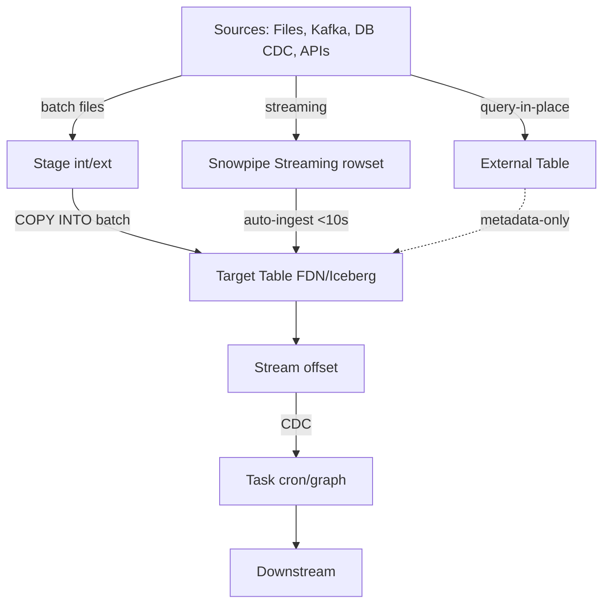

---

## Q1: What is the fundamental difference between `COPY INTO` and Snowpipe, and when do you use each?
**Difficulty:** Foundation
**Exam relevance:** "Choose the appropriate loading method based on latency, file size, and cost."

### Answer
`COPY INTO` is a synchronous, warehouse-driven bulk loader billed in warehouse-seconds. Snowpipe is a serverless, event-driven micro-batch loader billed in Snowpipe credits (per-file overhead + compute). Use `COPY INTO` for scheduled bulk loads with large files (100–250 MB compressed), Snowpipe for continuous arrival where latency < a few minutes matters.

### First Principles
Snowflake separates compute billing models: user-owned warehouses (COPY) vs. Snowflake-managed serverless (Snowpipe). Snowpipe's per-file overhead (~0.06 credits per 1000 files) makes small files uneconomical in bulk, but its event-driven architecture (SQS/EventGrid/Pub-Sub) delivers minute-level latency without idling a warehouse. The exam tests the economic crossover: at high file volume with small files, Snowpipe becomes expensive; at low file volume, warehouse idle time dominates `COPY INTO` cost. Snowpipe uses *at-least-once* semantics with 14-day file-load history for dedup; COPY uses load metadata keyed per table (64-day retention by default).

### Diagram
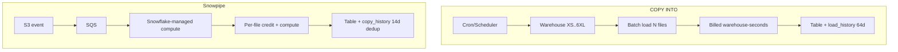

### Lab Exercise
```sql
-- Create a stage pointing to S3
CREATE OR REPLACE STAGE sales_stage
  URL = 's3://my-bucket/sales/'
  STORAGE_INTEGRATION = s3_int
  FILE_FORMAT = (TYPE = CSV FIELD_OPTIONALLY_ENCLOSED_BY = '"');

-- Option A: COPY INTO (warehouse-based bulk)
USE WAREHOUSE load_wh;
COPY INTO sales
  FROM @sales_stage
  PATTERN = '.*2026-10-30.*\.csv'
  ON_ERROR = 'SKIP_FILE_10%';

-- Option B: Snowpipe (serverless, event-driven)
CREATE OR REPLACE PIPE sales_pipe
  AUTO_INGEST = TRUE
  AS
  COPY INTO sales FROM @sales_stage
  FILE_FORMAT = (FORMAT_NAME = csv_fmt);

-- Verify
SELECT SYSTEM$PIPE_STATUS('sales_pipe');
SELECT * FROM TABLE(INFORMATION_SCHEMA.COPY_HISTORY(
  TABLE_NAME => 'SALES',
  START_TIME => DATEADD(hour, -1, CURRENT_TIMESTAMP)
));
```
**Expected outcome:** `pending_file_count` > 0 while files arrive, drops to 0 once ingested; `copy_history` shows per-file rowcount and errors.

### Gotchas / Exam Traps
- Snowpipe does **not** honor `TRUNCATE`, `MERGE`, or transformations beyond simple SELECT in the COPY statement (though basic `SELECT $1, $2+1 ...` IS allowed).
- `PATTERN` matching in Snowpipe only applies to files received after pipe creation; use `ALTER PIPE REFRESH` for historical files (one-time catch-up, limited to 7 days).
- Snowpipe dedup window is **14 days** — if the same filename is re-uploaded on day 15 it reloads. COPY dedup is **64 days** via `LOAD_HISTORY`.
- `ON_ERROR = 'CONTINUE'` in Snowpipe is fine, but `ABORT_STATEMENT` is the default and will cause failures to log and skip — not halt the pipe.

---

## Q2: Explain the three ways to deliver data via Snowpipe and when each is correct.
**Difficulty:** Intermediate
**Exam relevance:** "Compare Snowpipe auto-ingest, Snowpipe REST, and Snowpipe Streaming."

### Answer
(1) **Auto-ingest Snowpipe** — cloud storage event notifications (SQS/EventGrid/Pub-Sub) trigger file-based loads. (2) **Snowpipe REST** — the client calls `insertFiles` to notify the pipe (useful on-prem or when event notifications aren't available). (3) **Snowpipe Streaming** — a rowset-based Java/Python SDK that writes directly into table micro-partitions, no file staging, achieving sub-10-second latency.

### First Principles
Auto-ingest and REST both operate on files in a stage — their output is identical, only the trigger differs. Snowpipe Streaming is architecturally different: it uses the Snowflake Ingest SDK to open per-channel buffers that are flushed server-side into FDN micro-partitions without ever landing as a stage file. This bypasses the "write-file-then-copy" two-step, cutting latency and eliminating small-file costs. The tradeoff: Streaming requires client code (not pure config), and historically had schema evolution restrictions (now supported with `enable schema evolution`).

### Diagram
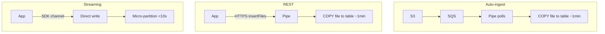

### Lab Exercise
```python
# Snowpipe Streaming (Python SDK)
from snowflake.ingest import SimpleIngestManager, StagedFile
# ... for FILE-based REST see docs; here is Streaming:

from snowflake.ingest.streaming import SnowflakeStreamingIngestClientFactory
props = {
  "user": "svc_user",
  "role": "INGEST_ROLE",
  "account": "myacct",
  "private_key": open('rsa_key.p8').read(),
  "scheme": "https", "port": 443,
  "host": "myacct.snowflakecomputing.com"
}
client = SnowflakeStreamingIngestClientFactory.builder("client1").setProperties(props).build()
channel = client.openChannel("MYDB", "PUBLIC", "EVENTS", "channel-1")
for row in event_source():
    channel.insertRow(row, offset_token=row["id"])
channel.close()
```
**Expected outcome:** Rows visible in `EVENTS` within 1–10 seconds; `SHOW CHANNELS IN TABLE events;` lists channel offset tokens for exactly-once resumption.

### Gotchas / Exam Traps
- Snowpipe Streaming provides **exactly-once** per channel via offset tokens; auto-ingest is **at-least-once**.
- Streaming channels have a client-side flush buffer; abrupt kill may lose un-flushed rows (always `close()`).
- You cannot mix Streaming writes and `COPY INTO` writes on the same table partitions concurrently without potential micro-partition fragmentation hurting pruning.
- REST pipe credentials require **key-pair auth** — password auth is explicitly disallowed.

---

## Q3: How do Streams work internally, and what are the three stream types?
**Difficulty:** Intermediate
**Exam relevance:** "Design CDC pipelines using Streams."

### Answer
A Stream is a logical offset bookmark over a source object's Time-Travel history. It records `METADATA$ACTION` (INSERT/DELETE), `METADATA$ISUPDATE`, and `METADATA$ROW_ID`. Three types: **Standard** (tracks inserts/updates/deletes with net CDC), **Append-only** (tracks only inserts, cheaper, works on standard tables and directory tables), **Insert-only** (for external tables).

### First Principles
Streams are *not* a separate queue or materialized change log — they're a pointer plus a diff view computed on query. Reading the stream computes `source@offset vs. source@current` using Time Travel. Hence the stream's "data retention" is bounded by `DATA_RETENTION_TIME_IN_DAYS` of the source (and `MAX_DATA_EXTENSION_TIME_IN_DAYS` for unconsumed streams). If you let a stream go stale past the extended retention, it becomes **stale** and must be recreated. Consuming a stream in a DML statement (even inside a transaction) advances the offset to the transaction start time atomically — this is why wrapping stream reads in explicit transactions is critical for exactly-once CDC.

### Diagram
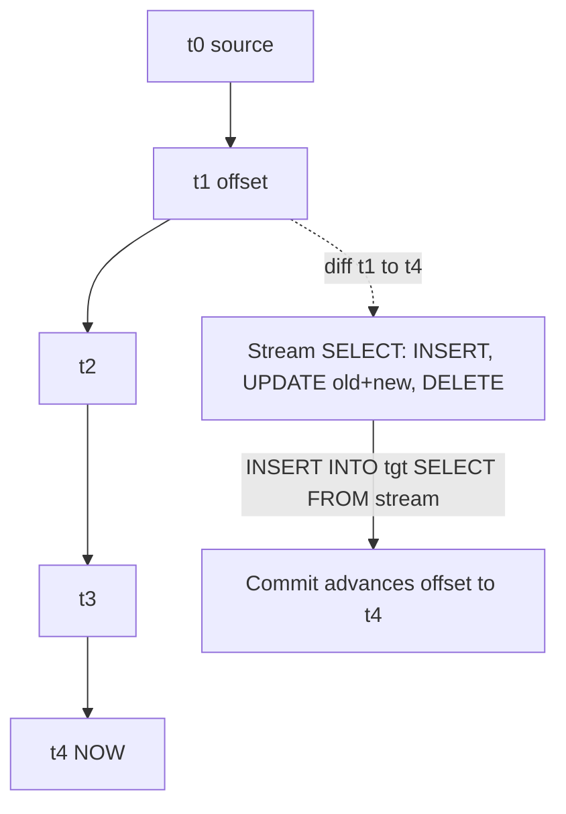

### Lab Exercise
```sql
CREATE OR REPLACE TABLE orders (id INT, amt NUMBER, status STRING);
CREATE OR REPLACE STREAM orders_stream ON TABLE orders
  APPEND_ONLY = FALSE SHOW_INITIAL_ROWS = TRUE;

INSERT INTO orders VALUES (1,100,'NEW'),(2,200,'NEW');
UPDATE orders SET status='PAID' WHERE id=1;
DELETE FROM orders WHERE id=2;

-- Peek without advancing
SELECT * FROM orders_stream;
-- Expect: id=1 UPDATE pair (old+new), id=2 DELETE, id=1 initial insert

-- Consume (advances offset)
BEGIN;
  INSERT INTO orders_history
  SELECT id, amt, status,
         METADATA$ACTION, METADATA$ISUPDATE,
         CURRENT_TIMESTAMP()
  FROM orders_stream;
COMMIT;

-- Now empty
SELECT COUNT(*) FROM orders_stream; -- 0
```
**Expected outcome:** Three rows for the three actions pre-consume; zero post-consume; subsequent DML repopulates.

### Gotchas / Exam Traps
- `SHOW_INITIAL_ROWS = TRUE` only applies on the **first** read after stream creation.
- A standard stream on a table with high update churn is expensive — each update generates a (delete + insert) pair in stream output.
- Multiple streams on one table are independent — each has its own offset. Great for fan-out; dangerous if you forget to drop stale ones.
- Changing table structure (adding columns) does not break the stream, but **recreating the table (`CREATE OR REPLACE`)** makes the stream stale instantly.
- `SYSTEM$STREAM_HAS_DATA('stream_name')` is the cheap pre-flight check for conditional tasks.

---

## Q4: Design a task graph that implements an idempotent CDC pipeline from a Stream.
**Difficulty:** Advanced
**Exam relevance:** "Orchestrate dependent transformations with Task Graphs (DAGs)."

### Answer
Use a root task to poll `SYSTEM$STREAM_HAS_DATA`, then dependent tasks for stage (consume stream to raw), transform (apply business logic), and audit. Dependencies are declared with `AFTER <parent>`; the graph is a Task Graph (DAG). Each task is a transaction; combine with offset-token writes for exactly-once downstream.

### First Principles
A Task Graph is a single scheduled unit — only the root task has a `SCHEDULE`; child tasks fire on completion of parents. Snowflake guarantees that a root task's children all see the same stream offset range because the stream advance only commits when a task's DML commits. If a child fails, downstream children are skipped and the stream offset for that child's DML never advances — the next run picks up the same CDC data (replay). To keep the pipeline idempotent, downstream MERGE operations should be keyed on business IDs plus a sequence/offset so re-runs are harmless.

### Diagram
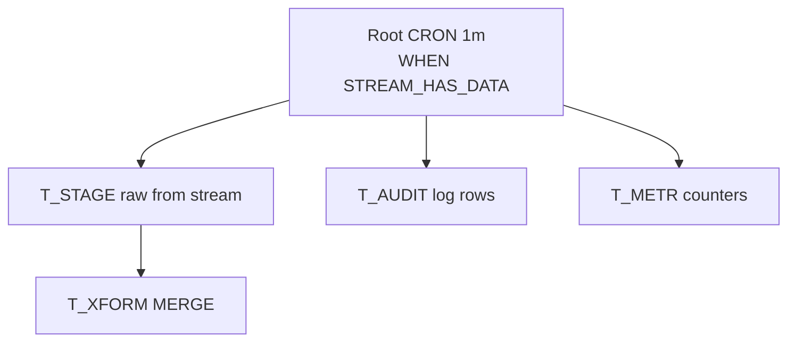

### Lab Exercise
```sql
CREATE OR REPLACE TASK t_root
  WAREHOUSE = etl_wh
  SCHEDULE = '1 MINUTE'
  WHEN SYSTEM$STREAM_HAS_DATA('orders_stream')
  AS
  INSERT INTO orders_raw
    SELECT *, METADATA$ACTION, CURRENT_TIMESTAMP()
    FROM orders_stream;

CREATE OR REPLACE TASK t_xform
  WAREHOUSE = etl_wh
  AFTER t_root
  AS
  MERGE INTO orders_dim d
  USING (SELECT * FROM orders_raw WHERE loaded_at > DATEADD(min,-5,CURRENT_TIMESTAMP())) s
  ON d.id = s.id
  WHEN MATCHED AND s.metadata$action='DELETE' THEN DELETE
  WHEN MATCHED THEN UPDATE SET d.amt=s.amt, d.status=s.status
  WHEN NOT MATCHED AND s.metadata$action='INSERT' THEN INSERT (id,amt,status) VALUES (s.id,s.amt,s.status);

CREATE OR REPLACE TASK t_audit
  WAREHOUSE = etl_wh
  AFTER t_root
  AS
  INSERT INTO pipeline_audit SELECT CURRENT_TIMESTAMP(), 'ORDERS', (SELECT COUNT(*) FROM orders_raw);

-- Resume: child tasks must be resumed BEFORE the root
ALTER TASK t_xform RESUME;
ALTER TASK t_audit RESUME;
ALTER TASK t_root  RESUME;
```
**Expected outcome:** Graph runs every minute only when stream has data; `TASK_HISTORY` and `TASK_DEPENDENTS` show the DAG.

### Gotchas / Exam Traps
- **Resume order matters**: children first, then root. Resuming the root first can orphan children. Same with suspend (root first, children after) — Snowflake enforces this.
- `WHEN` on a root task consumes a free scheduler check; a `FALSE` result does **not** charge compute.
- A single stream feeding multiple tasks is fine, but each task that reads it in DML advances the offset — the second task sees nothing. Use one "consumer" task that writes to a holding table.
- Task graphs have a max of **1000 tasks** and depth of **100 levels**.
- Serverless tasks (`USER_TASK_MANAGED_INITIAL_WAREHOUSE_SIZE`) remove warehouse management but are billed per compute-second with a 1-minute minimum.

---

## Q5: Compare External Tables vs. Iceberg Tables vs. Directory Tables.
**Difficulty:** Advanced
**Exam relevance:** "Query data in cloud storage without ingestion."

### Answer
**External Tables** read Parquet/CSV/JSON files from a stage via metadata catalog; schema inferred or declared; no DML. **Iceberg Tables** (Snowflake-managed or externally-managed) are first-class ACID tables stored in open Iceberg format on your cloud storage; support DML; integrate with other engines. **Directory Tables** are implicit metadata tables on named stages exposing file-level metadata (`relative_path`, `size`, `last_modified`, `md5`) — not data content.

### First Principles
Each addresses a different access pattern:
- External Tables: cheap, read-only federation. Snowflake stores *only* metadata (file list + partitions).
- Iceberg: write-capable "open table format" so Spark/Trino/Athena can share state with Snowflake using Iceberg's snapshot JSON files. Snowflake-managed Iceberg owns the catalog; externally-managed uses Glue/REST/Nessie.
- Directory Tables: let you treat a stage like an index — critical for unstructured data (images, PDFs) and for driving ingestion loops.

### Diagram
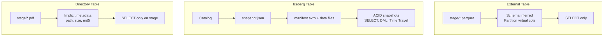

### Lab Exercise
```sql
-- External table
CREATE OR REPLACE EXTERNAL TABLE ext_sales (
  dt DATE AS TO_DATE(SPLIT_PART(METADATA$FILENAME,'/',3))
) PARTITION BY (dt)
  LOCATION = @sales_stage
  FILE_FORMAT = (TYPE = PARQUET)
  AUTO_REFRESH = TRUE;

-- Iceberg (Snowflake-managed catalog)
CREATE OR REPLACE ICEBERG TABLE sales_iceberg (
  id INT, amt NUMBER, dt DATE
) CATALOG = 'SNOWFLAKE'
  EXTERNAL_VOLUME = 'ext_vol_s3'
  BASE_LOCATION = 'sales/';

INSERT INTO sales_iceberg VALUES (1,100,CURRENT_DATE);
UPDATE sales_iceberg SET amt=200 WHERE id=1;  -- DML works

-- Directory table on a stage
CREATE OR REPLACE STAGE docs_stage
  DIRECTORY = (ENABLE = TRUE AUTO_REFRESH = TRUE)
  URL = 's3://my-bucket/docs/';
ALTER STAGE docs_stage REFRESH;

SELECT relative_path, size, last_modified, file_url
FROM DIRECTORY(@docs_stage);
```
**Expected outcome:** External table returns rows; Iceberg table supports MERGE and shows snapshots in `SNOWFLAKE.CORE.ICEBERG_TABLE_INFO`; directory table lists stage files.

### Gotchas / Exam Traps
- External tables have **no clustering** and only prune on partition columns — mismatch between filter and virtual-column expression kills pruning.
- Iceberg "Snowflake-managed" writes compact snapshots regularly; "externally-managed" relies on your other engine for compaction — Snowflake is **read-only** against externally-managed Iceberg by default (writable via catalog integration specifics).
- `AUTO_REFRESH = TRUE` on an external table requires an event-notification integration (SQS etc.), same as auto-ingest Snowpipe.
- Directory tables don't automatically see new files; need `ALTER STAGE ... REFRESH` or `AUTO_REFRESH = TRUE`.

---

## Q6: What is the Snowflake Kafka Connector's architecture, and how does Snowpipe Streaming change it?
**Difficulty:** Intermediate
**Exam relevance:** "Configure Kafka connector for low-latency ingest."

### Answer
The classic Kafka Connector sinks Kafka topics into Snowflake. Each topic becomes a target table (schema configurable). It buffers messages into stage files, then triggers Snowpipe to COPY them. The "Snowpipe Streaming" mode of the connector (set `snowflake.ingestion.method=SNOWPIPE_STREAMING`) bypasses file staging and writes directly via the Streaming SDK — ~5-second latency and lower cost at high throughput.

### First Principles
File-based Snowpipe amortizes per-file overhead over message batches, so very high-throughput topics still work economically. But the latency floor is bounded by file-flush interval + Snowpipe queue (~30–60s). Streaming mode flips the architecture: each Kafka partition maps to a Snowflake channel, delivering ordered, exactly-once writes with offset tokens derived from Kafka offsets. The connector reports offsets back to Kafka only after Snowflake acknowledges a flushed row — crash-safe resumption.

### Diagram
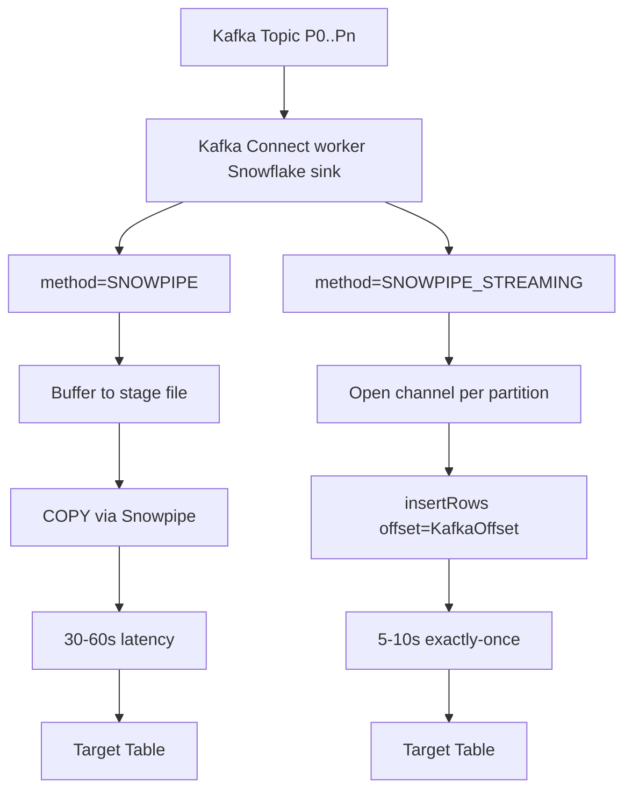

### Lab Exercise
```properties
# Kafka connector config (streaming mode)
name=snowflake-sink
connector.class=com.snowflake.kafka.connector.SnowflakeSinkConnector
tasks.max=4
topics=orders,events
snowflake.url.name=myacct.snowflakecomputing.com:443
snowflake.user.name=kafka_svc
snowflake.private.key=<pkcs8>
snowflake.database.name=RAW
snowflake.schema.name=KAFKA
snowflake.ingestion.method=SNOWPIPE_STREAMING
snowflake.enable.schematization=true
buffer.flush.time=1
value.converter=org.apache.kafka.connect.json.JsonConverter
```
```sql
-- Observe post-ingest
SELECT name, offset_token, client_sequencer
FROM SNOWFLAKE.ACCOUNT_USAGE.CHANNELS
WHERE table_name = 'ORDERS';
```
**Expected outcome:** One channel per Kafka partition; `offset_token` increases monotonically matching Kafka offsets.

### Gotchas / Exam Traps
- With `enable.schematization=true`, nested JSON is auto-flattened into typed columns via schema evolution — but requires `ENABLE_SCHEMA_EVOLUTION = TRUE` on the table and ownership privileges.
- Streaming mode requires **key-pair auth** (same as REST Snowpipe).
- Classic (file) mode creates one stage and one pipe per topic/partition — can create thousands of pipes on wide topics.
- The connector's offset tracking is in Kafka itself (via `__consumer_offsets`), not in Snowflake. Resetting the consumer group causes replay.

---

## Q7: What is the role of `MATCH_BY_COLUMN_NAME` and schema detection in `COPY INTO`?
**Difficulty:** Intermediate
**Exam relevance:** "Load semi-structured data with schema inference."

### Answer
`MATCH_BY_COLUMN_NAME = CASE_SENSITIVE | CASE_INSENSITIVE` maps JSON/Parquet/Avro/ORC fields to table columns by name instead of positional ordering, letting you load evolving semi-structured schemas without hand-written transformations. Combined with `INFER_SCHEMA()` you can auto-create tables that match file structure.

### First Principles
Positional `COPY` requires every column to be addressed by `$1, $2, ...` — brittle for Parquet with hundreds of columns and nested types. Snowflake stores the file schema's logical structure for columnar formats and performs name-based projection pushdown. When `MATCH_BY_COLUMN_NAME` is set and `ENABLE_SCHEMA_EVOLUTION=TRUE`, new file columns automatically add new table columns during load (nullable, inferred type). This is the server-side ELT pattern that avoids external DDL coordination.

### Diagram
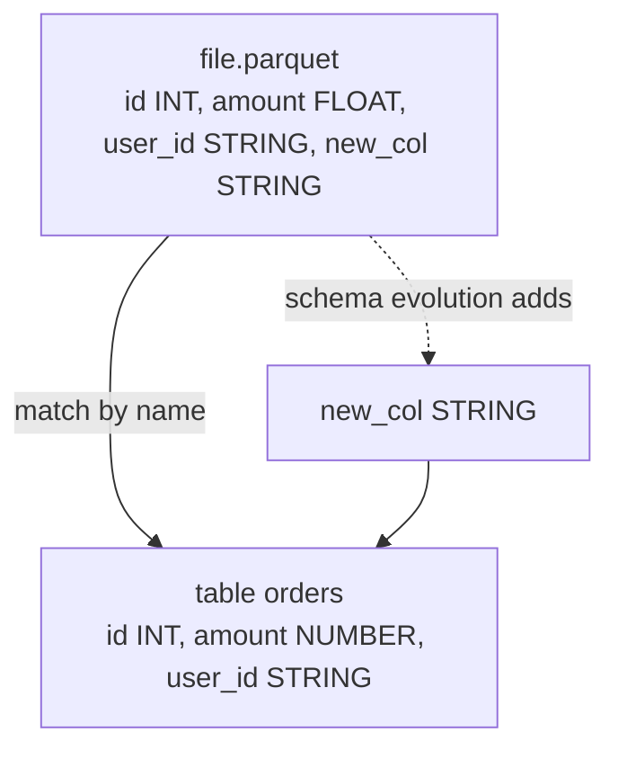

### Lab Exercise
```sql
-- Infer schema from stage files, auto-create table
CREATE OR REPLACE TABLE orders_auto
USING TEMPLATE (
  SELECT ARRAY_AGG(OBJECT_CONSTRUCT(*))
  FROM TABLE(INFER_SCHEMA(
    LOCATION => '@sales_stage',
    FILE_FORMAT => 'parquet_fmt'
  ))
);

ALTER TABLE orders_auto SET ENABLE_SCHEMA_EVOLUTION = TRUE;
GRANT EVOLVE SCHEMA ON TABLE orders_auto TO ROLE ingest_role;

COPY INTO orders_auto
FROM @sales_stage
FILE_FORMAT = (FORMAT_NAME = parquet_fmt)
MATCH_BY_COLUMN_NAME = CASE_INSENSITIVE;
```
**Expected outcome:** New columns in subsequent file loads auto-add to table; column mapping is name-based not positional.

### Gotchas / Exam Traps
- Schema evolution only **adds** columns and **widens** types — it never drops or narrows. Dropped source columns stay in the table as NULLs.
- `ENABLE_SCHEMA_EVOLUTION` requires the loading role to hold `EVOLVE SCHEMA` privilege, which is distinct from `INSERT`.
- `MATCH_BY_COLUMN_NAME` has no effect on CSV (no field names).
- Parquet with nested types maps as VARIANT by default unless you project explicit paths.

---

## Q8: Explain error handling options for `COPY INTO` and how to validate before loading.
**Difficulty:** Foundation
**Exam relevance:** "Handle load errors and validate files."

### Answer
`ON_ERROR` controls per-file behavior: `CONTINUE` (log, keep going), `SKIP_FILE` (abort that file only), `SKIP_FILE_N` / `SKIP_FILE_N%` (threshold), `ABORT_STATEMENT` (default — fail the whole copy). Use `VALIDATION_MODE = RETURN_ERRORS | RETURN_N_ROWS` to dry-run.

### First Principles
Snowflake processes files in parallel per table-load slot; error handling must therefore be per-file atomic. `ABORT_STATEMENT` rolls back the entire COPY — essential for financial loads where partial data is worse than no data. `CONTINUE` creates reconciliation debt (which errors occurred, where?) that `VALIDATE()` or `COPY_HISTORY` must reconcile. `VALIDATION_MODE` runs the parser/caster without writing to the table — cheap pre-flight check.

### Diagram
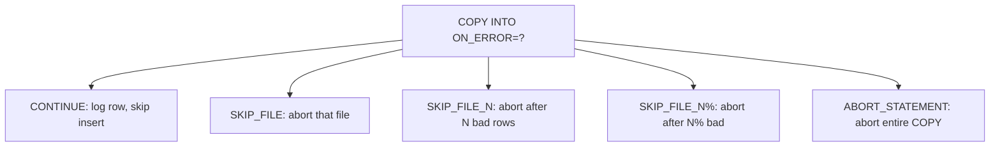

### Lab Exercise
```sql
-- Dry run: see parse errors without inserting
COPY INTO sales
  FROM @sales_stage
  FILE_FORMAT = (FORMAT_NAME = csv_fmt)
  VALIDATION_MODE = 'RETURN_ERRORS';

-- Load with threshold
COPY INTO sales
  FROM @sales_stage
  FILE_FORMAT = (FORMAT_NAME = csv_fmt)
  ON_ERROR = 'SKIP_FILE_5%';

-- Post-load reconciliation
SELECT file_name, status, error_count, first_error_message
FROM TABLE(VALIDATE(sales, JOB_ID => '_last'));
```
**Expected outcome:** `VALIDATION_MODE` returns rows for parse failures; `VALIDATE()` lists per-file errors from the last COPY.

### Gotchas / Exam Traps
- `ON_ERROR = 'CONTINUE'` means loaded tables may silently miss rows — always pair with `VALIDATE()` reconciliation.
- `VALIDATION_MODE = RETURN_N_ROWS` outputs the first N successfully *loadable* rows — not errors — commonly confused with `RETURN_ERRORS`.
- Snowpipe does not support `VALIDATION_MODE`; use `VALIDATE_PIPE_LOAD()` for history.

---

## Q9: How do you unload data from Snowflake, and what are the format and partitioning options?
**Difficulty:** Foundation
**Exam relevance:** "Export data to cloud storage."

### Answer
Use `COPY INTO @stage FROM table` (or query). Supported formats: CSV, JSON, Parquet (snappy by default). Partition output with `PARTITION BY (expr)` to write a file per partition value, and use `MAX_FILE_SIZE` (default 16MB uncompressed) and `SINGLE = TRUE/FALSE` to control sharding.

### First Principles
Unload is the inverse of load — Snowflake writes files in parallel per micro-partition slice. `PARTITION BY` evaluates per-row and routes to the correct output file, so cardinality of the partition expression determines file count. Overly fine partitions create thousands of tiny files (bad for downstream readers). `MAX_FILE_SIZE` caps per-file size by *compressed* bytes.

### Diagram
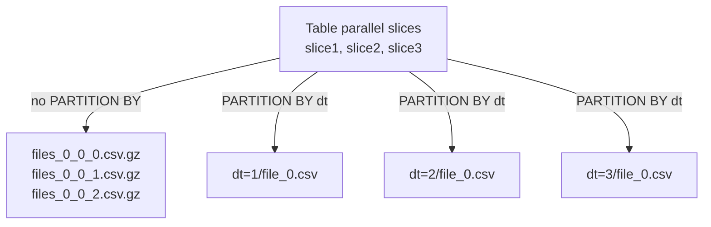

### Lab Exercise
```sql
COPY INTO @unload_stage/sales/
FROM (
  SELECT * FROM sales WHERE dt >= '2026-01-01'
)
PARTITION BY ('dt=' || TO_VARCHAR(dt))
FILE_FORMAT = (TYPE = PARQUET COMPRESSION = SNAPPY)
MAX_FILE_SIZE = 268435456  -- 256MB
HEADER = TRUE
OVERWRITE = TRUE;

LIST @unload_stage/sales/;
```
**Expected outcome:** One subfolder per date value; Parquet files up to 256MB.

### Gotchas / Exam Traps
- `SINGLE = TRUE` forces one file but max 5GB (S3 single-object limit through PUT).
- `PARTITION BY` with high cardinality can produce **millions** of files — exam traps often ask what happens: query cost dominated by file list time.
- Default Parquet compression is Snappy; GZIP is supported but slower.
- Unloaded CSV always double-quotes strings containing the field delimiter even without `FIELD_OPTIONALLY_ENCLOSED_BY`.

---

## Q10: How does Snowflake handle semi-structured ingestion with VARIANT, and what's the storage cost model?
**Difficulty:** Intermediate
**Exam relevance:** "Load and query semi-structured data efficiently."

### Answer
Semi-structured data (JSON, Avro, XML, Parquet) can be loaded into a `VARIANT` column. Snowflake stores it in a columnar format (shredded by path internally) — accessing frequently used paths performs as well as native columns. Storage billed on compressed bytes; VARIANT has small overhead vs. typed columns.

### First Principles
VARIANT isn't a BLOB — Snowflake's loader detects consistent paths across micro-partitions and stores each path in its own sub-column with its own min/max statistics for pruning. If a path appears in 95% of rows with INT type, that path prunes almost as well as a native INT column. Highly polymorphic paths (same key, different types across rows) force Snowflake to fall back to a tagged representation, hurting prune and performance.

### Diagram
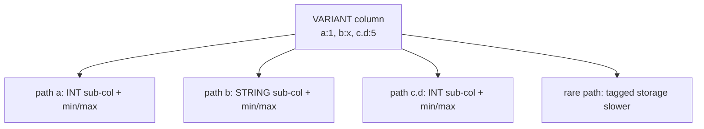

### Lab Exercise
```sql
CREATE OR REPLACE TABLE events_raw (ingest_ts TIMESTAMP, payload VARIANT);

INSERT INTO events_raw
SELECT CURRENT_TIMESTAMP, PARSE_JSON(column1)
FROM VALUES
  ('{"event":"click","user":{"id":42,"region":"us"}}'),
  ('{"event":"view","user":{"id":99,"region":"eu"},"ms":120}');

-- Columnar access
SELECT payload:event::STRING, payload:user.id::INT
FROM events_raw;

-- Flatten arrays
SELECT value::STRING AS tag
FROM events_raw, LATERAL FLATTEN(input => payload:tags);

-- Expose path stats
SELECT GET_PATH(payload,'user.region') FROM events_raw;
```
**Expected outcome:** Queries against `payload:event` prune as well as a native STRING column.

### Gotchas / Exam Traps
- Casting at query time (`::INT`) is required for ordering, aggregation, and index-like pruning.
- Max VARIANT size is **16 MB per row** (compressed) — larger payloads must be split.
- `PARSE_JSON` is strict; `TRY_PARSE_JSON` returns NULL on malformed input — essential for raw-feed ingestion.
- Loading Parquet into VARIANT loses columnar efficiency vs. loading into typed columns via `MATCH_BY_COLUMN_NAME`.

---

## Q11: What's the difference between a Serverless Task and a User-Managed Task?
**Difficulty:** Intermediate
**Exam relevance:** "Choose task compute model for cost and performance."

### Answer
A **user-managed task** specifies `WAREHOUSE = <wh>` — you own warehouse sizing, auto-suspend, and concurrency, and pay for warehouse time. A **serverless task** omits `WAREHOUSE` and specifies `USER_TASK_MANAGED_INITIAL_WAREHOUSE_SIZE = <size>` — Snowflake provides elastic serverless compute, billed by actual compute consumed (plus a 1-minute minimum per run).

### First Principles
User-managed tasks share a warehouse with other workloads, so queueing is possible but cost is predictable. Serverless tasks eliminate warehouse management and scale per-run — Snowflake also automatically right-sizes based on prior run history after a warm-up period. For sporadic, bursty, independent tasks serverless usually wins; for a dense pipeline hitting a shared warehouse that's already warm, user-managed is often cheaper.

### Diagram
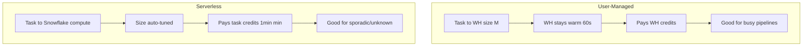

### Lab Exercise
```sql
-- User-managed
CREATE OR REPLACE TASK t_batch_um
  WAREHOUSE = batch_wh
  SCHEDULE = 'USING CRON 0 */2 * * * UTC'
  AS CALL build_daily();

-- Serverless
CREATE OR REPLACE TASK t_batch_ss
  USER_TASK_MANAGED_INITIAL_WAREHOUSE_SIZE = 'SMALL'
  SCHEDULE = 'USING CRON 0 */2 * * * UTC'
  AS CALL build_daily();

-- Observe sizing adaptation
SELECT name, state, scheduled_from, condition_text,
       completed_time - query_start_time AS duration
FROM TABLE(INFORMATION_SCHEMA.TASK_HISTORY(TASK_NAME=>'T_BATCH_SS'))
ORDER BY scheduled_time DESC;
```
**Expected outcome:** Serverless task shows adaptive sizing in subsequent runs.

### Gotchas / Exam Traps
- Serverless tasks have a **1-minute minimum** charge per run — short tasks (<30s) cost more serverless than on a shared warehouse.
- `USER_TASK_MANAGED_INITIAL_WAREHOUSE_SIZE` only applies to the first few runs; after Snowflake's auto-tuner takes over you can't force a size on serverless.
- Mixing user-managed and serverless in one DAG is allowed; dependencies behave the same.

---

## Q12: Describe how `COPY INTO` metadata functions help debug and reconcile loads.
**Difficulty:** Foundation
**Exam relevance:** "Monitor and reconcile loaded files."

### Answer
Three key functions: `METADATA$FILENAME` and `METADATA$FILE_ROW_NUMBER` as pseudo-columns inside the SELECT list of a COPY, `COPY_HISTORY` (Information Schema and Account Usage) for load events, and `LOAD_HISTORY` (table-level, 64-day) for the dedup bookkeeping.

### First Principles
Snowflake separates "what did the load do" (COPY_HISTORY event log) from "what has already been loaded" (LOAD_HISTORY, per-table dedup set). Debug any load problem by first reading the pseudo-columns to backtrack a row to its file + line, then checking COPY_HISTORY for file-level status, then confirming dedup in LOAD_HISTORY. For Snowpipe, use `PIPE_USAGE_HISTORY` and `SYSTEM$PIPE_STATUS`.

### Diagram
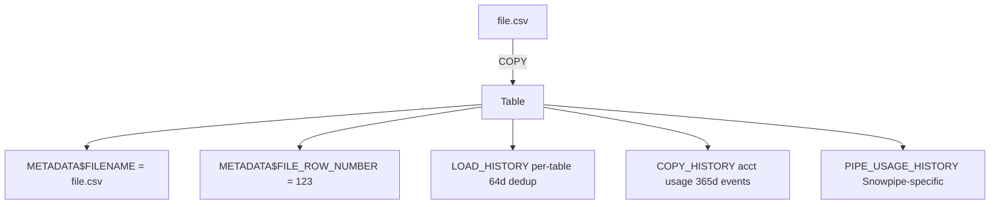

### Lab Exercise
```sql
COPY INTO sales
FROM (
  SELECT $1, $2, $3,
         METADATA$FILENAME AS src_file,
         METADATA$FILE_ROW_NUMBER AS src_row
  FROM @sales_stage/pattern/
)
FILE_FORMAT = (FORMAT_NAME = csv_fmt);

-- Debug: find all rows loaded from a specific file
SELECT * FROM sales WHERE src_file = 'sales/2026-10-30/batch_01.csv';

-- Load history
SELECT file_name, row_count, error_count, status, last_load_time
FROM INFORMATION_SCHEMA.LOAD_HISTORY
WHERE table_name = 'SALES'
ORDER BY last_load_time DESC;
```
**Expected outcome:** Each row traceable to source file+line; `LOAD_HISTORY` shows file-level status.

### Gotchas / Exam Traps
- `METADATA$FILE_ROW_NUMBER` is 1-based.
- `LOAD_HISTORY` is **per-table**; the same filename loaded into two tables is tracked independently.
- `COPY_HISTORY` in Account Usage has up to **90-minute latency**; Information Schema has lower latency but only 14-day retention.

---

## Q13: How do you implement incremental loading from an S3 bucket with event notifications?
**Difficulty:** Advanced
**Exam relevance:** "Build end-to-end auto-ingest with cloud event notifications."

### Answer
Create a storage integration (secure handshake with cloud IAM), create a stage using that integration, create a pipe with `AUTO_INGEST=TRUE` that writes a notification channel ARN. In S3, configure a bucket event notification to that SQS ARN. Snowpipe polls SQS and loads matching files.

### First Principles
Storage integration decouples Snowflake-side credentials from your cloud IAM — no secret ever lives in Snowflake. The pipe's generated SQS queue is managed by Snowflake and the bucket notification posts to it. The event notification carries *only* the object key, not the data — Snowpipe then reads the file via the integration. For EventGrid (Azure) and Pub/Sub (GCP) the pattern is identical: Snowflake generates a subscription endpoint; you point your cloud provider to it.

### Diagram
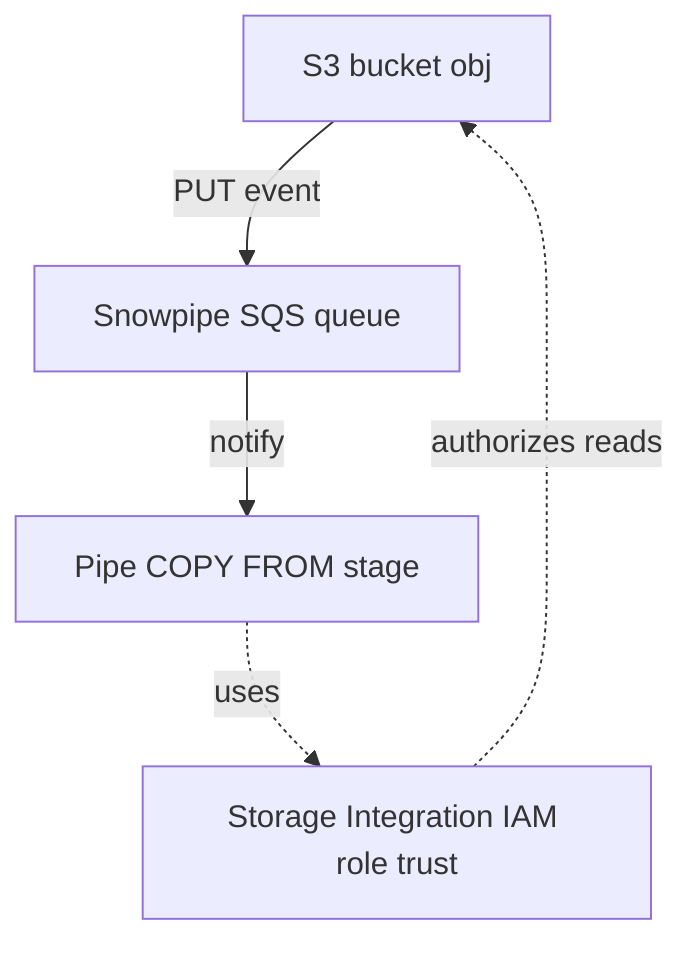

### Lab Exercise
```sql
CREATE STORAGE INTEGRATION s3_int
  TYPE = EXTERNAL_STAGE
  STORAGE_PROVIDER = S3
  ENABLED = TRUE
  STORAGE_AWS_ROLE_ARN = 'arn:aws:iam::123:role/snowflake-role'
  STORAGE_ALLOWED_LOCATIONS = ('s3://my-bucket/sales/');

-- Get the external IDs/user ARN that AWS trust policy must allow
DESC INTEGRATION s3_int;

CREATE OR REPLACE STAGE sales_stage
  URL = 's3://my-bucket/sales/'
  STORAGE_INTEGRATION = s3_int
  FILE_FORMAT = (FORMAT_NAME = csv_fmt);

CREATE OR REPLACE PIPE sales_pipe
  AUTO_INGEST = TRUE
  AS COPY INTO sales FROM @sales_stage;

-- Get the SQS ARN to configure in S3
SHOW PIPES LIKE 'SALES_PIPE';   -- notification_channel column
```
**Expected outcome:** `notification_channel` is the SQS ARN to paste into the S3 bucket event-notification config; new file uploads auto-load within ~1 minute.

### Gotchas / Exam Traps
- One SQS queue can serve multiple pipes **as long as they listen to disjoint prefixes** — exam loves this.
- Deleting the pipe does **not** delete the SQS queue (Snowflake-managed); it just stops consuming.
- `ALTER PIPE REFRESH` scans the bucket and enqueues files uploaded in the last 7 days — useful if event notifications were temporarily broken.
- Pipe owner change breaks the integration linkage; must re-grant and sometimes re-create.

---

## Q14: What is a Dynamic Table and how does it compare to a Stream+Task pipeline?
**Difficulty:** Advanced
**Exam relevance:** "Use Dynamic Tables as declarative pipelines."

### Answer
A Dynamic Table is a declarative materialized query that Snowflake refreshes automatically to meet a target data freshness (`TARGET_LAG`). It replaces the Stream+Task+Merge pattern with a single `CREATE DYNAMIC TABLE AS SELECT ...`. Snowflake tracks dependencies, chooses incremental vs. full refresh, and manages orchestration.

### First Principles
Streams+Tasks require you to encode: (1) what changed, (2) how to apply changes, (3) when to run. Dynamic Tables flip this — you declare the final state as SQL and Snowflake infers the diff via its internal change-tracking (same engine Streams use). It picks incremental refresh when the query is "incrementalizable" (joins, filters, aggregations over append-only sources) and falls back to full refresh otherwise. `TARGET_LAG` is a freshness SLA, not a schedule — refreshes may run more or less often to meet it.

### Diagram
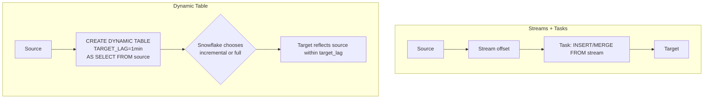

### Lab Exercise
```sql
CREATE OR REPLACE DYNAMIC TABLE orders_summary
  TARGET_LAG = '1 minute'
  WAREHOUSE = etl_wh
  REFRESH_MODE = AUTO
  INITIALIZE = ON_CREATE
AS
SELECT customer_id,
       COUNT(*)       AS order_cnt,
       SUM(amount)    AS total_amt
FROM orders
WHERE status = 'PAID'
GROUP BY customer_id;

-- Monitor refresh
SELECT name, state, refresh_version, refresh_action,
       data_timestamp, completion_target
FROM TABLE(INFORMATION_SCHEMA.DYNAMIC_TABLE_REFRESH_HISTORY(
  NAME => 'ORDERS_SUMMARY'
));
```
**Expected outcome:** Table initially materializes, then each minute (or less) applies incremental deltas; `refresh_action = INCREMENTAL` for most runs.

### Gotchas / Exam Traps
- `TARGET_LAG = DOWNSTREAM` means "refresh only when a dependent dynamic table needs me" — critical for cost in DAGs.
- Some SQL constructs force full refresh: `OVER()` window functions, non-deterministic UDFs, correlated subqueries. Check `REFRESH_HISTORY.refresh_action`.
- Dynamic Tables do **not** support Streams directly as sources — they consume from base tables, views, or other dynamic tables. For CDC input, source table itself needs change tracking.
- Dynamic Tables are **not** Materialized Views: they can join, aggregate, and chain; MVs cannot.

---

## Q15: How do you orchestrate backfills on a Snowpipe-ingested table?
**Difficulty:** Advanced
**Exam relevance:** "Backfill historical data with minimum disruption."

### Answer
Use `ALTER PIPE pipe_name REFRESH;` for files uploaded within the last 7 days. For older data, use `COPY INTO` manually (bypassing the pipe) with explicit `FILES=(..)` or `PATTERN=` scoping. Protect against double-loading by relying on `LOAD_HISTORY` dedup (COPY) or using distinct filenames (Snowpipe tracks by filename).

### First Principles
Snowpipe's auto-ingest only subscribes to events going forward. Historical files that pre-date the pipe (or were missed during an outage) must be re-notified. `REFRESH` enqueues missing files into the pipe's SQS, respecting its 7-day lookback. For older history, a one-off `COPY INTO` is the escape hatch — but you must prevent duplicate loads: COPY and Snowpipe share no dedup bookkeeping (COPY uses `LOAD_HISTORY`, Snowpipe uses pipe `file_load_history`), so a file loaded by one is not seen as loaded by the other unless the filename matches within COPY's 64-day window.

### Diagram
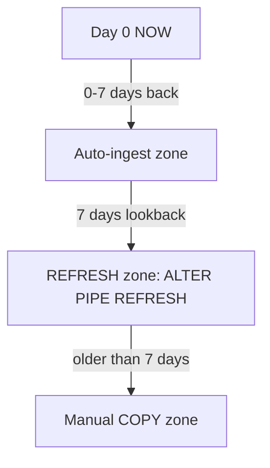

### Lab Exercise
```sql
-- 7-day gap recovery
ALTER PIPE sales_pipe REFRESH;

-- Historical backfill (older than 7 days)
COPY INTO sales
  FROM @sales_stage
  PATTERN = '.*2025-.*\.csv'
  ON_ERROR = 'ABORT_STATEMENT';

-- Check dedup
SELECT file_name, status, row_count, last_load_time
FROM INFORMATION_SCHEMA.LOAD_HISTORY
WHERE table_name = 'SALES' AND file_name LIKE '%2025%'
ORDER BY last_load_time DESC;
```
**Expected outcome:** `REFRESH` enqueues missing recent files; manual COPY handles ancient history.

### Gotchas / Exam Traps
- `REFRESH` enqueues all files matching the pipe's `PATTERN` in the lookback window — may re-notify files already loaded (dedup catches them, but still generates SQS traffic).
- Backfilling a pipe pattern that matches *too many* files can exceed Snowpipe's queue; batch by prefix.
- Running COPY while the pipe is active can create micro-partition fragmentation if they load overlapping files simultaneously.

---

## Q16: Explain how continuous ingestion failure modes differ: Snowpipe outage vs. target table dropped vs. pipe suspended.
**Difficulty:** Advanced
**Exam relevance:** "Diagnose and recover ingestion failures."

### Answer
**Pipe suspended** (`ALTER PIPE SUSPEND`): SQS queue continues collecting notifications; on resume, pipe drains the backlog. **Target table dropped**: pipe moves to `STOPPED_CLONED_OR_DROPPED` state; must recreate pipe. **Snowpipe service outage**: notifications queue in SQS (standard retention 4 days) — if outage exceeds retention, use `REFRESH`. **Pipe owner's role dropped**: pipe goes `PAUSED_BY_SYSTEM`; re-grant and resume.

### First Principles
Snowpipe has multiple state transitions beyond RUNNING/SUSPENDED. Each failure maps to a specific state exposed by `SYSTEM$PIPE_STATUS`. Operational playbooks need to key on `executionState` and `lastReceivedMessageTimestamp`. The 4-day SQS retention is a hard cliff — most severe outages hit this limit, so monitor queue age.

### Diagram
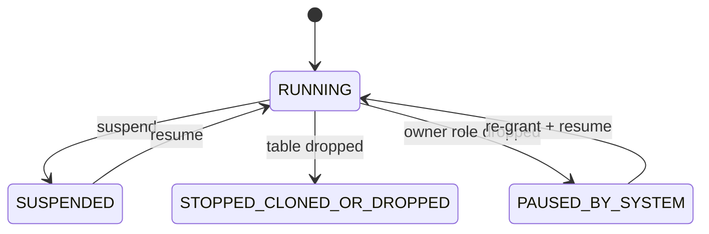

### Lab Exercise
```sql
SELECT SYSTEM$PIPE_STATUS('sales_pipe');
-- {"executionState":"RUNNING","pendingFileCount":12,...}

ALTER PIPE sales_pipe SET PIPE_EXECUTION_PAUSED = TRUE;
SELECT SYSTEM$PIPE_STATUS('sales_pipe');
-- {"executionState":"PAUSED",...}

-- Simulate dropped target
DROP TABLE sales;
SELECT SYSTEM$PIPE_STATUS('sales_pipe');
-- {"executionState":"STOPPED_CLONED_OR_DROPPED",...}

-- Recovery: recreate target, recreate pipe
CREATE TABLE sales (...);
CREATE OR REPLACE PIPE sales_pipe ...;
```
**Expected outcome:** State transitions observable in real time.

### Gotchas / Exam Traps
- `ALTER PIPE SUSPEND` is **not** the same as `PIPE_EXECUTION_PAUSED` — SUSPEND drops SQS subscription; PAUSED keeps it. Exam will swap these.
- Cloning a pipe into a new DB does **not** copy its SQS endpoint — the cloned pipe is `STOPPED_CLONED_OR_DROPPED` until re-created.
- Resuming a pipe after multi-day suspend: expect large catch-up; may create micro-partition fragmentation.

---

## Q17: How does Snowflake Connector for Spark/Python differ from `COPY INTO`, and when is it right?
**Difficulty:** Intermediate
**Exam relevance:** "Choose client-library vs. SQL-based ingestion."

### Answer
The Spark Connector and Snowpark enable DataFrame-based writes to Snowflake. Internally they `PUT` to a stage then `COPY INTO`, so cost model is identical to manual COPY. Right for ETL workflows already in Spark/Python ecosystem where DataFrame transforms happen before load. Not right for low-latency streaming (use Snowpipe Streaming SDK).

### First Principles
Connectors are convenience layers over the same primitives (stage, COPY). They add schema inference, type mapping (Spark types <-> Snowflake), partitioned parallel upload, and query pushdown. Query pushdown is the real power: a Spark SQL join between two Snowflake tables can be translated into a single Snowflake query, avoiding data egress. The connector transparently decides push vs. pull based on operator support.

### Diagram
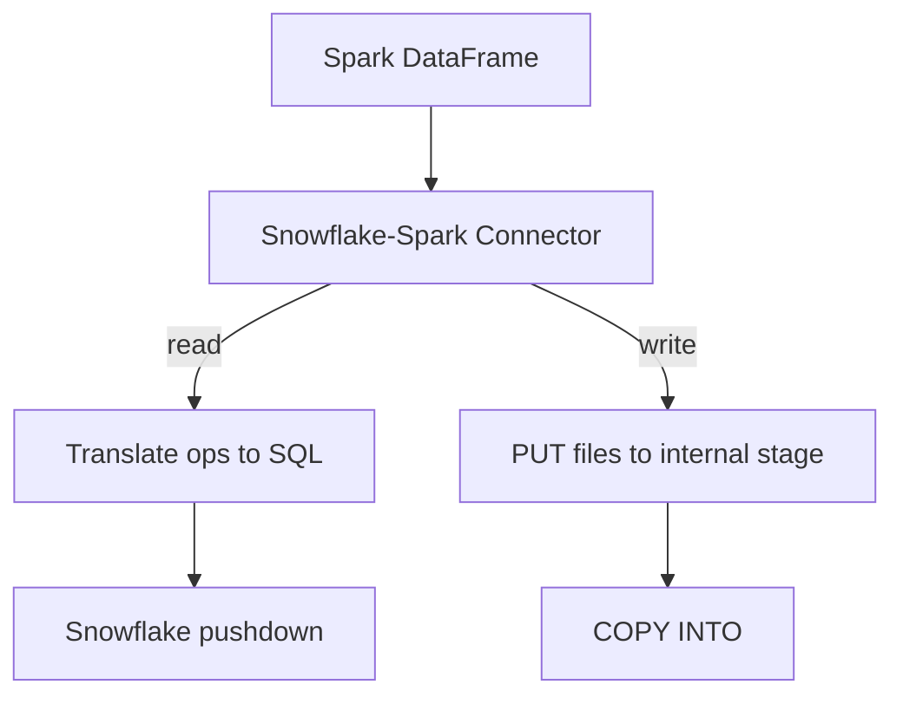

### Lab Exercise
```python
# Spark connector write
df = spark.read.parquet("s3://data/sales/")
df.write.format("snowflake") \
  .options(**sf_opts) \
  .option("dbtable","sales") \
  .option("sfSchema","PUBLIC") \
  .option("column_mapping","name") \
  .mode("append") \
  .save()

# Snowpark Python equivalent
from snowflake.snowpark import Session
sess = Session.builder.configs(cfg).create()
df = sess.read.parquet("@sales_stage/")
df.write.save_as_table("sales", mode="append", column_order="name")
```
**Expected outcome:** Files parallel-uploaded to internal stage, loaded via COPY; `COPY_HISTORY` shows a single multi-file COPY event.

### Gotchas / Exam Traps
- Spark connector pushdown requires compatible operators; UDFs on Spark side break pushdown and force egress.
- `column_mapping = "name"` maps DataFrame columns by name (requires schema evolution or exact match).
- Writing a huge DataFrame without repartitioning can create too few / too many files; tune Spark partition count to produce 100–250MB compressed files.

---

## Q18: What is "schema detection" in `INFER_SCHEMA` and how does it handle type coercion across files?
**Difficulty:** Intermediate
**Exam relevance:** "Create tables from file schemas automatically."

### Answer
`INFER_SCHEMA(LOCATION=>'@stage', FILE_FORMAT=>'fmt')` scans the file footer metadata (Parquet, ORC) or samples rows (CSV, JSON) and returns column names, types, and nullability. For multiple files, it finds the widest common type per column (INT + NUMBER -> NUMBER; INT + STRING -> STRING).

### First Principles
Columnar files carry their schema in the footer; row files require sampling. The widest-common-type rule is deterministic but can produce surprises: one file with a NULL in column X implies NULLABLE for the inferred schema even if 99 files have NOT NULL. Combined with `USING TEMPLATE` in CREATE TABLE, you get zero-DDL ingestion for Parquet workloads.

### Diagram
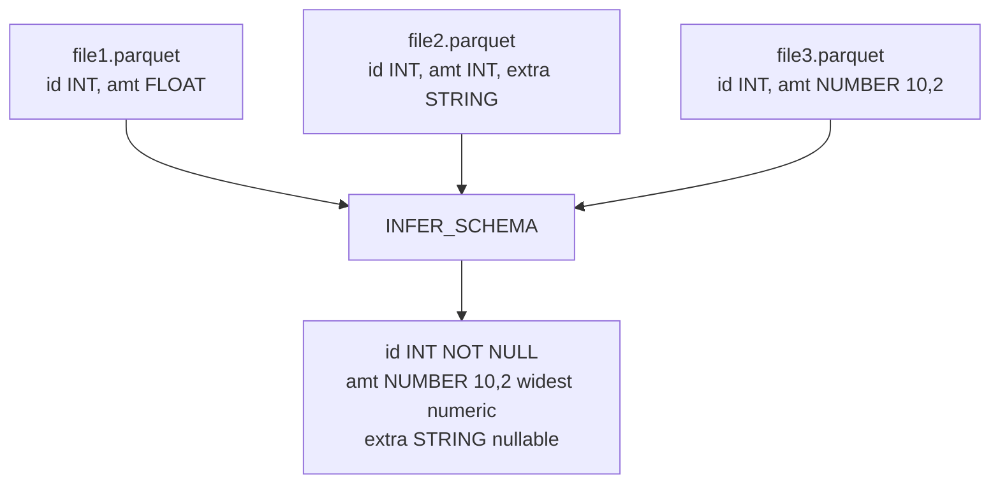

### Lab Exercise
```sql
SELECT * FROM TABLE(INFER_SCHEMA(
  LOCATION => '@sales_stage',
  FILE_FORMAT => 'parquet_fmt',
  IGNORE_CASE => TRUE
));
-- Returns: COLUMN_NAME, TYPE, NULLABLE, EXPRESSION, ORDER_ID, FILENAMES

CREATE TABLE sales_from_files
USING TEMPLATE (
  SELECT ARRAY_AGG(OBJECT_CONSTRUCT(*))
  FROM TABLE(INFER_SCHEMA(
    LOCATION => '@sales_stage',
    FILE_FORMAT => 'parquet_fmt'
  ))
);
```
**Expected outcome:** Table DDL exactly matches inferred schema; column order preserved via `ORDER_ID`.

### Gotchas / Exam Traps
- `INFER_SCHEMA` on CSV requires `PARSE_HEADER=TRUE` in the file format to produce column names.
- Mixing CSV and Parquet in one call fails — one file format at a time.
- JSON inference flattens one level by default; use `IGNORE_CASE` to normalize keys.

---

## Q19: Describe `COPY INTO` transformation capabilities (the "SELECT list" feature) and limits.
**Difficulty:** Intermediate
**Exam relevance:** "Apply simple transformations during load."

### Answer
`COPY INTO tgt FROM (SELECT $1::INT, UPPER($2), $3+1 FROM @stage)` allows per-column casts, scalar expressions, and simple filtering during load. Supported: casts, string/date functions, arithmetic, VARIANT path extraction. Not supported: joins (cannot JOIN to another table), aggregates, window functions, UDFs.

### First Principles
Snowflake pushes the SELECT list into the parallel per-file loader. Each micro-partition slice evaluates expressions independently — no cross-row dependencies allowed. This keeps load throughput high and avoids serial bottlenecks. For richer transforms, stage first then run a `MERGE`.

### Diagram
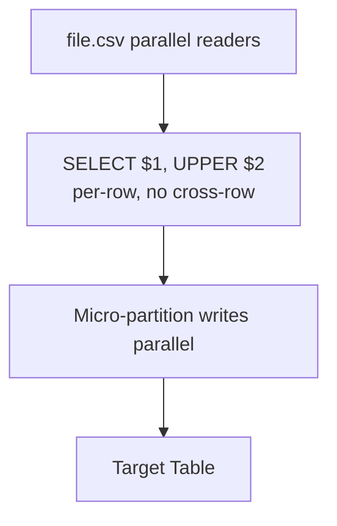

### Lab Exercise
```sql
COPY INTO sales (id, product, net_amt, load_ts)
FROM (
  SELECT $1::INT,
         UPPER($2::STRING),
         ($3::NUMBER) * (1 - 0.07),  -- strip tax
         CURRENT_TIMESTAMP()
  FROM @sales_stage
)
FILE_FORMAT = (TYPE = CSV FIELD_DELIMITER = ',' SKIP_HEADER = 1);

-- VARIANT extraction during load
COPY INTO events (id, user_id, event_ts)
FROM (
  SELECT $1:id::INT,
         $1:user.id::INT,
         TO_TIMESTAMP($1:ts::STRING)
  FROM @events_stage
)
FILE_FORMAT = (TYPE = JSON);
```
**Expected outcome:** Each row transformed inline during load; no staging table needed.

### Gotchas / Exam Traps
- Cannot reference another table in the SELECT list — no lookups during load.
- Expression failures count toward `ON_ERROR` threshold.
- Column list after `COPY INTO tgt (c1, c2, ...)` must match SELECT list count.

---

## Q20: How does `BULK_LOAD_HISTORY` differ from `COPY_HISTORY`, and when is each the right diagnostic?
**Difficulty:** Advanced
**Exam relevance:** "Monitor ingestion at account scale."

### Answer
`COPY_HISTORY` tracks every `COPY INTO` and Snowpipe event per table (365-day retention in Account Usage). `BULK_LOAD_HISTORY` (table function) returns per-batch load statistics for a given table within a time window — useful when debugging a specific table's throughput and error distribution. Both show file-level data; `COPY_HISTORY` is the aggregate account view.

### First Principles
Account Usage views are refresh-lagged (up to 2 hours) but retain history 365 days. Information Schema table functions are near-real-time (seconds) but have 14-day retention. For incident response, start with `INFORMATION_SCHEMA.COPY_HISTORY`; for long-term trends and audits use `ACCOUNT_USAGE.COPY_HISTORY`.

### Diagram
```mermaid
flowchart TD
    L1[Realtime: INFORMATION_SCHEMA.COPY_HISTORY<br/>14d retention]
    L1 --> L2[Account view: ACCOUNT_USAGE.COPY_HISTORY<br/>365d, 2h lag]
    L2 --> L3[Alerts: QUERY_HISTORY<br/>failed COPY statements]
```

### Lab Exercise
```sql
-- Realtime
SELECT file_name, status, row_count, error_count, pipe_name
FROM TABLE(INFORMATION_SCHEMA.COPY_HISTORY(
  TABLE_NAME => 'SALES',
  START_TIME => DATEADD(hour, -2, CURRENT_TIMESTAMP)
))
WHERE status != 'LOADED';

-- Historical trend
SELECT DATE_TRUNC('day', last_load_time) AS d,
       SUM(row_count) AS rows,
       SUM(error_count) AS errs
FROM SNOWFLAKE.ACCOUNT_USAGE.COPY_HISTORY
WHERE table_name = 'SALES'
AND last_load_time > DATEADD(day, -30, CURRENT_DATE)
GROUP BY 1 ORDER BY 1;
```
**Expected outcome:** Realtime shows last 2h of errors; historical shows 30-day load trend.

### Gotchas / Exam Traps
- `ACCOUNT_USAGE.COPY_HISTORY` requires `MONITOR` on the account or role grants to `SNOWFLAKE` DB.
- `ERROR_COUNT` in `COPY_HISTORY` counts rejected rows per file, not failed files.
- Snowpipe loads appear in COPY_HISTORY with `pipe_name` populated — filter by that for pipe-specific analysis.

---

## Q21: What are the latency, cost, and consistency trade-offs across the full ingestion toolbox?
**Difficulty:** Advanced
**Exam relevance:** "Select ingestion technology to meet SLA."

### Answer

| Method | Latency | Semantics |
|--------|---------|-----------|
| COPY INTO (bulk) | min–hours | at-least-once (64d dedup) |
| Snowpipe auto | ~1 min | at-least-once (14d dedup) |
| Snowpipe REST | ~1 min | at-least-once (14d dedup) |
| Snowpipe Streaming | <10s | exactly-once per channel |
| Kafka file | ~1 min | at-least-once |
| Kafka streaming | ~5s | exactly-once per partition |
| External Table | n/a (no load) | consistent at query time |

Cost: COPY uses WH credits; Snowpipe = per-file + compute; Streaming = per-row + compute; Kafka file = pipe cost; External = query compute only.

### First Principles
Latency decreases as architecture shifts from file-based to row-based. Cost per row generally **decreases** at scale for file-based methods (big files amortize overhead) and for streaming at high throughput, but file-based with tiny files is the worst spot — per-file overhead dominates. Exactly-once requires client-side offset tokens (Snowpipe Streaming, Kafka streaming); file-based methods rely on filename-based dedup which breaks if the same data is re-emitted under a different filename.

### Diagram
```mermaid
flowchart TD
    L[Latency vs Cost per row]
    L --> Q1[Low volume + tiny files<br/>Snowpipe BAD: expensive and slow]
    L --> Q2[High volume + rows<br/>Snowpipe Streaming: ideal for high-TPS]
    L --> Q3[Low volume + big files<br/>COPY bulk: cheap but slow]
```

### Lab Exercise
```sql
-- Benchmark: load 1M rows via COPY vs Snowpipe Streaming
-- COPY path
COPY INTO bench_copy FROM @bench_stage/1M.csv.gz
FILE_FORMAT = (FORMAT_NAME = csv_fmt);
-- Check cost in QUERY_HISTORY

-- Streaming path: run Python ingest client with 1M rows
-- Then check:
SELECT credits_used
FROM SNOWFLAKE.ACCOUNT_USAGE.SNOWPIPE_STREAMING_CLIENT_HISTORY
WHERE start_time > DATEADD(hour, -1, CURRENT_TIMESTAMP);
```
**Expected outcome:** Compare `BYTES_LOADED` and credit cost between methods.

### Gotchas / Exam Traps
- "Snowpipe is always cheaper than COPY" — false for small file counts (<~1k/day) where warehouse batch is cheaper.
- "Streaming is always lowest latency" — true for row-based, but Kafka connector adds Connect worker latency.
- "External tables have no cost" — they have **storage** cost (your bucket) and **query** cost (warehouse); only *ingestion* is free.

---

## Q22: What are the correct patterns for handling late-arriving data in a Stream+Task pipeline?
**Difficulty:** Advanced
**Exam relevance:** "Design pipelines resilient to out-of-order data."

### Answer
Three patterns: (1) **MERGE with watermark**: pick an application timestamp and only merge records newer than the target's current max; (2) **Dedup via `QUALIFY ROW_NUMBER()`** keyed on business ID + event_time; (3) **Append-only + windowed reconciliation** — write all stream rows to a raw log and periodically rebuild the target over the last N hours.

### First Principles
Streams emit changes in commit order, not event order. If source data has out-of-order inserts, the stream reflects that order faithfully. The target must choose: trust the latest write (dedup by business key, keep max event_time) or reconcile with lookback. Dynamic Tables sidestep this by always expressing final state as SQL — Snowflake handles the diff. For hand-rolled pipelines, deduplication and watermarking are the exam's go-to.

### Diagram
```mermaid
flowchart TD
    E1[event_time 10:05 arrives 10:08]
    E2[event_time 10:03 arrives 10:10 LATE]
    E1 --> SR[Stream shows both as INSERT]
    E2 --> SR
    SR --> M[MERGE picks latest per key:<br/>QUALIFY ROW_NUMBER PARTITION BY id<br/>ORDER BY event_time DESC = 1]
    M --> U[UPDATE only if s.event_time > t.event_time]
```

### Lab Exercise
```sql
CREATE OR REPLACE TASK t_merge_dedup
  WAREHOUSE = etl_wh
  AFTER t_root
  AS
  MERGE INTO orders_final t
  USING (
    SELECT id, event_time, status, amount
    FROM orders_stream
    WHERE METADATA$ACTION IN ('INSERT','UPDATE')
    QUALIFY ROW_NUMBER() OVER (PARTITION BY id ORDER BY event_time DESC) = 1
  ) s
  ON t.id = s.id
  WHEN MATCHED AND s.event_time > t.event_time THEN
    UPDATE SET t.status=s.status, t.amount=s.amount, t.event_time=s.event_time
  WHEN NOT MATCHED THEN
    INSERT (id, status, amount, event_time) VALUES (s.id,s.status,s.amount,s.event_time);
```
**Expected outcome:** Late arrivals with older event_time do not clobber newer target rows.

### Gotchas / Exam Traps
- `QUALIFY` without `PARTITION BY` applies globally — a classic trap.
- Pure UPSERT without event_time check overwrites newer with older on late arrival.
- Append-only reconciliation requires `MAX_DATA_EXTENSION_TIME_IN_DAYS` long enough on raw source for backfill lookback.

---

## Q23: Explain how to secure data movement end-to-end: client auth, in-transit, at-rest, and audit.
**Difficulty:** Intermediate
**Exam relevance:** "Secure ingestion pipelines."

### Answer
Auth: key-pair auth (RSA) for service accounts, no passwords for pipes or external services. In-transit: TLS 1.2+ enforced. At-rest: cloud storage uses server-side encryption; Snowflake-managed stages use AES-256; external stages use your bucket's SSE/CMK. Audit: `LOGIN_HISTORY`, `QUERY_HISTORY`, `COPY_HISTORY`, `ACCESS_HISTORY`.

### First Principles
Each hop needs its own protection. Credentials in config files are the weakest link — storage integrations and OAuth eliminate static secrets. Audit must be *immutable* for compliance; Account Usage views are append-only and tamper-evident. `ACCESS_HISTORY` is the modern query-level column-access audit.

### Diagram
```mermaid
flowchart TD
    C[Client] -->|TLS 1.2+ + key-pair auth| API[Snowflake API]
    API -->|role-based access| Op[Operations]
    Op --> P[PUT to stage SSE]
    Op --> Cp[COPY to table AES-256]
    Cp --> Aud[ACCESS_HISTORY, QUERY_HISTORY]
```

### Lab Exercise
```sql
-- Create service user with key-pair
CREATE USER kafka_svc TYPE=SERVICE RSA_PUBLIC_KEY='MIIBIj...';

-- Enforce network policy for ingest IPs
CREATE NETWORK POLICY ingest_only ALLOWED_IP_LIST=('10.0.0.0/8');
ALTER USER kafka_svc SET NETWORK_POLICY='INGEST_ONLY';

-- Audit who loaded what
SELECT user_name, query_text, start_time
FROM SNOWFLAKE.ACCOUNT_USAGE.QUERY_HISTORY
WHERE query_text ILIKE 'COPY INTO sales%'
AND start_time > DATEADD(day,-7,CURRENT_DATE);
```
**Expected outcome:** Service user restricted to key auth + IP whitelist; all loads auditable.

### Gotchas / Exam Traps
- Password auth is being deprecated for service users (type=SERVICE) — exam will test awareness.
- `NETWORK_POLICY` at user level overrides account-level.
- Storage integration requires both sides configured: cloud trust policy + Snowflake integration — mismatched external IDs is the #1 failure.

---

## Q24: How do you handle schema drift in a Snowpipe pipeline, both automated and manual options?
**Difficulty:** Advanced
**Exam relevance:** "Manage schema evolution in production pipelines."

### Answer
Automated: enable `ENABLE_SCHEMA_EVOLUTION = TRUE` on the target table, use `MATCH_BY_COLUMN_NAME`, and grant `EVOLVE SCHEMA` on the pipe's role. Manual: use a VARIANT staging table, add explicit `ALTER TABLE ... ADD COLUMN` via a task that reads `INFER_SCHEMA` or inspects raw payload, then project into typed columns.

### First Principles
Schema evolution has a trade-off: automation handles the common case (new nullable columns) but obscures breaking changes (type conflicts, deleted fields). Pure VARIANT staging treats the file as a document — infinite flexibility but no type-level pruning benefits. Hybrid: VARIANT staging + Dynamic Table projecting typed columns, letting the typed layer evolve on your schedule.

### Diagram
```mermaid
flowchart TD
    subgraph Auto[Automated]
        A1[Pipe] --> A2[Table ENABLE_SCHEMA_EVOLUTION]
        A2 --> A3[New col auto added]
    end
    subgraph Hyb[Hybrid]
        H1[Pipe] --> H2[raw VARIANT]
        H2 --> H3[Dynamic Table typed]
        H3 --> H4[Add new typed col when ready]
    end
```

### Lab Exercise
```sql
-- Automated path
CREATE OR REPLACE TABLE orders (id INT, amt NUMBER)
  ENABLE_SCHEMA_EVOLUTION = TRUE;
GRANT EVOLVE SCHEMA ON TABLE orders TO ROLE ingest_role;

CREATE OR REPLACE PIPE orders_pipe
  AUTO_INGEST = TRUE
  AS
  COPY INTO orders FROM @stage
  MATCH_BY_COLUMN_NAME = CASE_INSENSITIVE
  FILE_FORMAT = (FORMAT_NAME = json_fmt);

-- Hybrid path
CREATE OR REPLACE TABLE orders_raw (ts TIMESTAMP, doc VARIANT);
CREATE OR REPLACE DYNAMIC TABLE orders_typed
  TARGET_LAG = '5 minutes' WAREHOUSE = etl_wh
AS
SELECT doc:id::INT AS id,
       doc:amount::NUMBER(10,2) AS amount,
       doc:newfield::STRING AS newfield
FROM orders_raw;
```
**Expected outcome:** New file with new column auto-adds in automated path; manually promote fields from VARIANT in hybrid.

### Gotchas / Exam Traps
- `ENABLE_SCHEMA_EVOLUTION` ignores columns that *disappear* — they stay in the table with NULL.
- Type widening is one-way (INT -> NUMBER); type narrowing or incompatible changes (INT -> STRING with existing data) fail the load.
- `EVOLVE SCHEMA` privilege is required separately from `INSERT`.

---

## Q25: Compare Snowflake Streams, Change Tracking, and CDC via Dynamic Tables.
**Difficulty:** Advanced
**Exam relevance:** "Select the right change-capture primitive."

### Answer
**Change Tracking** is a table-level setting (`CHANGE_TRACKING=TRUE`) that enables the row-version metadata needed for streams and dynamic tables. **Streams** are user-facing CDC objects with offset bookmarks. **Dynamic Tables** consume change tracking transparently to drive incremental refresh — no user-visible stream object.

### First Principles
All three use the same underlying engine: the Fluid Delta Change Tracking system that records per-micro-partition insert/delete sets. Enabling change tracking on a table adds hidden metadata columns (effectively doubling micro-partition metadata but not data). Streams expose this diff to SQL users; Dynamic Tables consume it internally; both reference it to compute `source@t1 - source@t0`.

### Diagram
```mermaid
flowchart TD
    BT[Base table<br/>CHANGE_TRACKING=TRUE<br/>enables row-level diff metadata]
    BT --> S[STREAM offset: user SELECTs diff]
    BT --> DT[DYNAMIC TABLE: auto-SELECTs diff for refresh]
    BT --> CH[CHANGES clause: ad-hoc timeline query]
```

### Lab Exercise
```sql
-- Enable without creating a stream
ALTER TABLE orders SET CHANGE_TRACKING = TRUE;

-- Ad-hoc CDC query via CHANGES() clause (no stream object)
SELECT *, METADATA$ACTION, METADATA$ISUPDATE
FROM orders
CHANGES (INFORMATION => DEFAULT)
AT (OFFSET => -60*60); -- changes in last hour

-- Dynamic table consumes change tracking
CREATE DYNAMIC TABLE orders_summary
  TARGET_LAG='1 minute' WAREHOUSE=etl_wh
AS SELECT customer_id, SUM(amount) FROM orders GROUP BY customer_id;
```
**Expected outcome:** CHANGES clause works without a stream; Dynamic Table incrementally refreshes.

### Gotchas / Exam Traps
- `CHANGES()` requires `CHANGE_TRACKING = TRUE` *and* that the offset falls within `DATA_RETENTION_TIME_IN_DAYS`.
- Dropping and recreating the table (`CREATE OR REPLACE`) resets change tracking — streams go stale.
- Enabling change tracking on a huge existing table triggers a background rewrite to add metadata — plan a maintenance window.
