# Performance Optimization — DEA-C02 Study Guide

## Exam Weight & Scope
Performance Optimization is ~22% of the DEA-C02 exam. Covers warehouse sizing/scaling, caching (metadata/result/local SSD), clustering (natural, explicit, auto), search optimization, materialized views, query profile reading, pruning behavior, and workload isolation (multi-cluster, resource monitors).

## Core Concepts Map
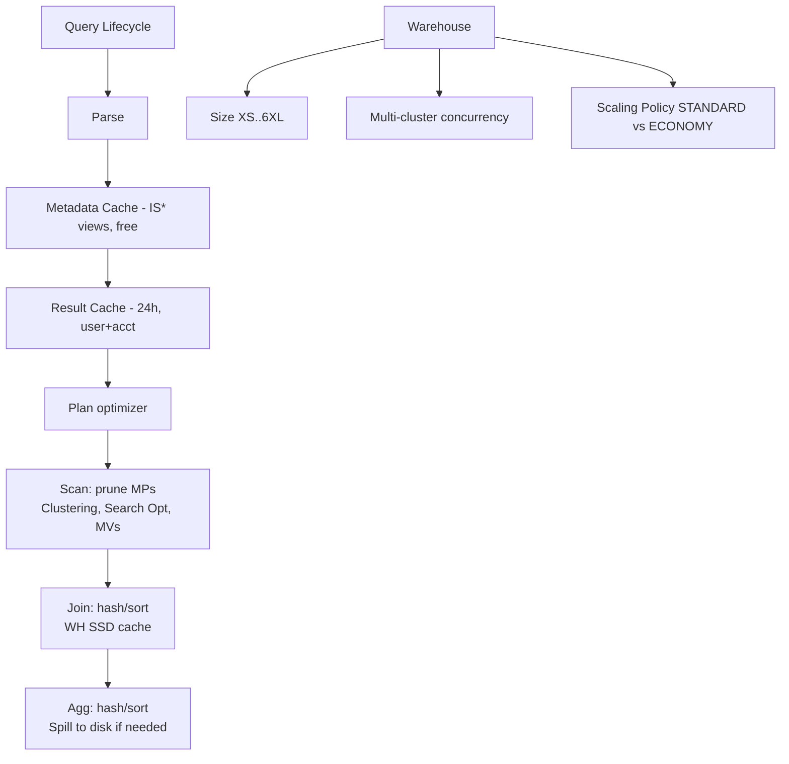

---

## Q1: What are the three caches in Snowflake, their scopes, and TTLs?
**Difficulty:** Foundation
**Exam relevance:** "Identify Snowflake caching layers and their effect on performance."

### Answer
(1) **Metadata cache** — persistent, serverless, caches micro-partition metadata (min/max, null counts, row counts). Serves queries like `SELECT COUNT(*)` with zero compute. (2) **Result cache** — stores query results for 24h (extends up to 31d with reuse); account-level, shared across users with same role access. (3) **Local disk (warehouse) cache** — SSD on each warehouse node caching recently read micro-partition data; cleared on warehouse suspend/resize.

### First Principles
Each cache targets a different cost axis: metadata eliminates the scan entirely (free compute), result cache eliminates re-execution (free compute), warehouse cache eliminates cloud-storage reads (faster scan, same compute). The exam loves to probe which cache serves which pattern:
- `SELECT COUNT(*)` with no WHERE: **metadata**
- Identical query within 24h, same result set, no underlying data change: **result**
- Same table scanned again with cold result cache but warm WH: **warehouse SSD**

Result cache is **invalidated** by any DML on underlying tables, UDFs marked non-deterministic, or any difference in user session (role, timezone, etc.).

### Diagram
```mermaid
flowchart TD
    Q[Query] --> M{Metadata cache?}
    M -->|hit free| Done1[COUNT*, MIN/MAX, prune stats]
    M -->|miss| R{Result cache?}
    R -->|hit free| Done2[Exact re-run <24h]
    R -->|miss| C[Compile + plan]
    C --> W{WH SSD cache?}
    W -->|hit fast| Done3[Recently scanned MPs]
    W -->|miss| Rem[Remote cloud storage cold scan]
```

### Lab Exercise
```sql
-- Metadata cache demo
SELECT COUNT(*) FROM huge_table;   -- milliseconds, bytes_scanned=0

-- Result cache demo
ALTER SESSION SET USE_CACHED_RESULT = TRUE;
SELECT product, SUM(amt) FROM sales GROUP BY 1;
-- Re-run: look at QUERY_HISTORY.query_result_type = 'RESULT_SET_FROM_CACHE'

-- Force fresh execution
ALTER SESSION SET USE_CACHED_RESULT = FALSE;
SELECT product, SUM(amt) FROM sales GROUP BY 1;
-- Note query_profile shows TableScan with remote vs local disk bytes

-- Warehouse cache demo
ALTER WAREHOUSE my_wh SUSPEND;
ALTER WAREHOUSE my_wh RESUME;    -- cache cleared
SELECT * FROM sales LIMIT 10;    -- all remote reads
SELECT * FROM sales LIMIT 10;    -- subsequent reads mostly local SSD
```
**Expected outcome:** `QUERY_HISTORY.percentage_scanned_from_cache` grows on repeat; after suspend it drops to 0.

### Gotchas / Exam Traps
- Resizing a warehouse (`ALTER WAREHOUSE SET WAREHOUSE_SIZE=`) often **does not** clear cache for standard scaling, but **does** replace nodes for some operations — Snowflake documents this nuance, exam will test.
- Result cache requires the user's role to have SELECT on all underlying objects at reuse time — permission changes invalidate.
- Any non-deterministic function (`CURRENT_TIMESTAMP`, `RANDOM`, `UUID_STRING`) disables result caching for that query.

---

## Q2: What is a micro-partition and how does Snowflake use pruning?
**Difficulty:** Foundation
**Exam relevance:** "Explain Snowflake's micro-partition architecture and pruning behavior."

### Answer
A micro-partition (MP) is a 50–500 MB uncompressed, columnar, immutable storage unit (16MB compressed typical). Each MP stores min/max/null-count/distinct-count per column in metadata. On query, Snowflake prunes MPs whose min/max don't overlap WHERE predicate — reading only "surviving" MPs.

### First Principles
Pruning is Snowflake's primary performance lever. Everything else (clustering, SOS, MVs) is designed to **make more pruning possible**. The optimizer checks predicate against metadata before issuing any read — pruning happens in cloud services, free of warehouse compute. If predicates are expression-based (`WHERE UPPER(col) = 'X'`) pruning fails because metadata is on raw column values. "Natural" data arrival order often provides good clustering for free when load order aligns with query filters (time-series data).

### Diagram
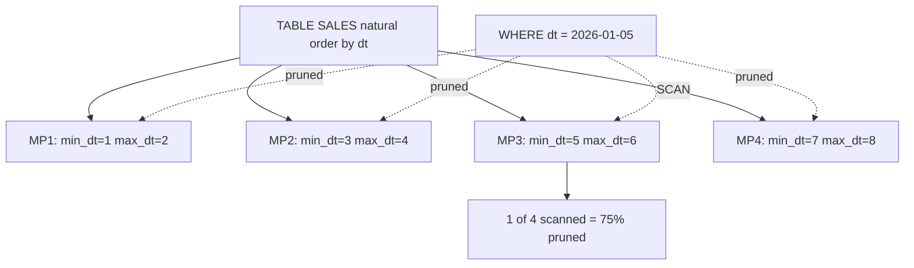

### Lab Exercise
```sql
-- Query profile shows pruning
EXPLAIN USING TABULAR
SELECT * FROM sales WHERE dt = '2026-01-05';

SELECT query_id, partitions_scanned, partitions_total,
       (partitions_total - partitions_scanned)*100.0/partitions_total AS pct_pruned
FROM TABLE(INFORMATION_SCHEMA.QUERY_HISTORY_BY_SESSION())
WHERE query_text ILIKE '%sales WHERE dt%'
ORDER BY start_time DESC LIMIT 5;

-- Compare: expression on column defeats pruning
EXPLAIN SELECT * FROM sales WHERE DATE_TRUNC('day', dt) = '2026-01-05';  -- no prune
EXPLAIN SELECT * FROM sales WHERE dt = '2026-01-05';                     -- prunes
```
**Expected outcome:** First explain scans all MPs; second prunes to minimum set.

### Gotchas / Exam Traps
- Casting the column in WHERE (`WHERE col::DATE = ...`) often defeats pruning; cast the literal (`WHERE col = '2026-01-05'::DATE`) is fine.
- `OR` across columns typically prevents pruning via columns in the OR; the optimizer may union pruned sets but joins across OR are often unsafe.
- Deleted rows still live in micro-partitions until re-clustering/rewrite — they count toward MP size but are filtered.

---

## Q3: Explain explicit clustering vs. auto clustering, and when to use each.
**Difficulty:** Intermediate
**Exam relevance:** "Design clustering keys and manage reclustering costs."

### Answer
**Explicit clustering** (`CLUSTER BY (col1, col2)`) declares a sort preference; auto-clustering (default ON when a key is set) is Snowflake's background serverless service that re-clusters data as inserts/updates break the ordering. **No clustering key** = relies on natural load order; works well for strictly time-sequential ingest. Use clustering only on tables large enough (>1 TB rule of thumb) with queries that filter/join on the key.

### First Principles
Clustering is NOT a sort — it's a *proximity* goal: Snowflake tries to keep rows with similar key values in the same micro-partition and keep MP min/max ranges tight. The clustering service measures "clustering depth" (overlapping MP ranges) and consolidates MPs when depth exceeds thresholds. This is pure cost: clustering runs on serverless credits, so a bad key (high cardinality, high churn) can burn more credits than it saves on queries. Rule of thumb: 2–4 columns, lowest-cardinality first, aligned with top WHERE/JOIN predicates.

### Diagram
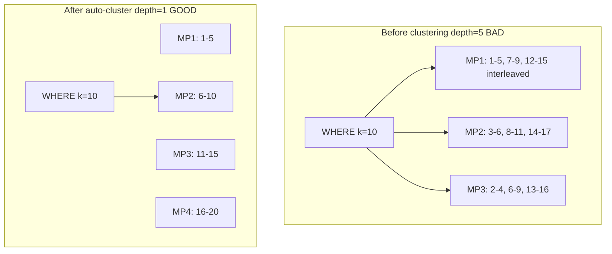

### Lab Exercise
```sql
CREATE OR REPLACE TABLE sales (
  dt DATE, region STRING, product STRING, amt NUMBER
) CLUSTER BY (dt, region);

-- Check clustering health
SELECT SYSTEM$CLUSTERING_INFORMATION('sales', '(dt, region)');
/*
{
  "cluster_by_keys" : "LINEAR(dt, region)",
  "total_partition_count" : 1024,
  "average_overlaps" : 1.3,
  "average_depth" : 2.1,
  "partition_depth_histogram" : {...}
}
*/

-- Clustering credit history
SELECT table_name, SUM(credits_used) AS credits_30d
FROM SNOWFLAKE.ACCOUNT_USAGE.AUTOMATIC_CLUSTERING_HISTORY
WHERE start_time > DATEADD(day,-30,CURRENT_DATE)
GROUP BY 1 ORDER BY 2 DESC;

-- Suspend auto-clustering if cost outweighs benefit
ALTER TABLE sales SUSPEND RECLUSTER;
```
**Expected outcome:** `average_depth` close to 1 for well-clustered tables; depth > 10 signals problem.

### Gotchas / Exam Traps
- `CLUSTER BY (col)` on a **high-cardinality column** (UUIDs, timestamps-to-ms) causes constant reclustering with little benefit — avoid.
- Clustering key column order matters: `(dt, region)` prunes `WHERE dt=X AND region=Y` but only partially on `WHERE region=Y` alone.
- Expressions in clustering key supported: `CLUSTER BY (DATE_TRUNC('day', ts))` — handy for time-series.
- Auto-clustering suspends automatically if the table has no DML for a while; resumes on next write.

---

## Q4: How does Search Optimization Service (SOS) differ from clustering, and when do you add it?
**Difficulty:** Intermediate
**Exam relevance:** "Use Search Optimization for point lookups."

### Answer
SOS builds a persistent search access path (equality lookup index, substring/regex, VARIANT path lookup, geospatial) stored separately per table. Unlike clustering, SOS doesn't reorganize data — it maintains auxiliary data structures. Use for **selective** point lookups on **non-clustering** columns (e.g., finding one order by order_id in a time-clustered table).

### First Principles
Clustering = organize data so predicates prune MPs. SOS = add a lookup index that identifies which MPs contain a value, without reorganizing. SOS complements clustering, not replaces it. SOS costs: storage overhead (the index) + serverless maintenance credits on writes. SOS shines on highly selective predicates (returning < 0.1% of rows) that aren't the clustering key; it does nothing for range scans or aggregations.

### Diagram
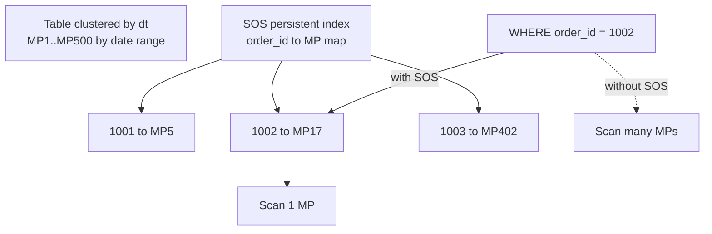

### Lab Exercise
```sql
ALTER TABLE sales ADD SEARCH OPTIMIZATION
  ON EQUALITY(order_id, customer_id)
  ON SUBSTRING(product_name);

-- Monitor build + cost
SELECT SYSTEM$ESTIMATE_SEARCH_OPTIMIZATION_COSTS('sales', 'EQUALITY(order_id, customer_id)');

SELECT table_name, credits_used
FROM SNOWFLAKE.ACCOUNT_USAGE.SEARCH_OPTIMIZATION_HISTORY
WHERE start_time > DATEADD(day,-30,CURRENT_DATE);

-- Verify query profile uses it
EXPLAIN SELECT * FROM sales WHERE order_id = 1234567;
-- Look for "Search Optimization Access Path" node
```
**Expected outcome:** `SYSTEM$ESTIMATE_SEARCH_OPTIMIZATION_COSTS` returns build + monthly costs; explain shows SOS path used.

### Gotchas / Exam Traps
- SOS has **no benefit** on queries returning > ~1% of rows — the overhead of consulting the index exceeds savings.
- SOS doesn't work on columns with semi-structured paths unless you explicitly add `ON VARIANT(col)` or path-specific SOS.
- SOS maintenance credits scale with write volume — a highly-updated table can make SOS prohibitive.
- SOS is per-column — each `EQUALITY(col)`/`SUBSTRING(col)` is a separate index to maintain.

---

## Q5: Compare Materialized Views, Dynamic Tables, and regular views.
**Difficulty:** Advanced
**Exam relevance:** "Choose between MV, DT, and standard views for performance."

### Answer
**View**: pure definition, zero storage, re-executes on every query. **Materialized View (MV)**: persistent aggregated/filtered subset, auto-maintained on base updates, restricted SQL (single table, limited aggregations). **Dynamic Table (DT)**: declarative pipeline, supports joins + full SQL, refresh governed by `TARGET_LAG`, incrementally maintained when possible.

### First Principles
MVs predate DTs and are optimized for a specific case: a hot aggregated/filtered projection of ONE table. They're transparently rewritten into queries (the optimizer substitutes the MV automatically if it matches). DTs are explicit pipeline objects — you query them by name — but can span multiple sources with full SQL. If a workload has many queries with same SELECT + aggregate on one table, MV wins. If you're building a pipeline that joins streams/dims, DT wins. Standard views are for complex but infrequently used logical shaping.

### Diagram

| Feature | View | MV | Dynamic Table |
|---------|------|----|--------------|
| Storage | none | pre-agg | pipeline output |
| Refresh | re-exec | auto | TARGET_LAG |
| SQL | any | 1 table, limited | full SQL + joins |
| Cost | none | storage + serverless | storage + WH |
| Access | transparent rewrite | transparent rewrite | query by name |

### Lab Exercise
```sql
-- Materialized View (single table, restrictive)
CREATE OR REPLACE MATERIALIZED VIEW mv_daily_sales
AS
SELECT dt, region, SUM(amt) AS total_amt, COUNT(*) AS cnt
FROM sales
GROUP BY dt, region;

-- MV query rewrite demo
EXPLAIN
SELECT region, SUM(amt) FROM sales WHERE dt='2026-10-30' GROUP BY region;
-- optimizer may rewrite to use mv_daily_sales

-- Dynamic Table (joins allowed)
CREATE OR REPLACE DYNAMIC TABLE dt_sales_enriched
  TARGET_LAG = '5 minutes'
  WAREHOUSE = etl_wh
AS
SELECT s.dt, s.region, c.customer_tier, SUM(s.amt) AS amt
FROM sales s JOIN customers c ON s.customer_id = c.id
GROUP BY s.dt, s.region, c.customer_tier;
```
**Expected outcome:** MV auto-rewrites eligible queries; DT appears as a queryable table refreshed to lag SLA.

### Gotchas / Exam Traps
- MVs cannot have: joins, `UNION`, window functions, non-deterministic UDFs, `HAVING`, `ORDER BY`.
- MV auto-rewrite only kicks in if the optimizer can prove equivalence — complex predicates may miss despite "obvious" match.
- Dropping an MV's base table forces drop (no CASCADE handling).
- DTs chain naturally (DT -> DT) with lag propagation (`TARGET_LAG = DOWNSTREAM`).

---

## Q6: Walk through reading a Query Profile — what the main operator shapes mean.
**Difficulty:** Intermediate
**Exam relevance:** "Diagnose performance issues using Query Profile."

### Answer
Query Profile is a visual DAG of operators (TableScan, Join, Aggregate, Sort, Window, Filter, Result). Key signals: **percentage pruned** (TableScan), **spilling to local/remote** (any blocking op), **exploding row counts** (Cartesian joins), **slowest operator** (red highlight), **synchronization time** (waiting on parallelism skew).

### First Principles
Snowflake queries run as a DAG of operators across warehouse nodes. The profile shows per-operator: input rows, output rows, bytes scanned local/remote, bytes spilled local/remote. Spilling is the #1 killer: when working set exceeds node RAM, data spills to local SSD (acceptable penalty) then to remote storage (10–100x slower). Spill = resize warehouse up OR reduce intermediate size. Pruning = cluster/predicates. Exploding join = wrong join key or missing dedup.

### Diagram
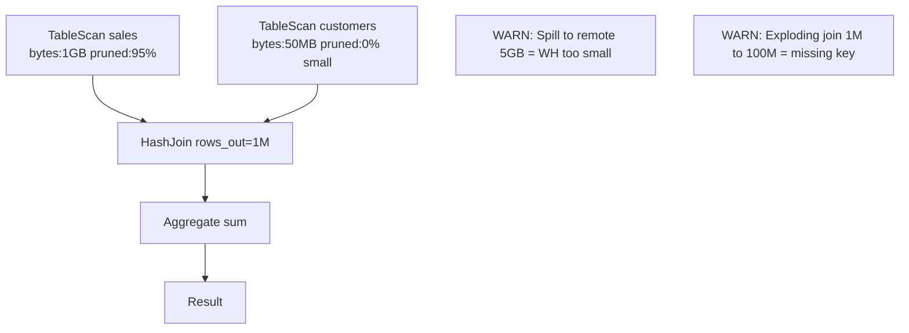

### Lab Exercise
```sql
-- Run a known slow query and open profile
SELECT /* profile_me */
  c.customer_tier, s.region, SUM(s.amt) AS amt
FROM sales s
JOIN customers c ON s.customer_id = c.id
WHERE s.dt > DATEADD(month,-6,CURRENT_DATE)
GROUP BY 1, 2
ORDER BY amt DESC;

-- Programmatic profile stats
SELECT query_id,
       execution_time, compilation_time,
       bytes_scanned, bytes_spilled_to_local_storage,
       bytes_spilled_to_remote_storage,
       percentage_scanned_from_cache,
       partitions_scanned, partitions_total
FROM TABLE(INFORMATION_SCHEMA.QUERY_HISTORY_BY_SESSION())
WHERE query_text ILIKE '%profile_me%'
ORDER BY start_time DESC LIMIT 1;
```
**Expected outcome:** Any spill > 0 to remote storage warrants warehouse resize or query rewrite.

### Gotchas / Exam Traps
- "Local disk I/O" is normal — only **remote** spill is a strong resize signal.
- "Synchronization" > 20% often means data skew — one node doing most work.
- "ExternalFunction" nodes have hidden network latency not reflected in bytes.
- The % next to each operator is % of **total execution time**, not row volume.

---

## Q7: How do you size a warehouse — and what's the "double warehouse" test?
**Difficulty:** Foundation
**Exam relevance:** "Right-size warehouses for workload."

### Answer
Start with the workload's natural parallelism: XS has 1 server (8 cores), each T-shirt size doubles compute. Pick based on data volume per query (rule of thumb: 100 GB per XS). The "double warehouse" test: if doubling the size cuts runtime by >40%, the workload benefits from more compute; if runtime drops <20%, you're over-provisioned.

### First Principles
Snowflake warehouses scale linearly for compute-bound work (joins, aggregations); doubling size roughly doubles concurrent I/O and halves scan time. But for small queries, overhead dominates — an XS can be faster than an M for sub-second queries. Scaling up helps **individual queries**; scaling out (multi-cluster) helps **concurrency**. Spilling is the biggest resize trigger: eliminate remote spill first.

### Diagram

| Size | Servers | Capacity | Credit mult |
|------|--------:|---------:|------------:|
| XS   |   1 | 100 GB  |   1x |
| S    |   2 | 200 GB  |   2x |
| M    |   4 | 400 GB  |   4x |
| L    |   8 | 800 GB  |   8x |
| XL   |  16 | 1.6 TB  |  16x |
| 2XL  |  32 | 3.2 TB  |  32x |
| 3XL  |  64 | 6.4 TB  |  64x |
| 4XL  | 128 | 12.8 TB | 128x |
| 5XL  | 256 | 25.6 TB | 256x |
| 6XL  | 512 | 51.2 TB | 512x |

Double warehouse test:
- M 60s → L 32s = benefits (47% faster, use L)
- M 60s → L 55s = no benefit (stay on M)

### Lab Exercise
```sql
-- Benchmark across sizes
CREATE OR REPLACE WAREHOUSE test_wh WAREHOUSE_SIZE=XSMALL AUTO_SUSPEND=60;

ALTER WAREHOUSE test_wh SET WAREHOUSE_SIZE=XSMALL;
ALTER WAREHOUSE test_wh RESUME;
SELECT /* xs_run */ SUM(amt) FROM sales WHERE dt > DATEADD(month,-6,CURRENT_DATE);

ALTER WAREHOUSE test_wh SET WAREHOUSE_SIZE=SMALL;
SELECT /* s_run */ SUM(amt) FROM sales WHERE dt > DATEADD(month,-6,CURRENT_DATE);

ALTER WAREHOUSE test_wh SET WAREHOUSE_SIZE=MEDIUM;
SELECT /* m_run */ SUM(amt) FROM sales WHERE dt > DATEADD(month,-6,CURRENT_DATE);

SELECT query_text, execution_time, warehouse_size, bytes_spilled_to_remote_storage
FROM TABLE(INFORMATION_SCHEMA.QUERY_HISTORY_BY_SESSION())
WHERE query_text LIKE '%_run%'
ORDER BY start_time DESC LIMIT 10;
```
**Expected outcome:** Scaling continues improving until remote spill = 0 and marginal gain < 20%.

### Gotchas / Exam Traps
- Billing is **per-second** with a 60s minimum per auto-suspend/resume cycle — bursty workloads should set `AUTO_SUSPEND=60`.
- Warehouse size does NOT affect concurrency (that's multi-cluster); it affects per-query parallelism.
- Snowpark optimized warehouses have 16x the memory per node — critical for ML/UDF workloads that need RAM but not compute.

---

## Q8: How do multi-cluster warehouses and scaling policies work?
**Difficulty:** Intermediate
**Exam relevance:** "Scale concurrency with multi-cluster warehouses."

### Answer
A multi-cluster warehouse maintains `MIN_CLUSTER_COUNT` to `MAX_CLUSTER_COUNT` identical-sized clusters. Snowflake routes incoming queries to least-loaded cluster. `SCALING_POLICY = STANDARD` adds clusters quickly when queued (prioritizes response time); `ECONOMY` waits longer (prioritizes credit efficiency, allowing some queueing).

### First Principles
A single cluster has fixed query concurrency (~8 by default via `MAX_CONCURRENCY_LEVEL`). When concurrent demand exceeds that, queries queue. Multi-cluster adds **horizontal** scale: more clusters means more concurrent queries, same per-query performance. Scaling policy dictates the sensitivity: STANDARD spins up a cluster on first queue signal; ECONOMY tries to keep queries queued ~6 minutes before adding a cluster. STANDARD = SLA; ECONOMY = cost.

### Diagram
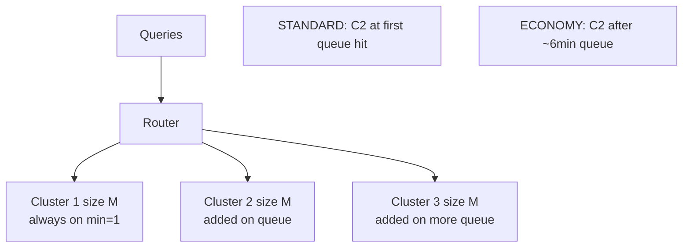

### Lab Exercise
```sql
CREATE OR REPLACE WAREHOUSE bi_wh
  WAREHOUSE_SIZE = MEDIUM
  MIN_CLUSTER_COUNT = 1
  MAX_CLUSTER_COUNT = 5
  SCALING_POLICY = STANDARD
  AUTO_SUSPEND = 120
  AUTO_RESUME = TRUE;

-- Observe clustering
SELECT warehouse_name, cluster_number, start_time, end_time, credits_used
FROM SNOWFLAKE.ACCOUNT_USAGE.WAREHOUSE_METERING_HISTORY
WHERE warehouse_name = 'BI_WH' AND start_time > DATEADD(day,-1,CURRENT_DATE)
ORDER BY start_time DESC;

-- Switch to ECONOMY if cost dominates
ALTER WAREHOUSE bi_wh SET SCALING_POLICY = ECONOMY;
```
**Expected outcome:** During peak hours, multiple cluster_number rows appear in metering.

### Gotchas / Exam Traps
- "Setting MIN=MAX gives a static multi-cluster" — true, but counterintuitively costs the sum of all clusters constantly.
- `MAX_CONCURRENCY_LEVEL` per cluster caps queries per cluster (default 8). Lowering it drives faster scale-out for small-but-many queries.
- Multi-cluster is **not** auto-scale-up (that's size). It's horizontal only.

---

## Q9: What's the mechanism behind "spilling to disk" and how do you fix it?
**Difficulty:** Intermediate
**Exam relevance:** "Diagnose and resolve spill-related performance issues."

### Answer
Spill happens when hash join / hash aggregate / sort operator working sets exceed node RAM. Snowflake spills intermediate state first to **local SSD** (fast), then to **remote storage** (slow). Fix: resize warehouse up (more RAM per node), use Snowpark-optimized warehouse (16x memory), reduce intermediate rows via better filters/pre-aggregation, or avoid cartesian explosions.

### First Principles
Hash operators build a hash table in RAM. For a join, Snowflake typically hashes the **smaller** side (build) and streams the larger side (probe). If build > RAM, it must spill. Aggregate spills when distinct group count exceeds a threshold. Sort spills when sort buffer exceeds RAM. Doubling warehouse size roughly doubles total RAM — a reliable fix for spill. Snowpark-optimized warehouses are purpose-built for memory-hungry Python UDFs and large aggregations.

### Diagram
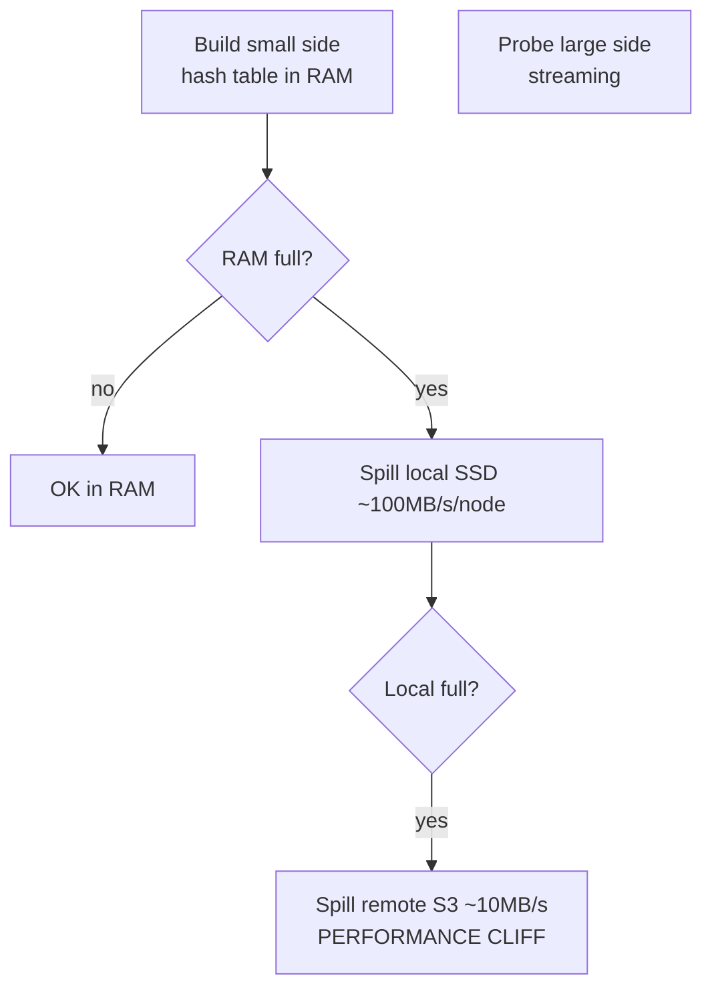

### Lab Exercise
```sql
-- Produce spill
CREATE OR REPLACE TABLE bigt AS
SELECT seq8() AS id, RANDOM() AS v, RANDSTR(1000, UNIFORM(1,1000, RANDOM())) AS payload
FROM TABLE(GENERATOR(ROWCOUNT => 100000000));

ALTER WAREHOUSE my_wh SET WAREHOUSE_SIZE=XSMALL;
SELECT /* spilltest */ payload, COUNT(*) FROM bigt GROUP BY payload;

SELECT bytes_spilled_to_local_storage, bytes_spilled_to_remote_storage,
       warehouse_size
FROM TABLE(INFORMATION_SCHEMA.QUERY_HISTORY_BY_SESSION())
WHERE query_text ILIKE '%spilltest%'
ORDER BY start_time DESC LIMIT 1;

-- Resize up to eliminate
ALTER WAREHOUSE my_wh SET WAREHOUSE_SIZE=LARGE;
SELECT /* nospill */ payload, COUNT(*) FROM bigt GROUP BY payload;
```
**Expected outcome:** Remote spill drops to 0 at some size; execution time correlates with spill reduction.

### Gotchas / Exam Traps
- `bytes_spilled_to_local_storage` alone isn't a red flag — remote is.
- Snowpark-optimized warehouses have higher base cost; use only for memory-bound Python/ML, not for pure SQL unless memory-constrained.
- Window functions over large partitions can spill independently of the join size.

---

## Q10: What is the "clustering depth" and how do you decide to recluster?
**Difficulty:** Advanced
**Exam relevance:** "Monitor clustering health."

### Answer
Clustering depth is the average number of overlapping MP ranges for a given key value — ideally close to 1. `SYSTEM$CLUSTERING_DEPTH('tbl', '(key)')` returns the number; `SYSTEM$CLUSTERING_INFORMATION` adds a histogram. If depth > 10 (and workloads filter on that key), either re-enable auto-clustering, change clustering key, or run a manual `INSERT ... SELECT` rewrite.

### First Principles
Pruning efficiency correlates with depth: depth 1 means every value lives in exactly one MP region; depth 100 means a `WHERE k=X` must scan 100 MPs regardless of selectivity. Depth grows as DML interleaves ranges. Auto-clustering trades credits for depth maintenance — you can trade off cost vs. depth via `ALTER TABLE SUSPEND/RESUME RECLUSTER`.

### Diagram

Good depth avg = 1.2:

| Depth | Share |
|------:|------:|
| 1 | 80% |
| 2 | 15% |
| 3 | 5% |

Bad depth avg = 25 (recluster urgently):

| Depth | Share |
|------:|------:|
| 1-5 | 5% |
| 6-10 | 10% |
| 11-50 | 50% |
| >50 | 35% |

### Lab Exercise
```sql
SELECT SYSTEM$CLUSTERING_DEPTH('sales', '(dt, region)');

SELECT SYSTEM$CLUSTERING_INFORMATION('sales', '(dt, region)');
-- Look at partition_depth_histogram.

-- Force a one-off reclustering rewrite (if auto is off)
ALTER TABLE sales RECLUSTER;  -- deprecated but still works
-- Or: fully rewrite
CREATE OR REPLACE TABLE sales_v2 CLONE sales;
INSERT OVERWRITE INTO sales SELECT * FROM sales_v2 ORDER BY dt, region;

ALTER TABLE sales RESUME RECLUSTER;
```
**Expected outcome:** Depth drops dramatically after rewrite; auto-clustering keeps it low ongoing.

### Gotchas / Exam Traps
- `SYSTEM$CLUSTERING_DEPTH` with no key argument uses the defined cluster key; with a different key tests a hypothetical.
- `INSERT OVERWRITE ... ORDER BY` is the manual reclustering escape hatch — exam may ask about it.
- Reclustering credits appear in `AUTOMATIC_CLUSTERING_HISTORY`, separate from WH credits.

---

## Q11: Explain how Snowflake chooses between a hash join and a nested-loop join.
**Difficulty:** Advanced
**Exam relevance:** "Understand join algorithms and when each applies."

### Answer
Snowflake defaults to **hash joins** for equi-joins (equality predicates). It uses **nested-loop** (specifically, Cartesian-style) for non-equi joins (`<`, `BETWEEN`, inequality) or cross joins. The optimizer may introduce **broadcast** (replicate small side to every node) vs **shuffle** (partition both sides by join key) based on size statistics.

### First Principles
Hash join requires equi-predicates to compute hash buckets. Non-equi predicates (`a < b`, range joins) force nested-loop which is O(n*m) — a performance disaster at scale. Range joins can sometimes be rewritten using interval tricks or Snowflake-specific `MATCH_RECOGNIZE`. Broadcast joins win when one side is tiny (<~100MB); shuffle joins win when both sides are large. The optimizer uses MP metadata (row count, distinct count) to decide.

### Diagram
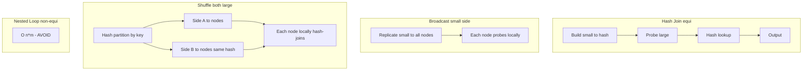

### Lab Exercise
```sql
EXPLAIN
SELECT s.*, c.region
FROM sales s JOIN customers c ON s.customer_id = c.id;  -- hash

EXPLAIN
SELECT s.*, dr.rate
FROM sales s JOIN dim_rate dr
ON s.dt BETWEEN dr.valid_from AND dr.valid_to;  -- nested loop (range)

-- Observe profile differences
SELECT query_text, operator_statistics
FROM TABLE(INFORMATION_SCHEMA.QUERY_HISTORY_BY_SESSION())
ORDER BY start_time DESC LIMIT 5;
```
**Expected outcome:** First has HashJoin node; second has NestedLoopJoin with potentially huge row cost.

### Gotchas / Exam Traps
- Range join between two large tables is often fixable by discretizing the range column (bucketing).
- Join on `UPPER(col) = UPPER(col)` prevents join-key pruning / clustering use — avoid function-wrapped joins.
- `BROADCAST` hints are not available in Snowflake; the optimizer decides.

---

## Q12: What is query acceleration service (QAS) and when does it help?
**Difficulty:** Advanced
**Exam relevance:** "Use Query Acceleration Service for skewed workloads."

### Answer
QAS is a serverless compute pool that offloads **scan-heavy portions of eligible queries** from your warehouse. Instead of resizing your WH for occasional big scans, QAS temporarily lends compute at per-second billing. Eligible: large table scans, selective filters, some aggregations. Not eligible: UDFs, high-cardinality distinct, small queries.

### First Principles
QAS exists because real workloads have long-tail outliers — a WH sized for the median query is undersized for the P99. Rather than resize for the outlier, QAS absorbs the burst. Snowflake decides automatically based on scan volume, pruning signatures, and eligibility rules. You enable it per warehouse with `ENABLE_QUERY_ACCELERATION=TRUE`, and set `QUERY_ACCELERATION_MAX_SCALE_FACTOR` to cap how much extra compute per query.

### Diagram
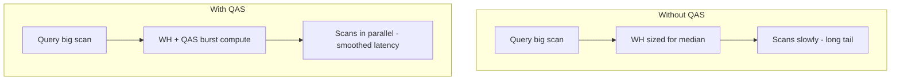

### Lab Exercise
```sql
ALTER WAREHOUSE my_wh SET
  ENABLE_QUERY_ACCELERATION = TRUE
  QUERY_ACCELERATION_MAX_SCALE_FACTOR = 8;  -- up to 8x extra

-- Observe QAS usage
SELECT query_id, warehouse_name,
       query_acceleration_bytes_scanned,
       query_acceleration_partitions_scanned,
       query_acceleration_upper_limit_scale_factor
FROM SNOWFLAKE.ACCOUNT_USAGE.QUERY_ACCELERATION_HISTORY
WHERE start_time > DATEADD(day,-7,CURRENT_DATE)
ORDER BY start_time DESC;

-- Estimate benefit for a specific query
SELECT SYSTEM$ESTIMATE_QUERY_ACCELERATION('<query_id>');
```
**Expected outcome:** QAS kicks in on outlier queries only; metering shows separate QAS credits.

### Gotchas / Exam Traps
- QAS doesn't help on well-sized WHs doing their expected work — it's for occasional big scans.
- Max scale factor caps **per-query** acceleration, not warehouse-wide.
- QAS doesn't accelerate writes, only reads.

---

## Q13: How does Snowflake's cost-based optimizer (CBO) use statistics, and when is it wrong?
**Difficulty:** Advanced
**Exam relevance:** "Understand CBO assumptions and edge cases."

### Answer
Snowflake's CBO uses MP-level stats automatically maintained on every write (no ANALYZE needed): row count, distinct-value estimates (HyperLogLog), null count, min/max per column. CBO builds plans using cardinality estimates. Mis-estimation happens on: non-equi joins, correlated predicates (ERP code implies region), UDF outputs, non-deterministic functions.

### First Principles
Unlike legacy databases requiring manual stats refreshes, Snowflake maintains stats as a byproduct of writing MPs. HyperLogLog gives distinct-count sketches cheaply. However, correlated predicates (e.g., `WHERE country='US' AND state='CA'` — most 'CA' are 'US') violate independence assumptions, so CBO over-estimates selectivity. The fix is to express the predicate in a way CBO handles (equality on fewer columns), or materialize derived values.

### Diagram
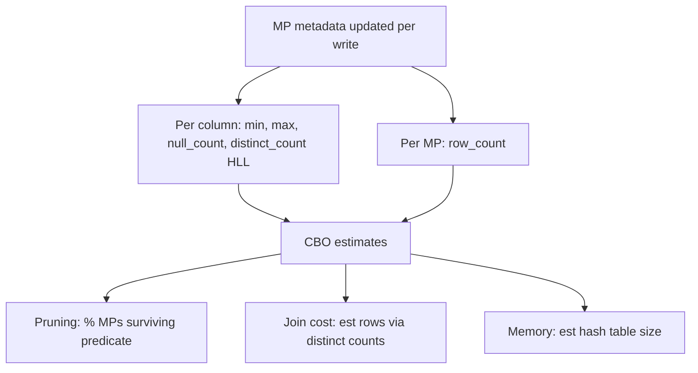

### Lab Exercise
```sql
-- Query that may mis-estimate
EXPLAIN USING TABULAR
SELECT * FROM sales
WHERE country='US' AND state='CA' AND city='San Francisco';

-- Check cardinality estimates vs actuals
SELECT query_id,
       JSON_EXTRACT_PATH_TEXT(stats,'estimated_rows') AS est_rows,
       rows_produced
FROM TABLE(INFORMATION_SCHEMA.QUERY_HISTORY_BY_SESSION())
ORDER BY start_time DESC LIMIT 5;
```
**Expected outcome:** When CBO estimate is far off from actual, plan may be suboptimal.

### Gotchas / Exam Traps
- There is no `ANALYZE TABLE` in Snowflake — stats are always current.
- `WITH JOIN HINT` and other hints are extremely limited; mostly you influence CBO by rewriting SQL.
- "Snowflake doesn't need indexes" — true, but SOS is effectively an index for lookup-heavy workloads.

---

## Q14: Explain `RESULT_SCAN` and when to use it.
**Difficulty:** Foundation
**Exam relevance:** "Reuse previous query results."

### Answer
`RESULT_SCAN('<query_id>')` returns the result set of a previous query as a table. Useful for post-processing (aggregating, filtering) a known result without re-running the base query. Results survive 24h (or until invalidated).

### First Principles
`RESULT_SCAN` taps the Result Cache directly as a table source. Zero compute. Great for interactive exploration or Snowsight dashboards that want to drill into a prior query. Not a replacement for materialized views (which are updated on data change); result_scan is point-in-time.

### Diagram
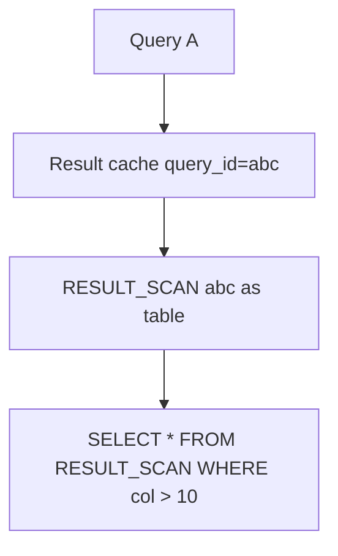

### Lab Exercise
```sql
SELECT customer_id, SUM(amt) AS total
FROM sales GROUP BY customer_id;

-- Grab the query_id from this session
SET last_qid = LAST_QUERY_ID();

-- Post-process without re-running the group-by
SELECT * FROM TABLE(RESULT_SCAN($last_qid))
WHERE total > 10000
ORDER BY total DESC;
```
**Expected outcome:** Second query completes in milliseconds — no compute.

### Gotchas / Exam Traps
- Result sets > 10,000 rows are stored in result cache but may require re-materialization; still free.
- `RESULT_SCAN(LAST_QUERY_ID())` is a common idiom.
- Non-deterministic queries don't cache; RESULT_SCAN won't find them.

---

## Q15: How do you set up and read resource monitors?
**Difficulty:** Foundation
**Exam relevance:** "Govern warehouse credit usage."

### Answer
Resource monitors cap credit usage at account or warehouse level. Define `CREDIT_QUOTA`, `FREQUENCY` (MONTHLY/DAILY/etc.), and triggers (`NOTIFY`, `SUSPEND`, `SUSPEND_IMMEDIATE`). Only ACCOUNTADMIN can create.

### First Principles
Snowflake's compute is pay-per-use with no hard limits by default — a runaway query can burn thousands of credits. Resource monitors are the safety net. Monthly quota + 90% notify + 100% suspend is the standard pattern. Monitors reset on `FREQUENCY` boundary.

### Diagram
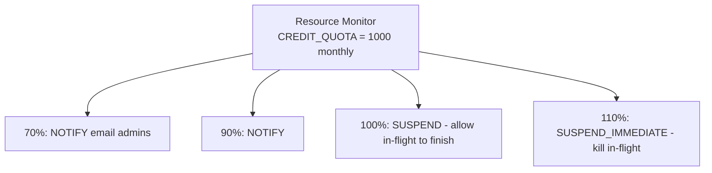

### Lab Exercise
```sql
CREATE OR REPLACE RESOURCE MONITOR etl_rm
  CREDIT_QUOTA = 500
  FREQUENCY = MONTHLY
  START_TIMESTAMP = IMMEDIATELY
  TRIGGERS
    ON 70 PERCENT DO NOTIFY
    ON 90 PERCENT DO NOTIFY
    ON 100 PERCENT DO SUSPEND
    ON 110 PERCENT DO SUSPEND_IMMEDIATE;

ALTER WAREHOUSE etl_wh SET RESOURCE_MONITOR = etl_rm;

-- Check status
SELECT name, credit_quota, used_credits, remaining_credits, level, frequency
FROM SNOWFLAKE.ACCOUNT_USAGE.RESOURCE_MONITORS;
```
**Expected outcome:** Warehouse auto-suspends at quota breach; alerts fire at thresholds.

### Gotchas / Exam Traps
- `SUSPEND` lets in-flight queries complete; `SUSPEND_IMMEDIATE` kills them (incurs rollback cost).
- Account-level monitor applies to **all** warehouses; warehouse-level monitors override.
- Monitors do NOT limit storage or serverless (Snowpipe, auto-cluster) credits — only warehouse credits.

---

## Q16: Design a warehouse topology for a mixed BI + ETL + ad-hoc workload.
**Difficulty:** Advanced
**Exam relevance:** "Isolate workloads via warehouses."

### Answer
Separate warehouses per workload to isolate credit cost and performance: `etl_wh` (M–L, serial batches), `bi_wh` (M, multi-cluster for concurrency), `adhoc_wh` (XS–S, aggressive auto-suspend, low max cluster), `svc_wh` (XS, Snowpipe REST or app queries). Attach resource monitors to each.

### First Principles
Snowflake's "virtual warehouse" model exists to let you isolate workloads without data copies. Mixing ETL (long-running, large scans) with BI (short, concurrent) in the same WH causes queueing and poor cache utilization — ETL evicts BI's hot MPs. Separate WHs = separate caches + separate scaling.

### Diagram
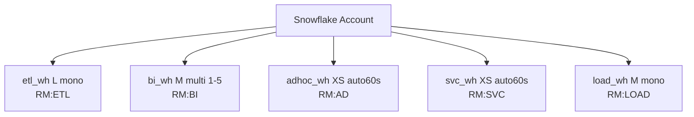

### Lab Exercise
```sql
CREATE WAREHOUSE etl_wh WAREHOUSE_SIZE=LARGE AUTO_SUSPEND=300 AUTO_RESUME=TRUE;
CREATE WAREHOUSE bi_wh  WAREHOUSE_SIZE=MEDIUM MIN_CLUSTER_COUNT=1 MAX_CLUSTER_COUNT=5
  SCALING_POLICY=STANDARD AUTO_SUSPEND=120;
CREATE WAREHOUSE adhoc_wh WAREHOUSE_SIZE=XSMALL AUTO_SUSPEND=60;

-- Attach monitors
CREATE RESOURCE MONITOR rm_etl CREDIT_QUOTA=2000 FREQUENCY=MONTHLY
  TRIGGERS ON 100 PERCENT DO SUSPEND;
ALTER WAREHOUSE etl_wh SET RESOURCE_MONITOR=rm_etl;
```
**Expected outcome:** Each workload isolated; metering easy to attribute.

### Gotchas / Exam Traps
- Role-based warehouse routing via `DEFAULT_WAREHOUSE` on roles ensures a user's queries land in the right pool.
- Over-partitioning (12+ warehouses) wastes idle credits during suspend/resume churn.
- Snowpark workloads should use Snowpark-optimized WH; mixing with pure SQL wastes memory.

---

## Q17: What is "query hash" and why does Snowflake use it?
**Difficulty:** Intermediate
**Exam relevance:** "Correlate queries across history."

### Answer
`QUERY_HASH` is a deterministic hash of the normalized query text (literals replaced, formatting stripped). Lets you group semantically identical queries across executions. `QUERY_PARAMETERIZED_HASH` is the same but also replaces inline values.

### First Principles
Production workloads have thousands of queries; raw text comparison is useless because literal values differ. Snowflake's query hash normalizes the AST so semantically equivalent queries hash the same. This powers Snowsight's "Top Queries" view and lets you trend one logical query over time regardless of parameterization.

### Diagram
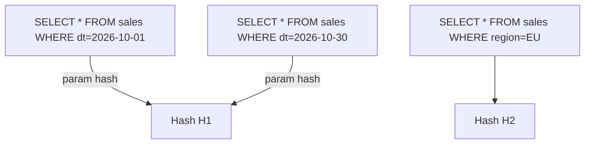

### Lab Exercise
```sql
SELECT query_parameterized_hash,
       COUNT(*) AS exec_cnt,
       AVG(execution_time)/1000 AS avg_sec,
       SUM(credits_used_cloud_services) AS total_credits
FROM SNOWFLAKE.ACCOUNT_USAGE.QUERY_HISTORY
WHERE start_time > DATEADD(day,-30,CURRENT_DATE)
GROUP BY 1
ORDER BY total_credits DESC
LIMIT 20;
```
**Expected outcome:** Identifies "top offenders" — queries worth optimizing.

### Gotchas / Exam Traps
- `QUERY_HASH` preserves distinct literals (`col='A'` vs `col='B'` differ); `QUERY_PARAMETERIZED_HASH` does not.
- Hash is NOT a security identifier; two users running identical SELECT get the same hash.
- Hash computes before compile — syntactically different but semantically same queries have different hashes.

---

## Q18: Explain how JOIN order affects performance, and whether the optimizer handles it.
**Difficulty:** Advanced
**Exam relevance:** "Understand join reordering and when manual intervention helps."

### Answer
Snowflake's CBO reorders joins to minimize intermediate row counts (hash the smaller side, join selective first). For most workloads the optimizer gets it right. Edge cases where you may need to rewrite: joins with correlated subqueries, many-way joins (>8 tables), joins involving materialized paths through views where cardinality is hidden.

### First Principles
Join cost scales with intermediate row counts. The optimal order joins the most selective tables first (smaller intermediate), then widens. CBO computes cardinalities from MP stats and picks an order. When CBO is wrong — usually because of correlated predicates it can't detect — row counts explode mid-plan. The fix is often to pre-aggregate (CTE) or materialize an intermediate so stats on it are explicit.

### Diagram
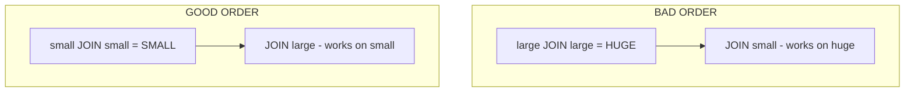

### Lab Exercise
```sql
-- Many-way join with CBO guessing
EXPLAIN
SELECT ...
FROM fact_sales s
JOIN dim_customer c ON ...
JOIN dim_product p ON ...
JOIN dim_region r ON ...
JOIN dim_time t ON ...
WHERE t.year = 2026;

-- Force partial aggregation first
WITH prefiltered AS (
  SELECT s.* FROM fact_sales s JOIN dim_time t ON s.dt_id = t.id
  WHERE t.year = 2026
)
SELECT ... FROM prefiltered p
JOIN dim_customer c ON ...
JOIN dim_product p2 ON ...;
```
**Expected outcome:** CTE often leads to better plan on complex joins (CBO treats CTE as fixed-cardinality intermediate).

### Gotchas / Exam Traps
- CTEs are inlined by default; Snowflake may or may not materialize. Use `MATERIALIZE` hint (via session parameter) to force.
- Join-elimination: Snowflake removes joins to tables not referenced in SELECT when FK constraints or uniqueness are informatics (`RELY` constraints) — define them even if not enforced.

---

## Q19: How does query compilation + metadata work for small/short queries?
**Difficulty:** Intermediate
**Exam relevance:** "Understand cloud services vs. warehouse time."

### Answer
Compilation and metadata operations run in Snowflake's **cloud services layer** (serverless, Snowflake-managed). Billed only if it exceeds 10% of daily warehouse credits (otherwise free). Queries like `SHOW`, `DESC`, `COUNT(*)` without WHERE run entirely in cloud services — no WH needed.

### First Principles
Snowflake separates compute into three layers: cloud services (metadata, auth, planning, caching, security), virtual warehouses (query execution), serverless (Snowpipe, auto-cluster, SOS maintenance, replication). Cloud services is subsidized up to 10% of consumption — making metadata-heavy workloads effectively free. Short queries served from metadata don't start a warehouse at all.

### Diagram
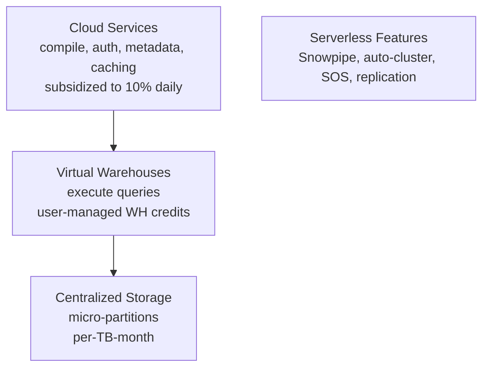

### Lab Exercise
```sql
-- Cloud services only
SELECT COUNT(*) FROM huge_table;    -- metadata, free
SHOW TABLES IN SCHEMA public;        -- metadata, free
DESC TABLE sales;                    -- metadata, free

-- Mixed
SELECT * FROM sales LIMIT 10;        -- WH required for data

-- Check cloud services usage
SELECT DATE_TRUNC('day', start_time) AS d,
       SUM(credits_used_cloud_services) AS cs,
       SUM(credits_used_compute) AS wh,
       cs / NULLIF(wh,0) AS cs_ratio
FROM SNOWFLAKE.ACCOUNT_USAGE.QUERY_HISTORY
WHERE start_time > DATEADD(day,-7,CURRENT_DATE)
GROUP BY 1 ORDER BY 1;
```
**Expected outcome:** `cs_ratio` typically well below 0.10 — all cloud services covered by subsidy.

### Gotchas / Exam Traps
- Heavy metadata workloads (lots of `SHOW`/`DESC` from BI tools) can push cs_ratio over 10% — monitor.
- `COUNT(*)` with filter needs the WH (unless pruning is total).
- Cloud services queries do NOT need a WH to be running — session can resume suspended WH only when actual data operation is needed.

---

## Q20: What are the signals for using Snowpark Optimized Warehouses?
**Difficulty:** Advanced
**Exam relevance:** "Choose warehouse type for Snowpark workloads."

### Answer
Signals: Python UDFs loading large models in memory (ML inference), heavy pandas operations in stored procedures, workloads with high `bytes_spilled_to_local_storage` despite reasonable WH size, Snowpark DataFrame operations with large intermediate materialization. Snowpark-optimized WHs have **16x memory per node** (same compute cores).

### First Principles
Standard WHs are tuned for columnar SQL — memory per core is moderate. Snowpark workloads (especially Python UDFs executing in sandboxed interpreters) can be memory-hungry: loading an sklearn model, building a pandas DataFrame, running inference. Snowpark-optimized trades a higher credit cost for drastically more RAM per worker, eliminating spill for those workloads.

### Diagram

| Attribute | Standard WH | Snowpark-Optimized WH |
|-----------|-------------|------------------------|
| RAM/core  | 16 GB | 256 GB (16x) |
| Credit mult | 1x | ~1.5x |
| Best for | SQL, columnar scans | Python UDFs, ML, pandas |

### Lab Exercise
```sql
CREATE WAREHOUSE ml_wh
  WAREHOUSE_SIZE = MEDIUM
  WAREHOUSE_TYPE = 'SNOWPARK-OPTIMIZED'
  AUTO_SUSPEND = 120;

-- Example: large model inference UDF
CREATE OR REPLACE FUNCTION predict_fraud(features VARIANT)
RETURNS FLOAT
LANGUAGE PYTHON
RUNTIME_VERSION = '3.11'
PACKAGES = ('scikit-learn','pandas','numpy')
IMPORTS = ('@models/fraud_model.pkl')
HANDLER = 'predict'
AS $$
import pickle, sys, pandas as pd
from _snowflake import vectorized

model = None
def _load():
    global model
    if model is None:
        with open(sys.argv[0] or '/tmp/model.pkl','rb') as f:
            model = pickle.load(f)
    return model

@vectorized(input=pd.DataFrame)
def predict(df):
    m = _load()
    return pd.Series(m.predict_proba(df.values)[:,1])
$$;

ALTER FUNCTION predict_fraud(VARIANT) SET SECURE;
```
**Expected outcome:** Model loads once per worker; vectorized UDF batches rows per call; standard WH would OOM.

### Gotchas / Exam Traps
- Can't convert a Standard WH to Snowpark-optimized in place; must recreate.
- Minimum size for Snowpark-optimized is **Medium**.
- Higher credit cost: use only for workloads that need it; pure SQL doesn't benefit.

---

## Q21: Describe how pruning interacts with semi-structured data (VARIANT) access.
**Difficulty:** Advanced
**Exam relevance:** "Optimize queries on VARIANT columns."

### Answer
Snowflake builds per-path sub-column statistics for consistent VARIANT paths. `payload:user.id::INT` prunes as well as a typed column when the path appears consistently across MPs. Casting + filter in WHERE on VARIANT path leverages those stats. Highly polymorphic VARIANT (same key, different types) falls back to tagged storage with weaker pruning.

### First Principles
A VARIANT loader scans incoming data, identifies common paths (>N% of rows), and allocates "virtual column" storage per path with its own min/max metadata. On query, Snowflake rewrites `v:path::TYPE` into reads of that virtual column with full pruning. The practical implication: schema consistency matters even for schema-less data. Enforce stable JSON schemas upstream if you want VARIANT pruning.

### Diagram
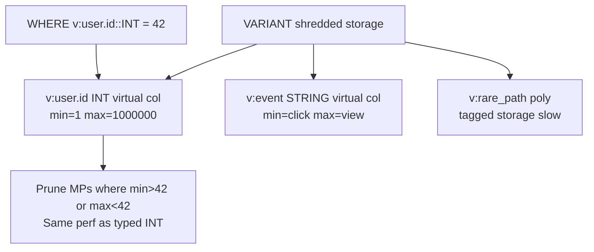

### Lab Exercise
```sql
EXPLAIN SELECT *
FROM events_raw
WHERE payload:user.id::INT = 42;

-- Compare: filter on untyped path (no cast)
EXPLAIN SELECT *
FROM events_raw
WHERE payload:user.id = 42;  -- type coercion, pruning weaker

-- Promote frequently queried paths to typed columns (dynamic table)
CREATE OR REPLACE DYNAMIC TABLE events_typed
  TARGET_LAG='5 minutes' WAREHOUSE=etl_wh
AS SELECT payload:user.id::INT AS user_id, payload:event::STRING AS event, *
   FROM events_raw;
```
**Expected outcome:** Typed path filter prunes well; untyped weaker.

### Gotchas / Exam Traps
- Always cast with `::TYPE` in VARIANT WHERE for best pruning.
- Compared literal must match type: `WHERE v:count::INT = '42'` fails pruning (STRING literal).
- Arrays within VARIANT don't prune; FLATTEN scans all elements.

---

## Q22: What is "join pruning" and how does Snowflake implement it?
**Difficulty:** Advanced
**Exam relevance:** "Advanced pruning via joins."

### Answer
Join pruning (also "bloom pruning" or "join filter pruning") passes filter values from the small side of a join to the large side's MP metadata check, pruning MPs on the probe side using the build side's actual values. Snowflake does this automatically when it has stats showing the small side is small.

### First Principles
A standard join scans the probe side fully then hashes matches. Join pruning adds a feed-forward: as the build side is read, Snowflake collects distinct join-key values and uses them to prune MPs on the probe side. For a selective dimension lookup, this can prune >99% of fact-table MPs. Effectiveness depends on both tables being clustered or at least having naturally-tight ranges on the join key.

### Diagram
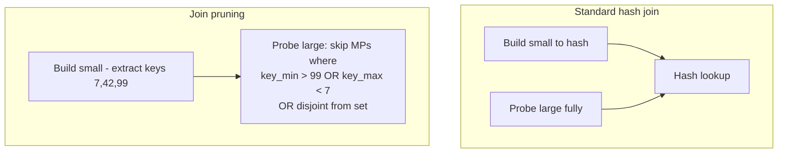

### Lab Exercise
```sql
-- Fact table clustered by customer_id for join pruning benefit
CREATE OR REPLACE TABLE sales_clu CLUSTER BY (customer_id) AS SELECT * FROM sales;

-- Small dimension filter
EXPLAIN
SELECT s.*
FROM sales_clu s
JOIN dim_customer c ON s.customer_id = c.id
WHERE c.tier = 'PLATINUM';   -- selects say 100 customers out of 1M

-- Query profile should show pruning on sales_clu driven by join
SELECT partitions_scanned, partitions_total
FROM TABLE(INFORMATION_SCHEMA.QUERY_HISTORY_BY_SESSION())
ORDER BY start_time DESC LIMIT 1;
```
**Expected outcome:** `partitions_scanned` far less than total despite no explicit predicate on sales_clu.

### Gotchas / Exam Traps
- Join pruning requires the probe side to be clustered (or naturally ordered) on the join key.
- Does not work for non-equi joins.
- Visible in profile as "Dynamic File Pruning" statistics.

---

## Q23: Explain query tag + warehouse monitoring strategy for a mature org.
**Difficulty:** Intermediate
**Exam relevance:** "Govern and attribute compute usage."

### Answer
Set `QUERY_TAG` at session start (`ALTER SESSION SET QUERY_TAG = '{"team":"analytics","job":"nightly_etl"}'`) so every query carries the tag. Join `QUERY_HISTORY.query_tag` with `WAREHOUSE_METERING_HISTORY` to attribute credits to teams/jobs/dashboards. Tag + user + warehouse = full attribution.

### First Principles
Snowflake doesn't natively charge by team — all usage rolls up to the account. Tags are the attribution primitive. Mature orgs make tagging mandatory via `ALTER ACCOUNT SET QUERY_TAG_MANDATORY_FOR_WAREHOUSE=TRUE` (not a real setting — but enforced via policies / dbt macros / BI connector configs). Combined with role → default_warehouse, you get clear cost views.

### Diagram
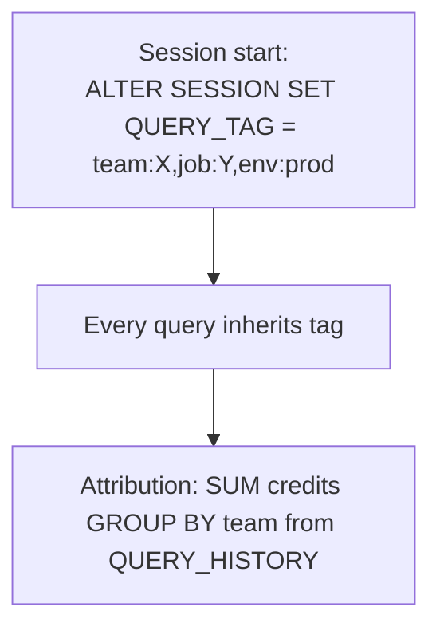

### Lab Exercise
```sql
ALTER SESSION SET QUERY_TAG = '{"team":"analytics","env":"prod","job":"daily_rollup"}';

SELECT SUM(amt) FROM sales WHERE dt > DATEADD(day,-7,CURRENT_DATE);

-- Later: attribution
SELECT TRY_PARSE_JSON(query_tag):team::STRING AS team,
       TRY_PARSE_JSON(query_tag):job::STRING AS job,
       SUM(credits_used_cloud_services + credits_used_compute) AS credits,
       COUNT(*) AS query_cnt
FROM SNOWFLAKE.ACCOUNT_USAGE.QUERY_HISTORY
WHERE start_time > DATEADD(day,-30,CURRENT_DATE)
GROUP BY 1, 2
ORDER BY credits DESC;
```
**Expected outcome:** Credits attributable to team/job over 30 days.

### Gotchas / Exam Traps
- `QUERY_TAG` is session-level only — children SPs/UDFs inherit, but new sessions reset.
- Tags with newlines or long JSON (>2000 chars) may truncate.
- `ACCESS_HISTORY` doesn't include tags; join on `query_id` to QUERY_HISTORY to get them.

---

## Q24: When would you use `SYSTEM$ESTIMATE_SEARCH_OPTIMIZATION_COSTS` vs just enabling SOS?
**Difficulty:** Intermediate
**Exam relevance:** "Cost-benefit analysis for SOS."

### Answer
Call `SYSTEM$ESTIMATE_SEARCH_OPTIMIZATION_COSTS('tbl', 'EQUALITY(col)')` **before** enabling SOS to see upfront build cost and ongoing storage/maintenance cost estimate. If estimated monthly cost exceeds the compute saved on current queries, don't enable.

### First Principles
SOS is a cost shift: pay serverless credits + storage to save warehouse credits. If your workload has few selective lookups, the trade is bad. The estimator uses current table size and update patterns to estimate costs. Pair with query history analysis of candidate predicates to validate benefit.

### Diagram
```mermaid
flowchart TD
    C[Candidate column<br/>frequent WHERE col = ?]
    C --> E[SYSTEM$ESTIMATE_SEARCH_OPTIMIZATION_COSTS]
    E --> X[Est monthly cost X credits]
    X --> H[QUERY_HISTORY: avg credits per lookup query]
    H --> D{Savings > X?}
    D -->|yes| EN[ENABLE SOS]
    D -->|no| SK[Skip SOS]
```

### Lab Exercise
```sql
SELECT SYSTEM$ESTIMATE_SEARCH_OPTIMIZATION_COSTS('sales', 'EQUALITY(order_id)');
-- Returns JSON with:
-- storage_bytes_estimated
-- cost_estimated_build_credits
-- cost_estimated_maintenance_credits_per_day

-- Compare against workload benefit
SELECT AVG(execution_time) / 1000 AS avg_sec,
       SUM(credits_used_cloud_services + credits_used_compute) AS credits
FROM SNOWFLAKE.ACCOUNT_USAGE.QUERY_HISTORY
WHERE query_text ILIKE '%sales%order_id =%'
AND start_time > DATEADD(day,-30,CURRENT_DATE);
```
**Expected outcome:** Clear numeric comparison between SOS cost and query savings.

### Gotchas / Exam Traps
- Estimates assume current table size; grows linearly with data.
- Build cost is one-time; maintenance is ongoing proportional to writes.
- Does not account for the queries you *might* run post-SOS; use with judgment.

---

## Q25: Describe Snowflake's "warehouse credit math" — how exactly are you billed?
**Difficulty:** Intermediate
**Exam relevance:** "Understand compute billing."

### Answer
Billed per-second with **60-second minimum per start/resume**. Credit rate = size multiplier (XS=1, S=2, M=4, L=8, XL=16, 2XL=32, 3XL=64, 4XL=128, 5XL=256, 6XL=512) × hours running. Multi-cluster: sum across active clusters. Snowpark-optimized: ~1.5x multiplier at same size (varies by region).

### First Principles
A warehouse that resumes, runs 10 seconds, then auto-suspends still bills 60 seconds. So aggressive `AUTO_SUSPEND=60` plus bursty workload = minimum charges per burst. Longer `AUTO_SUSPEND` keeps the WH warm (cache intact, no 60s floor) at the cost of idle time. The breakeven is typically ~5 minutes between queries.

### Diagram

Credits per hour (by size):

| Size | Credits/hr |
|------|-----------:|
| XS | 1 |
| S | 2 |
| M | 4 |
| L | 8 |
| XL | 16 |
| 2XL | 32 |
| 3XL | 64 |
| 4XL | 128 |
| 5XL | 256 |
| 6XL | 512 |

Billing rules:
- Per-second after 60s minimum per resume
- Billed in 1-second increments

Examples:
- M running 90s = 90/3600 × 4 = 0.1 credits
- M resume + 10s + suspend = 60/3600 × 4 = 0.067 credits (minimum)

### Lab Exercise
```sql
-- Attribution per warehouse
SELECT warehouse_name,
       DATE_TRUNC('day', start_time) AS d,
       SUM(credits_used) AS credits
FROM SNOWFLAKE.ACCOUNT_USAGE.WAREHOUSE_METERING_HISTORY
WHERE start_time > DATEADD(day,-30,CURRENT_DATE)
GROUP BY 1, 2
ORDER BY 2, 3 DESC;

-- Idle credits (resumed but no query running)
SELECT warehouse_name,
       SUM(credits_used) AS total,
       SUM(credits_used_compute) AS compute,  -- active
       SUM(credits_used) - SUM(credits_used_compute) AS idle
FROM SNOWFLAKE.ACCOUNT_USAGE.WAREHOUSE_METERING_HISTORY
WHERE start_time > DATEADD(day,-30,CURRENT_DATE)
GROUP BY 1
ORDER BY idle DESC;
```
**Expected outcome:** Identifies warehouses with high idle (auto-suspend too long or oversized).

### Gotchas / Exam Traps
- `AUTO_SUSPEND = 0` disables auto-suspend (dangerous, bills continuously).
- `AUTO_SUSPEND < 60` is allowed but the 60-second billing floor still applies — no cost benefit below 60s.
- Resizing a WH does **not** charge a new minimum — the WH continues from its current second count.
