# Storage & Data Protection — DEA-C02 Study Guide

## Exam Weight & Scope
Storage & Data Protection is ~18% of the DEA-C02 exam. Covers micro-partition internals, Time Travel semantics, Fail-safe, zero-copy cloning, replication (database/account), failover groups, data retention trade-offs, and storage cost mechanics.

## Core Concepts Map
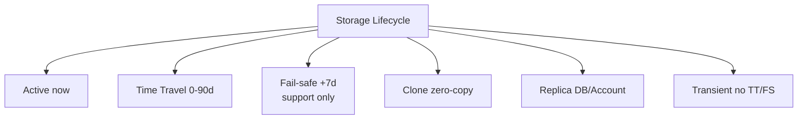

Table types:

| Type | TT | FS | Scope |
|------|---:|---:|-------|
| Permanent | 0-90d | 7d | account |
| Transient | 0-1d | none | account |
| Temporary | 0-1d | none | session only |
| External | none | none | metadata only |

Replication: Database replication → secondary DBs. Account replication → full account including users/roles. Failover group → promote for DR.

---

## Q1: Describe the micro-partition structure in detail — storage layout, encoding, immutability.
**Difficulty:** Intermediate
**Exam relevance:** "Explain Snowflake's physical storage architecture."

### Answer
A micro-partition (MP) is a 50–500 MB uncompressed, 16–50 MB compressed, columnar file in cloud storage (S3/Azure Blob/GCS). Each MP contains contiguous rows stored column-by-column with per-column encoding (dictionary, run-length, delta). MPs are **immutable** — any DML writes new MPs and marks old ones for deletion (soft delete + Time Travel + Fail-safe).

### First Principles
Immutability is foundational for Snowflake's time travel + zero-copy clone + concurrent access models. Instead of in-place updates, Snowflake writes new MPs and swaps pointers in a transaction-safe table metadata catalog. The old MPs still exist on cloud storage, protected by data retention; they're reclaimable only after Fail-safe (7 days) expires. Columnar encoding allows the scan engine to decode only requested columns; dictionary encoding compresses low-cardinality strings to tiny integers; metadata (min/max) lives in the catalog, not inside the file.

### Diagram
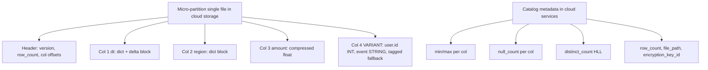

### Lab Exercise
```sql
-- Inspect physical storage
SELECT system$get_partition_details('sales') LIMIT 5;  -- debug-level

SELECT table_name,
       bytes AS active_bytes,
       bytes / NULLIF(row_count,0) AS bytes_per_row,
       row_count,
       retained_for_clone_bytes,
       time_travel_bytes,
       failsafe_bytes
FROM SNOWFLAKE.ACCOUNT_USAGE.TABLE_STORAGE_METRICS
WHERE table_name = 'SALES';

-- Compression ratio
SELECT bytes / NULLIF(active_bytes_raw_estimate,0) AS compression_ratio
FROM INFORMATION_SCHEMA.TABLE_STORAGE_METRICS
WHERE table_name = 'SALES';
```
**Expected outcome:** See storage split across active, Time Travel, Fail-safe; typical compression ratio 3–10x.

### Gotchas / Exam Traps
- Updating one row can rewrite an entire MP — small updates on huge MPs are inefficient.
- MPs are "soft deleted" via metadata, but the file remains until TT + FS expire — you pay storage.
- Max rows per MP is **not a hard limit**; Snowflake targets ~16 MB compressed per MP.

---

## Q2: Explain Time Travel in detail — syntax, limits, retention.
**Difficulty:** Foundation
**Exam relevance:** "Query and restore historical table states."

### Answer
Time Travel lets you query/restore a table at a point within its retention window. Syntax: `AT (TIMESTAMP => ...)`, `AT (OFFSET => -seconds)`, `AT (STATEMENT => '<query_id>')`, `BEFORE (STATEMENT => ...)`. Default retention: 1 day (permanent/transient) and 0 days (temporary) — configurable up to **90 days** on **Enterprise+** editions.

### First Principles
Time Travel is a lightweight pointer game: Snowflake retains the pre-change MPs for `DATA_RETENTION_TIME_IN_DAYS`. Queries at past timestamps use the catalog as of that time to list the MPs that were "active" then. The data is still just MPs in cloud storage — no snapshot copy, no replay. This is why Time Travel is extremely fast and nearly free (you only pay storage for retained bytes). After retention expires, MPs transition to Fail-safe (recoverable only via Snowflake Support for permanent tables).

### Diagram
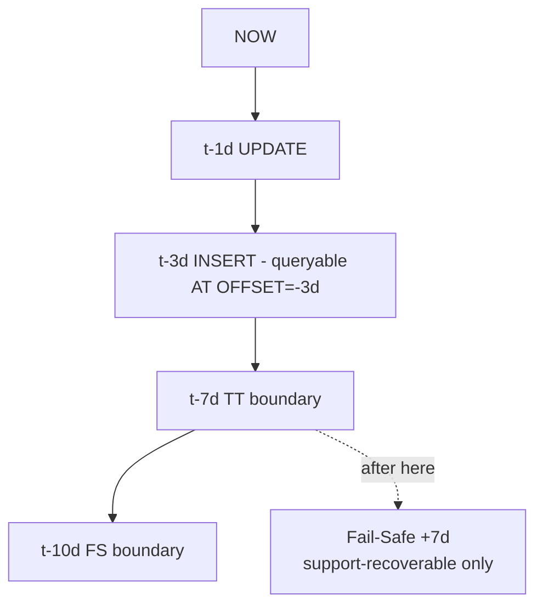

### Lab Exercise
```sql
-- Set up
CREATE TABLE tt_demo (id INT, v STRING) DATA_RETENTION_TIME_IN_DAYS=7;
INSERT INTO tt_demo VALUES (1,'a'),(2,'b'),(3,'c');
UPDATE tt_demo SET v='X' WHERE id=1;
DELETE FROM tt_demo WHERE id=3;

-- Query past
SELECT * FROM tt_demo AT (OFFSET => -60);  -- 60 seconds ago
SELECT * FROM tt_demo AT (TIMESTAMP => '2026-10-30 10:00:00'::TIMESTAMP_NTZ);
SELECT * FROM tt_demo BEFORE (STATEMENT => '<query_id>');

-- Restore accidentally dropped table (within retention)
DROP TABLE tt_demo;
UNDROP TABLE tt_demo;

-- Restore a specific past state
CREATE TABLE tt_demo_restored CLONE tt_demo AT (OFFSET => -300);
```
**Expected outcome:** All historical states queryable; `UNDROP` recovers dropped objects.

### Gotchas / Exam Traps
- `DATA_RETENTION_TIME_IN_DAYS=0` disables TT — allowed but destroys recovery capability.
- Changing retention from 7 to 1 **immediately** moves MPs older than 1 day to Fail-safe — unrecoverable except via support.
- `AT (STATEMENT => id)` returns state as of the start of that query; `BEFORE` returns state immediately before. Exam tests this distinction.
- `MAX_DATA_EXTENSION_TIME_IN_DAYS` extends retention for streams or dependencies — up to 90 days — but you still pay storage.

---

## Q3: What is Fail-safe and how does it differ from Time Travel?
**Difficulty:** Foundation
**Exam relevance:** "Explain Fail-safe recovery guarantees."

### Answer
Fail-safe is a **7-day, non-user-accessible** backup zone that holds MPs after Time Travel expires. It's for Snowflake Support to recover data in catastrophic failure scenarios. Only **permanent** tables have Fail-safe (transient and temporary do not). You cannot query or restore from Fail-safe yourself.

### First Principles
Time Travel is the user's recovery tool (SQL-accessible); Fail-safe is Snowflake's final safety net before data is permanently deleted. The 7-day Fail-safe window gives support time to recover from bugs or disasters without user intervention. Transient tables skip Fail-safe explicitly to save storage cost — ideal for staging/intermediate tables you can rebuild from source.

### Diagram
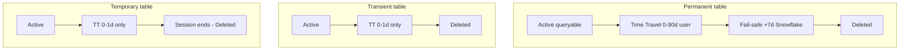

### Lab Exercise
```sql
-- Storage attribution shows Fail-safe
SELECT table_name,
       active_bytes,
       time_travel_bytes,
       failsafe_bytes,
       retained_for_clone_bytes
FROM SNOWFLAKE.ACCOUNT_USAGE.TABLE_STORAGE_METRICS
WHERE table_schema='PUBLIC'
ORDER BY failsafe_bytes DESC;

-- Create a transient to avoid Fail-safe cost
CREATE TRANSIENT TABLE staging_sales AS SELECT * FROM sales;

-- Verify no Fail-safe charges on transient
SELECT * FROM SNOWFLAKE.ACCOUNT_USAGE.TABLE_STORAGE_METRICS
WHERE table_name='STAGING_SALES';
```
**Expected outcome:** Transient table shows 0 failsafe_bytes; permanent tables may have significant failsafe_bytes.

### Gotchas / Exam Traps
- You cannot disable Fail-safe on a permanent table — convert to transient to skip it (requires drop+recreate).
- Fail-safe is **not configurable** — always 7 days.
- A dropped permanent table is in Fail-safe for 7 days post-TT; still bills storage.
- Converting a permanent table to transient requires `CREATE TRANSIENT TABLE ... AS SELECT * FROM permanent` + `DROP permanent` — you lose the original's Time Travel.

---

## Q4: Explain zero-copy cloning — mechanism, use cases, and cost.
**Difficulty:** Intermediate
**Exam relevance:** "Clone tables, schemas, databases for test/dev."

### Answer
`CREATE TABLE clone_t CLONE source_t` creates a logical copy that initially shares all MPs with source. Cost is instant metadata operation; storage cost is only for *diverged* MPs (data changed in either source or clone after cloning). Clones can be at any point in Time Travel. Supports tables, schemas, databases.

### First Principles
Clones work because MPs are immutable. The clone starts life sharing every MP pointer with the source. When either side modifies data, new MPs are written and only that side points to them. Divergence is additive — the two tables accumulate independent MP sets over time. For dev/test environments on huge databases, cloning is near-instant and nearly free initially. Snowflake tracks "retained for clone" bytes separately — MPs retained because a clone still references them.

### Diagram
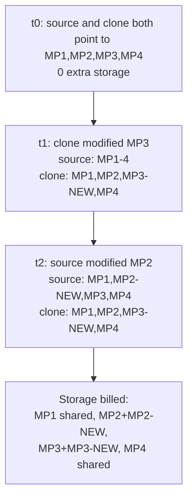

### Lab Exercise
```sql
-- Instant clone of a 10 TB table
CREATE TABLE sales_dev CLONE sales;

-- Clone at a past timestamp (recovery scenario)
CREATE TABLE sales_yesterday CLONE sales AT (TIMESTAMP => DATEADD(day,-1,CURRENT_TIMESTAMP));

-- Clone entire database for dev
CREATE DATABASE prod_dev CLONE prod_db;

-- Monitor retained-for-clone bytes
SELECT table_name,
       active_bytes,
       retained_for_clone_bytes,
       time_travel_bytes
FROM SNOWFLAKE.ACCOUNT_USAGE.TABLE_STORAGE_METRICS
WHERE table_schema = 'PUBLIC'
ORDER BY retained_for_clone_bytes DESC;
```
**Expected outcome:** Clone creation is sub-second; storage ~0 initially; grows only with divergence.

### Gotchas / Exam Traps
- Clones **don't inherit grants** — permissions must be re-granted.
- Pipes, streams, and tasks are cloned as metadata but typically start in a disabled or stale state and need manual re-setup.
- `retained_for_clone_bytes` is a hidden cost — dropping unused clones promptly saves money.
- Cloning does NOT clone the Fail-safe — the clone has fresh TT/FS starting at clone time.
- You cannot clone an external table (file-system backed, no MP state).

---

## Q5: Compare permanent, transient, and temporary tables.
**Difficulty:** Foundation
**Exam relevance:** "Choose table type for lifecycle and cost."

### Answer
**Permanent**: default, Time Travel 0–90d, Fail-safe 7d, full storage cost. **Transient**: TT max 1d, no Fail-safe, lower cost — for rebuildable intermediates. **Temporary**: session-scoped, TT max 1d, no FS, dropped at session end — for private scratch.

### First Principles
Choice is a trade-off between data protection and storage cost. For raw ingestion staging or ETL intermediate, transient tables cut storage ~30% (no FS). Temp tables are per-session only — multiple sessions can create same-named temp tables without conflict (name-isolated). Permanent is appropriate for authoritative sources of truth where recovery matters.

### Diagram

| Attribute | Permanent | Transient | Temporary |
|-----------|-----------|-----------|-----------|
| TT | 0-90d | 0-1d | 0-1d |
| FS | 7d | none | none |
| Scope | account | account | session |
| Replicable | yes | yes | no |
| SHOW visible | yes | yes | owner only |
| Billing | active+TT+FS | active+TT | active+TT |

### Lab Exercise
```sql
CREATE TABLE perm_t (id INT) DATA_RETENTION_TIME_IN_DAYS = 7;
CREATE TRANSIENT TABLE trans_t (id INT);
CREATE TEMPORARY TABLE temp_t (id INT);

-- Verify types
SELECT table_name, table_type, is_transient
FROM INFORMATION_SCHEMA.TABLES
WHERE table_schema='PUBLIC';

-- Observe cost difference
SELECT table_name, active_bytes, time_travel_bytes, failsafe_bytes
FROM SNOWFLAKE.ACCOUNT_USAGE.TABLE_STORAGE_METRICS
WHERE table_name IN ('PERM_T','TRANS_T','TEMP_T');
```
**Expected outcome:** `trans_t` and `temp_t` have 0 failsafe_bytes.

### Gotchas / Exam Traps
- You cannot create a **transient schema** that contains a permanent table — transient schemas force all contained objects to be transient.
- Temp tables shadow permanent tables with the same name in the current session — queries see the temp — classic gotcha.
- Converting between types requires drop + recreate (lose history).

---

## Q6: Explain replication: database replication, account replication, and failover groups.
**Difficulty:** Advanced
**Exam relevance:** "Design cross-region/cross-cloud DR."

### Answer
**Database replication**: replicate one DB to a secondary (read-only) in another region/account. Primary writes; secondary reads. **Account replication**: replicate entire account state (users, roles, warehouses, databases, integrations) to another account for full DR. **Failover groups**: logical grouping of DBs + account objects to failover together with ordered dependencies.

### First Principles
Replication is MP-level: Snowflake copies new MPs (deltas) to the secondary region's cloud storage. Secondary is read-only until promoted. Failover groups orchestrate the promotion: all objects in a group promote atomically, respecting referential dependencies. Account replication is a superset of DB replication, including identity (SCIM groups, OAuth integrations), warehouses, and masking policies.

### Diagram
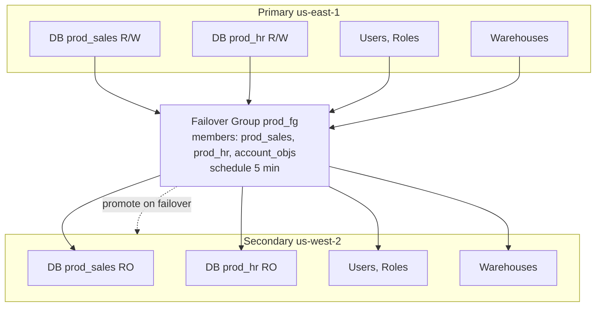

### Lab Exercise
```sql
-- Enable replication on primary (Business Critical+ for cross-cloud)
ALTER DATABASE prod_sales ENABLE REPLICATION TO ACCOUNTS myorg.secondary_account;

-- On secondary, create replica
CREATE DATABASE prod_sales AS REPLICA OF myorg.primary_account.prod_sales;

-- Set refresh schedule
ALTER DATABASE prod_sales REFRESH;  -- manual
-- Or use Task to refresh periodically

-- Create failover group
CREATE FAILOVER GROUP prod_fg
  OBJECT_TYPES = DATABASES, ROLES, USERS, WAREHOUSES
  ALLOWED_DATABASES = prod_sales, prod_hr
  ALLOWED_ACCOUNTS = myorg.secondary_account
  REPLICATION_SCHEDULE = '5 MINUTE';

-- On secondary during DR
ALTER FAILOVER GROUP prod_fg PRIMARY;  -- promote secondary to primary
```
**Expected outcome:** DBs on secondary refresh every 5 min; failover promotes atomically.

### Gotchas / Exam Traps
- Cross-region replication requires **Enterprise**; cross-cloud (e.g., AWS -> Azure) requires **Business Critical**.
- Replication costs: data transfer (egress) + compute on primary to prepare + compute on secondary to apply.
- Secondary cannot be written to directly — any writes fail. For bidirectional active-active, you need separate replication groups going each way.
- Account-level objects (roles, users) replicate ONLY via account replication / failover group, not simple DB replication.
- Replication of pipes requires pipe `AUTO_INGEST=TRUE` to be configured on the promoted secondary too.

---

## Q7: What is `UNDROP` and under what conditions does it succeed?
**Difficulty:** Foundation
**Exam relevance:** "Recover dropped objects via Time Travel."

### Answer
`UNDROP TABLE | SCHEMA | DATABASE <name>` restores a dropped object if within its retention period and no newer object with the same name exists. Requires `OWNERSHIP` on the parent object.

### First Principles
`DROP` is a metadata operation — the object's MPs still exist in storage and are kept until TT + FS expire. `UNDROP` reverses the drop by restoring the catalog entry. If you create a new table with the same name after dropping, the old one is "orphaned" (still consuming storage until FS expires) and un-undroppable because the name is taken.

### Diagram
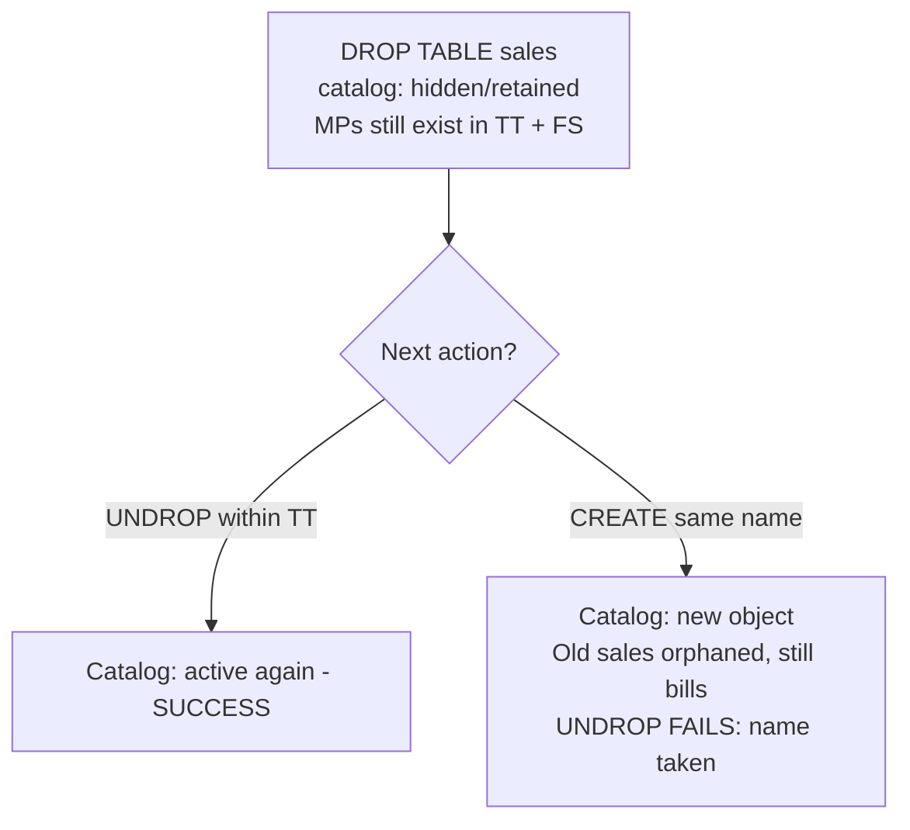

### Lab Exercise
```sql
CREATE TABLE sales_drop_demo (id INT);
INSERT INTO sales_drop_demo VALUES (1);

DROP TABLE sales_drop_demo;

-- Oops, restore
UNDROP TABLE sales_drop_demo;

-- Now the trap: recreate same name
DROP TABLE sales_drop_demo;
CREATE TABLE sales_drop_demo (id INT);  -- orphans the old one

UNDROP TABLE sales_drop_demo;  -- FAILS: name exists

-- See history
SELECT table_name, deleted, dropped_on
FROM INFORMATION_SCHEMA.TABLES
WHERE table_name LIKE 'SALES_DROP_DEMO%';
```
**Expected outcome:** First UNDROP succeeds; second fails due to naming collision.

### Gotchas / Exam Traps
- `UNDROP` is atomic — restores the object's state at drop time, not at some earlier moment.
- Dropped and recreated name: the original is unrecoverable via UNDROP; only Snowflake Support (while in FS) can recover.
- `UNDROP SCHEMA` restores schema + all contained tables (if their own retention allows).

---

## Q8: How is storage billed exactly, and where do you see the breakdown?
**Difficulty:** Intermediate
**Exam relevance:** "Attribute and optimize storage cost."

### Answer
Storage billed per-TB-month, averaged daily, on compressed bytes. Broken into: **active** (current data), **time travel** (retained historical MPs), **fail-safe** (post-TT retention), **staging** (internal stages), **replicated** (secondary data), **cloned retention** (MPs held because a clone references them). Visible in `STORAGE_USAGE` and `TABLE_STORAGE_METRICS`.

### First Principles
Snowflake bills what's physically in cloud storage. Deleted/updated rows persist as MPs through TT + FS. A high-churn table (many updates/deletes) can have Time Travel bytes exceeding active bytes — a common surprise. Transient tables cut storage ~30% by eliminating FS. Clones cost nothing until divergence. Dropped-but-not-yet-expired tables continue billing.

### Diagram
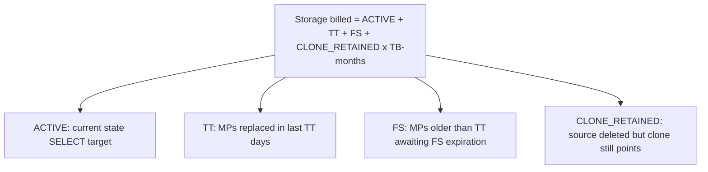

Example high-churn table:

| Zone | TB |
|------|---:|
| Active | 1 |
| TT (7d) | 3 |
| FS | 1 |
| **Total billed** | **5** |

### Lab Exercise
```sql
-- Monthly cost per table
SELECT table_name,
       active_bytes / POWER(2,40)  AS active_tb,
       time_travel_bytes / POWER(2,40) AS tt_tb,
       failsafe_bytes / POWER(2,40) AS fs_tb,
       retained_for_clone_bytes / POWER(2,40) AS clone_tb,
       (active_bytes + time_travel_bytes + failsafe_bytes + retained_for_clone_bytes)
         / POWER(2,40) AS total_tb
FROM SNOWFLAKE.ACCOUNT_USAGE.TABLE_STORAGE_METRICS
WHERE table_schema='PUBLIC'
ORDER BY total_tb DESC
LIMIT 20;

-- Account-level trend
SELECT DATE_TRUNC('day', usage_date) AS d,
       SUM(storage_bytes + stage_bytes + failsafe_bytes) / POWER(2,40) AS total_tb
FROM SNOWFLAKE.ACCOUNT_USAGE.STORAGE_USAGE
WHERE usage_date > DATEADD(day,-30,CURRENT_DATE)
GROUP BY 1 ORDER BY 1;
```
**Expected outcome:** Identifies tables where TT/FS dominate — candidates for shorter retention or transient conversion.

### Gotchas / Exam Traps
- `STORAGE_USAGE` is **account-level daily averages**, not snapshot. `TABLE_STORAGE_METRICS` is table-level snapshot.
- Reducing `DATA_RETENTION_TIME_IN_DAYS` **immediately** moves aged MPs to FS — storage drop takes 7 days to fully reflect.
- External tables show 0 storage (data in your bucket) but Iceberg metadata on Snowflake-managed catalog does accrue small storage.

---

## Q9: How does `DATA_RETENTION_TIME_IN_DAYS` interact with Time Travel and Streams?
**Difficulty:** Advanced
**Exam relevance:** "Configure retention for compliance and CDC."

### Answer
`DATA_RETENTION_TIME_IN_DAYS` sets the Time Travel window per table (or inherited from schema/db/account). Streams require retention long enough to cover their offset lag; `MAX_DATA_EXTENSION_TIME_IN_DAYS` extends retention when a stream (or other dependent object) hasn't advanced — Snowflake can hold data longer to prevent stream staleness.

### First Principles
Retention is a hierarchy: account default < DB override < schema override < table override. A stream pinned to an old offset essentially pins the table's TT. Without extension, the stream goes stale and must be recreated. `MAX_DATA_EXTENSION_TIME_IN_DAYS` lets Snowflake extend retention beyond the base `DATA_RETENTION_TIME_IN_DAYS` for up to 90 days, protecting streams. Beyond that, the stream is stale no matter what.

### Diagram
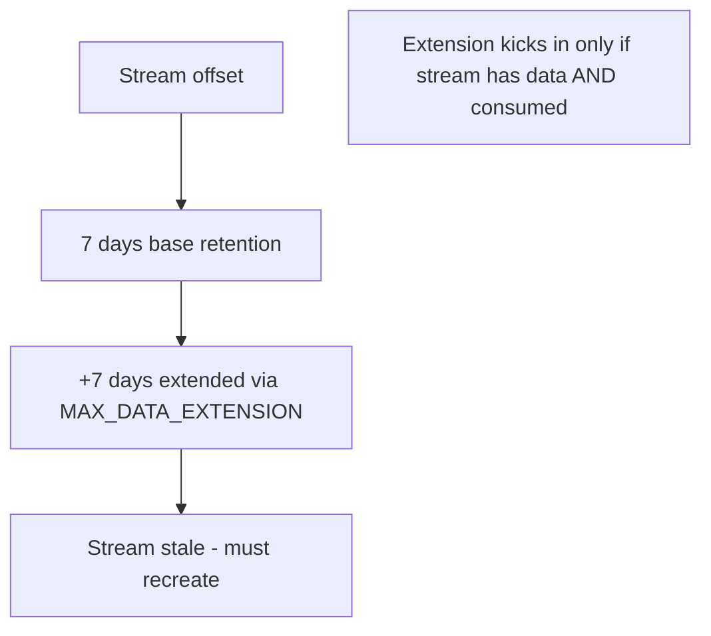

### Lab Exercise
```sql
ALTER TABLE orders SET
  DATA_RETENTION_TIME_IN_DAYS = 7
  MAX_DATA_EXTENSION_TIME_IN_DAYS = 14;

-- Check if stream will be safe
SELECT system$stream_get_table_timestamp('orders_stream');
-- Returns timestamp of the stream offset; data must survive until next consume

-- Account default
ALTER ACCOUNT SET DATA_RETENTION_TIME_IN_DAYS = 1;

-- Inherited at new DB
CREATE DATABASE short_term_db;  -- inherits 1 day

-- Override at DB
ALTER DATABASE prod_db SET DATA_RETENTION_TIME_IN_DAYS = 90;
```
**Expected outcome:** Hierarchy visible via `SHOW PARAMETERS`.

### Gotchas / Exam Traps
- Setting retention to 0 while a stream exists makes the stream stale instantly.
- `MAX_DATA_EXTENSION_TIME_IN_DAYS = 0` disables extension — stream staleness protection off.
- Changing retention from 90 to 7 **immediately** moves aged MPs to FS — large storage drop over the next 7 days.

---

## Q10: Walk through a disaster recovery scenario: entire region outage.
**Difficulty:** Advanced
**Exam relevance:** "Design DR topology with Snowflake."

### Answer
Pre-configure failover group between primary (region A) and secondary (region B). On outage: (1) confirm primary unreachable, (2) `ALTER FAILOVER GROUP x PRIMARY` on secondary to promote, (3) update DNS/application connection strings to secondary account URL, (4) continue writes on new primary. After recovery, reverse replication to re-sync and plan failback.

### First Principles
RTO (Recovery Time Objective) in Snowflake is minutes if failover groups are pre-configured with recent `REPLICATION_SCHEDULE`. RPO (Recovery Point Objective) equals the replication lag — typically 5–15 minutes. Account URL changes on failover; applications must use the organization URL (`<org>.<account>.snowflakecomputing.com`) which Snowflake can redirect, OR implement connection switching logic.

### Diagram
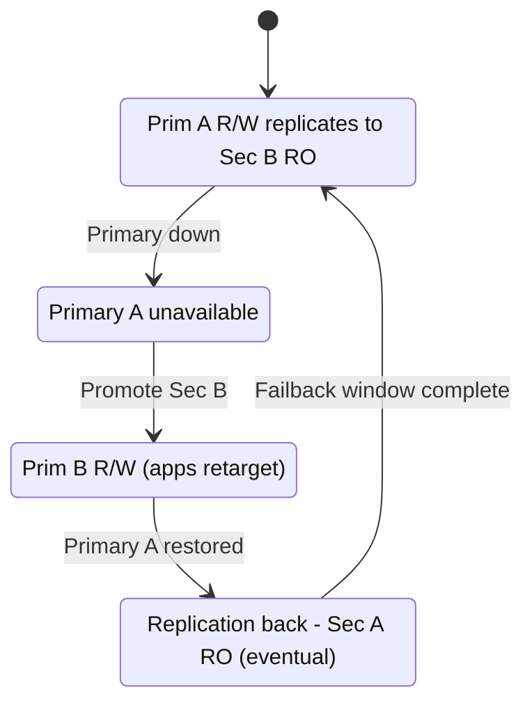

### Lab Exercise
```sql
-- Pre-DR setup (both accounts)
CREATE FAILOVER GROUP prod_fg
  OBJECT_TYPES = DATABASES, ROLES, USERS, WAREHOUSES, INTEGRATIONS
  ALLOWED_DATABASES = prod_sales, prod_hr
  ALLOWED_ACCOUNTS = myorg.secondary_account
  REPLICATION_SCHEDULE = '5 MINUTE';

-- Monitor lag
SELECT name, phase, start_time, end_time,
       DATEDIFF(second, start_time, end_time) AS duration_s
FROM SNOWFLAKE.ACCOUNT_USAGE.REPLICATION_GROUP_REFRESH_HISTORY
ORDER BY start_time DESC LIMIT 5;

-- DR event (on secondary)
ALTER FAILOVER GROUP prod_fg PRIMARY;
-- Now secondary is R/W; apps retarget

-- Failback (after primary restored)
-- On new secondary (old primary), refresh and promote back
ALTER FAILOVER GROUP prod_fg REFRESH;
ALTER FAILOVER GROUP prod_fg PRIMARY;  -- back on original primary
```
**Expected outcome:** Failover completes in minutes; writes resume on new primary.

### Gotchas / Exam Traps
- Not all objects replicate equally — `TASKS` require pipeline state to be reconstructed; `PIPES` require re-pointing cloud storage event notifications to the new secondary queue URL.
- The organization URL (`<org>.<account>.snowflakecomputing.com`) provides automatic routing if you use **Client Redirect** (Snowflake feature); otherwise apps must handle switching.
- Replication is **asynchronous** — any writes in the last N minutes before outage may be lost (RPO).

---

## Q11: What are the implications of changing `DATA_RETENTION_TIME_IN_DAYS` on a huge table?
**Difficulty:** Advanced
**Exam relevance:** "Manage retention changes operationally."

### Answer
Reducing retention immediately classifies MPs older than the new threshold as past their TT — they move to Fail-safe (if permanent) or deletion queue (if transient/temp). Increasing retention retroactively protects MPs still in storage: Fail-safe MPs within the extended window return to TT (if still in FS); already-deleted MPs are gone.

### First Principles
Retention is a view over the physical MP lifecycle. Snowflake doesn't rewrite anything on retention change — just moves the boundary. The physical storage impact depends on how much data has aged out: a table with constant churn and 90d retention has 90 days of MPs; reducing to 1d doesn't delete them, it just shifts them to FS, which still bills for 7 more days.

### Diagram

| State | Active | TT | FS |
|-------|-------:|---:|---:|
| Before (retention=90d) | 1 TB | 50 TB (90d churn) | 1 TB |
| After set retention=1d | 1 TB | 1 TB (yesterday only) | 50 TB (drains over 7d) |
| Set retention=90d back | TT recovers only what's still in FS (≤7d) | Older is gone | — |

### Lab Exercise
```sql
-- Observe effect
SELECT table_name, active_bytes/POWER(2,40) AS a_tb,
       time_travel_bytes/POWER(2,40) AS tt_tb,
       failsafe_bytes/POWER(2,40) AS fs_tb
FROM SNOWFLAKE.ACCOUNT_USAGE.TABLE_STORAGE_METRICS
WHERE table_name='HUGE_TABLE';

-- Reduce retention
ALTER TABLE huge_table SET DATA_RETENTION_TIME_IN_DAYS = 1;

-- Rerun query over next week to see FS drain
```
**Expected outcome:** FS bytes grow immediately as TT shrinks; FS drains over 7 days.

### Gotchas / Exam Traps
- Account-level retention change propagates to all children unless explicitly overridden — can be surprising.
- Setting retention = 0 removes TT entirely and immediately shifts all TT MPs to FS.
- Changing retention does NOT delete data instantly — storage cost persists through FS window.

---

## Q12: Explain how Snowflake encryption-at-rest and key hierarchy work.
**Difficulty:** Intermediate
**Exam relevance:** "Understand encryption and tri-secret secure."

### Answer
All data at rest is AES-256 encrypted. Three-tier key hierarchy: **root key** (cloud KMS/HSM) encrypts **account master keys** which encrypt **table master keys** which encrypt **file keys** (per MP). Keys rotate automatically every 30 days. **Tri-Secret Secure** (BC+) adds a customer-managed root key — Snowflake cannot decrypt without you.

### First Principles
Multi-tier keys limit blast radius: compromising a file key exposes one MP; compromising an account master key exposes that account. Automatic rotation + rekeying (periodic re-encryption with new keys) limits temporal exposure. Customer-managed keys (Tri-Secret) give revocation power — removing your root key renders your data permanently unreadable, which is both a feature (compliance) and a risk (lock yourself out).

### Diagram
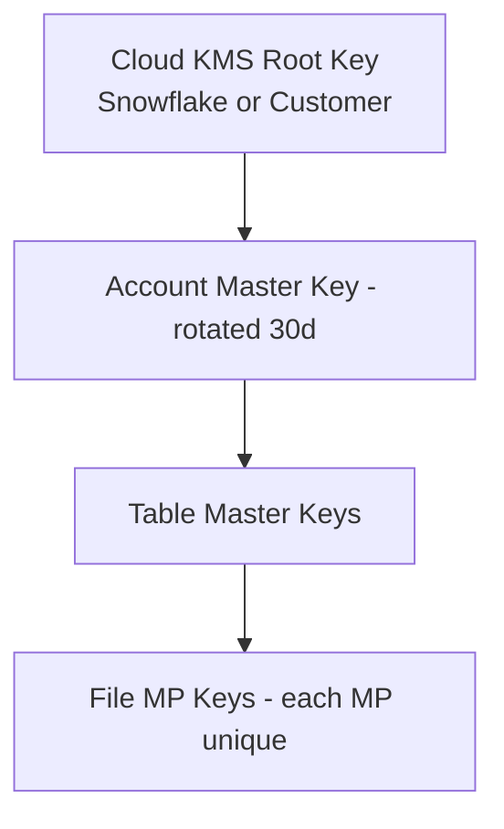

### Lab Exercise
```sql
-- Rekey all data (periodic Snowflake-initiated process)
ALTER ACCOUNT SET PERIODIC_DATA_REKEYING = TRUE;

-- Enable Tri-Secret Secure (requires Business Critical + KMS integration)
-- Account-level configuration via Snowflake Support ticket

-- View encryption status
SHOW PARAMETERS LIKE 'PERIODIC_DATA_REKEYING' IN ACCOUNT;
```
**Expected outcome:** Rekeying enabled; data periodically re-encrypted.

### Gotchas / Exam Traps
- Tri-Secret Secure requires **Business Critical** edition.
- Rekeying is background and does not disrupt queries.
- Revoking the customer-managed key is **irreversible** — Snowflake can't help.

---

## Q13: How does cloning interact with Time Travel and Fail-safe on the clone?
**Difficulty:** Advanced
**Exam relevance:** "Understand clone retention inheritance."

### Answer
A clone inherits a *fresh* TT/FS lifecycle starting at clone time. Querying the clone's past via Time Travel only reaches back to the clone's creation (plus the clone's own retention setting). The clone does NOT inherit the source's historical TT window.

### First Principles
A clone is a point-in-time copy of catalog state. Pre-clone history belongs to the source; post-clone history belongs to the clone. If you need to query 30 days before the clone was made, you need to clone AT (TIMESTAMP) to get a specific past point, or query the source directly (if source retention still covers it).

### Diagram
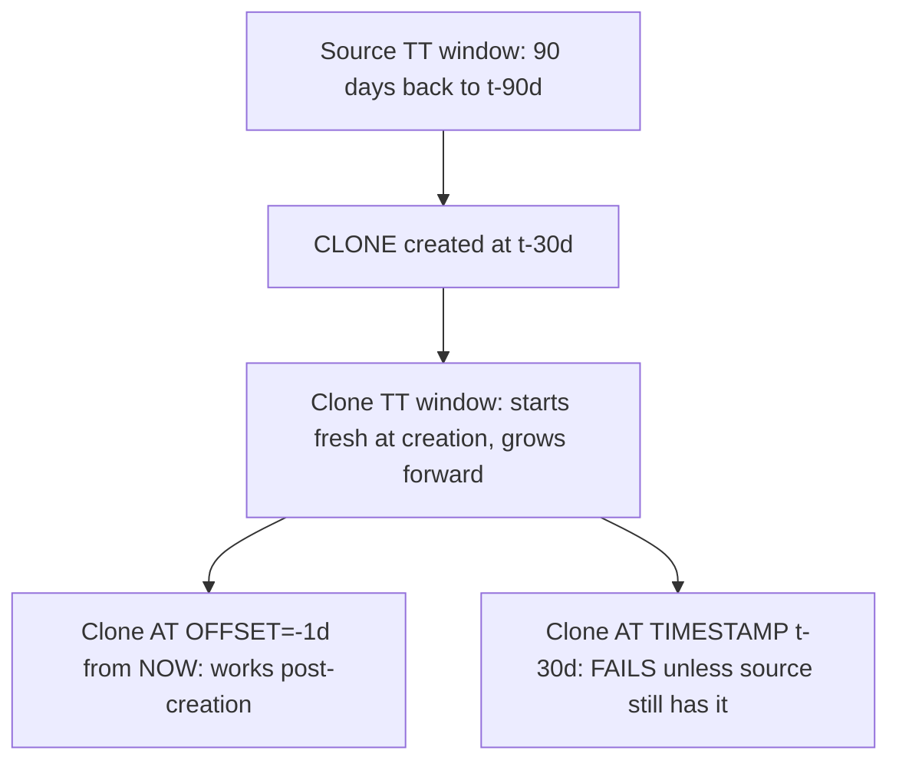

### Lab Exercise
```sql
-- Create clone with its own retention
CREATE TABLE dev_sales CLONE sales DATA_RETENTION_TIME_IN_DAYS = 30;

-- Clone TT starts fresh
SELECT COUNT(*) FROM dev_sales AT (OFFSET => -60);  -- works (60s ago)
SELECT COUNT(*) FROM dev_sales AT (OFFSET => -3600*24*7);  -- fails if clone < 7 days old

-- To preserve historical access, clone AT historical point:
CREATE TABLE dev_sales_week_ago CLONE sales AT (OFFSET => -3600*24*7);
```
**Expected outcome:** Clone's TT window independent of source.

### Gotchas / Exam Traps
- Cloning a huge table at a historical TT point is still instant (metadata only).
- Clones + replication: a clone of a replica is NOT replicated; must be in a replicated DB directly.

---

## Q14: Explain how UPDATE/DELETE/MERGE operations physically affect micro-partitions.
**Difficulty:** Advanced
**Exam relevance:** "Understand DML cost."

### Answer
UPDATE: writes new MPs containing the modified row(s) and marks the old MPs for Time Travel. One row changed in a 500MB MP forces the entire MP to be rewritten. DELETE: similar — MPs with deleted rows are rewritten without those rows. MERGE: a combination; INSERT branches append new MPs, UPDATE/DELETE branches rewrite affected MPs.

### First Principles
MP immutability means DML has a minimum granularity: an MP. Partial-row updates don't exist. Snowflake does NOT read-modify-write per row; it reads the MP, applies all changes to that MP's rows, and writes a new MP. Churn-heavy tables grow TT fast because every change retains the pre-change MP for retention days. The practical fix: cluster so updates target the same MPs, or use INSERT-only patterns + MERGE on compacted downstream.

### Diagram
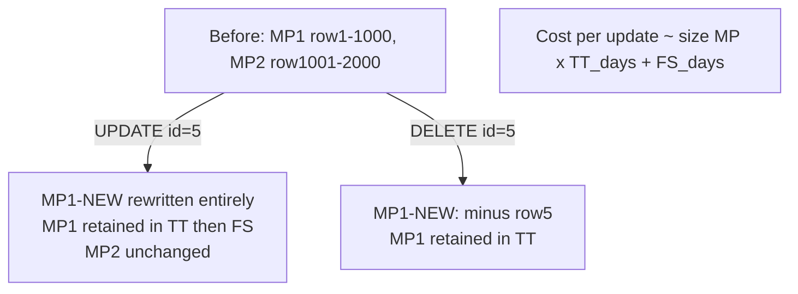

### Lab Exercise
```sql
-- Measure impact of churn
CREATE TABLE churn_test AS SELECT seq8() AS id, randstr(100,random()) AS v
FROM TABLE(GENERATOR(ROWCOUNT => 1000000));

SELECT table_name, active_bytes, time_travel_bytes
FROM INFORMATION_SCHEMA.TABLE_STORAGE_METRICS WHERE table_name='CHURN_TEST';

-- One row at a time
UPDATE churn_test SET v='X' WHERE id=1;
UPDATE churn_test SET v='X' WHERE id=2;
UPDATE churn_test SET v='X' WHERE id=3;

-- Check TT bytes growth
SELECT time_travel_bytes FROM INFORMATION_SCHEMA.TABLE_STORAGE_METRICS WHERE table_name='CHURN_TEST';

-- vs. batch update: one DML touching many rows in same MPs
UPDATE churn_test SET v='Y' WHERE id BETWEEN 1 AND 100000;
```
**Expected outcome:** Row-at-a-time updates generate much more TT bytes than one batch update.

### Gotchas / Exam Traps
- Delete-and-insert does NOT merge back — both ops rewrite MPs independently.
- `TRUNCATE TABLE` is a metadata-only operation but still fills TT with pointers to the pre-truncate state.
- `MERGE` with no action (all WHEN clauses fail) is zero-cost; but if any branch fires, the MP is rewritten.

---

## Q15: What's the deal with hybrid tables and Unistore?
**Difficulty:** Advanced
**Exam relevance:** "Hybrid Tables for transactional workloads."

### Answer
**Hybrid Tables** are the backing storage for Unistore — a mix of row-store (for OLTP point reads/writes) and columnar (for analytics). PK required; secondary indexes supported; low-latency single-row ops. Analytical queries can join hybrid tables with standard columnar tables transparently.

### First Principles
Traditional Snowflake is columnar-only — great for scans, bad for single-row updates (MP rewrite). Hybrid tables layer row-oriented storage with secondary indexes on top of Snowflake's architecture, enabling OLTP-style access without a separate database. Writes commit in milliseconds; reads by PK are sub-millisecond. The columnar replica keeps analytical queries fast.

### Diagram
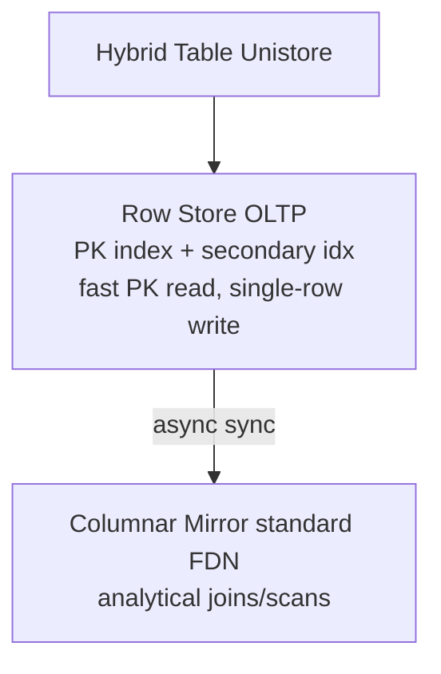

### Lab Exercise
```sql
CREATE OR REPLACE HYBRID TABLE orders_oltp (
  order_id INT PRIMARY KEY,
  customer_id INT,
  amt NUMBER,
  status STRING,
  INDEX idx_cust (customer_id)
);

-- OLTP-style access
INSERT INTO orders_oltp VALUES (1,42,100,'NEW');
UPDATE orders_oltp SET status='PAID' WHERE order_id=1;
SELECT * FROM orders_oltp WHERE order_id=1;  -- ms latency

-- Hybrid analytical join
SELECT c.customer_tier, SUM(o.amt)
FROM orders_oltp o JOIN customers c ON o.customer_id = c.id
GROUP BY 1;
```
**Expected outcome:** Point lookups fast; join with columnar table works seamlessly.

### Gotchas / Exam Traps
- Hybrid Tables have **separate storage pricing** — row-store at a premium.
- Not all SQL features supported (some stream/task compatibility limits).
- PK is required; cannot be NULL; UPSERT uses PK.
- Available only in supported regions.

---

## Q16: Describe `DATA_RETENTION_TIME_IN_DAYS` edge cases: streams, dynamic tables, materialized views.
**Difficulty:** Advanced
**Exam relevance:** "Retention interaction with dependent objects."

### Answer
Streams, Dynamic Tables, and some MVs read historical data via Time Travel. Each triggers `MAX_DATA_EXTENSION_TIME_IN_DAYS` on their source table to preserve data they need. If `MAX_DATA_EXTENSION_TIME_IN_DAYS` is too short and the dependent isn't consumed, it goes stale.

### First Principles
Dependents pin history — Snowflake tracks the oldest offset any dependent needs and keeps data at least that long, up to the max extension. This can cause retention cost surprises: a forgotten stream on a huge, churn-heavy table silently retains 30 days of TT instead of 1.

### Diagram
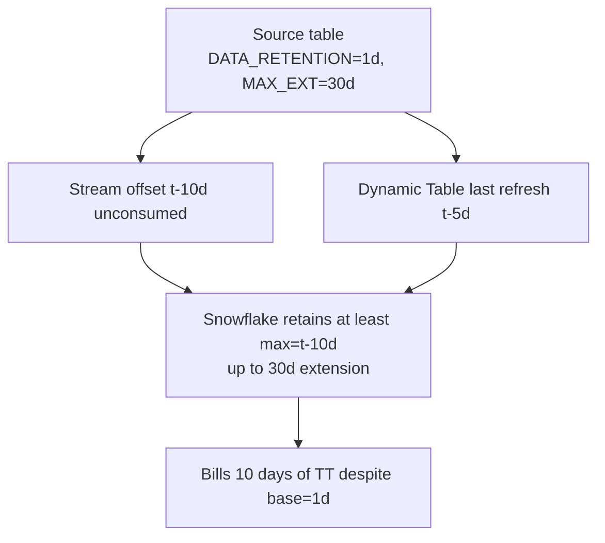

### Lab Exercise
```sql
-- Find stale streams causing TT bloat
SELECT stream_name, source_table_name, stale, stale_after
FROM INFORMATION_SCHEMA.STREAMS
WHERE stale = 'true' OR stale_after < DATEADD(day,30,CURRENT_TIMESTAMP);

-- See which tables have long-tail retention from dependents
SELECT table_name, data_retention_time_in_days, max_data_extension_time_in_days
FROM INFORMATION_SCHEMA.TABLES
WHERE table_schema='PUBLIC';
```
**Expected outcome:** Identify dependents preventing retention cleanup.

### Gotchas / Exam Traps
- Stale streams are a silent cost sink — audit regularly.
- `MAX_DATA_EXTENSION_TIME_IN_DAYS = 0` makes streams go stale aggressively but reduces storage.
- Dynamic Tables with long `TARGET_LAG` effectively extend source retention.

---

## Q17: Explain cross-cloud / cross-region replication cost and performance.
**Difficulty:** Advanced
**Exam relevance:** "Design cross-region/cloud DR costs."

### Answer
Cross-region replication incurs: (1) **egress** data transfer (per GB, varies by cloud/region pair), (2) **compute** on primary to serialize deltas, (3) **compute** on secondary to apply, (4) **storage** on secondary. Cross-cloud (AWS -> Azure) incurs additional cross-cloud transfer rates. Latency = replication schedule interval (minimum 1 minute).

### First Principles
Replication is MP-level change propagation, not log shipping. Snowflake computes which MPs are new/changed and copies them. Egress dominates cost for large data volumes; small frequent replications amortize better than infrequent huge ones (less data at each sync). Cross-cloud is 2–5x more expensive per GB than cross-region same-cloud.

### Diagram
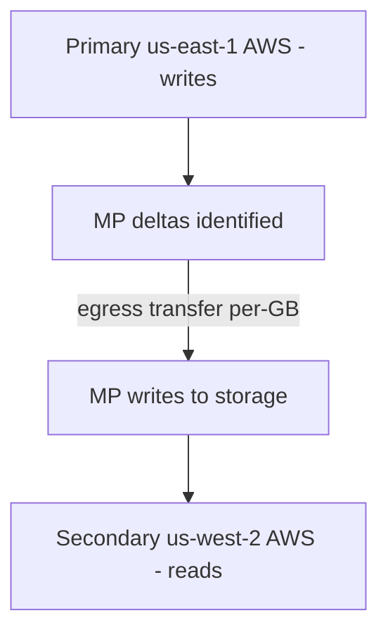

### Lab Exercise
```sql
-- Replication credit usage
SELECT database_name, credits_used, bytes_transferred
FROM SNOWFLAKE.ACCOUNT_USAGE.REPLICATION_USAGE_HISTORY
WHERE start_time > DATEADD(day,-30,CURRENT_DATE)
ORDER BY credits_used DESC;

-- Replication refresh history
SELECT database_name, phase, start_time,
       DATEDIFF(second, start_time, end_time) AS dur_s,
       error_message
FROM SNOWFLAKE.ACCOUNT_USAGE.REPLICATION_GROUP_REFRESH_HISTORY
ORDER BY start_time DESC LIMIT 20;
```
**Expected outcome:** Cost attributable per DB; refresh history shows lag.

### Gotchas / Exam Traps
- Cross-cloud replication requires **Business Critical** edition.
- Enabling replication on a huge DB causes a large initial transfer (seed) — plan network capacity.
- Egress cost is **not** billed in Snowflake credits; it's a separate line on the invoice.

---

## Q18: What happens when you drop a database vs. a schema vs. a table — and the related recovery?
**Difficulty:** Foundation
**Exam relevance:** "Object lifecycle and recovery."

### Answer
Dropping a database/schema/table is a metadata op; the object (and its contained objects) move to a hidden retained state for `DATA_RETENTION_TIME_IN_DAYS`. `UNDROP` restores it. After retention + FS expires, data is permanently deleted.

### First Principles
The hierarchy is: dropping a database effectively drops all schemas and tables within. Each inherits its own retention; the parent's retention also matters. `UNDROP DATABASE` restores the DB and all child objects whose own retention still covers them.

### Diagram
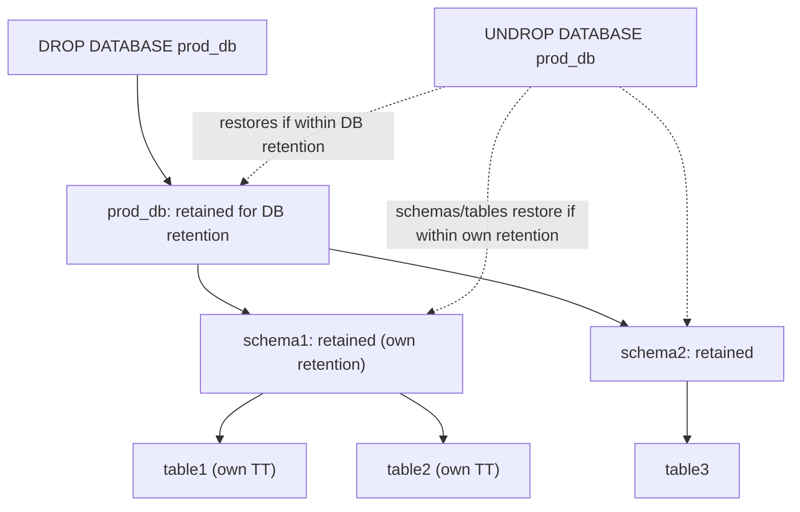

### Lab Exercise
```sql
CREATE DATABASE drop_test DATA_RETENTION_TIME_IN_DAYS=7;
CREATE TABLE drop_test.public.t1 (id INT);
INSERT INTO drop_test.public.t1 VALUES (1);

DROP DATABASE drop_test;
UNDROP DATABASE drop_test;

SELECT * FROM drop_test.public.t1;  -- row still there
```
**Expected outcome:** DB and contents restored intact.

### Gotchas / Exam Traps
- You cannot `UNDROP` a table whose database has been dropped and FS-expired — the catalog chain is gone.
- Dropping a shared/exposed DB breaks the share — recipients lose access.

---

## Q19: What are the storage implications of `CREATE TABLE AS SELECT (CTAS)` vs `INSERT ... SELECT`?
**Difficulty:** Intermediate
**Exam relevance:** "Choose creation pattern for cost."

### Answer
CTAS creates a fresh table with new MPs — fully independent of source, no clone savings. `INSERT ... SELECT` appends new MPs to an existing table. For a one-shot copy of a large table, `CLONE` is nearly free; CTAS doubles storage.

### First Principles
CTAS is "deep copy" — the result shares no MPs with the source. Use when you need an independent table with different clustering, column definitions, or when source will be dropped. Clone is "shallow copy" (metadata) — use when you want cost-efficient dev/test or snapshots. INSERT ... SELECT appends to existing — use for incremental loads.

### Diagram
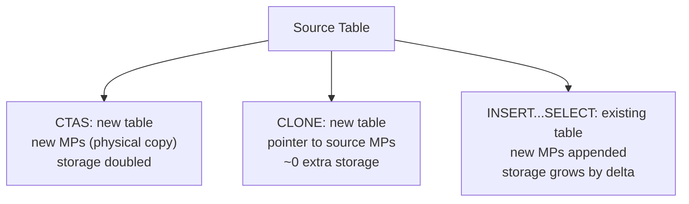

### Lab Exercise
```sql
-- All three approaches
CREATE TABLE sales_copy1 AS SELECT * FROM sales;   -- deep copy, 2x storage
CREATE TABLE sales_copy2 CLONE sales;              -- shallow, ~0 extra
INSERT INTO sales_copy2 SELECT * FROM sales;       -- doubles clone's physical storage
```
**Expected outcome:** `TABLE_STORAGE_METRICS` shows differential storage.

### Gotchas / Exam Traps
- CTAS inherits data types and column definitions but **not** constraints, defaults, cluster keys (unless `LIKE` used first then `COPY GRANTS` + insert).
- CTAS does NOT replicate TT state of source — new table starts fresh.
- Clone preserves clustering, grants (`COPY GRANTS` option), and more metadata than CTAS.

---

## Q20: How does Snowflake handle data at the cloud provider level — single region, multi-AZ?
**Difficulty:** Foundation
**Exam relevance:** "Understand regional architecture."

### Answer
Within a region, Snowflake uses the cloud provider's multi-AZ storage (S3, GCS, Azure Blob) for 99.999999999% durability. Compute is in a single AZ typically but can span. For cross-AZ failures within a region, cloud storage transparently handles it. Cross-region needs replication.

### First Principles
Snowflake delegates data durability to the underlying cloud storage service, which replicates across AZs by default. Compute nodes are stateless (except SSD cache) — if a node fails, Snowflake replaces it transparently. Single-region HA = cloud storage multi-AZ; multi-region HA = Snowflake replication.

### Diagram
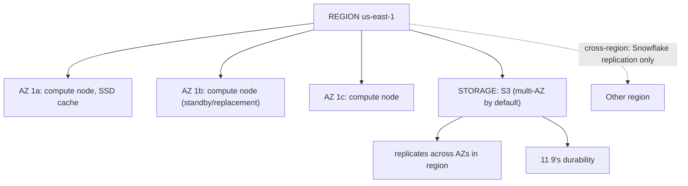

### Lab Exercise
```sql
-- Check your account's region
SELECT CURRENT_REGION();
SELECT CURRENT_ACCOUNT(), SYSTEM$ALLOWLIST();

-- Region info
SELECT * FROM SNOWFLAKE.ACCOUNT_USAGE.REPLICATION_GROUP_USAGE_HISTORY LIMIT 1;
```
**Expected outcome:** Current region identified; cross-region groups visible if configured.

### Gotchas / Exam Traps
- Snowflake does NOT provide cross-region failover automatically — must configure replication.
- Within-region AZ failure is transparent; no action needed.
- Account URL carries region: `<account>.<region>.<cloud>.snowflakecomputing.com`.

---

## Q21: Explain what "zero-copy clone" cannot do.
**Difficulty:** Intermediate
**Exam relevance:** "Clone limitations."

### Answer
Cannot clone: external tables (no MP state), stages (file-system), pipes (metadata only — must recreate), temporary tables (session-bound), hybrid tables (as of some editions), shared tables (from another account). Clones DO copy metadata of pipes/streams/tasks but these often need re-setup to be functional.

### First Principles
Clone works where MPs are the storage substrate. Objects without MPs (external tables, stages) can't be cloned data-wise. Clones of ingest/orchestration metadata (pipes, streams, tasks) copy structure but lose runtime state — SQS subscriptions, offsets, schedules — so they need reconfiguration.

### Diagram
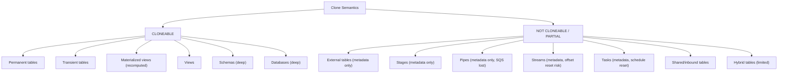

### Lab Exercise
```sql
CREATE DATABASE prod_dev CLONE prod_db;

-- Check what was cloned
SHOW SCHEMAS IN prod_dev;
SHOW TABLES IN SCHEMA prod_dev.public;
SHOW PIPES IN SCHEMA prod_dev.public;  -- present but inactive
SHOW STREAMS IN SCHEMA prod_dev.public;  -- stale (offset doesn't track prod_db)
SHOW TASKS IN SCHEMA prod_dev.public;    -- suspended by default

-- Re-enable
ALTER TASK prod_dev.public.my_task RESUME;
```
**Expected outcome:** Tables cloned deeply; pipes/streams/tasks need manual intervention.

### Gotchas / Exam Traps
- Grants don't clone by default; add `COPY GRANTS` option or re-grant explicitly.
- Cloning a DB with 100s of streams/tasks can be a long cleanup effort.

---

## Q22: What's the pattern for a "point-in-time snapshot" in Snowflake?
**Difficulty:** Intermediate
**Exam relevance:** "Create logical snapshots for auditing."

### Answer
Three options: (1) **Clone AT (TIMESTAMP)** — zero-copy point-in-time copy of a table/schema/db; (2) **Transient snapshot table** via `CREATE TRANSIENT TABLE snap AS SELECT * FROM src AT (...)` for a persisted but cheap snapshot; (3) **Time Travel query itself** — no persistence, run `SELECT * FROM src AT (...)` as needed.

### First Principles
Clone is cheapest for whole-table snapshots. SELECT AT is best for ad-hoc audit queries without storage. Transient CTAS is best when you want a persisted, queryable snapshot that survives beyond TT retention but don't need FS.

### Diagram
```mermaid
flowchart TD
    S["Snapshot options"]
    S --> C["CLONE AT: metadata snapshot<br/>0 extra storage until divergence"]
    S --> SEL["SELECT AT: no persistence<br/>free, limited by TT window"]
    S --> T["TRANSIENT CTAS AT: physical copy<br/>pay storage, outlives TT window"]
```

### Lab Exercise
```sql
-- Option 1: clone
CREATE TABLE sales_snap_2026_10_30 CLONE sales
  AT (TIMESTAMP => '2026-10-30 23:59:59'::TIMESTAMP);

-- Option 2: transient
CREATE TRANSIENT TABLE sales_snap_long_term AS
  SELECT * FROM sales AT (OFFSET => -3600*24);

-- Option 3: ad-hoc query (no persistence)
SELECT COUNT(*) FROM sales AT (OFFSET => -3600*24);
```
**Expected outcome:** Choice depends on persistence need vs storage cost.

### Gotchas / Exam Traps
- Clone AT a time outside the source's current retention FAILS.
- Transient snapshot does NOT have FS — if critical for audit/compliance, use permanent.

---

## Q23: How do shares interact with Time Travel and cloning?
**Difficulty:** Advanced
**Exam relevance:** "Secure Data Sharing semantics."

### Answer
A share exposes read-only pointers to tables; consumer accounts query the data without copying. Time Travel on shared tables: consumers CAN use `AT/BEFORE` on shared tables within retention, as if they were local (reads are from provider's storage). Cloning: consumers CANNOT clone shared tables; must materialize via CTAS into their own account first.

### First Principles
Shares are a security + access construct, not a copy. Provider owns the data; consumer gets a secure virtual view. Time Travel works through the share because MPs still exist. Cloning doesn't work because the consumer doesn't own storage. For a consumer-controlled copy, CTAS creates a deep physical copy in the consumer's account.

### Diagram
```mermaid
flowchart TD
    subgraph P["PROVIDER ACCOUNT"]
        PT["sales (table)"]
        SH["share: adds read grants"]
        MP["MP in cloud storage"]
        PT --> SH
        PT --> MP
    end
    subgraph C["CONSUMER ACCOUNT"]
        DB["db_from_share"]
        SV["sales (shared view)"]
        SEL["SELECT allowed (reads from provider storage)"]
        TT["AT/BEFORE allowed (within retention)"]
        CL["CLONE denied"]
        CT["CTAS allowed (independent table)"]
        DB --> SV
        SV --> SEL
        SV --> TT
        SV --> CL
        SV --> CT
    end
    SH --> DB
```

### Lab Exercise
```sql
-- Provider
CREATE SHARE sales_share;
GRANT USAGE ON DATABASE prod_db TO SHARE sales_share;
GRANT USAGE ON SCHEMA prod_db.public TO SHARE sales_share;
GRANT SELECT ON TABLE prod_db.public.sales TO SHARE sales_share;
ALTER SHARE sales_share ADD ACCOUNTS = consumer_account;

-- Consumer
CREATE DATABASE db_from_share FROM SHARE provider_account.sales_share;
SELECT * FROM db_from_share.public.sales AT (OFFSET => -60);  -- works
CREATE TABLE t2 CLONE db_from_share.public.sales;  -- FAILS
CREATE TABLE t2 AS SELECT * FROM db_from_share.public.sales;  -- works
```
**Expected outcome:** Shared access with TT; clone fails; CTAS creates independent copy.

### Gotchas / Exam Traps
- Consumers can only read; no DML on shared tables.
- Secure views are often used to filter data per consumer (row-level sharing).
- Account-level objects (tags, policies) don't share without separate configuration.

---

## Q24: Explain how `CLUSTER BY` interacts with cloning and replication.
**Difficulty:** Advanced
**Exam relevance:** "Clustering across clones and replicas."

### Answer
A clone inherits the cluster key definition and auto-clustering state (ON/OFF). Future DML on the clone triggers independent reclustering (separate credit charges). Replication: replica inherits cluster key and auto-clustering runs on the primary (sync propagates clustered MPs); secondary does not re-cluster — it mirrors primary's MP layout.

### First Principles
Clones share MPs initially; divergent writes may degrade clustering independently. Auto-clustering per-table runs on whichever accounts have writes. In replication, physical layout propagates from primary; secondary is a read-only mirror of primary's clustered state.

### Diagram
```mermaid
flowchart TD
    subgraph CL["Clone"]
        CS["source: cluster key=(dt), auto-cluster ON"]
        CC["clone: cluster key=(dt) inherited, auto-cluster ON"]
        CW["writes to clone trigger reclustering independently (own credits)"]
        CS --> CC --> CW
    end
    subgraph REP["Replication"]
        PR["primary: cluster key=(dt), auto-cluster ON"]
        SE["replication sends MPs"]
        SC["secondary: cluster key=(dt) [informational]<br/>auto-cluster inactive, mirror of primary layout"]
        PR --> SE --> SC
    end
```

### Lab Exercise
```sql
SHOW TABLES LIKE 'SALES' IN SCHEMA PROD_DB.PUBLIC;  -- see cluster key

CREATE TABLE sales_dev CLONE prod_db.public.sales;
SHOW TABLES LIKE 'SALES_DEV';  -- same cluster key

ALTER TABLE sales_dev SUSPEND RECLUSTER;  -- disable on dev for cost

-- Clustering credit per account
SELECT table_name, SUM(credits_used)
FROM SNOWFLAKE.ACCOUNT_USAGE.AUTOMATIC_CLUSTERING_HISTORY
GROUP BY 1;
```
**Expected outcome:** Clone has own clustering; replica inherits layout.

### Gotchas / Exam Traps
- Secondary replica cannot write, so auto-cluster is irrelevant there — but you still see the key in SHOW TABLES.
- Suspending auto-cluster on a dev clone saves credits during dev experiments.

---

## Q25: How do you audit storage changes over time?
**Difficulty:** Intermediate
**Exam relevance:** "Monitor storage trends."

### Answer
Use `DATABASE_STORAGE_USAGE_HISTORY` (daily, DB-level), `STAGE_STORAGE_USAGE_HISTORY` (daily, stage-level), `TABLE_STORAGE_METRICS` (snapshot, table-level), and `STORAGE_USAGE` (account daily totals). Combine with `ACCESS_HISTORY` to correlate growth to writes.

### First Principles
Storage trends are the longest-running cost signal. Snowflake's Account Usage views keep 365 days. For table-level trending, snapshot `TABLE_STORAGE_METRICS` into a custom history table (there's no built-in table-level history view).

### Diagram
```mermaid
flowchart TD
    A["Account level (365d)"]
    A --> A1["STORAGE_USAGE"]
    A --> A2["DATABASE_STORAGE_USAGE_HISTORY"]
    S["Snapshot (right now)"] --> S1["TABLE_STORAGE_METRICS"]
    W["write"] --> MP["MP creation"] --> G["storage growth"]
    G --> QH["QUERY_HISTORY (what wrote)"]
    QH --> SU["STORAGE_USAGE (how much)"]
```

### Lab Exercise
```sql
-- Daily DB-level storage trend
SELECT database_name,
       DATE_TRUNC('day', usage_date) AS d,
       SUM(average_database_bytes) / POWER(2,40) AS tb
FROM SNOWFLAKE.ACCOUNT_USAGE.DATABASE_STORAGE_USAGE_HISTORY
WHERE usage_date > DATEADD(day,-90,CURRENT_DATE)
GROUP BY 1,2
ORDER BY 2,3 DESC;

-- Custom table-level history (persist daily snapshots)
CREATE TABLE storage_history AS SELECT CURRENT_DATE AS d, *
FROM SNOWFLAKE.ACCOUNT_USAGE.TABLE_STORAGE_METRICS;

-- Schedule a task to snapshot daily
CREATE OR REPLACE TASK snap_storage
  WAREHOUSE = etl_wh
  SCHEDULE = 'USING CRON 0 1 * * * UTC'
AS
INSERT INTO storage_history
SELECT CURRENT_DATE, * FROM SNOWFLAKE.ACCOUNT_USAGE.TABLE_STORAGE_METRICS;
```
**Expected outcome:** 90-day DB-level trends; custom table-level history over time.

### Gotchas / Exam Traps
- `TABLE_STORAGE_METRICS` has no history — snapshot it yourself.
- Account Usage views have up to 2-hour lag; Information Schema is realtime but 14-day retention.
- Monitoring storage with `SHOW TABLES` is slow at scale — use metadata views.
