# Security — DEA-C02 Study Guide

## Exam Weight & Scope
Security is ~15% of the DEA-C02 exam. Covers RBAC design, masking policies, row access policies, column lineage, network policies, authentication (OAuth, SAML, SCIM, key-pair, MFA), object dependencies, secure data sharing, access history, and governance tagging.

## Core Concepts Map
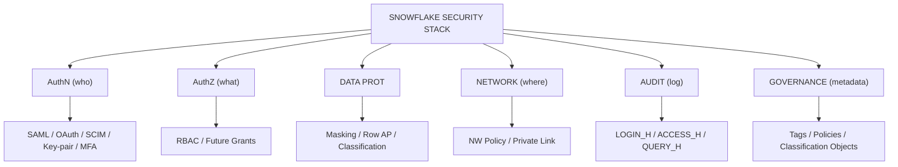

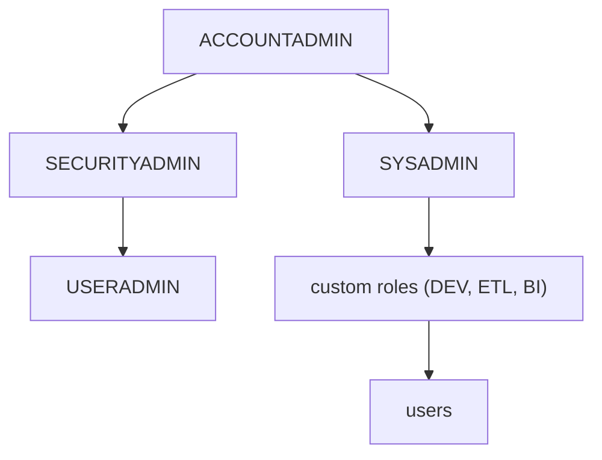

---

## Q1: Explain Snowflake's RBAC model — roles, grants, inheritance.
**Difficulty:** Foundation
**Exam relevance:** "Design a role hierarchy."

### Answer
Snowflake uses **role-based access control**: privileges are granted to roles, roles granted to users (or other roles). Users activate one role per session (`USE ROLE`); the active role determines access. Roles form a DAG via grants — a parent role inherits all child roles' privileges. System-defined: `ACCOUNTADMIN` (apex), `SECURITYADMIN`, `USERADMIN`, `SYSADMIN`, `PUBLIC`.

### First Principles
RBAC separates **what** (privileges) from **who** (users) via **why** (roles). Roles are the governance unit. Custom roles form the operational hierarchy (functional roles for teams/apps) which get access-role grants (per-object permission bundles). Snowflake recommends a two-layer pattern: access roles (narrow, per-object type/table), functional roles (team-oriented, aggregating access roles).

### Diagram
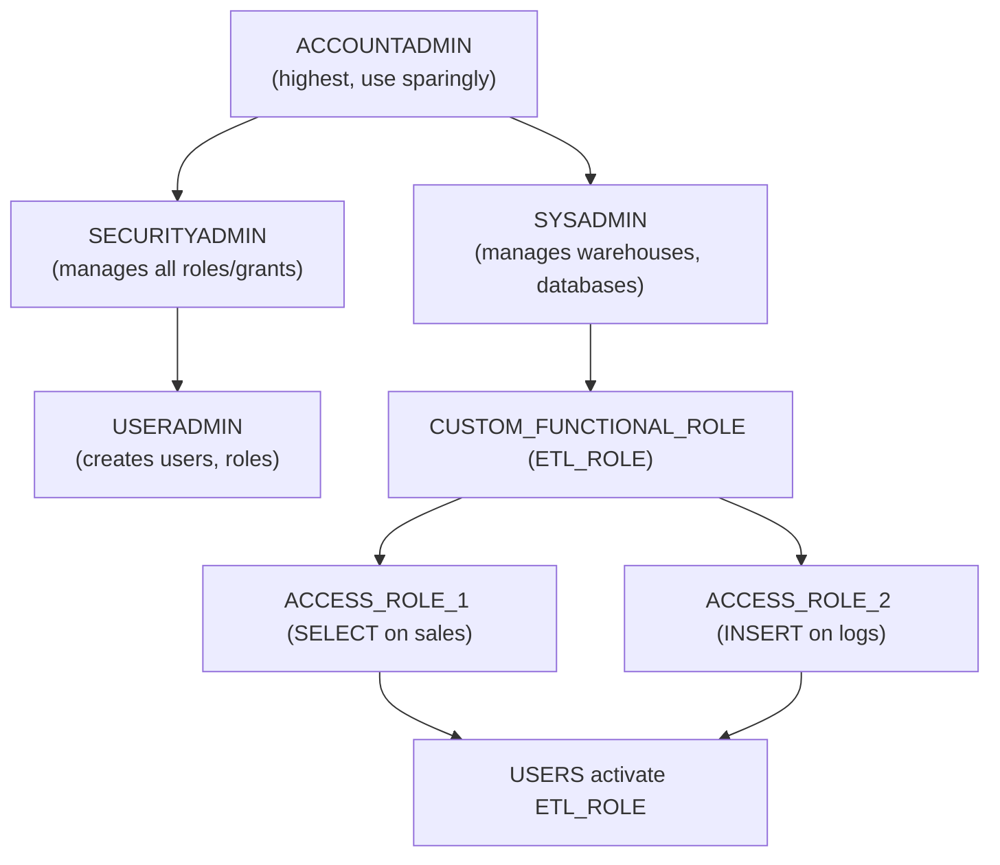

### Lab Exercise
```sql
-- Two-layer role pattern
USE ROLE SECURITYADMIN;

-- Access roles (per-object capability)
CREATE ROLE sales_read;
CREATE ROLE sales_write;
GRANT USAGE ON DATABASE prod_db TO ROLE sales_read;
GRANT USAGE ON SCHEMA prod_db.public TO ROLE sales_read;
GRANT SELECT ON ALL TABLES IN SCHEMA prod_db.public TO ROLE sales_read;
GRANT SELECT ON FUTURE TABLES IN SCHEMA prod_db.public TO ROLE sales_read;
GRANT INSERT, UPDATE, DELETE ON ALL TABLES IN SCHEMA prod_db.public TO ROLE sales_write;

-- Functional roles (per-team)
CREATE ROLE analytics_team;
GRANT ROLE sales_read TO ROLE analytics_team;

CREATE ROLE etl_team;
GRANT ROLE sales_read TO ROLE etl_team;
GRANT ROLE sales_write TO ROLE etl_team;

-- Grant to users
GRANT ROLE analytics_team TO USER alice;
GRANT ROLE etl_team TO USER bob;

-- Must grant to SYSADMIN so hierarchy stays visible to admins
GRANT ROLE analytics_team TO ROLE SYSADMIN;
GRANT ROLE etl_team TO ROLE SYSADMIN;
```
**Expected outcome:** Users inherit SELECT via roles; adding new tables auto-covered by FUTURE grant.

### Gotchas / Exam Traps
- `GRANT ... ON ALL TABLES` is a point-in-time snapshot — new tables need `GRANT ... ON FUTURE TABLES`.
- Future grants are **owned by the role that creates them**; dropping that role orphans them.
- `PUBLIC` role is granted to all users; **never** grant sensitive privs to PUBLIC.
- `ACCOUNTADMIN` should be assigned to <5 users and used only when needed; use SYSADMIN for daily work.
- `MANAGE GRANTS` privilege lets a role grant privs it doesn't own (useful for delegation but dangerous).

---

## Q2: What is "ownership" in Snowflake, and how does it differ from grants?
**Difficulty:** Intermediate
**Exam relevance:** "Understand object ownership transfer."

### Answer
Every object has exactly one **owner role**. Owner has implicit `OWNERSHIP` privilege — includes grant, revoke, drop, alter, as well as all read/write. Transfer with `GRANT OWNERSHIP ON <obj> TO ROLE <new_owner>` or `REVOKE CURRENT GRANTS` option. Grants to other roles are separate from ownership.

### First Principles
Ownership is the ultimate privilege: it lets a role do anything to the object. Grants to non-owners are explicit privilege sets. If you create an object as role X, X owns it even if another admin created the role. Transferring ownership can `COPY CURRENT GRANTS` (new owner inherits existing grant tree) or `REVOKE CURRENT GRANTS` (new owner replaces all grants).

### Diagram
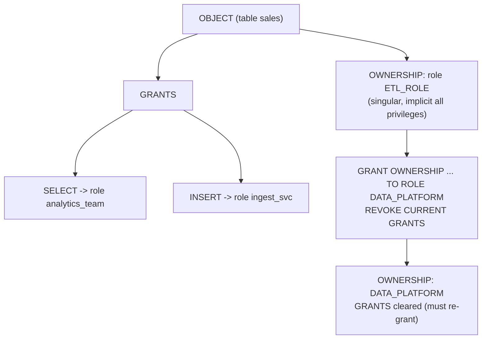

### Lab Exercise
```sql
-- Show owner
SHOW TABLES LIKE 'SALES';  -- owner column

-- Transfer ownership
USE ROLE SECURITYADMIN;
GRANT OWNERSHIP ON TABLE sales TO ROLE data_platform
  COPY CURRENT GRANTS;  -- preserve existing grants

-- Verify
SHOW GRANTS ON TABLE sales;
```
**Expected outcome:** Ownership moved; grants preserved with COPY option.

### Gotchas / Exam Traps
- `COPY CURRENT GRANTS` is the default; explicit flag recommended for clarity.
- Dropping a role transfers its owned objects to the role that drops it — can orphan accidentally.
- `GRANT OWNERSHIP` requires MANAGE GRANTS or the executing role to currently own the object.
- Future grants are owned by the role that creates the grant, not the target role.

---

## Q3: How do masking policies work and what's the dynamic data masking lifecycle?
**Difficulty:** Intermediate
**Exam relevance:** "Protect sensitive columns dynamically."

### Answer
A masking policy is a SQL expression evaluated at query time per column: `CASE WHEN current_role() IN ('ADMIN') THEN val ELSE '***' END`. Attach with `ALTER TABLE ... ALTER COLUMN email SET MASKING POLICY mp_email`. The policy decides visibility based on session context (role, user, query_tag).

### First Principles
Masking is at the column level, applied at the storage access layer — queries always see masked data unless the policy returns the unmasked value. One policy can be reused across many columns (as long as types match). The policy body sees the column value as `VAL` and current session info via `CURRENT_ROLE()`, `CURRENT_USER()`, etc. Masked columns can still be filtered on, but the filter applies to the masked value — so `WHERE email = 'alice@x.com'` returns nothing for non-privileged users unless the policy returns the real value for them.

### Diagram
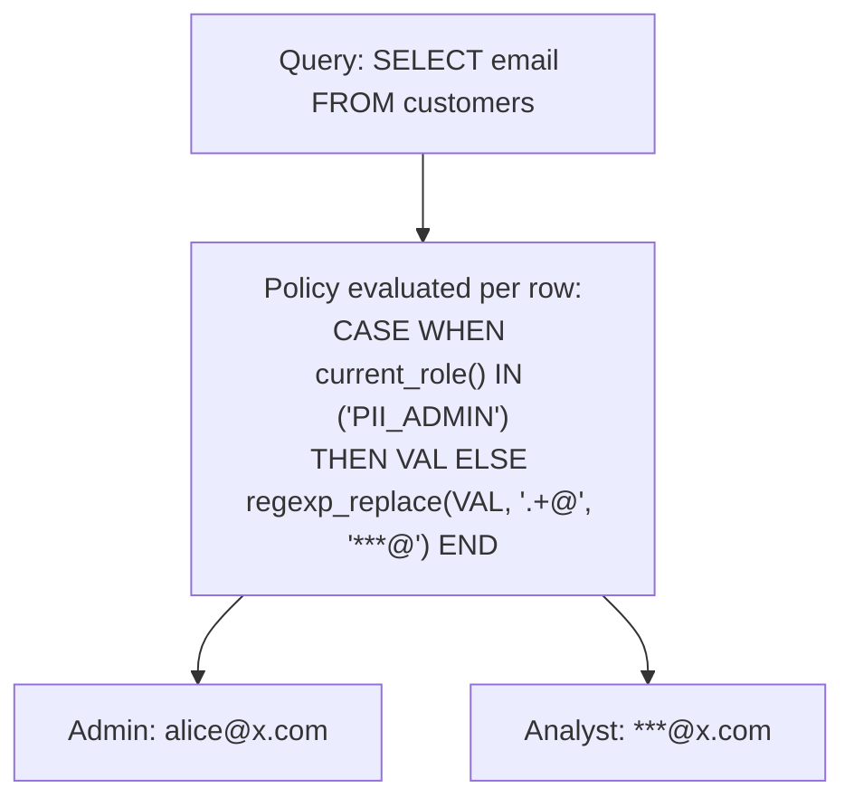

### Lab Exercise
```sql
USE ROLE SECURITYADMIN;

CREATE OR REPLACE MASKING POLICY mp_email AS (val STRING)
RETURNS STRING ->
  CASE
    WHEN CURRENT_ROLE() IN ('PII_ADMIN','DATA_PLATFORM') THEN val
    WHEN CURRENT_ROLE() = 'ANALYTICS_TEAM' THEN REGEXP_REPLACE(val, '.+@', '***@')
    ELSE '*** masked ***'
  END;

ALTER TABLE customers MODIFY COLUMN email SET MASKING POLICY mp_email;

-- Verify
USE ROLE analytics_team;
SELECT email FROM customers LIMIT 5;  -- shows ***@domain

USE ROLE pii_admin;
SELECT email FROM customers LIMIT 5;  -- shows real emails

-- Multi-column policy with condition
CREATE OR REPLACE MASKING POLICY mp_pii AS (val STRING)
RETURNS STRING ->
  CASE WHEN CURRENT_ROLE()='PII_ADMIN' THEN val ELSE SHA2(val) END;

ALTER TABLE customers MODIFY COLUMN ssn SET MASKING POLICY mp_pii;
ALTER TABLE customers MODIFY COLUMN phone SET MASKING POLICY mp_pii;
```
**Expected outcome:** Different roles see different values; policy evaluates per row.

### Gotchas / Exam Traps
- Masking policy must RETURN the same type as the column — mismatched types fail.
- A column can have at most ONE masking policy.
- Masking policies are owned by a role; dropping that role orphans the policy (dependent objects fail).
- Mask conditions like `CURRENT_ROLE() = 'ADMIN'` only match the active role — not inherited roles. Use `IS_ROLE_IN_SESSION('ADMIN')` to check inheritance.
- Masking does NOT prevent JOINs — a masked column can still participate but join values are the masked outputs.

---

## Q4: What are Row Access Policies and how do they differ from masking?
**Difficulty:** Intermediate
**Exam relevance:** "Filter rows per user/role."

### Answer
Row Access Policies (RAP) filter which rows a user sees. Attached to a table with `ALTER TABLE ... ADD ROW ACCESS POLICY rap_name ON (col1, col2)`. The policy returns BOOLEAN per row — TRUE = visible. Masking hides values; RAP hides rows entirely.

### First Principles
RAPs are evaluated per row during query, like a hidden WHERE. The policy sees named columns of the attached table and can also reference mapping tables (entitlement tables that join user -> allowed region, say). Great for multi-tenant isolation — one physical table, many tenants, each sees only their rows. Policy must be deterministic for pruning; cached across invocations within a query.

### Diagram
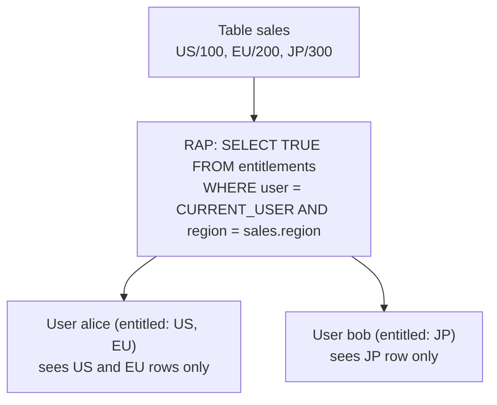

### Lab Exercise
```sql
CREATE OR REPLACE TABLE sales (region STRING, amt NUMBER);
INSERT INTO sales VALUES ('US',100),('EU',200),('JP',300);

CREATE OR REPLACE TABLE entitlements (user_name STRING, region STRING);
INSERT INTO entitlements VALUES
  ('ALICE','US'),('ALICE','EU'),('BOB','JP');

CREATE OR REPLACE ROW ACCESS POLICY rap_region AS (region STRING)
RETURNS BOOLEAN ->
  CURRENT_ROLE() = 'ACCOUNTADMIN'
  OR EXISTS (
    SELECT 1 FROM entitlements
    WHERE user_name = CURRENT_USER() AND entitlements.region = region
  );

ALTER TABLE sales ADD ROW ACCESS POLICY rap_region ON (region);

-- As ALICE
SELECT * FROM sales;  -- US, EU only
-- As BOB
SELECT * FROM sales;  -- JP only
```
**Expected outcome:** Different users see different row subsets based on entitlement mapping.

### Gotchas / Exam Traps
- A table can have **one row access policy at a time** (as of DEA-C02 timing — multi-RAP available in some paths).
- RAP columns must exist and match types.
- RAP policy functions should be deterministic for CBO pruning; subqueries into mapping tables are OK but add overhead.
- When attached, RAP is enforced for ALL queries including by table owner; owner must have grant to the policy via SECURITYADMIN.

---

## Q5: Describe OAuth integration for client applications.
**Difficulty:** Advanced
**Exam relevance:** "Configure OAuth for third-party clients."

### Answer
Snowflake supports OAuth 2.0 for client auth: (1) **Snowflake OAuth** — Snowflake acts as authorization server, issues tokens. (2) **External OAuth** — a third-party IdP (Okta, Azure AD, PingFederate) issues tokens; Snowflake validates. Clients request tokens, present them to Snowflake, access via scope-mapped role.

### First Principles
OAuth removes password management from clients. Tokens carry scope + user identity; Snowflake maps the scope to a role (via `OAUTH_SCOPE_MAPPING`). Short-lived access tokens + longer-lived refresh tokens enable automation without storing credentials. External OAuth is preferred in enterprises with existing IdP.

### Diagram
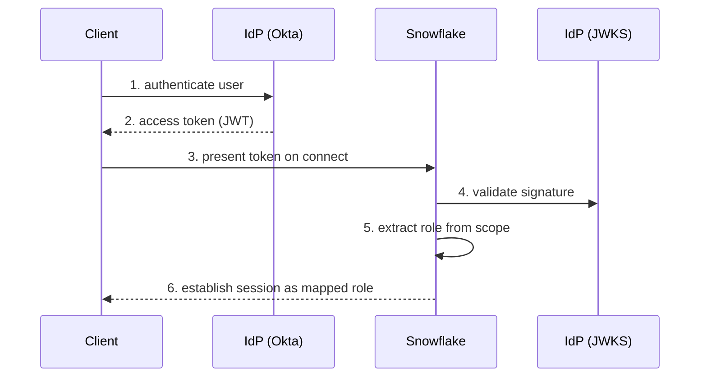

### Lab Exercise
```sql
-- Snowflake OAuth (Snowflake-as-authserver)
USE ROLE ACCOUNTADMIN;
CREATE SECURITY INTEGRATION tableau_oauth
  TYPE = OAUTH
  ENABLED = TRUE
  OAUTH_CLIENT = TABLEAU_DESKTOP
  OAUTH_REDIRECT_URI = 'https://my-tableau.example.com/callback';

SHOW INTEGRATIONS;
-- Returns client_id, client_secret for configuring Tableau

-- External OAuth (Okta)
CREATE SECURITY INTEGRATION okta_oauth
  TYPE = EXTERNAL_OAUTH
  ENABLED = TRUE
  EXTERNAL_OAUTH_TYPE = OKTA
  EXTERNAL_OAUTH_ISSUER = 'https://my-org.okta.com'
  EXTERNAL_OAUTH_JWS_KEYS_URL = 'https://my-org.okta.com/oauth2/.../v1/keys'
  EXTERNAL_OAUTH_TOKEN_USER_MAPPING_CLAIM = 'sub'
  EXTERNAL_OAUTH_SNOWFLAKE_USER_MAPPING_ATTRIBUTE = 'LOGIN_NAME';
```
**Expected outcome:** Client applications authenticate via IdP; Snowflake accepts JWT tokens signed by issuer.

### Gotchas / Exam Traps
- `EXTERNAL_OAUTH_TOKEN_USER_MAPPING_CLAIM` maps JWT claim -> Snowflake user; getting this wrong causes "user not found" errors.
- Snowflake OAuth tokens have 10-minute access TTL; refresh tokens 90 days.
- OAuth scopes must map to roles (`session:role:<role_name>`) or Snowflake uses the user's default role.
- MFA cannot be enforced for OAuth logins; MFA happens at IdP.

---

## Q6: Explain SCIM provisioning and its relationship to SAML/OAuth.
**Difficulty:** Intermediate
**Exam relevance:** "Automate user and role provisioning."

### Answer
SCIM (System for Cross-domain Identity Management) is a REST API for auto-provisioning users and groups from an IdP (Okta, Azure AD). IdP pushes user create/update/delete to Snowflake via SCIM endpoint. Combines with SAML/OAuth: SCIM syncs identities; SAML/OAuth authenticates them at login.

### First Principles
Identity lifecycle without SCIM is manual: HR adds user to Okta, admin manually creates in Snowflake. SCIM automates: IdP is the source of truth; Snowflake auto-creates/disables users. Groups in IdP map to roles in Snowflake — add a user to the "Analytics" group in Okta and they get the `ANALYTICS_TEAM` role in Snowflake automatically.

### Diagram
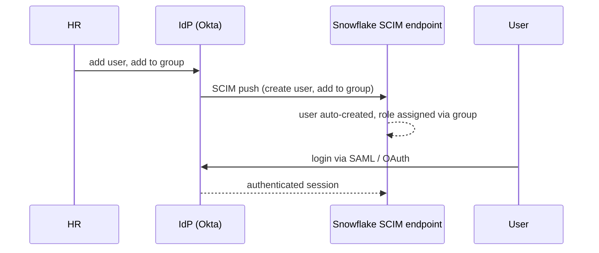

### Lab Exercise
```sql
-- Snowflake side: enable SCIM
USE ROLE ACCOUNTADMIN;
CREATE OR REPLACE SECURITY INTEGRATION okta_scim
  TYPE = SCIM
  SCIM_CLIENT = OKTA
  RUN_AS_ROLE = OKTA_PROVISIONER;

-- Returns bearer token for Okta to use
SELECT SYSTEM$GENERATE_SCIM_ACCESS_TOKEN('OKTA_SCIM');

-- Snowflake side: role that will own provisioned users
CREATE ROLE okta_provisioner;
GRANT CREATE USER, CREATE ROLE ON ACCOUNT TO ROLE okta_provisioner;

-- In Okta: configure SCIM endpoint with bearer token
-- Okta pushes users/groups to Snowflake automatically
```
**Expected outcome:** Adding users in Okta auto-creates them in Snowflake with mapped roles.

### Gotchas / Exam Traps
- SCIM auto-creates users with `DISABLED` if they're disabled in IdP — but doesn't drop them.
- SCIM-managed users cannot be edited manually in Snowflake — must change in IdP.
- Only ONE SCIM integration per IdP type per account.
- SCIM token has 6-month expiry; rotate before expiration.

---

## Q7: What are network policies and how do you layer them?
**Difficulty:** Foundation
**Exam relevance:** "Restrict network access to Snowflake."

### Answer
Network policies allow/block IP ranges for login. Applied at account level (default) or user level (override). `ALTER NETWORK POLICY np SET ALLOWED_IP_LIST=('10.0.0.0/8') BLOCKED_IP_LIST=(...)`. User-level network policy overrides account-level.

### First Principles
Snowflake accepts connections from any IP by default — a security concern. Network policies provide a firewall at the control plane. For high-security accounts, use Private Link (AWS PrivateLink/Azure Private Link/Google Private Service Connect) to eliminate public endpoints entirely. Private Link + network policy restricting to private IPs = strongest posture.

### Diagram
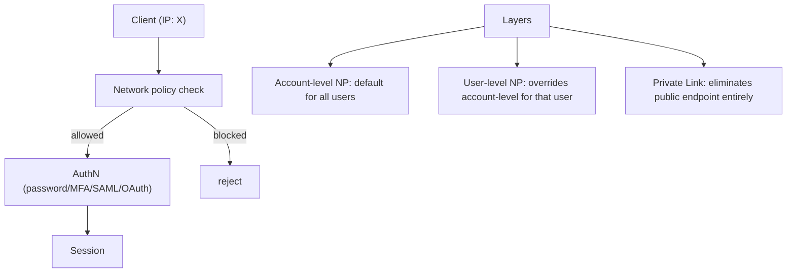

### Lab Exercise
```sql
CREATE OR REPLACE NETWORK POLICY corp_only
  ALLOWED_IP_LIST = ('10.0.0.0/8','192.168.0.0/16','203.0.113.5/32')
  BLOCKED_IP_LIST = ('203.0.113.0/24');  -- block overrides allow

-- Account-level
ALTER ACCOUNT SET NETWORK_POLICY = corp_only;

-- User-level override
ALTER USER alice SET NETWORK_POLICY = alice_special_np;

-- Audit
SELECT user_name, event_timestamp, error_message, client_ip
FROM SNOWFLAKE.ACCOUNT_USAGE.LOGIN_HISTORY
WHERE is_success='NO'
AND event_timestamp > DATEADD(day,-7,CURRENT_DATE);
```
**Expected outcome:** Logins outside allowed IPs fail; `LOGIN_HISTORY` records them.

### Gotchas / Exam Traps
- Setting an overly restrictive NP that excludes **your own** IP locks you out — Snowflake Support must remove it.
- `BLOCKED_IP_LIST` wins over `ALLOWED_IP_LIST` when they overlap.
- Network policies apply to **connections**, not to object access within a session.
- Private Link + public endpoint disabled = highest security.

---

## Q8: What is Access History and how does it support audit requirements?
**Difficulty:** Advanced
**Exam relevance:** "Audit column-level data access."

### Answer
`SNOWFLAKE.ACCOUNT_USAGE.ACCESS_HISTORY` records every query's **columns accessed** (base_objects_accessed), **columns written** (objects_modified), and **direct/indirect lineage** (via views, UDFs). Enterprise+ feature. Essential for GDPR/CCPA audit, data classification compliance.

### First Principles
Standard `QUERY_HISTORY` tells you the query text but not which columns were actually read (after view resolution and projection). `ACCESS_HISTORY` resolves views, inline SQL, and UDFs to list the base-table columns actually touched. For data classification policies, this proves exactly who accessed what sensitive column when.

### Diagram
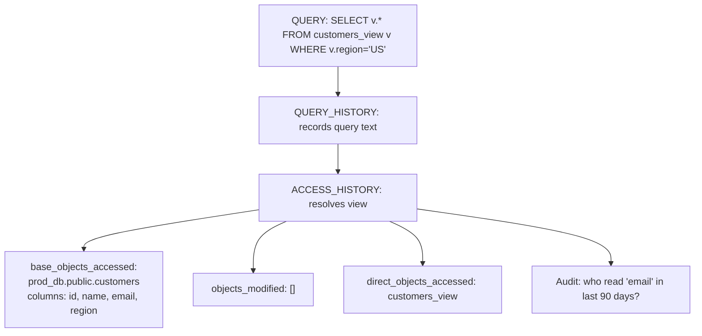

### Lab Exercise
```sql
-- Audit column access
SELECT user_name,
       query_start_time,
       query_id,
       value:objectName::STRING AS obj,
       col.value:columnName::STRING AS column_read
FROM SNOWFLAKE.ACCOUNT_USAGE.ACCESS_HISTORY ah,
     LATERAL FLATTEN(ah.base_objects_accessed) obj,
     LATERAL FLATTEN(obj.value:columns) col
WHERE obj.value:objectName::STRING = 'PROD_DB.PUBLIC.CUSTOMERS'
AND col.value:columnName::STRING = 'EMAIL'
AND query_start_time > DATEADD(day,-30,CURRENT_DATE)
ORDER BY query_start_time DESC;

-- Who modified a table
SELECT user_name, query_start_time, query_id,
       value:objectName::STRING AS obj_written
FROM SNOWFLAKE.ACCOUNT_USAGE.ACCESS_HISTORY,
     LATERAL FLATTEN(objects_modified)
WHERE query_start_time > DATEADD(day,-7,CURRENT_DATE);
```
**Expected outcome:** Per-column access audit; who modified what tables.

### Gotchas / Exam Traps
- `ACCESS_HISTORY` has up to 3-hour latency in Account Usage.
- Access to the view includes access to the base table columns the view projects.
- UDFs/stored procedures that read tables record access against the procedure caller's identity.
- Enterprise+ edition required.

---

## Q9: Explain object tagging and how it combines with policies.
**Difficulty:** Intermediate
**Exam relevance:** "Classify and govern data via tags."

### Answer
Object tags are key-value metadata attached to databases, schemas, tables, columns, warehouses, etc. (`ALTER TABLE sales SET TAG classification='CONFIDENTIAL'`). Policies can reference tags: a masking policy conditional on `SYSTEM$GET_TAG('CLASSIFICATION', ...)` applies different masking to differently classified columns. **Tag-based masking policy** attaches a policy to a tag so any column with that tag gets masking automatically.

### First Principles
Tags are the metadata layer that bridges governance intent to enforcement. Classifying columns with tags (manual or auto via `SYSTEM$CLASSIFY`) allows one policy to protect many columns. Add a column tagged `PII_EMAIL` to any table and the mapped masking policy applies automatically — no per-column `ALTER` needed.

### Diagram
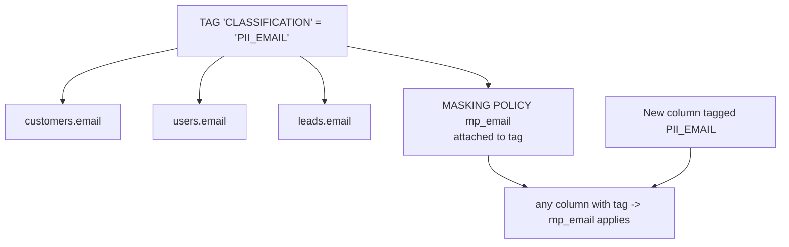

### Lab Exercise
```sql
USE ROLE ACCOUNTADMIN;
CREATE TAG classification;
CREATE TAG pii_level ALLOWED_VALUES 'none','low','medium','high';

-- Tag objects
ALTER TABLE customers MODIFY COLUMN email SET TAG classification = 'PII_EMAIL';
ALTER TABLE customers MODIFY COLUMN ssn SET TAG classification = 'PII_SSN';

-- Tag-based masking
CREATE OR REPLACE MASKING POLICY mp_email AS (val STRING) RETURNS STRING ->
  CASE WHEN CURRENT_ROLE() = 'PII_ADMIN' THEN val ELSE '***@masked' END;

ALTER TAG classification SET MASKING POLICY mp_email;
-- Now ANY column tagged classification='PII_EMAIL' is masked
-- But: tag-attached masking policies apply per tag value, so refine:

CREATE OR REPLACE MASKING POLICY mp_pii_universal AS (val STRING) RETURNS STRING ->
  CASE
    WHEN CURRENT_ROLE() = 'PII_ADMIN' THEN val
    WHEN SYSTEM$GET_TAG_ON_CURRENT_COLUMN('CLASSIFICATION') = 'PII_SSN' THEN REPEAT('*',11)
    WHEN SYSTEM$GET_TAG_ON_CURRENT_COLUMN('CLASSIFICATION') = 'PII_EMAIL' THEN REGEXP_REPLACE(val,'.+@','***@')
    ELSE val
  END;

-- Tag references via views
SELECT * FROM TABLE(INFORMATION_SCHEMA.TAG_REFERENCES_ALL_COLUMNS(
  'customers', 'TABLE'
));
```
**Expected outcome:** New columns inherit protection by being tagged; one policy covers many columns.

### Gotchas / Exam Traps
- Tag-based masking requires **Enterprise+** edition.
- Only ONE masking policy can be attached to a given tag at a time.
- Tags propagate down the hierarchy (DB -> schema -> table -> column) by default — check inheritance.
- `SYSTEM$CLASSIFY` can auto-detect PII types using Snowflake Cortex (newer feature).

---

## Q10: Describe Secure Data Sharing and its security model.
**Difficulty:** Advanced
**Exam relevance:** "Share data securely without copy."

### Answer
Secure Data Sharing creates a read-only reference to provider's data for consumer accounts in the same region. Provider creates a `SHARE`, grants object privileges to the share, adds consumer accounts. Consumer creates a database `FROM SHARE`. No data copies; consumer queries hit provider storage. Cross-region/cloud requires replication first.

### First Principles
Shares are metadata grants, not copies. The provider pays storage; the consumer pays compute. Secure views (`CREATE SECURE VIEW`) hide definition from consumer and can filter data per consumer via `CURRENT_ACCOUNT()` inside the view. Reader Accounts allow non-Snowflake consumers to query via a provider-managed account.

### Diagram
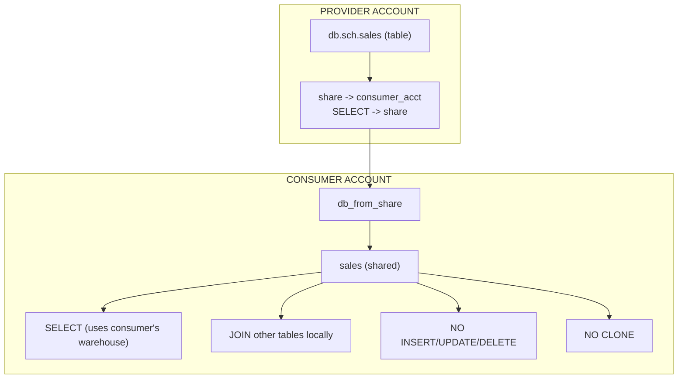

### Lab Exercise
```sql
-- Provider
USE ROLE ACCOUNTADMIN;
CREATE SHARE sales_share;
GRANT USAGE ON DATABASE prod_db TO SHARE sales_share;
GRANT USAGE ON SCHEMA prod_db.public TO SHARE sales_share;
GRANT SELECT ON TABLE prod_db.public.sales TO SHARE sales_share;

-- Add consumer
ALTER SHARE sales_share ADD ACCOUNTS = consumer_org.consumer_acct;

-- Secure view with per-consumer filter
CREATE SECURE VIEW prod_db.public.sales_per_consumer AS
SELECT * FROM prod_db.public.sales
WHERE account_id = CURRENT_ACCOUNT();

GRANT SELECT ON VIEW prod_db.public.sales_per_consumer TO SHARE sales_share;

-- Consumer
CREATE DATABASE sales_from_provider FROM SHARE provider_org.provider_acct.sales_share;
SELECT * FROM sales_from_provider.public.sales;
SELECT * FROM sales_from_provider.public.sales_per_consumer;  -- only this consumer's rows
```
**Expected outcome:** Consumer reads provider data without copying; per-consumer view filters automatically.

### Gotchas / Exam Traps
- Shares work only in same region/cloud by default — cross-region requires replication of the source DB.
- Consumers CAN see table structure (DESC) and query data, but CANNOT see the definition of secure views/UDFs.
- Dropping objects from the share immediately removes consumer access.
- Reader accounts are managed by provider; provider pays all compute for reader account queries.

---

## Q11: How do you authenticate service accounts securely (key-pair auth)?
**Difficulty:** Intermediate
**Exam relevance:** "Service account auth without passwords."

### Answer
Generate RSA key pair; register public key with user (`ALTER USER svc SET RSA_PUBLIC_KEY='...'`). Client signs a JWT per connection with private key; Snowflake validates signature. Supports two keys (`RSA_PUBLIC_KEY` and `RSA_PUBLIC_KEY_2`) for zero-downtime rotation.

### First Principles
Passwords in config files are the #1 source of credential leaks. Key-pair auth puts only the public key in Snowflake; the private key stays with the service. Rotating keys without downtime: set `RSA_PUBLIC_KEY_2` to new key, deploy new private key to clients, remove `RSA_PUBLIC_KEY`, promote key2 to key1. Required for Snowpipe REST and Kafka connector.

### Diagram
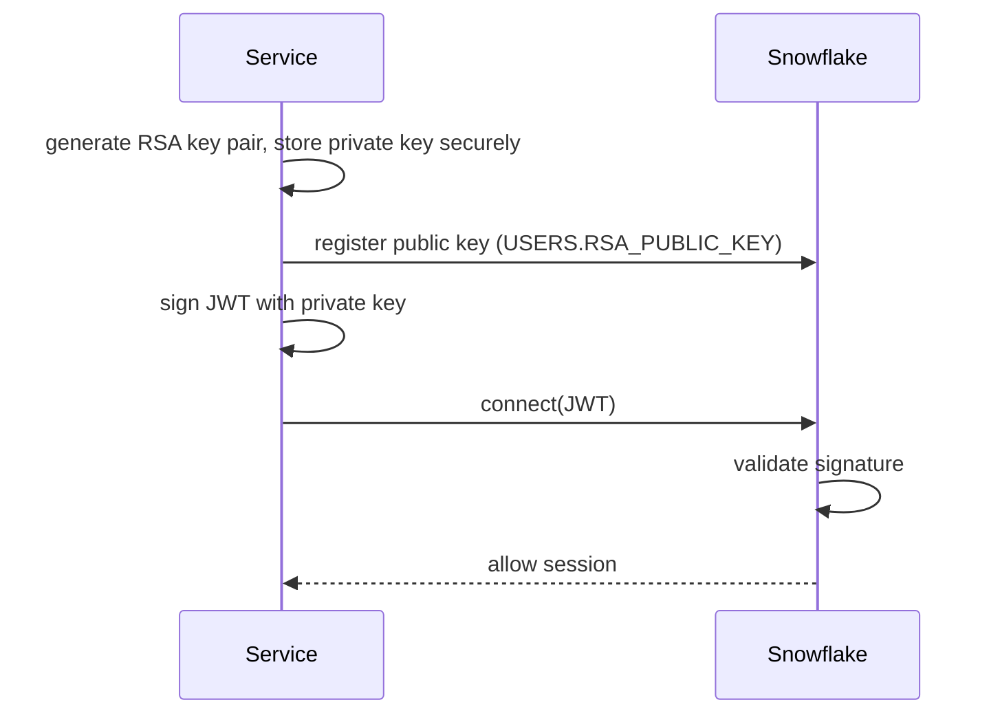

### Lab Exercise
```bash
# Generate key pair
openssl genrsa 2048 | openssl pkcs8 -topk8 -inform PEM -out rsa_key.p8 -nocrypt
openssl rsa -in rsa_key.p8 -pubout -out rsa_key.pub
# Strip header/footer; copy base64 body
```
```sql
USE ROLE SECURITYADMIN;
ALTER USER svc_ingest SET RSA_PUBLIC_KEY='MIIBIjANBgkq...';

-- Rotate: add second key, remove old
ALTER USER svc_ingest SET RSA_PUBLIC_KEY_2='MIIBIj...new...';
-- Deploy new private key to clients
ALTER USER svc_ingest UNSET RSA_PUBLIC_KEY;
ALTER USER svc_ingest SET RSA_PUBLIC_KEY='MIIBIj...new...';
ALTER USER svc_ingest UNSET RSA_PUBLIC_KEY_2;

-- Audit key usage
SELECT user_name, authentication_factor_name, event_timestamp
FROM SNOWFLAKE.ACCOUNT_USAGE.LOGIN_HISTORY
WHERE first_authentication_factor = 'RSA_KEYPAIR'
AND event_timestamp > DATEADD(day,-7,CURRENT_DATE);
```
**Expected outcome:** Service connects via JWT signed with private key; no password required.

### Gotchas / Exam Traps
- Public key must be in PEM format WITHOUT the `-----BEGIN PUBLIC KEY-----` headers.
- A user can have BOTH password and key — service users should disable password (`ALTER USER svc SET PASSWORD=NULL`).
- Snowflake-recommended service user type: `USER TYPE = SERVICE` which disallows password auth entirely (newer feature).
- Max 2 keys per user; use both for rotation window.

---

## Q12: What is Private Link, and how does it integrate with network policies?
**Difficulty:** Advanced
**Exam relevance:** "Eliminate public endpoints via Private Link."

### Answer
AWS PrivateLink / Azure Private Link / Google Private Service Connect expose Snowflake via a VPC endpoint inside your network. No public internet traversal. Combines with network policies restricting to internal IPs for defense-in-depth. Requires Business Critical edition (AWS/Azure) or Enterprise (GCP).

### First Principles
Default Snowflake endpoints are public (TLS-secured but reachable from internet). Private Link places a VPC-local endpoint; your traffic stays on the cloud provider's backbone. Combining with network policy that blocks all public IPs forces every connection through the private endpoint — zero internet exposure.

### Diagram
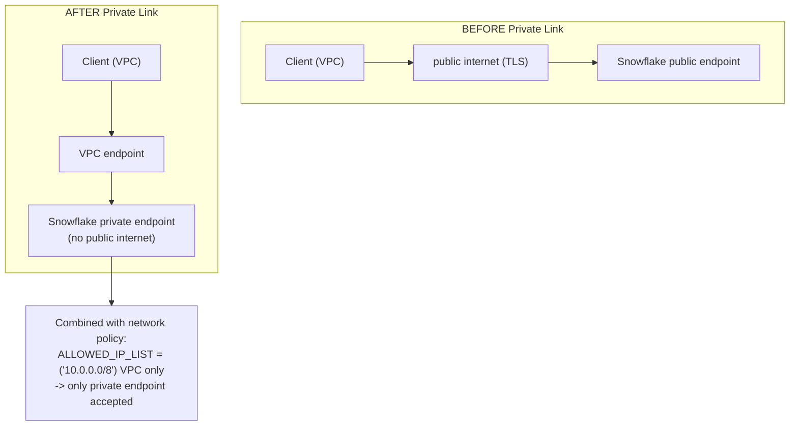

### Lab Exercise
```sql
-- Request Private Link endpoint from Snowflake Support (per account)
-- Returns VPC endpoint service name

-- In AWS, create VPC endpoint pointing to the service
-- Then on Snowflake side:
SELECT SYSTEM$GET_PRIVATELINK_CONFIG();  -- returns endpoint info

-- Enforce via network policy
ALTER ACCOUNT SET NETWORK_POLICY = internal_vpc_only;

-- Verify
SELECT SYSTEM$WHITELIST_PRIVATELINK();
```
**Expected outcome:** All traffic flows through VPC endpoint; public endpoint can be disabled entirely.

### Gotchas / Exam Traps
- Private Link setup requires coordination with Snowflake Support — not self-service.
- Snowsight UI access may need `SYSTEM$WHITELIST_PRIVATELINK()` to allow Snowflake-managed proxy IPs for OCSP + web UI.
- Private Link for client auth = yes; Snowpipe auto-ingest from your bucket still uses cloud provider networking (SQS).

---

## Q13: Describe how `ACCOUNTADMIN` should be used — and the three key policies.
**Difficulty:** Foundation
**Exam relevance:** "Govern highest-privilege role."

### Answer
`ACCOUNTADMIN` is the most privileged role. Best practices: (1) Assign to **at most 2 users** (CTO, lead admin). (2) **Enforce MFA** on all ACCOUNTADMIN users. (3) Use **just-in-time elevation** — ACCOUNTADMIN users work as SYSADMIN daily and `USE ROLE ACCOUNTADMIN` only when necessary.

### First Principles
ACCOUNTADMIN can do anything, including delete the account. Over-use leads to inadvertent damage and audit noise. The role hierarchy supports task-appropriate roles — if your task doesn't need account-wide power, don't use the account-wide role. MFA ensures compromise of the password alone isn't enough.

### Diagram
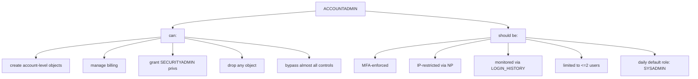

### Lab Exercise
```sql
USE ROLE ACCOUNTADMIN;

-- Enforce MFA on ACCOUNTADMIN users
SELECT user_name
FROM SNOWFLAKE.ACCOUNT_USAGE.GRANTS_TO_USERS
WHERE role = 'ACCOUNTADMIN' AND deleted_on IS NULL;

-- For each:
ALTER USER <admin_user> SET MINS_TO_BYPASS_MFA = 0;  -- always require MFA

-- Audit ACCOUNTADMIN activity
SELECT user_name, query_text, role_name, start_time
FROM SNOWFLAKE.ACCOUNT_USAGE.QUERY_HISTORY
WHERE role_name = 'ACCOUNTADMIN'
AND start_time > DATEADD(day,-7,CURRENT_DATE)
ORDER BY start_time DESC;
```
**Expected outcome:** ACCOUNTADMIN use is auditable and rare.

### Gotchas / Exam Traps
- Default role matters — if a user's default role is ACCOUNTADMIN, every login uses it.
- `USE SECONDARY ROLES ALL` can activate multiple roles including ACCOUNTADMIN inadvertently.
- CREATE objects as ACCOUNTADMIN by mistake makes ACCOUNTADMIN the owner — hard to fix.

---

## Q14: What are secondary roles and how do they change query behavior?
**Difficulty:** Advanced
**Exam relevance:** "Multi-role sessions."

### Answer
`USE SECONDARY ROLES ALL` activates all granted roles simultaneously in a session, in addition to the primary role. Privilege check becomes the union of all active roles. Reverses with `USE SECONDARY ROLES NONE`.

### First Principles
Traditional Snowflake sessions have one active role at a time. Users with grants across many functional roles had to `USE ROLE` to switch — annoying for BI tools. Secondary roles let a session hold multiple roles' privileges, acting as their union. Object creation still goes to the **primary** role (ownership); only authorization checks use the union.

### Diagram
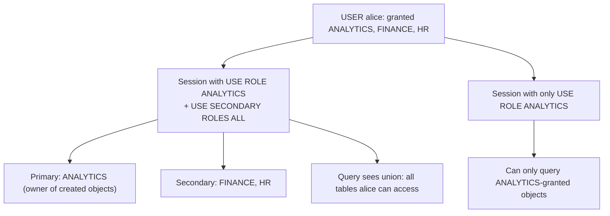

### Lab Exercise
```sql
USE ROLE analytics;
USE SECONDARY ROLES ALL;

SELECT CURRENT_ROLE(), CURRENT_SECONDARY_ROLES();

-- Query combining data visible to different roles
SELECT a.*, f.*, h.*
FROM analytics_db.public.events a
JOIN finance_db.public.ledger f ON a.id = f.event_id
JOIN hr_db.public.employees h ON f.employee_id = h.id;

-- Create a table (owned by primary role: ANALYTICS)
CREATE TABLE combined_report AS SELECT ...;

-- Turn off
USE SECONDARY ROLES NONE;
```
**Expected outcome:** Query crosses role-managed data; new object owned by primary role.

### Gotchas / Exam Traps
- Row access policies evaluate against `CURRENT_ROLE()` (primary) by default — may surprise with secondary roles.
- Masking policies similarly evaluate the primary role in `CURRENT_ROLE()`; use `IS_ROLE_IN_SESSION()` to consider secondary.
- Secondary roles don't change `CURRENT_ROLE()` return — only authorization.

---

## Q15: Describe row-level security best practices for multi-tenant SaaS.
**Difficulty:** Advanced
**Exam relevance:** "Design tenant isolation."

### Answer
Store `tenant_id` column on every table; create an entitlements table mapping users/accounts to tenants; apply a row access policy on each table filtering by `tenant_id` using the entitlements table. Use secure views for consumers via data share — the view filters by `CURRENT_ACCOUNT()` to isolate tenants.

### First Principles
Multi-tenancy with one schema requires defense in depth: RAP ensures no accidental cross-tenant query; secure views hide the policy mechanism from consumers; separate warehouses per large tenant (optional) isolate performance. The design makes "wrong tenant" queries impossible at the storage layer.

### Diagram
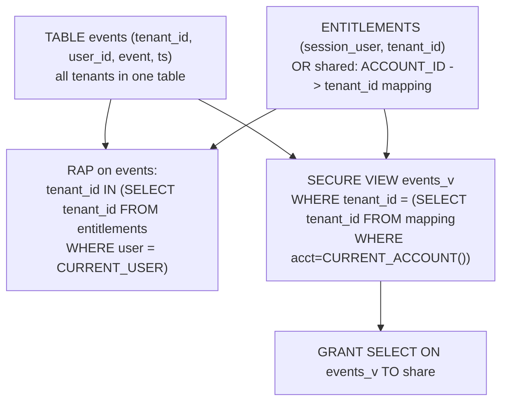

### Lab Exercise
```sql
CREATE TABLE events (
  tenant_id STRING,
  user_id STRING,
  event STRING,
  ts TIMESTAMP
);

CREATE TABLE user_tenant_mapping (snowflake_user STRING, tenant_id STRING);

CREATE OR REPLACE ROW ACCESS POLICY rap_tenant AS (tenant_id STRING)
RETURNS BOOLEAN ->
  tenant_id IN (
    SELECT utm.tenant_id FROM user_tenant_mapping utm
    WHERE utm.snowflake_user = CURRENT_USER()
  );

ALTER TABLE events ADD ROW ACCESS POLICY rap_tenant ON (tenant_id);

-- For data share
CREATE SECURE VIEW events_shared AS
SELECT * FROM events
WHERE tenant_id = (
  SELECT tenant_id FROM account_tenant_map WHERE account_id = CURRENT_ACCOUNT()
);
```
**Expected outcome:** Each user/account only sees its tenant's rows.

### Gotchas / Exam Traps
- Entitlements table reads must be fast — cluster by user_name.
- Mapping table updates have no latency; the next query sees new entitlements.
- RAP + large JOINs can degrade pruning if the policy's subquery is complex — materialize entitlements if needed.
- Don't accidentally grant SELECT on entitlements table to tenants.

---

## Q16: What is the "secure UDF" / "secure view" concept and when do you need it?
**Difficulty:** Intermediate
**Exam relevance:** "Hide logic from downstream consumers."

### Answer
`CREATE SECURE VIEW/FUNCTION` hides the view/function body from users without `OWNERSHIP`. Prevents inspecting business logic or inferring row-filter conditions via `EXPLAIN`. Required for views exposed via data sharing or shared across sensitive boundaries.

### First Principles
A non-secure view's definition is visible to anyone with SELECT — they can read your filtering/masking logic. For data shared externally, this leaks IP and may expose row-filter conditions a malicious consumer could probe. Secure views disable certain optimizations (predicate pushdown is restricted to not reveal row counts) for safety. Minor performance cost in exchange for information hiding.

### Diagram
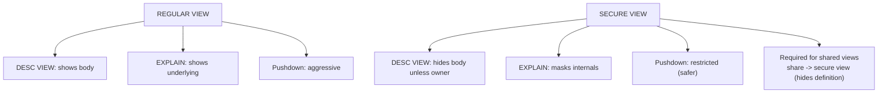

### Lab Exercise
```sql
CREATE SECURE VIEW sensitive_sales AS
SELECT *
FROM sales
WHERE region IN (SELECT region FROM my_entitlements WHERE user_id = CURRENT_USER());

-- Non-owner tries to inspect:
GRANT SELECT ON VIEW sensitive_sales TO ROLE analyst;
USE ROLE analyst;
DESC VIEW sensitive_sales;  -- body hidden

-- EXPLAIN also hides internals
EXPLAIN SELECT * FROM sensitive_sales;
```
**Expected outcome:** Non-owners can query but not see internals.

### Gotchas / Exam Traps
- Secure views have **restricted predicate pushdown** — may be slower than regular views in some cases.
- `IS_GRANTABLE` is harder to inspect; account for troubleshooting friction.
- Secure UDFs similarly hide function body.

---

## Q17: How do you implement data classification and automatic protection?
**Difficulty:** Advanced
**Exam relevance:** "Automated PII discovery and protection."

### Answer
Use `EXTRACT_SEMANTIC_CATEGORIES` and `ASSOCIATE_SEMANTIC_CATEGORY_TAGS` to auto-classify columns (email, SSN, phone, credit card). The procedure samples data and applies system tags (`SNOWFLAKE.CORE.SEMANTIC_CATEGORY`). Combine with tag-based masking policies to automatically protect classified columns.

### First Principles
Manually tagging thousands of columns doesn't scale. Snowflake's classification engine samples columns and uses regex + ML models to identify PII types. Associated tags are system-managed; your tag-based policies apply protection without manual intervention. Classification is best run after major schema changes or on new tables.

### Diagram
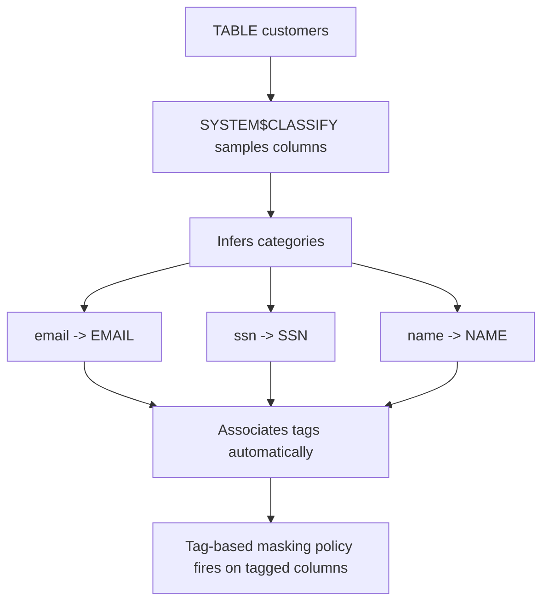

### Lab Exercise
```sql
-- Classify a table
CALL SYSTEM$CLASSIFY('customers');
-- Returns JSON with per-column classification

-- Auto-tag based on classification
CALL ASSOCIATE_SEMANTIC_CATEGORY_TAGS('customers', 'default');
-- Attaches SNOWFLAKE.CORE.SEMANTIC_CATEGORY tags

-- See results
SELECT * FROM TABLE(INFORMATION_SCHEMA.TAG_REFERENCES_ALL_COLUMNS('customers','TABLE'));

-- Attach masking policy to tag
CREATE OR REPLACE MASKING POLICY mp_classified AS (val STRING)
RETURNS STRING ->
  CASE
    WHEN CURRENT_ROLE() = 'PII_ADMIN' THEN val
    WHEN SYSTEM$GET_TAG_ON_CURRENT_COLUMN('SNOWFLAKE.CORE.SEMANTIC_CATEGORY') = 'EMAIL'
      THEN REGEXP_REPLACE(val, '.+@', '***@')
    WHEN SYSTEM$GET_TAG_ON_CURRENT_COLUMN('SNOWFLAKE.CORE.SEMANTIC_CATEGORY') = 'SSN'
      THEN REPEAT('*',11)
    ELSE val
  END;

ALTER TAG SNOWFLAKE.CORE.SEMANTIC_CATEGORY SET MASKING POLICY mp_classified;
```
**Expected outcome:** New tables classified and auto-protected without manual column tagging.

### Gotchas / Exam Traps
- Classification samples data; low-cardinality tables may misclassify.
- `SYSTEM$CLASSIFY` requires Enterprise+.
- System tags can't be modified by users — you can only attach masking policies to them.

---

## Q18: Explain how to enforce MFA, SSO, and password policies.
**Difficulty:** Intermediate
**Exam relevance:** "Enforce enterprise authentication standards."

### Answer
Password policy: `CREATE PASSWORD POLICY pp MIN_LENGTH=12 ... ; ALTER ACCOUNT SET PASSWORD POLICY = pp`. MFA: `ALTER USER x SET MINS_TO_BYPASS_MFA=0` to enforce. SSO via SAML: `CREATE SECURITY INTEGRATION ... TYPE=SAML2`. Combine: SSO primary auth, MFA on IdP side, local accounts (ACCOUNTADMIN) with MFA + password policy.

### First Principles
Multiple auth factors must stack. SSO delegates auth to IdP but local admin accounts remain for emergency access — those need strict password + MFA. Password policies prevent weak passwords on local accounts. `DISABLE_MFA` and similar bypasses should be audited.

### Diagram
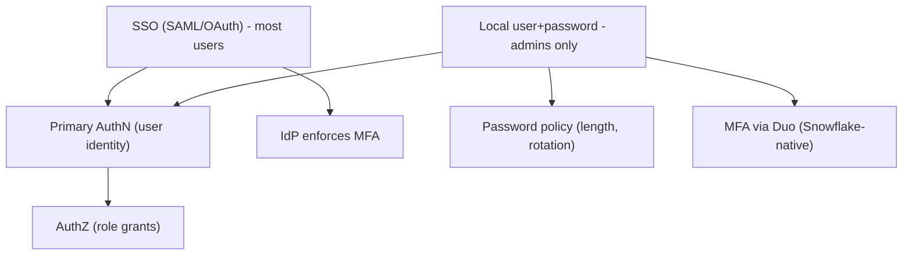

### Lab Exercise
```sql
-- Password policy
CREATE OR REPLACE PASSWORD POLICY strong_pp
  PASSWORD_MIN_LENGTH = 14
  PASSWORD_MAX_LENGTH = 64
  PASSWORD_MIN_UPPER_CASE_CHARS = 1
  PASSWORD_MIN_LOWER_CASE_CHARS = 1
  PASSWORD_MIN_NUMERIC_CHARS = 1
  PASSWORD_MIN_SPECIAL_CHARS = 1
  PASSWORD_MAX_AGE_DAYS = 90
  PASSWORD_MAX_RETRIES = 5
  PASSWORD_LOCKOUT_TIME_MINS = 15;

ALTER ACCOUNT SET PASSWORD POLICY = strong_pp;

-- MFA
ALTER USER alice SET MINS_TO_BYPASS_MFA = 0;  -- always require

-- SAML SSO
CREATE OR REPLACE SECURITY INTEGRATION azure_sso
  TYPE = SAML2
  ENABLED = TRUE
  SAML2_ISSUER = 'https://sts.windows.net/<tenant>/'
  SAML2_SSO_URL = 'https://login.microsoftonline.com/<tenant>/saml2'
  SAML2_PROVIDER = 'CUSTOM'
  SAML2_X509_CERT = '<base64 cert>'
  SAML2_SP_INITIATED_LOGIN_PAGE_LABEL = 'AzureAD';
```
**Expected outcome:** Strong auth enforced; MFA required on all local accounts.

### Gotchas / Exam Traps
- Password policies don't apply to SAML-authenticated users (IdP enforces).
- `MINS_TO_BYPASS_MFA` default is 0 but admins can set a higher value — audit for compliance.
- Disabling SSO on an account that only has SSO-authenticated users locks everyone out — always keep a local admin.

---

## Q19: Explain how `MANAGE GRANTS` and future grants work.
**Difficulty:** Advanced
**Exam relevance:** "Delegate grant management safely."

### Answer
`MANAGE GRANTS` is an account-level privilege letting a role grant privileges on objects it doesn't own. SECURITYADMIN has it by default. **Future grants** apply to not-yet-created objects: `GRANT SELECT ON FUTURE TABLES IN SCHEMA x TO ROLE y` — any new table in schema x auto-grants SELECT to y.

### First Principles
In a mature RBAC, developers create tables but shouldn't manage grants directly — too error-prone. Future grants delegate: SECURITYADMIN pre-defines what each role gets on new objects; devs just create tables and permissions propagate automatically. `MANAGE GRANTS` lets a non-owner (e.g., central platform team) adjust grants.

### Diagram
```mermaid
flowchart TD
    FG["FUTURE GRANT<br/>GRANT SELECT ON FUTURE TABLES IN SCHEMA sales TO ROLE analyst"]
    FG --> SCH["stored as 'future grant' on schema"]
    SCH --> NEW["Any new table in sales schema:<br/>auto-grants SELECT to analyst<br/>at creation time, no manual action"]
    MG["MANAGE GRANTS<br/>Role X has MANAGE GRANTS"]
    MG --> CAN["Can grant/revoke privs on any object<br/>even without owning them"]
```

### Lab Exercise
```sql
USE ROLE SECURITYADMIN;

-- Future grants on a schema
GRANT USAGE ON SCHEMA prod_db.sales TO ROLE analyst;
GRANT SELECT ON FUTURE TABLES IN SCHEMA prod_db.sales TO ROLE analyst;
GRANT SELECT ON FUTURE VIEWS IN SCHEMA prod_db.sales TO ROLE analyst;

-- Any new table auto-grants
USE ROLE SYSADMIN;
CREATE TABLE prod_db.sales.new_fact (...);
-- analyst can now SELECT without further action

-- Show future grants
SHOW FUTURE GRANTS IN SCHEMA prod_db.sales;

-- Delegating grant management
GRANT MANAGE GRANTS ON ACCOUNT TO ROLE platform_eng;
```
**Expected outcome:** New objects covered; central team can govern grants without owning objects.

### Gotchas / Exam Traps
- Future grants exist at schema or database level; schema-level overrides database-level for the schema.
- Dropping the role that CREATED the future grant orphans it — new objects don't get the grant.
- `GRANT SELECT ON ALL TABLES` + `GRANT SELECT ON FUTURE TABLES` is the standard combo for coverage.

---

## Q20: What is "trusted access" and anonymous blocks in security context?
**Difficulty:** Advanced
**Exam relevance:** "Execute privileged logic safely."

### Answer
Stored procedures run with **caller's rights** by default; set `EXECUTE AS OWNER` to run with the owner's privileges (SUID-style). Lets owners publish procedures that execute privileged actions callers can't perform directly. Combined with scoped grants, enables controlled escalation.

### First Principles
A caller-rights procedure can only do what the caller can do — safe but limits usefulness. Owner-rights procedures elevate privileges within the procedure body — useful for admin-only logic exposed as a limited API. Must be designed carefully: SQL injection in an owner-rights proc = critical escalation.

### Diagram
```mermaid
flowchart TD
    C["CALLER's RIGHTS"]
    C --> C1["Procedure call runs as caller"]
    C --> C2["Caller must have all underlying privs"]
    O["OWNER's RIGHTS"]
    O --> O1["Procedure call runs as owner"]
    O --> O2["Owner must have privs"]
    O --> O3["Caller only needs EXECUTE on proc"]
    O --> UC["Use case: expose a safe wrapper over sensitive logic"]
```

### Lab Exercise
```sql
USE ROLE SECURITYADMIN;

-- Admin-only operation exposed to limited role
CREATE OR REPLACE PROCEDURE grant_temp_access(target_role STRING, obj STRING)
RETURNS STRING
LANGUAGE SQL
EXECUTE AS OWNER
AS
$$
BEGIN
  -- Only owner (SECURITYADMIN) can grant; procedure elevates
  LET stmt STRING := 'GRANT SELECT ON TABLE ' || :obj || ' TO ROLE ' || :target_role;
  EXECUTE IMMEDIATE :stmt;
  RETURN 'OK';
END;
$$;

-- Grant execute to developer; developer cannot run GRANT directly but can call procedure
GRANT USAGE ON PROCEDURE grant_temp_access(STRING,STRING) TO ROLE dev;

USE ROLE dev;
CALL grant_temp_access('analytics','prod_db.public.sales');
```
**Expected outcome:** Dev calls procedure to grant SELECT without having MANAGE GRANTS.

### Gotchas / Exam Traps
- `EXECUTE AS OWNER` makes the procedure a critical security surface — audit the body carefully.
- `EXECUTE AS CALLER` is default; make the choice explicit.
- Owner-rights procs cannot `USE ROLE` or `USE SECONDARY ROLES` to switch away.

---

## Q21: How do you audit privilege grants over time?
**Difficulty:** Intermediate
**Exam relevance:** "Audit RBAC changes."

### Answer
Query `SNOWFLAKE.ACCOUNT_USAGE.GRANTS_TO_USERS` and `GRANTS_TO_ROLES` for current+historical grants (365-day retention). The `deleted_on` column marks revoked grants. For point-in-time snapshots, use these views; for change detection, build a daily snapshot table.

### First Principles
Account Usage views retain history, allowing "who had what access when" queries required by SOX/GDPR audits. The views are append-only in effect — revocations update `deleted_on` rather than removing rows. Combining with `QUERY_HISTORY` or `ACCESS_HISTORY` tells the full story: who had privs, who actually used them.

### Diagram
```mermaid
flowchart TD
    GR["GRANTS_TO_ROLES<br/>columns: role, privilege, granted_on,<br/>granted_by, created_on, deleted_on"]
    GR --> R1["analyst, SELECT, PROD.SALES, SECADMIN, 2026-01-01, NULL"]
    GR --> R2["analyst, SELECT, PROD.HR, SECADMIN, 2026-01-15, 2026-03-10 (revoked)"]
    GU["GRANTS_TO_USERS<br/>columns: user, role, granted_by, created_on, deleted_on"]
    AT["Audit at point in time:<br/>WHERE created_on <= T<br/>AND (deleted_on IS NULL OR deleted_on > T)"]
    GR --> AT
    GU --> AT
```

### Lab Exercise
```sql
-- Current grants on a role
SELECT role, privilege, granted_on, name AS object_name, granted_by
FROM SNOWFLAKE.ACCOUNT_USAGE.GRANTS_TO_ROLES
WHERE deleted_on IS NULL AND role = 'ANALYST';

-- Point-in-time: who had access to sales table on a date
SELECT grantee_name, privilege_type
FROM SNOWFLAKE.ACCOUNT_USAGE.GRANTS_TO_ROLES
WHERE name = 'SALES'
AND created_on <= '2026-06-01'
AND (deleted_on IS NULL OR deleted_on > '2026-06-01');

-- Users with ACCOUNTADMIN over the last 90 days
SELECT grantee_name AS user, created_on, deleted_on
FROM SNOWFLAKE.ACCOUNT_USAGE.GRANTS_TO_USERS
WHERE role = 'ACCOUNTADMIN'
ORDER BY created_on DESC;
```
**Expected outcome:** Historical access reconstructible to any date.

### Gotchas / Exam Traps
- Up to 2-hour lag on Account Usage.
- Deleted role objects: grants show NULL `name` sometimes; check `granted_on` for type.
- Database/schema renames don't update historical records — the name shown is the name at grant time.

---

## Q22: Describe how `USE SECONDARY ROLES` affects masking and row access policies.
**Difficulty:** Advanced
**Exam relevance:** "Edge cases with secondary roles."

### Answer
Masking/RAP policy expressions typically use `CURRENT_ROLE()` which returns only the primary role. To consider secondary roles, use `IS_ROLE_IN_SESSION('<role>')` which returns TRUE if the role is active (primary or secondary).

### First Principles
Policies written with `CURRENT_ROLE() = 'ADMIN'` miss users whose admin role is secondary. For correct behavior under `USE SECONDARY ROLES ALL`, policies should query role membership rather than active primary role.

### Diagram
```mermaid
flowchart TD
    P1["Policy: CASE WHEN CURRENT_ROLE() = 'ADMIN' THEN val ELSE '***'"]
    P1 --> R1["alice USE ROLE ANALYST + SECONDARY ROLES ALL (incl ADMIN)"]
    R1 --> O1["CURRENT_ROLE() = 'ANALYST'"]
    O1 --> B1["Policy returns '***' (bug?)"]
    P2["Policy: CASE WHEN IS_ROLE_IN_SESSION('ADMIN') THEN val ELSE '***'"]
    P2 --> O2["IS_ROLE_IN_SESSION('ADMIN') = TRUE"]
    O2 --> B2["Policy returns val (correct)"]
```

### Lab Exercise
```sql
CREATE OR REPLACE MASKING POLICY mp_role_aware AS (val STRING)
RETURNS STRING ->
  CASE
    WHEN IS_ROLE_IN_SESSION('PII_ADMIN') THEN val
    WHEN IS_ROLE_IN_SESSION('ANALYTICS_TEAM') THEN REGEXP_REPLACE(val, '.+@', '***@')
    ELSE '*** masked ***'
  END;

ALTER TABLE customers MODIFY COLUMN email SET MASKING POLICY mp_role_aware;

-- Test with secondary roles
USE ROLE analytics_team;
USE SECONDARY ROLES ALL;
SELECT email FROM customers;  -- unmasked if alice also has PII_ADMIN via secondary
```
**Expected outcome:** Policy respects secondary role grants.

### Gotchas / Exam Traps
- Decide at design time whether policies should respect secondary roles — differs by use case.
- `CURRENT_AVAILABLE_ROLES()` lists all roles user has (even if not activated); use `IS_ROLE_IN_SESSION()` for *active* check.

---

## Q23: Explain how to secure external access (external functions, external access integration).
**Difficulty:** Advanced
**Exam relevance:** "Secure outbound network calls."

### Answer
External functions call out to AWS Lambda, Azure Functions, GCP via **API integrations**. For general external HTTP/HTTPS from UDFs/procs, use **external access integrations** which require a **network rule** (allowed hosts) and **secret** (credentials). Both grant the integration to users/roles explicitly.

### First Principles
Outbound traffic from Snowflake is a security boundary — you don't want UDFs calling arbitrary hosts. External access integrations enforce an allow-list of hosts (network rules) and encapsulate credentials (secrets object). The UDF code references the integration; Snowflake validates allowed hosts at execution.

### Diagram
```mermaid
flowchart TD
    UDF["UDF"]
    UDF --> EAI["external_access_integration (API)"]
    EAI --> NR["NETWORK RULE: hosts allow-list"]
    EAI --> SEC["SECRETS: username/password/OAuth"]
    NR --> OUT["outbound HTTPS to approved hosts"]
    SEC --> OUT
```

### Lab Exercise
```sql
USE ROLE ACCOUNTADMIN;

CREATE OR REPLACE NETWORK RULE allowed_apis
  TYPE = HOST_PORT
  MODE = EGRESS
  VALUE_LIST = ('api.external.com:443','secure-endpoint.io:443');

CREATE OR REPLACE SECRET api_secret
  TYPE = GENERIC_STRING
  SECRET_STRING = 'bearer-token-value';

CREATE OR REPLACE EXTERNAL ACCESS INTEGRATION ext_api_int
  ALLOWED_NETWORK_RULES = (allowed_apis)
  ALLOWED_AUTHENTICATION_SECRETS = (api_secret)
  ENABLED = TRUE;

GRANT USAGE ON INTEGRATION ext_api_int TO ROLE etl_role;
GRANT READ ON SECRET api_secret TO ROLE etl_role;

CREATE OR REPLACE FUNCTION call_api(payload STRING) RETURNS STRING
LANGUAGE PYTHON
RUNTIME_VERSION = '3.11'
HANDLER = 'main'
EXTERNAL_ACCESS_INTEGRATIONS = (ext_api_int)
SECRETS = ('cred' = api_secret)
PACKAGES = ('requests')
AS $$
import _snowflake, requests
def main(payload):
  token = _snowflake.get_generic_secret_string('cred')
  r = requests.post('https://api.external.com/x',
                    headers={'Authorization': f'Bearer {token}'},
                    json={'data': payload})
  return r.text
$$;
```
**Expected outcome:** UDF can call ONLY the whitelisted endpoints with managed credentials.

### Gotchas / Exam Traps
- Hostname-only rules are supported for TLS SNI matching; IPs can be restricted via firewall-side rules too.
- Secrets are never visible in query text or results — opaque reference only.
- UDF without `EXTERNAL_ACCESS_INTEGRATIONS` cannot make outbound calls at all (sandbox).

---

## Q24: How does Snowflake handle credential storage and rotation?
**Difficulty:** Intermediate
**Exam relevance:** "Securely manage service credentials."

### Answer
Use **secrets** objects: `CREATE SECRET ... TYPE = PASSWORD | OAUTH2 | GENERIC_STRING ...`. Secrets are encrypted, access-controlled, and referenced by name (never embedded in SQL). Rotate by `ALTER SECRET SET SECRET_STRING = 'new'` — all consumers see new value immediately.

### First Principles
Hardcoding credentials in UDFs or stages is a leak waiting to happen. Secret objects centralize credential storage with encryption + RBAC. Rotation is a single update; all referencing objects pick up without redeployment.

### Diagram
```mermaid
flowchart TD
    S["SECRET api_token (encrypted at rest)"]
    S --> R1["external_access_integration -> UDFs"]
    S --> R2["snowpipe (REST) -> ingest clients"]
    S --> R3["Kafka connector (via config)"]
    ROT["ALTER SECRET api_token SET SECRET_STRING = 'new'"]
    ROT --> ALL["all consumers transparent update"]
    S -.-> ROT
```

### Lab Exercise
```sql
-- Password-type secret
CREATE OR REPLACE SECRET db_creds
  TYPE = PASSWORD
  USERNAME = 'svc_user'
  PASSWORD = 'temp_secret';

-- OAuth-type secret
CREATE OR REPLACE SECRET api_oauth
  TYPE = OAUTH2
  API_AUTHENTICATION = my_oauth_integration
  OAUTH_SCOPES = ('read','write');

-- Grant and reference
GRANT READ ON SECRET db_creds TO ROLE etl_role;

-- Rotate
ALTER SECRET db_creds SET PASSWORD = 'new_strong_password';
```
**Expected outcome:** Credentials never appear in logs or SQL; rotation is seamless.

### Gotchas / Exam Traps
- Secret value is never returned by any SELECT or SHOW — only metadata.
- Audit: `GRANTS_TO_ROLES` shows READ on secret but not value usage; use `ACCESS_HISTORY` for that.
- Max secret string length ~ 1 MB.

---

## Q25: Design an end-to-end least-privilege RBAC for a data platform.
**Difficulty:** Advanced
**Exam relevance:** "Comprehensive RBAC design."

### Answer
Three-layer: (1) **Access roles** per object type/scope (read/write/admin per schema). (2) **Functional roles** per team/service (etl_dev, analyst, bi_tool_svc). (3) **User assignment** to functional roles only; functional roles aggregate access roles. ACCOUNTADMIN restricted to 2 users. Service accounts use key-pair + network policy restriction.

### First Principles
Least privilege = each role has exactly the privileges needed, no more. Granular access roles make auditing cleaner (one grant per capability); functional roles make daily operations convenient (one role per persona). Separation ensures changes to a persona don't accidentally grant unrelated privileges.

### Diagram
```mermaid
flowchart TD
    AL["alice"] --> ANR["analyst_role"]
    ANR --> SR1["sales_read -> sales table"]
    ANR --> HR["hr_read -> hr table"]
    BO["bob"] --> ETD["etl_developer"]
    ETD --> RW["raw_write -> raw schema"]
    ETD --> STG["staging_rw -> staging schema"]
    ETD --> SR2["sales_read -> sales (for lookups)"]
    SV["svc"] --> INS["ingest_service"]
    INS --> PU["pipe_user -> pipe/stage"]
    INS --> RW2["raw_write"]
```

### Lab Exercise
```sql
USE ROLE SECURITYADMIN;

-- Access roles (building blocks)
CREATE ROLE sales_read;
CREATE ROLE sales_write;
CREATE ROLE hr_read;
CREATE ROLE etl_system;

GRANT USAGE ON DATABASE prod_db TO ROLE sales_read;
GRANT USAGE ON SCHEMA prod_db.sales TO ROLE sales_read;
GRANT SELECT ON ALL TABLES IN SCHEMA prod_db.sales TO ROLE sales_read;
GRANT SELECT ON FUTURE TABLES IN SCHEMA prod_db.sales TO ROLE sales_read;

GRANT INSERT,UPDATE,DELETE,TRUNCATE ON ALL TABLES IN SCHEMA prod_db.sales TO ROLE sales_write;

-- Functional roles
CREATE ROLE analyst_role;
CREATE ROLE etl_developer;
CREATE ROLE ingest_service;

GRANT ROLE sales_read TO ROLE analyst_role;
GRANT ROLE hr_read TO ROLE analyst_role;

GRANT ROLE sales_read TO ROLE etl_developer;
GRANT ROLE sales_write TO ROLE etl_developer;
GRANT ROLE etl_system TO ROLE etl_developer;

GRANT ROLE etl_system TO ROLE ingest_service;

-- Assign to users/services
GRANT ROLE analyst_role TO USER alice;
GRANT ROLE etl_developer TO USER bob;

-- Keep hierarchy visible to admins
GRANT ROLE analyst_role TO ROLE sysadmin;
GRANT ROLE etl_developer TO ROLE sysadmin;
GRANT ROLE ingest_service TO ROLE sysadmin;

-- Service user hardening
CREATE USER svc_ingest TYPE = SERVICE RSA_PUBLIC_KEY = '...';
ALTER USER svc_ingest SET DEFAULT_ROLE = ingest_service;
ALTER USER svc_ingest SET NETWORK_POLICY = corp_internal;
GRANT ROLE ingest_service TO USER svc_ingest;
```
**Expected outcome:** Clean separation; new tables auto-covered; service users hardened.

### Gotchas / Exam Traps
- Forgetting `GRANT ROLE X TO SYSADMIN` means admins can't see/manage the role.
- Future grants are per-schema; new schemas need their own future grants.
- Role hierarchy should be a DAG (no cycles) — Snowflake enforces.
- Service accounts should never have interactive password; use key-pair.
