# Data Transformation — DEA-C02 Study Guide

## Exam Weight & Scope
Data Transformation is ~18% of the DEA-C02 exam. Covers Snowpark (Python/Scala/Java), UDFs (scalar, vectorized, table), UDTFs, Stored Procedures, Dynamic Tables as pipeline, Iceberg Tables for interop, SQL ELT patterns, dbt integration patterns, scripting (Snowflake Scripting), and model/function governance.

## Core Concepts Map
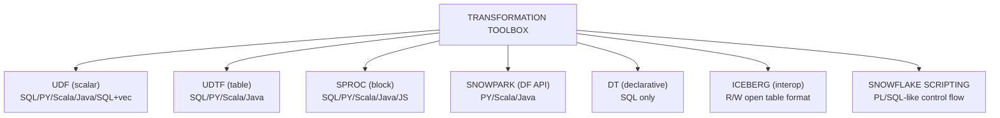

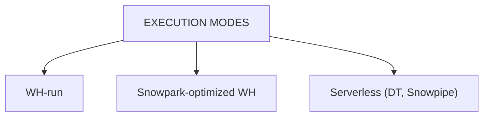

---

## Q1: What are the different UDF types, their execution models, and when to use each?
**Difficulty:** Foundation
**Exam relevance:** "Choose the right UDF type."

### Answer
(1) **Scalar SQL UDF**: single SQL expression, inlined by optimizer, zero overhead. (2) **Scalar Python/Scala/Java UDF**: single-value in, single-value out, runs in sandboxed interpreter. (3) **Vectorized Python UDF**: receives a pandas DataFrame batch, returns pandas Series — amortizes interpreter overhead. (4) **Table UDF (UDTF)**: multiple-row output per input, supports partitioning/stateful processing. (5) **External UDF/Function**: calls out to AWS Lambda/Azure/GCP via API integration.

### First Principles
Each type trades flexibility for performance. SQL UDFs are the fastest (plan inlining); scalar Python runs row-by-row with per-row Python overhead; vectorized Python batches 1000+ rows per call, cutting overhead ~100x. UDTFs are needed when output rows differ from input rows (explode, generate_series, window processing). External functions are last-resort for logic that must run outside Snowflake (3rd-party APIs, legacy ML services).

### Diagram
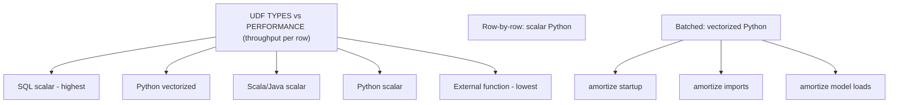

### Lab Exercise
```sql
-- Scalar SQL UDF (zero overhead)
CREATE OR REPLACE FUNCTION tax(amt NUMBER)
RETURNS NUMBER
AS $$ amt * 0.07 $$;

-- Scalar Python UDF (row-by-row)
CREATE OR REPLACE FUNCTION py_tax(amt FLOAT)
RETURNS FLOAT
LANGUAGE PYTHON RUNTIME_VERSION='3.11'
HANDLER = 'compute'
AS $$
def compute(amt): return amt * 0.07
$$;

-- Vectorized Python UDF (batched)
CREATE OR REPLACE FUNCTION vec_tax(amt FLOAT)
RETURNS FLOAT
LANGUAGE PYTHON RUNTIME_VERSION='3.11'
PACKAGES = ('pandas')
HANDLER = 'compute'
AS $$
import pandas as pd
from _snowflake import vectorized

@vectorized(input=pd.DataFrame)
def compute(df):
  return df[0] * 0.07
$$;

-- UDTF (fan-out)
CREATE OR REPLACE FUNCTION split_tags(s STRING)
RETURNS TABLE (tag STRING)
LANGUAGE PYTHON RUNTIME_VERSION='3.11'
HANDLER='Splitter'
AS $$
class Splitter:
  def process(self, s):
    for t in s.split(','):
      yield (t.strip(),)
$$;

-- Benchmark
SELECT COUNT(tax(amt)), COUNT(py_tax(amt)), COUNT(vec_tax(amt)) FROM sales;
SELECT * FROM TABLE(split_tags('a,b,c'));
```
**Expected outcome:** SQL UDF ~10x faster than scalar Python; vectorized Python ~5x faster than scalar Python.

### Gotchas / Exam Traps
- SQL UDFs with multiple statements are limited; use SPROCS for control flow.
- Python UDFs cannot execute SQL — only pure Python. For SQL calls, use stored procedures.
- UDFs are deterministic by default; mark `NOT DETERMINISTIC` for non-deterministic ones to prevent incorrect result caching.
- Imports (sklearn models, large libs) run per-session but cached per Python interpreter — vectorized amortizes.

---

## Q2: Explain Snowpark DataFrame API fundamentals and lazy evaluation.
**Difficulty:** Intermediate
**Exam relevance:** "Build pipelines with Snowpark."

### Answer
Snowpark (Python/Scala/Java) provides a DataFrame API that compiles to Snowflake SQL. Operations are **lazy** — only `collect()`, `show()`, `save_as_table()`, `write.save()`, etc. trigger execution. The compiled SQL runs on your warehouse — no data egress; DataFrames are view-like references.

### First Principles
Snowpark isn't Spark-on-Snowflake — it's a SQL generator with Spark-like syntax. Every DataFrame op builds a SQL plan tree; action methods materialize it. This means no row-at-a-time Python interpretation: joins, filters, aggregations run as Snowflake SQL. The Python layer is just orchestration. UDFs are the exception — those execute in sandbox Python workers.

### Diagram
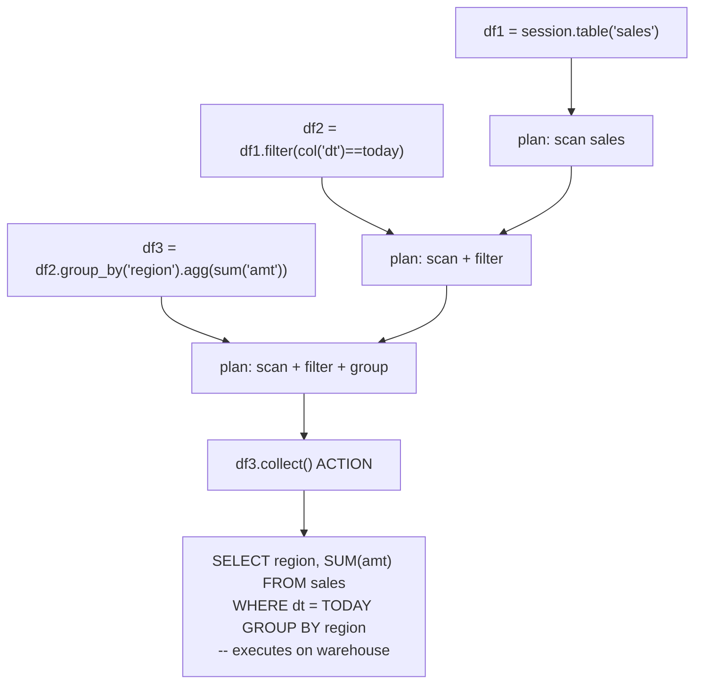

### Lab Exercise
```python
from snowflake.snowpark import Session
from snowflake.snowpark.functions import col, sum as sum_, lit

session = Session.builder.configs(cfg).create()
df = session.table("sales")

# Lazy transformations
df2 = (df.filter(col("dt") >= lit("2026-01-01"))
         .group_by("region")
         .agg(sum_("amt").alias("total")))

df2.explain()        # shows compiled SQL plan
# Not yet executed

df2.show()           # execute, display
df2.collect()        # execute, pull all rows to Python
df2.write.save_as_table("sales_by_region", mode="overwrite")  # execute, persist
```
**Expected outcome:** `explain()` reveals SQL; execution only on action.

### Gotchas / Exam Traps
- `df.cache()` persists to a temp table — explicit materialization, not Spark-like in-memory.
- UDF calls inside DataFrames push the UDF into the generated SQL and execute in warehouse workers.
- Mixing `collect()` with large data pulls data to Python — can OOM.
- `df.to_pandas()` is a client-side convenience; result size matters.

---

## Q3: Compare Stored Procedures across languages (SQL Scripting, JavaScript, Python, Scala, Java).
**Difficulty:** Intermediate
**Exam relevance:** "Choose procedure language for use case."

### Answer
**SQL Scripting**: PL/SQL-like, native, best for pure data manipulation. **JavaScript**: legacy, flexible, good for complex control flow without external libs. **Python/Scala/Java (Snowpark)**: full language + Snowpark DataFrames + external packages, best for ML/complex transforms. All run inside the warehouse sandbox.

### First Principles
Procedures encapsulate transaction logic — a single CALL commits atomically. Choice depends on the logic: pure SQL loops → SQL Scripting; cross-table complex iteration → JavaScript/Python; ML/data science → Python with Snowpark; existing Java/Scala shops → Java/Scala. Snowpark languages give you DataFrame API inside the proc.

### Diagram
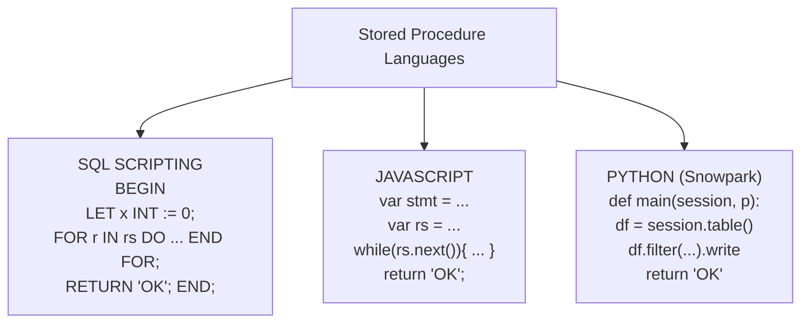

### Lab Exercise
```sql
-- SQL Scripting
CREATE OR REPLACE PROCEDURE sp_sql(days INT)
RETURNS STRING LANGUAGE SQL
AS
$$
DECLARE
  cnt INT;
BEGIN
  LET sql_stmt STRING := 'DELETE FROM sales WHERE dt < DATEADD(day, -' || :days || ', CURRENT_DATE)';
  EXECUTE IMMEDIATE :sql_stmt;
  cnt := SQLROWCOUNT;
  RETURN 'Deleted ' || cnt || ' rows';
END;
$$;

CALL sp_sql(30);
```
```python
# Python Snowpark
CREATE OR REPLACE PROCEDURE sp_py(days INT)
RETURNS STRING
LANGUAGE PYTHON RUNTIME_VERSION='3.11'
PACKAGES = ('snowflake-snowpark-python')
HANDLER = 'main'
AS
$$
from snowflake.snowpark.functions import col
from snowflake.snowpark import Session

def main(session: Session, days: int):
    df = session.table("sales").filter(col("dt") < F.dateadd("day", F.lit(-days), F.current_date()))
    n = df.count()
    df.delete()
    return f"Deleted {n} rows"
$$;

CALL sp_py(30);
```
**Expected outcome:** Both procs clean up data; Python one has access to DataFrame API + external packages.

### Gotchas / Exam Traps
- Procedures DO NOT auto-commit each statement in SQL Scripting unless you BEGIN/COMMIT; a single `CALL` is one transaction by default.
- Python procs with Snowpark need `snowflake-snowpark-python` package.
- `EXECUTE AS CALLER` (default) vs `EXECUTE AS OWNER` — critical for security design.
- JavaScript procs are legacy — Python preferred for new work.

---

## Q4: What is a Dynamic Table and how is it different from a Materialized View or Stream+Task?
**Difficulty:** Advanced
**Exam relevance:** "Choose declarative pipeline construct."

### Answer
A **Dynamic Table (DT)** is a declarative managed pipeline: `CREATE DYNAMIC TABLE AS SELECT ...` with a `TARGET_LAG` (freshness SLA). Snowflake orchestrates incremental refreshes. Differences: DT supports joins and chaining (unlike MV); it's an explicit queryable object (unlike MV auto-rewrite); Snowflake handles orchestration (unlike Stream+Task).

### First Principles
DT abstracts the Stream+Task pattern. You describe final state as SQL; Snowflake figures out the incremental refresh (change tracking + diff + apply). It attempts "incremental" refresh for incrementalizable queries, falls back to "full" refresh otherwise. The DAG of chained DTs is auto-orchestrated with lag propagation.

### Diagram
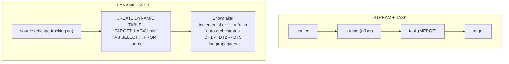

### Lab Exercise
```sql
CREATE OR REPLACE DYNAMIC TABLE orders_enriched
  TARGET_LAG = '1 minute'
  WAREHOUSE = etl_wh
  REFRESH_MODE = AUTO
  INITIALIZE = ON_CREATE
AS
SELECT o.id, o.amt, c.customer_tier, p.product_name
FROM orders o
JOIN customers c ON o.customer_id = c.id
JOIN products p ON o.product_id = p.id
WHERE o.status = 'PAID';

-- Downstream DT with lag=DOWNSTREAM (only refresh when needed)
CREATE OR REPLACE DYNAMIC TABLE orders_summary
  TARGET_LAG = DOWNSTREAM
  WAREHOUSE = etl_wh
AS
SELECT customer_tier, SUM(amt) AS total
FROM orders_enriched
GROUP BY customer_tier;

-- Monitor
SELECT name, target_lag, latest_data_timestamp, mean_lag_s
FROM INFORMATION_SCHEMA.DYNAMIC_TABLES
WHERE name LIKE 'ORDERS%';

SELECT name, state, refresh_action, refresh_mode, duration_s
FROM TABLE(INFORMATION_SCHEMA.DYNAMIC_TABLE_REFRESH_HISTORY(NAME=>'ORDERS_ENRICHED'));
```
**Expected outcome:** DTs refresh to meet lag SLA; `refresh_action = 'INCREMENTAL'` for most refreshes.

### Gotchas / Exam Traps
- Some SQL forces FULL refresh: non-deterministic functions, correlated subqueries, some window functions, SELECT *.
- `TARGET_LAG = DOWNSTREAM` is critical for chained DTs — upstream only refreshes when downstream needs.
- DTs don't consume Streams directly — they use change tracking on base tables.
- DT refresh respects `WAREHOUSE` size; use serverless mode by omitting WAREHOUSE for auto-provisioned compute.

---

## Q5: What are Iceberg Tables and how do they interoperate with other engines?
**Difficulty:** Advanced
**Exam relevance:** "Use Iceberg for data lake interop."

### Answer
Iceberg Tables store data in Apache Iceberg open table format on your cloud storage. Two modes: **Snowflake-managed catalog** (Snowflake owns the catalog, best R/W performance) and **externally-managed catalog** (Glue/REST/Nessie, best for sharing with Spark/Trino). Both support DML, time travel, and ACID. Interop lets Snowflake and external engines read/write the same tables.

### First Principles
Standard Snowflake tables use the proprietary FDN format — fast but closed. Iceberg's open format with manifest/snapshot files allows any Iceberg-aware engine (Spark, Trino, Athena, DuckDB) to read. Snowflake-managed means Snowflake writes Iceberg files but owns commits; externally-managed means an external catalog is source of truth, Snowflake reads/writes through it. Latter needed for true multi-engine write.

### Diagram
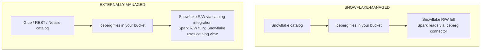

### Lab Exercise
```sql
-- External volume (bucket + IAM)
CREATE EXTERNAL VOLUME iceberg_vol
  STORAGE_LOCATIONS = (
    (NAME='s3_loc', STORAGE_PROVIDER='S3',
     STORAGE_BASE_URL='s3://my-bucket/iceberg/',
     STORAGE_AWS_ROLE_ARN='arn:aws:iam::...')
  );

-- Snowflake-managed Iceberg table
CREATE OR REPLACE ICEBERG TABLE sales_iceberg (
  id INT, amt NUMBER, dt DATE
)
CATALOG = 'SNOWFLAKE'
EXTERNAL_VOLUME = 'iceberg_vol'
BASE_LOCATION = 'sales/';

INSERT INTO sales_iceberg VALUES (1, 100, CURRENT_DATE);
UPDATE sales_iceberg SET amt=200 WHERE id=1;

-- Time travel on Iceberg
SELECT * FROM sales_iceberg AT (OFFSET => -60);

-- Externally-managed (Glue)
CREATE OR REPLACE CATALOG INTEGRATION glue_cat
  CATALOG_SOURCE = GLUE
  CATALOG_NAMESPACE = 'my_db'
  TABLE_FORMAT = ICEBERG
  GLUE_AWS_ROLE_ARN='arn:aws:iam::...'
  GLUE_REGION='us-east-1'
  ENABLED=TRUE;

CREATE OR REPLACE ICEBERG TABLE sales_glue
  EXTERNAL_VOLUME = 'iceberg_vol'
  CATALOG = 'glue_cat'
  CATALOG_TABLE_NAME = 'sales';
```
**Expected outcome:** Iceberg table queryable by Snowflake and (via Iceberg catalog) by Spark/Trino.

### Gotchas / Exam Traps
- Externally-managed Iceberg: Snowflake is typically **read-only** unless the catalog is Snowflake's REST catalog or configured for R/W.
- Snowflake-managed Iceberg: performance close to FDN tables; interoperability via Iceberg format in bucket.
- Iceberg time travel uses snapshots in Iceberg's own metadata — distinct from Snowflake's TT bytes.
- Compaction/vacuum: Snowflake-managed auto-compacts; externally-managed depends on external engine.

---

## Q6: Explain how to implement SCD Type 2 using Streams + MERGE.
**Difficulty:** Intermediate
**Exam relevance:** "Build dimensional pipelines."

### Answer
Capture changes via Stream on source. In the merge: close current record (`UPDATE` setting `valid_to=NOW()`), insert new current record (`INSERT` with `valid_from=NOW(), valid_to=NULL`). Guard with a hash check to avoid no-op updates.

### First Principles
SCD2 preserves history: every change creates a new row with validity window. Deletes become "end current" without a new row. Streams tell you WHICH records changed; MERGE applies the SCD2 pattern. The hash column prevents churn when source has non-dimensional updates (e.g., updated_at bumped but dim attributes unchanged).

### Diagram
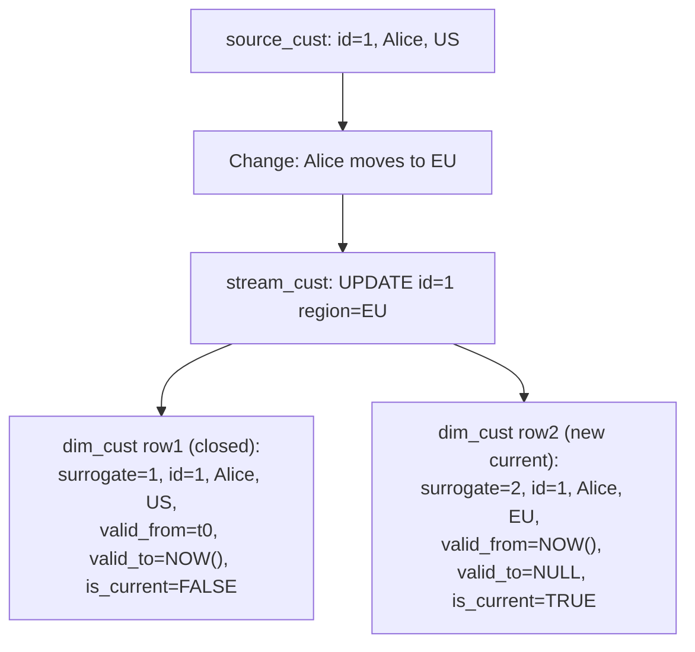

### Lab Exercise
```sql
CREATE OR REPLACE TABLE dim_cust (
  surrogate INT AUTOINCREMENT,
  id INT, name STRING, region STRING,
  hash_val STRING,
  valid_from TIMESTAMP, valid_to TIMESTAMP,
  is_current BOOLEAN
);

CREATE OR REPLACE STREAM src_cust_stream ON TABLE src_cust;

CREATE OR REPLACE TASK t_scd2
  WAREHOUSE = etl_wh
  SCHEDULE = '5 MINUTE'
  WHEN SYSTEM$STREAM_HAS_DATA('src_cust_stream')
  AS
MERGE INTO dim_cust d
USING (
  SELECT id, name, region, SHA2(name || region) AS h
  FROM src_cust_stream
  WHERE METADATA$ACTION IN ('INSERT','UPDATE')
) s
ON d.id = s.id AND d.is_current = TRUE
WHEN MATCHED AND d.hash_val <> s.h THEN
  UPDATE SET valid_to = CURRENT_TIMESTAMP, is_current = FALSE
WHEN NOT MATCHED THEN
  INSERT (id, name, region, hash_val, valid_from, valid_to, is_current)
  VALUES (s.id, s.name, s.region, s.h, CURRENT_TIMESTAMP, NULL, TRUE);

-- Second MERGE needed to INSERT the new current row for UPDATEs
-- (MERGE handles only one branch per source row)
INSERT INTO dim_cust (id, name, region, hash_val, valid_from, valid_to, is_current)
SELECT s.id, s.name, s.region, SHA2(s.name || s.region), CURRENT_TIMESTAMP, NULL, TRUE
FROM src_cust_stream s
JOIN dim_cust d ON d.id = s.id AND d.is_current = FALSE
WHERE s.METADATA$ACTION = 'UPDATE';
```
**Expected outcome:** History preserved across changes; current row flagged.

### Gotchas / Exam Traps
- MERGE cannot both close-old and insert-new in one statement per source row — needs two steps or a stored procedure.
- Hash avoids false updates when non-tracked columns change.
- Deletes: either hard-delete current row or close with `is_current=FALSE` and leave valid_to.
- Dynamic Table can simplify this if source is CDC-friendly.

---

## Q7: Explain dbt + Snowflake patterns and the role of custom materializations.
**Difficulty:** Intermediate
**Exam relevance:** "Use dbt effectively with Snowflake."

### Answer
dbt generates and runs SQL on Snowflake with built-in materializations: `view` (CREATE OR REPLACE VIEW), `table` (CTAS), `incremental` (MERGE), `ephemeral` (CTE inlined). Snowflake-specific extras: `snapshot` for SCD2, custom materializations for Dynamic Tables, Iceberg, Snowpark models. Macros wrap repetitive logic (e.g., `grant_select`).

### First Principles
dbt is pure SQL + Jinja templating that compiles to Snowflake SQL. It's not a runtime — it submits SQL and tracks state. For Snowflake performance, dbt models should align with Snowflake patterns: pre-aggregated tables for BI, incremental models for large facts, snapshots for SCD2. Snowpark Python models (`.py` in dbt-snowflake) run Snowpark DataFrames inside dbt.

### Diagram
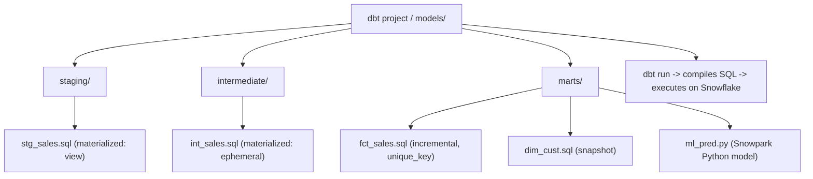

### Lab Exercise
```sql
-- Example incremental model: models/marts/fct_sales.sql
{{ config(materialized='incremental', unique_key='id', on_schema_change='append_new_columns') }}

SELECT id, amt, dt, loaded_at
FROM {{ source('raw','sales') }}

WHERE loaded_at > (SELECT MAX(loaded_at) FROM {{ this }})


-- Snapshot model: snapshots/dim_cust_snap.sql

{{ config(target_schema='snapshots', unique_key='id', strategy='check', check_cols=['name','region']) }}
SELECT * FROM {{ source('raw','customers') }}


-- Dynamic Table custom materialization (dbt-snowflake 1.6+)
{{ config(materialized='dynamic_table', target_lag='1 minute', snowflake_warehouse='etl_wh') }}
SELECT customer_id, SUM(amt) FROM {{ ref('fct_sales') }} GROUP BY customer_id
```
```python
# Snowpark Python model: models/marts/ml_pred.py
def model(dbt, session):
    dbt.config(materialized="table", packages=["scikit-learn","pandas"])
    df = dbt.ref("fct_sales").to_pandas()
    from sklearn.linear_model import LogisticRegression
    # ... train, predict
    return session.create_dataframe(df)
```
**Expected outcome:** `dbt run` orchestrates everything; incremental model only processes new rows.

### Gotchas / Exam Traps
- `on_schema_change` controls incremental model behavior on new columns.
- Snapshot `strategy='check'` tracks any column change; `strategy='timestamp'` requires an updated_at column.
- Snowpark models require Snowpark-optimized warehouse for heavy ML.
- dbt uses `CREATE OR REPLACE` on tables — breaks downstream streams unless `clone` strategy used.

---

## Q8: Describe secure UDFs and how to publish safe analytics to data consumers.
**Difficulty:** Intermediate
**Exam relevance:** "Hide function body from consumers."

### Answer
`CREATE SECURE FUNCTION ... AS SELECT ...` hides the body from non-owners. Prevents consumers (via data share or shared schema) from inspecting business logic. Pair with `SECURE VIEW` for row-filtering plus logic hiding.

### First Principles
Non-secure UDFs expose their body via `DESC FUNCTION`; shared consumers can inspect logic and infer sensitive conditions (filters, PII mappings). Secure UDFs hide the body unconditionally for non-owners. Snowflake may restrict pushdown optimizations on secure UDFs to prevent info leakage via timing/plan analysis.

### Diagram
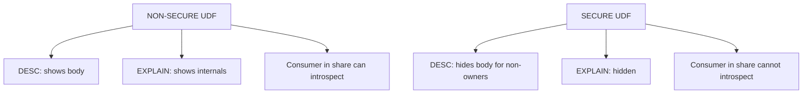

### Lab Exercise
```sql
-- Non-secure
CREATE OR REPLACE FUNCTION risk_score(amt NUMBER, country STRING)
RETURNS NUMBER
AS $$
  CASE WHEN country='X' AND amt > 10000 THEN 10 ELSE 1 END
$$;

DESC FUNCTION risk_score(NUMBER,STRING);  -- shows body

-- Secure
CREATE OR REPLACE SECURE FUNCTION risk_score_sec(amt NUMBER, country STRING)
RETURNS NUMBER
AS $$
  CASE WHEN country='X' AND amt > 10000 THEN 10 ELSE 1 END
$$;

GRANT USAGE ON FUNCTION risk_score_sec(NUMBER,STRING) TO ROLE consumer;

USE ROLE consumer;
DESC FUNCTION risk_score_sec(NUMBER,STRING);  -- body hidden
SELECT risk_score_sec(5000,'US');  -- works
```
**Expected outcome:** Secure UDF usable but body hidden.

### Gotchas / Exam Traps
- Secure UDFs may have slower execution due to restricted optimization.
- Changing non-secure to secure requires DROP + CREATE SECURE (CREATE OR REPLACE SECURE works but changes grants).
- Secure applies to UDFs, Views, Table Functions — same concept.

---

## Q9: What is Snowflake Scripting and when do you need it?
**Difficulty:** Foundation
**Exam relevance:** "Procedural SQL for control flow."

### Answer
Snowflake Scripting is procedural SQL (BEGIN/END blocks, LET, IF, FOR, WHILE, cursors) runnable in stored procedures or anonymous blocks. Use for logic that pure SQL can't express cleanly: loops, conditionals, dynamic SQL, cursor iteration.

### First Principles
Standard SQL is declarative — you can't easily express "do these steps in order with branching." Scripting adds imperative constructs natively (no JavaScript needed). For most ETL logic that stays within SQL ops, Scripting is simpler than Python Snowpark.

### Diagram
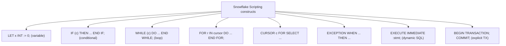

### Lab Exercise
```sql
CREATE OR REPLACE PROCEDURE process_partitions()
RETURNS STRING
LANGUAGE SQL
AS
$$
DECLARE
  total INT DEFAULT 0;
  cur CURSOR FOR SELECT DISTINCT dt FROM sales_raw ORDER BY dt;
BEGIN
  FOR rec IN cur DO
    LET cnt INT := (SELECT COUNT(*) FROM sales_raw WHERE dt = rec.dt);
    IF (cnt > 1000) THEN
      INSERT INTO sales_processed SELECT * FROM sales_raw WHERE dt = rec.dt;
      total := total + cnt;
    END IF;
  END FOR;
  RETURN 'Processed ' || :total || ' rows';
EXCEPTION
  WHEN OTHER THEN
    RETURN 'ERROR: ' || SQLERRM;
END;
$$;

CALL process_partitions();

-- Anonymous block (no procedure)
BEGIN
  LET x INT := 10;
  INSERT INTO log_tbl VALUES (:x, CURRENT_TIMESTAMP);
END;
```
**Expected outcome:** Procedural loop over distinct dates with conditional processing.

### Gotchas / Exam Traps
- `LET` is used for both declaration (in DECLARE) and assignment (in body) — mind context.
- Cursor iteration is slower than set-based SQL; use only when needed.
- Scripting blocks are a single transaction by default — use `BEGIN TRANSACTION; COMMIT;` for finer control.
- `SQLROWCOUNT`, `SQLSTATE`, `SQLERRM` give error info.

---

## Q10: How do Snowpark Python stored procedures interact with Snowpark-optimized warehouses?
**Difficulty:** Advanced
**Exam relevance:** "Memory-intensive Python workloads."

### Answer
Standard warehouses give ~16 GB RAM per node. Snowpark-optimized warehouses give ~256 GB per node (16x). For procs loading large models, big pandas DataFrames, or ML training, use Snowpark-optimized to avoid OOM. Set `WAREHOUSE_TYPE='SNOWPARK-OPTIMIZED'` at warehouse creation.

### First Principles
Pure SQL rarely needs much per-worker memory — columnar scans stream. Python UDFs/procs load models/libraries per worker and operate on in-memory DataFrames. Standard WH memory can be a bottleneck. Snowpark-optimized gives purpose-built memory headroom with ~1.5x credit cost — worth it for memory-bound workloads.

### Diagram
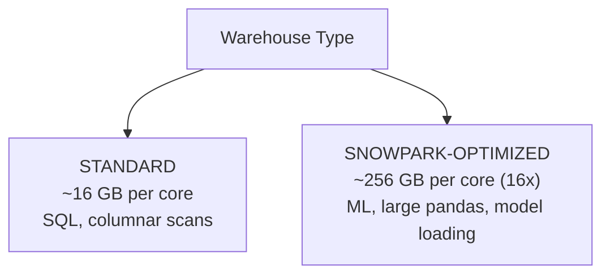

### Lab Exercise
```sql
CREATE WAREHOUSE ml_wh
  WAREHOUSE_SIZE = MEDIUM
  WAREHOUSE_TYPE = 'SNOWPARK-OPTIMIZED'
  AUTO_SUSPEND = 300;

CREATE OR REPLACE PROCEDURE train_fraud_model()
RETURNS STRING
LANGUAGE PYTHON
RUNTIME_VERSION='3.11'
PACKAGES=('snowflake-snowpark-python','scikit-learn','pandas','joblib')
HANDLER='main'
AS
$$
from snowflake.snowpark import Session
from sklearn.ensemble import RandomForestClassifier
import joblib, io

def main(session: Session):
    df = session.table("fraud_training").to_pandas()  # may be large
    X = df.drop(columns=['label'])
    y = df['label']
    model = RandomForestClassifier(n_estimators=500).fit(X, y)

    # Serialize model to stage
    buf = io.BytesIO()
    joblib.dump(model, buf)
    buf.seek(0)
    session.file.put_stream(buf, '@models/fraud_model.pkl', auto_compress=False, overwrite=True)
    return 'Model trained and saved'
$$;

CALL train_fraud_model();
```
**Expected outcome:** Model trains on large data without OOM; serialized to stage.

### Gotchas / Exam Traps
- `.to_pandas()` on a huge table OOMs even on Snowpark-optimized — stream or chunk if > tens of GB.
- Snowpark-optimized minimum size is Medium.
- Can't convert existing WH to Snowpark-optimized — recreate.

---

## Q11: Describe how to version and deploy UDFs/procedures safely.
**Difficulty:** Intermediate
**Exam relevance:** "Govern UDF lifecycle."

### Answer
Pattern: (1) Use overloaded names with version suffix: `my_udf_v1`, `my_udf_v2`; (2) Expose a wrapper that selects version based on a feature flag table; (3) Deploy via dbt + Jinja templates or GitHub Actions calling Snowflake API. Alternative: use `CREATE OR REPLACE` carefully — breaks dependent objects momentarily.

### First Principles
UDFs are referenced by name + signature. Changing a UDF body with `CREATE OR REPLACE` is atomic but affects all callers immediately. Versioning gives rollback and canary deployment. CI/CD via Terraform's Snowflake provider or Snowpark Python API lets you code-review changes before production.

### Diagram
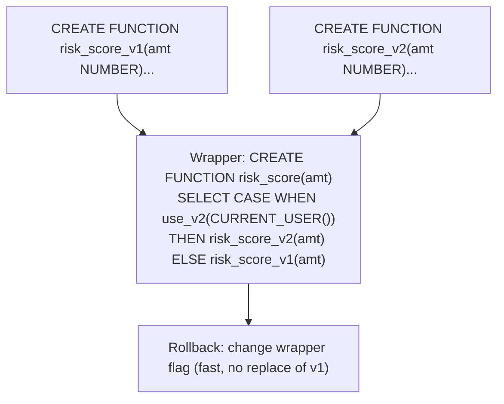

### Lab Exercise
```sql
-- v1
CREATE OR REPLACE FUNCTION risk_v1(amt NUMBER) RETURNS NUMBER
AS $$ CASE WHEN amt > 10000 THEN 10 ELSE 1 END $$;

-- v2
CREATE OR REPLACE FUNCTION risk_v2(amt NUMBER) RETURNS NUMBER
AS $$ CASE WHEN amt > 5000 THEN 10 ELSE 1 END $$;

-- Feature flag table
CREATE OR REPLACE TABLE feature_flags (flag STRING, enabled BOOLEAN);
INSERT INTO feature_flags VALUES ('risk_v2', FALSE);

-- Wrapper
CREATE OR REPLACE FUNCTION risk(amt NUMBER) RETURNS NUMBER
AS $$
  SELECT CASE
    WHEN (SELECT enabled FROM feature_flags WHERE flag='risk_v2') THEN risk_v2(amt)
    ELSE risk_v1(amt)
  END
$$;

-- Enable v2
UPDATE feature_flags SET enabled=TRUE WHERE flag='risk_v2';
```
**Expected outcome:** Switch versions by toggling flag; rollback instant.

### Gotchas / Exam Traps
- `CREATE OR REPLACE FUNCTION` with signature change creates new function; dependent code may fail if signature differs.
- Native Snowflake "model registry" / "function versioning" is evolving — check latest for GA features.
- Package versions in Python UDFs are pinned via `PACKAGES=('pandas==1.5.3')` — treat as deployment artifact.

---

## Q12: What are Streamlit in Snowflake apps and how do they fit DEA workflows?
**Difficulty:** Advanced
**Exam relevance:** "Build data apps natively."

### Answer
Streamlit in Snowflake (SiS) runs Python Streamlit apps natively inside Snowflake, using a warehouse for compute and the user's session for data access. SiS lets DEAs build internal data tools (quality dashboards, ingestion monitors, admin UIs) without external hosting.

### First Principles
Traditionally, data apps required separate compute (ECS, Kubernetes), network connectivity, and credentials management. SiS runs the Python directly in Snowflake, inheriting the user's identity + role for data access. For DEA use cases, this means ad-hoc pipeline monitoring dashboards built in minutes with no infra.

### Diagram
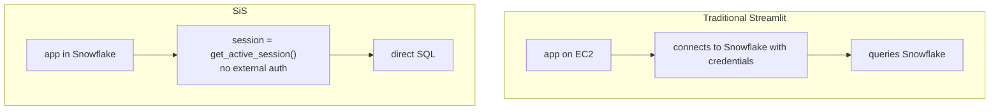

### Lab Exercise
```python
# streamlit_app.py (deployed as SiS app)
import streamlit as st
from snowflake.snowpark.context import get_active_session

session = get_active_session()
st.title("Pipeline Monitor")

df = session.sql("""
  SELECT pipe_name, state, pending_file_count
  FROM TABLE(SYSTEM$PIPE_STATUS('%'))
""").to_pandas()
st.dataframe(df)

df2 = session.sql("""
  SELECT DATE_TRUNC('hour', last_load_time) AS hr, COUNT(*) AS files
  FROM SNOWFLAKE.ACCOUNT_USAGE.COPY_HISTORY
  WHERE last_load_time > DATEADD(day,-1,CURRENT_TIMESTAMP)
  GROUP BY 1 ORDER BY 1
""").to_pandas()
st.line_chart(df2.set_index('HR'))
```
```sql
-- Deploy via SQL
CREATE STREAMLIT pipeline_monitor
  ROOT_LOCATION = '@app_stage/streamlit/'
  MAIN_FILE = 'streamlit_app.py'
  QUERY_WAREHOUSE = adhoc_wh;
```
**Expected outcome:** Interactive dashboard in Snowsight showing live pipe status.

### Gotchas / Exam Traps
- SiS runs under the invoker's role via `get_active_session()`.
- Compute billed to `QUERY_WAREHOUSE`.
- Package availability limited to Snowpark Python package list.

---

## Q13: Explain how `TASK` graphs orchestrate multi-step Snowpark procedures.
**Difficulty:** Advanced
**Exam relevance:** "Orchestrate ML/Snowpark pipelines."

### Answer
Chain tasks with `AFTER` dependencies to orchestrate: root task triggers Snowpark training proc, dependent tasks run inference, downstream task writes predictions. Each task can call a different procedure. Serverless tasks allow Python/Snowpark procs without pre-sizing warehouses.

### First Principles
Task graphs are the native scheduler. Combining with Snowpark procs gives you a native ML pipeline inside Snowflake: no external airflow needed. Root task on schedule; dependent tasks on completion; failure semantics propagate (child skips if parent fails).

### Diagram
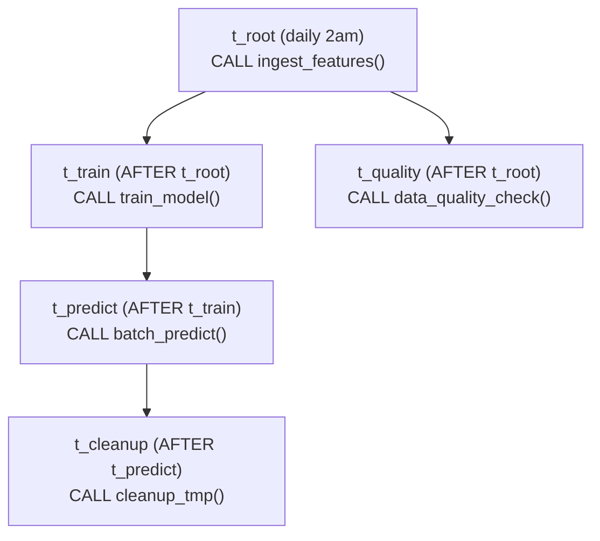

### Lab Exercise
```sql
CREATE OR REPLACE TASK t_root
  WAREHOUSE = etl_wh
  SCHEDULE = 'USING CRON 0 2 * * * UTC'
  AS CALL ingest_features();

CREATE OR REPLACE TASK t_train
  WAREHOUSE = ml_wh                     -- Snowpark-optimized
  AFTER t_root
  AS CALL train_fraud_model();

CREATE OR REPLACE TASK t_predict
  WAREHOUSE = ml_wh
  AFTER t_train
  AS CALL batch_predict();

CREATE OR REPLACE TASK t_quality
  WAREHOUSE = etl_wh
  AFTER t_root
  AS CALL run_quality_checks();

-- Resume children first then root
ALTER TASK t_predict RESUME;
ALTER TASK t_quality RESUME;
ALTER TASK t_train RESUME;
ALTER TASK t_root RESUME;

-- Monitor graph execution
SELECT name, state, scheduled_time, completed_time, error_message
FROM TABLE(INFORMATION_SCHEMA.TASK_HISTORY(SCHEDULED_TIME_RANGE_START=>DATEADD(day,-1,CURRENT_TIMESTAMP)))
ORDER BY scheduled_time DESC;
```
**Expected outcome:** Pipeline runs nightly; each task owns a step with its own warehouse.

### Gotchas / Exam Traps
- One graph can have one root; multi-root requires separate graphs.
- Max 1000 tasks per graph; max depth 100.
- Different tasks can use different warehouses — isolate compute by workload type.
- `TASK_HISTORY` is the main monitoring view.

---

## Q14: What is a Table Function (UDTF) and how do you implement a windowing one?
**Difficulty:** Advanced
**Exam relevance:** "Build custom table-valued functions."

### Answer
UDTFs produce multiple rows per input row (fan-out) and support stateful processing via class-based handlers. `PARTITION BY` lets each partition have its own state. Supports Python/Scala/Java. Use for row-by-row stateful logic that can't be done with SQL window functions.

### First Principles
Scalar UDFs are 1:1; UDTFs are 1:N and stateful. The handler class has `process()` (per row), optional `end_partition()` (end of partition), and state fields. `PARTITION BY` groups input rows into partitions passed to one instance of the class — effectively a per-partition reduce.

### Diagram
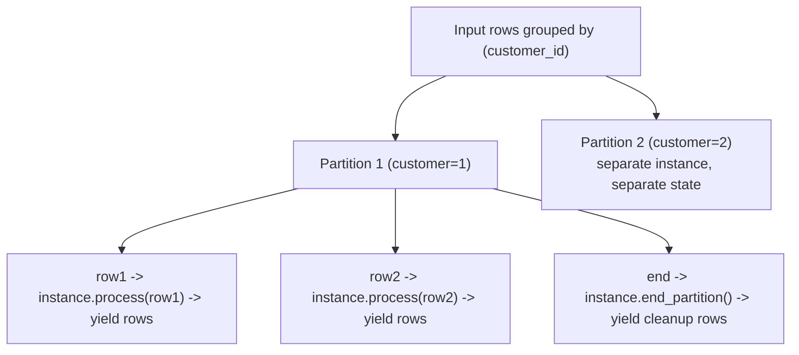

### Lab Exercise
```sql
-- Example: session detection from clickstream
CREATE OR REPLACE FUNCTION detect_sessions(ts TIMESTAMP, event STRING)
RETURNS TABLE (session_id STRING, start_ts TIMESTAMP, end_ts TIMESTAMP, event_count INT)
LANGUAGE PYTHON
RUNTIME_VERSION='3.11'
HANDLER='Sessionizer'
AS
$$
import uuid
class Sessionizer:
    def __init__(self):
        self.session_id = None
        self.start_ts = None
        self.last_ts = None
        self.count = 0

    def process(self, ts, event):
        if self.last_ts is None or (ts - self.last_ts).total_seconds() > 1800:
            # Emit previous session
            if self.session_id:
                yield (self.session_id, self.start_ts, self.last_ts, self.count)
            self.session_id = str(uuid.uuid4())
            self.start_ts = ts
            self.count = 0
        self.last_ts = ts
        self.count += 1

    def end_partition(self):
        if self.session_id:
            yield (self.session_id, self.start_ts, self.last_ts, self.count)
$$;

-- Usage: PARTITION BY user, ORDER BY ts
SELECT user_id, s.*
FROM clicks c,
     TABLE(detect_sessions(c.ts, c.event) OVER (PARTITION BY c.user_id ORDER BY c.ts)) s;
```
**Expected outcome:** Clickstream converted to sessions per user.

### Gotchas / Exam Traps
- `OVER (PARTITION BY ... ORDER BY ...)` required for stateful UDTFs.
- `end_partition()` must yield any pending state.
- Multiple partitions run in parallel on different workers.
- Vectorized UDTFs available for perf-critical cases.

---

## Q15: How do you call external APIs from Snowflake (external functions vs. external access integration)?
**Difficulty:** Advanced
**Exam relevance:** "Integrate external systems."

### Answer
Two patterns: (1) **External Functions** — Snowflake calls your AWS Lambda/Azure Function via API Gateway; good for complex orchestration, batching. (2) **External Access Integration** — UDF/proc makes HTTPS calls directly to allow-listed hosts; simpler, no cloud function needed.

### First Principles
External functions existed first; they require setting up API Gateway + Lambda + Snowflake API integration — heavy. External access integration (newer) lets UDF code use `requests` directly to allowed hosts — simpler for most use cases. External functions are still better for batched, high-throughput calls (API Gateway buffers batches).

### Diagram
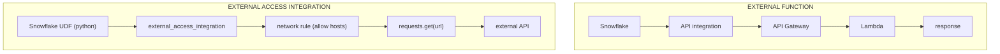

### Lab Exercise
```sql
-- External function path
CREATE OR REPLACE API INTEGRATION aws_api
  API_PROVIDER = AWS_API_GATEWAY
  API_AWS_ROLE_ARN = 'arn:aws:iam::...:role/snowflake'
  API_ALLOWED_PREFIXES = ('https://xyz.execute-api.us-east-1.amazonaws.com/prod/')
  ENABLED = TRUE;

CREATE OR REPLACE EXTERNAL FUNCTION geocode(address STRING)
RETURNS VARIANT
API_INTEGRATION = aws_api
AS 'https://xyz.execute-api.us-east-1.amazonaws.com/prod/geocode';

SELECT geocode('1600 Amphitheatre Pkwy');

-- External access integration path (simpler)
CREATE NETWORK RULE allowed_geo
  TYPE = HOST_PORT
  MODE = EGRESS
  VALUE_LIST = ('maps.googleapis.com:443');

CREATE SECRET geo_key TYPE=GENERIC_STRING SECRET_STRING='YOUR_API_KEY';

CREATE EXTERNAL ACCESS INTEGRATION geo_access
  ALLOWED_NETWORK_RULES = (allowed_geo)
  ALLOWED_AUTHENTICATION_SECRETS = (geo_key)
  ENABLED = TRUE;

CREATE OR REPLACE FUNCTION py_geocode(address STRING) RETURNS VARIANT
LANGUAGE PYTHON RUNTIME_VERSION='3.11'
HANDLER='main'
EXTERNAL_ACCESS_INTEGRATIONS=(geo_access)
SECRETS=('key'=geo_key)
PACKAGES=('requests')
AS $$
import _snowflake, requests, json
def main(addr):
    k = _snowflake.get_generic_secret_string('key')
    r = requests.get(f'https://maps.googleapis.com/maps/api/geocode/json?address={addr}&key={k}')
    return json.loads(r.text)
$$;
```
**Expected outcome:** Both paths return geocoded results; external access integration is lighter.

### Gotchas / Exam Traps
- External functions have ~10 min max wall time; design for retry.
- External access integration: `requests` library must be in `PACKAGES`.
- Both honor UDF concurrency limits.

---

## Q16: Describe how Snowflake Scripting handles transactions.
**Difficulty:** Advanced
**Exam relevance:** "Transaction boundaries in procedures."

### Answer
By default, a stored procedure runs in an **autocommit transaction** — each statement commits individually unless you explicitly `BEGIN TRANSACTION`. Use `BEGIN TRANSACTION; ... COMMIT; (or ROLLBACK)` for multi-statement atomicity. Scripting handles exceptions with `EXCEPTION WHEN ... THEN`.

### First Principles
Snowflake defaults to autocommit; sessions have `AUTOCOMMIT=TRUE` typically. Inside a proc, this means each DML is a separate transaction unless you wrap. `BEGIN TRANSACTION` opens a multi-statement transaction; `COMMIT` or `ROLLBACK` closes. Exception handlers can wrap the whole or part — important for data integrity in multi-step logic.

### Diagram
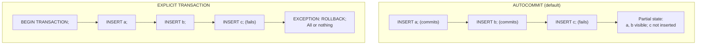

### Lab Exercise
```sql
CREATE OR REPLACE PROCEDURE sp_atomic()
RETURNS STRING LANGUAGE SQL
AS
$$
BEGIN
  BEGIN TRANSACTION;
    INSERT INTO ledger (acct, amt) VALUES ('A', -100);
    INSERT INTO ledger (acct, amt) VALUES ('B',  100);
    -- some check
    LET bal_a NUMBER := (SELECT SUM(amt) FROM ledger WHERE acct='A');
    IF (bal_a < -1000) THEN
      ROLLBACK;
      RETURN 'Rolled back';
    END IF;
  COMMIT;
  RETURN 'Committed';
EXCEPTION
  WHEN OTHER THEN
    ROLLBACK;
    RETURN 'ERROR: ' || SQLERRM;
END;
$$;
```
**Expected outcome:** Transfer is atomic; failure rolls back both inserts.

### Gotchas / Exam Traps
- `AUTOCOMMIT=FALSE` session parameter also opens implicit transactions — session-level alternative.
- A procedure can be called inside another procedure's transaction — nested transactions use savepoints internally.
- `TRANSACTION_ABORT_ON_ERROR` controls behavior on error inside transaction.

---

## Q17: How do you implement data quality checks declaratively?
**Difficulty:** Intermediate
**Exam relevance:** "Enforce data quality in pipelines."

### Answer
Options: (1) **Alerts** (`CREATE ALERT`) — scheduled anomaly detection, fire actions on condition. (2) **dbt tests** (not_null, unique, custom tests). (3) **Dynamic Tables with validity windows** that filter out invalid rows. (4) **Constraints** (informational only, `RELY` keyword): PK, FK, UNIQUE — not enforced but inform CBO.

### First Principles
Snowflake doesn't enforce constraints like Postgres — they're informational and used for query optimization only (join elimination). So "data quality" enforcement is a layer above: assertions, alerts, test runs. Dynamic Tables with WHERE clauses that filter bad rows are a declarative quality boundary — downstream only ever sees valid rows.

### Diagram
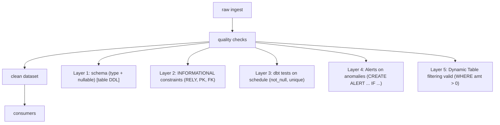

### Lab Exercise
```sql
-- Informational constraints (help CBO; not enforced)
ALTER TABLE sales ADD PRIMARY KEY (id) RELY;
ALTER TABLE sales ADD FOREIGN KEY (customer_id) REFERENCES customers(id) RELY;

-- dbt test example (schema.yml)
-- - name: sales
--     tests:
--       - not_null: id
--       - unique: id
--       - relationships: {to: ref('customers'), field: id}

-- Alert for anomalies
CREATE OR REPLACE ALERT dq_null_customer
  WAREHOUSE = etl_wh
  SCHEDULE = '10 MINUTE'
  IF (EXISTS (
    SELECT 1 FROM sales
    WHERE customer_id IS NULL
    AND loaded_at > DATEADD(minute, -10, CURRENT_TIMESTAMP)
  ))
  THEN
    CALL SYSTEM$SEND_EMAIL('ops_notif','ops@co.com','DQ Alert','Null customer_id detected');

ALTER ALERT dq_null_customer RESUME;

-- Dynamic Table filtering bad data
CREATE OR REPLACE DYNAMIC TABLE sales_clean
  TARGET_LAG = '1 minute' WAREHOUSE = etl_wh
AS
SELECT * FROM sales
WHERE amt > 0 AND customer_id IS NOT NULL AND dt BETWEEN '2020-01-01' AND CURRENT_DATE;
```
**Expected outcome:** Quality boundary enforced; alerts notify on anomalies.

### Gotchas / Exam Traps
- `RELY` constraints are optimization hints only — bad data still inserts.
- Alerts have minimum 1-minute schedule.
- `SYSTEM$SEND_EMAIL` requires a notification integration configured.
- Dynamic Table with filter is a "soft" enforcement — bad data lives in source but is hidden downstream.

---

## Q18: Explain how Snowpark Python Native Apps work for shipping code to data.
**Difficulty:** Advanced
**Exam relevance:** "Build Native Apps."

### Answer
A Snowflake Native App packages UDFs/procs/views/Streamlit UI as a listing on the Marketplace. Consumers install it in their own account; it runs against their data, not provider's. Provider ships code; consumer brings data. Monetize via Marketplace billing or private listings.

### First Principles
Traditional data sharing moves data to consumers. Native Apps invert this: provider ships code that runs on consumer data — no copies, consumer retains full control, provider never sees the data. The app runs in a sandboxed application role within consumer's account.

### Diagram
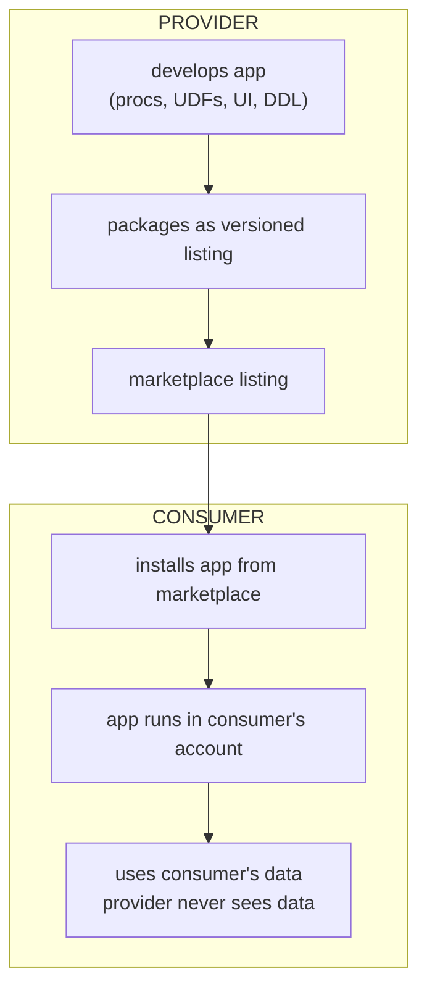

### Lab Exercise
```sql
-- Provider side (simplified)
CREATE APPLICATION PACKAGE fraud_detector_pkg;

ALTER APPLICATION PACKAGE fraud_detector_pkg
  ADD VERSION v1 USING '@setup_stage/v1/';

-- Setup script (packaged):
-- /v1/setup.sql
-- CREATE APPLICATION ROLE app_user;
-- CREATE SCHEMA app_schema;
-- CREATE PROCEDURE app_schema.score(input VARIANT) ... ;
-- GRANT USAGE ON SCHEMA app_schema TO APPLICATION ROLE app_user;

ALTER APPLICATION PACKAGE fraud_detector_pkg
  SET DEFAULT RELEASE DIRECTIVE VERSION = v1 PATCH = 0;

-- Share with consumer accounts
CREATE SHARE fraud_detector_share;
GRANT INSTALL, DEVELOP ON APPLICATION PACKAGE fraud_detector_pkg TO SHARE fraud_detector_share;

-- Consumer side
CREATE APPLICATION fraud_detector FROM APPLICATION PACKAGE fraud_detector_pkg;
-- Grant app access to consumer's data:
GRANT USAGE ON DATABASE prod_db TO APPLICATION fraud_detector;
GRANT SELECT ON TABLE prod_db.public.transactions TO APPLICATION fraud_detector;

CALL fraud_detector.app_schema.score(SELECT OBJECT_CONSTRUCT(*) FROM transactions LIMIT 1);
```
**Expected outcome:** Provider ships code; consumer runs on own data; provider never sees data.

### Gotchas / Exam Traps
- Native Apps are in GA across many regions but check specific cloud/region.
- Billing: provider sets listing price; Snowflake handles monetization.
- Debugging: provider can't query consumer's data; must rely on consumer-supplied test data in dev installs.

---

## Q19: What are the differences between IMMUTABLE, VOLATILE, and STABLE function volatility?
**Difficulty:** Advanced
**Exam relevance:** "Function determinism and caching."

### Answer
Snowflake UDFs can be marked **IMMUTABLE** (same input always same output, result-cacheable), **VOLATILE** (output may change on each call, no caching). STABLE is a Postgres term — Snowflake just has IMMUTABLE and VOLATILE. Default: IMMUTABLE for SQL UDFs, VOLATILE for Python if `IS_VOLATILE` not specified.

### First Principles
If Snowflake knows a function is deterministic, it can cache results (session-level and even cross-session result cache). Marking a function wrongly (e.g., VOLATILE when it's deterministic) foregoes caching; marking VOLATILE as IMMUTABLE causes wrong cached results. For functions using `CURRENT_TIMESTAMP` or random, always VOLATILE.

### Diagram
```mermaid
flowchart TD
    I["IMMUTABLE"]
    I --> I1["f(x) always same output"]
    I --> I2["cached in result cache"]
    I --> I3["can be pushed down"]
    V["VOLATILE"]
    V --> V1["f(x) may differ each call"]
    V --> V2["not cached"]
    V --> V3["not pushed down to pruning"]
    V --> V4["called per row every time"]
```

### Lab Exercise
```sql
CREATE OR REPLACE FUNCTION pure_tax(amt NUMBER)
RETURNS NUMBER
IMMUTABLE
AS $$ amt * 0.07 $$;

CREATE OR REPLACE FUNCTION random_adj(amt NUMBER)
RETURNS NUMBER
VOLATILE
AS $$ amt * (1 + UNIFORM(0.0, 0.1, RANDOM())::NUMBER) $$;

-- Query result cached only for pure_tax
SELECT pure_tax(100), random_adj(100);
SELECT pure_tax(100), random_adj(100);  -- random_adj differs; pure_tax same
```
**Expected outcome:** VOLATILE functions re-execute; IMMUTABLE cached.

### Gotchas / Exam Traps
- Marking a function IMMUTABLE when it reads from a table makes caching unsafe — avoid.
- Python UDFs that reference globals or network resources should be VOLATILE.
- IMMUTABLE flag enables micro-partition pruning when UDF appears in WHERE.

---

## Q20: How do you implement a slowly-changing dimension Type 7 (hybrid) in Snowflake?
**Difficulty:** Advanced
**Exam relevance:** "Advanced dimensional modeling."

### Answer
SCD Type 7 = both historical versions and a current-flag/current-value column. Combine SCD2 (versioned rows with valid_from/to) with a dim_cust_current view/table that always points to the latest version. Queries requiring history use the versioned table; queries wanting current state use the view.

### First Principles
SCD2 preserves history but querying "today's" state requires `WHERE is_current=TRUE`. SCD7 adds the "current" layer so BI tools don't deal with history filters. In Snowflake, you can implement the current layer as a view (`WHERE is_current`) or a separate materialized/dynamic table for performance.

### Diagram
```mermaid
flowchart TD
    H["dim_cust_scd2 (history)<br/>(id=1 v1 Alice US t0->t1)<br/>(id=1 v2 Alice EU t1->NULL)<br/>(id=2 v1 Bob US t0->NULL)"]
    CU["dim_cust_current (view/DT)<br/>(id=1 Alice EU)<br/>(id=2 Bob US)"]
    QC["Query current: use dim_cust_current"]
    QT["Point-in-time: dim_cust_scd2 WHERE :t BETWEEN valid_from AND COALESCE(valid_to,:t)"]
    H --> CU
    H --> QT
    CU --> QC
```

### Lab Exercise
```sql
CREATE OR REPLACE TABLE dim_cust_scd2 (
  surrogate INT AUTOINCREMENT, id INT, name STRING, region STRING,
  valid_from TIMESTAMP, valid_to TIMESTAMP, is_current BOOLEAN
);

-- Current layer as a dynamic table
CREATE OR REPLACE DYNAMIC TABLE dim_cust_current
  TARGET_LAG = '1 minute' WAREHOUSE = etl_wh
AS
SELECT id, name, region
FROM dim_cust_scd2
WHERE is_current = TRUE;

-- Query current state
SELECT * FROM dim_cust_current WHERE id = 1;

-- Point-in-time query
SELECT * FROM dim_cust_scd2
WHERE id = 1 AND '2026-06-01' BETWEEN valid_from AND COALESCE(valid_to, '9999-12-31');
```
**Expected outcome:** Current layer auto-refreshes; history preserved for audit.

### Gotchas / Exam Traps
- Dynamic Table of current layer refreshes incrementally when scd2 has new current rows.
- Row counts can be deceptive — scd2 grows unbounded; prune old versions if business allows.

---

## Q21: What is the role of `CALLER` vs `OWNER` rights in Snowpark procedures?
**Difficulty:** Advanced
**Exam relevance:** "Procedure security model."

### Answer
`EXECUTE AS CALLER` (default): procedure runs with caller's privileges — safe but limited to what caller can do. `EXECUTE AS OWNER`: runs with owner's privileges — enables controlled escalation but requires careful auditing for SQL injection and data leakage.

### First Principles
A proc called with EXECUTE AS CALLER cannot do more than the caller alone could; so it's safe to publish. EXECUTE AS OWNER lets the proc touch objects the caller doesn't have direct access to — common for "safe wrapper" patterns (expose a limited API to data callers can't read directly). Owner-rights procs are a security surface requiring input validation.

### Diagram
```mermaid
flowchart TD
    P["PROC calls table X"]
    P --> CA["EXECUTE AS CALLER"]
    CA --> CA1["caller must have SELECT on X"]
    CA --> CA2["proc accesses X as caller"]
    CA --> CA3["session context: caller's role"]
    P --> OW["EXECUTE AS OWNER"]
    OW --> OW1["owner must have SELECT on X"]
    OW --> OW2["proc accesses X as owner"]
    OW --> OW3["session context: proc's owner role"]
    OW --> OW4["caller only needs USAGE on PROC"]
```

### Lab Exercise
```sql
-- Example: owner-rights proc exposes a filtered view of sensitive data
USE ROLE SECURITYADMIN;

CREATE OR REPLACE PROCEDURE audited_pii_access(user_filter STRING)
RETURNS TABLE (id INT, email_masked STRING)
LANGUAGE SQL
EXECUTE AS OWNER
AS
$$
DECLARE
  res RESULTSET DEFAULT (
    SELECT id, REGEXP_REPLACE(email,'.+@','***@') AS email_masked
    FROM customers
    WHERE user_name = :user_filter
  );
BEGIN
  -- Audit the access
  INSERT INTO pii_access_log VALUES (CURRENT_USER(), :user_filter, CURRENT_TIMESTAMP);
  RETURN TABLE(res);
END;
$$;

GRANT USAGE ON PROCEDURE audited_pii_access(STRING) TO ROLE analyst;

USE ROLE analyst;
CALL audited_pii_access('alice@example.com');  -- works; logged
SELECT * FROM customers;  -- fails (analyst has no direct access)
```
**Expected outcome:** Analyst can query via proc but not directly.

### Gotchas / Exam Traps
- SQL injection in owner-rights procs = privilege escalation. Use bind parameters, not string concatenation.
- `CURRENT_USER()` returns the caller even in owner-rights procs; `CURRENT_ROLE()` returns the owner role.
- Owner-rights procs cannot `USE ROLE` or `USE SECONDARY ROLES`.

---

## Q22: How does Snowflake handle Python packages and dependency management for UDFs?
**Difficulty:** Intermediate
**Exam relevance:** "Package UDFs with external libraries."

### Answer
Snowflake has a curated set of Python packages from Anaconda (`SNOWFLAKE.ANACONDA.CONDA_PACKAGES` view). Specify via `PACKAGES=('pandas','numpy','scikit-learn==1.3.0')`. For packages not in Anaconda, upload a wheel to a stage and use `IMPORTS=('@stage/pkg.whl')`. Must accept Anaconda ToS at account level first.

### First Principles
UDF Python workers can't `pip install` on the fly — Snowflake pre-provisions a curated Anaconda env to ensure security and reproducibility. The `PACKAGES` clause declares dependencies; Snowflake installs the version at UDF creation (if not already available). Custom wheels bypass the Anaconda ToS and let you use any package.

### Diagram
```mermaid
flowchart TD
    UDF["UDF declaration"]
    UDF --> PKG["PACKAGES = ('pandas','scikit-learn==1.3.0')"]
    PKG --> WK["Snowflake worker:<br/>pre-installed Anaconda env<br/>+ requested packages at specified versions"]
    UDF --> IMP["IMPORTS = ('@stage/mymodule.py','@stage/custompkg.whl')"]
    IMP --> FS["Loaded onto worker filesystem<br/>accessible to Python code"]
    WK --> FS
```

### Lab Exercise
```sql
-- Accept Anaconda ToS (account-level, once)
-- UI: Snowsight > Admin > Terms & Billing > Anaconda
-- Or SQL (if available in your region):
-- ALTER ACCOUNT SET PYTHON_PACKAGE_POLICY='<policy>';

-- UDF with packages
CREATE OR REPLACE FUNCTION classify_sentiment(text STRING)
RETURNS STRING
LANGUAGE PYTHON RUNTIME_VERSION='3.11'
PACKAGES = ('scikit-learn==1.3.0','pandas','joblib')
IMPORTS = ('@models/sentiment_model.pkl')
HANDLER = 'classify'
AS $$
import sys, joblib
import pandas as pd

MODEL = None
def _get_model():
    global MODEL
    if MODEL is None:
        MODEL = joblib.load(sys.argv[0] if len(sys.argv)>0 else '/tmp/sentiment_model.pkl')
    return MODEL

def classify(text):
    return _get_model().predict([text])[0]
$$;

SELECT classify_sentiment('great product');

-- Discover available packages
SELECT * FROM SNOWFLAKE.ANACONDA.CONDA_PACKAGES
WHERE package_name LIKE '%sklearn%' OR package_name LIKE 'scikit%';
```
**Expected outcome:** UDF with ML model works; discover packages via metadata view.

### Gotchas / Exam Traps
- Anaconda ToS must be accepted at account level before use.
- Not all pypi packages are in Anaconda — check `CONDA_PACKAGES` view first.
- Version pins should be exact for reproducibility; drift is painful.
- Custom wheels in `IMPORTS` must be compatible with Snowflake's Linux Python version.

---

## Q23: Explain how to profile and optimize a Snowpark Python UDF.
**Difficulty:** Advanced
**Exam relevance:** "Optimize Python UDF performance."

### Answer
Profile via `QUERY_PROFILE` — look at ExternalFunction / UDF node time. Optimizations: (1) vectorize (`@vectorized` decorator for batches); (2) move expensive setup (model loading, imports) outside the handler function (uses module-level globals); (3) use `IMMUTABLE` to enable caching; (4) use Snowpark-optimized WH for memory-heavy; (5) reduce row counts via predicates before UDF application.

### First Principles
Python UDFs have per-row overhead (interpreter switch, serialization). Vectorized UDFs batch rows, cutting overhead ~100x. Module-level global caching (singleton pattern) avoids re-loading models/libraries per invocation. Snowpark-optimized gives more RAM for in-worker caching. Reducing input rows before UDF is often the biggest win.

### Diagram
```mermaid
flowchart TD
    B["BAD: scalar UDF, model load in handler"]
    B --> B1["per-row interpretation"]
    B --> B2["per-row model init"]
    B --> B3["cost: O(rows)"]
    B --> B4["Before UDF: SELECT * FROM huge<br/>(UDF applied to all rows)"]
    G["GOOD: vectorized UDF, model load at module level"]
    G --> G1["per-batch interpretation"]
    G --> G2["init once per worker"]
    G --> G3["cost: O(batches)"]
    G --> G4["After UDF filter: SELECT ... WHERE udf(x)<br/>(filter first, then UDF)"]
```

### Lab Exercise
```sql
-- Bad: scalar, model loaded per row
CREATE OR REPLACE FUNCTION bad_predict(x FLOAT) RETURNS FLOAT
LANGUAGE PYTHON RUNTIME_VERSION='3.11' PACKAGES=('scikit-learn','joblib')
IMPORTS=('@models/m.pkl') HANDLER='pred'
AS $$
import joblib, sys
def pred(x):
    model = joblib.load(sys.argv[0] or '/tmp/m.pkl')  # EVERY ROW
    return model.predict([[x]])[0]
$$;

-- Good: vectorized, module-level model
CREATE OR REPLACE FUNCTION good_predict(x FLOAT) RETURNS FLOAT
LANGUAGE PYTHON RUNTIME_VERSION='3.11' PACKAGES=('scikit-learn','joblib','pandas')
IMPORTS=('@models/m.pkl') HANDLER='pred'
AS $$
import joblib, sys, pandas as pd
from _snowflake import vectorized

MODEL = joblib.load(sys.argv[0] or '/tmp/m.pkl')  # ONCE PER WORKER

@vectorized(input=pd.DataFrame)
def pred(df):
    return pd.Series(MODEL.predict(df.values))
$$;

-- Benchmark
SELECT bad_predict(x) FROM million_rows;  -- slow
SELECT good_predict(x) FROM million_rows; -- much faster

-- Profile
SELECT query_text, execution_time, bytes_scanned
FROM TABLE(INFORMATION_SCHEMA.QUERY_HISTORY_BY_SESSION())
ORDER BY start_time DESC LIMIT 5;
```
**Expected outcome:** `good_predict` runs 10-100x faster than `bad_predict`.

### Gotchas / Exam Traps
- Vectorized UDFs require `pandas` in PACKAGES.
- Module-level code runs ONCE per worker; subsequent invocations reuse — the correct place for expensive init.
- `sys.argv` holds imports; use for stage files loaded in UDF.

---

## Q24: What is the pattern for implementing idempotent ingestion with transformation?
**Difficulty:** Advanced
**Exam relevance:** "Build re-runnable pipelines."

### Answer
Pattern: (1) **Ingest with MERGE** keyed on business ID — re-processing the same source gives same target. (2) **Transforms use idempotent MERGE** on target. (3) **Use CDC offset tokens** (Streams + task write offsets) so replay from a known point is possible. (4) **Avoid INSERT without MERGE** on upstream data.

### First Principles
Pipelines fail; retries are inevitable. Idempotent operations give identical result regardless of how many times they run. MERGE on business ID is the primary tool. For streaming CDC, offset tokens pin "where we are" so replay can start at the known-committed offset.

### Diagram
```mermaid
flowchart TD
    S["source (file in stage, Kafka offset)"]
    M["MERGE on business ID<br/>WHEN MATCHED THEN UPDATE<br/>WHEN NOT MATCHED THEN INSERT"]
    R["result: same regardless of retries"]
    S --> M --> R
```

### Lab Exercise
```sql
-- Idempotent MERGE from stream
CREATE OR REPLACE TASK t_merge
  WAREHOUSE = etl_wh
  SCHEDULE = '1 MINUTE'
  WHEN SYSTEM$STREAM_HAS_DATA('src_stream')
  AS
MERGE INTO target t
USING (
  SELECT business_id, event_time, data,
         ROW_NUMBER() OVER (PARTITION BY business_id ORDER BY event_time DESC) AS rn
  FROM src_stream
  WHERE METADATA$ACTION IN ('INSERT','UPDATE')
) s
ON t.business_id = s.business_id AND s.rn = 1
WHEN MATCHED AND s.event_time > t.event_time THEN
  UPDATE SET t.data = s.data, t.event_time = s.event_time
WHEN NOT MATCHED THEN
  INSERT (business_id, event_time, data) VALUES (s.business_id, s.event_time, s.data);
```
**Expected outcome:** Re-running the same source data causes no change in target.

### Gotchas / Exam Traps
- Append-only INSERT is NOT idempotent; always use MERGE for upsert.
- Deletes complicate idempotency — use tombstone rows or soft-delete flags.
- Snowpipe Streaming + offset tokens = exactly-once from Kafka to Snowflake.

---

## Q25: Describe end-to-end: ingest from Kafka, transform via Dynamic Tables, serve via Streamlit.
**Difficulty:** Advanced
**Exam relevance:** "Build complete transformation pipeline."

### Answer
(1) Kafka connector (streaming mode) writes to raw table. (2) Dynamic Tables stage, enrich, aggregate with chained lag. (3) Streamlit in Snowflake app queries the final DT and visualizes. All in Snowflake — no external orchestration or hosting.

### First Principles
A modern data pipeline is: ingest, transform, serve. Snowflake natively supports each: streaming SDK + Kafka connector for ingest, DTs for transform, SiS for serve. No external servers; one credit stream; unified security.

### Diagram
```mermaid
flowchart TD
    K["Kafka topic (orders)"]
    K -->|"Snowpipe Streaming via Kafka connector"| RO["RAW.orders"]
    RO --> OC["DT.orders_cleaned (TARGET_LAG='1m')"]
    OC --> OE["DT.orders_enriched<br/>JOIN customers, products (TARGET_LAG='1m')"]
    OE --> HS["DT.hourly_summary (TARGET_LAG='5m')"]
    HS --> SIS["Streamlit in Snowflake dashboard"]
```

### Lab Exercise
```sql
-- 1. Raw table (populated by Kafka connector in streaming mode)
CREATE OR REPLACE TABLE raw_orders (
  ingested_at TIMESTAMP, record_metadata VARIANT, record_content VARIANT
) ENABLE_SCHEMA_EVOLUTION=TRUE;

-- 2. Dynamic Tables
CREATE OR REPLACE DYNAMIC TABLE orders_cleaned
  TARGET_LAG = '1 minute' WAREHOUSE = etl_wh
AS
SELECT record_content:order_id::INT AS order_id,
       record_content:customer_id::INT AS customer_id,
       record_content:amt::NUMBER AS amt,
       record_content:ts::TIMESTAMP AS ts
FROM raw_orders
WHERE record_content:order_id IS NOT NULL;

CREATE OR REPLACE DYNAMIC TABLE orders_enriched
  TARGET_LAG = '1 minute' WAREHOUSE = etl_wh
AS
SELECT o.*, c.customer_tier, c.region
FROM orders_cleaned o JOIN customers c ON o.customer_id = c.id;

CREATE OR REPLACE DYNAMIC TABLE hourly_summary
  TARGET_LAG = '5 minutes' WAREHOUSE = etl_wh
AS
SELECT DATE_TRUNC('hour', ts) AS hr, region, customer_tier,
       COUNT(*) AS order_cnt, SUM(amt) AS total_amt
FROM orders_enriched
GROUP BY 1, 2, 3;
```
```python
# 3. Streamlit app in Snowflake
import streamlit as st
from snowflake.snowpark.context import get_active_session

session = get_active_session()
st.title("Live Orders Dashboard")

df = session.table("HOURLY_SUMMARY").to_pandas()
st.line_chart(df.pivot(index='HR', columns='REGION', values='TOTAL_AMT'))
```
**Expected outcome:** End-to-end pipeline from Kafka to dashboard, all in Snowflake.

### Gotchas / Exam Traps
- Each DT needs its own refresh cost — chain carefully.
- `TARGET_LAG = DOWNSTREAM` on upstream DTs reduces redundant refreshes.
- Streamlit app warehouse should match query cost — can be smaller than ETL WH.
- Permission model: Streamlit runs as viewer; viewer must have SELECT on DTs.
