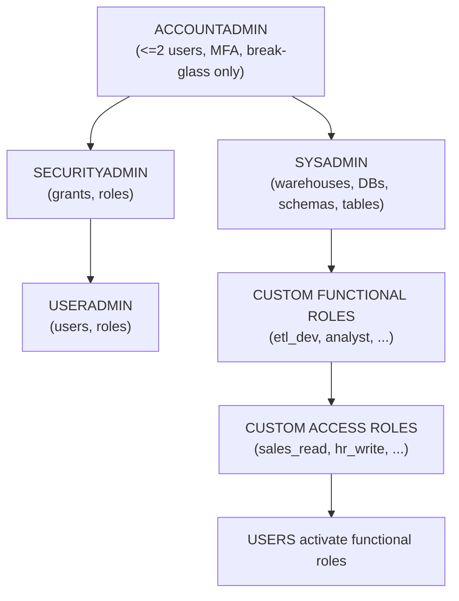

# DEA-C02 One-Page Cheatsheet

Dense reference, exam-day quick lookup. Everything here is testable.

---

## 1. CREDIT & COST MATH

### Warehouse credit multipliers (per hour)
```
XS=1    S=2    M=4    L=8    XL=16    2XL=32    3XL=64    4XL=128    5XL=256    6XL=512
```
Billing: per-second after **60-second minimum per resume**. `AUTO_SUSPEND<60` still bills 60s floor.
Snowpark-optimized WH: ~1.5x same-size standard, 16x per-core memory, min size M.

### Common cost rules
| Rule                                       | Value                                                 |
|--------------------------------------------|-------------------------------------------------------|
| Serverless task minimum                    | 1 min per run                                         |
| Snowpipe file overhead                     | ~0.06 credits / 1000 files + compute                  |
| Cloud services daily subsidy               | 10% of daily WH credits (free below this)             |
| Clustering credits                         | Serverless; separate from WH credits                  |
| SOS credits                                | Serverless; proportional to writes                    |
| Storage billing                            | Compressed TB-month, daily averaged                   |
| Replication                                | Egress + primary compute + secondary compute          |

### Cost-formula examples
```
M wh resumed, 90s query, suspend  = 90/3600 * 4   = 0.1 credits
M wh resumed, 10s query, suspend  = 60/3600 * 4   = 0.067 credits (floor hit)
L multi-cluster, 2 clusters, 1 hr = 2 * 8         = 16 credits
2XL for 15 min                    = 0.25 * 32     = 8 credits
Snowpark-optimized M, 1 hr        = 4 * 1.5       = ~6 credits
```

---

## 2. RETENTION WINDOWS

| What | Std | Ent+ | Notes |
|------|-----|------|-------|
| TT — permanent | 0–1d | 0–90d | `DATA_RETENTION_TIME_IN_DAYS` |
| TT — transient | 0–1d | 0–1d | No FS |
| TT — temporary | 0–1d | 0–1d | Session-scoped, no FS |
| Fail-safe (perm only) | 7d | 7d | Non-config, Support recovery |
| MAX_DATA_EXT | 0–14d | 0–90d | Extends TT for streams/DT |
| Snowpipe dedup | 14d | 14d | By filename |
| COPY LOAD_HISTORY | 64d | 64d | Per-table dedup |
| INFO_SCHEMA.COPY_HIST | 14d | 14d | Realtime |
| ACCT_USAGE.COPY_HIST | 365d | 365d | ~90 min lag |
| ACCT_USAGE.* (most) | 365d | 365d | 1–3h lag |
| Result cache | 24h | 24h | Up to 31d with reuse |
| SQS retention | 4d | 4d | Beyond: REFRESH (7d) |
| Snowpipe REFRESH | 7d | 7d | One-time catch-up |
| OAuth access token | 10 min | 10 min | Refresh 90d |

---

## 3. SYNTAX QUICK-REFERENCE

### CREATE PIPE
```sql
CREATE OR REPLACE PIPE sales_pipe
  AUTO_INGEST = TRUE
  INTEGRATION = 'event_grid_int'          -- Azure/GCP only; S3 derives from stage
  AS COPY INTO sales FROM @sales_stage
     FILE_FORMAT = (FORMAT_NAME = csv_fmt)
     MATCH_BY_COLUMN_NAME = CASE_INSENSITIVE
     ON_ERROR = 'SKIP_FILE_5%';
```

### CREATE STREAM
```sql
CREATE OR REPLACE STREAM orders_stream ON TABLE orders
  APPEND_ONLY = FALSE           -- or TRUE for insert-only
  SHOW_INITIAL_ROWS = TRUE      -- first read returns existing rows
  COMMENT = 'CDC on orders';
```

### CREATE TASK (serverless)
```sql
CREATE OR REPLACE TASK t_root
  USER_TASK_MANAGED_INITIAL_WAREHOUSE_SIZE = 'SMALL'
  SCHEDULE = 'USING CRON 0 */2 * * * UTC'       -- or '1 MINUTE'
  WHEN SYSTEM$STREAM_HAS_DATA('orders_stream')
AS
  INSERT INTO orders_raw SELECT * FROM orders_stream;

CREATE OR REPLACE TASK t_child
  WAREHOUSE = etl_wh
  AFTER t_root                                   -- dependency
AS MERGE INTO ...;

-- Resume order: children first, then root
ALTER TASK t_child RESUME;
ALTER TASK t_root  RESUME;
```

### CREATE DYNAMIC TABLE
```sql
CREATE OR REPLACE DYNAMIC TABLE orders_summary
  TARGET_LAG = '1 minute'                        -- or DOWNSTREAM
  WAREHOUSE = etl_wh                             -- omit for serverless
  REFRESH_MODE = AUTO                            -- or INCREMENTAL | FULL
  INITIALIZE = ON_CREATE                         -- or ON_SCHEDULE
AS
  SELECT customer_id, SUM(amt) AS total
  FROM orders JOIN customers ON orders.cust_id = customers.id
  GROUP BY customer_id;
```

### Snowpark Python decorators
```python
# Vectorized UDF
from _snowflake import vectorized
import pandas as pd

@vectorized(input=pd.DataFrame)
def compute(df):
    return df[0] * 0.07

# UDTF
class Splitter:
    def process(self, s):
        for t in s.split(','):
            yield (t.strip(),)

# Stored proc entry
def main(session, days: int):
    df = session.table("sales").filter(...)
    df.write.save_as_table("tgt", mode="append")
    return "OK"
```

### Masking policy
```sql
CREATE OR REPLACE MASKING POLICY mp_email AS (val STRING)
RETURNS STRING ->
  CASE
    WHEN IS_ROLE_IN_SESSION('PII_ADMIN') THEN val
    WHEN IS_ROLE_IN_SESSION('ANALYTICS') THEN REGEXP_REPLACE(val,'.+@','***@')
    ELSE '*** masked ***'
  END;

ALTER TABLE customers MODIFY COLUMN email SET MASKING POLICY mp_email;
```

### Row Access Policy
```sql
CREATE OR REPLACE ROW ACCESS POLICY rap_region AS (region STRING)
RETURNS BOOLEAN ->
  CURRENT_ROLE() = 'ACCOUNTADMIN'
  OR EXISTS (
    SELECT 1 FROM entitlements
    WHERE user_name = CURRENT_USER() AND entitlements.region = region
  );

ALTER TABLE sales ADD ROW ACCESS POLICY rap_region ON (region);
```

### Iceberg Table (Snowflake-managed)
```sql
CREATE OR REPLACE ICEBERG TABLE sales_iceberg (id INT, amt NUMBER, dt DATE)
  CATALOG = 'SNOWFLAKE'
  EXTERNAL_VOLUME = 'iceberg_vol'
  BASE_LOCATION = 'sales/';
```

### Zero-copy clone with options
```sql
CREATE TABLE dev_sales CLONE sales
  AT (TIMESTAMP => '2026-10-30 23:59:59'::TIMESTAMP);
CREATE DATABASE prod_dev CLONE prod_db COPY GRANTS;
```

### Future grants
```sql
GRANT USAGE ON SCHEMA prod_db.sales TO ROLE analyst;
GRANT SELECT ON ALL TABLES IN SCHEMA prod_db.sales TO ROLE analyst;
GRANT SELECT ON FUTURE TABLES IN SCHEMA prod_db.sales TO ROLE analyst;
```

### External Access Integration (outbound HTTPS)
```sql
CREATE NETWORK RULE allowed_apis
  TYPE = HOST_PORT MODE = EGRESS
  VALUE_LIST = ('api.external.com:443');

CREATE SECRET api_token TYPE = GENERIC_STRING SECRET_STRING = '<bearer>';

CREATE EXTERNAL ACCESS INTEGRATION ext_api_int
  ALLOWED_NETWORK_RULES = (allowed_apis)
  ALLOWED_AUTHENTICATION_SECRETS = (api_token)
  ENABLED = TRUE;
```

---

## 4. COMMON SYSTEM$ FUNCTIONS

| Function | Purpose |
|----------|---------|
| `SYSTEM$PIPE_STATUS('pipe')` | JSON: executionState, pendingFileCount |
| `SYSTEM$STREAM_HAS_DATA('stream')` | Boolean — Task WHEN clause |
| `SYSTEM$STREAM_GET_TABLE_TIMESTAMP('stream')` | Stream offset timestamp |
| `SYSTEM$CLUSTERING_DEPTH('tbl','(cols)')` | Avg depth (ideal ~1) |
| `SYSTEM$CLUSTERING_INFORMATION(...)` | JSON histogram, total MPs |
| `SYSTEM$ESTIMATE_SEARCH_OPTIMIZATION_COSTS(...)` | Build + maint credits |
| `SYSTEM$ESTIMATE_QUERY_ACCELERATION('qid')` | Potential QAS speedup |
| `SYSTEM$CLASSIFY('tbl')` | Auto-classify PII cols |
| `SYSTEM$GET_TAG('TAG','obj','DOMAIN')` | Return tag value |
| `SYSTEM$GET_TAG_ON_CURRENT_COLUMN('TAG')` | In masking policy, current col's tag |
| `SYSTEM$WHITELIST()` / `SYSTEM$ALLOWLIST()` | Required IPs/hosts to allow |
| `SYSTEM$GET_PRIVATELINK_CONFIG()` | PrivateLink endpoint info |
| `SYSTEM$GENERATE_SCIM_ACCESS_TOKEN('integ')` | Bearer token for SCIM push |
| `SYSTEM$CANCEL_QUERY('qid')` | Terminate running query |

---

## 5. QUERY PROFILE RED FLAGS

| Signal | Diagnosis | Fix |
|--------|-----------|-----|
| `bytes_spilled_to_remote_storage > 0` | WH out of RAM, spilling to S3 | Resize up / Snowpark-opt |
| `bytes_spilled_to_local_storage > 0` only | Normal for large sorts/joins | Usually acceptable |
| `partitions_scanned = partitions_total` | No pruning | Check filter wrapping; add/fix cluster key |
| Exploding rows at join (10M -> 10B) | Missing predicate / cross-join | Verify join key and selectivity |
| Synchronization time > 30% | Data skew; one node doing most work | Rewrite skewed key; sometimes larger WH |
| 0% from local cache after warm up | Cache evicted / resize / suspend | Keep WH warm; longer `AUTO_SUSPEND` |
| ExternalFunction node high elapsed | Network round-trip to Lambda/API | Batch rows; consider native UDF |
| "Decorrelation" of subquery slow | Correlated subquery CBO limit | Rewrite as JOIN or CTE |
| Compilation time > execution time | Query too complex, too many objects | Simplify; use CTEs; pre-materialize |

---

## 6. RBAC DEFAULT ROLE MATRIX



### Default responsibilities
| Role           | Scope                                                                     |
|----------------|---------------------------------------------------------------------------|
| ACCOUNTADMIN   | Billing, replication, account-level settings, resource monitors            |
| SECURITYADMIN  | Create/drop roles, grants, masking policies, network policies, OAuth       |
| USERADMIN      | Create/drop users and roles only                                           |
| SYSADMIN       | Create/drop warehouses, databases, schemas, tables                         |
| PUBLIC         | Default for every user. Never grant sensitive privileges                   |
| Custom functional | Per-team persona (analyst, etl_dev). Granted access roles              |
| Custom access  | Per-object capability (sales_read, hr_write). Granted to functional roles  |

### Important two-layer pattern
```
GRANT USAGE ON DATABASE db   TO ROLE sales_read;
GRANT USAGE ON SCHEMA db.sch TO ROLE sales_read;
GRANT SELECT ON ALL TABLES    IN SCHEMA db.sch TO ROLE sales_read;
GRANT SELECT ON FUTURE TABLES IN SCHEMA db.sch TO ROLE sales_read;

GRANT ROLE sales_read TO ROLE analyst;      -- functional
GRANT ROLE analyst    TO USER alice;
GRANT ROLE analyst    TO ROLE SYSADMIN;     -- so admins can see it
```

---

## 7. DECISION TABLES

### When to use which ingestion method
| Scenario                                              | Pick                              |
|-------------------------------------------------------|-----------------------------------|
| Latency < 10s, exactly-once needed                    | Snowpipe Streaming                |
| Latency ~1 min, events in cloud bucket                | Snowpipe auto-ingest              |
| Latency ~1 min, no cloud events available             | Snowpipe REST                     |
| Hourly/nightly bulk, large files (100–250 MB)         | COPY INTO (batch)                 |
| Query files in place, read-only, no ingest            | External Table                    |
| Full ACID on open format, multi-engine access         | Iceberg Table                     |
| Kafka source, <5s latency, exactly-once per partition | Kafka connector STREAMING mode    |
| Kafka source, cost-first                              | Kafka connector classic (file) mode |

### MV vs Dynamic Table vs View
| Need                                       | Pick               |
|--------------------------------------------|--------------------|
| Pre-aggregated projection of ONE table, auto query-rewrite | Materialized View  |
| Multi-table pipeline, SLA-driven freshness, chainable      | Dynamic Table      |
| Pure logical shaping, no storage, infrequent              | Standard View      |
| Expose logic to data-share consumer                        | Secure View        |

### Clone vs CTAS vs CTAS AT
| Need                                              | Pick                                 |
|---------------------------------------------------|--------------------------------------|
| Instant dev copy of huge table                    | `CLONE`                              |
| Deep physical copy with new schema/clustering     | `CTAS`                               |
| Snapshot at specific past timestamp               | `CLONE AT (TIMESTAMP => ...)`        |
| Persisted snapshot outliving source retention     | `CTAS AT (OFFSET => ...)` into transient |
| Ad-hoc point-in-time read, no persistence         | `SELECT ... AT (OFFSET=>...)`        |

### Transient vs Permanent vs Temporary
| Need                                      | Pick             |
|-------------------------------------------|------------------|
| Authoritative data, needs recovery         | Permanent        |
| ETL intermediate, rebuildable from source  | Transient        |
| Private per-session scratch                | Temporary        |

### Resize up vs Multi-cluster vs QAS
| Pain point                                           | Fix                        |
|------------------------------------------------------|----------------------------|
| Single query slow, remote spill                      | Resize up                  |
| Many concurrent queries queueing                     | Multi-cluster (horizontal) |
| Occasional outlier big-scan query                    | QAS enable + scale factor  |
| Memory-heavy Python/ML UDFs                          | Snowpark-optimized WH      |

### Masking Policy vs Row Access Policy vs Secure View
| Need                                           | Pick                 |
|------------------------------------------------|----------------------|
| Hide value in a column per role                | Masking policy       |
| Hide entire rows per user/tenant               | Row access policy    |
| Hide view definition from consumer             | Secure view          |
| Hide function body from consumer               | Secure UDF           |

### Classification / tagging approach
| Scope                              | Pick                                        |
|------------------------------------|---------------------------------------------|
| One-off per-column protection      | Attach masking policy to column directly    |
| Many columns, same policy          | Tag columns, attach policy to tag           |
| Auto PII detection                 | `SYSTEM$CLASSIFY` + `ASSOCIATE_SEMANTIC_CATEGORY_TAGS` |

### Stream+Task vs Dynamic Table
| Need                                                     | Pick             |
|----------------------------------------------------------|------------------|
| Pure SQL incremental pipeline, declarative, chainable    | Dynamic Table    |
| Complex procedural logic (loops, UDF side effects)       | Stream + Task    |
| Snowpark/Python transformations as part of pipeline      | Stream + Task (procedure) |
| Ad-hoc CDC exploration without a persistent object       | `CHANGES ()` clause with `CHANGE_TRACKING=TRUE` |

### Pipe state actions
| State | Cause | Recovery |
|-------|-------|----------|
| RUNNING | Normal | — |
| SUSPENDED | ALTER PIPE SUSPEND; SQS still queues | RESUME drains backlog (4d SQS retention) |
| PAUSED | PIPE_EXECUTION_PAUSED=TRUE; stays subscribed | Set PIPE_EXECUTION_PAUSED=FALSE |
| STOPPED_CLONED_OR_DROPPED | Target dropped or pipe cloned | Recreate pipe |
| PAUSED_BY_SYSTEM | Owner role dropped | Re-grant ownership + RESUME |

---

## 8. EDITION FEATURE MATRIX

| Feature                                           | Std | Ent | BC | VPS |
|---------------------------------------------------|-----|-----|----|-----|
| Core compute, storage, TT=1d, FS=7d               | ✓   | ✓   | ✓  | ✓   |
| Standard sharing                                  | ✓   | ✓   | ✓  | ✓   |
| TT up to 90d                                      |     | ✓   | ✓  | ✓   |
| Materialized views                                |     | ✓   | ✓  | ✓   |
| Search Optimization Service                       |     | ✓   | ✓  | ✓   |
| Dynamic Tables                                    |     | ✓   | ✓  | ✓   |
| Access History / Object Dependencies              |     | ✓   | ✓  | ✓   |
| Account Usage                                     |     | ✓   | ✓  | ✓   |
| Column-level masking + tag-based policies         |     | ✓   | ✓  | ✓   |
| Row access policies                               |     | ✓   | ✓  | ✓   |
| Same-cloud cross-region replication               |     | ✓   | ✓  | ✓   |
| Cross-cloud replication                           |     |     | ✓  | ✓   |
| Tri-Secret Secure (customer-managed root key)     |     |     | ✓  | ✓   |
| PrivateLink (AWS, Azure)                          |     |     | ✓  | ✓   |
| HIPAA / PCI / FedRAMP support                     |     |     | ✓  | ✓   |
| Dedicated metadata infrastructure                 |     |     |    | ✓   |

---

## 9. KEY ACCOUNT_USAGE / INFORMATION_SCHEMA VIEWS

| View                                               | What's in it                                           |
|----------------------------------------------------|--------------------------------------------------------|
| `ACCOUNT_USAGE.QUERY_HISTORY`                      | Every query, 365d, 45 min lag                          |
| `ACCOUNT_USAGE.LOGIN_HISTORY`                      | Login events, 365d                                     |
| `ACCOUNT_USAGE.ACCESS_HISTORY`                     | Column-level access, 365d, 3h lag                      |
| `ACCOUNT_USAGE.COPY_HISTORY`                       | COPY/Snowpipe loads, 365d, 90 min lag                  |
| `ACCOUNT_USAGE.WAREHOUSE_METERING_HISTORY`         | WH credits per hour                                    |
| `ACCOUNT_USAGE.TABLE_STORAGE_METRICS`              | Per-table active/TT/FS/retained_for_clone (snapshot)   |
| `ACCOUNT_USAGE.STORAGE_USAGE`                      | Account-level daily storage                            |
| `ACCOUNT_USAGE.DATABASE_STORAGE_USAGE_HISTORY`     | Per-DB daily storage                                   |
| `ACCOUNT_USAGE.AUTOMATIC_CLUSTERING_HISTORY`       | Clustering credits per table                           |
| `ACCOUNT_USAGE.SEARCH_OPTIMIZATION_HISTORY`        | SOS credits                                            |
| `ACCOUNT_USAGE.PIPE_USAGE_HISTORY`                 | Snowpipe credits + bytes                               |
| `ACCOUNT_USAGE.SNOWPIPE_STREAMING_CLIENT_HISTORY`  | Streaming credits                                      |
| `ACCOUNT_USAGE.QUERY_ACCELERATION_HISTORY`         | QAS credits + scale factor                             |
| `ACCOUNT_USAGE.GRANTS_TO_ROLES` / `GRANTS_TO_USERS`| RBAC history, 365d                                     |
| `ACCOUNT_USAGE.REPLICATION_GROUP_REFRESH_HISTORY`  | Replication lag + errors                               |
| `INFORMATION_SCHEMA.QUERY_HISTORY_BY_SESSION()`    | Realtime queries, 14d                                  |
| `INFORMATION_SCHEMA.COPY_HISTORY()`                | Realtime load events, 14d                              |
| `INFORMATION_SCHEMA.LOAD_HISTORY`                  | Per-table dedup set, 64d                               |
| `INFORMATION_SCHEMA.TASK_HISTORY()`                | Task runs, 14d                                         |
| `INFORMATION_SCHEMA.DYNAMIC_TABLE_REFRESH_HISTORY()`| DT refresh runs, 14d                                  |

**Rule of thumb:** `INFORMATION_SCHEMA.*()` for realtime (sub-second lag, 14d retention); `ACCOUNT_USAGE.*` for historical analysis (minutes-to-hours lag, 365d retention).

---

## 10. CRITICAL "DO NOT CONFUSE" PAIRS

| A | B | Difference |
|---|---|------------|
| Time Travel | Fail-safe | TT: user-queryable 0-90d. FS: Support-only, 7d, permanent-only. |
| Snowpipe auto-ingest | Snowpipe Streaming | File-based ~1min at-least-once vs rowset <10s exactly-once. |
| COPY LOAD_HISTORY (64d) | Snowpipe file history (14d) | Separate dedup sets, different windows. |
| ALTER PIPE SUSPEND | PIPE_EXECUTION_PAUSED=TRUE | SUSPEND stops SQS consumption; PAUSED keeps subscription. |
| Materialized View | Dynamic Table | MV: single-table, transparent rewrite. DT: full SQL, explicit object. |
| CLONE | CTAS | CLONE: 0-copy metadata. CTAS: deep physical copy. |
| CTAS | CREATE TABLE LIKE | CTAS copies data + default columns. LIKE copies structure only. |
| USERADMIN | SECURITYADMIN | USERADMIN creates users/roles. SECURITYADMIN manages grants. |
| CURRENT_ROLE() | IS_ROLE_IN_SESSION('X') | CURRENT returns primary. IS_ROLE checks primary OR secondary. |
| USE SECONDARY ROLES ALL | USE ROLE | Secondary = privilege union. USE ROLE = primary switch. |
| Standard WH | Snowpark-optimized WH | 16GB/core vs 256GB/core (16x), min M, ~1.5x cost. |
| SCALING_POLICY=STANDARD | SCALING_POLICY=ECONOMY | STANDARD scales fast (SLA). ECONOMY delays (~6min, cost). |
| RETURN_ERRORS | RETURN_N_ROWS | ERRORS: parse failures. N_ROWS: first N loadable rows. |
| External Table | Iceberg Table | Ext: read-only metadata federation. Iceberg: ACID + multi-engine. |
| External Function | External Access Integration | Ext fn: sync API call. EAI: outbound HTTP from UDF/proc. |
| EXECUTE AS CALLER | EXECUTE AS OWNER | CALLER (default): caller's privs. OWNER: elevates to owner's. |
| MASKING POLICY | ROW ACCESS POLICY | Masking: change values in a column. RAP: filter rows entirely. |

---

## 11. EXAM-DAY REMINDERS

- Read every question twice. "Choose TWO" questions award 0 for 1 or 3 — pick exactly 2.
- "Scenario" prompts: eliminate 2 options first, then compare the surviving pair.
- When a question mentions "lowest cost" or "cheapest" — think transient tables, serverless, DOWNSTREAM lag, aggressive AUTO_SUSPEND, right-sizing not over-sizing.
- When a question mentions "lowest latency" or "<10s" — Snowpipe Streaming.
- When a question mentions "exactly-once" — Snowpipe Streaming or Kafka connector streaming mode.
- When a question mentions "declarative pipeline" or "incremental refresh" — Dynamic Tables.
- When a question mentions "point lookup on non-clustering column" — SOS.
- When a question mentions "range scan on time-series" — Clustering key.
- When a question mentions "share with another account" — Secure Data Sharing + Secure View.
- When a question mentions "service account" — key-pair auth + `USER TYPE = SERVICE` + network policy.
- When a question mentions "role for new tables" — FUTURE grants.
- When a question mentions "memory-heavy Python" — Snowpark-optimized warehouse.
- When a question mentions "cross-cloud" — Business Critical.

Breathe. Pass.
