# Accounts & Security — ARA-C01 Study Guide

## Exam Weight & Scope
Approximately 20-25% of ARA-C01. Covers account architecture (editions, regions, organizations), identity & access (RBAC, SCIM, SSO/SAML, OAuth, key-pair auth), network controls (network policies, PrivateLink, SCIM), encryption hierarchy (Tri-Secret Secure, periodic rekeying), and auditing (ACCESS_HISTORY, LOGIN_HISTORY, SESSION_POLICIES).

## Core Concepts Map
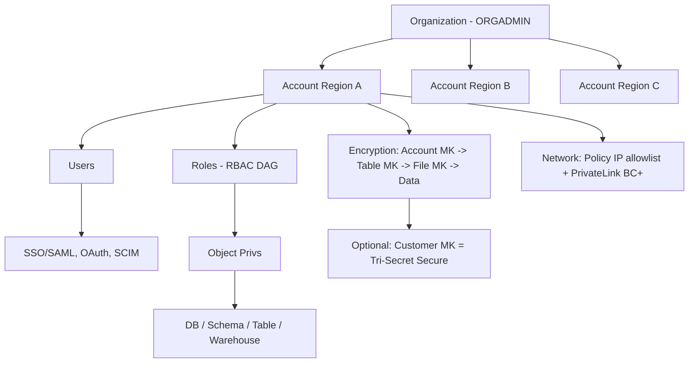

---

## Q1: What is the difference between an Organization, an Account, and the ORGADMIN role?
**Difficulty:** Foundation
**Exam relevance:** "Describe Snowflake organization and account structure"

### Answer
An **Organization** is the top-level container that groups one or more Snowflake accounts under a single customer entity, enabling cross-account features (replication, failover, self-service account creation). An **Account** is a single Snowflake deployment in one region/cloud with its own URL, users, data, and billing. **ORGADMIN** is a system role that lives in one designated account and can CREATE ACCOUNT, enable replication, view org-wide usage, and manage account properties — but it cannot access data in other accounts.

### First Principles
Snowflake separated the control plane (org identity, cross-account orchestration) from the data plane (account-level compute/storage) so that enterprises can span clouds and regions without a single blast radius. Organizations exist to let a customer manage 50 accounts (dev/test/prod × regions × BUs) as a fleet rather than as orphans. ORGADMIN is intentionally narrow — it is a *governance* role, not a *data* role — because Snowflake's security model refuses to let any one principal silently cross account boundaries.

### Diagram
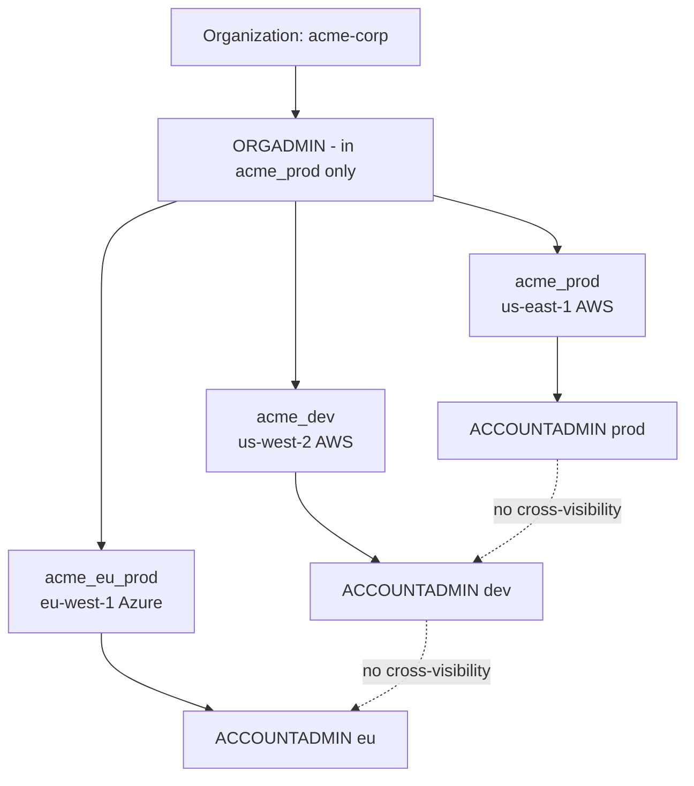

### Lab Exercise
```sql
-- As ORGADMIN:
USE ROLE ORGADMIN;
SHOW ORGANIZATION ACCOUNTS;
SHOW REGIONS;

-- Enable replication for an account
SELECT SYSTEM$GLOBAL_ACCOUNT_SET_PARAMETER(
  'acme_dev.us-west-2.aws',
  'ENABLE_ACCOUNT_DATABASE_REPLICATION',
  'true'
);

-- Create a new account programmatically
CREATE ACCOUNT acme_sandbox
  ADMIN_NAME = 'sbx_admin'
  ADMIN_PASSWORD = 'TempP@ss123!'
  EMAIL = 'ops@acme.com'
  EDITION = ENTERPRISE
  REGION = 'aws_us_west_2';
```
**Expected outcome:** New account URL returned. Observe that ORGADMIN cannot `USE DATABASE` in `acme_sandbox` — it can only *provision*, not *consume*.

### Gotchas / Exam Traps
- ORGADMIN exists in exactly ONE account (the one designated during org creation); you cannot have ORGADMIN replicated across accounts.
- ACCOUNTADMIN in one account has zero visibility into another account unless an explicit replication/share is established.
- Deleting an account is a two-phase operation: DROP ACCOUNT marks it for deletion with a 7-30 day grace period (configurable per edition).

---

## Q2: Compare Snowflake editions (Standard, Enterprise, Business Critical, VPS) across security features.
**Difficulty:** Foundation
**Exam relevance:** "Determine the appropriate edition for a workload"

### Answer
**Standard** = baseline features, 1-day Time Travel, no multi-cluster warehouses, no column-level security. **Enterprise** = up to 90-day Time Travel, multi-cluster warehouses, materialized views, dynamic data masking, row access policies, external tokenization. **Business Critical** = adds HIPAA/PCI/HITRUST compliance, Tri-Secret Secure (customer-managed keys), PrivateLink, failover/failback, database replication for DR. **VPS (Virtual Private Snowflake)** = Business Critical + a dedicated metadata and services layer isolated from all other customers.

### First Principles
Snowflake tiers editions by *isolation* and *recoverability*, not by compute. Standard shares all layers with other tenants. Enterprise adds governance primitives. Business Critical adds *regulatory* capabilities and *disaster* capabilities — because PrivateLink requires network isolation, and Tri-Secret Secure requires an external KMS integration. VPS exists for defense/finance customers who legally cannot share any shared services. The exam loves to test "customer needs PrivateLink" → must be Business Critical minimum.

### Diagram

| Edition | Isolation | DR/Repl | Compliance | PrivateLink |
|---------|-----------|---------|------------|-------------|
| Standard | shared | none | baseline | no |
| Enterprise | shared | none | SOC2/ISO | no |
| Business Critical | shared | yes | HIPAA/PCI | yes |
| VPS | dedicated | yes | HIPAA/PCI/FedRAMP-High | yes |

### Lab Exercise
```sql
-- Check current edition
SELECT CURRENT_ACCOUNT(), SYSTEM$CURRENT_USER_TASK_NAME();
SHOW PARAMETERS LIKE 'EDITION' IN ACCOUNT;

-- Enterprise+: create a masking policy
CREATE OR REPLACE MASKING POLICY mask_email AS (val STRING) RETURNS STRING ->
  CASE WHEN CURRENT_ROLE() IN ('PII_READER') THEN val
       ELSE REGEXP_REPLACE(val, '.+@', '***@') END;

ALTER TABLE customers MODIFY COLUMN email SET MASKING POLICY mask_email;
```
**Expected outcome:** Non-PII_READER roles see `***@domain.com`. On Standard edition the CREATE MASKING POLICY statement errors out.

### Gotchas / Exam Traps
- Downgrading editions is not supported — plan up, not down.
- Replication *for failover* (not just read-only replicas) requires Business Critical on both source and target.
- Edition is set per-account, not per-org — a single org can mix editions.

---

## Q3: Explain the Snowflake RBAC model including role hierarchies and the two system DAGs.
**Difficulty:** Intermediate
**Exam relevance:** "Design role-based access control architecture"

### Answer
Snowflake RBAC is a **DAG of roles**, where privileges flow from objects → roles, and roles are *granted to other roles* forming a hierarchy. Two system roles anchor the top: **ACCOUNTADMIN** (admin DAG) and **SECURITYADMIN**/**USERADMIN** (identity DAG). Best practice separates **access roles** (grant object privileges, e.g. `sales_db_r`, `sales_db_rw`) from **functional roles** (represent personas, e.g. `analyst_sales`, `engineer_sales`), where functional roles are granted access roles. Users then receive one or more functional roles.

### First Principles
Pure RBAC has an exponential grant problem: N users × M objects = N×M grants. Snowflake solves it by making roles *composable* via the role-of-role hierarchy. Access roles abstract "what" (data), functional roles abstract "who" (persona). This two-tier pattern means swapping a user's team = changing one role grant, not re-granting hundreds of objects. SYSADMIN is designed to own all data objects; ACCOUNTADMIN sits above both SYSADMIN and SECURITYADMIN to resolve privilege-escalation guardrails.

### Diagram
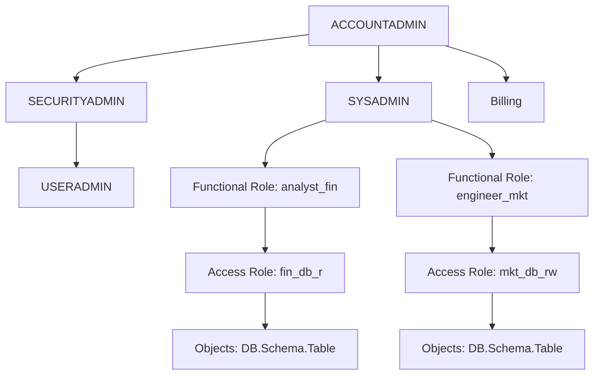

### Lab Exercise
```sql
USE ROLE SECURITYADMIN;

-- Access role (what)
CREATE ROLE sales_db_r;
GRANT USAGE ON DATABASE sales TO ROLE sales_db_r;
GRANT USAGE ON SCHEMA sales.public TO ROLE sales_db_r;
GRANT SELECT ON ALL TABLES IN SCHEMA sales.public TO ROLE sales_db_r;
GRANT SELECT ON FUTURE TABLES IN SCHEMA sales.public TO ROLE sales_db_r;

-- Functional role (who)
CREATE ROLE analyst_sales;
GRANT ROLE sales_db_r TO ROLE analyst_sales;
GRANT ROLE analyst_sales TO USER jdoe;

-- Verify
USE ROLE analyst_sales;
SELECT CURRENT_AVAILABLE_ROLES();
SHOW GRANTS TO ROLE analyst_sales;
```
**Expected outcome:** `jdoe` can SELECT on sales tables, and new tables created in `sales.public` are automatically readable (future grant).

### Gotchas / Exam Traps
- `GRANT ... ON ALL TABLES` is a one-time grant; use `GRANT ... ON FUTURE TABLES` for new objects.
- FUTURE grants at the DATABASE level are overridden by FUTURE grants at the SCHEMA level (schema-level wins).
- The role that CREATES an object owns it. If SYSADMIN doesn't own everything, use `MANAGED ACCESS` schemas or `GRANT OWNERSHIP ... REVOKE CURRENT GRANTS`.
- Role inheritance is not transitively visible in `SHOW GRANTS TO USER` — use `SHOW GRANTS TO ROLE` recursively.

---

## Q4: Design an RBAC schema for a multi-tenant SaaS where tenant data must be strictly segregated.
**Difficulty:** Advanced
**Exam relevance:** "Design access control for multi-tenancy"

### Answer
Choose between **account-per-tenant** (strongest isolation, highest ops cost, uses org-level provisioning) or **schema-per-tenant** with row access policies (shared compute, lower cost). For schema-per-tenant: create one database `app_data`, one schema per tenant `tenant_<id>`, one access role per tenant `tenant_<id>_r`, apply row access policies that check `CURRENT_ROLE()` or a session tag. Add resource monitors per-tenant via per-tenant warehouses, and use `MANAGED ACCESS` schemas so only SECURITYADMIN controls grants.

### First Principles
Multi-tenancy forces a tradeoff between the *blast radius* of a bug/breach and the *marginal cost* per tenant. Account-per-tenant means a bug in tenant A's config cannot leak into tenant B — but you pay for N accounts, N replications, N monitors. Schema-per-tenant collapses infrastructure but demands that *every* access path be filtered — a single missing WHERE clause leaks data. Row access policies solve this by making the filter mandatory at the engine level, not at the application level.

### Diagram
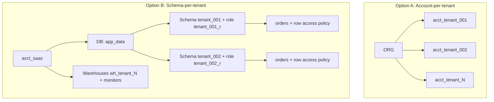

### Lab Exercise
```sql
-- Row access policy pattern for schema-per-tenant with shared tables
CREATE OR REPLACE ROW ACCESS POLICY tenant_filter AS (tenant_id STRING)
RETURNS BOOLEAN ->
  tenant_id = CURRENT_ACCOUNT_SESSION_VARIABLE('tenant_id')
  OR CURRENT_ROLE() = 'ACCOUNTADMIN';

CREATE TABLE orders (
  order_id INT, tenant_id STRING, amount NUMBER
) WITH ROW ACCESS POLICY tenant_filter ON (tenant_id);

-- Session-tag approach from app connection:
ALTER SESSION SET tenant_id = 'tenant_001';
SELECT * FROM orders;  -- returns only tenant_001 rows
```
**Expected outcome:** Even ACCOUNTADMIN querying without the session var set gets zero rows for other tenants until explicit override.

### Gotchas / Exam Traps
- Row access policies cannot reference the row being evaluated — they only see policy arguments (passed-in column values).
- A row access policy on a view does not substitute for one on the underlying table; attach to the base table.
- Shared warehouses across tenants cause the "noisy neighbor" problem — the exam will present a scenario where tenant A's queries starve tenant B.

---

## Q5: What is SCIM and how does it integrate with Snowflake?
**Difficulty:** Intermediate
**Exam relevance:** "Configure identity provisioning"

### Answer
**SCIM 2.0** (System for Cross-domain Identity Management) is a REST protocol for provisioning users and groups from an IdP (Okta, Azure AD, PingIdentity) into Snowflake automatically. Snowflake exposes a SCIM endpoint; the IdP pushes user creates/updates/deactivations and group memberships. Snowflake maps SCIM groups → **roles** (not users). You configure SCIM by creating a SCIM security integration and binding it to a service principal.

### First Principles
Manual user management breaks at scale — HR offboarding should propagate to Snowflake in minutes, not weeks. SCIM is just-in-time for CRUD on identities. Snowflake maps SCIM groups to roles because roles are the unit of authorization — this way, assigning a user to the "finance_analysts" AD group grants the matching Snowflake role without a human touching Snowflake. The handoff point is: *IdP owns identity, Snowflake owns authorization*.

### Diagram
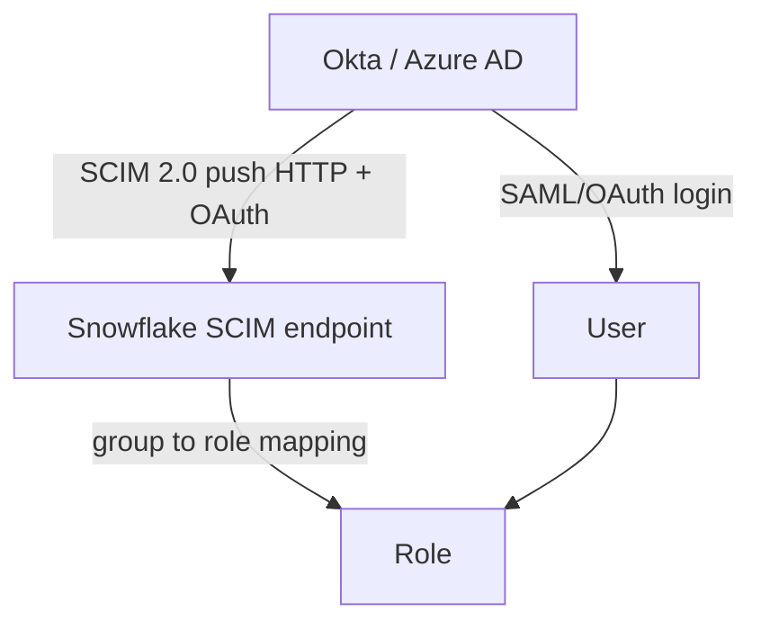

### Lab Exercise
```sql
USE ROLE ACCOUNTADMIN;

CREATE OR REPLACE SECURITY INTEGRATION okta_scim
  TYPE = SCIM
  SCIM_CLIENT = 'OKTA'
  RUN_AS_ROLE = 'OKTA_PROVISIONER';

CREATE ROLE OKTA_PROVISIONER;
GRANT CREATE USER ON ACCOUNT TO ROLE OKTA_PROVISIONER;
GRANT CREATE ROLE ON ACCOUNT TO ROLE OKTA_PROVISIONER;
GRANT ROLE OKTA_PROVISIONER TO ROLE ACCOUNTADMIN;

-- Generate the access token Okta will use
SELECT SYSTEM$GENERATE_SCIM_ACCESS_TOKEN('OKTA_SCIM');
```
**Expected outcome:** Token is a long-lived JWT. Okta uses it in the Bearer header for `/scim/v2/Users` and `/scim/v2/Groups` operations.

### Gotchas / Exam Traps
- `RUN_AS_ROLE` must *not* be ACCOUNTADMIN or SECURITYADMIN — Snowflake blocks this.
- SCIM users created with SCIM cannot be managed via SQL (`ALTER USER`) without disabling the SCIM lifecycle — changes get overwritten on next sync.
- SCIM maps groups to roles; it does NOT create privileges on objects. You still need to grant object privs to the roles.

---

## Q6: Walk through configuring SAML SSO with Okta, including SP-initiated vs IdP-initiated flows.
**Difficulty:** Intermediate
**Exam relevance:** "Design SSO authentication"

### Answer
Create a **SAML2 security integration** in Snowflake with Okta's SSO URL, X.509 cert, and issuer. In Okta create a SAML app with Snowflake's ACS URL (`https://<account>.snowflakecomputing.com/fed/login`) and entity ID. **SP-initiated**: user hits Snowflake, Snowflake redirects to Okta, Okta auths, posts SAML response back. **IdP-initiated**: user clicks a tile in Okta dashboard, Okta posts SAML directly to Snowflake's ACS. Snowflake requires `LOGIN_NAME` or `EMAIL` in NameID to match a Snowflake user.

### First Principles
SAML separates *identity assertion* (IdP's job) from *resource access* (SP's job) via a signed XML blob. Snowflake trusts a signed assertion from an IdP whose cert is pinned in the integration. SP-initiated is more secure (prevents some replay attacks) but requires users to know the Snowflake URL; IdP-initiated is friendlier (click tile) but exposes a wider replay surface — the exam asks when to use each.

### Diagram
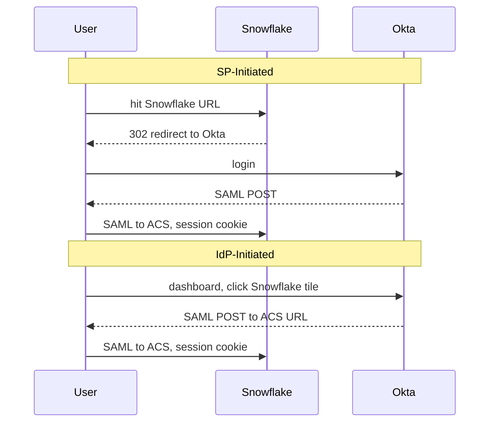

### Lab Exercise
```sql
USE ROLE ACCOUNTADMIN;

CREATE OR REPLACE SECURITY INTEGRATION okta_saml
  TYPE = SAML2
  ENABLED = TRUE
  SAML2_ISSUER = 'http://www.okta.com/exk1abc123'
  SAML2_SSO_URL = 'https://acme.okta.com/app/snowflake/exk1abc123/sso/saml'
  SAML2_PROVIDER = 'OKTA'
  SAML2_X509_CERT = 'MIIDpDCCAoyg...'
  SAML2_SP_INITIATED_LOGIN_PAGE_LABEL = 'OktaSSO'
  SAML2_ENABLE_SP_INITIATED = TRUE;

-- Enforce SSO for a user:
ALTER USER jdoe SET DISABLED = FALSE DEFAULT_ROLE = analyst_sales;
-- Prevent password login:
ALTER USER jdoe SET PASSWORD = NULL;
```
**Expected outcome:** `jdoe` cannot log in with password; must go through Okta. Login page shows an "OktaSSO" button.

### Gotchas / Exam Traps
- SAML NameID case sensitivity: Snowflake lowercases LOGIN_NAME but SAML assertions are case-sensitive — mismatches cause silent login failures.
- Setting `PASSWORD = NULL` is the explicit way to force SSO; a non-null password remains a valid alternate credential.
- If you lose Okta access and only ACCOUNTADMIN has SSO, you're locked out — always keep one break-glass local user.

---

## Q7: Explain key-pair authentication and when to use it over password or OAuth.
**Difficulty:** Intermediate
**Exam relevance:** "Configure service account authentication"

### Answer
Key-pair auth replaces a password with an RSA public/private keypair. The public key is stored on the user via `ALTER USER ... SET RSA_PUBLIC_KEY`; the client signs a JWT with the private key and sends it as the password equivalent. Use for **service accounts** (automation, CI/CD, dbt) where OAuth is impractical and where rotating a password across many pipelines is operationally painful.

### First Principles
Passwords for service accounts are a secret-management disaster: they get committed to repos, embedded in config files, and shared via Slack. Key pairs let you separate the *public* identifier (checked into Snowflake) from the *private* secret (stored in Vault/KMS). JWTs expire within minutes, so even if intercepted the window is tiny. OAuth is better still, but it requires an authorization server that many data pipelines don't have — key-pair is the pragmatic default for machine identities.

### Diagram
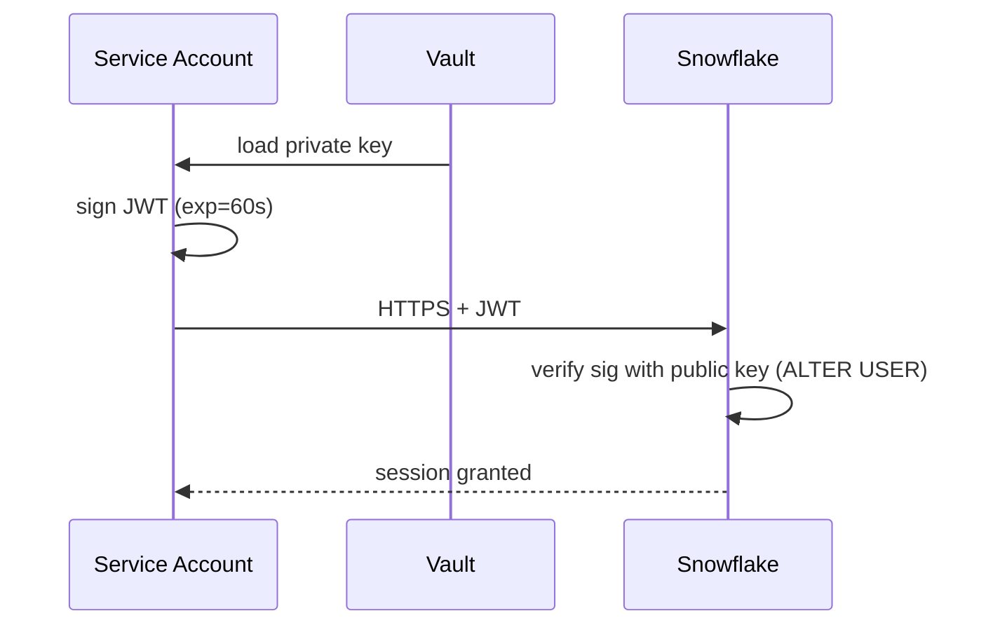

### Lab Exercise
```bash
# Generate keypair (one-time)
openssl genrsa -out rsa_key.p8 2048
openssl rsa -in rsa_key.p8 -pubout -out rsa_key.pub

# Extract public key body (strip PEM headers/newlines)
cat rsa_key.pub | sed '/-----/d' | tr -d '\n'
```
```sql
-- Register the public key
ALTER USER etl_bot SET RSA_PUBLIC_KEY='MIIBIjANBgkqhki...';

-- Optional second key for rotation
ALTER USER etl_bot SET RSA_PUBLIC_KEY_2='MIIBIjANBgkqhki...';

-- Verify
DESC USER etl_bot;
```
```python
import snowflake.connector
from cryptography.hazmat.primitives import serialization
with open("rsa_key.p8","rb") as f:
    pkey = serialization.load_pem_private_key(f.read(), password=None)
conn = snowflake.connector.connect(
    user="etl_bot", account="acme.us-east-1",
    private_key=pkey.private_bytes(
        encoding=serialization.Encoding.DER,
        format=serialization.PrivateFormat.PKCS8,
        encryption_algorithm=serialization.NoEncryption()
    ),
    role="loader"
)
```
**Expected outcome:** Connection succeeds without any password; token lifetime is minutes.

### Gotchas / Exam Traps
- Two slots (`RSA_PUBLIC_KEY` and `RSA_PUBLIC_KEY_2`) exist specifically for **zero-downtime rotation** — register the new key as _2, cut traffic over, then promote.
- Encrypted private keys (`.p8` with passphrase) need the passphrase at connection time — teams sometimes forget this when migrating from unencrypted keys.
- Key-pair auth cannot be enforced per-user via a parameter; combine with network policies and `MUST_CHANGE_PASSWORD` to force the migration.

---

## Q8: Describe the Snowflake encryption key hierarchy and Tri-Secret Secure.
**Difficulty:** Advanced
**Exam relevance:** "Design encryption and key management"

### Answer
Snowflake uses a **4-level AES-256 key hierarchy**: Root Key → Account Master Key → Table Master Key → File Key. Every stored file (micro-partition) is encrypted with a unique File Key wrapped by the Table MK, wrapped by the Account MK, wrapped by the Root Key. Keys rotate automatically every 30 days (new keys for new data; old data stays wrapped by old keys until periodic rekey). **Tri-Secret Secure** adds a *customer-managed key* from AWS KMS / Azure Key Vault / GCP KMS as a co-wrap of the Account MK — Snowflake cannot decrypt without the customer's key.

### First Principles
A single master key is a single point of compromise. Snowflake's hierarchy enables (a) *scope-limited* keys so compromising one TMK affects one table, (b) *rotation without rewrite* because new data uses new keys while old data remains valid, and (c) *regulatory separation of duties* via Tri-Secret: because the customer holds a wrap-key in their own KMS, Snowflake cannot be subpoenaed into decrypting data without the customer's cooperation.

### Diagram
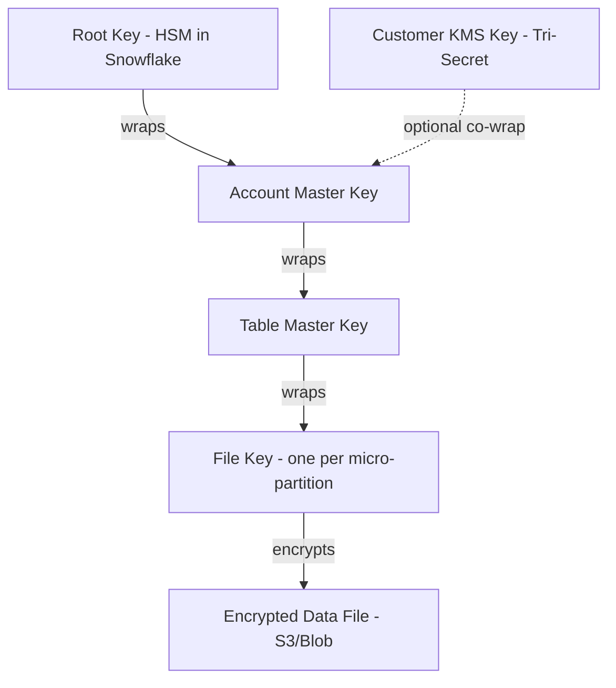

### Lab Exercise
```sql
-- Trigger periodic rekey for a database (Enterprise+)
ALTER ACCOUNT SET PERIODIC_DATA_REKEYING = TRUE;

-- Rekey a specific table
ALTER TABLE sensitive_pii SET DATA_RETENTION_TIME_IN_DAYS = 90;
-- (rekey happens automatically on write of new MP;
--  periodic rekey rewraps files whose keys are >1 year old)

-- Tri-Secret Secure setup (requires BC+ and support ticket):
-- 1. Create a CMK in AWS KMS, give Snowflake service principal kms:Encrypt/Decrypt
-- 2. Open support ticket with the KMS key ARN
-- 3. Snowflake rewraps your Account MK
```
**Expected outcome:** `PERIODIC_DATA_REKEYING = TRUE` causes files to be re-encrypted on a rolling basis as their key ages. Storage usage temporarily grows (old+new until FS cleanup).

### Gotchas / Exam Traps
- Rekeying is a background operation — do not expect immediate effect; it uses credits for cloud services.
- Revoking the customer KMS key in Tri-Secret Secure makes your Snowflake data permanently inaccessible, including to Snowflake support. This is "cryptoshredding" and is irreversible.
- Tri-Secret Secure protects data at rest in Snowflake storage; it does not encrypt data in your external stages — use stage-level encryption keys separately.

---

## Q9: What is a Network Policy and how does it differ from PrivateLink?
**Difficulty:** Intermediate
**Exam relevance:** "Configure network access controls"

### Answer
A **Network Policy** is an IP allowlist/blocklist applied at the account or user level — it is a *filter on public internet traffic* reaching Snowflake. **PrivateLink** (AWS PrivateLink / Azure Private Link) is a *private network path* that routes traffic between your VPC/VNet and Snowflake without traversing the public internet. Network policies protect the public endpoint; PrivateLink replaces the public endpoint entirely with a private one.

### First Principles
Network policies are IP-based — they say "only this CIDR can reach us." But traffic still crosses the public internet, protected by TLS. Enterprises in regulated industries need stronger guarantees: that packets *never leave* the cloud provider's private network. PrivateLink does this by creating an interface endpoint (ENI in AWS) inside your VPC that terminates to Snowflake's service. The exam frequently asks: "customer forbids any public internet route" → PrivateLink; "customer wants to restrict a known office IP range" → network policy.

### Diagram
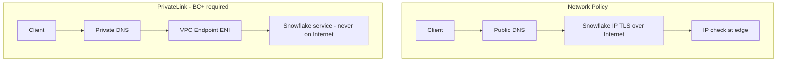

### Lab Exercise
```sql
USE ROLE SECURITYADMIN;

-- Account-level network policy
CREATE NETWORK POLICY corp_office
  ALLOWED_IP_LIST = ('203.0.113.0/24', '198.51.100.42')
  BLOCKED_IP_LIST = ();

ALTER ACCOUNT SET NETWORK_POLICY = corp_office;

-- Per-user override
ALTER USER automation_bot SET NETWORK_POLICY = NULL;  -- bot comes via PrivateLink

-- PrivateLink lookup
SELECT SYSTEM$GET_PRIVATELINK_CONFIG();
-- Returns the VPC endpoint URLs and service names you give to AWS/Azure
```
**Expected outcome:** Logins from IPs outside the allowlist are rejected at the edge with a specific error. `SYSTEM$GET_PRIVATELINK_CONFIG` returns `privatelink-pls-id`, `privatelink-ocsp-url`, etc.

### Gotchas / Exam Traps
- Setting a user-level network policy *overrides* the account-level policy for that user — don't inadvertently grant broader access.
- PrivateLink requires Business Critical edition minimum; the exam tests this gating.
- Private DNS zones (`<account>.privatelink.snowflakecomputing.com`) must be configured in your VPC — missing this makes PrivateLink "work" at the network layer but fail at DNS.
- You can combine network policies and PrivateLink; e.g., allow only your PrivateLink endpoint CIDR in the policy, blocking any residual public access.

---

## Q10: Design an authentication strategy for an enterprise with human users, service accounts, and partner access.
**Difficulty:** Advanced
**Exam relevance:** "Design multi-persona authentication architecture"

### Answer
**Human users**: SAML SSO from the corporate IdP (Okta), SCIM for provisioning, MFA enforced via Okta, network policy restricting to corporate CIDR + VPN. **Internal service accounts**: key-pair auth with keys stored in HashiCorp Vault, no password, network policy restricting to AWS NAT CIDR, dedicated roles. **Partners/customers**: OAuth 2.0 with a custom security integration (Snowflake acts as resource server, partner app as client), or dedicated reader accounts, or Snowflake Data Share consumption, with per-partner network policies.

### First Principles
Each persona has different *credential volatility* and *audit* needs. Humans join/leave constantly → SCIM. Service accounts need machine-readable auth → key-pair/OAuth. Partners sit outside your identity domain → OAuth or separate accounts. A single mechanism for all three is either too weak (passwords for everything) or too clunky (SAML for a Python job). Separating them lets each use the appropriate security control and lets you revoke each independently.

### Diagram
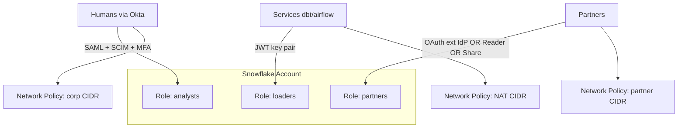

### Lab Exercise
```sql
-- Human SSO already in Q6
-- Service account already in Q7
-- OAuth integration for a partner app:
CREATE SECURITY INTEGRATION partner_oauth
  TYPE = OAUTH
  OAUTH_CLIENT = CUSTOM
  OAUTH_CLIENT_TYPE = 'CONFIDENTIAL'
  OAUTH_REDIRECT_URI = 'https://partner.example.com/oauth/callback'
  OAUTH_ISSUE_REFRESH_TOKENS = TRUE
  OAUTH_REFRESH_TOKEN_VALIDITY = 7776000  -- 90 days
  ENABLED = TRUE;

SELECT SYSTEM$SHOW_OAUTH_CLIENT_SECRETS('PARTNER_OAUTH');

-- Per-persona network policies
CREATE NETWORK POLICY humans_corp ALLOWED_IP_LIST=('203.0.113.0/24');
CREATE NETWORK POLICY services_nat ALLOWED_IP_LIST=('52.1.2.3/32');
CREATE NETWORK POLICY partners_pub ALLOWED_IP_LIST=('198.51.100.0/24');

ALTER USER jdoe SET NETWORK_POLICY = humans_corp;
ALTER USER etl_bot SET NETWORK_POLICY = services_nat;
ALTER USER partner_integration SET NETWORK_POLICY = partners_pub;
```
**Expected outcome:** Each persona has an independent credential type and network boundary.

### Gotchas / Exam Traps
- OAuth refresh tokens have a maximum validity of 90 days — longer than this requires re-consent.
- You cannot mix SAML SSO and local password for the same user without an explicit break-glass pattern; `MINS_TO_BYPASS_MFA` can create a temporary opening.
- A single Snowflake account can host multiple security integrations of different types (SAML, SCIM, OAuth) simultaneously — the exam tests the misconception that you need separate accounts.

---

## Q11: What is OAuth and how does Snowflake implement it (custom OAuth vs External OAuth)?
**Difficulty:** Advanced
**Exam relevance:** "Configure OAuth 2.0 integrations"

### Answer
**Snowflake OAuth (Custom OAuth)**: Snowflake acts as the authorization server; a client app registers via a security integration, users consent, Snowflake issues access tokens that it validates itself. **External OAuth**: Snowflake accepts tokens issued by an *external* authorization server (Okta, Azure AD, Ping) — Snowflake only validates signature/claims and maps the token's subject to a Snowflake user. Use Custom OAuth for apps written specifically to integrate with Snowflake; use External OAuth to centralize auth in your existing IdP.

### First Principles
OAuth decouples *who you are* (the resource owner) from *what the client can do on your behalf* via scoped, time-limited tokens. Having Snowflake itself be the authorization server is operationally simple but creates two identity systems to manage. External OAuth lets your IdP remain the single source of truth — Snowflake trusts tokens the IdP minted. The decision pivots on where you want token issuance to live: inside Snowflake (simpler integration) or in your IdP (unified governance).

### Diagram
```mermaid
flowchart TD
    subgraph CO[Custom OAuth]
        A1[App] --> SF1[Snowflake /oauth/auth]
        SF1 --> C1[User consents at Snowflake]
        C1 --> T1[Snowflake issues token]
        T1 --> API1[App to Snowflake API + token]
        API1 --> V1[Snowflake self-validates]
    end
    subgraph EO[External OAuth]
        A2[App] --> OK[Okta /oauth/token]
        OK --> C2[User consents at Okta]
        C2 --> T2[Okta issues token]
        T2 --> API2[App to Snowflake API + Okta token]
        API2 --> V2[Snowflake validates against Okta JWKS]
    end
```

### Lab Exercise
```sql
-- External OAuth (Okta) integration
CREATE SECURITY INTEGRATION okta_ext_oauth
  TYPE = EXTERNAL_OAUTH
  ENABLED = TRUE
  EXTERNAL_OAUTH_TYPE = OKTA
  EXTERNAL_OAUTH_ISSUER = 'https://acme.okta.com/oauth2/default'
  EXTERNAL_OAUTH_JWS_KEYS_URL = 'https://acme.okta.com/oauth2/default/v1/keys'
  EXTERNAL_OAUTH_AUDIENCE_LIST = ('https://acme.snowflakecomputing.com')
  EXTERNAL_OAUTH_TOKEN_USER_MAPPING_CLAIM = 'email'
  EXTERNAL_OAUTH_SNOWFLAKE_USER_MAPPING_ATTRIBUTE = 'LOGIN_NAME'
  EXTERNAL_OAUTH_ANY_ROLE_MODE = 'ENABLE';

-- Test: use an Okta-issued token in a connection
```
```python
# Using an Okta JWT
conn = snowflake.connector.connect(
  account="acme", user="jdoe@acme.com",
  authenticator="oauth",
  token="<okta_access_token>"
)
```
**Expected outcome:** The Okta-issued JWT is validated by Snowflake against Okta's JWKS; the `email` claim maps to `jdoe@acme.com` as `LOGIN_NAME`.

### Gotchas / Exam Traps
- `EXTERNAL_OAUTH_AUDIENCE_LIST` must match the `aud` claim in the token — a common misconfig that produces cryptic errors.
- Snowflake OAuth issues an *access token* and optionally a *refresh token*; access tokens have a short life (10 min default) and cannot be extended.
- External OAuth doesn't support SCIM; you still need SCIM configured separately if you want auto-provisioning.

---

## Q12: Explain ACCESS_HISTORY and how it differs from QUERY_HISTORY for compliance.
**Difficulty:** Advanced
**Exam relevance:** "Design audit and compliance logging"

### Answer
`QUERY_HISTORY` is the *statement log* — every SQL statement, who ran it, when, duration, bytes scanned. `ACCESS_HISTORY` (Enterprise+) is the *data access log* — for each query, which *columns* in which *tables* were actually read or written, including columns referenced in WHERE and JOIN. Use QUERY_HISTORY for performance/billing; use ACCESS_HISTORY for compliance (prove who touched which PII column) and column-level lineage.

### First Principles
Compliance frameworks (GDPR, HIPAA) ask "who accessed this specific column, when?" — a question QUERY_HISTORY can't answer because a `SELECT *` doesn't name columns. ACCESS_HISTORY solves this by having the engine record *resolved column references* post-parse. It also powers column-level lineage: a `CREATE TABLE AS SELECT a FROM src` writes a row linking `src.a` → `new.a`. This is what makes "track data origin" feasible without external tooling.

### Diagram

| QUERY_HISTORY ("what ran") | ACCESS_HISTORY ("what data touched") |
|----------------------------|--------------------------------------|
| query_id | query_id |
| user_name | direct_objects_accessed [{table, cols}] |
| query_text | base_objects_accessed [{table, cols}] |
| warehouse | objects_modified [{table, cols}] |
| execution_time | query_start_time |
| bytes_scanned | user_name |

### Lab Exercise
```sql
-- Who accessed the salary column in last 30 days?
SELECT user_name, query_start_time, query_id,
       base_objects_accessed
FROM SNOWFLAKE.ACCOUNT_USAGE.ACCESS_HISTORY
WHERE query_start_time >= DATEADD('day', -30, CURRENT_TIMESTAMP())
  AND ARRAY_SIZE(
        FILTER(base_objects_accessed, o ->
          o:objectName::STRING = 'HR_DB.PUBLIC.EMPLOYEES'
          AND ARRAY_CONTAINS('SALARY'::VARIANT, o:columns)
        )
      ) > 0
ORDER BY query_start_time DESC;

-- Column-level lineage: find downstream of SRC.ORDERS.AMOUNT
SELECT DISTINCT
  direct_objects_accessed[0]:objectName::STRING AS source_table,
  objects_modified[0]:objectName::STRING        AS target_table
FROM SNOWFLAKE.ACCOUNT_USAGE.ACCESS_HISTORY
WHERE ARRAY_SIZE(objects_modified) > 0
  AND ARRAY_CONTAINS('SRC.ORDERS.AMOUNT'::VARIANT, direct_objects_accessed);
```
**Expected outcome:** Row-by-row audit trail of column access for compliance review.

### Gotchas / Exam Traps
- ACCESS_HISTORY has a latency of up to 3 hours — not real-time.
- Retention is 365 days in ACCOUNT_USAGE; use scheduled unloads if you need longer.
- `ACCESS_HISTORY` is Enterprise edition and above; Standard customers only get QUERY_HISTORY.
- Views appear as "direct objects" and the underlying tables as "base objects" — both are captured.

---

## Q13: Describe session policies and how to enforce idle timeouts.
**Difficulty:** Intermediate
**Exam relevance:** "Design session security controls"

### Answer
A **session policy** sets `SESSION_IDLE_TIMEOUT_MINS` (idle before auto-logout) and `SESSION_UI_IDLE_TIMEOUT_MINS` (idle on Snowsight). Attach to account or user with `ALTER ACCOUNT SET SESSION POLICY` / `ALTER USER ... SET SESSION POLICY`. Different timeouts for programmatic clients vs UI sessions let you keep long-running ETL alive while timing out abandoned browser tabs.

### First Principles
A session is a long-lived credential — stealing an active cookie bypasses all auth controls. Idle timeouts bound the exploit window. Snowflake exposes two knobs because programmatic sessions are usually long-running jobs that shouldn't die at 4 hours, while UI sessions represent humans walking away from laptops and should expire fast.

### Diagram
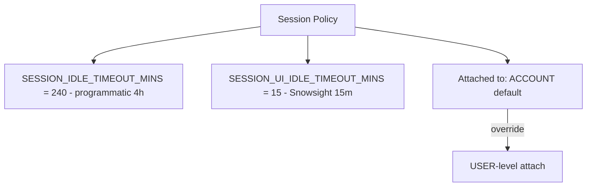

### Lab Exercise
```sql
CREATE SESSION POLICY tight_session
  SESSION_IDLE_TIMEOUT_MINS = 60
  SESSION_UI_IDLE_TIMEOUT_MINS = 10;

ALTER ACCOUNT SET SESSION POLICY tight_session;

-- Exception: ETL account needs 8h idle
CREATE SESSION POLICY etl_session
  SESSION_IDLE_TIMEOUT_MINS = 480
  SESSION_UI_IDLE_TIMEOUT_MINS = 10;
ALTER USER etl_bot SET SESSION POLICY etl_session;
```
**Expected outcome:** Idle browser tabs log out after 10 min; idle programmatic sessions after 60 min for humans, 480 min for ETL bot.

### Gotchas / Exam Traps
- There is no per-role session policy — only account and user scope.
- SSO sessions still respect the Snowflake session policy, independent of IdP session lifetime.
- Setting the policy does not kick existing sessions — new sessions get the new policy.

---

## Q14: What are authentication policies (new) and how do they relate to the older authenticators?
**Difficulty:** Advanced
**Exam relevance:** "Design authentication policies"

### Answer
**Authentication policies** are a newer construct (2024+) that let you declaratively restrict *which* auth methods (`PASSWORD`, `SAML`, `OAUTH`, `KEYPAIR`, etc.) and *which* client applications (`SNOWSIGHT`, `DRIVERS`, `SNOWFLAKE_UI`) can be used, scoped to account or user. Older approach was ad-hoc: set `PASSWORD = NULL` to disable password, configure network policies, hope. New policies make it one declaration.

### First Principles
Historically Snowflake disabled auth methods by *absence* (no password set = no password auth). This is implicit, hard to audit, and brittle under rotation. Explicit authentication policies invert the model: say what IS allowed, deny the rest. This is the same pattern as modern cloud IAM — explicit allowlists beat implicit disables.

### Diagram
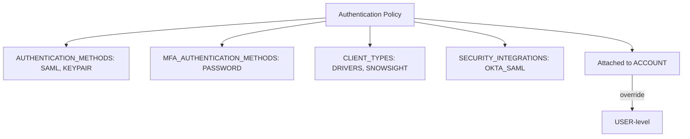

### Lab Exercise
```sql
CREATE AUTHENTICATION POLICY sso_only
  AUTHENTICATION_METHODS = ('SAML', 'KEYPAIR')
  MFA_AUTHENTICATION_METHODS = ('PASSWORD')
  MFA_ENROLLMENT = REQUIRED
  CLIENT_TYPES = ('SNOWSIGHT', 'DRIVERS')
  SECURITY_INTEGRATIONS = ('OKTA_SAML');

ALTER ACCOUNT SET AUTHENTICATION POLICY sso_only;

-- Service account exception
CREATE AUTHENTICATION POLICY svc_keypair
  AUTHENTICATION_METHODS = ('KEYPAIR')
  CLIENT_TYPES = ('DRIVERS');
ALTER USER etl_bot SET AUTHENTICATION POLICY svc_keypair;
```
**Expected outcome:** Humans must use SAML; etl_bot must use key pair; passwords are only allowed as a factor during MFA enrollment.

### Gotchas / Exam Traps
- Authentication policy and network policy are *independent* layers — both must allow a login.
- You can lock yourself out by setting an authentication policy that excludes your current method — always have a break-glass user with a separate policy exemption.
- `MFA_ENROLLMENT = REQUIRED` only enforces on password-based users; SSO users typically do MFA at the IdP.

---

## Q15: Scenario — Design a landing zone for a bank with HIPAA-adjacent PII, cross-region DR, and partner data sharing.
**Difficulty:** Advanced
**Exam relevance:** "Multi-domain architecture scenario"

### Answer
Use **Business Critical** edition in both primary (us-east-1) and DR (us-west-2) accounts under one Organization. Enable **Tri-Secret Secure** with CMKs in AWS KMS, one per region. **PrivateLink** from the bank's AWS VPCs; public endpoint disabled via network policy pinned to the PrivateLink endpoint. **SAML+SCIM** from Okta with MFA mandatory; service accounts on **key-pair auth** rotated 90 days via Vault. **Database replication + failover group** for the four core databases with 1-hour RPO. For partner sharing: create a **secure share** from a dedicated schema with masking policies on PII; partner consumes via a Snowflake-to-Snowflake share — no data egress to partner VPC.

### First Principles
The scenario combines compliance (BC + Tri-Secret), network isolation (PrivateLink), identity governance (SAML+SCIM+MFA+keypair), and data egress controls (secure shares instead of pipelines). Each requirement maps to a specific Snowflake primitive — the architect's job is to compose them without creating gaps. The failover group is the DR primitive; the secure share is the partner primitive; separating these from each other means a partner has no replication path, and DR has no partner path.

### Diagram
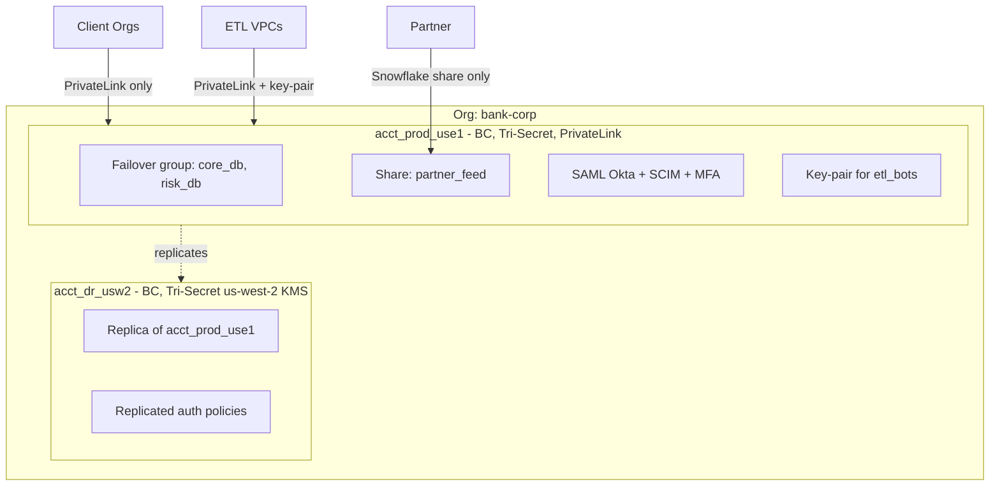

### Lab Exercise
```sql
-- 1. Enable replication for failover group
USE ROLE ACCOUNTADMIN;
CREATE FAILOVER GROUP fg_core
  OBJECT_TYPES = (DATABASES, ROLES, USERS, WAREHOUSES, SHARES)
  ALLOWED_DATABASES = (core_db, risk_db, compliance_db)
  ALLOWED_ACCOUNTS = (bank_corp.acct_dr_usw2)
  REPLICATION_SCHEDULE = '60 MINUTE';

-- 2. Secure share with masked PII
CREATE SECURE VIEW shares.partner_feed AS
  SELECT acct_num_masked, product, balance_bucket FROM core_db.accounts;
CREATE SHARE partner_feed_share;
GRANT USAGE ON DATABASE shares TO SHARE partner_feed_share;
GRANT SELECT ON shares.partner_feed TO SHARE partner_feed_share;
ALTER SHARE partner_feed_share ADD ACCOUNTS = partner_acct;

-- 3. Promote DR account during failover
USE ROLE ACCOUNTADMIN;  -- in dr account
ALTER FAILOVER GROUP fg_core PRIMARY;
```
**Expected outcome:** Partner reads from `partner_feed_share` with zero data movement; DR promotion takes seconds for metadata, data is already replicated.

### Gotchas / Exam Traps
- Failover groups replicate roles and users — but *not* share consumer accounts; recreating shares post-failover is required unless they are included in the group.
- Tri-Secret CMKs are regional — your DR account needs its own CMK in its own KMS; replication alone doesn't carry the key.
- Partner share accounts are *not* in your org — you cannot grant them any role; they get a share and nothing else.

---

## Q16: How does Snowflake log and audit role usage, including role grant changes?
**Difficulty:** Intermediate
**Exam relevance:** "Design governance and audit"

### Answer
Role grant/revoke events are captured in `SNOWFLAKE.ACCOUNT_USAGE.GRANTS_TO_ROLES` and `GRANTS_TO_USERS` (point-in-time snapshots), plus a change log in `SNOWFLAKE.ACCOUNT_USAGE.ACCESS_HISTORY` for DDL events. Role usage per query is in `QUERY_HISTORY.ROLE_NAME`. For compliance, run periodic diffs of GRANTS_TO_ROLES to detect privilege drift.

### First Principles
Access control changes are the highest-value audit events — one bad GRANT can create a data breach. Snowflake exposes the *state* (what grants exist today) and the *stream* (query history of DDL). Diffing the state over time + joining with QUERY_HISTORY tells you *who* changed *what* and *when*.

### Diagram
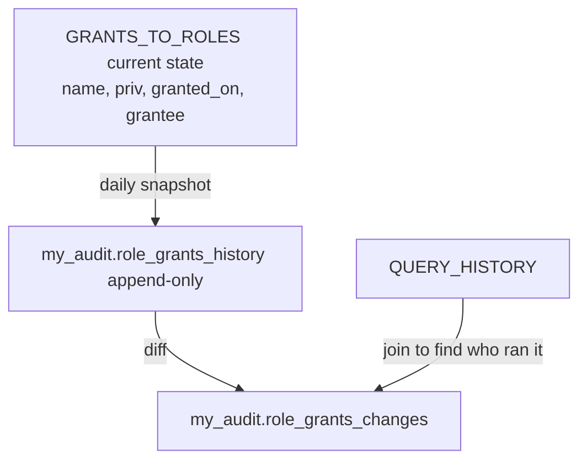

### Lab Exercise
```sql
-- Snapshot current grants
CREATE TABLE audit.role_grants_snapshot AS
SELECT CURRENT_TIMESTAMP() AS snap_ts, *
FROM SNOWFLAKE.ACCOUNT_USAGE.GRANTS_TO_ROLES;

-- Daily task to append snapshot
CREATE OR REPLACE TASK audit.daily_grant_snapshot
  WAREHOUSE = audit_wh SCHEDULE = 'USING CRON 0 2 * * * UTC'
AS
  INSERT INTO audit.role_grants_snapshot
  SELECT CURRENT_TIMESTAMP(), * FROM SNOWFLAKE.ACCOUNT_USAGE.GRANTS_TO_ROLES;

-- Find new grants in last day
WITH t AS (
  SELECT snap_ts, role, privilege, granted_on, grantee_name FROM audit.role_grants_snapshot
  WHERE snap_ts >= DATEADD('day',-2,CURRENT_TIMESTAMP())
)
SELECT a.* FROM t a
LEFT JOIN t b ON a.role=b.role AND a.privilege=b.privilege AND a.granted_on=b.granted_on
            AND a.grantee_name=b.grantee_name AND b.snap_ts < a.snap_ts
WHERE b.snap_ts IS NULL;
```
**Expected outcome:** Changed-grants report; join to QUERY_HISTORY for the actor.

### Gotchas / Exam Traps
- `ACCOUNT_USAGE.GRANTS_TO_ROLES` has up to 2 hours of latency; `INFORMATION_SCHEMA` is live but limited to 7 days of history.
- `OWNERSHIP` grants transfer owner — a common exam trap is forgetting that `GRANT OWNERSHIP` *replaces* the owner rather than adding one.
- `SHOW GRANTS` doesn't surface inherited grants from role-of-role; use the `SNOWFLAKE.ACCOUNT_USAGE` views for the full picture.

---

## Q17: What is Snowflake's shared responsibility model for security?
**Difficulty:** Foundation
**Exam relevance:** "Describe shared responsibility"

### Answer
Snowflake is responsible for the **physical infrastructure, platform encryption, patching, availability, and compliance certifications**. The customer is responsible for **data classification, user/role design, network policies, choosing the right edition, data masking, and secrets they put inside Snowflake**. The exam frames it as: Snowflake secures *of* the cloud; the customer secures *in* the cloud.

### First Principles
Snowflake abstracts the cloud provider's physical layer and its own platform plane, but authorization *inside* a Snowflake account is an application problem that only the customer understands. A misconfigured role is the customer's job; a hypervisor zero-day is Snowflake's job. The exam will present a leak scenario and ask who was responsible — the answer hinges on whether the control was tenant-configurable.

### Diagram
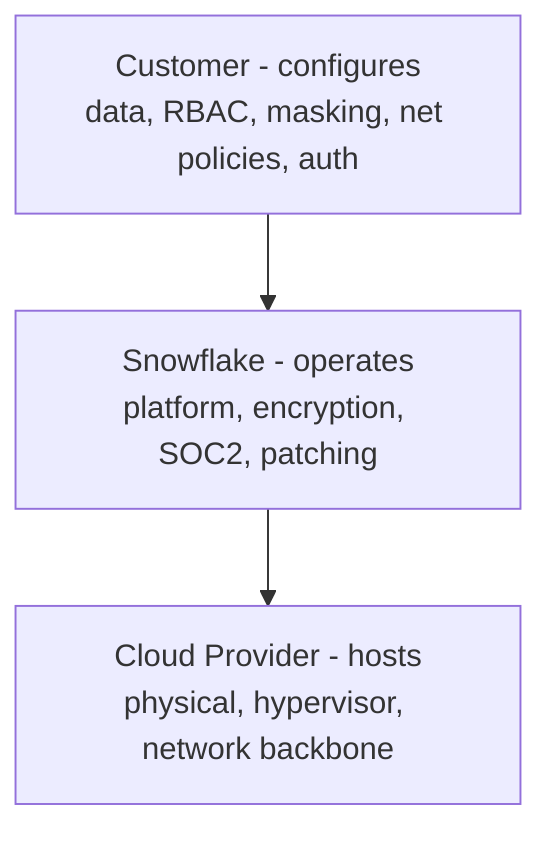

### Lab Exercise
```sql
-- Review customer-side configs
SHOW NETWORK POLICIES IN ACCOUNT;
SHOW SECURITY INTEGRATIONS;
SHOW MASKING POLICIES IN ACCOUNT;
SHOW ROW ACCESS POLICIES IN ACCOUNT;
SELECT * FROM SNOWFLAKE.ACCOUNT_USAGE.USERS WHERE disabled=FALSE AND password_last_set_time IS NOT NULL;
```
**Expected outcome:** Inventory of customer-side security posture.

### Gotchas / Exam Traps
- Snowflake does not back up your DDL/role definitions outside Time Travel — the customer is responsible for IaC (Terraform, Permifrost) of security objects.
- Snowflake's SOC2 covers Snowflake controls; your SOC2 covers *your* use of Snowflake — don't conflate.
- Public share-level data (Snowflake Marketplace) is customer-exposed by customer action — Snowflake has no obligation to redact.

---

## Q18: Compare dynamic data masking, external tokenization, and row access policies.
**Difficulty:** Advanced
**Exam relevance:** "Choose the right data protection mechanism"

### Answer
**Dynamic Data Masking (DDM)**: a function applied at query time that transforms a column value based on `CURRENT_ROLE()` or context — unmasked value stays in storage. **External Tokenization**: data is replaced by a *token* before loading (via a tokenization service); authorized users detokenize at query time via an external function. **Row Access Policy (RAP)**: filters *entire rows* — rows the user shouldn't see simply don't appear.

### First Principles
Three primitives for three threat models. DDM protects against *authorized users with wrong intent* (an analyst who shouldn't see raw SSNs). Tokenization protects against *platform compromise* (the raw SSN never enters Snowflake storage). RAP protects against *scope leakage* (region A users seeing region B rows). You often compose all three: tokenize PII at load, DDM for role-based unmask, RAP for tenant isolation.

### Diagram

| Primitive | Stored | Returned | Example |
|-----------|--------|----------|---------|
| DDM | raw | masked | `555-12-9999` -> `***` |
| Tokenization | token | detokenized (via ext fn) | `TK_abc123` -> raw |
| Row Access Policy | all rows | filtered rows | rows where region=user_region |

### Lab Exercise
```sql
-- Dynamic masking
CREATE MASKING POLICY ssn_mask AS (v STRING) RETURNS STRING ->
  CASE WHEN CURRENT_ROLE()='PII_READER' THEN v
       ELSE REGEXP_REPLACE(v,'[0-9]','*') END;
ALTER TABLE emp MODIFY COLUMN ssn SET MASKING POLICY ssn_mask;

-- External tokenization requires an external function; conceptually:
CREATE EXTERNAL FUNCTION detok(token STRING) RETURNS STRING
  API_INTEGRATION = aws_api INTEGRATION_NAME = 'detok_api' AS '...';
CREATE MASKING POLICY ssn_detok AS (v STRING) RETURNS STRING ->
  CASE WHEN CURRENT_ROLE()='PII_READER' THEN detok(v) ELSE v END;

-- Row access
CREATE ROW ACCESS POLICY region_rap AS (region STRING) RETURNS BOOLEAN ->
  region = CURRENT_ACCOUNT_SESSION_VARIABLE('region') OR CURRENT_ROLE()='GLOBAL_ADMIN';
ALTER TABLE sales ADD ROW ACCESS POLICY region_rap ON (region);
```
**Expected outcome:** All three can coexist on the same table; policies compose but add compile-time overhead.

### Gotchas / Exam Traps
- You can only attach ONE masking policy per column — nest logic inside the policy if you need multiple rules.
- RAP policies run per-row at scan time; combined with high-cardinality predicates, they can defeat clustering — profile!
- Tokenization at load is the only approach that keeps raw PII out of Snowflake entirely — DDM alone does not satisfy some regulators.

---

## Q19: Explain Trust Center and how it surfaces security best-practice violations.
**Difficulty:** Intermediate
**Exam relevance:** "Operational security monitoring"

### Answer
**Trust Center** (Snowsight) scans the account against a set of security scanners (CIS Snowflake Benchmark, custom scanners you author) and reports findings — e.g., ACCOUNTADMIN users without MFA, roles with excessive grants, public shares. Scanners run on a schedule; results go to `SNOWFLAKE.TRUST_CENTER.FINDINGS`. Think of it as a CIS-aligned posture dashboard inside Snowflake.

### First Principles
Security posture decays — grants accumulate, MFA lapses, test accounts linger. Trust Center codifies the common controls as declarative scanners that run continuously, replacing manual quarterly audits with always-on monitoring. The exam positions it against ACCESS_HISTORY (what happened) vs Trust Center (what's wrong *now*).

### Diagram
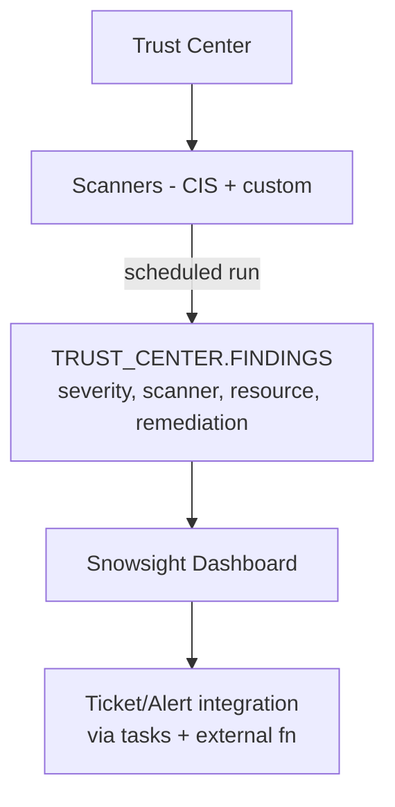

### Lab Exercise
```sql
-- View findings
SELECT scanner_id, severity, finding_resource, finding_description
FROM SNOWFLAKE.TRUST_CENTER.FINDINGS
WHERE severity IN ('HIGH','CRITICAL')
ORDER BY first_detected_at DESC;

-- Enable a scanner package
CALL SNOWFLAKE.TRUST_CENTER.ENABLE_SCANNER_PACKAGE('CIS Benchmarks');

-- Suppress a false positive
CALL SNOWFLAKE.TRUST_CENTER.CREATE_SUPPRESSION(
  'CIS_1_8', 'ACME_CORP.BREAK_GLASS_ADMIN', 'DAYS', 365, 'Approved exception');
```
**Expected outcome:** Dashboard shows highest-impact findings; suppressions let you accept risk with a documented reason.

### Gotchas / Exam Traps
- Trust Center scanners require ACCOUNTADMIN or a role granted the SNOWFLAKE.TRUST_CENTER_ADMIN application role.
- Findings are *detective*, not *preventive* — they alert after the misconfig exists.
- The CIS benchmark is a subset of controls; custom scanners cover organization-specific policies.

---

## Q20: Scenario — A pentest finds that service account credentials are in Git. Design remediation + prevention.
**Difficulty:** Advanced
**Exam relevance:** "Credential hygiene design"

### Answer
**Immediate**: rotate the leaked credential (`ALTER USER ... SET RSA_PUBLIC_KEY=...` or `UNSET PASSWORD`), review `LOGIN_HISTORY` and `QUERY_HISTORY` for anomalous access in the exposure window, disable the user if compromise is plausible, trigger IR process. **Prevention**: migrate all service accounts to key-pair with keys in Vault or AWS Secrets Manager (never Git); enforce via *authentication policy* that disallows PASSWORD for service accounts; add a GitHub pre-commit hook + CI scanner (gitleaks/trufflehog); apply network policies restricting service accounts to CI runner CIDRs; set `ACCESS_HISTORY`-based alerts for the leaked identity.

### First Principles
Credentials in Git is a *process* failure, not a Snowflake failure — but the response must address both. Rotation closes the open window; authentication policies make the failure impossible going forward (if PASSWORD is disallowed, there's nothing to commit). Network policies limit blast radius if the next generation of credentials also leaks. Monitoring provides detection for all remaining risks.

### Diagram

| Remediate | Prevent |
|-----------|---------|
| 1. Rotate key/pwd | 1. Vault / Secrets Mgr for private keys |
| 2. Review history | 2. Auth policy: KEYPAIR only for services |
| 3. Disable if compromised | 3. Network policy: CI CIDR only |
| 4. IR + stakeholders | 4. Pre-commit + CI secret scan |
| | 5. Trust Center scanner for policy drift |
| | 6. Access history alerts on anomaly |

### Lab Exercise
```sql
-- 1. Immediate rotation
ALTER USER etl_bot UNSET PASSWORD;
ALTER USER etl_bot SET RSA_PUBLIC_KEY_2 = '<new_key>';
-- (after CI redeploys) :
ALTER USER etl_bot SET RSA_PUBLIC_KEY = '<new_key>';
ALTER USER etl_bot UNSET RSA_PUBLIC_KEY_2;

-- 2. Review
SELECT user_name, client_ip, event_timestamp, is_success
FROM SNOWFLAKE.ACCOUNT_USAGE.LOGIN_HISTORY
WHERE user_name='ETL_BOT' AND event_timestamp >= '2024-11-01'
ORDER BY event_timestamp;

-- 3. Harden
CREATE AUTHENTICATION POLICY svc_keypair_only
  AUTHENTICATION_METHODS = ('KEYPAIR')
  CLIENT_TYPES = ('DRIVERS');
ALTER USER etl_bot SET AUTHENTICATION POLICY svc_keypair_only;

CREATE NETWORK POLICY ci_only ALLOWED_IP_LIST = ('52.1.2.3/32');
ALTER USER etl_bot SET NETWORK POLICY ci_only;
```
**Expected outcome:** New keys propagated with zero downtime; password route is syntactically unavailable; CIDR restricts blast radius.

### Gotchas / Exam Traps
- Rotating RSA_PUBLIC_KEY while jobs are running kills in-flight sessions; use the _2 slot for staged rotation.
- `UNSET PASSWORD` must be followed by making sure no caller still uses password auth — set an authentication policy to enforce it.
- The exam likes to test that you review LOGIN_HISTORY *before* disabling — otherwise you destroy evidence.

---

## Summary of Key Decision Frameworks

| Need | Choice |
|------|--------|
| Restrict by IP | Network Policy |
| No public internet route | PrivateLink (BC+) |
| Automated user lifecycle | SCIM + SAML |
| Service account auth | Key-pair |
| Partner app auth | External OAuth or Custom OAuth |
| Prove column access | ACCESS_HISTORY (Enterprise+) |
| CMK sovereignty | Tri-Secret Secure (BC+) |
| Tenant isolation (max) | Account-per-tenant |
| Tenant isolation (cost) | Schema + Row Access Policy |
| Posture monitoring | Trust Center |
| Enforce auth method | Authentication Policy |
| Timeout idle sessions | Session Policy |
