# Snowflake Architecture — ARA-C01 Study Guide

## Exam Weight & Scope
Approximately 15-20% of ARA-C01. Covers the three-layer architecture (cloud services, compute/virtual warehouses, centralized storage), multi-cluster warehouses, caching layers (result, metadata, local disk), micro-partition storage, cross-cloud/region topology, and the role of the metadata layer in query planning.

## Core Concepts Map
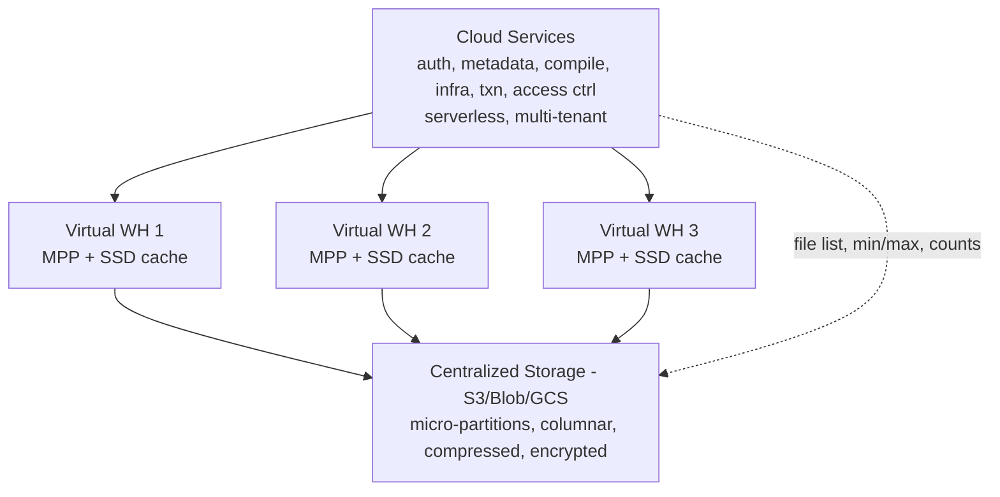

---

## Q1: Describe the three layers of Snowflake's architecture and why they are decoupled.
**Difficulty:** Foundation
**Exam relevance:** "Describe multi-cluster shared data architecture"

### Answer
Three layers: **Cloud Services** (brain — auth, metadata, compile, optimize, infra), **Compute** (virtual warehouses — MPP clusters that execute queries), and **Centralized Storage** (data at rest in S3/Azure Blob/GCS as columnar micro-partitions). Decoupling lets compute scale independently of storage — spin up 10 warehouses on the same data without copying it, or resize a warehouse without touching data.

### First Principles
Traditional MPP databases couple compute and storage: adding a node means redistributing data. This creates the "elastic scale problem" — scaling takes hours, downsize risks data loss, and multi-workload isolation requires separate clusters with duplicated data. Snowflake inverted this: storage is a dumb, cheap, cloud-native blob; compute is ephemeral, isolated, right-sized per workload. The metadata layer in Cloud Services glues them together — it is the only place that *knows* where data lives, which is why it's architecturally critical.

### Diagram
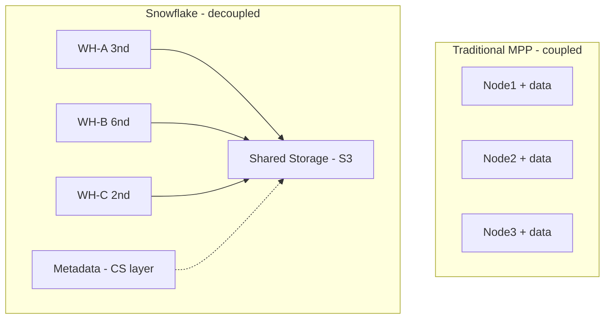

### Lab Exercise
```sql
-- Prove layer independence
CREATE WAREHOUSE wh_small WITH WAREHOUSE_SIZE = 'XSMALL';
CREATE WAREHOUSE wh_large WITH WAREHOUSE_SIZE = 'LARGE';
-- Same data, different compute
USE WAREHOUSE wh_small;
SELECT COUNT(*) FROM shared_db.public.orders;
USE WAREHOUSE wh_large;
SELECT COUNT(*) FROM shared_db.public.orders;  -- same bytes read, different parallelism
-- Resize mid-flight
ALTER WAREHOUSE wh_small SET WAREHOUSE_SIZE = 'MEDIUM';
-- No data moves; existing queries complete on old size, new queries use new size
```
**Expected outcome:** Resize completes near-instantly because no data has to move. Query against same table runs on both WHs with same bytes-scanned but different wall-clock.

### Gotchas / Exam Traps
- "Shared storage" doesn't mean shared *cache* — each warehouse has its own SSD cache (warm cache locality).
- Metadata is NOT in the storage bucket; it lives in Cloud Services FoundationDB-like store.
- Cloud Services usage is billed only when it exceeds 10% of daily credits — most customers never pay for it.

---

## Q2: What does the Cloud Services layer do, and when do you pay for it?
**Difficulty:** Foundation
**Exam relevance:** "Explain the roles of each architecture layer"

### Answer
Cloud Services provides: authentication, metadata management, query parsing/optimization, access control, infrastructure manager, transaction manager, and security. It is a globally multi-tenant, serverless, replicated service managed by Snowflake. Billing: Cloud Services usage is **free up to 10% of your daily compute credits**. Beyond that threshold, you pay for CS at the same per-credit rate.

### First Principles
Query *planning* is fundamentally stateful (needs metadata) and must be centralized to allow cross-warehouse coherence (one warehouse can see another's commits). Snowflake centralized this into a managed service because every customer needed the same thing — and ensured it's "free until you abuse it" to prevent charging twice for coordination overhead. The 10% threshold aligns incentives: short-query, metadata-heavy workloads (e.g., `SHOW` loops, tiny statements) stress CS and you pay for it; actual data work on warehouses is below the threshold.

### Diagram
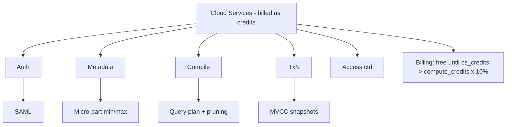

### Lab Exercise
```sql
-- See cloud services usage
SELECT
  warehouse_name,
  SUM(credits_used_compute)       AS compute_credits,
  SUM(credits_used_cloud_services) AS cs_credits,
  SUM(credits_used)                AS total,
  CASE WHEN SUM(credits_used_cloud_services) > SUM(credits_used_compute)*0.10
       THEN SUM(credits_used_cloud_services) - SUM(credits_used_compute)*0.10
       ELSE 0 END AS billable_cs
FROM SNOWFLAKE.ACCOUNT_USAGE.WAREHOUSE_METERING_HISTORY
WHERE start_time >= DATEADD('day',-7,CURRENT_TIMESTAMP())
GROUP BY warehouse_name;
```
**Expected outcome:** Shows which warehouses have CS-heavy workloads (BI dashboards running SHOWS every second often cross the threshold).

### Gotchas / Exam Traps
- Pure metadata queries (`SELECT COUNT(*) FROM huge_table`) run entirely in Cloud Services — no warehouse credits consumed, only CS credits.
- Resource monitors do NOT track CS credits — a runaway script spamming DDL can cost money without triggering any monitor.
- Serverless features (Snowpipe, Automatic Clustering, Materialized Views, Search Optimization) have their own billing — separate from Cloud Services credits.

---

## Q3: Describe a Virtual Warehouse and its sizing dimensions.
**Difficulty:** Foundation
**Exam relevance:** "Design virtual warehouse topology"

### Answer
A **Virtual Warehouse (VW)** is an MPP compute cluster of EC2/VM nodes dedicated to one workload. Two dimensions: **size** (XSMALL = 1 node, SMALL = 2, MEDIUM = 4, LARGE = 8, XLARGE = 16, ... up to 6XL = 512 nodes — each step doubles compute and cost) and **cluster count** (multi-cluster: 1 to N concurrent clusters of the same size). Size scales *query parallelism*; cluster count scales *query concurrency*.

### First Principles
A single query parallelizes across the nodes in one cluster — bigger size = faster single query (if the query is parallelizable). Many concurrent queries saturate a cluster — more clusters means more queued queries get a cluster. These are orthogonal: a Medium×4-cluster warehouse handles 4× concurrent dashboards each at 4-node speed; an XLarge×1-cluster handles 1 big query very fast and queues the rest. Choosing size vs cluster count is the architect's core sizing decision.

### Diagram

**Size (vertical scale, doubles credits/hr each step)**

| Size | Nodes |
|------|-------|
| XS | 1 |
| S | 2 |
| M | 4 |
| L | 8 |
| XL | 16 |
| 2XL | 32 |
| 6XL | 512 |

**Cluster count (horizontal, linear credits/hr per cluster)**

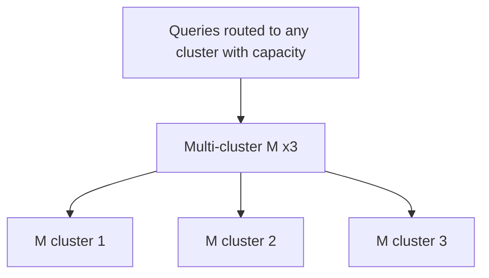

### Lab Exercise
```sql
CREATE WAREHOUSE wh_bi
  WAREHOUSE_SIZE = 'MEDIUM'
  MIN_CLUSTER_COUNT = 1
  MAX_CLUSTER_COUNT = 5
  SCALING_POLICY = 'STANDARD'       -- vs 'ECONOMY'
  AUTO_SUSPEND = 60                 -- seconds idle
  AUTO_RESUME = TRUE
  INITIALLY_SUSPENDED = FALSE;

-- Watch scaling in action
SELECT warehouse_name, cluster_number, start_time, end_time, credits_used
FROM SNOWFLAKE.ACCOUNT_USAGE.WAREHOUSE_METERING_HISTORY
WHERE warehouse_name='WH_BI' AND start_time >= DATEADD(hour,-1,CURRENT_TIMESTAMP())
ORDER BY start_time;
```
**Expected outcome:** As concurrent queries rise, cluster_number increases from 1 up to 5; falls back when idle.

### Gotchas / Exam Traps
- Scaling policy: `STANDARD` spawns clusters aggressively on queue; `ECONOMY` waits to see sustained load before adding. Economy saves cost but increases queue times.
- Resizing (changing size) does NOT disrupt running queries — existing finish on old size.
- Multi-cluster warehouses are Enterprise+ only; Standard edition is single-cluster.
- Auto-suspend < 60s is possible but Snowflake has a 1-minute minimum billing granularity — suspending at 30s and resuming at 45s costs 2 full minutes.

---

## Q4: Explain Snowflake's three cache layers and when each is used.
**Difficulty:** Intermediate
**Exam relevance:** "Describe caching architecture"

### Answer
Three caches: (1) **Result Cache** — stored in Cloud Services, keyed by query text + source data state, 24-hour TTL (renewed on hit up to 31 days), shared across all users in the account. (2) **Metadata Cache** — stored in Cloud Services, feeds pruning and query optimization. (3) **Warehouse Local Disk Cache (SSD cache)** — per-warehouse SSD caching of recently-read micro-partitions; wiped on suspend. Query path: result cache → warehouse SSD cache → remote storage.

### First Principles
Each cache sits at a different cost/latency point. Result cache is free and instantaneous — if the same query ran recently and no underlying data changed, just return the result. Metadata cache gives query-planning instant pruning without reading data. SSD cache saves network round-trips to S3 for "warm" data. The ordering is semantic — result → metadata → SSD → remote — and each miss costs more latency and credits.

### Diagram
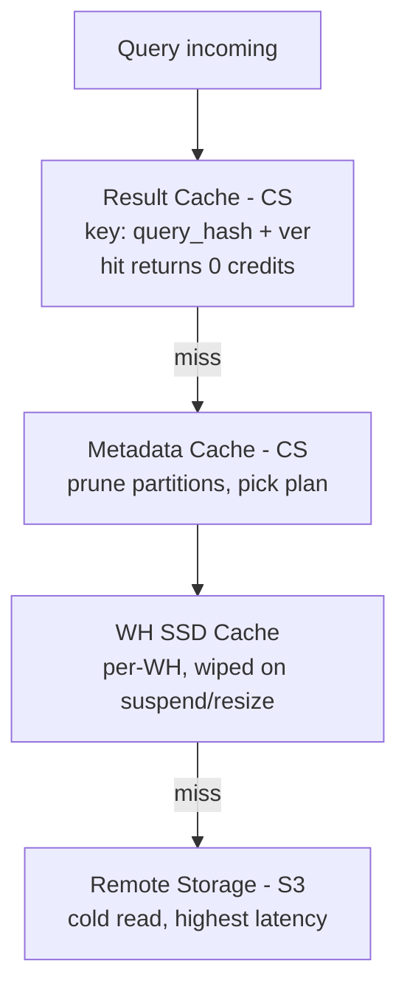

### Lab Exercise
```sql
-- Run twice; second hits result cache
SELECT COUNT(*) FROM shared.orders;  -- cold, ~1s
SELECT COUNT(*) FROM shared.orders;  -- cached, ~0.05s

-- Disable result cache to force warehouse execution
ALTER SESSION SET USE_CACHED_RESULT = FALSE;
SELECT COUNT(*) FROM shared.orders;  -- warm (SSD), credits billed

-- Suspend wipes SSD cache
ALTER WAREHOUSE wh_bi SUSPEND;
ALTER WAREHOUSE wh_bi RESUME;
SELECT COUNT(*) FROM shared.orders;  -- cold again, remote reads
```
**Expected outcome:** Three distinct timings matching the cache hierarchy. Check QUERY_HISTORY `PERCENTAGE_SCANNED_FROM_CACHE` to see the SSD hit ratio.

### Gotchas / Exam Traps
- Result cache invalidates when *any* underlying table changes, including Time Travel changes — a reclustering can invalidate the cache even without row changes.
- Result cache is bypassed if the query uses non-deterministic functions (CURRENT_TIMESTAMP, UUID_STRING, RANDOM).
- Multi-cluster warehouses: each cluster has its own SSD cache; a query routed to a different cluster may miss cache even though another cluster of the same WH has it warm.
- Resizing a warehouse wipes the SSD cache (new nodes have cold disks).

---

## Q5: What is a micro-partition and how does it enable Snowflake's performance?
**Difficulty:** Intermediate
**Exam relevance:** "Describe micro-partition architecture"

### Answer
A **micro-partition** is a 50-500 MB (compressed) immutable file in object storage holding a horizontal row group of a table in **columnar format**. Each MP carries metadata: per-column min/max, distinct count, null count, bloom-filter-like structures. Metadata lives in Cloud Services, so the query optimizer can **prune** (skip) partitions whose metadata proves they can't contain matching rows — often skipping 95%+ of a table.

### First Principles
Row-store scanning is linear in table size. Columnar + partition pruning turns scans from O(table) to O(matching partitions). Snowflake's innovation: micro-partitions are *auto-generated* from load order, no DBA defines them. The min/max per column gives free zone-maps on every column. The small size (50-500MB) is a sweet spot: big enough to amortize open-cost, small enough that pruning is granular. Columns within an MP are stored contiguously for I/O efficiency.

### Diagram
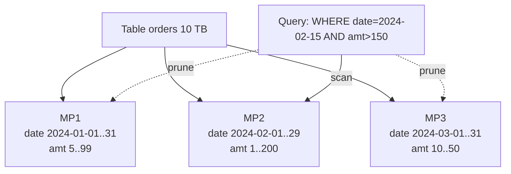

### Lab Exercise
```sql
-- Observe pruning
EXPLAIN SELECT * FROM huge_orders WHERE order_date='2024-02-15';
-- Look for "partitionsAssigned" vs "partitionsTotal" in plan

-- Table-level MP stats
SELECT table_name,
       row_count,
       bytes,
       (bytes/row_count)::NUMBER AS avg_bytes_per_row,
       active_bytes/(1024*1024*1024) AS gb
FROM SNOWFLAKE.ACCOUNT_USAGE.TABLE_STORAGE_METRICS
WHERE table_name='HUGE_ORDERS';

-- Clustering depth (a lower score = better pruning)
SELECT SYSTEM$CLUSTERING_INFORMATION('huge_orders','(order_date)');
```
**Expected outcome:** EXPLAIN shows `partitionsAssigned: 234 / partitionsTotal: 50000` — pruning working. Clustering info returns `average_depth` and `partition_depth` histogram.

### Gotchas / Exam Traps
- Micro-partitions are *immutable*. UPDATE/DELETE creates new MPs; old ones remain until Time Travel + Fail-safe expire.
- Pruning uses per-column min/max — if your WHERE clause wraps the column in a function (`WHERE DATE(ts)='...'`), min/max can't help; use `WHERE ts >= '...' AND ts < '...'` instead.
- MP size is a *compressed* size; uncompressed can be 10-100x larger.

---

## Q6: Explain how Snowflake handles ACID transactions across the three layers.
**Difficulty:** Advanced
**Exam relevance:** "Describe transaction architecture"

### Answer
Snowflake uses **snapshot isolation** backed by a transaction manager in Cloud Services. Each statement sees a consistent snapshot of the database at its start time, defined by a version timestamp on the metadata. Writes create new micro-partitions (never modify in place); the new MPs are "committed" by atomically updating the table's metadata pointer. Readers see old pointer until commit; after commit, they see new pointer. Fail-safe + Time Travel preserve the old MPs for recoverability.

### First Principles
On an immutable object-store, you cannot "update in place." Snowflake embraces this: every write produces new files, and ACID is achieved via an atomic metadata flip. Snapshot isolation works because readers only need to resolve the "current pointer at my start time" — they don't need locks on the data. Writers conflict only on the metadata pointer, serialized by the transaction manager. This is why `ALTER TABLE` can run concurrently with long SELECTs without blocking either.

### Diagram
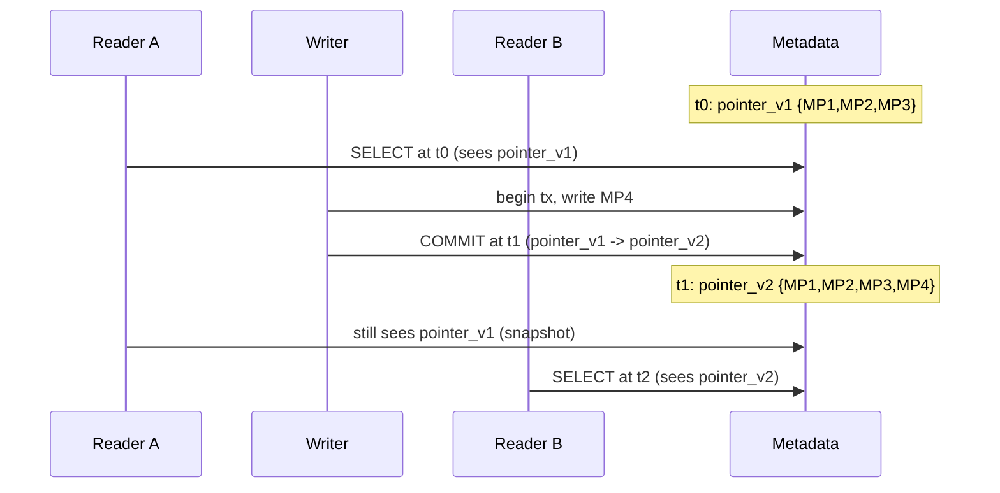

### Lab Exercise
```sql
-- Session A
BEGIN;
SELECT COUNT(*) FROM accounts WHERE region='EU';  -- t0 snapshot
-- (hold)

-- Session B
INSERT INTO accounts VALUES ('EU', 'new_acct', 100);
COMMIT;

-- Session A continues
SELECT COUNT(*) FROM accounts WHERE region='EU';  -- SAME COUNT, still t0 snapshot
COMMIT;

-- Session A opens new tx
SELECT COUNT(*) FROM accounts WHERE region='EU';  -- NEW COUNT, snapshot moved

-- Prove via Time Travel
SELECT COUNT(*) FROM accounts AT(OFFSET => -60);  -- 1 minute ago
```
**Expected outcome:** Within a transaction, counts stay consistent even as other sessions commit. After commit of session A, new reads see latest state.

### Gotchas / Exam Traps
- Snowflake has only one isolation level: **read committed** at statement level, **snapshot** inside explicit transactions. There is no serializable; concurrent writes may need app-side retry.
- Transactions can span multiple statements but NOT multiple sessions; `BEGIN` is tied to session.
- Long-running transactions can block automatic clustering and Time Travel cleanup — monitor `OPEN_TRANSACTIONS`.

---

## Q7: Design a warehouse topology for a company with ETL, BI dashboards, data science, and ad-hoc users.
**Difficulty:** Advanced
**Exam relevance:** "Design workload-isolated warehouse topology"

### Answer
Separate warehouses per workload to prevent noisy neighbors:
- **wh_etl** (L, 1 cluster, no auto-suspend during business hrs) — big batch loads.
- **wh_bi** (M, multi-cluster 1-5, STANDARD scaling, auto-suspend 60s) — bursty concurrent dashboards.
- **wh_ds** (XL, 1 cluster, auto-suspend 300s) — heavy single queries from notebooks.
- **wh_adhoc** (S, multi-cluster 1-3, ECONOMY scaling, auto-suspend 60s) — unpredictable user queries.
- Attach **resource monitors** per warehouse with daily/monthly credit caps.
- Use **query tags** per workload for cost allocation.

### First Principles
Workloads have different *shapes*: ETL has few, long queries (vertical scale wins); BI has many, short queries (horizontal scale wins); DS has few, giant queries (vertical only); ad-hoc is unpredictable (defensive sizing + economy scaling). Mixing shapes on one warehouse means tuning for the worst case or starving the best case. Separation also lets you bill back to teams and apply per-workload monitors.

### Diagram

| Warehouse | Size | Role | Monitor |
|-----------|------|------|---------|
| wh_etl | L x1 | loader_role | 500/day suspend@100% |
| wh_bi | M x1-5 | bi_role | 300/day notify@80% |
| wh_ds | XL x1 | ds_role | 1000/mo notify@80% |
| wh_adhoc | S x1-3 | analyst_role | 100/day suspend@100% |
| wh_ops | XS x1 | ops_role | — |

### Lab Exercise
```sql
-- Define workloads with resource monitors
CREATE RESOURCE MONITOR rm_etl WITH CREDIT_QUOTA = 500 FREQUENCY = DAILY
  TRIGGERS ON 80 PERCENT DO NOTIFY
           ON 100 PERCENT DO SUSPEND
           ON 110 PERCENT DO SUSPEND_IMMEDIATE;

CREATE WAREHOUSE wh_etl WITH WAREHOUSE_SIZE='LARGE' AUTO_SUSPEND=300
  RESOURCE_MONITOR = rm_etl;

CREATE WAREHOUSE wh_bi WITH WAREHOUSE_SIZE='MEDIUM' MIN_CLUSTER_COUNT=1 MAX_CLUSTER_COUNT=5
  SCALING_POLICY='STANDARD' AUTO_SUSPEND=60;

CREATE WAREHOUSE wh_ds WITH WAREHOUSE_SIZE='XLARGE' AUTO_SUSPEND=300;

CREATE WAREHOUSE wh_adhoc WITH WAREHOUSE_SIZE='SMALL' MIN_CLUSTER_COUNT=1 MAX_CLUSTER_COUNT=3
  SCALING_POLICY='ECONOMY' AUTO_SUSPEND=60;

-- Query tagging for cost allocation
ALTER SESSION SET QUERY_TAG = 'workload=bi;team=finance';
```
**Expected outcome:** Each workload isolated; `ACCOUNT_USAGE.WAREHOUSE_METERING_HISTORY` + `QUERY_TAG` enables per-team chargeback.

### Gotchas / Exam Traps
- Resource monitors run on a schedule (every ~15 min) — they are NOT real-time. A query that spikes credits can exceed the quota before suspension triggers.
- Resource monitors apply to compute credits, NOT to serverless (Snowpipe, auto-cluster) — those bill separately.
- `SUSPEND_IMMEDIATE` kills in-flight queries; `SUSPEND` waits for them to finish.
- A warehouse can have only one resource monitor; a resource monitor can gate many warehouses OR the entire account (not both).

---

## Q8: Explain multi-cluster warehouses and the STANDARD vs ECONOMY scaling policies.
**Difficulty:** Intermediate
**Exam relevance:** "Design multi-cluster scaling"

### Answer
A **multi-cluster warehouse** has `MIN_CLUSTER_COUNT` and `MAX_CLUSTER_COUNT` of same-size clusters. Snowflake adds clusters when queries queue, removes when idle. **STANDARD**: adds clusters immediately upon any queueing — minimizes wait at cost of credits. **ECONOMY**: waits ~6+ minutes of sustained queue before adding — maximizes utilization at cost of latency.

### First Principles
Concurrency and latency conflict: more clusters = less wait but more cost; fewer clusters = cheaper but queueing. Snowflake exposes this as a dial. STANDARD assumes users are impatient (BI dashboards, interactive). ECONOMY assumes workloads are tolerant (batch, scheduled). The 6-minute buffer in ECONOMY is roughly one credit-billing minute's worth of justification — add a cluster only when the queue would cost more than one cluster-minute.

### Diagram

| Trigger | Standard | Economy |
|---------|----------|---------|
| Queue > 0 | spin new cluster immediately | wait sustained > 6 min |
| Idle | drop after > 1 min | drop after > 6 min |
| Good for | BI, interactive | batch, pipelines |
| Trade-off | $$ for low latency | latency for low $$ |

### Lab Exercise
```sql
-- Economy for a batch warehouse
CREATE WAREHOUSE wh_batch
  WAREHOUSE_SIZE='LARGE'
  MIN_CLUSTER_COUNT=1 MAX_CLUSTER_COUNT=4
  SCALING_POLICY='ECONOMY'
  AUTO_SUSPEND=300;

-- Standard for a BI warehouse
CREATE WAREHOUSE wh_bi
  WAREHOUSE_SIZE='MEDIUM'
  MIN_CLUSTER_COUNT=2 MAX_CLUSTER_COUNT=10
  SCALING_POLICY='STANDARD'
  AUTO_SUSPEND=60;

-- Watch
SELECT warehouse_name, cluster_number, start_time, end_time
FROM SNOWFLAKE.ACCOUNT_USAGE.WAREHOUSE_EVENTS_HISTORY
WHERE warehouse_name IN ('WH_BATCH','WH_BI')
ORDER BY start_time DESC;
```
**Expected outcome:** On BI load spikes, WH_BI spawns clusters in seconds; WH_BATCH shows clusters only during sustained load.

### Gotchas / Exam Traps
- Setting MIN=MAX makes it effectively a single-cluster warehouse of that count — no auto-scaling.
- Query routing within a multi-cluster WH is opaque; you cannot pin a query to a specific cluster.
- A single query cannot span multiple clusters within a multi-cluster warehouse — size (not cluster count) governs single-query parallelism.

---

## Q9: Describe cross-cloud/cross-region topology options in Snowflake.
**Difficulty:** Advanced
**Exam relevance:** "Design cross-cloud architecture"

### Answer
Within one Organization you can have accounts on multiple clouds (AWS, Azure, GCP) and multiple regions, with **cross-region/cross-cloud replication** (Enterprise+) and **failover groups** (BC+). Data sharing works across regions/clouds via **auto-fulfillment listings** (Snowflake transparently maintains a replica in the consumer's region). Some workloads can span regions via replicated databases consumed by local warehouses, but queries themselves are always local to one region.

### First Principles
Snowflake does not have cross-region queries — a query runs in one region's compute against that region's storage. To serve users in multiple regions, you *replicate* the data to multiple regions and let each region query locally. This is the deliberate design: cross-region query latency would be unacceptable (100-200ms per S3 request × many requests). Replication + local query is the Snowflake pattern for global.

### Diagram
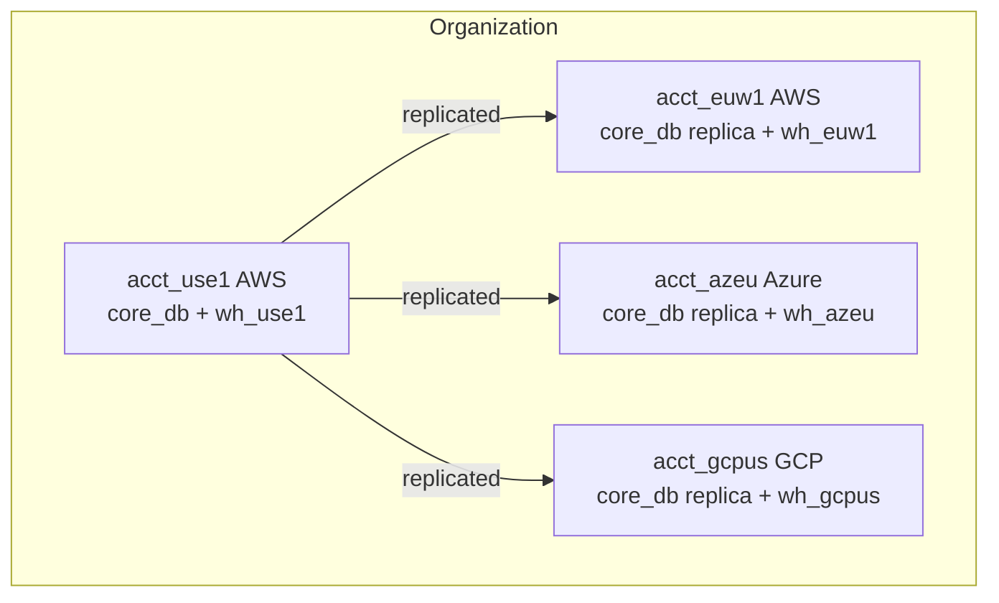
Users query local replica → no cross-region latency. Marketplace listings auto-fulfill replicas on-demand.

### Lab Exercise
```sql
-- In primary account acct_use1
USE ROLE ACCOUNTADMIN;
ALTER DATABASE core_db ENABLE REPLICATION TO ACCOUNTS acme.acct_euw1;

-- In secondary acct_euw1
CREATE DATABASE core_db AS REPLICA OF acme.acct_use1.core_db;
ALTER DATABASE core_db REFRESH;

-- Schedule refresh
CREATE TASK refresh_core
  WAREHOUSE = wh_ops SCHEDULE = '30 MINUTE'
AS
  ALTER DATABASE core_db REFRESH;
ALTER TASK refresh_core RESUME;
```
**Expected outcome:** `core_db` in EU account is read-only replica, refreshed every 30 min with ~change-set bytes transferred.

### Gotchas / Exam Traps
- Database replication alone is **not DR**; it's one-way read replicas. For failover you need **failover groups** (BC+) which replicate roles, users, warehouses, etc. — see domain 6.
- Cross-cloud replication incurs egress charges from the source cloud; a Snowflake "egress" line item appears on your bill.
- Replicas are read-only in the secondary account until failover promotes them to primary.
- External tables and external stages do NOT replicate; you must recreate them in the target region.

---

## Q10: What is the metadata layer and how does it enable instant operations like SHOW and COUNT?
**Difficulty:** Intermediate
**Exam relevance:** "Describe metadata-driven operations"

### Answer
The metadata layer (in Cloud Services) stores: object definitions (tables, columns, grants), micro-partition catalogs (list of files per table, per-column min/max, row counts), transaction history, and query stats. Because row counts and column stats are maintained **at write time**, operations like `SELECT COUNT(*)`, `MIN/MAX/COUNT DISTINCT (approximate)`, and `SHOW TABLES` return instantly from metadata with **zero warehouse credits**.

### First Principles
Metadata is the "index of indexes" in Snowflake — the engine never scans data when it can answer from metadata. This is possible because MPs are immutable and the metadata is updated transactionally on commit. Approximate stats (HLL for distinct count) are maintained for free. The exam loves to probe: "Does `SELECT COUNT(*)` consume warehouse credits?" (No — metadata only, if no WHERE.)

### Diagram
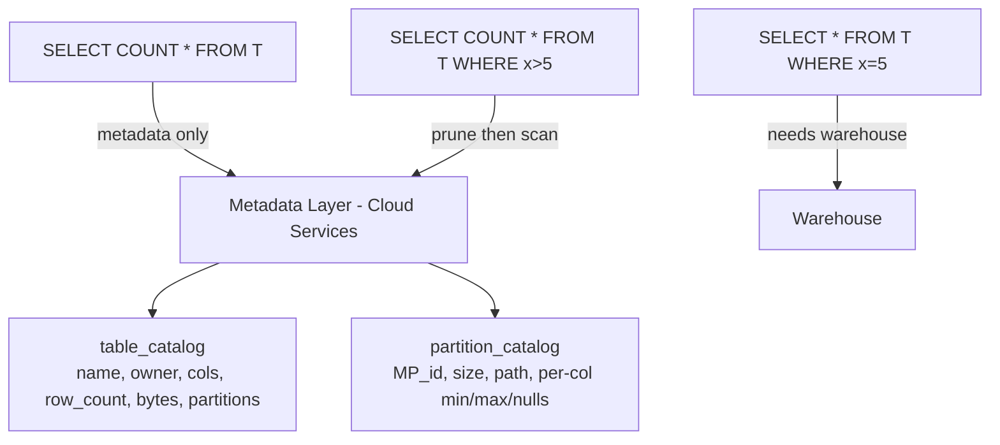

### Lab Exercise
```sql
-- No warehouse needed
ALTER WAREHOUSE wh_bi SUSPEND;
USE WAREHOUSE wh_bi;
SELECT COUNT(*) FROM huge_orders;    -- returns instantly, warehouse NOT resumed
SELECT MIN(order_date), MAX(order_date) FROM huge_orders;  -- metadata only
SHOW TABLES IN SCHEMA public;         -- metadata only

-- Now a query that actually touches data
SELECT COUNT(*) FROM huge_orders WHERE amount > 1000;
-- Warehouse resumes; this scans partitions
```
**Expected outcome:** Pure-metadata operations return instantly without warehouse resume. QUERY_HISTORY shows warehouse_name=NULL for those.

### Gotchas / Exam Traps
- `SELECT MIN(x), MAX(x), COUNT(*)` on an unfiltered table is metadata-only. Adding ANY `WHERE` forces data scan — exam traps this.
- `COUNT(DISTINCT x)` is NOT metadata-only; use `APPROX_COUNT_DISTINCT` which uses HLL sketches but still touches partitions.
- `INFORMATION_SCHEMA` views are backed by metadata and limited to 7 days; `ACCOUNT_USAGE` has longer retention but up to 3-hour latency.

---

## Q11: Describe the role of Snowgrid and global replication.
**Difficulty:** Advanced
**Exam relevance:** "Explain cross-region infrastructure"

### Answer
**Snowgrid** is Snowflake's internal mesh connecting all regions/clouds, enabling: cross-region replication, cross-cloud sharing, Marketplace auto-fulfillment, Organization-level identity, and failover. It is Snowflake-managed infrastructure — customers don't configure it; they just use features (`ALTER DATABASE ... ENABLE REPLICATION`) that ride on top. Snowgrid provides end-to-end encryption and metadata-aware transport.

### First Principles
Enabling cross-cloud features requires a global control plane that spans AWS/Azure/GCP's underlying networks. Rather than exposing this plumbing, Snowflake abstracts it as "Snowgrid" — the architect's view is: "I say replicate, Snowflake makes it happen." The implementation detail (which pipes, which regions, which clouds) is operationally irrelevant.

### Diagram
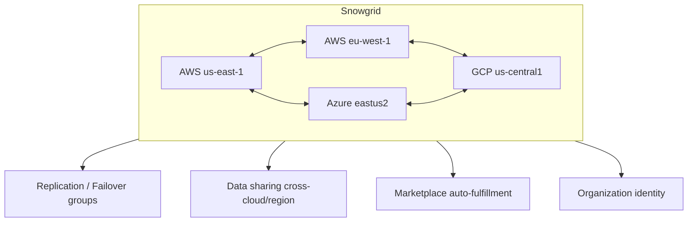

### Lab Exercise
```sql
-- Verify a listing is auto-fulfillable
USE ROLE ACCOUNTADMIN;
SHOW REGIONS;

-- Enable auto-fulfillment for a listing (via Snowsight: Marketplace > Listing > Auto Fulfillment)
-- Then consumers in any region can request access -- Snowgrid handles replication
```
**Expected outcome:** Listing available across clouds/regions with latency only on first fulfillment.

### Gotchas / Exam Traps
- Snowgrid is NOT a customer-visible object — there's nothing to configure. Exam tries to trick with "configure Snowgrid parameters."
- Snowgrid handles the transport but you still pay egress on cross-cloud replication.
- Private connectivity (PrivateLink) is point-to-point to one account; Snowgrid handles inter-account traffic separately.

---

## Q12: Explain the lifecycle of a query from submission to result.
**Difficulty:** Intermediate
**Exam relevance:** "Trace query execution"

### Answer
Query lifecycle:
1. **Parse** (CS) — syntax check, auth check.
2. **Resolve** (CS) — look up tables, columns via metadata.
3. **Optimize** (CS) — plan generation, pruning estimates, join order.
4. **Result cache check** (CS) — if hit, return result; else continue.
5. **Compile** (CS) — concrete execution plan.
6. **Execute** (Warehouse) — nodes read MPs (SSD cache or remote), run operators, exchange data over fast interconnect.
7. **Return** (CS) — results stream back to client, result cache populated.

### First Principles
Steps 1-5 and 7 are in Cloud Services (free up to 10% threshold); only step 6 consumes warehouse credits. This design means the "cost" of a query is approximately proportional to data scanned by the warehouse, not to its complexity or planner work. Caching skips step 6 entirely for repeat queries.

### Diagram
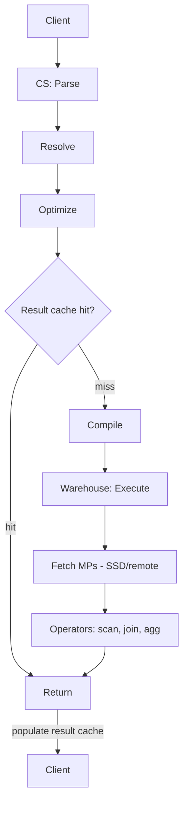

### Lab Exercise
```sql
-- Profile a query
EXPLAIN SELECT customer, SUM(amount)
FROM orders JOIN customers USING(cust_id)
WHERE order_date >= '2024-01-01'
GROUP BY customer;

-- After running, inspect
SELECT query_id, compilation_time, execution_time, queued_overload_time,
       bytes_scanned, bytes_sent_over_the_network,
       percentage_scanned_from_cache
FROM SNOWFLAKE.ACCOUNT_USAGE.QUERY_HISTORY
WHERE query_text ILIKE '%customer%' ORDER BY start_time DESC LIMIT 5;

-- Snowsight: open the Query Profile for a visual tree
```
**Expected outcome:** Query profile shows each operator's time, bytes, and partitions touched.

### Gotchas / Exam Traps
- `compilation_time` is in Cloud Services (free up to threshold). Long compile is a sign of unoptimized SQL or stale stats.
- `queued_overload_time` means warehouse was saturated — scale up or add clusters.
- `queued_provisioning_time` means warehouse was resuming from suspend — expected on first-of-day queries.

---

## Q13: Design a warehouse strategy for a workload with 10× difference between peak and off-peak concurrency.
**Difficulty:** Advanced
**Exam relevance:** "Design elastic compute"

### Answer
Use a **multi-cluster warehouse** with `MIN_CLUSTER_COUNT=1` and `MAX_CLUSTER_COUNT=10`, `SCALING_POLICY=STANDARD`, `AUTO_SUSPEND=60`. During off-peak, 1 cluster handles traffic; during peak, Snowflake spawns up to 10 clusters. Pair with a **resource monitor** capping daily credits, and set `MAX_CONCURRENCY_LEVEL` per cluster (default 8) to control the queue-vs-spawn threshold.

### First Principles
Multi-cluster is the elastic concurrency primitive. The 10× ratio is well-suited because scaling up/down is minutes-level — fast enough for intraday bursts, slow enough that you don't thrash. The scaling policy choice depends on whether queue latency during the ramp is acceptable: STANDARD avoids queue; ECONOMY saves credits.

### Diagram

| Time | Load | Clusters | Notes |
|------|------|----------|-------|
| 01:00-07:00 | low | 1 | off-peak |
| 07:30 | rising | 2 | first dashboards |
| 09:00 | peak | 10 | morning + reports |
| 13:00 | high | 7 | |
| 17:00 | falling | 3 | |
| 19:00 | low | 1 | |

Standard scaling spawns within 30s of queue; drops a cluster after ~1 min idle.

### Lab Exercise
```sql
CREATE WAREHOUSE wh_bursty
  WAREHOUSE_SIZE='MEDIUM'
  MIN_CLUSTER_COUNT=1 MAX_CLUSTER_COUNT=10
  SCALING_POLICY='STANDARD'
  MAX_CONCURRENCY_LEVEL=8
  AUTO_SUSPEND=60
  AUTO_RESUME=TRUE;

-- Observe over a day
SELECT TO_HOUR(start_time) AS hr,
       AVG(cluster_count)        AS avg_clusters,
       MAX(cluster_count)        AS peak_clusters,
       SUM(credits_used)         AS total_credits
FROM (
  SELECT start_time, cluster_number AS cluster_count, credits_used
  FROM SNOWFLAKE.ACCOUNT_USAGE.WAREHOUSE_METERING_HISTORY
  WHERE warehouse_name='WH_BURSTY' AND start_time >= DATEADD('day',-1,CURRENT_TIMESTAMP())
)
GROUP BY hr ORDER BY hr;
```
**Expected outcome:** Hourly profile shows cluster count tracking load; total credits scale sublinearly thanks to idle suspend.

### Gotchas / Exam Traps
- `MAX_CONCURRENCY_LEVEL` controls how many queries one cluster will accept before overflowing (not the WH total). Setting it very low (e.g., 2) forces aggressive multi-cluster spawn.
- Query queueing counts toward `queued_overload_time`, not warehouse credits — queueing is free, slow execution isn't.
- Standard edition is single-cluster only — multi-cluster scenarios imply Enterprise+.

---

## Q14: Explain how a Snowflake query is pruned at micro-partition level.
**Difficulty:** Advanced
**Exam relevance:** "Describe pruning mechanics"

### Answer
Pruning happens in two phases: (1) **Static pruning at optimize-time** using the WHERE predicates and the per-MP min/max in metadata — MPs whose range cannot contain matching rows are excluded. (2) **Dynamic pruning at runtime** for join-filter pushdown (bloom filters built from the build side of a join propagate to the probe side's scan).

### First Principles
Metadata min/max is cheap to maintain and extremely effective for *range* predicates on well-clustered columns. If data arrives naturally sorted by date, every MP has a tight date range → almost every WHERE on date prunes aggressively. For unsorted columns, min/max spans the whole range → no pruning. This is why clustering strategy exists — to tighten the min/max ranges on *query-relevant* columns.

### Diagram
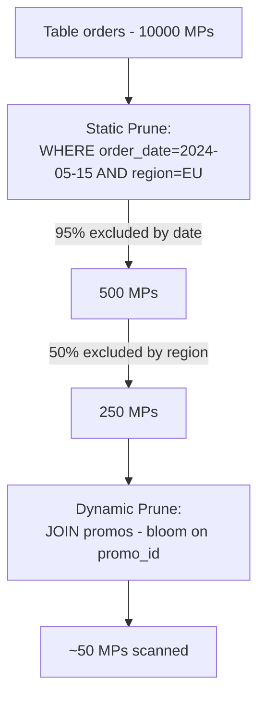

### Lab Exercise
```sql
EXPLAIN
  SELECT SUM(amount)
  FROM orders o JOIN promos p USING(promo_id)
  WHERE o.order_date='2024-05-15' AND o.region='EU';
-- Look for: partitionsAssigned / partitionsTotal
--           predicate pushdown
--           bloom filter joins

-- Check clustering depth on a column
SELECT SYSTEM$CLUSTERING_INFORMATION('orders','(order_date, region)');
```
**Expected outcome:** EXPLAIN shows partitions touched vs total; clustering_information gives histogram of overlap depth.

### Gotchas / Exam Traps
- Functions on columns (`WHERE DATE_TRUNC('month',ts) = ...`) defeat pruning. Rewrite as range predicates.
- `IN` lists of thousands of values can defeat pruning on heavily-clustered tables; try temp tables + joins.
- Row access policies run *after* pruning but *before* return; they can't help prune.

---

## Q15: Scenario — Snowflake users across three continents complain about variable query latency.
**Difficulty:** Advanced
**Exam relevance:** "Design global performance"

### Answer
Diagnose: are queries hitting a single-region account from distant clients? If so, latency floor = client-region round-trip. Solution: **replicate** the database to accounts in each region (us-east-1, eu-west-1, ap-southeast-1); users connect to their nearest account. Use **failover groups** if those regional accounts must be writable alternatives. Mitigate at edges with **result cache** (already shared account-wide) and **materialized views** for repeat computations.

### First Principles
Latency floor to Snowflake is the TCP round-trip to the region hosting the account — ~150ms Tokyo-to-Virginia one-way. Queries that return many rows multiply that by extra packets. You cannot query another region, only replicate to it. Multi-region deployment is the only architectural fix for client-latency-driven variance.

### Diagram
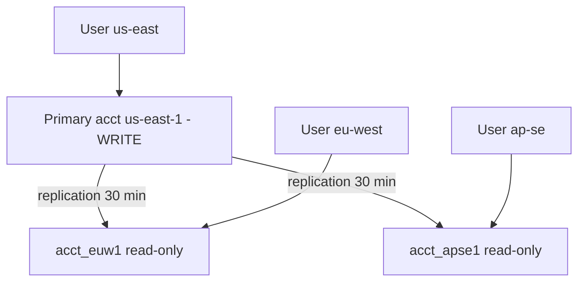
Alternative: use failover groups so any region can be primary.

### Lab Exercise
```sql
-- Replicate core_db to EU and APSE
ALTER DATABASE core_db ENABLE REPLICATION TO ACCOUNTS acme.acct_euw1, acme.acct_apse1;

-- In each secondary
CREATE DATABASE core_db AS REPLICA OF acme.acct_use1.core_db;
CREATE TASK refresh_core WAREHOUSE=wh_ops SCHEDULE='15 MINUTE' AS ALTER DATABASE core_db REFRESH;
ALTER TASK refresh_core RESUME;

-- Point clients at local account
-- EU client: connect to acme.acct_euw1
-- APSE client: connect to acme.acct_apse1
```
**Expected outcome:** EU queries latency drops from ~400ms to ~20ms baseline.

### Gotchas / Exam Traps
- Writes still happen in primary — if EU users need to write, you need failover groups and primary promotion (not just read replicas).
- Replication is asynchronous; EU reads may be up to the refresh-interval stale.
- Egress charges apply to the replication bytes crossing region/cloud boundaries.

---

## Q16: What is Query Acceleration Service (QAS) and how does it fit in the architecture?
**Difficulty:** Advanced
**Exam relevance:** "Describe serverless compute augmentation"

### Answer
**QAS** is a serverless compute pool Snowflake maintains to opportunistically parallelize parts of a query *beyond* what the warehouse's own nodes can handle. Enable per-warehouse; set `QUERY_ACCELERATION_MAX_SCALE_FACTOR` (0-100) which caps extra compute vs warehouse size. Snowflake decides which queries benefit (large scans with lightweight post-processing) and offloads those parts automatically. Billed as serverless credits separately from warehouse credits.

### First Principles
Some queries are bottlenecked on the scan (I/O-bound) and would run faster with more parallelism, but the warehouse is appropriately sized for the *rest* of the workload. Rather than oversize the warehouse (overpaying for all queries), QAS adds elastic scan parallelism on-demand, only for the queries that benefit. It's a cost-elasticity feature, not a replacement for right-sizing.

### Diagram
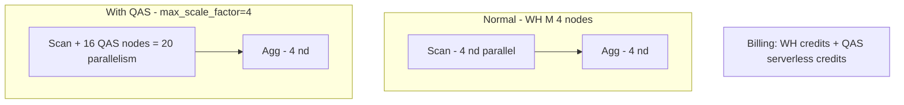

### Lab Exercise
```sql
ALTER WAREHOUSE wh_bi SET
  ENABLE_QUERY_ACCELERATION=TRUE
  QUERY_ACCELERATION_MAX_SCALE_FACTOR=8;

-- Verify eligibility
SELECT query_id, query_acceleration_bytes_scanned, query_acceleration_partitions_scanned,
       query_acceleration_upper_limit_scale_factor
FROM SNOWFLAKE.ACCOUNT_USAGE.QUERY_HISTORY
WHERE warehouse_name='WH_BI' AND query_acceleration_bytes_scanned > 0
ORDER BY start_time DESC;

-- Candidate check for a specific query
SELECT SYSTEM$ESTIMATE_QUERY_ACCELERATION('<query_id>');
```
**Expected outcome:** Eligible queries show nonzero `query_acceleration_bytes_scanned`; wall-clock reduced on scan-heavy queries.

### Gotchas / Exam Traps
- QAS only accelerates certain shapes — large scans with lightweight aggregation/filter. Join-heavy or CPU-bound queries don't benefit.
- `MAX_SCALE_FACTOR` is an upper bound; Snowflake may use less if marginal benefit is low.
- QAS credits are separate from warehouse credits; a resource monitor on the warehouse doesn't cap QAS usage.

---

## Q17: Explain Snowpark Container Services' role in the architecture.
**Difficulty:** Advanced
**Exam relevance:** "Describe compute extensions"

### Answer
**Snowpark Container Services (SPCS)** lets you run Docker containers inside Snowflake, with the containers having direct access to Snowflake data via SQL. Images are hosted in Snowflake's internal image registry; **compute pools** of Snowflake-managed VMs (CPU or GPU) run the containers. Use for custom runtimes (R, Julia), ML serving, Streamlit apps, or legacy apps colocated with data.

### First Principles
Snowflake historically ran only SQL and UDFs (Python/Java/Scala) with sandboxed runtimes. Some workloads (model inference, specialized libraries, GPU) require more flexibility — but shuttling data out of Snowflake to run them elsewhere is expensive and governance-breaking. SPCS brings arbitrary containers *inside* the security boundary, so container-based compute is governed by Snowflake RBAC and reads Snowflake tables natively.

### Diagram
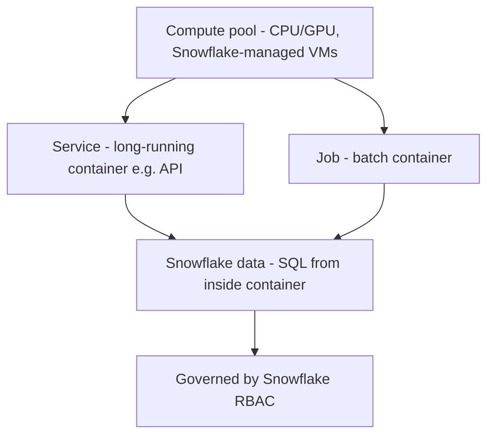

### Lab Exercise
```sql
-- Create a compute pool
CREATE COMPUTE POOL cp_models
  MIN_NODES=1 MAX_NODES=3
  INSTANCE_FAMILY=CPU_X64_S
  AUTO_SUSPEND_SECS=300;

-- Push an image (via docker CLI logged into Snowflake registry)
-- docker push <acct>.registry.snowflakecomputing.com/mydb/myschema/myrepo/myimage:v1

-- Deploy as a service
CREATE SERVICE sentiment_api
  IN COMPUTE POOL cp_models
  FROM SPECIFICATION $$
  spec:
    containers:
    - name: api
      image: /mydb/myschema/myrepo/myimage:v1
      resources:
        requests:
          cpu: 2
          memory: 4Gi
    endpoints:
    - name: http
      port: 8080
      public: true
  $$;

-- Hit the service from SQL via a function
```
**Expected outcome:** Container runs inside Snowflake's trust boundary; endpoints become callable from SQL or externally.

### Gotchas / Exam Traps
- SPCS billing is separate — compute pool credits, image registry storage, egress for public endpoints.
- Containers run as *service users*; grant them data access via roles like any other principal.
- Not every region supports SPCS yet; check `SHOW COMPUTE POOLS` region availability.

---

## Q18: Compare Standard Streams, Append-Only Streams, and Insert-Only Streams.
**Difficulty:** Intermediate
**Exam relevance:** "Choose stream types"

### Answer
A **Stream** is a change-tracking offset on a table/view, exposing changes since last consumption. **Standard**: tracks inserts, updates, deletes (CDC-complete). **Append-only**: tracks inserts only (ignores U/D) — faster for append-heavy. **Insert-only**: for external tables / directory tables, tracks file-level inserts only. Choice depends on whether your pipeline needs full CDC or only new rows.

### First Principles
Not every pipeline cares about updates/deletes; many are append-only (events, logs). A standard stream tracks a change-table alongside the base; append-only maintains far less state. Insert-only streams exist because external tables (files in a stage) don't support in-place updates — only "new files appeared." Picking the lightest stream type that satisfies your semantics saves cost.

### Diagram

| Stream Type | Sees |
|-------------|------|
| Standard | row1 INSERT, row2 UPDATE, row3 DELETE |
| Append-only | row1 INSERT only |
| Insert-only (ext/dir tables) | new files only |

### Lab Exercise
```sql
CREATE OR REPLACE TABLE events (id INT, payload STRING, ts TIMESTAMP);
CREATE OR REPLACE STREAM str_std ON TABLE events;
CREATE OR REPLACE STREAM str_append ON TABLE events APPEND_ONLY=TRUE;

INSERT INTO events VALUES (1,'a',CURRENT_TIMESTAMP());
UPDATE events SET payload='b' WHERE id=1;
DELETE FROM events WHERE id=1;

SELECT * FROM str_std;      -- 3 rows: insert, update(old,new), delete
SELECT * FROM str_append;   -- 1 row: insert
```
**Expected outcome:** Standard captures all operations with METADATA$ACTION and METADATA$ISUPDATE columns; append-only sees only inserts.

### Gotchas / Exam Traps
- Streams require `CHANGE_TRACKING=TRUE` on the base table (set automatically when the stream is created, but not retroactive for the stream's offset).
- Consumption *advances* the offset — once a stream is read inside a DML, subsequent reads see nothing new. Use multiple streams for multi-consumer scenarios.
- Streams become stale if the base table's Time Travel retention expires before consumption. Monitor `STALE_AFTER`.

---

## Q19: Describe how Snowflake isolates one tenant's compute from another's.
**Difficulty:** Intermediate
**Exam relevance:** "Describe multi-tenancy isolation"

### Answer
Each virtual warehouse is a **dedicated cluster** of VMs assigned exclusively to one customer — no CPU, memory, or local disk is shared across customers. Cloud Services is multi-tenant but request-level isolated. Storage buckets are per-customer, encrypted with per-customer keys. The isolation seam is "warehouse = your box; everything else is Snowflake's problem."

### First Principles
Multi-tenancy at the compute layer would create noisy-neighbor risk and audit nightmares. Snowflake avoids this by never sharing a VM across tenants — warehouses are the atomic ownership unit of VMs. Multi-tenant Cloud Services is defensible because its workloads are tiny (metadata lookups), and the request/response model prevents cross-tenant data flow.

### Diagram
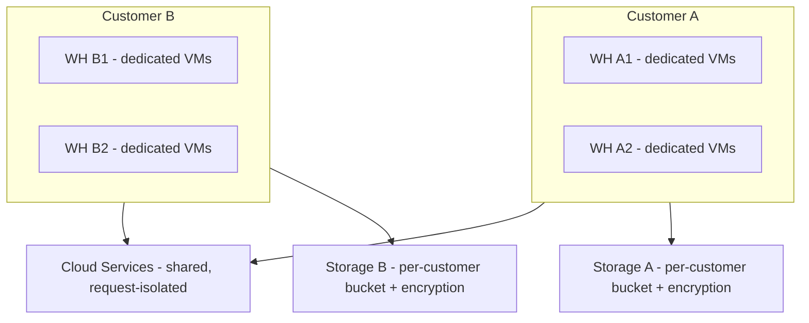

### Lab Exercise
```sql
-- You can't inspect other tenants, but you can verify your own isolation:
SELECT CURRENT_ACCOUNT(), CURRENT_REGION();
SHOW WAREHOUSES;
-- Warehouses listed are only yours; Snowflake does not expose other tenants.
```
**Expected outcome:** No cross-tenant visibility; your warehouses run on dedicated hardware.

### Gotchas / Exam Traps
- VPS (Virtual Private Snowflake) extends isolation to the Cloud Services layer — the shared metadata service is replaced by a dedicated one. Business Critical does NOT include this.
- Multi-tenancy in CS is sometimes a compliance concern — the exam may ask which edition isolates CS (answer: VPS).

---

## Q20: Scenario — ETL job finishing in 2 hours needs to finish in 20 minutes with same cost.
**Difficulty:** Advanced
**Exam relevance:** "Right-size compute"

### Answer
Snowflake billing is linear in cluster-size × time: 1 unit × 120 min ≈ 6 units × 20 min (same credits, 6× faster). So **scale up the warehouse** from (say) Small (2 credits/hr) to 2XLarge (32 credits/hr) and the job finishes ~16× faster for ~16× the per-second rate but ~1× total credits — assuming the job is parallelizable. Verify via `EXPLAIN` and query profile: if the plan is dominated by scan/aggregation (parallelizable), scaling pays. If dominated by a sequential operator (COPY from a tiny file, cursor), scaling won't help.

### First Principles
Snowflake credits are size × time, and well-parallelizable work scales near-linearly up to the point where the warehouse is bottlenecked on something else (coordinator, data skew, serial operator). The architect's job is to confirm parallelism headroom via the query profile, then size up. For predictable batch windows this is the single highest-leverage change.

### Diagram

| Size | Rate (cr/hr) | Time | Total Credits |
|------|--------------|------|---------------|
| Small | 2 | 120 min | 4 |
| Medium | 4 | 60 min | 4 |
| Large | 8 | 30 min | 4 |
| XLarge | 16 | 15 min | 4 |
| 2XLarge | 32 | 7.5 min | 4 |

(assuming linear parallelism)

### Lab Exercise
```sql
-- Baseline on Small
USE WAREHOUSE wh_etl_s;
ALTER WAREHOUSE wh_etl_s SET WAREHOUSE_SIZE='SMALL';
-- run the pipeline; note duration + credits used

-- Scale up
ALTER WAREHOUSE wh_etl_s SET WAREHOUSE_SIZE='2XLARGE';
-- rerun; compare duration and credits

-- Review
SELECT warehouse_name, start_time, end_time,
       TIMEDIFF('second',start_time,end_time) AS seconds,
       credits_used
FROM SNOWFLAKE.ACCOUNT_USAGE.QUERY_HISTORY
WHERE query_tag='etl_pipeline_v1' ORDER BY start_time DESC;
```
**Expected outcome:** Credits roughly equal; wall-clock 6-10× faster. If credits grew significantly, the query isn't fully parallelizable — profile.

### Gotchas / Exam Traps
- Not every query scales linearly. Serial operators (recursive CTEs, cursor loops), skew (one partition dominates), and small source files cap the benefit.
- Loading from a single file is bottlenecked by the file split; break large files into 100-250 MB splits for parallel COPY.
- Snowflake bills per-second after the first 60 seconds — short queries on huge warehouses pay the full first minute.

---

## Summary of Architecture Decision Framework

| Need | Lever |
|------|-------|
| Faster single query | Scale UP (size) |
| More concurrent queries | Scale OUT (clusters) |
| Spiky workload | Multi-cluster + auto-suspend |
| Predictable batch | Economy scaling policy |
| Cross-region users | Replication + local warehouses |
| Metadata-only queries | Keep warehouse suspended |
| Scan-heavy occasional queries | Enable QAS |
| Custom runtime/GPU | Snowpark Container Services |
| Workload isolation | Separate warehouses + resource monitors |
| CS-heavy small statements | Watch 10% threshold |
