# Data Engineering — ARA-C01 Study Guide

## Exam Weight & Scope
Approximately 15-20% of ARA-C01. Covers ingestion patterns (bulk COPY vs Snowpipe vs Snowpipe Streaming), transformation primitives (Streams, Tasks, Dynamic Tables, Materialized Views), external integrations (external tables, Iceberg tables, external functions), hybrid tables (Unistore), and pipeline design patterns.

## Core Concepts Map
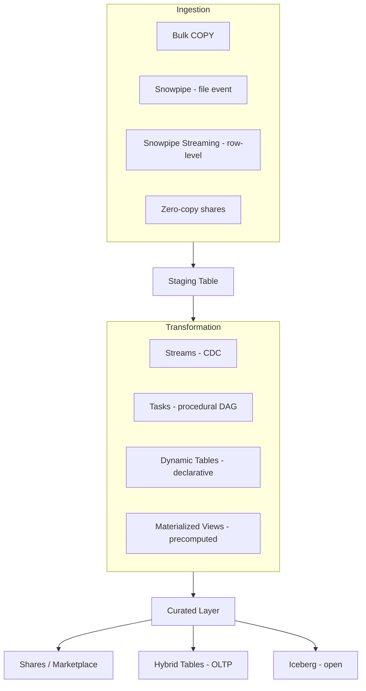

---

## Q1: Compare bulk COPY, Snowpipe, and Snowpipe Streaming.
**Difficulty:** Foundation
**Exam relevance:** "Choose an ingestion pattern"

### Answer
**Bulk COPY**: scheduled `COPY INTO table FROM stage`, pays warehouse credits, best for hourly/daily batches of large files. **Snowpipe**: continuous micro-batch, triggered by cloud notifications (SNS/EventGrid/Pub-Sub) or REST, serverless billing, minutes-level latency. **Snowpipe Streaming**: row-at-a-time ingestion via Snowflake Ingest SDK (Java/Python), seconds-level latency, no file staging, serverless billing per row-ingested.

### First Principles
Three pricing/latency points: files-on-schedule (cheap, high-latency), files-on-arrival (medium cost, minutes), rows-on-arrival (highest cost per row, seconds). COPY is cheapest when you can batch; Snowpipe trades a modest premium for arrival-driven freshness; Streaming eliminates file staging entirely at a per-row price. The architect's call: what's the real freshness SLA?

### Diagram

| Dimension | Bulk COPY | Snowpipe | Streaming |
|-----------|-----------|----------|-----------|
| Trigger | Scheduler cron | File lands in stage | App calls Ingest SDK |
| Mechanism | COPY INTO t | Snowflake notified | Rows via REST |
| Billing | WH credits | Serverless/file | Serverless/row |
| Latency | hours | minutes | seconds |
| Cost/GB | lowest | medium | highest |

### Lab Exercise
```sql
-- 1. Bulk COPY
COPY INTO raw.events FROM @s3_stage/events/2024-11-01/
  FILE_FORMAT = (TYPE=PARQUET)
  ON_ERROR = CONTINUE;

-- 2. Snowpipe (file-triggered)
CREATE PIPE pipe_events
  AUTO_INGEST = TRUE
  AWS_SNS_TOPIC = 'arn:aws:sns:us-east-1:123:ingest-topic'
AS
  COPY INTO raw.events FROM @s3_stage/events/ FILE_FORMAT=(TYPE=PARQUET);

-- 3. Snowpipe Streaming (via SDK)
-- Java/Python app:
--   SnowflakeStreamingIngestClient -> openChannel("raw.events") -> insertRows(List<Map<String,Object>>)
```
```python
# Python
from snowflake.ingest import SimpleIngestManager, StagedFile
# Streaming client requires the Snowflake Ingest Service SDK (snowflake-ingest-service)
# High-level pseudocode:
# client.open_channel("raw.events", "chan1").insert_rows([{...}], offset_token="...")
```
**Expected outcome:** Each pattern delivers data with its tradeoff — COPY batches 1h files, Snowpipe shows ~2-min delay from file upload, Streaming shows ~seconds from row insert.

### Gotchas / Exam Traps
- Snowpipe is NOT guaranteed per-record ordering; files are processed in arrival order but concurrently.
- Snowpipe Streaming's billing is per *client second* + per *row*; a chatty client with low throughput is expensive.
- `COPY INTO` is idempotent on file-name (will not reload the same file within 64 days); use `FORCE=TRUE` to override.
- Bulk COPY uses the executing user's warehouse; Snowpipe uses Snowflake-managed serverless compute.

---

## Q2: Describe Streams and the three types in detail.
**Difficulty:** Intermediate
**Exam relevance:** "Design CDC pipelines"

### Answer
A **Stream** is a change-tracking cursor on a table/view/external-table/stage. It exposes rows with `METADATA$ACTION` (INSERT/DELETE), `METADATA$ISUPDATE` (true for the pair of rows representing an UPDATE), and `METADATA$ROW_ID`. Three types: **Standard** (I/U/D), **Append-only** (I only), **Insert-only** (for external stages/directory tables). Consuming the stream in a DML transaction advances its offset atomically.

### First Principles
Snowflake tables are versioned at the metadata level (via Time Travel). A stream is a *saved offset* into the version history, allowing "give me what changed since I last looked." The semantics (I/U/D vs I only) match pipeline needs: full CDC for mirroring; append-only for high-throughput event tables where UPDATE/DELETE are rare and skipping them is cheaper. Insert-only exists because external tables can only observe file arrivals, not row-level changes.

### Diagram
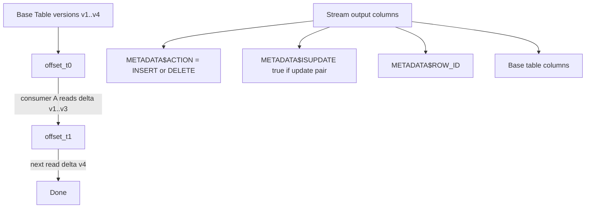

### Lab Exercise
```sql
CREATE TABLE src (id INT, val STRING);
CREATE STREAM src_cdc ON TABLE src;

INSERT INTO src VALUES (1,'a'),(2,'b');
UPDATE src SET val='A' WHERE id=1;
DELETE FROM src WHERE id=2;

-- Peek without consuming
SELECT * FROM src_cdc;

-- Consume in a transaction
INSERT INTO target
  SELECT id, val, METADATA$ACTION, METADATA$ISUPDATE
  FROM src_cdc;
-- stream offset advances; next SELECT * FROM src_cdc returns 0 rows (if no new changes)

-- Check stream staleness
SHOW STREAMS LIKE 'src_cdc';
-- STALE_AFTER column: deadline before stream expires
```
**Expected outcome:** First SELECT shows 4 rows (1 insert id=2, 1 delete id=2, 2 rows for update of id=1 — a DELETE + INSERT pair). After consuming DML, stream empties.

### Gotchas / Exam Traps
- A stream advances only when consumed inside a DML (INSERT/UPDATE/MERGE/DELETE/CTAS). `SELECT * FROM stream` alone does NOT advance.
- Multiple reads inside the same transaction see the same snapshot — critical for correctness.
- `STALE_AFTER` = base table's Time Travel retention + 14 days. If the stream isn't consumed in that window, it becomes stale (returns error on read).
- An UPDATE appears as a DELETE row + INSERT row with `METADATA$ISUPDATE=TRUE` — handle this if your target cares about updates.

---

## Q3: Describe Tasks and task DAGs including serverless vs user-managed warehouses.
**Difficulty:** Intermediate
**Exam relevance:** "Design task orchestration"

### Answer
A **Task** is a scheduled SQL statement (or stored procedure call). Tasks can chain into **DAGs** via `AFTER` dependency. Two compute modes: **user-managed warehouse** (specify WAREHOUSE; pay regular compute credits) or **serverless** (specify USER_TASK_MANAGED_INITIAL_WAREHOUSE_SIZE; Snowflake runs it, pays serverless credits). Scheduling: CRON expression or interval minutes.

### First Principles
Tasks give Snowflake-native orchestration without external tools (Airflow, dbt scheduler). DAGs make dependency explicit. Serverless mode is for small, intermittent tasks where keeping a warehouse running wastes credits; user-managed is for bursty or variable-size tasks where you've already got a warehouse awake. The streams-tasks pattern is Snowflake's canonical pipeline primitive.

### Diagram
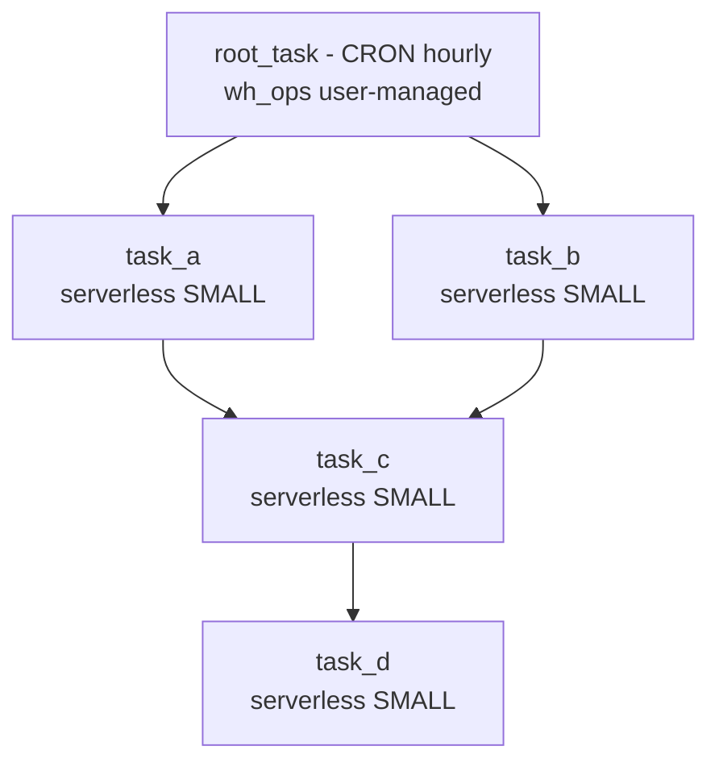

### Lab Exercise
```sql
-- Serverless root task
CREATE OR REPLACE TASK root_task
  USER_TASK_MANAGED_INITIAL_WAREHOUSE_SIZE='SMALL'
  SCHEDULE = 'USING CRON 0 * * * * UTC'
AS
  CALL load_landing();

-- Child task triggered when stream has data
CREATE OR REPLACE TASK task_a
  USER_TASK_MANAGED_INITIAL_WAREHOUSE_SIZE='SMALL'
  AFTER root_task
  WHEN SYSTEM$STREAM_HAS_DATA('src_cdc')
AS
  INSERT INTO target_a SELECT * FROM src_cdc WHERE type='A';

CREATE OR REPLACE TASK task_c
  AFTER task_a
AS
  CALL post_process();

ALTER TASK root_task RESUME;  -- resumes the whole DAG
```
**Expected outcome:** Each hour, root fires; task_a conditionally fires if the stream has rows; task_c follows task_a.

### Gotchas / Exam Traps
- A task is CREATED SUSPENDED. You must `ALTER TASK ... RESUME` or it never runs.
- Only the root task of a DAG has a SCHEDULE; children have AFTER.
- `WHEN SYSTEM$STREAM_HAS_DATA(...)` lets a task skip execution if there's nothing to do — but still counts as an evaluation.
- Serverless task size can auto-tune: `USER_TASK_MANAGED_INITIAL_WAREHOUSE_SIZE` is initial; Snowflake adjusts based on history.
- Task history is in `TASK_HISTORY`; failures do NOT auto-retry — you must handle in the SQL (TRY/CATCH in SP) or with task-level `ALTER TASK ... SET RETRY_...`.

---

## Q4: Explain Dynamic Tables and compare to Streams+Tasks and Materialized Views.
**Difficulty:** Advanced
**Exam relevance:** "Choose declarative vs procedural pipelines"

### Answer
A **Dynamic Table** is a declaratively-defined result table that Snowflake incrementally refreshes to meet a **TARGET_LAG** SLA. You write `CREATE DYNAMIC TABLE dt TARGET_LAG='5 MIN' WAREHOUSE=wh AS SELECT ...`; Snowflake figures out how to incrementally compute the delta and refresh. Compared to Streams+Tasks: no procedural glue, no manual offset management. Compared to Materialized Views: supports joins, aggregations, window functions, and chaining (DT on DT).

### First Principles
Streams+Tasks is powerful but low-level: you own the offsets, the DAG, the DML. Dynamic Tables shift to a declarative model — "I want this result with this freshness." Snowflake computes the dependency graph and incremental refresh plan. MVs cover simple precomputed aggregations on a single base table; DTs cover arbitrary pipelines. The trade is control: DT abstracts the plumbing but doesn't let you insert procedural logic between steps.

### Diagram
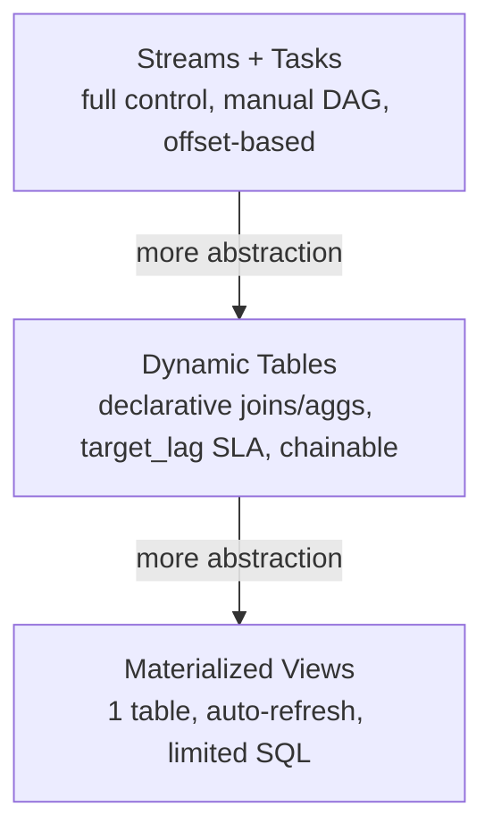

### Lab Exercise
```sql
-- A DT that aggregates orders by day, kept within 5-min staleness
CREATE OR REPLACE DYNAMIC TABLE orders_daily
  TARGET_LAG = '5 MIN'
  WAREHOUSE = wh_etl
AS
SELECT DATE_TRUNC('day', order_ts) AS d,
       customer_id,
       SUM(amount) AS total,
       COUNT(*)    AS n
FROM raw.orders
GROUP BY 1,2;

-- Chain a second DT on top
CREATE OR REPLACE DYNAMIC TABLE orders_daily_summary
  TARGET_LAG = DOWNSTREAM        -- inherits from downstream dependency
  WAREHOUSE = wh_etl
AS
SELECT d, SUM(total) AS grand_total FROM orders_daily GROUP BY d;

-- Inspect refresh history
SELECT * FROM TABLE(INFORMATION_SCHEMA.DYNAMIC_TABLE_REFRESH_HISTORY())
WHERE name='ORDERS_DAILY' ORDER BY refresh_start_time DESC;
```
**Expected outcome:** `orders_daily` refreshes within 5 min of base table changes; `orders_daily_summary` refreshes to keep downstream freshness.

### Gotchas / Exam Traps
- `TARGET_LAG = DOWNSTREAM` lets intermediate DTs defer refresh until a leaf needs it — important for cost.
- Not all SQL is incrementally refreshable; non-deterministic functions or certain window frames trigger full-recompute. Check `IS_INCREMENTAL_REFRESHABLE`.
- DTs cannot have primary keys or constraints; they're derived.
- DTs run on a user-managed warehouse (unlike MVs which are serverless).

---

## Q5: Compare Dynamic Tables and Materialized Views in detail.
**Difficulty:** Advanced
**Exam relevance:** "Choose precomputation primitive"

### Answer
**MV**: single-table, limited SQL (no joins, limited aggregates, no outer joins), auto-maintained serverlessly, best for repeating lookups on a hot subset of a large table. **DT**: multi-table joins, window functions, arbitrary SQL, user-managed warehouse, declarative lag target, chainable. MV is a "SQL-free index of a precomputation"; DT is a "pipeline step."

### First Principles
MVs predate DTs and were designed as query-rewrite accelerators: the optimizer transparently uses the MV when it recognizes an equivalent query. DTs are explicit targets you write TO — queries reference the DT directly, not an underlying base. The paradigm differs: MVs are optimization; DTs are pipeline. Use MV when the query shape is fixed and you want transparent speedup; use DT when you're building a derived model layer.

### Diagram

| Aspect | Materialized View | Dynamic Table |
|--------|-------------------|---------------|
| Base | 1 table | multiple tables + joins |
| Refresh | serverless auto | user-managed WH, scheduled |
| Access | optimizer rewrites | reference by name |
| SQL | limited aggregates | full SQL |
| Chainable | no | yes (DT on DT) |

### Lab Exercise
```sql
-- MV: optimizer-rewritten
CREATE MATERIALIZED VIEW mv_cust_totals AS
SELECT customer_id, SUM(amount) AS total FROM orders GROUP BY customer_id;

-- Querying orders triggers MV usage automatically
EXPLAIN SELECT customer_id, SUM(amount) FROM orders GROUP BY customer_id;
-- Look for "MV" or "materialized view" in the plan

-- DT: explicit reference
CREATE DYNAMIC TABLE dt_cust_summary TARGET_LAG='15 MIN' WAREHOUSE=wh_etl AS
SELECT c.region, c.tier, SUM(o.amount) AS total
FROM orders o JOIN customers c USING(customer_id)
GROUP BY c.region, c.tier;

SELECT * FROM dt_cust_summary;  -- explicit; optimizer doesn't magic-rewrite your other queries into it
```
**Expected outcome:** MV speeds up any query matching its SELECT shape; DT must be referenced by name.

### Gotchas / Exam Traps
- MVs disallow outer joins, cross-table aggregations, limit, order by, UDFs. If your logic needs them, you MUST use DT (or Streams+Tasks).
- MVs maintain even against DML to the base table; cost of maintenance is billed as serverless credits.
- MVs are Enterprise+; DTs are available in all editions.

---

## Q6: Explain external tables, directory tables, and external stages.
**Difficulty:** Intermediate
**Exam relevance:** "Design external data access"

### Answer
**External stage**: a reference to an S3/Blob/GCS path with credentials — Snowflake can read/write files there. **External table**: a *table-like view* over files in a stage, where metadata (file list, partitions) is maintained but data lives outside Snowflake. **Directory table**: a metadata-only table *built into every stage* that lists files + presigned URLs; use `DIRECTORY=(ENABLE=TRUE)` to activate.

### First Principles
Snowflake separates *where* data lives (storage) from *how* it's accessed (table abstraction). An external stage says "I have files out there"; an external table says "treat those files as a queryable table" without copying them in. Directory tables bridge files and tables for use cases (e.g., unstructured content, document indexes) where you want SQL discovery of file objects. The decision: pay once for Snowflake-managed storage (COPY INTO) vs query external bytes forever (external table).

### Diagram

| Object | Purpose |
|--------|---------|
| External stage `@s3_stage` | s3://bucket/path; credentials via SI; feeds COPY INTO target |
| External table `ext_tbl` | partitioned by date; reads parquet live; no copy into Snowflake |
| Directory table | per-stage view of files + presigned URLs for apps |

### Lab Exercise
```sql
-- External stage with storage integration
CREATE STORAGE INTEGRATION s3_int
  TYPE=EXTERNAL_STAGE STORAGE_PROVIDER=S3
  ENABLED=TRUE
  STORAGE_AWS_ROLE_ARN='arn:aws:iam::123:role/snowflake'
  STORAGE_ALLOWED_LOCATIONS=('s3://acme-data/');

CREATE STAGE ext_stage
  URL='s3://acme-data/events/'
  STORAGE_INTEGRATION=s3_int
  FILE_FORMAT=(TYPE=PARQUET)
  DIRECTORY=(ENABLE=TRUE);

-- External table partitioned
CREATE EXTERNAL TABLE ext_events (
  event_date DATE AS TO_DATE(SPLIT_PART(metadata$filename,'/',3))
)
PARTITION BY (event_date)
LOCATION=@ext_stage/
FILE_FORMAT=(TYPE=PARQUET)
AUTO_REFRESH=TRUE;

-- Directory table
SELECT relative_path, size, file_url, last_modified FROM DIRECTORY(@ext_stage);
```
**Expected outcome:** External table scans parquet files live; directory table lists every file with presigned URLs.

### Gotchas / Exam Traps
- External tables scan on every query — no micro-partition pruning via Snowflake metadata beyond partitioning. Push down selectivity via partition columns.
- `AUTO_REFRESH=TRUE` requires an SNS/EventGrid/PubSub notification setup similar to Snowpipe.
- External tables are read-only (except Iceberg which has write support in certain modes).
- Directory tables REFRESH is NOT automatic unless `AUTO_REFRESH=TRUE`; otherwise call `ALTER STAGE ext_stage REFRESH;`.

---

## Q7: Describe Snowflake-managed Iceberg tables and their advantages.
**Difficulty:** Advanced
**Exam relevance:** "Design open-table-format architecture"

### Answer
**Iceberg tables** are open-format tables stored in Parquet with Iceberg metadata. Two flavors: **Snowflake-managed** (Snowflake owns both data + metadata, full read/write, closest to native tables) and **externally-managed** (another engine like Spark owns metadata via a catalog like Glue/Nessie, Snowflake reads/writes via connector). Advantage: data stays in open format in your bucket, accessible by any Iceberg-aware engine (Spark, Trino, Flink) — avoids vendor lock-in while keeping Snowflake performance.

### First Principles
Historically, data loaded into Snowflake was in Snowflake's proprietary micro-partition format — portable only via export. Iceberg solves this by letting data live in your S3/Blob as open Parquet, with Iceberg metadata giving ACID + time-travel semantics. Snowflake-managed Iceberg means Snowflake maintains the metadata catalog; externally-managed means a third-party catalog is authoritative and Snowflake joins the party. Choose Snowflake-managed if Snowflake is primary; externally-managed if you have polyglot engines.

### Diagram

| Aspect | Snowflake-Managed Iceberg | External Catalog Iceberg |
|--------|---------------------------|---------------------------|
| Data | Your S3 parquet | Your S3 parquet |
| Metadata | Snowflake owns | Glue / Nessie |
| Write authority | Snowflake | Catalog owner |
| Snowflake access | Read + write | Read-only or synced |
| Multi-engine read | Yes (any Iceberg engine) | Yes (any Iceberg engine) |

### Lab Exercise
```sql
-- External volume (points to your bucket)
CREATE EXTERNAL VOLUME ext_vol
  STORAGE_LOCATIONS = (
    (NAME='aws-us-east-1' STORAGE_PROVIDER='S3'
     STORAGE_BASE_URL='s3://acme-iceberg/'
     STORAGE_AWS_ROLE_ARN='arn:aws:iam::123:role/snowflake'
     ENCRYPTION=(TYPE='AWS_SSE_KMS' KMS_KEY_ID='arn:aws:kms:...')));

-- Snowflake-managed Iceberg catalog
CREATE CATALOG INTEGRATION ice_cat
  CATALOG_SOURCE=SNOWFLAKE TABLE_FORMAT=ICEBERG ENABLED=TRUE;

-- Snowflake-managed Iceberg table
CREATE ICEBERG TABLE orders_ice (
  id INT, amount NUMBER, order_ts TIMESTAMP
)
EXTERNAL_VOLUME='ext_vol'
CATALOG='SNOWFLAKE'
BASE_LOCATION='orders/';

INSERT INTO orders_ice VALUES (1, 100.0, CURRENT_TIMESTAMP());
SELECT * FROM orders_ice;

-- From Spark side, read same table via Iceberg catalog pointing to BASE_LOCATION
```
**Expected outcome:** Parquet + metadata files appear in `s3://acme-iceberg/orders/`; readable by Spark/Trino with Iceberg metadata.

### Gotchas / Exam Traps
- Iceberg tables require an **external volume** — a Snowflake-managed credential + path to your bucket.
- External catalog Iceberg tables may be read-only in Snowflake unless the catalog supports Snowflake writes.
- Iceberg time-travel operates on snapshot IDs, not Snowflake's clock-based time travel — they are independent features.
- Clustering, materialized views, and dynamic tables on Iceberg have limitations — verify current support.

---

## Q8: What are Hybrid Tables (Unistore) and when do you use them?
**Difficulty:** Advanced
**Exam relevance:** "Design transactional workloads"

### Answer
**Hybrid tables** combine OLTP (row-store with primary key + secondary indexes) and analytics (columnar automatic replication). Use for workloads needing low-latency single-row lookups + updates (e.g., session state, operational data, feature store) alongside analytical queries. Primary key enforced; FOREIGN KEY enforced; secondary indexes supported.

### First Principles
Standard Snowflake tables are columnar and immutable at the MP level — excellent for scans, terrible for 50-row point lookups with transactional updates. Hybrid tables add a row-oriented store (RocksDB-like) *and* automatically mirror into columnar for the analytical side. This lets one table serve both patterns without a dual-write pipeline. The use case: Unistore apps where you'd otherwise run a separate OLTP DB (Postgres) alongside Snowflake.

### Diagram
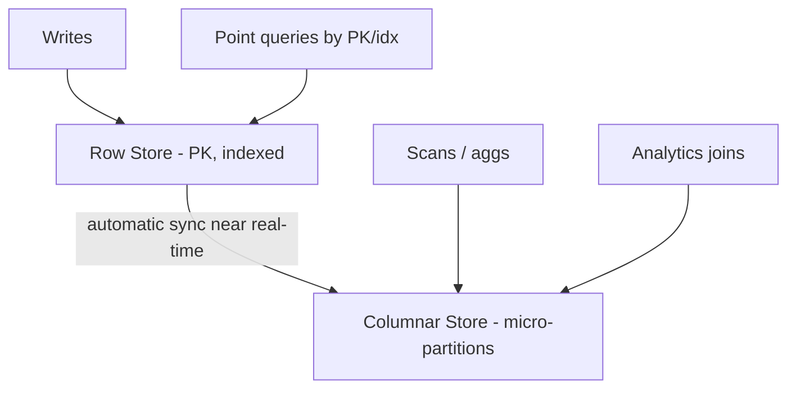

### Lab Exercise
```sql
CREATE HYBRID TABLE user_sessions (
  session_id STRING PRIMARY KEY,
  user_id    INT NOT NULL,
  started_at TIMESTAMP,
  state      VARIANT,
  INDEX idx_user (user_id)
);

-- Fast point lookup
SELECT state FROM user_sessions WHERE session_id='abc123';   -- sub-ms

-- Analytical aggregation
SELECT DATE_TRUNC('hour',started_at) AS hr, COUNT(*)
FROM user_sessions GROUP BY hr;                                -- columnar scan

-- Transactional update
BEGIN;
UPDATE user_sessions SET state=OBJECT_INSERT(state,'cart',TRUE) WHERE session_id='abc123';
COMMIT;
```
**Expected outcome:** Point lookups return in milliseconds; analytical scans use columnar; FK/PK/index constraints enforced.

### Gotchas / Exam Traps
- Hybrid tables are a newer feature with regional availability — check if your account's region supports them.
- Storage is dual (row + columnar) — storage cost is higher than regular tables.
- Not all table features are supported (certain clustering ops, external replication of hybrid-specific metadata).
- Hybrid tables support MERGE/UPSERT with transactional semantics; this is the differentiator vs standard tables.

---

## Q9: Design a near-real-time analytics pipeline from Kafka to curated metrics.
**Difficulty:** Advanced
**Exam relevance:** "End-to-end pipeline scenario"

### Answer
**Ingest**: Snowpipe Streaming via the Kafka Connector (which uses the streaming SDK under the hood) writes to `raw.events` with seconds-level latency. **Transform**: a Dynamic Table `clean.events` normalizes/enriches with `TARGET_LAG='1 MIN'`. **Aggregate**: a Dynamic Table `metrics.events_1min` summarizes 1-minute windows with `TARGET_LAG='2 MIN'`. **Serve**: BI tool queries `metrics.events_1min` on a dedicated warehouse. Optional: a secondary stream + task alerts on anomalies via an external function.

### First Principles
Each layer has a freshness vs cost knob. Streaming at the edge is non-negotiable for seconds latency. Dynamic Tables with explicit lag targets let you cascade freshness: raw gets fresh fast; aggregates follow. Separation of raw/clean/metrics mirrors medallion architecture and gives natural rollback points (replay from clean, replay from raw).

### Diagram
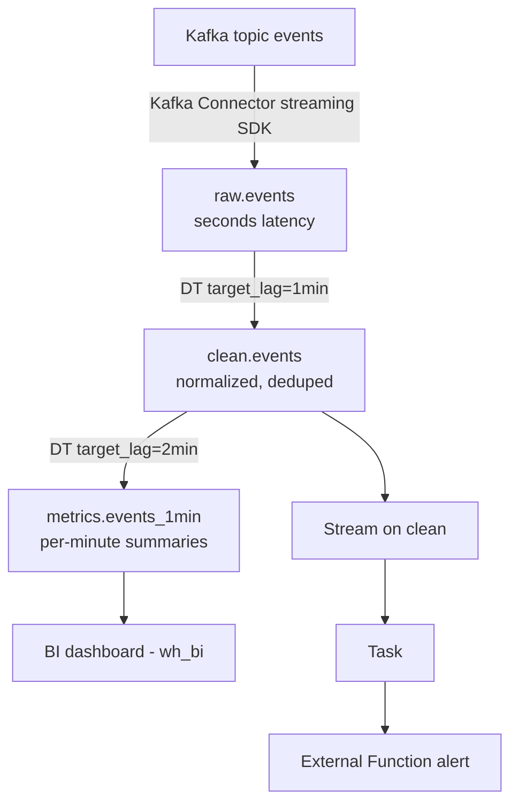

### Lab Exercise
```sql
-- Raw table (streaming target)
CREATE TABLE raw.events (
  event_id STRING, user_id INT, event_type STRING, payload VARIANT, ingest_ts TIMESTAMP DEFAULT CURRENT_TIMESTAMP()
);
-- Kafka Connector configuration (snowflake.ingestion.method=SNOWPIPE_STREAMING)
-- lands rows here via the Ingest SDK

-- Clean DT
CREATE DYNAMIC TABLE clean.events
  TARGET_LAG = '1 MIN' WAREHOUSE = wh_etl
AS
SELECT event_id, user_id, UPPER(event_type) AS event_type,
       payload:region::STRING AS region, ingest_ts
FROM raw.events
WHERE event_type IS NOT NULL
QUALIFY ROW_NUMBER() OVER (PARTITION BY event_id ORDER BY ingest_ts) = 1;

-- Metrics DT
CREATE DYNAMIC TABLE metrics.events_1min
  TARGET_LAG = '2 MIN' WAREHOUSE = wh_etl
AS
SELECT DATE_TRUNC('minute', ingest_ts) AS minute_bucket,
       region, event_type, COUNT(*) AS n
FROM clean.events
GROUP BY 1,2,3;

-- Alert stream+task
CREATE STREAM clean.events_cdc ON TABLE clean.events APPEND_ONLY=TRUE;
CREATE TASK alert_task
  USER_TASK_MANAGED_INITIAL_WAREHOUSE_SIZE='XSMALL'
  SCHEDULE = '1 MINUTE'
  WHEN SYSTEM$STREAM_HAS_DATA('clean.events_cdc')
AS
  CALL send_alert_if_spike();
ALTER TASK alert_task RESUME;
```
**Expected outcome:** End-to-end latency from Kafka producer → BI dashboard is ~3-5 min; alerts fire on anomalies at 1-min granularity.

### Gotchas / Exam Traps
- Deduplication via QUALIFY works but is a window — on huge data streams, consider using primary keys and MERGE in a task instead.
- Chained DTs cost more as each layer refreshes — set `TARGET_LAG = DOWNSTREAM` on intermediate DTs when the leaf's lag dominates.
- Streaming SDK billing has a per-channel minimum — too many channels on low-throughput data is wasteful; batch at the connector level.

---

## Q10: Explain external functions and when to use them.
**Difficulty:** Intermediate
**Exam relevance:** "Design external integrations"

### Answer
**External functions** are SQL UDFs that call a remote HTTP endpoint (via an API gateway integration like AWS API Gateway, Azure API Management, GCP API Gateway). The HTTP service runs your code (any language, any infra), Snowflake sends batches of rows, receives responses, materializes as function output. Use for: calling third-party APIs (sentiment, geo), invoking proprietary models, integrating with legacy services.

### First Principles
Not everything should live in Snowflake — proprietary models, licensed APIs, and legacy services exist elsewhere. External functions provide a secure, batched, auditable bridge: Snowflake handles batching + retries + auth; the user's AWS Lambda handles compute. This is the "escape hatch" for computation that can't move to Snowflake. Alternative is SPCS (containers inside Snowflake) if latency/governance demands it.

### Diagram
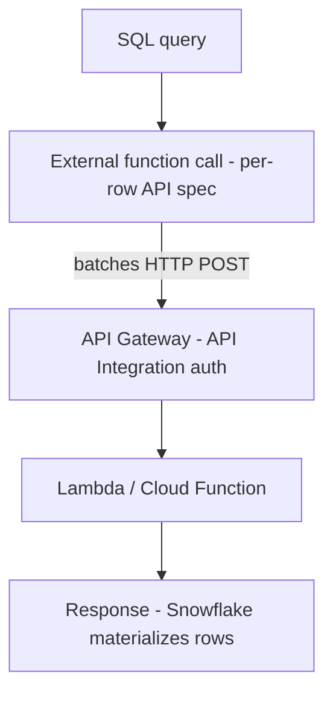

### Lab Exercise
```sql
-- API integration (one-time per cloud)
CREATE API INTEGRATION aws_api_int
  API_PROVIDER = AWS_API_GATEWAY
  API_AWS_ROLE_ARN = 'arn:aws:iam::123:role/sf_api_role'
  API_ALLOWED_PREFIXES = ('https://abc.execute-api.us-east-1.amazonaws.com/prod/')
  ENABLED = TRUE;

-- External function
CREATE EXTERNAL FUNCTION sentiment(text STRING)
  RETURNS NUMBER
  API_INTEGRATION = aws_api_int
  HEADERS = ('x-source'='snowflake')
  AS 'https://abc.execute-api.us-east-1.amazonaws.com/prod/sentiment';

-- Use it
SELECT review_id, sentiment(review_text) AS score FROM reviews LIMIT 100;
```
**Expected outcome:** Snowflake batches rows into HTTP payloads (~100-1000 rows per call), parallelizes across warehouse nodes.

### Gotchas / Exam Traps
- External functions have strict request/response shapes — JSON with `data` key, batch-aligned by row index.
- Latency of each call is in the critical path of the query; a slow endpoint tanks query performance.
- Egress costs apply to data leaving Snowflake. Compute within Snowflake (UDF, SPCS) when possible.
- Snowflake retries on 5xx with jitter but doesn't retry on 4xx — your API must be idempotent.

---

## Q11: Describe stored procedures: Snowflake Scripting, JavaScript, Python, Scala.
**Difficulty:** Intermediate
**Exam relevance:** "Design procedural logic"

### Answer
Four languages for SPs: (1) **Snowflake Scripting** — SQL + procedural extensions (IF/LOOP/CURSOR), native, best for SQL-heavy procedural work. (2) **JavaScript** — original SP language, limited by sandbox. (3) **Python** — Snowpark Python, has Snowflake session, best for ML/data manipulation with pandas. (4) **Scala/Java** — Snowpark Scala/Java for JVM shops. Pick by language ergonomics for your team; all run inside Snowflake.

### First Principles
Different teams speak different languages. Snowflake Scripting is close to Oracle PL/SQL (comfortable for DBAs). Python is dominant for data engineers / data scientists. JavaScript persists for legacy. Scala/Java fits dbt + JVM ETL ecosystems. All offer the same primitive: run code with a Snowflake session, interact via SQL + DataFrames.

### Diagram
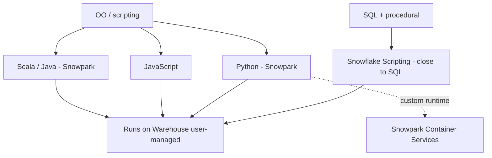

### Lab Exercise
```sql
-- Snowflake Scripting
CREATE OR REPLACE PROCEDURE merge_updates()
RETURNS STRING
LANGUAGE SQL
AS
$$
DECLARE
  n INT;
BEGIN
  MERGE INTO target t USING (SELECT * FROM src_cdc) s
    ON t.id = s.id
  WHEN MATCHED AND s.METADATA$ACTION='DELETE' THEN DELETE
  WHEN MATCHED THEN UPDATE SET t.val = s.val
  WHEN NOT MATCHED THEN INSERT (id,val) VALUES (s.id,s.val);
  n := SQLROWCOUNT;
  RETURN 'Merged ' || n || ' rows';
END;
$$;

-- Python
CREATE OR REPLACE PROCEDURE compute_feature(table_name STRING)
RETURNS TABLE()
LANGUAGE PYTHON
RUNTIME_VERSION = '3.11'
PACKAGES = ('snowflake-snowpark-python','pandas')
HANDLER = 'run'
AS
$$
def run(session, table_name):
    df = session.table(table_name).to_pandas()
    df['feature'] = df['value'] * 2
    return session.create_dataframe(df)
$$;

CALL merge_updates();
CALL compute_feature('raw.orders');
```
**Expected outcome:** Each SP executes within one session; Python SPs can use pandas up to memory limits of the warehouse node.

### Gotchas / Exam Traps
- Python SPs can be caller's rights or owner's rights (`EXECUTE AS CALLER` vs `EXECUTE AS OWNER`). Default is OWNER — the SP runs with the owner's privileges, a security consideration.
- Snowpark packages must be in Anaconda channel OR uploaded as stage files + referenced.
- JavaScript SPs are limited to small result sets (snapshot in RAM); for streaming big results prefer Python/Scripting with cursors.

---

## Q12: Compare UDF types: scalar, table, external, vectorized.
**Difficulty:** Intermediate
**Exam relevance:** "Design UDFs"

### Answer
- **Scalar UDF**: one row in, one scalar out. Language: SQL, JS, Python, Scala, Java.
- **Table UDF (UDTF)**: one call, multiple rows out. Useful for row-expansion logic (parse JSON array into rows).
- **External UDF**: calls a remote HTTP endpoint; see Q10.
- **Vectorized Python UDF**: receives a pandas DataFrame batch of rows, returns a Series — dramatically faster than row-by-row Python UDFs for numeric work.

### First Principles
Scalar UDFs are the stepping stone from SQL to procedural logic. UDTFs let one input produce N outputs — the inverse of aggregation. Vectorized UDFs exploit SIMD and avoid Python per-row overhead; crucial for ML scoring. External UDFs span the trust boundary. The exam tests choosing the right flavor: don't use row-at-a-time Python when vectorized exists.

### Diagram

| UDF Type | Shape | Use For |
|----------|-------|---------|
| Scalar | row to value, fastest native | enrichment |
| UDTF | row to N rows | splits / flatten JSON |
| External | row to HTTP call, network latency | 3rd-party APIs |
| Vectorized Py | batch DataFrame to Series, SIMD | numeric ML scoring |

### Lab Exercise
```sql
-- Scalar SQL UDF
CREATE FUNCTION tax(amt NUMBER) RETURNS NUMBER AS 'amt * 0.08';

-- Table UDF (Python)
CREATE OR REPLACE FUNCTION split_lines(s STRING)
RETURNS TABLE (line STRING)
LANGUAGE PYTHON RUNTIME_VERSION='3.11' HANDLER='Splitter'
AS
$$
class Splitter:
    def process(self, s):
        for line in s.split('\n'):
            yield (line,)
$$;

SELECT doc_id, line FROM docs, TABLE(split_lines(body));

-- Vectorized Python UDF
CREATE OR REPLACE FUNCTION score_vec(x FLOAT, y FLOAT)
RETURNS FLOAT
LANGUAGE PYTHON RUNTIME_VERSION='3.11'
PACKAGES=('pandas','numpy')
HANDLER='run'
AS
$$
from _snowflake import vectorized
import pandas as pd

@vectorized(input=pd.DataFrame)
def run(df):
    return df[0]*2.5 + df[1]
$$;
```
**Expected outcome:** Vectorized UDF measurably faster than scalar Python on wide numeric data (10-100× in realistic cases).

### Gotchas / Exam Traps
- Non-vectorized Python UDFs can run slowly due to per-row Python interpreter overhead. ALWAYS prefer vectorized for numeric batches.
- UDFs are *not* order-preserving across the query; don't rely on side effects.
- UDTFs can be invoked via `LATERAL`; the exam tests the syntax.

---

## Q13: Design a batch ingest pattern for 500 GB of daily parquet files from S3.
**Difficulty:** Advanced
**Exam relevance:** "Design batch ingest"

### Answer
Use **bulk COPY** on a dedicated warehouse (Large or XLarge for parallelism). Files should be **100-250 MB each** (not one huge file). COPY in **parallel** by splitting the stage path or using multiple COPY statements. Use `ON_ERROR=SKIP_FILE_<N>` or `CONTINUE` for resilience. Keep history in `COPY_HISTORY` for idempotency; files auto-dedupe within 64 days. Wrap in a stored procedure invoked by a scheduled task.

### First Principles
Snowflake parallelism = warehouse nodes × file splits. One giant file = one thread. 100 small files = up to 100 parallel loaders. The sweet spot (100-250 MB compressed) balances per-file overhead against parallelism. Larger warehouse sizes help only if there are enough files to feed the nodes.

### Diagram
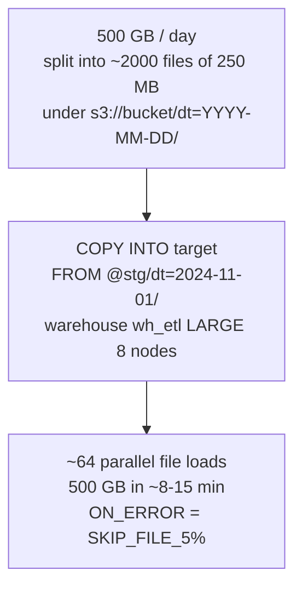

### Lab Exercise
```sql
CREATE WAREHOUSE wh_etl WAREHOUSE_SIZE='LARGE' AUTO_SUSPEND=120;

CREATE OR REPLACE PROCEDURE daily_load(load_date STRING)
RETURNS STRING LANGUAGE SQL AS
$$
BEGIN
  COPY INTO raw.events
  FROM @ext_stage/dt=:LOAD_DATE/
  FILE_FORMAT = (TYPE=PARQUET)
  MATCH_BY_COLUMN_NAME = CASE_INSENSITIVE
  ON_ERROR = 'SKIP_FILE_5%'
  PURGE = FALSE;
  RETURN 'OK ' || :LOAD_DATE;
END;
$$;

CREATE TASK task_daily_load
  WAREHOUSE = wh_etl
  SCHEDULE = 'USING CRON 0 2 * * * UTC'
AS
  CALL daily_load(TO_VARCHAR(CURRENT_DATE()-1));
ALTER TASK task_daily_load RESUME;

-- Audit
SELECT * FROM TABLE(INFORMATION_SCHEMA.COPY_HISTORY(TABLE_NAME=>'RAW.EVENTS', START_TIME=>DATEADD('day',-7,CURRENT_TIMESTAMP())));
```
**Expected outcome:** 500 GB loads in minutes; failures logged, successful files tracked in COPY_HISTORY.

### Gotchas / Exam Traps
- `PURGE=TRUE` deletes files from the stage after successful load; useful for cleanup but destructive — be sure load is validated.
- `COPY` is idempotent on file-name within 64 days; the same filename won't reload. Change filename or set `FORCE=TRUE` to replay.
- `MATCH_BY_COLUMN_NAME` lets COPY match parquet columns by name to target columns — critical for schema evolution.

---

## Q14: Explain MERGE and its common pitfalls in Snowflake.
**Difficulty:** Intermediate
**Exam relevance:** "Design upsert logic"

### Answer
`MERGE` combines INSERT/UPDATE/DELETE into one statement based on a join condition. Use `WHEN MATCHED [AND <cond>] THEN UPDATE/DELETE`, `WHEN NOT MATCHED THEN INSERT`. Common pitfall: non-unique source rows per target key cause **non-deterministic update** errors (`ERROR_ON_NONDETERMINISTIC_MERGE=TRUE` by default). Solution: aggregate/dedupe source, or set the parameter to FALSE (risky).

### First Principles
MERGE is a single atomic DML to a snowflake table — one commit. If a target row matches multiple source rows, which source "wins"? Snowflake refuses to guess by default. Deduping source via `QUALIFY ROW_NUMBER()` upstream makes behavior deterministic. Streams + MERGE is the canonical pattern for CDC-into-target.

### Diagram

| Target | Source |
|--------|--------|
| id=1 val='a' | id=1 val='b' |
| id=2 val='c' | id=1 val='c' (DUPLICATE) |
| | id=3 val='d' |

MERGE ON target.id=source.id with duplicate source for id=1 produces non-deterministic error by default.

Fix: `SELECT ... QUALIFY ROW_NUMBER() OVER (PARTITION BY id ORDER BY ts DESC) = 1` upstream.

### Lab Exercise
```sql
-- Pattern: Stream + MERGE
CREATE OR REPLACE TASK merge_cdc
  USER_TASK_MANAGED_INITIAL_WAREHOUSE_SIZE='SMALL'
  SCHEDULE='5 MINUTE'
  WHEN SYSTEM$STREAM_HAS_DATA('src_cdc')
AS
MERGE INTO dw.target t
USING (
  SELECT id, val, METADATA$ACTION, METADATA$ISUPDATE
  FROM src_cdc
  QUALIFY ROW_NUMBER() OVER (PARTITION BY id ORDER BY METADATA$ROW_ID DESC) = 1
) s
ON t.id = s.id
WHEN MATCHED AND s.METADATA$ACTION='DELETE' AND s.METADATA$ISUPDATE=FALSE THEN DELETE
WHEN MATCHED AND s.METADATA$ACTION='INSERT' THEN UPDATE SET val=s.val
WHEN NOT MATCHED AND s.METADATA$ACTION='INSERT' THEN INSERT (id,val) VALUES (s.id,s.val);
```
**Expected outcome:** Target mirrors source with CDC semantics; task runs every 5 min if there's new change data.

### Gotchas / Exam Traps
- Streams emit UPDATE as DELETE+INSERT pair — handle both or filter by `METADATA$ISUPDATE`.
- MERGE can produce `partition explosion` when the predicate isn't selective; monitor plan.
- `MERGE ... WHEN NOT MATCHED BY SOURCE` (full outer merge) is NOT supported in Snowflake MERGE natively — you need a separate DELETE pass.

---

## Q15: Describe stages: internal (user, table, named) vs external.
**Difficulty:** Foundation
**Exam relevance:** "Describe stage types"

### Answer
- **User stage** (`@~`): per-user, implicit, best for ad-hoc PUT of a few files.
- **Table stage** (`@%mytable`): per-table, implicit, for files loaded to just that table.
- **Named internal stage** (`@mystage`): explicit, in a schema, shareable via grants, best for shared ingest workflows.
- **External stage**: references S3/Blob/GCS; data lives outside Snowflake.

### First Principles
Snowflake stages abstract over "where files live" for COPY/PUT/GET. Internal stages are Snowflake-managed storage (micro-partition-adjacent); external stages point at your cloud buckets. User/table stages exist for convenience in simple cases; named stages are the real tool for engineered pipelines because they can carry grants.

### Diagram

| Stage | Syntax | Scope |
|-------|--------|-------|
| User | `@~mystage` | per-user, implicit |
| Table | `@%mytable` | per-table, implicit |
| Named internal | `@mydb.sch.named_stg` | shareable via grants |
| Named external | `@mydb.sch.ext_stg` | points to s3://bucket/ |

Operations: PUT uploads local to internal; GET downloads from internal; COPY INTO loads from any stage.

### Lab Exercise
```sql
-- Named internal stage
CREATE STAGE my_stage FILE_FORMAT=(TYPE=CSV);
PUT file:///tmp/data.csv @my_stage;
COPY INTO target FROM @my_stage/data.csv.gz;

-- List files
LIST @my_stage;
LIST @~;              -- user stage
LIST @%target;        -- table stage

-- Grant on named stage
GRANT READ ON STAGE my_stage TO ROLE loader;
```
**Expected outcome:** Each stage type works for the appropriate scope. Table/user stages have no grant options.

### Gotchas / Exam Traps
- User/table stages cannot be granted to other users — if sharing files is needed, use a named stage.
- PUT compresses by default (auto-gzip); set `AUTO_COMPRESS=FALSE` for pre-compressed files.
- External stages require storage integrations (not inline credentials) for production — baked credentials are deprecated.

---

## Q16: Explain error handling in Snowpipe and COPY.
**Difficulty:** Intermediate
**Exam relevance:** "Design resilient ingest"

### Answer
`COPY INTO` supports `ON_ERROR = CONTINUE | SKIP_FILE | SKIP_FILE_<N> | SKIP_FILE_<N>% | ABORT_STATEMENT`. Pipe-level error history: `SNOWPIPE.PIPE_USAGE_HISTORY` + `COPY_HISTORY`. Dead-letter pattern: use `VALIDATION_MODE = RETURN_ALL_ERRORS` or `RETURN_ERRORS` first to inspect, then load with permissive `ON_ERROR`. For Snowpipe, failed files appear in `COPY_HISTORY` with `error` details.

### First Principles
Files can be malformed; the question is how fatal that is for the pipeline. Dropping a whole file for one bad row is wasteful; accepting arbitrary bad rows corrupts the target. `SKIP_FILE_<N>` offers a tolerable error budget. Dead-letter requires moving the problem files aside so humans can inspect without blocking the pipe.

### Diagram

| ON_ERROR | Effect |
|----------|--------|
| CONTINUE | load good rows, log bad |
| SKIP_FILE | skip file on any error |
| SKIP_FILE_5 | skip if >=5 bad rows |
| SKIP_FILE_5% | skip if >=5% bad rows |
| ABORT_STATEMENT | fail whole COPY on first error (default) |

Dead-letter pattern: use `VALIDATION_MODE=RETURN_ERRORS` to preflight; on fail, PUT bad file to `@stg_bad`; load good files with `ON_ERROR=CONTINUE`.

### Lab Exercise
```sql
-- Preflight validation
COPY INTO target FROM @stg
  VALIDATION_MODE = RETURN_ERRORS
  FILE_FORMAT = (TYPE=CSV);
-- Returns table of errors; no data loaded

-- Load with tolerable errors
COPY INTO target FROM @stg
  ON_ERROR = 'CONTINUE'
  FILE_FORMAT = (TYPE=CSV);

-- Inspect
SELECT * FROM TABLE(INFORMATION_SCHEMA.COPY_HISTORY(TABLE_NAME=>'TARGET', START_TIME=>DATEADD('hour',-1,CURRENT_TIMESTAMP())))
WHERE status != 'Loaded';

-- Pipe errors
SELECT * FROM SNOWFLAKE.ACCOUNT_USAGE.PIPE_USAGE_HISTORY WHERE pipe_name='PIPE_EVENTS';
```
**Expected outcome:** Validation surfaces specific row/column errors; CONTINUE loads clean rows; failed files remain visible for triage.

### Gotchas / Exam Traps
- `ON_ERROR=CONTINUE` silently drops bad rows — monitor COPY_HISTORY.
- Snowpipe does NOT support VALIDATION_MODE; preflight validation is a COPY-only feature.
- Failed Snowpipe loads retry a limited number of times; after exhaustion the file is marked error-ed and must be re-staged.

---

## Q17: Describe table types: permanent, transient, temporary, external, Iceberg, hybrid.
**Difficulty:** Intermediate
**Exam relevance:** "Choose table type"

### Answer
- **Permanent**: default, up to 90-day Time Travel + 7-day Fail-safe. Full durability.
- **Transient**: no Fail-safe, max 1-day Time Travel. Cheaper, OK to recreate.
- **Temporary**: session-scoped, dropped at session end. No Fail-safe, max 1-day TT.
- **External**: data in S3, read-only (except Iceberg).
- **Iceberg**: open-format Parquet + Iceberg metadata.
- **Hybrid**: OLTP + columnar, PK/FK enforced.

### First Principles
Snowflake tables are expensive to store (versioned + fail-safe) because the platform guarantees recoverability. Lower-durability types (transient, temporary) sacrifice recoverability for cost — appropriate for stages, scratch, intermediate pipeline outputs. The architect's job is to pick the minimum durability that meets the data's criticality.

### Diagram

| Type | Time Travel | Fail-safe | Scope | Cost |
|------|-------------|-----------|-------|------|
| Permanent | 1-90 days | 7 days | global | highest |
| Transient | 0-1 day | none | global | medium |
| Temporary | 0-1 day | none | session | lowest |
| External | file-level | — | global | ext'l storage |
| Iceberg | snapshot-based | — | global | ext'l storage |
| Hybrid | depends | — | global | row + col |

### Lab Exercise
```sql
-- Permanent (default)
CREATE TABLE prod.customers (...);

-- Transient (ETL staging)
CREATE TRANSIENT TABLE staging.raw_batch AS SELECT * FROM @ext_stage;

-- Temporary (scratch in a session)
CREATE TEMPORARY TABLE tmp_lookup AS SELECT ... ;

-- Verify
SELECT table_name, table_type, is_transient
FROM INFORMATION_SCHEMA.TABLES WHERE table_schema='PROD';
```
**Expected outcome:** Transient/temp save on fail-safe storage and limit TT accidents; `DROP ... UNDROP` works for permanent only beyond 1 day.

### Gotchas / Exam Traps
- You cannot change a table's type after creation — plan up front.
- Transient tables are often what dbt uses for incremental models (via `transient=true`) to save storage.
- Temporary tables with the same name as a permanent one *mask* the permanent in that session — subtle bug source.

---

## Q18: Design a feature store on Snowflake using Dynamic Tables + Hybrid Tables.
**Difficulty:** Advanced
**Exam relevance:** "Design ML-adjacent architecture"

### Answer
**Offline features**: Dynamic Tables aggregating raw events to feature vectors keyed by entity_id, TARGET_LAG tuned to training freshness need (e.g., 1h). **Online features**: Hybrid Table `features_online` with PK=entity_id, kept in sync via a scheduled task that upserts from the DT. Training reads the DT; inference reads the Hybrid Table by PK with sub-ms latency. Feature registry via a metadata table.

### First Principles
Offline features need batch-processing scale (DT, columnar). Online features need point-lookup latency (Hybrid Table). The feature store pattern is this split with a reliable sync. The Snowflake-native implementation collapses what would otherwise require a separate Redis + feature catalog + sync pipeline into Snowflake primitives.

### Diagram
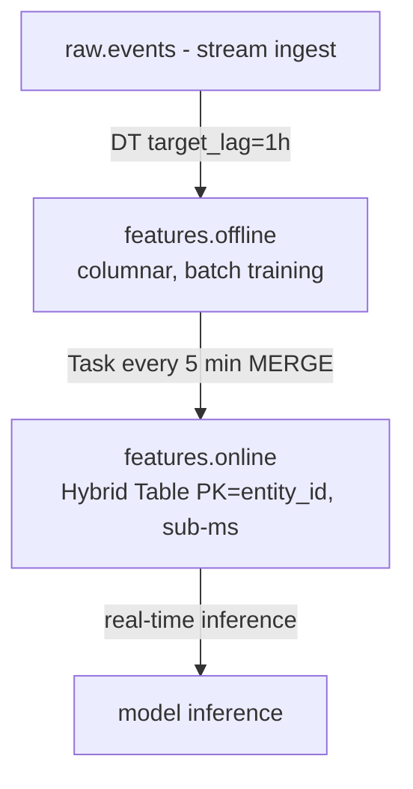

### Lab Exercise
```sql
-- Offline DT
CREATE DYNAMIC TABLE features.offline
  TARGET_LAG='1 HOUR' WAREHOUSE=wh_etl
AS
SELECT user_id,
       AVG(amount)                                        AS avg_order_30d,
       COUNT(*)                                           AS n_orders_30d,
       MAX(order_ts)                                      AS last_order_ts
FROM raw.orders
WHERE order_ts >= DATEADD('day',-30,CURRENT_TIMESTAMP())
GROUP BY user_id;

-- Online hybrid table
CREATE HYBRID TABLE features.online (
  user_id INT PRIMARY KEY,
  avg_order_30d NUMBER,
  n_orders_30d INT,
  last_order_ts TIMESTAMP,
  updated_at TIMESTAMP
);

-- Sync task
CREATE TASK sync_online_features
  USER_TASK_MANAGED_INITIAL_WAREHOUSE_SIZE='SMALL'
  SCHEDULE='5 MINUTE'
AS
MERGE INTO features.online t
USING features.offline s ON t.user_id = s.user_id
WHEN MATCHED THEN UPDATE SET
  avg_order_30d=s.avg_order_30d, n_orders_30d=s.n_orders_30d,
  last_order_ts=s.last_order_ts, updated_at=CURRENT_TIMESTAMP()
WHEN NOT MATCHED THEN INSERT VALUES (s.user_id, s.avg_order_30d, s.n_orders_30d, s.last_order_ts, CURRENT_TIMESTAMP());

ALTER TASK sync_online_features RESUME;
```
**Expected outcome:** Training reads `features.offline` for batch scans; inference reads `features.online` by PK for sub-ms lookup.

### Gotchas / Exam Traps
- Point-in-time correctness for training: use the DT's time-travel to recover features as of training cutoff, else leakage.
- Hybrid table storage is more expensive — only put the online-serving slice there, not full history.
- Feature freshness depends on the slowest hop in the chain; monitor DT refresh + sync task durations.

---

## Q19: Explain Kafka Connector for Snowflake vs direct Snowpipe Streaming.
**Difficulty:** Intermediate
**Exam relevance:** "Design streaming integrations"

### Answer
The **Kafka Connector** is an open-source Kafka Connect plugin that reads Kafka topics and writes to Snowflake. Two modes: (1) **File-mode (legacy)**: buffers records to files, uses Snowpipe. (2) **Snowpipe Streaming mode**: uses the streaming SDK, lower latency, no file staging. Direct **Snowpipe Streaming** is the SDK itself; the Kafka Connector wraps it for Kafka-specific concerns (offsets, partitions, exactly-once).

### First Principles
Kafka → Snowflake is a common integration, and reinventing the connector in every org is wasteful. The Kafka Connector handles offset commits (exactly-once), topic-to-table mapping, dead-letter topics, and schema evolution. Direct Streaming SDK is the base layer — use it when you have non-Kafka streaming sources (Kinesis custom, Pulsar, HTTP push). Pick the connector when source is Kafka; pick SDK when source is anything else.

### Diagram

| Concern | Kafka Connector | Direct Streaming SDK |
|---------|-----------------|-----------------------|
| Host | Kafka Connect worker | Your app |
| Ingest | Snowpipe Streaming mode (SDK underneath) | Opens channel, calls insertRows |
| Offsets | Exactly-once via offsets | You handle |
| Errors | Dead-letter topic | You handle |
| Mapping | Topic -> Table map | You handle |
| Use when | Source is Kafka | Non-Kafka sources |

### Lab Exercise
```properties
# Kafka Connect config
name=snowflake_sink
connector.class=com.snowflake.kafka.connector.SnowflakeSinkConnector
topics=events
snowflake.url.name=acme.us-east-1.snowflakecomputing.com
snowflake.user.name=kafka_user
snowflake.private.key=<base64_key>
snowflake.database.name=raw
snowflake.schema.name=public
snowflake.topic2table.map=events:events_tbl
snowflake.ingestion.method=SNOWPIPE_STREAMING
buffer.flush.time=10
buffer.count.records=10000
```
```python
# Direct SDK (Python)
from snowflake.ingest.streaming import OpenChannelRequest
# simplified pseudo-code
channel = client.open_channel(OpenChannelRequest(db="RAW", schema="PUBLIC", table="EVENTS", channel="chan-1"))
channel.insert_rows([{"id":1,"val":"a"}], offset_token="offset-123")
```
**Expected outcome:** Both deliver rows with seconds-level latency; connector adds Kafka-specific guardrails.

### Gotchas / Exam Traps
- Kafka Connector in Snowpipe Streaming mode supports schema evolution; legacy file-mode does not.
- `snowflake.enable.schematization=TRUE` lets the connector add columns on-the-fly matching Kafka schema.
- Streaming SDK ingestion requires key-pair auth (not password); exam tests this.

---

## Q20: Scenario — Design an incremental data lake pipeline where source is 100 TB S3 Parquet and target is Snowflake-governed analytics.
**Difficulty:** Advanced
**Exam relevance:** "Scenario design"

### Answer
Create an **external stage** on the S3 location + **external table** `raw.ext_events` with partition columns for date (prune at query time). Use **Snowflake-managed Iceberg table** `curated.events_ice` to control the governed curated layer in open format — writes from Snowflake, readable by Spark/Trino if needed. **Dynamic Tables** on top of the Iceberg table deliver `metrics.*` for BI. Use **tasks** to run `INSERT INTO curated.events_ice SELECT ... FROM raw.ext_events WHERE partition_date = ...` for new partitions; use `STREAMS` on the Iceberg table to drive incremental downstream DTs.

### First Principles
At 100 TB, you don't want to COPY everything into Snowflake-proprietary MP format — storage doubles. Keeping raw as external + curated as Iceberg means data stays in your bucket, in open format, while Snowflake provides governance (RBAC, masking) and compute. Dynamic Tables on Iceberg provide incremental SQL semantics without reinventing CDC.

### Diagram
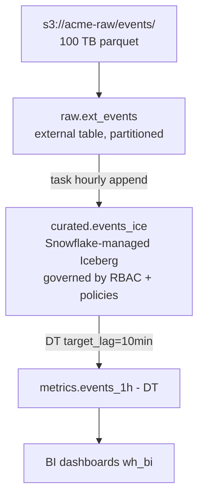

### Lab Exercise
```sql
-- External stage + table
CREATE STAGE raw_stg URL='s3://acme-raw/events/' STORAGE_INTEGRATION=s3_int
  FILE_FORMAT=(TYPE=PARQUET);
CREATE EXTERNAL TABLE raw.ext_events (
  event_date DATE AS TO_DATE(SPLIT_PART(metadata$filename,'/',3))
) PARTITION BY (event_date) LOCATION=@raw_stg AUTO_REFRESH=TRUE;

-- Managed Iceberg curated
CREATE ICEBERG TABLE curated.events_ice (
  event_id STRING, user_id INT, event_type STRING, event_ts TIMESTAMP, region STRING
)
EXTERNAL_VOLUME='ext_vol' CATALOG='SNOWFLAKE' BASE_LOCATION='curated/events/';

-- Incremental append task
CREATE TASK append_curated
  USER_TASK_MANAGED_INITIAL_WAREHOUSE_SIZE='MEDIUM'
  SCHEDULE='1 HOUR'
AS
INSERT INTO curated.events_ice
SELECT $1:event_id::STRING, $1:user_id::INT, $1:event_type::STRING,
       $1:event_ts::TIMESTAMP, $1:region::STRING
FROM raw.ext_events
WHERE event_date = CURRENT_DATE()
  AND event_id NOT IN (SELECT event_id FROM curated.events_ice WHERE event_date=CURRENT_DATE());

-- DT on Iceberg
CREATE DYNAMIC TABLE metrics.events_1h
  TARGET_LAG='10 MIN' WAREHOUSE=wh_etl AS
SELECT DATE_TRUNC('hour',event_ts) AS h, region, event_type, COUNT(*) AS n
FROM curated.events_ice GROUP BY 1,2,3;
```
**Expected outcome:** Raw data stays in S3, curated layer in Iceberg (also S3), aggregations in Snowflake metadata. Multi-engine reachable if needed.

### Gotchas / Exam Traps
- External tables cost per-query based on bytes scanned from S3 — pruning via partition columns is critical.
- Iceberg table maintenance (compaction, snapshot expiry) is handled by Snowflake for Snowflake-managed; for externally-managed you must schedule it.
- DTs on Iceberg tables are supported but check incremental refreshability — some SQL shapes require full-refresh.

---

## Summary of Data Engineering Decisions

| Need | Primitive |
|------|-----------|
| Scheduled batch (hourly+) | COPY INTO |
| File-arrival latency (min) | Snowpipe |
| Row-arrival latency (sec) | Snowpipe Streaming |
| Kafka source | Kafka Connector (streaming mode) |
| CDC on tables | Streams (standard) |
| Procedural orchestration | Tasks + stored procedures |
| Declarative pipeline SLA | Dynamic Tables |
| Query rewrite acceleration | Materialized View |
| Transactional + analytical | Hybrid Table |
| Open-format curated | Iceberg (Snowflake-managed) |
| Lake queries live | External Table |
| Call external compute | External Function or SPCS |
| Scratch data | Transient / Temporary table |
