# Performance Optimization — ARA-C01 Study Guide

## Exam Weight & Scope
Approximately 15-20% of ARA-C01. Covers clustering strategy (auto + manual), search optimization service, materialized views, query acceleration service, warehouse right-sizing, query profile interpretation, caching strategy, and anti-patterns (data skew, UDF overhead, exploding joins).

## Core Concepts Map
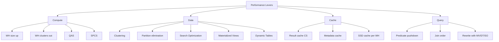

---

## Q1: Describe natural clustering and when you need manual clustering.
**Difficulty:** Intermediate
**Exam relevance:** "Design clustering strategy"

### Answer
**Natural clustering** happens when inserted data arrives already sorted by a column — micro-partitions get tight min/max ranges on that column, so WHERE on it prunes well. **Manual clustering** (defining a `CLUSTER BY (col1, col2)`) tells Snowflake to maintain the table reclustered on those keys using the serverless **Automatic Clustering** service. Use manual clustering when (a) table is >1 TB, (b) queries filter on columns that aren't the natural load order, and (c) a measured clustering depth is poor on those columns.

### First Principles
Snowflake prunes based on per-column min/max metadata. Natural load order makes some columns automatically well-pruned (e.g., `insert_ts` → sorted). But if queries filter on `region` or `customer_id` while data loads in time order, those columns' min/max per MP span the entire domain → zero pruning. Automatic clustering reorganizes MPs so the chosen columns' ranges tighten. The cost: ongoing serverless credits to maintain cluster quality.

### Diagram

**Natural (loaded in time order)**

| MP | ts | region | cust |
|----|----|---------|------|
| MP1 | 2024-01-01..01-10 | AF..ZA | 000..999 |
| MP2 | 2024-01-10..01-20 | AF..ZA | 000..999 |

ts prunes well; region/cust prune poorly.

**Clustered by (region, ts)**

| MP | region | ts |
|----|---------|-----|
| MP1 | AF..DK | 2024-01-01..12-31 |
| MP2 | DK..FR | 2024-01-01..12-31 |

region prunes well; ts still OK within region. Maintenance via Automatic Clustering (serverless).

### Lab Exercise
```sql
-- Measure baseline clustering
SELECT SYSTEM$CLUSTERING_INFORMATION('orders','(region)');
-- Look at: total_partition_count, average_depth, partition_depth_histogram
-- high average_depth = poor clustering on that column

-- Define clustering
ALTER TABLE orders CLUSTER BY (region, order_date);

-- Watch reclustering
SELECT * FROM TABLE(INFORMATION_SCHEMA.AUTOMATIC_CLUSTERING_HISTORY(
    DATE_RANGE_START=>DATEADD(day,-7,CURRENT_DATE()),
    TABLE_NAME=>'ORDERS'));

-- Suspend to control cost
ALTER TABLE orders SUSPEND RECLUSTER;
ALTER TABLE orders RESUME RECLUSTER;
```
**Expected outcome:** `average_depth` drops significantly after a few hours of reclustering; queries on `region` scan far fewer MPs.

### Gotchas / Exam Traps
- Clustering keys should be **low-cardinality to medium-cardinality** columns in your WHERE/JOIN. High-cardinality (UUID) wastes effort.
- Order matters: `(region, date)` groups by region first, then date within region. Reverse (`date, region`) is different.
- Automatic clustering is serverless — the cost shows up in `AUTOMATIC_CLUSTERING_HISTORY`, NOT on your warehouses.
- Choose 3-4 keys at most; more keys dilute the signal.
- Reclustering is best-effort and incremental; a huge table takes days to reach steady state.

---

## Q2: When should you use the Search Optimization Service?
**Difficulty:** Advanced
**Exam relevance:** "Choose search optimization"

### Answer
**SOS** builds a search access path (persistent index-like structure) that accelerates **point-lookup** and **substring/geospatial/VARIANT** queries on very large tables. Enable when (a) queries filter with equality/IN on a high-cardinality column (e.g., `WHERE user_id = 123`) returning few rows out of billions, (b) clustering can't help because the predicate column is unrelated to natural order, (c) the query is run many times a day (justifies the maintenance cost). Enable via `ALTER TABLE t ADD SEARCH OPTIMIZATION ON EQUALITY(col1,col2) ...;` and pay for maintenance (serverless) + a bit of extra storage.

### First Principles
Pruning via min/max fails on high-cardinality predicates — any micro-partition "could" contain a specific user_id. SOS builds a fine-grained search path that pinpoints which MPs actually contain that value, dropping scan sets by 100-1000×. It's a credit tradeoff: pay for SOS maintenance to save on scan credits. Worth it when the same point-lookup pattern runs thousands of times per day.

### Diagram

| Scenario | Scanned | Notes |
|----------|---------|-------|
| No SOS, 10B rows, `cust_id='C-12345'` | 10 TB | scan all MPs |
| With SOS | 50 MB | SOS finds 2 MPs |

SO-eligible predicates: EQUALITY (`col = const`, `col IN`), SUBSTRING (`col LIKE`), GEO (`ST_WITHIN`, `ST_CONTAINS`), VARIANT (`path:field`).

### Lab Exercise
```sql
-- Enable on a table for specific columns
ALTER TABLE customers ADD SEARCH OPTIMIZATION
  ON EQUALITY(customer_id, email)
  ON SUBSTRING(name);

-- Check status (building takes hours for large tables)
SHOW TABLES LIKE 'customers';
-- or
SELECT * FROM INFORMATION_SCHEMA.SEARCH_OPTIMIZATION_HISTORY;

-- Compare before/after
EXPLAIN SELECT * FROM customers WHERE customer_id='C-12345';
-- Look for "search access path"

-- Cost
SELECT * FROM SNOWFLAKE.ACCOUNT_USAGE.SEARCH_OPTIMIZATION_HISTORY
WHERE start_time >= DATEADD('day',-7,CURRENT_TIMESTAMP());
```
**Expected outcome:** Query plan references SOS; wall-clock drops from seconds to milliseconds for point lookups.

### Gotchas / Exam Traps
- SOS is Enterprise+ only.
- SOS does NOT help range scans (`WHERE col BETWEEN x AND y`) — use clustering for ranges.
- Building SOS on a huge table takes hours and consumes significant credits; monitor and plan.
- SOS maintenance cost grows with DML churn — on highly-mutating tables, SOS can exceed the saved query cost. Measure.
- Snowflake chooses whether to use SOS at plan time; it won't use it if a simpler pruning strategy wins.

---

## Q3: When to use Materialized Views vs Dynamic Tables vs Streams+Tasks?
**Difficulty:** Advanced
**Exam relevance:** "Choose precomputation primitive"

### Answer
- **MV**: optimizer-rewritten precomputation of a *single-table* aggregation. Transparent speedup for repetitive queries.
- **Dynamic Table**: declarative multi-table precomputed result with a `TARGET_LAG` SLA. Explicit reference; chainable.
- **Streams+Tasks**: full procedural CDC pipeline. Any logic, any schedule.

Choose MV when the query shape is fixed and you want the optimizer to auto-use it; choose DT when you're building a derived model that queries reference by name; choose Streams+Tasks when you need procedural control, external calls, or complex orchestration.

### First Principles
Three abstraction levels for precomputation. MV is the most transparent (query-level); DT is the pipeline-level; Streams+Tasks is the operation-level. Higher abstraction = less control + less tuning overhead. Pick the highest abstraction that satisfies your requirements.

### Diagram

| Primitive | Transparency | SQL Surface |
|-----------|--------------|-------------|
| MV | queries hit base, optimizer substitutes MV | SUM/COUNT on single table, simple GROUP BY |
| DT | queries hit DT directly, DT auto-refreshes | joins, window fns, chaining, arbitrary SQL |
| Streams+Tasks | procedural, full control | arbitrary (incl UDFs, external fns, Python) |

### Lab Exercise
```sql
-- MV: simple precomputation
CREATE MATERIALIZED VIEW mv_sales_by_region AS
SELECT region, SUM(amount) AS tot FROM orders GROUP BY region;

-- Any query matching the shape gets rewritten:
EXPLAIN SELECT region, SUM(amount) FROM orders GROUP BY region;
-- Plan shows MV scan instead of base scan

-- DT: joined dataset
CREATE DYNAMIC TABLE dt_rich_orders TARGET_LAG='5 MIN' WAREHOUSE=wh_etl AS
SELECT o.*, c.tier, c.region FROM orders o JOIN customers c USING(customer_id);

-- Queries reference DT by name:
SELECT tier, SUM(amount) FROM dt_rich_orders GROUP BY tier;

-- Streams+Tasks: anything
CREATE STREAM str ON TABLE orders;
CREATE TASK t
  USER_TASK_MANAGED_INITIAL_WAREHOUSE_SIZE='SMALL' SCHEDULE='5 MINUTE'
  WHEN SYSTEM$STREAM_HAS_DATA('str')
AS
  BEGIN
    LET n INT := (SELECT COUNT(*) FROM str);
    IF (n > 10000) THEN
      CALL send_alert(:n);
    END IF;
    INSERT INTO curated.orders SELECT * FROM str;
  END;
```
**Expected outcome:** Each tool solves a different class of problem; using the right one minimizes maintenance.

### Gotchas / Exam Traps
- MVs have strict SQL limitations (no joins, no limit, limited aggregates); DT is the escape hatch when MV won't accept your query.
- MV maintenance is billed as serverless; DT maintenance uses the warehouse you specify.
- A DT built on a stream is NOT supported — DTs read tables directly; Streams are consumption-side primitives.

---

## Q4: Explain Query Acceleration Service (QAS) and when it fires.
**Difficulty:** Advanced
**Exam relevance:** "Design serverless acceleration"

### Answer
**QAS** adds serverless compute to accelerate the scan phase of queries that benefit — specifically those with **large scans and lightweight post-processing** (big WHERE filters, simple aggregations). Enable per-warehouse with `ENABLE_QUERY_ACCELERATION=TRUE` and set `QUERY_ACCELERATION_MAX_SCALE_FACTOR` (how much extra compute vs warehouse size). Snowflake decides at plan time whether to offload; eligible queries show nonzero `query_acceleration_bytes_scanned` in QUERY_HISTORY.

### First Principles
Right-sizing a warehouse is a compromise: too large for most queries, too small for a few hot queries. QAS lets you keep a small warehouse (cheap for 99% of queries) and borrow extra scan parallelism on-demand for the 1% that would benefit. The scale factor caps how big that borrow is — scale 4 on a Medium adds up to 16 extra nodes of scan.

### Diagram
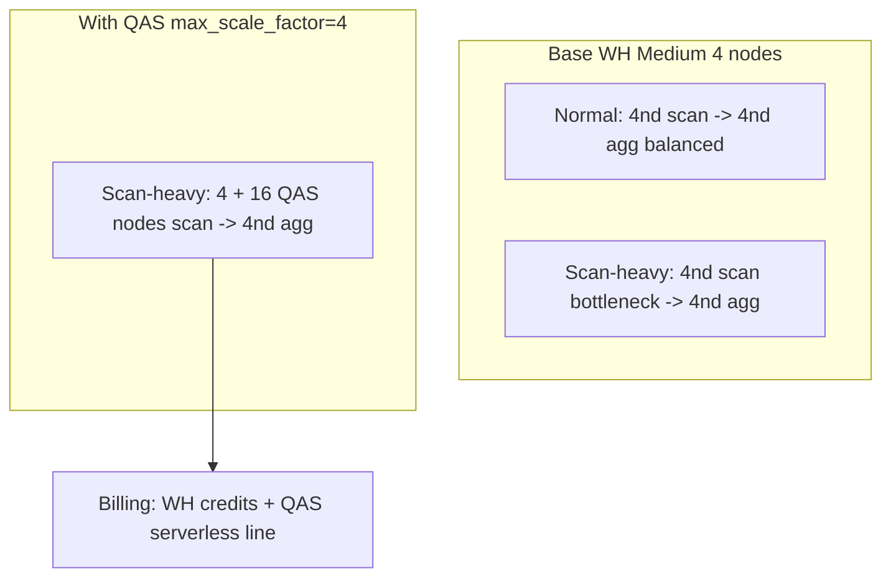

### Lab Exercise
```sql
ALTER WAREHOUSE wh_bi SET
  ENABLE_QUERY_ACCELERATION = TRUE
  QUERY_ACCELERATION_MAX_SCALE_FACTOR = 8;

-- Observe
SELECT query_id, warehouse_name,
       query_acceleration_bytes_scanned,
       query_acceleration_partitions_scanned,
       query_acceleration_upper_limit_scale_factor
FROM SNOWFLAKE.ACCOUNT_USAGE.QUERY_HISTORY
WHERE warehouse_name='WH_BI' AND query_acceleration_bytes_scanned > 0
ORDER BY start_time DESC;

-- Cost
SELECT * FROM SNOWFLAKE.ACCOUNT_USAGE.QUERY_ACCELERATION_HISTORY
WHERE start_time >= DATEADD(day,-7,CURRENT_TIMESTAMP());
```
**Expected outcome:** Scan-heavy queries accelerate; cost shows under separate serverless line.

### Gotchas / Exam Traps
- QAS helps *scan-dominated* work. Join-heavy or CPU-heavy queries get no benefit.
- QAS credits are SEPARATE from warehouse credits — resource monitors on the WH don't cap QAS.
- `SYSTEM$ESTIMATE_QUERY_ACCELERATION('<query_id>')` previews eligibility and recommended scale factor.
- Setting `MAX_SCALE_FACTOR = 0` disables QAS even if `ENABLE_QUERY_ACCELERATION = TRUE`.

---

## Q5: Explain the Query Profile and what to look for.
**Difficulty:** Intermediate
**Exam relevance:** "Diagnose query performance"

### Answer
The **Query Profile** is a visual execution plan in Snowsight showing each operator (TableScan, Filter, Join, Aggregate), its elapsed time %, rows produced, and bytes scanned. Key signals: (1) `partitionsScanned / partitionsTotal` — low ratio = good pruning; (2) **spilling** (SpilledToLocalStorage / SpilledToRemoteStorage) — memory pressure, scale WH up; (3) **exploding joins** — intermediate row counts >> input; (4) **cartesian warnings** — missing join predicate; (5) **UDF cost** — slow row-by-row Python UDFs.

### First Principles
Snowflake's profile exposes the plan + runtime stats so you can see where credits were spent. A query that scans 10 TB when it should scan 10 GB means pruning failed — fix clustering or the WHERE clause. Spill means the WH is too small for the sort/join working set. Exploding joins mean cardinality estimates were wrong; often a missing predicate or unexpected many-to-many.

### Diagram
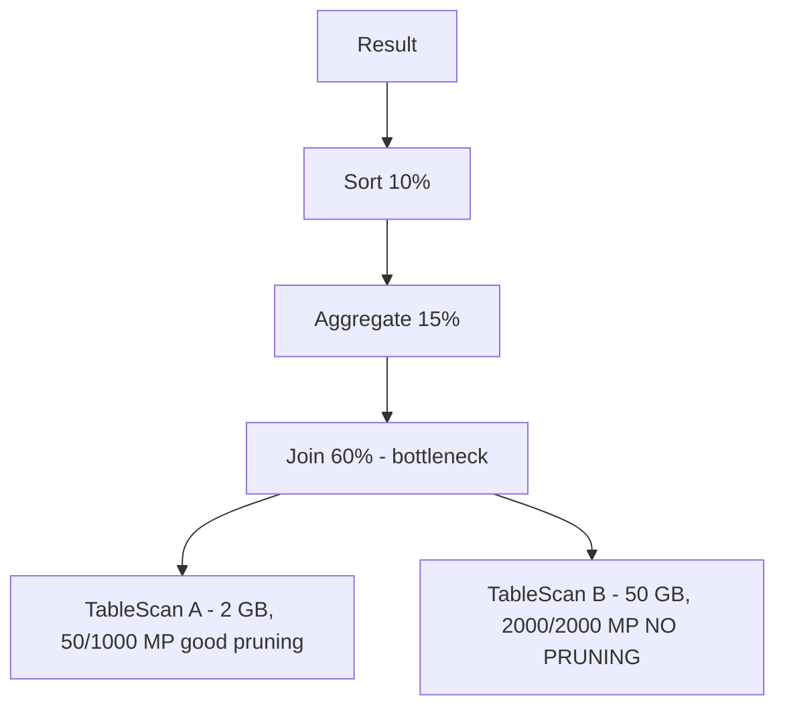

Red flags: `SpilledToLocalStorage > 0` means WH too small; join `outputRows >> inputRows` means explosion; `partitionsScanned / partitionsTotal` near 1.0 means no pruning.

### Lab Exercise
```sql
-- Run a query, then open Snowsight -> Query History -> click query -> Query Profile

-- Programmatic access
SELECT query_id, partitions_scanned, partitions_total,
       bytes_scanned, bytes_spilled_to_local_storage, bytes_spilled_to_remote_storage,
       compilation_time, execution_time, queued_overload_time
FROM SNOWFLAKE.ACCOUNT_USAGE.QUERY_HISTORY
WHERE query_id='<id>';

-- Statistics for a bad query:
SELECT percentage_scanned_from_cache, bytes_scanned, rows_produced
FROM SNOWFLAKE.ACCOUNT_USAGE.QUERY_HISTORY
WHERE query_id='<id>';
```
**Expected outcome:** You identify the bottleneck operator and the fix lever.

### Gotchas / Exam Traps
- `queued_overload_time` means warehouse was saturated at submission — scale clusters OR size.
- `queued_provisioning_time` is first-of-day resume latency — expected, not a tuning issue.
- `bytes_spilled_to_remote_storage` is severe; always try to upsize before investigating further.
- Pruning % in profile sometimes shows 100% scan on tiny tables because *all* MPs ARE relevant; context matters.

---

## Q6: Diagnose and fix a query that scans the full table despite a WHERE on an indexed-looking column.
**Difficulty:** Advanced
**Exam relevance:** "Diagnose pruning failures"

### Answer
Common causes: (1) **function on column** (`WHERE DATE(ts)='...'`) defeats min/max pruning — rewrite as range. (2) **Column is not naturally or manually clustered** on load — min/max spans entire domain. (3) **Implicit cast** mismatches types. (4) **Multiple predicates on different unclustered columns** — only the first-matching MP metadata helps. Fix with query rewrite, clustering, or SOS depending on predicate type.

### First Principles
Pruning works on raw column min/max. Any transformation of the column at query time means Snowflake can't use the stats — it must open the MP to evaluate the predicate. The optimizer doesn't rewrite `DATE(ts)='2024-01-01'` to `ts >= '2024-01-01' AND ts < '2024-01-02'` automatically.

### Diagram

| Bad | Fix |
|-----|-----|
| `WHERE DATE(ts) = '2024-01-01'` | `WHERE ts >= '2024-01-01' AND ts < '2024-01-02'` |
| `WHERE YEAR(order_date) = 2024` | `WHERE order_date >= '2024-01-01' AND order_date < '2025-01-01'` |
| `WHERE user_id::STRING = '123'` | `WHERE user_id = 123` (type match + stats work) |
| `WHERE SUBSTR(sku,1,3) = 'ABC'` | add SOS on sku substring if can't rewrite |

### Lab Exercise
```sql
-- Check if pruning worked
EXPLAIN SELECT * FROM huge_orders WHERE DATE(order_ts) = '2024-11-01';
-- partitionsAssigned likely == partitionsTotal

-- Rewrite
EXPLAIN SELECT * FROM huge_orders
WHERE order_ts >= '2024-11-01' AND order_ts < '2024-11-02';
-- partitionsAssigned drops dramatically

-- Clustering depth check
SELECT SYSTEM$CLUSTERING_INFORMATION('huge_orders','(order_ts)');
```
**Expected outcome:** Rewritten query scans 10-100× fewer partitions.

### Gotchas / Exam Traps
- Date/time functions wrapping columns are the single most common pruning killer — a favorite exam target.
- The optimizer DOES push some simple conditions through but NOT arbitrary function compositions.
- A view with calculated columns in WHERE can hide this — look at the base plan.

---

## Q7: Design a performance test to decide between scaling up (size) vs scaling out (clusters).
**Difficulty:** Advanced
**Exam relevance:** "Right-size compute"

### Answer
Run two experiments:
1. **Single-query latency**: run the biggest, most-complex query at XS, S, M, L, XL. If latency scales near-linearly (half time at double size), the query is *parallelizable* → **scale UP** solves single-query speed.
2. **Concurrent-throughput**: run N copies simultaneously at (size × clusters) and measure throughput. If throughput caps while any size × 1 cluster is CPU-saturated, you need **scale OUT** (more clusters).

If both tests show gains, use multi-cluster with the smallest size that satisfies single-query latency, then let clusters handle concurrency.

### First Principles
Size scales *parallelism within a query*; clusters scale *parallelism across queries*. A single query cannot span clusters; many short queries can. The dimensions are orthogonal, and testing them separately reveals which lever your workload needs.

### Diagram
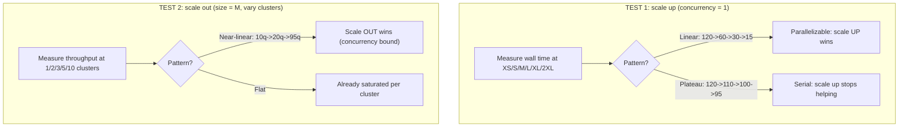

### Lab Exercise
```sql
-- TEST 1: pin to one size at a time
ALTER WAREHOUSE wh_test SET WAREHOUSE_SIZE='XSMALL';
-- run representative query, record wall from QUERY_HISTORY
-- repeat for S, M, L, XL

-- TEST 2: fix size, change cluster count
ALTER WAREHOUSE wh_test SET WAREHOUSE_SIZE='MEDIUM' MIN_CLUSTER_COUNT=1 MAX_CLUSTER_COUNT=10 SCALING_POLICY='STANDARD';

-- Fire N concurrent copies via SP or external tool
-- Measure throughput: total queries / wallclock
SELECT COUNT(*) / EXTRACT(EPOCH FROM (MAX(end_time) - MIN(start_time)))
FROM SNOWFLAKE.ACCOUNT_USAGE.QUERY_HISTORY
WHERE warehouse_name='WH_TEST' AND query_tag='scaling_test';
```
**Expected outcome:** Clear data on which lever gives most speedup per credit.

### Gotchas / Exam Traps
- Credit cost is linear in (size × time) and in (clusters × time) — being on size 4XL for 10 seconds costs the same as 2XL for 20 seconds.
- Pruning quality can mask parallelism — if pruning cuts work massively, larger WH wastes capacity.
- The 60-second minimum billing applies — tiny queries pay for a full minute each.

---

## Q8: What is auto-suspend, and what are the tradeoffs?
**Difficulty:** Foundation
**Exam relevance:** "Design warehouse lifecycle"

### Answer
**AUTO_SUSPEND** = seconds-of-idle before Snowflake suspends the warehouse. Low values (60s) save credits during idle gaps but wipe the SSD cache on each resume (cold queries). High values (300-600s) keep cache warm but burn credits during longer gaps. Choose by workload: BI dashboards with bursty concurrent queries benefit from longer suspend; nightly batch benefits from shorter.

### First Principles
Snowflake bills per-second after the first 60 seconds, so idle time between queries directly costs money. The SSD cache is the counterweight: suspending wipes it, forcing the next query to re-read from S3 (seconds added to cold queries). The optimum balances expected idle gap × credits/second against expected cold-start penalty.

### Diagram
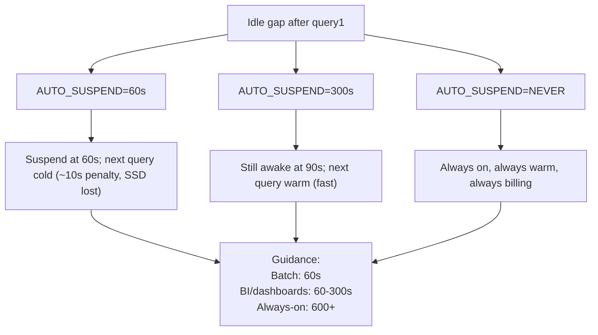

### Lab Exercise
```sql
-- Short suspend for bursty BI
ALTER WAREHOUSE wh_bi SET AUTO_SUSPEND=60;

-- Long suspend for interactive analyst (keeps cache for repeat queries)
ALTER WAREHOUSE wh_analyst SET AUTO_SUSPEND=300;

-- Monitor idle vs active
SELECT warehouse_name,
       SUM(credits_used) AS total_credits,
       SUM(IFF(credits_used_compute=0, 1, 0)) AS idle_intervals
FROM SNOWFLAKE.ACCOUNT_USAGE.WAREHOUSE_METERING_HISTORY
WHERE start_time >= DATEADD(day,-7,CURRENT_TIMESTAMP())
GROUP BY warehouse_name;
```
**Expected outcome:** Workload-matched suspend reduces idle credits without harming cache hit ratio.

### Gotchas / Exam Traps
- AUTO_SUSPEND of 0 means "never auto-suspend" — not "suspend immediately."
- Resizing a warehouse spawns new nodes with cold cache even if the WH was already warm.
- Minimum AUTO_SUSPEND is 60s; smaller values are rounded up.
- Suspend latency is near-instant; resume latency is a few seconds.

---

## Q9: Explain data skew and its effect on query performance.
**Difficulty:** Advanced
**Exam relevance:** "Diagnose skew"

### Answer
**Data skew** occurs when work is unevenly distributed across warehouse nodes — e.g., a join on `country` where 50% of rows are 'US' means one node processes half the data. Visible in query profile as unequal operator durations across nodes. Fixes: (1) rewrite join to add a secondary key, (2) use a UNION of filtered partitions for the skewed value, (3) use SAMPLE for exploratory, (4) sometimes scaling the WH helps if parallelism is CPU-bound; often it doesn't because the skewed node is still the bottleneck.

### First Principles
MPP parallelism is only as fast as the slowest node. Natural key skew (geographic, user activity) breaks the equal-work assumption. Snowflake doesn't automatically rebalance within a query — the fix is in the query itself: break the skewed key into smaller units, or pre-aggregate before the join.

### Diagram
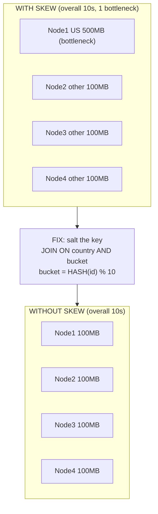

### Lab Exercise
```sql
-- Detect skew
SELECT value:name::STRING AS op,
       value:executionTime::NUMBER AS ms
FROM TABLE(GET_QUERY_OPERATOR_STATS('<query_id>'));
-- Compare per-op times; look for one that dwarfs others

-- Salt heavy key
WITH salted AS (
  SELECT *, HASH(order_id) % 10 AS salt FROM orders
),
salted_cust AS (
  SELECT c.*, s2.salt
  FROM customers c, (SELECT DISTINCT salt FROM salted) s2  -- replicate
)
SELECT * FROM salted s JOIN salted_cust sc
  ON s.customer_id = sc.customer_id AND s.salt = sc.salt;
```
**Expected outcome:** Query plan shows balanced work across nodes; wall-clock drops.

### Gotchas / Exam Traps
- Skew is hidden in Query Profile unless you expand per-node stats; the overall operator time masks it.
- Clustering by the skewed key doesn't help pruning but can worsen skew for scans.
- The exam often presents a scenario where scaling up didn't help — the implied fix is addressing skew, not more compute.

---

## Q10: Describe multi-cluster warehouse behavior for concurrency.
**Difficulty:** Intermediate
**Exam relevance:** "Design concurrency"

### Answer
A **multi-cluster warehouse** runs 1 to N parallel clusters of the same size. Each cluster accepts up to `MAX_CONCURRENCY_LEVEL` queries (default 8). When queries queue, Snowflake spawns additional clusters (up to MAX_CLUSTER_COUNT) based on `SCALING_POLICY`. Clusters are drained and dropped when idle. Each cluster has its own SSD cache.

### First Principles
A single cluster's capacity is bounded by MAX_CONCURRENCY_LEVEL. Beyond that, queries queue. For bursty concurrent workloads (dashboards, BI), multi-cluster is the only way to absorb spikes without perma-paying for peak. For long-running single queries, multi-cluster adds nothing — only size helps.

### Diagram
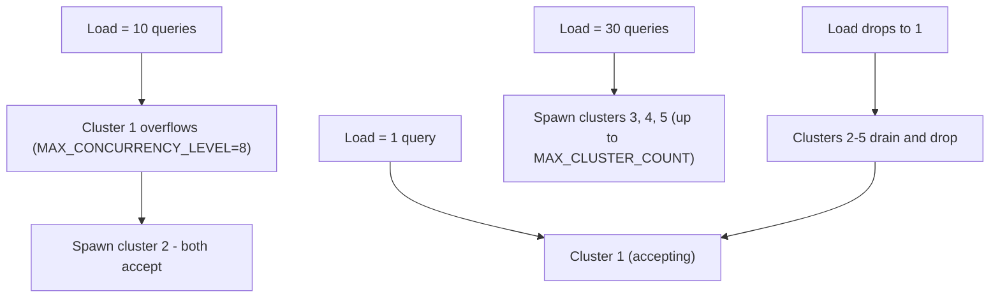

### Lab Exercise
```sql
CREATE WAREHOUSE wh_bi
  WAREHOUSE_SIZE='MEDIUM'
  MIN_CLUSTER_COUNT=1 MAX_CLUSTER_COUNT=5
  SCALING_POLICY='STANDARD'
  MAX_CONCURRENCY_LEVEL=8;

-- Observe scaling events
SELECT warehouse_name, event_name, event_reason, timestamp
FROM SNOWFLAKE.ACCOUNT_USAGE.WAREHOUSE_EVENTS_HISTORY
WHERE warehouse_name='WH_BI' AND event_name IN ('CLUSTER_RESUMED','CLUSTER_SUSPENDED')
ORDER BY timestamp DESC;
```
**Expected outcome:** Scaling events track load.

### Gotchas / Exam Traps
- Lowering MAX_CONCURRENCY_LEVEL forces faster scale-out; raising it packs more queries per cluster (less latency isolation).
- Multi-cluster is Enterprise+ only.
- Cross-cluster SSD cache is NOT shared; a query on cluster 2 that previously ran on cluster 1 reads from S3.

---

## Q11: Explain Snowflake's cost of UDFs and when to prefer native SQL.
**Difficulty:** Intermediate
**Exam relevance:** "Diagnose UDF overhead"

### Answer
Native SQL and SQL UDFs run inside the vectorized SQL engine — fast. **Python/Java/Scala UDFs** run in a sandboxed runtime per node; row-by-row Python UDFs can be 10-100× slower than SQL equivalents due to serialization overhead. Prefer SQL where possible; use **vectorized Python UDFs** (pandas-batch) when Python is required; use **UDTFs** sparingly.

### First Principles
The SQL engine is vectorized C++; each operator processes thousands of rows per CPU cycle via SIMD. Python crosses a JNI-like boundary — each row serializes, deserializes, runs through the GIL. Vectorized UDFs batch the crossing so overhead amortizes. External functions add network latency on top. Pick the lowest-overhead primitive that satisfies the computation.

### Diagram
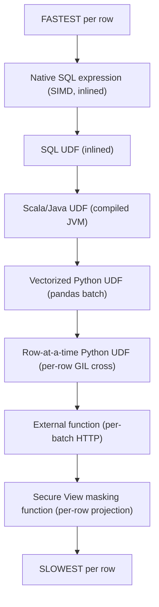

### Lab Exercise
```sql
-- Slow: row-at-a-time Python
CREATE FUNCTION slow_py(x FLOAT, y FLOAT) RETURNS FLOAT
LANGUAGE PYTHON RUNTIME_VERSION='3.11' HANDLER='run' AS
$$
def run(x,y): return x*2.5 + y
$$;

-- Fast: vectorized
CREATE OR REPLACE FUNCTION fast_py(x FLOAT, y FLOAT) RETURNS FLOAT
LANGUAGE PYTHON RUNTIME_VERSION='3.11' PACKAGES=('pandas','numpy')
HANDLER='run' AS
$$
from _snowflake import vectorized
import pandas as pd
@vectorized(input=pd.DataFrame)
def run(df):
    return df[0]*2.5 + df[1]
$$;

-- Fastest: SQL
CREATE OR REPLACE FUNCTION sql_fn(x FLOAT, y FLOAT) RETURNS FLOAT AS 'x*2.5 + y';

-- Benchmark
CREATE TABLE t AS SELECT UNIFORM(0.0,100.0,RANDOM()) a, UNIFORM(0.0,100.0,RANDOM()) b
                  FROM TABLE(GENERATOR(ROWCOUNT=>10000000));
SELECT COUNT(*) FROM (SELECT slow_py(a,b) FROM t);     -- slowest
SELECT COUNT(*) FROM (SELECT fast_py(a,b) FROM t);     -- fast
SELECT COUNT(*) FROM (SELECT sql_fn(a,b) FROM t);      -- fastest
```
**Expected outcome:** SQL UDF ≈ native; vectorized Python 2-5× slower; scalar Python 20-100× slower.

### Gotchas / Exam Traps
- UDFs can defeat optimizer predicate pushdown and parallelism estimates.
- UDFs cannot execute DDL/DML; they're pure functions.
- Deterministic UDFs (`IMMUTABLE`) can be memoized; non-deterministic can't.

---

## Q12: Describe secure views and their performance implications.
**Difficulty:** Intermediate
**Exam relevance:** "Design secure views"

### Answer
A **secure view** hides its definition from users without privileges and prevents the optimizer from exposing underlying data through side channels (e.g., error messages revealing row counts). Trade-off: some optimizations (predicate pushdown through joins, UDF folding) are limited to avoid data leakage. Prefer secure views for views that span sensitive data or data shares; use regular views for internal, trusted contexts.

### First Principles
Query optimization sometimes reorders predicates in ways that could reveal information to a determined adversary — e.g., a UDF side effect executed only when a sensitive filter matches. Secure views enforce "no projection of information outside what the SELECT says," at the cost of restricted optimizations. For external-facing or shared views, the security win outweighs the performance loss.

### Diagram
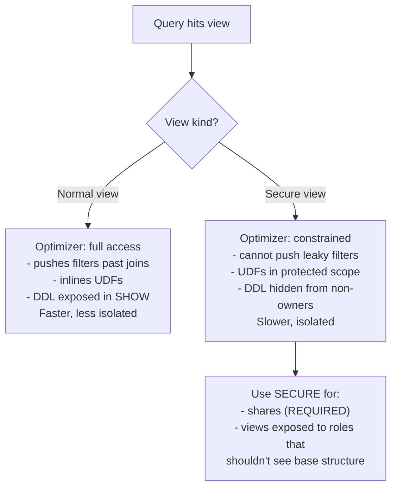

### Lab Exercise
```sql
CREATE SECURE VIEW customers_safe AS
SELECT customer_id, region FROM customers_raw;
-- The definition is only visible to the view owner

-- vs
CREATE VIEW customers_regular AS
SELECT customer_id, region FROM customers_raw;

-- From a user without SELECT on customers_raw:
SELECT GET_DDL('VIEW','customers_safe');       -- returns NULL / permission error
SELECT GET_DDL('VIEW','customers_regular');    -- returns the SQL

-- Secure views are REQUIRED in shares:
CREATE SHARE sh_safe;
GRANT USAGE ON DATABASE d TO SHARE sh_safe;
GRANT SELECT ON VIEW customers_safe TO SHARE sh_safe;    -- OK (secure)
-- GRANT SELECT ON VIEW customers_regular TO SHARE sh_safe;  -- NOT ALLOWED
```
**Expected outcome:** Secure view's SQL body hidden; mandatory for data shares.

### Gotchas / Exam Traps
- Data shares require ALL views to be secure. Non-secure views in a share raise errors.
- `GET_DDL` and `SHOW VIEWS` reveal regular view SQL even to users without base-table access — not just secure-view users should assume privacy.
- The performance delta is usually single-digit percent; secure views are not catastrophically slower.

---

## Q13: Explain pruning for VARIANT/JSON columns.
**Difficulty:** Advanced
**Exam relevance:** "Design semi-structured query optimization"

### Answer
VARIANT columns do NOT get full per-field min/max in micro-partition metadata by default — only the whole-VARIANT level stats exist. Filters on `col:field = 'x'` scan all MPs. Fix: (1) extract the field to a typed column via a **computed column** or materialize it in a derived table; (2) enable **SOS on VARIANT** which indexes specific paths; (3) use clustering on the extracted column.

### First Principles
Snowflake's columnar engine optimizes typed columns. VARIANT is a container type — Snowflake stores sub-fields with per-row offsets but doesn't maintain MP-level min/max for arbitrary paths. For common query filters, extracting to a typed column recovers normal pruning. SOS on VARIANT exists for high-cardinality JSON lookups.

### Diagram
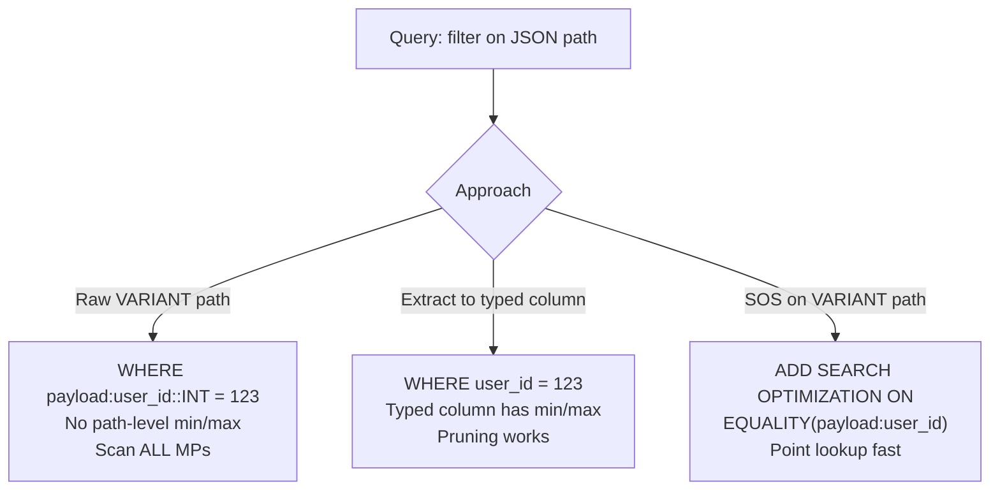

### Lab Exercise
```sql
-- Baseline
EXPLAIN SELECT * FROM events WHERE payload:user_id::INT = 123;
-- partitionsScanned ~= partitionsTotal

-- Fix 1: computed column
ALTER TABLE events ADD COLUMN user_id INT AS (payload:user_id::INT);
-- (Snowflake supports computed columns on standard tables since 2024)
EXPLAIN SELECT * FROM events WHERE user_id = 123;    -- MUCH better pruning

-- Fix 2: SOS on path
ALTER TABLE events ADD SEARCH OPTIMIZATION ON EQUALITY(payload:user_id);
EXPLAIN SELECT * FROM events WHERE payload:user_id = 123;
-- Plan references SO Access Path
```
**Expected outcome:** Pruning works; wall-clock drops substantially.

### Gotchas / Exam Traps
- `SELECT payload:a:b FROM t` works but filtering on it doesn't prune without SOS or extraction.
- Flattening (`LATERAL FLATTEN`) is expensive; precompute if used often.
- Deeply nested paths pay cost for every level — flatten to typed columns for hot paths.

---

## Q14: How does join order affect performance, and when must you intervene?
**Difficulty:** Advanced
**Exam relevance:** "Diagnose join performance"

### Answer
Snowflake's optimizer picks join order based on **cost estimates** from table stats. Usually optimal, but can go wrong when: (1) stats are stale (fresh ETL), (2) filter selectivity is misestimated (UDF predicates, exotic data), (3) a view hides a large intermediate. Intervene by: (a) rewriting the query with CTEs that materialize ordered subresults, (b) using `/*+ ...*/` hints (limited in Snowflake — mostly use rewrites), (c) adding a selective predicate earlier.

### First Principles
Join planning is NP-hard in general; the optimizer uses heuristics on cardinality estimates. When estimates are wrong (common with complex predicates or correlated columns), the chosen order can be catastrophic. Breaking the query into CTEs forces an explicit shape that the optimizer must respect.

### Diagram
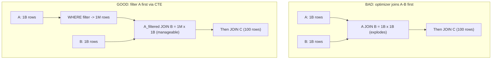

### Lab Exercise
```sql
-- Diagnose
SELECT query_id, SUBSTR(query_text,1,100) qt, bytes_scanned,
       bytes_spilled_to_remote_storage AS remote_spill
FROM SNOWFLAKE.ACCOUNT_USAGE.QUERY_HISTORY
WHERE bytes_spilled_to_remote_storage > 0
ORDER BY remote_spill DESC LIMIT 10;

-- Rewrite with explicit CTE to materialize the small set first
WITH a_filtered AS (
  SELECT * FROM a WHERE DATE(a.ts)='2024-11-01'    -- selective
)
SELECT * FROM a_filtered JOIN b USING(id) JOIN c USING(cat);
```
**Expected outcome:** Smaller intermediate result; no remote spill; faster.

### Gotchas / Exam Traps
- CTE materialization is a hint, not a guarantee — Snowflake may inline the CTE. For hard forcing, use a transient table.
- `MATERIALIZED` keyword on CTEs is NOT supported in Snowflake.
- Rebuilding stats manually: `SELECT SYSTEM$ESTIMATE_SEARCH_OPTIMIZATION_COSTS(...)` and other diagnostics help; there is no `ANALYZE` command — stats are maintained automatically.

---

## Q15: Design a performance review for a workload spending more credits than expected.
**Difficulty:** Advanced
**Exam relevance:** "Operational cost optimization"

### Answer
Methodology:
1. **Top-N queries by credits**: `QUERY_HISTORY` × `WAREHOUSE_METERING_HISTORY` to find the 20% of queries using 80% of credits.
2. **Classify by shape**: scan-heavy (QAS candidate), join-heavy (rewrite), point-lookup (SOS), repeated (MV / result cache).
3. **Right-size each warehouse**: look at utilization histogram, suspend gaps, cluster count.
4. **Identify runaways**: queries with `bytes_spilled_to_remote_storage > 0`, long compile times, `queued_overload_time`.
5. **Apply fixes**: clustering, SOS, MV, DT, rewrite, right-size, kill zombies.

### First Principles
Cost optimization follows Pareto: a tiny number of queries drive the bill. Fixing the top 10 queries typically moves cost 30-50%. The analytics should be data-driven, not vibes — ACCOUNT_USAGE has everything needed.

### Diagram
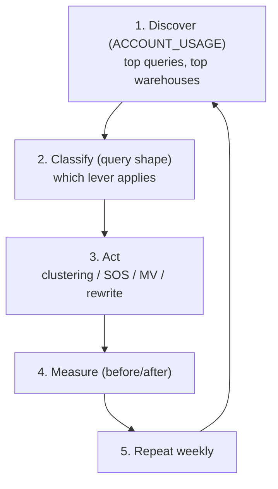

### Lab Exercise
```sql
-- Top queries by credits proxy (bytes scanned × WH size)
WITH q AS (
  SELECT query_id, query_text, warehouse_name, warehouse_size,
         bytes_scanned, execution_time,
         CASE warehouse_size
           WHEN 'X-Small' THEN 1 WHEN 'Small' THEN 2 WHEN 'Medium' THEN 4
           WHEN 'Large' THEN 8 WHEN 'X-Large' THEN 16 WHEN '2X-Large' THEN 32
           ELSE 64 END AS size_mult
  FROM SNOWFLAKE.ACCOUNT_USAGE.QUERY_HISTORY
  WHERE start_time >= DATEADD(day,-7,CURRENT_TIMESTAMP())
)
SELECT query_id, SUBSTR(query_text,1,80) qt, warehouse_name,
       (execution_time/1000) AS sec,
       (execution_time/3600000.0 * size_mult) AS est_credits
FROM q ORDER BY est_credits DESC LIMIT 20;

-- Spilling queries
SELECT query_id, bytes_spilled_to_remote_storage/(1024*1024*1024) AS spill_gb
FROM SNOWFLAKE.ACCOUNT_USAGE.QUERY_HISTORY
WHERE bytes_spilled_to_remote_storage > 0
  AND start_time >= DATEADD(day,-7,CURRENT_TIMESTAMP())
ORDER BY spill_gb DESC LIMIT 20;

-- Warehouse utilization
SELECT warehouse_name,
       SUM(credits_used) AS total,
       AVG(IFF(queued_overload_time>0,1,0)) AS pct_queued
FROM SNOWFLAKE.ACCOUNT_USAGE.QUERY_HISTORY
WHERE start_time >= DATEADD(day,-7,CURRENT_TIMESTAMP())
GROUP BY warehouse_name;
```
**Expected outcome:** Prioritized list of fixes with measurable before/after.

### Gotchas / Exam Traps
- `ACCOUNT_USAGE` has up to 3h latency; use `INFORMATION_SCHEMA` for live but limited (7-day) data.
- Credit cost estimation from `bytes_scanned × size` is approximate; use `WAREHOUSE_METERING_HISTORY` for true billed credits.
- Query tagging (`QUERY_TAG`) is the key to chargeback — enforce via session parameters per role.

---

## Q16: Explain the difference between data cache sizes across warehouse sizes.
**Difficulty:** Intermediate
**Exam relevance:** "SSD cache planning"

### Answer
Each node in a warehouse has a fixed per-node SSD cache (approx hundreds of GB). Doubling warehouse size doubles the number of nodes → doubles aggregate SSD cache. For scan-heavy workloads on hot data, upsizing both parallelizes AND increases cache capacity, so repeated scans get faster even if the first scan isn't bottlenecked on compute.

### First Principles
SSD cache is a per-node resource. Snowflake distributes micro-partitions across nodes; a bigger warehouse holds more MPs resident. When your working set exceeds a smaller WH's aggregate cache, you re-read from S3. Upsizing can hit "all working set in SSD" sweet spot.

### Diagram
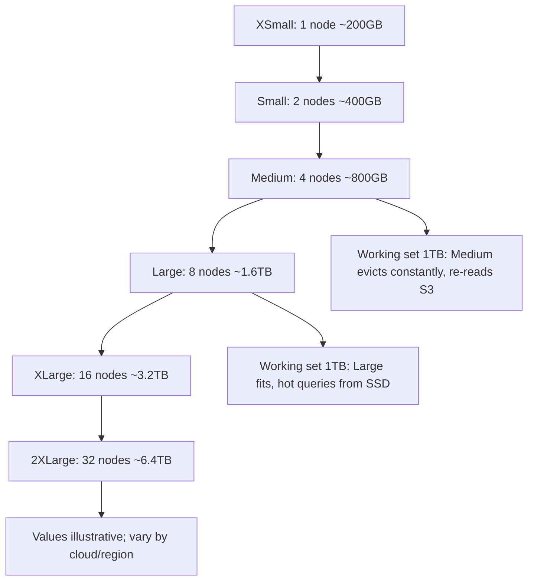

### Lab Exercise
```sql
-- See cache hit ratio
SELECT query_id, warehouse_size, percentage_scanned_from_cache, bytes_scanned
FROM SNOWFLAKE.ACCOUNT_USAGE.QUERY_HISTORY
WHERE warehouse_name='WH_BI' AND start_time >= DATEADD(hour,-24,CURRENT_TIMESTAMP())
ORDER BY start_time DESC LIMIT 50;

-- Resize and re-test
ALTER WAREHOUSE wh_bi SET WAREHOUSE_SIZE='LARGE';
-- re-run the same workload
-- cache% should improve for workloads whose working set now fits
```
**Expected outcome:** Larger WH shows higher `percentage_scanned_from_cache` for repeated hot queries.

### Gotchas / Exam Traps
- SSD cache is wiped on suspend and on resize — benchmarks after resize miss warm cache.
- Cache capacity varies by cloud region and node type; the above values are illustrative.
- SSD cache is per-cluster in multi-cluster warehouses; a query routed to a new cluster misses cache.

---

## Q17: What is the Result Cache and when is it bypassed?
**Difficulty:** Foundation
**Exam relevance:** "Describe caching"

### Answer
The **Result Cache** stores query results in Cloud Services, keyed by (normalized SQL + role + underlying data state). TTL is 24 hours per use, up to 31 days with repeated hits. Bypassed when: (1) `USE_CACHED_RESULT=FALSE`, (2) query uses non-deterministic functions (CURRENT_TIMESTAMP, UUID_STRING, RANDOM, external functions, UDFs with VOLATILE), (3) underlying table data changed since cache entry, (4) different role (different privileges might return different rows).

### First Principles
Result cache is "free, infinite, instant" for repeated identical queries. The invalidation triggers are the correctness guards: data changed = result might be different; non-determinism = result might be different each time. The role check prevents data leakage: another role with less access might see different rows.

### Diagram
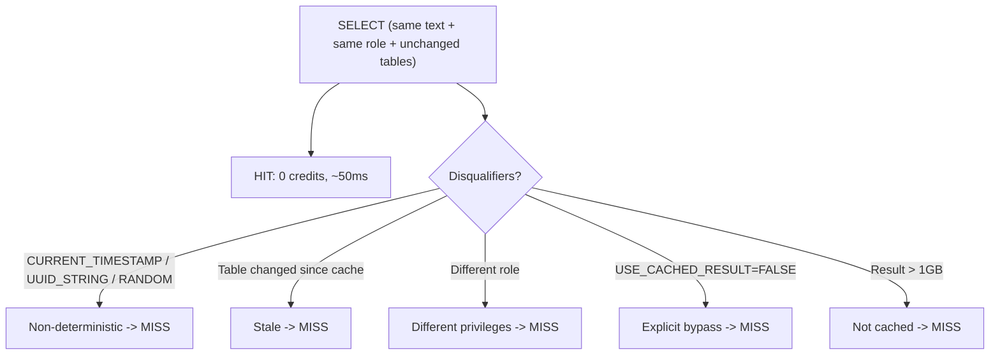

### Lab Exercise
```sql
-- Test cache
SELECT COUNT(*) FROM huge_orders;    -- cold, scans
SELECT COUNT(*) FROM huge_orders;    -- cache hit (~50ms)

-- Disable
ALTER SESSION SET USE_CACHED_RESULT=FALSE;
SELECT COUNT(*) FROM huge_orders;    -- fresh scan again

-- Non-deterministic bypass
SELECT COUNT(*), CURRENT_TIMESTAMP() FROM huge_orders;
SELECT COUNT(*), CURRENT_TIMESTAMP() FROM huge_orders;    -- different ts, bypass

-- Check cache hit in history
SELECT query_id, is_cache_hit, query_text
FROM SNOWFLAKE.ACCOUNT_USAGE.QUERY_HISTORY
WHERE query_text ILIKE '%huge_orders%' ORDER BY start_time DESC LIMIT 10;
```
**Expected outcome:** Repeated queries show `is_cache_hit=TRUE`; non-deterministic queries always FALSE.

### Gotchas / Exam Traps
- Result cache is **account-wide** — any user with the same role gets the cached result (correctly, since role equivalence).
- Even DDL on an unrelated table in the same database does NOT invalidate the cache; only changes to the queried tables do.
- `is_cache_hit=TRUE` means ZERO warehouse credits.

---

## Q18: Diagnose and fix a query that's slow despite using the result cache.
**Difficulty:** Advanced
**Exam relevance:** "Diagnose caching misses"

### Answer
"Slow despite result cache" is a contradiction — result cache hits return in ~50ms. The user is probably experiencing: (1) first run is slow (cache not warm yet), (2) role difference / session parameter change invalidated the cache, (3) another session's DML invalidated. Diagnose with `QUERY_HISTORY.is_cache_hit`. If never-cached, check for non-determinism in the query.

### First Principles
Result cache is binary: either you hit, in which case the response is instantaneous, or you miss, in which case the full query runs. A "sometimes fast, sometimes slow" pattern reveals partial cache hit rate — the fix is to understand what's invalidating.

### Diagram
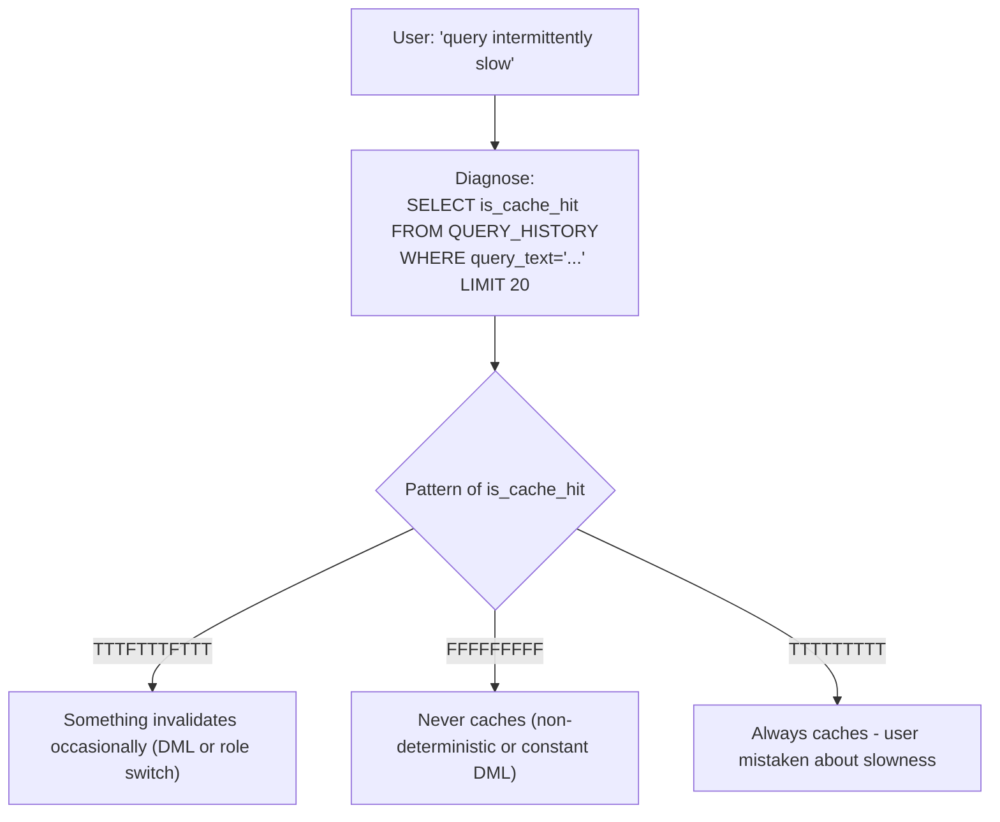

### Lab Exercise
```sql
SELECT query_id, is_cache_hit, user_name, role_name, start_time,
       execution_time
FROM SNOWFLAKE.ACCOUNT_USAGE.QUERY_HISTORY
WHERE query_text='SELECT COUNT(*) FROM huge_orders'
ORDER BY start_time DESC LIMIT 20;

-- If pattern suggests cache misses on DML:
SELECT query_id, start_time, query_text
FROM SNOWFLAKE.ACCOUNT_USAGE.QUERY_HISTORY
WHERE query_text ILIKE 'INSERT%huge_orders%'
ORDER BY start_time DESC LIMIT 20;

-- Fix: cache stable aggregates in a MV or DT instead
CREATE MATERIALIZED VIEW mv_total_orders AS SELECT COUNT(*) AS n FROM huge_orders;
SELECT n FROM mv_total_orders;    -- MV always current and fast
```
**Expected outcome:** Diagnosis clarifies "slow sometimes" cause; MV or DT gives stable fast access when base data changes.

### Gotchas / Exam Traps
- Session parameters affect caching: `TIMEZONE`, `DATE_INPUT_FORMAT`, etc. — a different setting is a different cache key.
- Masking policies / row access policies that reference `CURRENT_ROLE()` or session variables can make results role-specific.
- Queries exceeding 1 GB result size aren't cached.

---

## Q19: Scenario — A dashboard with 50 widgets refreshes concurrently every 60 seconds and WHs can't keep up.
**Difficulty:** Advanced
**Exam relevance:** "Design concurrent BI performance"

### Answer
Multiple fixes stacked:
1. **Materialize** the dashboard's underlying data as a **Dynamic Table** (`TARGET_LAG='30 SEC'`) so widgets query a precomputed table.
2. **Multi-cluster warehouse** (M×2-10 STANDARD) so concurrent widgets fan out across clusters.
3. **Result cache** benefits: if the DT doesn't change for 30s, repeat widget queries hit cache after first invocation.
4. **Query tagging** to monitor: `ALTER SESSION SET QUERY_TAG='dashboard=main;widget=X';` for per-widget analytics.
5. Consider rewriting widget queries to share a common CTE / DT instead of each hitting raw tables.

### First Principles
50 widgets × 60s refresh = ~1 query/second with correlation. Each widget doing a 2-second heavy SELECT means the WH is pegged. Precomputing once per 30s (DT) means 50 widgets read from one lightweight table and most of them hit result cache. Multi-cluster absorbs the spike at refresh instant.

### Diagram
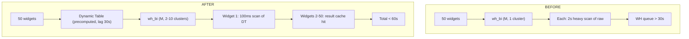

### Lab Exercise
```sql
-- Precompute dashboard data
CREATE DYNAMIC TABLE dash.events_dash
  TARGET_LAG='30 SEC' WAREHOUSE=wh_etl AS
SELECT region, event_type, DATE_TRUNC('minute',ts) AS m, COUNT(*) AS c
FROM raw.events
WHERE ts >= DATEADD(hour,-24,CURRENT_TIMESTAMP())
GROUP BY 1,2,3;

-- Multi-cluster dashboard WH
ALTER WAREHOUSE wh_bi SET
  MIN_CLUSTER_COUNT=2 MAX_CLUSTER_COUNT=10
  SCALING_POLICY='STANDARD'
  AUTO_SUSPEND=60;

-- Widgets now query dash.events_dash with simple WHERE/GROUP BY
-- Most hit result cache in the 30s window

-- Track
ALTER SESSION SET QUERY_TAG='dashboard=main';
SELECT query_tag, AVG(execution_time), AVG(queued_overload_time)
FROM SNOWFLAKE.ACCOUNT_USAGE.QUERY_HISTORY
WHERE query_tag ILIKE 'dashboard%'
  AND start_time >= DATEADD(hour,-1,CURRENT_TIMESTAMP())
GROUP BY query_tag;
```
**Expected outcome:** Dashboard refresh completes consistently inside 60s; WH credits drop since DT serves repeated widgets.

### Gotchas / Exam Traps
- DT refresh timing matters — a 30s target lag with 50 widgets querying at 60s intervals works only if widgets are aligned.
- If dashboard filters are user-specific (role, region), result cache may not help; precompute per-user may be needed.
- Multi-cluster scaling adds credits — profile vs the before to confirm net savings.

---

## Q20: Scenario — Choosing between clustering and search optimization for a 50 TB fact table.
**Difficulty:** Advanced
**Exam relevance:** "Choose optimization strategy"

### Answer
Analyze query patterns:
- **Range filters** (`WHERE date BETWEEN ...`, `region = 'EU'` with low cardinality) → **cluster by (date, region)**.
- **Point lookups on high-cardinality cols** (`WHERE order_id = ...`, `WHERE user_email LIKE '%@acme%'`) → **SOS on those cols**.
- **Both**: use clustering for the common range filter + SOS for the hot point-lookup column.

Measure before/after: `SYSTEM$CLUSTERING_INFORMATION` for cluster depth; `QUERY_HISTORY` for scan reduction. SOS costs ongoing credits proportional to churn; clustering costs ongoing credits proportional to new MP arrival rate — budget both.

### First Principles
The two services target different predicate shapes. Clustering optimizes min/max-based pruning on *ranges* and *low-cardinality equalities*. SOS optimizes *point lookups* on high-cardinality values. They can and often should coexist on the same table.

### Diagram
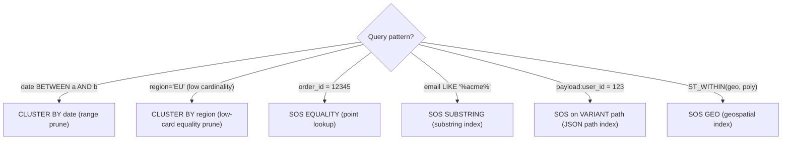

### Lab Exercise
```sql
-- Combined
ALTER TABLE fact_orders CLUSTER BY (order_date, region);
ALTER TABLE fact_orders ADD SEARCH OPTIMIZATION
  ON EQUALITY(order_id)
  ON SUBSTRING(customer_email);

-- Monitor
SELECT SYSTEM$CLUSTERING_INFORMATION('fact_orders','(order_date,region)');

SELECT * FROM SNOWFLAKE.ACCOUNT_USAGE.AUTOMATIC_CLUSTERING_HISTORY
WHERE table_name='FACT_ORDERS' AND start_time >= DATEADD(day,-7,CURRENT_TIMESTAMP());

SELECT * FROM SNOWFLAKE.ACCOUNT_USAGE.SEARCH_OPTIMIZATION_HISTORY
WHERE table_name='FACT_ORDERS' AND start_time >= DATEADD(day,-7,CURRENT_TIMESTAMP());
```
**Expected outcome:** Both services spend credits; combined query performance improves across both patterns.

### Gotchas / Exam Traps
- SOS build time on 50 TB can be days — plan rollout.
- SOS maintenance credits on hot-updated tables can exceed the saved query credits — measure.
- Clustering keys choice: avoid high-cardinality primary keys; prefer the query filter cols.
- Enterprise+ edition needed for both.

---

## Summary of Performance Levers

| Symptom | Lever |
|---------|-------|
| First-run slow, subsequent fast | SSD cache working |
| Many identical queries | Result cache (already free) |
| Big scans, light post | QAS |
| Fixed query shape, repeat | Materialized View |
| Multi-step pipeline | Dynamic Tables |
| Range filter | Clustering |
| Point lookup, high card | Search Optimization |
| Memory spill | Scale UP |
| Queue overflow | Scale OUT (clusters) |
| Slow Python UDF | Vectorize |
| JSON filter slow | Extract to col or SOS variant |
| Join explosion | Rewrite with selective CTE |
| Function-wrapped column in WHERE | Rewrite as range |
