# Data Sharing & Collaboration — ARA-C01 Study Guide

## Exam Weight & Scope
Approximately 15-20% of ARA-C01. Covers Secure Data Sharing (zero-copy sharing within Snowflake), Reader Accounts, Snowflake Marketplace, Private Listings, cross-region/cross-cloud sharing via auto-fulfillment, Data Clean Rooms, Native Apps, and governance of shared data (secure views, masking at share boundary).

## Core Concepts Map
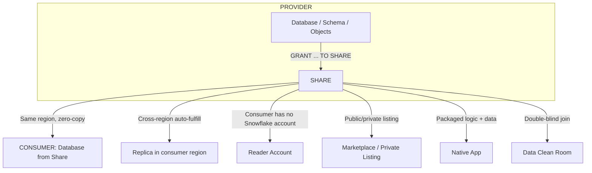

---

## Q1: Describe Secure Data Sharing and why it's "zero-copy."
**Difficulty:** Foundation
**Exam relevance:** "Describe secure data sharing"

### Answer
**Secure Data Sharing** lets a provider grant read access to selected objects (tables, secure views, UDFs) in a share. A consumer Snowflake account creates a database **from the share**; querying it reads live data directly from the provider's storage via Snowflake's metadata layer. Zero data is copied — the consumer sees the provider's data as it exists now (within replication latency, which is zero in-region). The consumer provides their own compute (warehouse) to query the share.

### First Principles
Traditional data sharing = export + copy + import. Snowflake inverted this: shared metadata, not shared files. Because Snowflake's storage layer is centrally addressable and encryption keys can be derived per-share, the consumer's queries authenticate at the metadata layer, access the same underlying micro-partitions, and spend consumer compute credits. The result: no stale copies, no sync pipelines, instant propagation, and provider pays no compute cost for consumer queries.

### Diagram
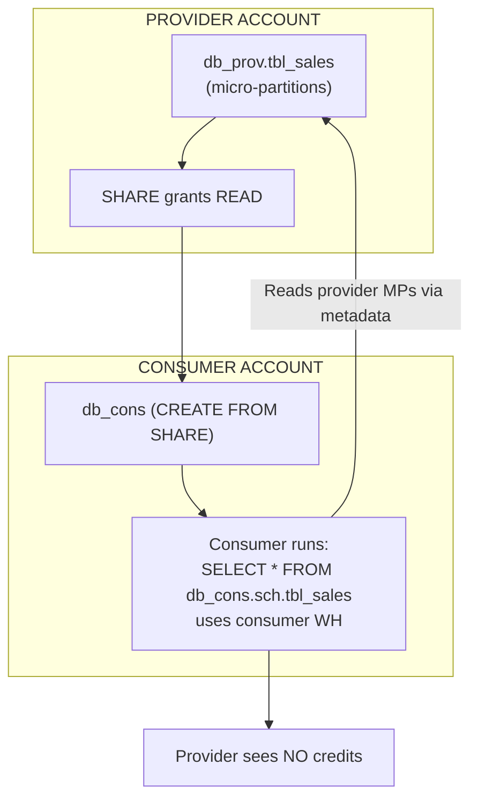

### Lab Exercise
```sql
-- PROVIDER
USE ROLE ACCOUNTADMIN;
CREATE DATABASE db_shared;
CREATE SCHEMA db_shared.sales;
CREATE TABLE db_shared.sales.orders (id INT, amount NUMBER);
INSERT INTO db_shared.sales.orders VALUES (1,100),(2,200);

CREATE SHARE share_sales;
GRANT USAGE ON DATABASE db_shared TO SHARE share_sales;
GRANT USAGE ON SCHEMA db_shared.sales TO SHARE share_sales;
GRANT SELECT ON TABLE db_shared.sales.orders TO SHARE share_sales;
ALTER SHARE share_sales ADD ACCOUNTS = consumer_acct;

-- CONSUMER
USE ROLE ACCOUNTADMIN;
SHOW SHARES;    -- sees inbound share
CREATE DATABASE orders_from_provider FROM SHARE provider_acct.share_sales;
GRANT IMPORTED PRIVILEGES ON DATABASE orders_from_provider TO ROLE analyst;

-- Analyst queries
USE ROLE analyst;
SELECT * FROM orders_from_provider.sales.orders;
```
**Expected outcome:** Consumer sees live data instantly; provider sees no compute activity from this query.

### Gotchas / Exam Traps
- Shares can only be made from Snowflake Enterprise+ accounts (consumer and provider).
- Consumer cannot modify shared data — share is read-only.
- Shared objects at the SHARE level are not inherited by nested schemas automatically; grant each object.
- `IMPORTED PRIVILEGES` is the only grant that works on a share database.
- You cannot share: external tables, Streams, materialized views in older versions (check current), temporary objects.

---

## Q2: Explain cross-region and cross-cloud sharing (replication-based).
**Difficulty:** Advanced
**Exam relevance:** "Design cross-region sharing"

### Answer
Native Secure Data Sharing is only within the **same region of the same cloud**. For cross-region or cross-cloud, use **database replication**: provider replicates to a target region/cloud, then creates a share from the replica. Alternatively, use **Marketplace / Private Listings with auto-fulfillment** — Snowflake automatically creates and refreshes a replica in the consumer's region.

### First Principles
Shares work by addressing the same micro-partition files; those files live in one region. Cross-region means the file is physically unreachable at low latency. Replication solves this by maintaining a copy in the target region. Auto-fulfillment is Snowflake's turnkey version — the provider enables it on a listing, Snowflake handles replication to any region a consumer requests.

### Diagram
```mermaid
flowchart TD
    subgraph Same["SAME REGION"]
        PE["provider_us-east.tbl"] --> SE["SHARE -> consumer_us-east"]
    end
    subgraph Cross["CROSS-REGION (REPLICATED SHARE)"]
        PE2["provider_us-east.tbl"] -->|"Replicate DB"| REP["tbl_repl in us-west<br/>(read-only replica)"]
        REP --> SW["SHARE from replica -> consumer_us-west"]
    end
    subgraph Auto["AUTO-FULFILL (Marketplace / Private Listing)"]
        L["Provider lists tbl with auto-fulfill ON"] --> RQ["Consumer in any region requests access"]
        RQ --> AF["Snowflake auto-creates replica in consumer's region"]
        AF --> CL["Consumer queries locally"]
    end
```

### Lab Exercise
```sql
-- Provider (us-east-1)
-- 1. Enable DB for replication
ALTER DATABASE db_shared ENABLE REPLICATION TO ACCOUNTS acme.acct_usw2;

-- Secondary (us-west-2)
CREATE DATABASE db_shared_replica AS REPLICA OF acme.acct_use1.db_shared;
ALTER DATABASE db_shared_replica REFRESH;
CREATE TASK refresh_replica WAREHOUSE=wh_ops SCHEDULE='15 MINUTE'
  AS ALTER DATABASE db_shared_replica REFRESH;
ALTER TASK refresh_replica RESUME;

-- Create share from REPLICA in us-west-2
CREATE SHARE share_sales_usw2;
GRANT USAGE ON DATABASE db_shared_replica TO SHARE share_sales_usw2;
GRANT USAGE ON SCHEMA db_shared_replica.sales TO SHARE share_sales_usw2;
GRANT SELECT ON ALL TABLES IN SCHEMA db_shared_replica.sales TO SHARE share_sales_usw2;
ALTER SHARE share_sales_usw2 ADD ACCOUNTS = consumer_usw2;

-- Alternatively via Private Listing with auto-fulfill (Snowsight)
-- Provider: Marketplace > Listings > New > Private Listing
--   enable Auto-Fulfill for selected regions
--   invite consumer accounts
-- Consumer: Marketplace > Requests > Accept
```
**Expected outcome:** Replica refreshes every 15 min; share from replica serves same-region consumers; auto-fulfill replicas appear in each consumer's region automatically.

### Gotchas / Exam Traps
- Replication latency = refresh interval (as low as 1 min; practical: 10-60 min).
- Cross-cloud replication incurs egress charges from the source cloud.
- Auto-fulfill requires the provider to have replication enabled and consumer region added to allowed set.
- Shares from replicas inherit the replica's refresh latency — consumers see stale-by-refresh data.

---

## Q3: What is a Reader Account and when do you use it?
**Difficulty:** Intermediate
**Exam relevance:** "Design sharing to non-Snowflake customers"

### Answer
A **Reader Account** is a Snowflake account created and *managed by the provider* for a consumer who doesn't have their own Snowflake. The provider pays for the Reader Account's compute (via a dedicated usage pool). Use when sharing data with partners/customers who aren't Snowflake customers and you want to give them Snowflake-native access without them signing up.

### First Principles
Native Secure Data Sharing requires both ends to be Snowflake. Reader Accounts bridge the gap: Snowflake creates a lightweight consumer account in the provider's org, the provider pre-provisions users/roles, and the consumer logs in with a URL. Compute billing routes to the provider — the data owner pays for all queries made against the share. Operationally this means setting resource limits per Reader Account to control cost.

### Diagram
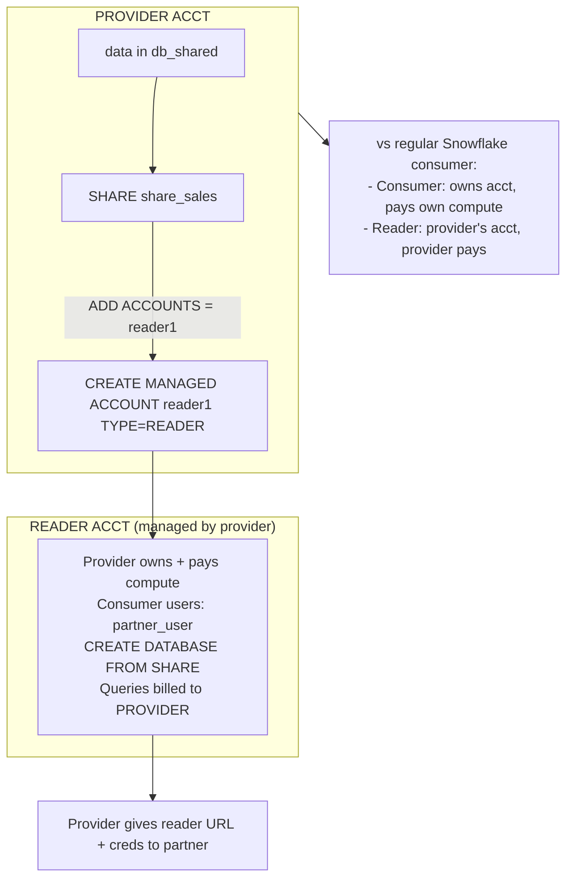

### Lab Exercise
```sql
-- Create a reader account (ORGADMIN or ACCOUNTADMIN)
CREATE MANAGED ACCOUNT reader1
  ADMIN_NAME = 'reader_admin'
  ADMIN_PASSWORD = 'TempP@ss123!'
  TYPE = READER
  COMMENT = 'For partner Acme Inc.';

-- Returns a URL; connect as reader_admin to configure
-- In the reader account:
CREATE DATABASE partner_data FROM SHARE provider_acct.share_sales;
CREATE WAREHOUSE wh_reader WITH WAREHOUSE_SIZE='SMALL' AUTO_SUSPEND=60;
GRANT IMPORTED PRIVILEGES ON DATABASE partner_data TO ROLE PUBLIC;

-- Provider sets resource monitor to cap costs
USE ROLE ACCOUNTADMIN;
CREATE RESOURCE MONITOR rm_reader1 WITH CREDIT_QUOTA=100 FREQUENCY=MONTHLY
  TRIGGERS ON 100 PERCENT DO SUSPEND;
-- Then in the reader account:
ALTER ACCOUNT SET RESOURCE_MONITOR = rm_reader1;
```
**Expected outcome:** Partner logs into reader1's URL, queries partner_data via wh_reader; provider's bill shows the credits.

### Gotchas / Exam Traps
- Reader Accounts are capped at 20 per provider account.
- Provider owns ALL cost — a careless partner can rack up charges without resource monitors.
- Reader Accounts are limited: cannot create their own shares, cannot replicate, limited edition features.
- Managing many reader accounts is painful at scale — prefer Marketplace / Private Listings when partners are Snowflake-capable or willing to become so.

---

## Q4: Compare Snowflake Marketplace, Private Listings, and direct shares.
**Difficulty:** Intermediate
**Exam relevance:** "Choose a sharing distribution model"

### Answer
- **Direct share**: provider explicitly adds consumer account to the share. Point-to-point.
- **Private Listing**: provider publishes a listing visible only to specified consumer accounts; consumers request access via Snowsight. Great for curated partner data distribution.
- **Snowflake Marketplace**: public listing. Any Snowflake customer can discover + request/purchase. Includes free and paid listings.

Both Marketplace and Private Listings support auto-fulfillment across regions/clouds. Direct shares are the lowest overhead; listings add discoverability + request workflow + paid monetization.

### First Principles
Three distribution models reflect scale: direct is 1-to-N known consumers; private listing is curated discovery across many partners; marketplace is one-to-many public. The architect's choice is based on who the audience is and whether consumers should discover and self-serve.

### Diagram
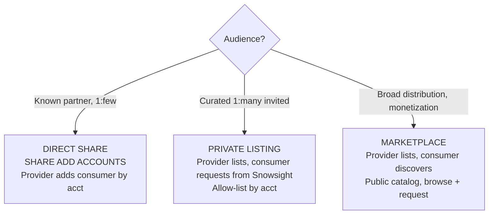

### Lab Exercise
```sql
-- Direct (as in Q1)
ALTER SHARE share_sales ADD ACCOUNTS = partner_acct;

-- Private Listing (via Snowsight: Marketplace > Listings > New Listing > Private)
-- Define: title, descr, data product, allowed consumers, auto-fulfill regions

-- Marketplace listing (via Snowsight: Marketplace > Listings > New Listing > Public)
-- Add: title, descr, data product, business dimensions, pricing (if paid)
-- Submit for Snowflake review

-- Programmatic listing (Snowflake CLI / API supports both)
```
**Expected outcome:** Direct share is instant; private listing adds a request workflow; Marketplace adds review + public catalog entry.

### Gotchas / Exam Traps
- Marketplace listings go through Snowflake review (business + data quality).
- Paid listings require a billing agreement with Snowflake; proceeds go through Snowflake's billing.
- Private Listings do NOT require review and allow faster iteration.
- All three can use the same underlying share — a share can back a direct grant AND a listing.

---

## Q5: Describe Data Clean Rooms and the problems they solve.
**Difficulty:** Advanced
**Exam relevance:** "Design privacy-preserving collaboration"

### Answer
A **Data Clean Room** is a privacy-preserving environment where two or more parties collaborate on their data *without exposing raw records*. Snowflake's clean room primitives include: **secure UDFs** that only expose aggregates, **row access policies** that enforce join-only-on-identifier semantics, **approved queries** that are vetted before execution, and **differential privacy** / **minimum aggregation threshold** controls. Use for: advertisers computing overlap/attribution across platforms, healthcare joining cohorts without PHI exchange, retailers co-marketing without customer lists exchange.

### First Principles
Two parties want to answer "how many of my customers overlap with yours?" but neither will send a raw customer list. A clean room enforces: both parties contribute data into a controlled space; only pre-approved queries run; outputs are aggregated with minimum thresholds so no row can be inferred. The Snowflake implementation uses secure views + row access policies + aggregated-only UDFs — all enforced at the engine level, not application level.

### Diagram
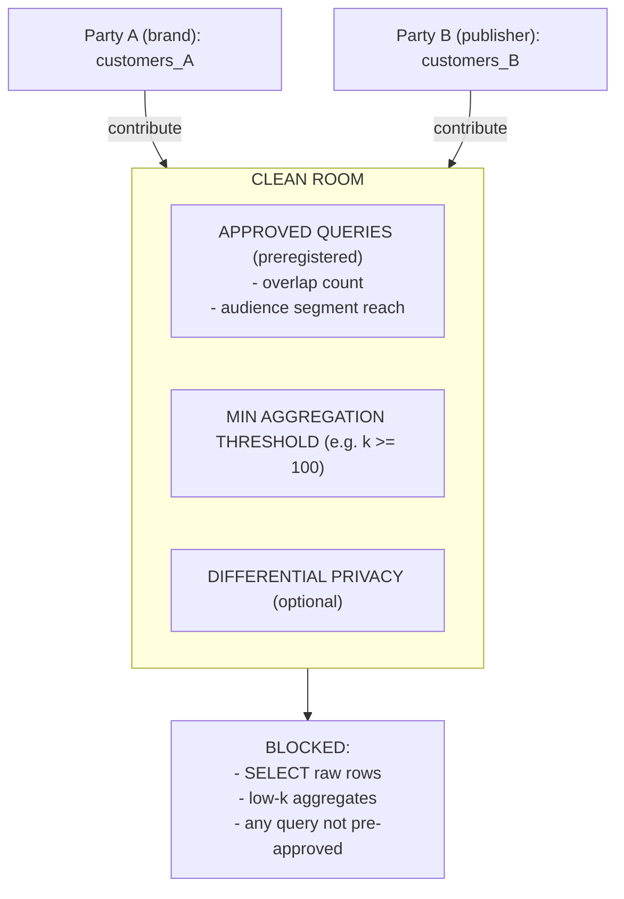

### Lab Exercise
```sql
-- Simplified clean room pattern
-- 1. Party A shares customer identifiers (hashed) to a shared schema
--    with secure view that only exposes aggregates:
CREATE SECURE VIEW clean_room.a_customers AS
  SELECT customer_hash FROM a_private.customers;
CREATE SHARE sh_a_to_cr;
GRANT USAGE ON DATABASE clean_room TO SHARE sh_a_to_cr;
GRANT SELECT ON clean_room.a_customers TO SHARE sh_a_to_cr;

-- 2. Party B same
-- 3. Clean-room account joins both shares, exposes only approved aggregates:
CREATE OR REPLACE SECURE VIEW overlap_count AS
WITH overlap AS (
  SELECT a.customer_hash FROM a_share.clean_room.a_customers a
  JOIN b_share.clean_room.b_customers b ON a.customer_hash=b.customer_hash
)
SELECT CASE WHEN COUNT(*) >= 100 THEN COUNT(*) ELSE NULL END AS overlap_n
FROM overlap;

-- Only overlap_count is exposed to both parties via a secondary share
-- Raw rows never visible from either side.
```
**Expected outcome:** Parties see only overlap aggregate above k=100 threshold; neither sees the other's raw rows.

### Gotchas / Exam Traps
- "Clean room" is a pattern + Snowflake-native primitives (plus Native Apps for packaged clean rooms); it's not a single DDL command.
- Minimum aggregation threshold must be enforced inside the SQL — Snowflake doesn't auto-threshold.
- Differential privacy support in Snowflake is evolving; check current features (SNOWFLAKE.CORE.DIFFERENTIAL_PRIVACY).
- Native Apps provide a packaged clean room (Snowflake Partner Clean Rooms is a product category).

---

## Q6: Design a secure share where the consumer can perform transformations without seeing raw PII.
**Difficulty:** Advanced
**Exam relevance:** "Design governed sharing"

### Answer
Share **secure views** that already apply **dynamic data masking** on PII columns. The consumer can run arbitrary SQL on the shared view (joins, aggregates, filters) but columns in the secure view are already masked for them (`CURRENT_ROLE()` in the policy evaluates to the consumer's role in their account, which is unprivileged by default — so they see masked values). The consumer can create materialized tables in their own account from the shared view's transformed output.

### First Principles
A share can expose base tables OR views. Secure views can embed masking policies that are evaluated in the consumer's security context. Because the consumer never has UNMASK privilege on the policy (which the provider owns), they see masked data regardless of what SQL they run. Consumer-side transformations happen on already-masked values.

### Diagram
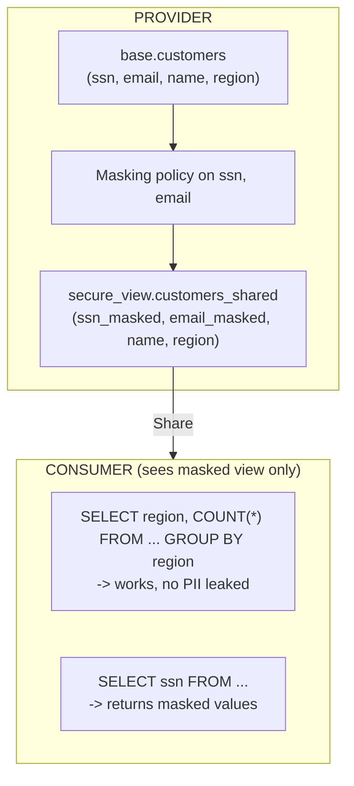

### Lab Exercise
```sql
-- PROVIDER
CREATE MASKING POLICY mask_ssn AS (v STRING) RETURNS STRING ->
  CASE WHEN CURRENT_ROLE() IN ('PII_READER') THEN v
       ELSE REGEXP_REPLACE(v,'[0-9]','*') END;
CREATE MASKING POLICY mask_email AS (v STRING) RETURNS STRING ->
  CASE WHEN CURRENT_ROLE() IN ('PII_READER') THEN v
       ELSE REGEXP_REPLACE(v,'.+@','***@') END;

ALTER TABLE base.customers MODIFY COLUMN ssn SET MASKING POLICY mask_ssn;
ALTER TABLE base.customers MODIFY COLUMN email SET MASKING POLICY mask_email;

CREATE SECURE VIEW shared.customers_shared AS
  SELECT customer_id, ssn, email, name, region FROM base.customers;

CREATE SHARE sh_customers;
GRANT USAGE ON DATABASE shared TO SHARE sh_customers;
GRANT SELECT ON shared.customers_shared TO SHARE sh_customers;
ALTER SHARE sh_customers ADD ACCOUNTS = partner_acct;

-- CONSUMER
CREATE DATABASE partner_data FROM SHARE provider_acct.sh_customers;
SELECT * FROM partner_data.shared.customers_shared LIMIT 5;
-- ssn: '***-**-****', email: '***@domain.com'

-- Consumer can transform
CREATE TABLE my_analytics AS
SELECT region, COUNT(*) AS n FROM partner_data.shared.customers_shared GROUP BY region;
```
**Expected outcome:** Consumer sees masked values; aggregations work; raw PII never leaves the provider.

### Gotchas / Exam Traps
- Masking policies evaluate `CURRENT_ROLE()` in the *consumer's* role context — critical: ensure the consumer's role name doesn't accidentally match the policy's unmask list.
- `CURRENT_ACCOUNT()` in a policy returns the *consumer's account* when running in their context — can be used to allowlist specific consumer accounts.
- Secure views are REQUIRED in shares; non-secure views can leak via error messages.
- Row access policies also work across the share boundary.

---

## Q7: What are Native Apps and how do they relate to data sharing?
**Difficulty:** Advanced
**Exam relevance:** "Design Native Apps for sharing"

### Answer
**Snowflake Native Apps** package data, logic (stored procedures, UDFs), and UI (Streamlit) into a distributable application that runs inside the consumer's Snowflake account. The provider authors an app via a **setup script**; consumers install from a listing. The app runs in a privileged schema with provider-controlled code + consumer's data — great for selling analytics logic alongside data (ML scoring, benchmarking, data quality checkers).

### First Principles
Secure Data Sharing shares data read-only. Native Apps let providers ship *behavior* — the consumer's Snowflake runs the provider's code against the consumer's data without the provider seeing it. This is "code goes to data, not data goes to code." Monetizable via Marketplace. Enables SaaS-like products on Snowflake.

### Diagram
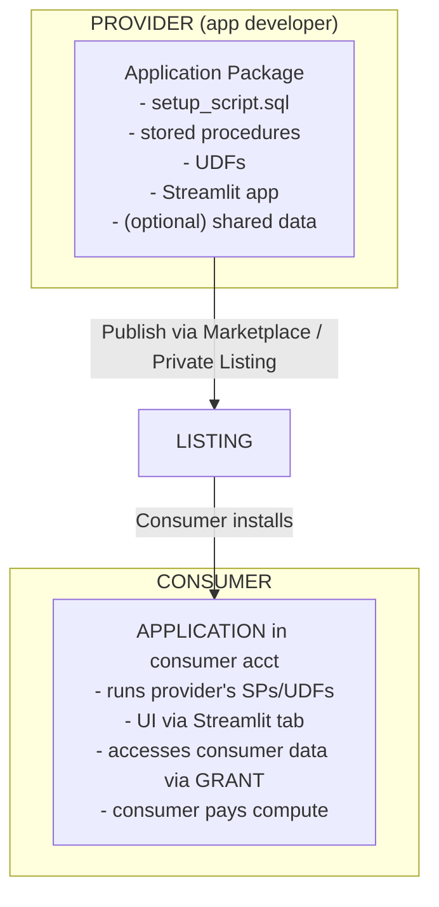

### Lab Exercise
```sql
-- PROVIDER: create application package
CREATE APPLICATION PACKAGE acme_analytics;
USE APPLICATION PACKAGE acme_analytics;
CREATE SCHEMA code;
CREATE PROCEDURE code.score_customers(src VARCHAR)
RETURNS TABLE()
LANGUAGE SQL
AS
$$
  BEGIN
    LET rs RESULTSET := (SELECT customer_id, score(features) AS score FROM identifier(:src));
    RETURN TABLE(rs);
  END;
$$;

CREATE OR REPLACE MANIFEST FILE 'manifest.yml' $$
manifest_version: 1
version:
  name: v1_0
  patch: 0
artifacts:
  setup_script: setup.sql
$$;

-- Setup script (what runs on install)
PUT file:///tmp/setup.sql @acme_analytics.code.app_src;

-- Create app version + publish listing
ALTER APPLICATION PACKAGE acme_analytics ADD VERSION v1_0 USING '@acme_analytics.code.app_src';

-- CONSUMER: install
CREATE APPLICATION acme_analytics_app
  FROM APPLICATION PACKAGE acme_analytics
  USING VERSION v1_0;

-- Grant consumer data access to the app
GRANT USAGE ON SCHEMA my_data.public TO APPLICATION acme_analytics_app;
GRANT SELECT ON TABLE my_data.public.features TO APPLICATION acme_analytics_app;

-- Invoke the app's procedure
CALL acme_analytics_app.code.score_customers('my_data.public.features');
```
**Expected outcome:** Consumer's data stays in consumer's account; provider's logic runs locally; results returned to consumer.

### Gotchas / Exam Traps
- Native Apps can be *paid* via Marketplace — a sophisticated monetization path.
- Logs/telemetry from a Native App can flow back to the provider via **event sharing** (opt-in, aggregated) — this is the data governance seam.
- Native Apps run with their own role (APPLICATION role) which must be granted access to consumer data.
- Updating a Native App requires publishing a new version; consumers upgrade voluntarily or by auto-update policy.

---

## Q8: Scenario — Share live data to 500 B2B customers with varying regions.
**Difficulty:** Advanced
**Exam relevance:** "Scale sharing to many consumers"

### Answer
Use a **Private Listing with auto-fulfillment**:
1. Define a share with secure views + masking appropriate for the customer tier.
2. Publish as a Private Listing with the customer accounts allow-listed.
3. Enable auto-fulfillment to all target regions (us-east-1, us-west-2, eu-west-1, ap-southeast-1).
4. Snowflake automatically replicates to each region on first consumer accept, maintains freshness.
5. Monitor consumption via `SNOWFLAKE.ACCOUNT_USAGE.LISTINGS_CONSUMPTION_HISTORY`.
6. Different tiers can get different shares (bronze = aggregated; gold = raw-grain) via per-tier listings.

### First Principles
With 500 consumers, direct `ALTER SHARE ADD ACCOUNTS` is operationally painful (admin tickets, no self-service). Listings provide a consumer-initiated flow: customers request, you approve, auto-fulfill handles regional replication. Tiering lets you package the data at different fidelities for pricing/privacy. Monitoring reveals which consumers actually use the data.

### Diagram
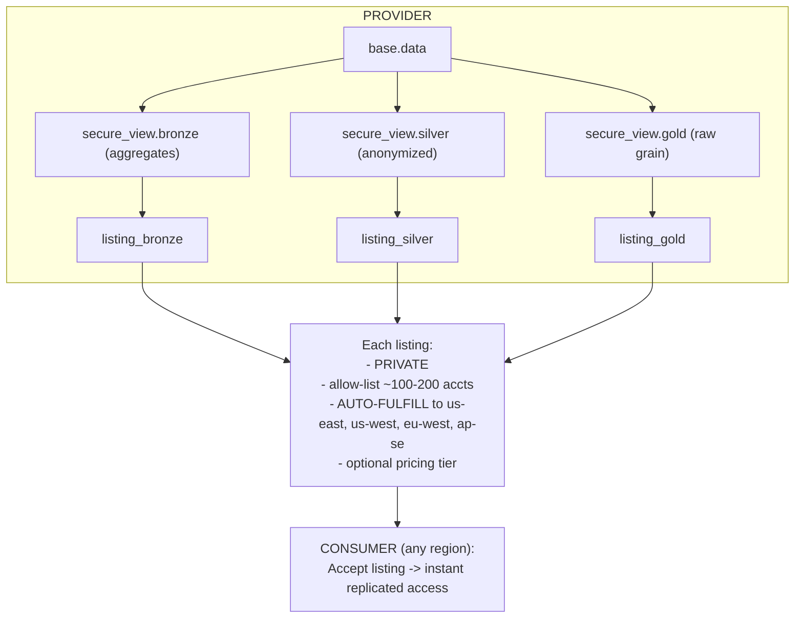

### Lab Exercise
```sql
-- Base share with secure view
CREATE SECURE VIEW shared.bronze AS
SELECT DATE_TRUNC('day',ts) d, region, COUNT(*) n FROM base.events GROUP BY 1,2;

CREATE SHARE sh_bronze;
GRANT USAGE ON DATABASE shared TO SHARE sh_bronze;
GRANT SELECT ON shared.bronze TO SHARE sh_bronze;

-- In Snowsight: Marketplace > New Listing > Private
--   data product: sh_bronze
--   target consumers: list of 500 accounts (uploaded via CSV)
--   auto-fulfill regions: us-east-1, us-west-2, eu-west-1, ap-southeast-1
--   terms & descriptions

-- Programmatic listing (new API, 2024+)
CREATE EXTERNAL LISTING listing_bronze
  SHARE = sh_bronze
  AS $$
title: "Acme Events Bronze"
description: "Daily aggregated event counts by region"
targets:
  discovery:
    accounts: ['PARTNER_1','PARTNER_2', ...]
regions:
  - aws_us_east_1
  - aws_us_west_2
  - aws_eu_west_1
  - aws_ap_southeast_1
auto_fulfillment:
  enabled: true
$$;

-- Monitor
SELECT consumer_account_name, consumer_region, query_count, listing_display_name
FROM SNOWFLAKE.ACCOUNT_USAGE.LISTING_CONSUMPTION_HISTORY
WHERE event_date >= DATEADD(day,-7,CURRENT_DATE())
ORDER BY query_count DESC;
```
**Expected outcome:** Each consumer accepts via Snowsight, gets a region-local database with the share's content; usage visible in listing analytics.

### Gotchas / Exam Traps
- Auto-fulfillment incurs egress charges on cross-region replication; monitor spend.
- Replicas update on a schedule — not real-time; typical freshness is minutes.
- Not every region supports auto-fulfillment yet; check region matrix.
- Reversing a listing (removing a consumer) revokes access immediately.

---

## Q9: How do you share Streams, Tasks, and other non-table objects?
**Difficulty:** Intermediate
**Exam relevance:** "Describe shareable object types"

### Answer
Not everything is shareable. **Shareable**: tables, external tables, secure views, secure UDFs, Iceberg tables (in supported configurations). **NOT shareable directly**: streams, tasks, materialized views (historically limited), stored procedures, pipes, sequences, dynamic tables (some restrictions), hybrid tables. Workaround: build derived tables from streams/MVs in the provider's account and share the derived table.

### First Principles
Objects with runtime state (streams track offsets, tasks run on schedules) don't make sense "shared" — they're per-account constructs. Views (secure) and functions (secure) are shareable because they're pure definitions. The share model is "share data + computations expressible as queries."

### Diagram
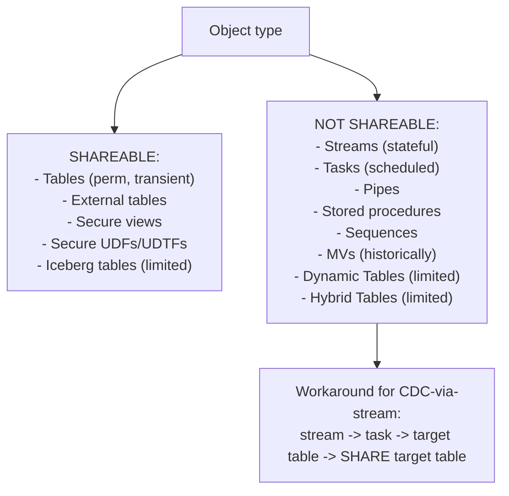

### Lab Exercise
```sql
-- Share a secure view derived from DT or stream
CREATE DYNAMIC TABLE curated.events_latest
  TARGET_LAG='5 MIN' WAREHOUSE=wh_etl AS
SELECT * FROM raw.events WHERE ts >= DATEADD('day',-7,CURRENT_TIMESTAMP());

-- Share the DT output as a secure view
CREATE SECURE VIEW shared.events_7d AS SELECT * FROM curated.events_latest;

CREATE SHARE sh_events;
GRANT USAGE ON DATABASE shared TO SHARE sh_events;
GRANT SELECT ON shared.events_7d TO SHARE sh_events;
ALTER SHARE sh_events ADD ACCOUNTS = partner_acct;

-- Secure UDF in a share
CREATE SECURE FUNCTION shared.score(x FLOAT, y FLOAT) RETURNS FLOAT AS 'x*2.5 + y';
GRANT USAGE ON FUNCTION shared.score(FLOAT,FLOAT) TO SHARE sh_events;
```
**Expected outcome:** Consumer uses the DT-derived view (updated every 5 min) and the secure UDF.

### Gotchas / Exam Traps
- Secure UDFs in a share must be `SECURE` so the body isn't visible to consumers.
- Materialized views and Dynamic Tables in shares have evolving support — always check the latest docs.
- You CANNOT share objects owned by a role you don't have on the share; grants must come from the share's owner.

---

## Q10: Explain the role of ACCOUNT_USAGE.LISTINGS and consumption reporting.
**Difficulty:** Intermediate
**Exam relevance:** "Operate shared data"

### Answer
`SNOWFLAKE.ACCOUNT_USAGE.LISTINGS_CONSUMPTION_HISTORY` (and the newer `LISTING_CONSUMPTION_HISTORY`) exposes per-consumer, per-day usage of your listings — query counts, bytes queried, access events. Use for: billing partners on paid listings, understanding which data products are hot, identifying inactive consumers to clean up. Related views: `LISTING_EVENTS_DAILY`, `LISTING_ACCESS_HISTORY`.

### First Principles
Monetizing shared data requires measuring consumption. Snowflake exposes consumption metrics so providers can bill or report back. These are limited by what the consumer's account allows to be reported — detailed per-query logs stay in the consumer's account unless event sharing is enabled.

### Diagram
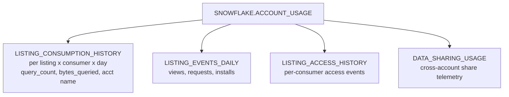

### Lab Exercise
```sql
-- Which consumers use my listing?
SELECT consumer_account_name, consumer_account_locator,
       SUM(query_count) AS queries,
       SUM(bytes_queried)/(1024*1024*1024) AS gb_queried
FROM SNOWFLAKE.ACCOUNT_USAGE.LISTING_CONSUMPTION_HISTORY
WHERE listing_display_name='Acme Events Bronze'
  AND event_date >= DATEADD(day,-30,CURRENT_DATE())
GROUP BY 1,2 ORDER BY queries DESC;

-- Listing engagement funnel
SELECT event_date, event_type, COUNT(*) AS n
FROM SNOWFLAKE.ACCOUNT_USAGE.LISTING_EVENTS_DAILY
WHERE listing_name='LISTING_BRONZE'
GROUP BY 1,2 ORDER BY event_date, event_type;
-- event_type: VIEWED, REQUESTED, GRANTED, INSTALLED, QUERIED
```
**Expected outcome:** Per-consumer usage; funnel from view to query.

### Gotchas / Exam Traps
- Latency up to 48 hours for some listing views.
- Consumer identity may be anonymized for free Marketplace listings (depending on consumer's privacy settings).
- You cannot see consumer SQL — only aggregate metrics.

---

## Q11: Design a provider governance strategy for shared PII data.
**Difficulty:** Advanced
**Exam relevance:** "Govern shared PII"

### Answer
Layered controls:
1. **Classify** PII columns via tags (`CREATE TAG pii; ALTER COLUMN SET TAG pii='true'`).
2. **Masking policies** on tagged columns, defaulting to masked for non-privileged roles.
3. **Secure views** that project only authorized columns; expose via share.
4. **Row access policies** scoping rows per consumer account (via `CURRENT_ACCOUNT()`).
5. **Logging** access via `ACCESS_HISTORY` for compliance (Enterprise+).
6. **DLP scanning** via Trust Center scanners or external DLP integrations.
7. **Legal agreements** encoded as terms-of-use on the Listing.

### First Principles
Sharing PII multiplies the surface for leaks — each consumer is another trust boundary. Technical controls (masking, policies, secure views) prevent accidental exposure; audit controls (logs) prove compliance. Legal controls bind consumers to agreed-upon use. The architect combines all three.

### Diagram
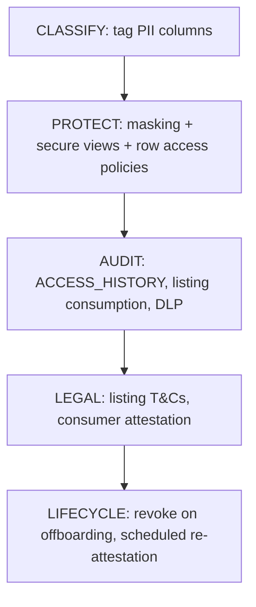

### Lab Exercise
```sql
-- 1. Classify
CREATE TAG governance.pii;
ALTER TABLE base.customers MODIFY COLUMN ssn SET TAG governance.pii='true';
ALTER TABLE base.customers MODIFY COLUMN email SET TAG governance.pii='true';

-- 2. Masking by tag
CREATE MASKING POLICY mask_pii AS (v STRING) RETURNS STRING ->
  CASE WHEN CURRENT_ACCOUNT() = CURRENT_ACCOUNT()  -- provider self
         AND CURRENT_ROLE() IN ('PII_READER') THEN v
       ELSE '***MASKED***' END;
-- Apply by tag:
ALTER TAG governance.pii SET MASKING POLICY mask_pii;

-- 3. Row access by consumer account
CREATE ROW ACCESS POLICY share_only_eu AS (region STRING) RETURNS BOOLEAN ->
  region='EU' OR CURRENT_ACCOUNT()='PROVIDER_SELF_ACCT';
ALTER TABLE shared.customers ADD ROW ACCESS POLICY share_only_eu ON (region);

-- 4. Share secure view
CREATE SECURE VIEW shared.customers_v AS
SELECT customer_id, region, ssn, email FROM base.customers;

CREATE SHARE sh_customers;
GRANT USAGE ON DATABASE shared TO SHARE sh_customers;
GRANT SELECT ON shared.customers_v TO SHARE sh_customers;
ALTER SHARE sh_customers ADD ACCOUNTS = partner_a, partner_b;

-- 5. Audit
SELECT user_name, direct_objects_accessed
FROM SNOWFLAKE.ACCOUNT_USAGE.ACCESS_HISTORY
WHERE direct_objects_accessed[0]:objectName::STRING LIKE '%CUSTOMERS_V%';
```
**Expected outcome:** PII tags drive masking; consumers see masked PII; audit trail logs every access.

### Gotchas / Exam Traps
- Tag-based masking is set once but applied to every tagged column — scalable.
- Row access policies on shared tables evaluate `CURRENT_ACCOUNT()` as the consumer's locator — allowlist by locator.
- Tags do NOT replicate across accounts unless replication is enabled; if your DR account also needs the tags, replicate tag objects.

---

## Q12: Compare Pricing models for Marketplace listings.
**Difficulty:** Intermediate
**Exam relevance:** "Monetize data"

### Answer
Marketplace listing pricing options: **Free** (standard sharing), **Paid** (via Snowflake billing), **Paid with usage-based** (consumer pays per query / per month / etc.), **Trial** (free for N days). Snowflake handles billing via its agreement with providers. Private Listings can also be paid. Compute credits remain the consumer's responsibility (they query with their warehouse).

### First Principles
Providers may want to monetize the data product. Snowflake inserts itself as the billing intermediary — consumers see the data cost on their Snowflake bill, Snowflake pays the provider minus a fee. The compute cost of querying stays with the consumer regardless. This separation lets consumers budget data costs separately from compute.

### Diagram
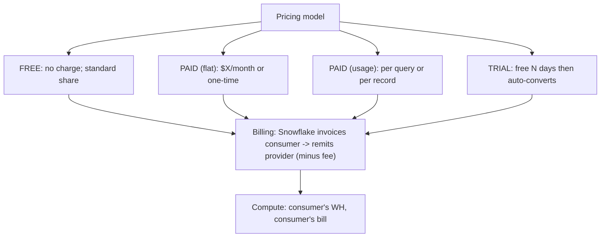

### Lab Exercise
```sql
-- Listing pricing via Snowsight UI or new DDL
CREATE EXTERNAL LISTING listing_gold
  SHARE = sh_gold
  AS $$
title: "Acme Events Gold"
pricing:
  model: paid_recurring
  amount: 1000
  currency: USD
  period: MONTHLY
  trial_days: 14
$$;
```
**Expected outcome:** Consumer sees pricing in Marketplace tile; accepts terms; Snowflake handles billing.

### Gotchas / Exam Traps
- Paid listings require a signed Marketplace Provider Agreement with Snowflake.
- Trials auto-convert — ensure the consumer explicitly consents.
- Compute costs can dwarf data costs for heavy consumers; make this clear in listing docs to avoid customer disputes.

---

## Q13: Explain Secure UDFs in sharing contexts.
**Difficulty:** Advanced
**Exam relevance:** "Share computation"

### Answer
A **Secure UDF** is a UDF whose SQL/code body is hidden from users without privileges and whose execution is isolated from side-channel optimization leaks. In a share, use secure UDFs to expose computation (e.g., scoring, classification) without revealing the implementation. Grant `USAGE` on the function to the share.

### First Principles
Shares can expose precomputed data; sometimes you want to expose *logic* instead (apply this model to the consumer's data). Secure UDFs are the primitive — provider owns code, consumer can invoke on their data, Snowflake enforces that neither query plan nor error messages leak the body or input distributions.

### Diagram
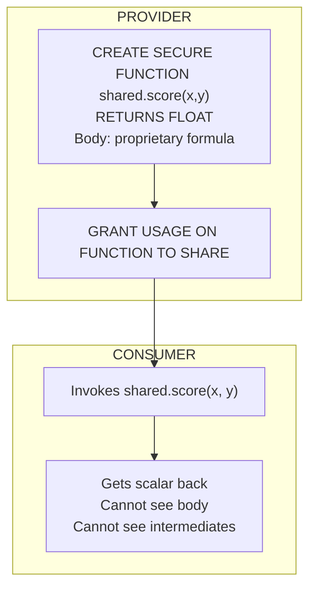

### Lab Exercise
```sql
-- Secure UDF
CREATE SECURE FUNCTION shared.predict_churn(features VARIANT)
RETURNS FLOAT
LANGUAGE PYTHON RUNTIME_VERSION='3.11' PACKAGES=('scikit-learn','joblib')
HANDLER='run'
AS
$$
import joblib
model = joblib.load('/tmp/model.pkl')     # provider's model
def run(features):
    import json
    x = [features[k] for k in ['f1','f2','f3']]
    return float(model.predict_proba([x])[0,1])
$$;

CREATE SHARE sh_fn;
GRANT USAGE ON DATABASE shared TO SHARE sh_fn;
GRANT USAGE ON SCHEMA shared.public TO SHARE sh_fn;
GRANT USAGE ON FUNCTION shared.predict_churn(VARIANT) TO SHARE sh_fn;
ALTER SHARE sh_fn ADD ACCOUNTS = partner_acct;

-- CONSUMER
SELECT customer_id, shared.predict_churn(features) AS churn_prob
FROM my_data.customers;
```
**Expected outcome:** Consumer scores their data with provider's model; model internals never exposed.

### Gotchas / Exam Traps
- Secure UDFs incur per-row Python overhead unless vectorized — see performance guide.
- Shared UDFs cannot reference other objects outside the shared database (grants don't cross databases implicitly).
- Native Apps are an alternative that let the function run with richer privileges and UI.

---

## Q14: Scenario — Partner wants to merge their data with your share to compute joint analytics.
**Difficulty:** Advanced
**Exam relevance:** "Design federated analytics"

### Answer
Options (in order of trust/complexity):
1. **One-sided share**: you share a secure view to partner; partner joins with their data in their account. Partner sees your (masked) data, you don't see theirs.
2. **Reciprocal shares**: both sides share secure views to each other, each queries union in their own account. Each sees aggregates of the other.
3. **Clean room pattern**: both share into a neutral account; approved aggregated queries only (see Q5).
4. **Native App**: provider ships code to consumer; code joins your data (as a share) with consumer's data; outputs reported back as consented aggregates.

### First Principles
"Joint analytics" has an implicit trust question: who sees what. If asymmetric (partner analyzes your data), a one-way share works. If symmetric but low-trust, clean room. If logic is proprietary and should execute at consumer side, Native App.

### Diagram
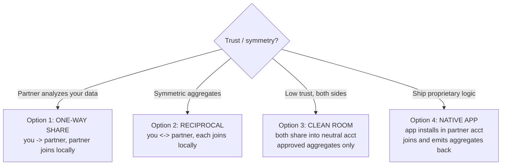

### Lab Exercise
```sql
-- Option 2: reciprocal secure share
-- Provider A
CREATE SECURE VIEW shared.a_summary AS SELECT region, COUNT(*) n FROM a.base GROUP BY region;
CREATE SHARE sh_a_to_b;
GRANT USAGE ON DATABASE shared TO SHARE sh_a_to_b;
GRANT SELECT ON shared.a_summary TO SHARE sh_a_to_b;
ALTER SHARE sh_a_to_b ADD ACCOUNTS = partner_b_acct;

-- Partner B does mirror
-- Each installs the other's share and queries locally:
SELECT a.region, a.n AS a_n, b.n AS b_n
FROM shared_from_a.shared.a_summary a FULL OUTER JOIN
     my.local.b_summary b USING(region);
```
**Expected outcome:** Each party has their own joined view; neither mutates the other's data.

### Gotchas / Exam Traps
- Query compute is on the executing side — if partner joins your huge share, partner pays.
- Transit of masked aggregates still crosses the account boundary; row access + minimum thresholds matter.
- Legal: shares often require a data use agreement independent of Snowflake.

---

## Q15: What is Snowflake Horizon and its role in governance of shared data?
**Difficulty:** Intermediate
**Exam relevance:** "Describe governance tooling"

### Answer
**Snowflake Horizon** is the umbrella name for governance, compliance, security, privacy, interoperability, and discovery features. It includes: **Data Metrics Functions** (data quality), **Lineage**, **Access History**, **Data Classification**, **Tagging**, **Trust Center**, **Universal Search**, and more. For sharing, Horizon's lineage shows data flow across shares; classification auto-tags PII; the universal catalog surfaces shareable assets.

### First Principles
Governance isn't one feature — it's a system of discovery, classification, policy, audit, and lineage. Snowflake bundled these under "Horizon" to give customers a unified narrative. For architects, Horizon features are the toolkit for making shared data auditable and discoverable.

### Diagram
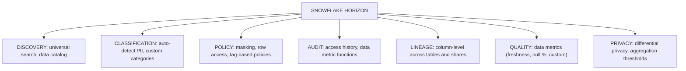

### Lab Exercise
```sql
-- Classification
CALL SNOWFLAKE.CORE.CLASSIFY_SCHEMA('BASE','PUBLIC');
-- Returns semantic classifications of columns (EMAIL, PHONE, ADDRESS, etc.)

-- Data metrics
CREATE DATA METRIC FUNCTION pct_null(c STRING) RETURNS NUMBER AS
$$ 100.0 * SUM(CASE WHEN c IS NULL THEN 1 ELSE 0 END) / COUNT(*) $$;
ALTER TABLE base.customers ADD DATA METRIC FUNCTION pct_null ON (email);

-- Lineage (programmatic via Snowsight API, or Account_Usage views)
SELECT * FROM SNOWFLAKE.ACCOUNT_USAGE.ACCESS_HISTORY
WHERE direct_objects_accessed[0]:objectName::STRING LIKE '%customers%';
```
**Expected outcome:** Classified columns, data metrics, and lineage all queryable; useful for compliance of shared data.

### Gotchas / Exam Traps
- Horizon is a marketing umbrella; the exam may use the term "Horizon" to describe a feature mix.
- Data classification is an inference engine — review results; don't trust blindly.
- Lineage visible across shares depends on consumer sharing their access history back — not automatic.

---

## Q16: Scenario — You discover a consumer is querying your share far more than agreed; how do you throttle without breaking?
**Difficulty:** Advanced
**Exam relevance:** "Operational throttling"

### Answer
Options:
1. **Narrower share**: create a new share with aggregated views; invite consumer to the new share and remove them from the old. Preserves access but at lower fidelity.
2. **Row access policy** on the shared table/view that limits consumer-side rows based on `CURRENT_ACCOUNT()`.
3. **Rate limit via view**: a view that only exposes recent data (`WHERE ts >= DATEADD(day,-7,CURRENT_TIMESTAMP())`) so consumer queries less data.
4. **Resource monitor on your side? No — consumer uses their compute.** But you can **monitor consumption** and have a business conversation.
5. **Terminate**: `ALTER SHARE sh REMOVE ACCOUNTS=consumer_acct`.

### First Principles
As a provider you don't control the consumer's compute budget. You can limit *what* they can access (data volume, columns, rows) via secure views + policies. Terminating is the nuclear option. The architect's job is to design shares with built-in rate-friendly views (recent window, pre-aggregated) so consumers don't have to query mountains of raw data.

### Diagram
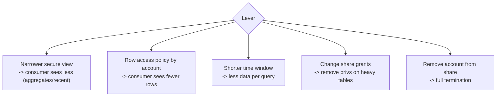

### Lab Exercise
```sql
-- Add a 7-day window to the shared view
CREATE OR REPLACE SECURE VIEW shared.events_7d AS
SELECT * FROM base.events WHERE event_ts >= DATEADD('day',-7,CURRENT_TIMESTAMP());

-- Row access policy on account allowlist
CREATE ROW ACCESS POLICY rp_acct AS (region STRING) RETURNS BOOLEAN ->
  CASE WHEN CURRENT_ACCOUNT() = 'HEAVY_PARTNER' AND region <> 'US' THEN FALSE
       ELSE TRUE END;
ALTER TABLE base.events ADD ROW ACCESS POLICY rp_acct ON (region);

-- Terminate consumer
ALTER SHARE sh_events REMOVE ACCOUNTS = heavy_partner_acct;
```
**Expected outcome:** Consumer's queries now scan less; or lose access entirely.

### Gotchas / Exam Traps
- Removing a consumer from a share invalidates their derived tables; coordinate.
- Row access policies change behavior silently — consumers may complain of missing data without a clear cause.
- Billing agreements often constrain throttling without notice — read the T&Cs.

---

## Q17: Compare Direct Share, Marketplace, Native App for a data product with proprietary logic.
**Difficulty:** Advanced
**Exam relevance:** "Choose distribution for logic-bearing products"

### Answer
- **Direct Share**: can share secure views + secure UDFs — some logic, but no UI, no versioning, no monetization.
- **Marketplace listing**: direct share + discoverability + optional pricing. Same logic constraints.
- **Native App**: full logic (SPs, UDFs, Streamlit UI), versioning, upgrade workflows, event sharing for telemetry, monetizable. Best for data products with substantial IP in the logic.

### First Principles
As the "logic weight" of a data product grows, you need richer packaging. A simple precomputed table is fine as a share. A model with pre/post processing + a dashboard is a Native App. Marketplace listings sit between — more surface than a direct share, less than a Native App.

### Diagram
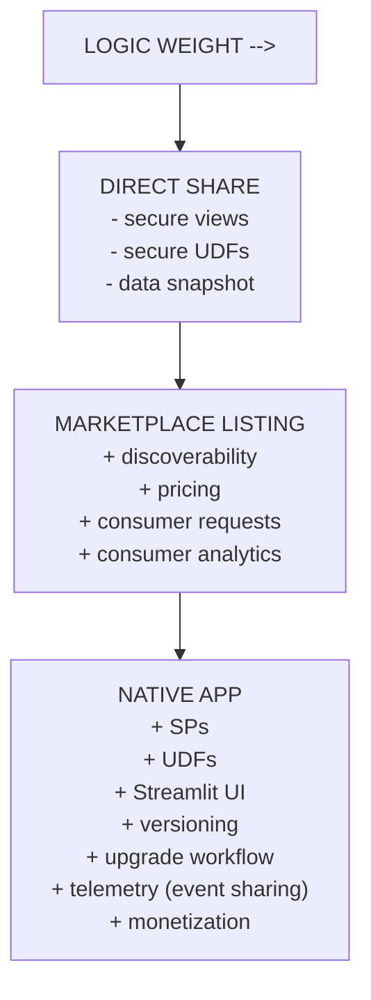

### Lab Exercise
```sql
-- Scale from share to app
-- Phase 1: share
CREATE SHARE sh_v1; GRANT ... ON shared.v_main TO SHARE sh_v1;

-- Phase 2: listing of same share
CREATE EXTERNAL LISTING listing_v1 SHARE=sh_v1 AS $$ ... $$;

-- Phase 3: app wrapper around same data + logic
CREATE APPLICATION PACKAGE pkg_v2;
-- ... version with SP + Streamlit tab
```
**Expected outcome:** Each phase adds packaging without rebuilding the data layer.

### Gotchas / Exam Traps
- Native Apps require Snowflake dev-tooling (snowcli, VSCode extension) — operational investment.
- Shares can't carry Streamlit; if your product has a UI, you need Native Apps.
- Monetization paths differ: marketplace pricing vs. Native App pricing (same billing, different packaging).

---

## Q18: Explain how to replicate shares themselves (for DR of a sharing provider).
**Difficulty:** Advanced
**Exam relevance:** "DR for sharing"

### Answer
Include `SHARES` in a **failover group** containing the shared databases. On failover, the shares in the DR account become primary and continue serving consumers — provided consumer accounts are in the same region (or the DR share is also replicated to their region, which requires auto-fulfill coordination). Alternative: maintain parallel shares in each region, each backed by replicated databases.

### First Principles
A share is metadata pointing to data. Replication can carry both the data and the share definition. If the primary region fails, consumers in that same region can be pointed to the DR region's share (requires their reconfiguration). To avoid any manual consumer action, Marketplace auto-fulfill maintains per-region shares automatically.

### Diagram
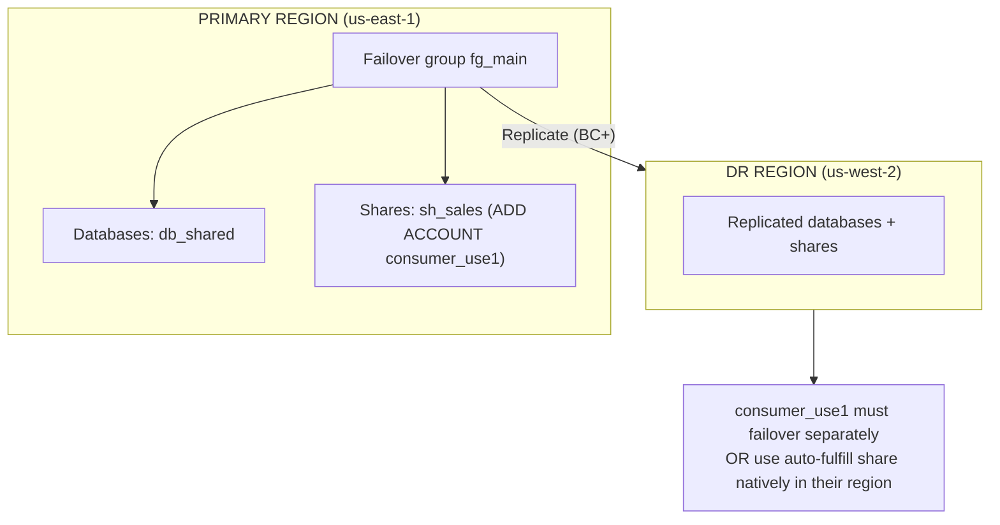

### Lab Exercise
```sql
CREATE FAILOVER GROUP fg_main
  OBJECT_TYPES = (DATABASES, SHARES, ROLES, USERS, WAREHOUSES)
  ALLOWED_DATABASES = (db_shared)
  ALLOWED_SHARES = (sh_sales)
  ALLOWED_ACCOUNTS = (acme.acct_dr_usw2)
  REPLICATION_SCHEDULE = '30 MINUTE';

-- On primary failure:
USE ROLE ACCOUNTADMIN;    -- in DR account
ALTER FAILOVER GROUP fg_main PRIMARY;
-- Shares in DR account now accept queries
```
**Expected outcome:** Consumer in us-east-1 can be reconfigured to use DR account's share (or must also failover regionally).

### Gotchas / Exam Traps
- Consumer account changes DURING failover require consumer-side action (CREATE DATABASE FROM new share name).
- Only BC+ supports failover groups.
- Cross-region consumer continuity really needs auto-fulfill listings, not just failover groups.

---

## Q19: Design a share for a 30 TB dataset with hourly updates and 50 consumers in 3 regions.
**Difficulty:** Advanced
**Exam relevance:** "Design scalable sharing"

### Answer
1. Build a **Dynamic Table** `curated.events_hourly` in primary account that materializes the hourly-updated snapshot.
2. Create a **Private Listing** on a secure view of the DT.
3. Enable **auto-fulfill** to the 3 target regions. Consumers in each region accept once.
4. Snowflake replicates to each region on first accept and maintains hourly freshness.
5. Set up consumption monitoring via `LISTING_CONSUMPTION_HISTORY`.
6. Enforce row/column policies in the secure view for governance.

### First Principles
Scale demands self-service (consumers accept, not you add); multiple regions demand auto-fulfill; 30 TB demands precomputed curated layer (don't share raw). Combining DT + listing + auto-fulfill nails all three.

### Diagram
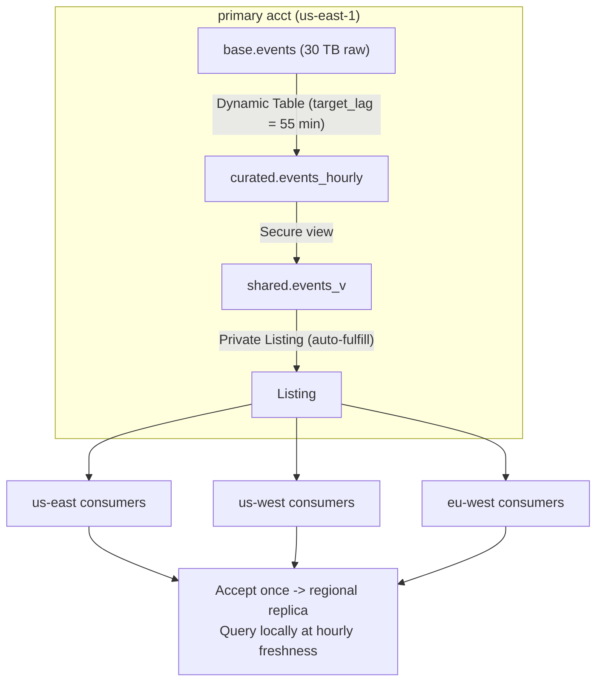

### Lab Exercise
```sql
-- Curated DT
CREATE DYNAMIC TABLE curated.events_hourly TARGET_LAG='55 MIN' WAREHOUSE=wh_etl AS
SELECT * FROM base.events WHERE event_ts >= DATEADD(day,-30,CURRENT_TIMESTAMP());

-- Secure view
CREATE SECURE VIEW shared.events_v AS SELECT * FROM curated.events_hourly;

-- Share + Listing with auto-fulfill
CREATE SHARE sh_events;
GRANT USAGE ON DATABASE shared TO SHARE sh_events;
GRANT SELECT ON shared.events_v TO SHARE sh_events;

CREATE EXTERNAL LISTING listing_events SHARE=sh_events AS $$
title: "Acme Events Hourly"
targets:
  discovery:
    accounts: [ (50 account locators) ]
regions:
  - aws_us_east_1
  - aws_us_west_2
  - aws_eu_west_1
auto_fulfillment:
  enabled: true
$$;

-- Monitor
SELECT consumer_account_name, SUM(query_count), SUM(bytes_queried)
FROM SNOWFLAKE.ACCOUNT_USAGE.LISTING_CONSUMPTION_HISTORY
WHERE listing_display_name='Acme Events Hourly'
GROUP BY 1;
```
**Expected outcome:** 50 consumers across 3 regions all query at hourly freshness; replication automatic.

### Gotchas / Exam Traps
- Cross-region replication egress is non-trivial at 30 TB daily refresh — budget cloud cross-region costs.
- First accept per region triggers initial replication (hours for 30 TB).
- A single-region DT feeding a secure view feeding a listing has 3 hops of refresh; monitor total staleness.

---

## Q20: Explain data governance considerations when consuming shared data.
**Difficulty:** Advanced
**Exam relevance:** "Consumer-side governance"

### Answer
As a **consumer** of a share, you remain responsible for:
1. **RBAC on IMPORTED PRIVILEGES**: only grant to roles that actually need it.
2. **Secondary sharing**: shared data CANNOT be re-shared (Snowflake blocks this) — but copies you make CAN; copying shared data effectively bypasses the provider's governance, so prevent via policy.
3. **Masking on your side**: you can add additional masking on a shared view's output when you re-expose internally.
4. **Compliance mapping**: shared PII inherits GDPR/CCPA obligations in your account.
5. **Audit**: `ACCESS_HISTORY` captures reads of shared objects.

### First Principles
Receiving data doesn't absolve you of governance — regulators care who processed the PII, not just who owned it. Treating shared data like your own data (classify, policy, audit) keeps you compliant. Snowflake's shared-data model simplifies the mechanics but doesn't change the legal perimeter.

### Diagram
```mermaid
flowchart TD
    SDB["SHARED DB"] -->|"IMPORTED PRIVS"| Roles["Roles"]
    Roles --> Users["USERS (humans + apps)"]
    Users --> Logs["LOGS -> ACCESS_HISTORY"]
    SDB -->|"CTAS into local table"| Copy["Consumer-owned copy"]
    Copy -->|"Your masking policies"| Int["Internal exposure"]
```

### Lab Exercise
```sql
-- Granular grant to least-privileged role
GRANT IMPORTED PRIVILEGES ON DATABASE events_from_provider TO ROLE analyst_restricted;

-- Add masking on your side when exposing further
CREATE SECURE VIEW internal.events_restricted AS
SELECT customer_id, hash_fn(email) AS email_hash, event_type, ts
FROM events_from_provider.shared.events_v;

-- Prevent naive copies that bypass policies
GRANT SELECT ON events_from_provider.shared.events_v TO ROLE analyst_restricted;
REVOKE CREATE TABLE ON SCHEMA analyst_restricted FROM ROLE analyst_restricted;

-- Audit consumer-side access
SELECT user_name, query_start_time, direct_objects_accessed
FROM SNOWFLAKE.ACCOUNT_USAGE.ACCESS_HISTORY
WHERE direct_objects_accessed[0]:objectName::STRING ILIKE '%events_v';
```
**Expected outcome:** Shared data governed on your side with least-privilege + audit.

### Gotchas / Exam Traps
- Shares cannot be re-shared, but CTAS from a share creates an independent copy that CAN. Governance leakage happens here.
- Account_usage views don't automatically show which consumer accessed what; stand up your own observability.
- Provider's masking policies apply when querying the share directly; your CTAS output is unmasked unless you apply policies at copy time.

---

## Summary of Sharing Decisions

| Need | Mechanism |
|------|-----------|
| Share live data, same region | Secure Data Share (direct) |
| Share across regions | Replication + share, or auto-fulfill listing |
| Partner without Snowflake | Reader Account |
| Discoverable, curated | Private Listing |
| Public monetizable | Marketplace |
| Package logic + UI | Native App |
| Privacy-preserving join | Data Clean Room |
| Expose fn without body | Secure UDF |
| Hide view definition | Secure View (mandatory in shares) |
| Measure consumer usage | LISTING_CONSUMPTION_HISTORY |
| DR for sharing provider | Failover group with SHARES |
