# Storage & Protection — ARA-C01 Study Guide

## Exam Weight & Scope
Approximately 15-20% of ARA-C01. Covers micro-partition storage model, Time Travel, Fail-safe, zero-copy cloning, database/schema/table-level replication, failover groups, DR patterns (RPO/RTO), and storage cost optimization.

## Core Concepts Map
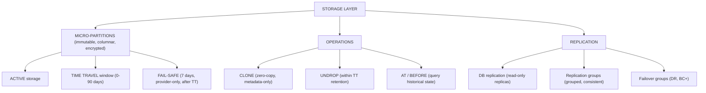

---

## Q1: Describe micro-partitions and their lifecycle (active, time travel, fail-safe).
**Difficulty:** Foundation
**Exam relevance:** "Describe storage lifecycle"

### Answer
Snowflake stores every table as **micro-partitions**: immutable, 50-500 MB (compressed) columnar files with per-column min/max metadata. Lifecycle:
1. **Active**: live MPs serving queries.
2. **Time Travel**: when a MP is replaced by DML, the old MP enters TT for 1-90 days (configurable, max 90 for permanent, 1 for transient/temporary).
3. **Fail-safe**: after TT expires, old MPs enter a 7-day Snowflake-only recovery zone (permanent tables only, no customer access).
4. **Deleted**: after 7-day Fail-safe, MPs are permanently removed.

### First Principles
Immutable storage + versioned metadata = snapshot isolation and time travel for free. The architecture guarantees recoverability by never deleting MPs until the retention + fail-safe clock expires. The cost is storage: a table with heavy churn stores many versions. Transient tables skip fail-safe (saves 7 days of storage); temporary are even cheaper (session-only).

### Diagram
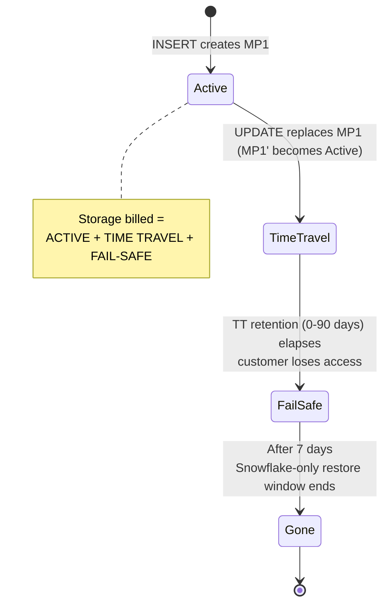

### Lab Exercise
```sql
-- Set a long retention for critical tables
CREATE TABLE prod.customers (...) DATA_RETENTION_TIME_IN_DAYS = 30;

-- Monitor per-table storage
SELECT table_name,
       active_bytes/(1024*1024*1024)      AS active_gb,
       time_travel_bytes/(1024*1024*1024) AS tt_gb,
       failsafe_bytes/(1024*1024*1024)    AS fs_gb,
       (active_bytes+time_travel_bytes+failsafe_bytes)/(1024*1024*1024) AS total_gb
FROM SNOWFLAKE.ACCOUNT_USAGE.TABLE_STORAGE_METRICS
WHERE deleted = FALSE
ORDER BY total_gb DESC LIMIT 20;

-- Reduce retention on a churny table
ALTER TABLE staging.churn_table SET DATA_RETENTION_TIME_IN_DAYS = 1;
```
**Expected outcome:** Permanent tables with heavy UPDATE/DELETE show large TT+FS storage; shortening retention frees space in days.

### Gotchas / Exam Traps
- Fail-safe is NOT customer-configurable — always 7 days for permanent tables, 0 for transient/temporary.
- `DATA_RETENTION_TIME_IN_DAYS = 0` disables Time Travel; use for staging that doesn't need it.
- Standard edition caps retention at 1 day; Enterprise+ allows up to 90.
- Shortening retention doesn't retroactively shorten TT for currently-stored versions — new DML drops versions at the new rate.

---

## Q2: Explain Time Travel usage patterns and AT/BEFORE syntax.
**Difficulty:** Intermediate
**Exam relevance:** "Query historical data"

### Answer
Time Travel lets you query a table as of a past timestamp, offset, or statement. Syntax: `SELECT ... FROM t AT(TIMESTAMP => '...')` / `AT(OFFSET => -N)` (seconds) / `AT(STATEMENT => '<query_id>')` / `BEFORE(STATEMENT => '<query_id>')`. Also used by `CLONE ... AT(...)` and `CREATE TABLE AS SELECT ... AT(...)`. Max window = `DATA_RETENTION_TIME_IN_DAYS` for the table.

### First Principles
Metadata versions let any read specify "which version." Snowflake exposes this through SQL extensions. `AT` is inclusive of the moment; `BEFORE` is exclusive. STATEMENT is useful for "before this bad UPDATE ran, show me what the table looked like." Combined with clone, you can resurrect a prior state as a new table.

### Diagram
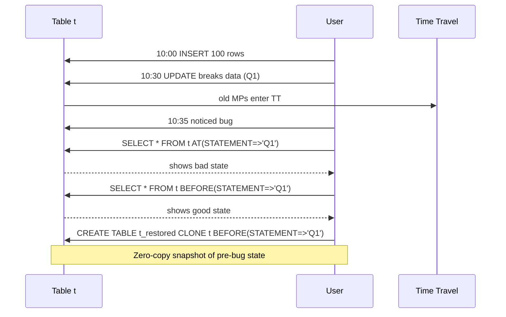

### Lab Exercise
```sql
-- Current state
SELECT COUNT(*) FROM orders;

-- 1 hour ago
SELECT COUNT(*) FROM orders AT(OFFSET => -3600);

-- Specific timestamp
SELECT COUNT(*) FROM orders AT(TIMESTAMP => '2024-11-01 10:00:00'::TIMESTAMP);

-- Before a bad statement
SELECT COUNT(*) FROM orders BEFORE(STATEMENT => '01abcde-...');

-- Clone from a point in time (zero-copy)
CREATE TABLE orders_pre_bug CLONE orders BEFORE(STATEMENT => '01abcde-...');

-- Undrop (within retention)
DROP TABLE orders;
UNDROP TABLE orders;
```
**Expected outcome:** Historical snapshots queryable; clones at a past point are free.

### Gotchas / Exam Traps
- Clone AT a past time creates a new table at that state — the source table is untouched.
- `AT(TIMESTAMP => '...')` must be within the retention window; outside raises error.
- UNDROP works on tables, schemas, databases — but only within the retention window of the parent (for a dropped schema, the schema's retention governs its tables).
- DDL operations (ALTER TABLE DROP COLUMN) are NOT reversible via Time Travel — only DML is.

---

## Q3: Describe Fail-safe and when customers can access it.
**Difficulty:** Foundation
**Exam relevance:** "Describe fail-safe"

### Answer
**Fail-safe** is a 7-day Snowflake-managed recovery zone that begins when Time Travel for a MP expires. Only Snowflake support can restore from fail-safe (via a support ticket). Fail-safe exists for **permanent tables only** — transient and temporary have none. The customer *pays* for fail-safe storage.

### First Principles
Fail-safe is the last-chance safety net for catastrophic data loss (customer accidentally dropped critical data and extended TT didn't catch it). It's expensive to maintain, so Snowflake monetizes it as additional storage. The 7-day fixed duration balances recoverability against cost. Customers paying for TT already have a self-service recovery window; fail-safe is for cases where TT was too short.

### Diagram
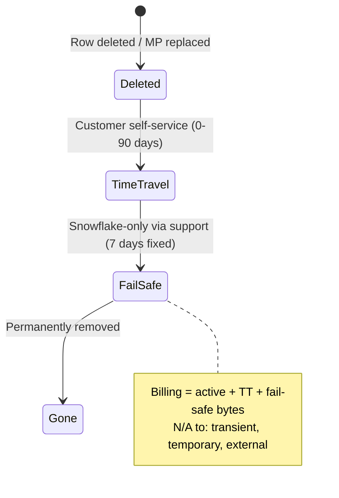

### Lab Exercise
```sql
-- Fail-safe bytes per table
SELECT table_name,
       failsafe_bytes/(1024*1024*1024) AS fs_gb,
       table_type
FROM SNOWFLAKE.ACCOUNT_USAGE.TABLE_STORAGE_METRICS
WHERE deleted = FALSE AND failsafe_bytes > 0
ORDER BY failsafe_bytes DESC LIMIT 20;

-- To skip fail-safe entirely for churny staging
CREATE TRANSIENT TABLE staging.events_in AS SELECT * FROM @stg/raw/;
-- Transient = no fail-safe
```
**Expected outcome:** Permanent tables with heavy churn show meaningful fail-safe bytes; transient tables show 0.

### Gotchas / Exam Traps
- Fail-safe cannot be configured — it's always 7 days for permanent.
- Fail-safe restoration is a support ticket, not a self-service command.
- The exam often asks "what retention can you set on fail-safe?" — the answer is: you can't; it's fixed.
- Switching a permanent table to transient is not possible (would need to recreate).

---

## Q4: Explain zero-copy cloning and when to use it.
**Difficulty:** Intermediate
**Exam relevance:** "Design cloning strategy"

### Answer
`CLONE` creates a new object (table, schema, database) that *shares* the source's current micro-partitions. No data is copied; only metadata is created pointing at the same MPs. After clone, both source and clone diverge via copy-on-write: new DML to either creates new MPs owned by that side. Use for: dev/test environments, point-in-time snapshots for repro, "backup" before risky DDL/DML.

### First Principles
Immutable MPs mean a logical copy = a new metadata pointer; no bytes move. Divergence happens only when a side writes. This makes "spin up a full-size dev database" an O(1) operation instead of O(TB). Clones are not "mirrors" — they are logical siblings with their own future history.

### Diagram
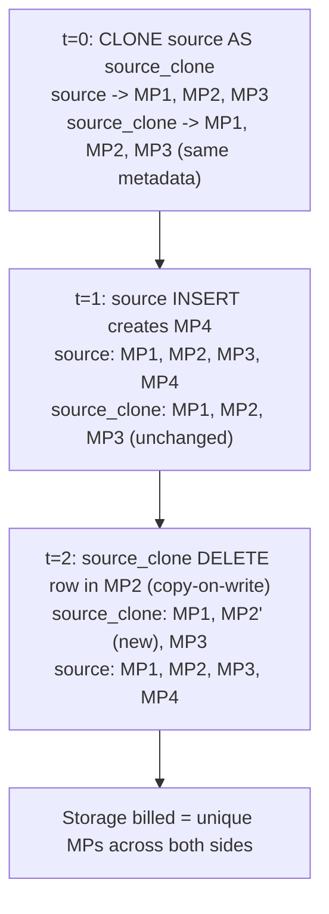

### Lab Exercise
```sql
-- Clone a database (metadata-only)
CREATE DATABASE prod_dev CLONE prod;
-- Instant; same current data

-- Clone a specific table at a past point
CREATE TABLE orders_snapshot CLONE orders AT(OFFSET=>-86400);  -- 24h ago

-- Clone with grant inheritance
CREATE SCHEMA dev CLONE prod_sch COPY GRANTS;

-- Check divergence storage
SELECT clone_group_id, table_name, active_bytes, time_travel_bytes
FROM SNOWFLAKE.ACCOUNT_USAGE.TABLE_STORAGE_METRICS
WHERE clone_group_id IS NOT NULL
ORDER BY active_bytes DESC;
```
**Expected outcome:** Clones created instantly; billed storage grows only as either side mutates.

### Gotchas / Exam Traps
- Clones do NOT include: pipes, external tables (clone a view over them), temporary objects.
- Streams, Tasks: cloned, but a cloned Stream has a fresh offset (empty), and a cloned Task is suspended by default.
- `COPY GRANTS` copies current grants; without it, the clone has no inherited grants.
- A cloned object has NO relationship to the source after creation — changes to one don't affect the other.

---

## Q5: Design a dev/test refresh pattern using cloning.
**Difficulty:** Advanced
**Exam relevance:** "Design environment refresh"

### Answer
Nightly:
1. Drop `dev` database.
2. `CREATE DATABASE dev CLONE prod;` (instant).
3. Apply dev-specific grants and masking policies (dev engineers get full access; production PII is already masked at base).
4. Apply any data-scrubbing (e.g., obfuscate names via UPDATE on dev only — this creates divergent MPs but is bounded).

Weekly or on-demand: variants (feature branches) can be cloned from dev. Developers work in isolated clones without affecting each other.

### First Principles
Traditional dev refresh = copy TB of data = hours + storage doubling. Clone = instant + no storage until divergence. The architecture pattern "clone + mask + grant" gives every dev environment a point-in-time, logically isolated playground at near-zero marginal cost.

### Diagram
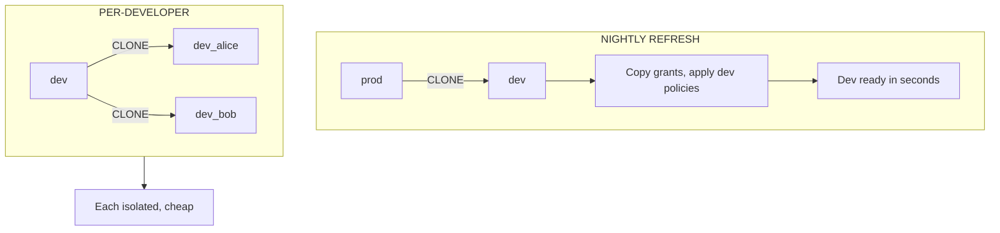

### Lab Exercise
```sql
-- Automate via SP + Task
CREATE OR REPLACE PROCEDURE refresh_dev()
RETURNS STRING LANGUAGE SQL AS
$$
BEGIN
  DROP DATABASE IF EXISTS dev;
  CREATE DATABASE dev CLONE prod;
  GRANT USAGE ON DATABASE dev TO ROLE dev_engineers;
  GRANT USAGE ON ALL SCHEMAS IN DATABASE dev TO ROLE dev_engineers;
  GRANT SELECT, INSERT, UPDATE, DELETE ON ALL TABLES IN DATABASE dev TO ROLE dev_engineers;
  -- Dev-specific masking override (if any)
  RETURN 'Dev refreshed at ' || CURRENT_TIMESTAMP();
END;
$$;

CREATE TASK task_refresh_dev
  USER_TASK_MANAGED_INITIAL_WAREHOUSE_SIZE='XSMALL'
  SCHEDULE = 'USING CRON 0 2 * * * UTC'
AS CALL refresh_dev();
ALTER TASK task_refresh_dev RESUME;

-- Per-dev clone
CREATE DATABASE dev_alice CLONE dev;
```
**Expected outcome:** Dev always has yesterday's prod data at zero clone-time cost.

### Gotchas / Exam Traps
- `COPY GRANTS` works at the clone level; grants on children carry too.
- Dropping and recloning is simpler than ALTER-ing diffs; the clone is cheap enough.
- Clones of clones are supported but create long dependency chains for storage attribution.

---

## Q6: Explain database replication and its billing.
**Difficulty:** Intermediate
**Exam relevance:** "Design database replication"

### Answer
**Database replication** creates a read-only replica in another account (same or different region/cloud). Billing: (1) **egress** charges from source cloud/region (if cross-region/cross-cloud); (2) **storage** in target account at target-region rates; (3) **compute** in both source (serialization) and target (apply changes) during refresh — small for incremental, larger for initial. Refresh is **manual or scheduled** via `ALTER DATABASE ... REFRESH;`.

### First Principles
Snowflake separates "replicate the data" from "promote to writable" — the first is DB replication (any edition), the second needs failover groups (BC+). Billing is designed to be fair: you pay egress only for the bytes crossing clouds/regions; incremental refresh means only changes transfer after the initial seed.

### Diagram
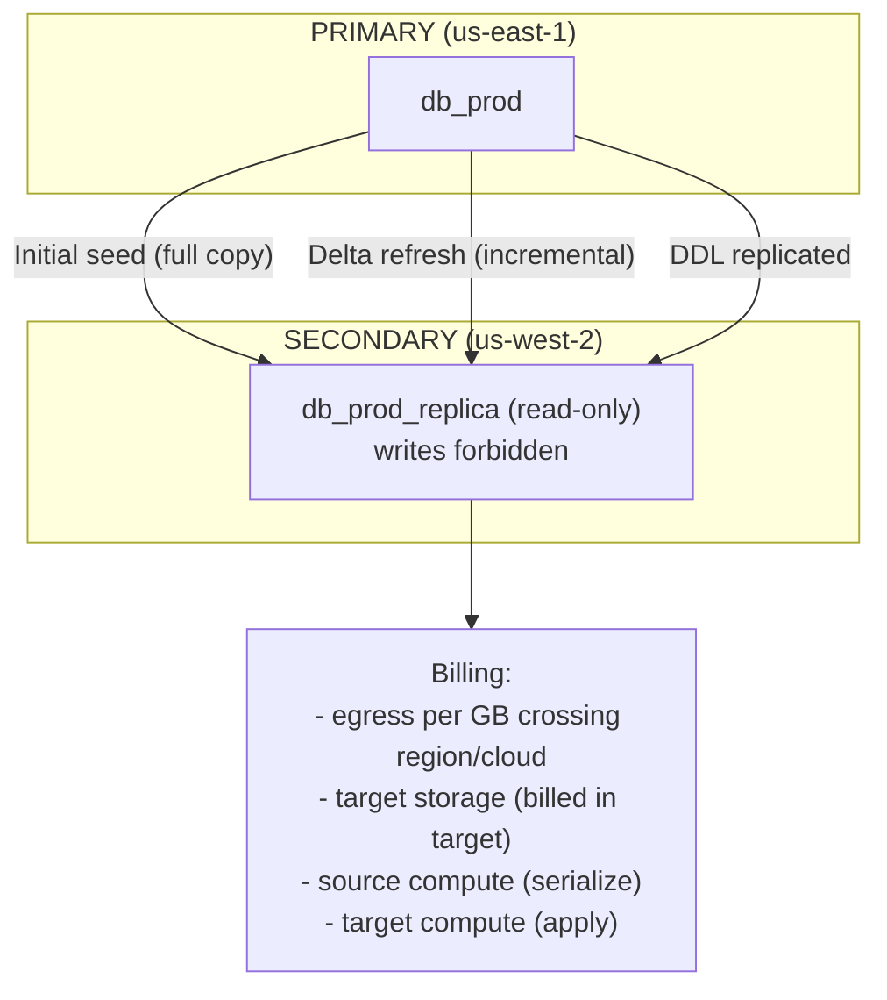

### Lab Exercise
```sql
-- Primary
USE ROLE ACCOUNTADMIN;
ALTER DATABASE db_prod ENABLE REPLICATION TO ACCOUNTS acme.acct_dr_usw2;

-- Secondary
USE ROLE ACCOUNTADMIN;    -- in secondary account
CREATE DATABASE db_prod AS REPLICA OF acme.acct_use1.db_prod;
ALTER DATABASE db_prod REFRESH;

-- Scheduled refresh
CREATE TASK t_refresh WAREHOUSE=wh_ops SCHEDULE='30 MINUTE' AS
  ALTER DATABASE db_prod REFRESH;
ALTER TASK t_refresh RESUME;

-- Monitor refresh
SELECT * FROM TABLE(INFORMATION_SCHEMA.DATABASE_REFRESH_HISTORY('db_prod'));

-- Cost
SELECT * FROM SNOWFLAKE.ACCOUNT_USAGE.REPLICATION_USAGE_HISTORY
WHERE database_name='DB_PROD' AND start_time >= DATEADD(day,-7,CURRENT_TIMESTAMP());
```
**Expected outcome:** Replica consistent to the last successful refresh; billing shows egress and compute.

### Gotchas / Exam Traps
- Replicas are READ-ONLY. Writes error. Use failover group to promote.
- The replica's roles/users do NOT replicate automatically — only database objects. Failover groups replicate account-level objects.
- Replication requires BC+ edition on BOTH sides for failover; read-only replication works on Enterprise+.
- External tables, pipes, streams don't replicate (must recreate in target).

---

## Q7: Describe Failover Groups and how they differ from database replication.
**Difficulty:** Advanced
**Exam relevance:** "Design DR with failover groups"

### Answer
**Failover Groups** (BC+) replicate a bundle of objects (databases, shares, roles, users, warehouses, resource monitors, integrations) and support **failover** — promoting the secondary to primary with a single `ALTER FAILOVER GROUP ... PRIMARY;`. Database replication alone replicates data; failover groups replicate the entire account surface needed to actually fail over. Also provides consistent point-in-time across all included databases.

### First Principles
A DR plan needs more than data: users must log in, roles must grant, warehouses must exist. Failover groups codify this as "the DR unit." Account-level objects (users, roles, warehouses) are included in exactly ONE failover group to avoid duplicates. Promotion is atomic across all included objects — no partial failover.

### Diagram
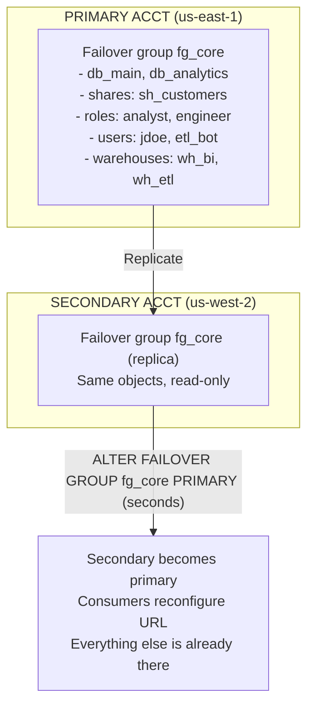

### Lab Exercise
```sql
-- Primary
CREATE FAILOVER GROUP fg_core
  OBJECT_TYPES = (DATABASES, SHARES, ROLES, USERS, WAREHOUSES, RESOURCE MONITORS, INTEGRATIONS)
  ALLOWED_DATABASES = (db_main, db_analytics)
  ALLOWED_SHARES = (sh_customers)
  ALLOWED_ACCOUNTS = (acme.acct_dr_usw2)
  REPLICATION_SCHEDULE = '30 MINUTE';

-- Secondary (automatic creation on refresh)
-- Trigger initial refresh
ALTER FAILOVER GROUP fg_core REFRESH;

-- Promote (DR event)
USE ROLE ACCOUNTADMIN;    -- in secondary account
ALTER FAILOVER GROUP fg_core PRIMARY;

-- Monitor
SELECT * FROM TABLE(INFORMATION_SCHEMA.REPLICATION_GROUP_REFRESH_HISTORY('fg_core'));
```
**Expected outcome:** Primary promotion completes in seconds; secondary becomes writable. Consumers must update their connection URL.

### Gotchas / Exam Traps
- Users and roles can be in at most ONE failover group across the account — "the unit of DR."
- Failover groups require BC+ edition.
- After failover, the original primary (if it recovers) becomes a secondary; to switch back use `ALTER FAILOVER GROUP ... PRIMARY;` from the old primary.
- `ALTER FAILOVER GROUP ... RESUME` must be called after promotion to resume scheduled refresh.
- Including SHARES means consumer accounts still see the share after failover — but consumer-side `CREATE DATABASE FROM SHARE` references the primary account at the time of create; failover may require consumer-side reconfiguration unless using auto-fulfill listings.

---

## Q8: Explain RPO vs RTO and how Snowflake replication achieves them.
**Difficulty:** Advanced
**Exam relevance:** "Design DR SLAs"

### Answer
- **RPO (Recovery Point Objective)**: max acceptable data loss, measured in time. Snowflake's replication refresh interval determines RPO — e.g., 30-min refresh = up to 30-min data loss. Minimum achievable RPO is approximately 1 minute (minimum refresh frequency).
- **RTO (Recovery Time Objective)**: max acceptable downtime. Snowflake failover group promotion takes seconds-to-minutes for the metadata flip. Consumer-side DNS/connection reconfiguration adds minutes. End-to-end RTO is typically 5-15 min for well-tested plans.

### First Principles
RPO = how much data can you afford to lose = how often do you replicate. RTO = how long can you be down = how fast can promotion + reconfiguration finish. Shorter RPO costs more (more frequent replication = more egress). Shorter RTO costs more (pre-provisioned warm standby, tested runbooks, DNS automation).

### Diagram
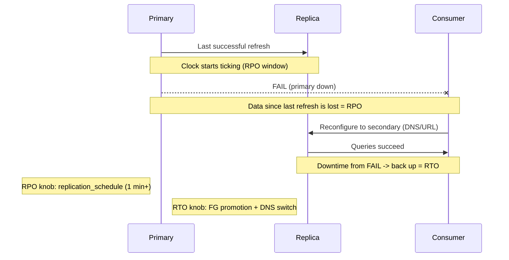

### Lab Exercise
```sql
-- Aggressive RPO
CREATE FAILOVER GROUP fg_rt1
  OBJECT_TYPES=(DATABASES, SHARES, ROLES, USERS, WAREHOUSES)
  ALLOWED_DATABASES=(db_critical)
  ALLOWED_ACCOUNTS=(acme.dr)
  REPLICATION_SCHEDULE='1 MINUTE';

-- Measure actual RPO
SELECT phase_name, start_time, end_time,
       TIMEDIFF('second', LAG(end_time) OVER (ORDER BY start_time), start_time) AS gap_sec
FROM TABLE(INFORMATION_SCHEMA.REPLICATION_GROUP_REFRESH_HISTORY('fg_rt1'))
WHERE phase_name='COMPLETED' ORDER BY start_time DESC;

-- Measure RTO (simulate failover in staging)
-- time: ALTER FAILOVER GROUP fg_rt1 PRIMARY; then verify queries succeed on new primary
```
**Expected outcome:** 1-min RPO achievable at higher egress cost; RTO measured end-to-end including consumer reconfig.

### Gotchas / Exam Traps
- RPO measured from last successful replication, not from scheduled time — a stuck replication can silently blow past the SLA.
- RTO must include client-side DNS/connection changes; this isn't automatic unless using a proxy or client-side logic.
- Failing back after a DR event is a planned operation (reverse direction) — plan for both directions.

---

## Q9: Design a DR architecture for a mission-critical workload with RPO 5-min and RTO 15-min.
**Difficulty:** Advanced
**Exam relevance:** "Design full DR"

### Answer
1. **Business Critical** edition in both primary (us-east-1) and secondary (us-west-2) accounts.
2. **Failover group** `fg_critical` with 1-min replication schedule for the core databases + roles/users/warehouses.
3. **Shares** included in the failover group if customers consume data.
4. **Pre-warmed warehouses** in the secondary (keep MIN_CLUSTER_COUNT=1 with low AUTO_SUSPEND, or periodic ping).
5. **Automated runbook** that scripts the `ALTER FAILOVER GROUP ... PRIMARY;` + client reconfiguration (DNS switch, config update).
6. **Quarterly DR drills** including failover and failback to prove RTO.
7. **Monitoring + alerting** on replication lag — alert if the last_refresh is >5 min behind.

### First Principles
RPO is a math problem (replication frequency) and RTO is a process problem (promotion + reconfig). A paper RTO of 2 minutes means nothing if nobody has tested the switch. Mandatory ingredients: cross-region BC accounts, failover group with aggressive schedule, warmed compute on standby, automated runbook, periodic tested drills, monitoring.

### Diagram
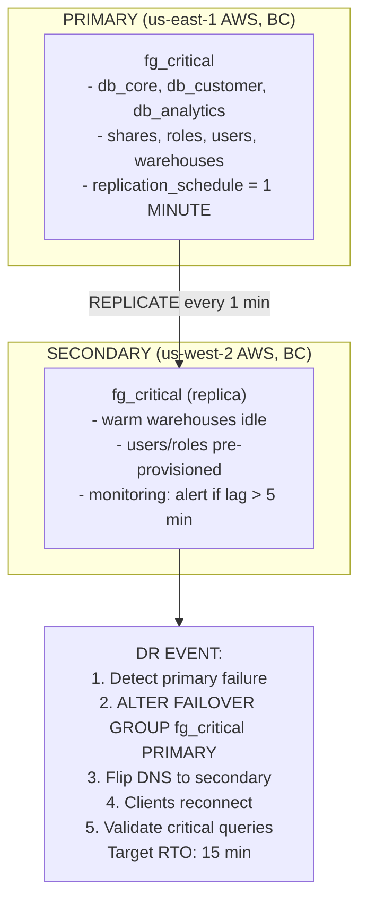

### Lab Exercise
```sql
-- Failover group
CREATE FAILOVER GROUP fg_critical
  OBJECT_TYPES=(DATABASES, SHARES, ROLES, USERS, WAREHOUSES, RESOURCE MONITORS)
  ALLOWED_DATABASES=(db_core, db_customer, db_analytics)
  ALLOWED_SHARES=(sh_main)
  ALLOWED_ACCOUNTS=(acme.acct_dr)
  REPLICATION_SCHEDULE='1 MINUTE';

-- Replication lag monitoring
CREATE OR REPLACE TASK alert_replication_lag
  USER_TASK_MANAGED_INITIAL_WAREHOUSE_SIZE='XSMALL'
  SCHEDULE='5 MINUTE'
AS
BEGIN
  LET last_refresh TIMESTAMP := (
    SELECT MAX(end_time) FROM TABLE(INFORMATION_SCHEMA.REPLICATION_GROUP_REFRESH_HISTORY('fg_critical'))
    WHERE phase_name='COMPLETED');
  LET lag_sec INT := DATEDIFF('second', :last_refresh, CURRENT_TIMESTAMP());
  IF (lag_sec > 300) THEN
    CALL alert_pagerduty('Replication lag: ' || :lag_sec || 's');
  END IF;
END;
ALTER TASK alert_replication_lag RESUME;

-- Scripted promotion runbook (test in staging)
-- in DR account:
-- ALTER FAILOVER GROUP fg_critical PRIMARY;
-- SELECT 1 FROM db_core.sch.tbl_critical;  -- smoke test
-- flip DNS: acme-prod.snowflakecomputing.com -> dr account URL
```
**Expected outcome:** RPO consistently <5 min; drills measure actual RTO; monitoring prevents silent lag.

### Gotchas / Exam Traps
- Replicating every minute at scale is expensive — balance with business requirement.
- Failover of a failover group is atomic across all its objects — no partial state.
- Consumer accounts of shares need a plan: either auto-fulfill listings (per-region native) or coordinated DNS switch.

---

## Q10: Explain the relationship between Time Travel, Clone, and Fail-safe.
**Difficulty:** Intermediate
**Exam relevance:** "Describe storage protection stack"

### Answer
Three layers of protection, increasing in cost + recovery scope:
1. **Clone**: on-demand point-in-time copy; useful for dev or pre-change backup.
2. **Time Travel**: automatic retention of old MPs for self-service query/restore.
3. **Fail-safe**: additional 7-day Snowflake-only safety net after TT expires.

They stack: a MP touched by DML flows ACTIVE → TT (0-90d) → FS (7d) → gone. Clone is a snapshot primitive that uses whatever is available (active + TT) at the moment of clone creation.

### First Principles
Protection is temporal: how far back can you go? Clone (point-in-time, snapshot now). TT (self-service, up to 90 days). FS (support-only, final week). Costs rise with recovery horizon. The architect chooses retention based on recoverability vs storage spend.

### Diagram
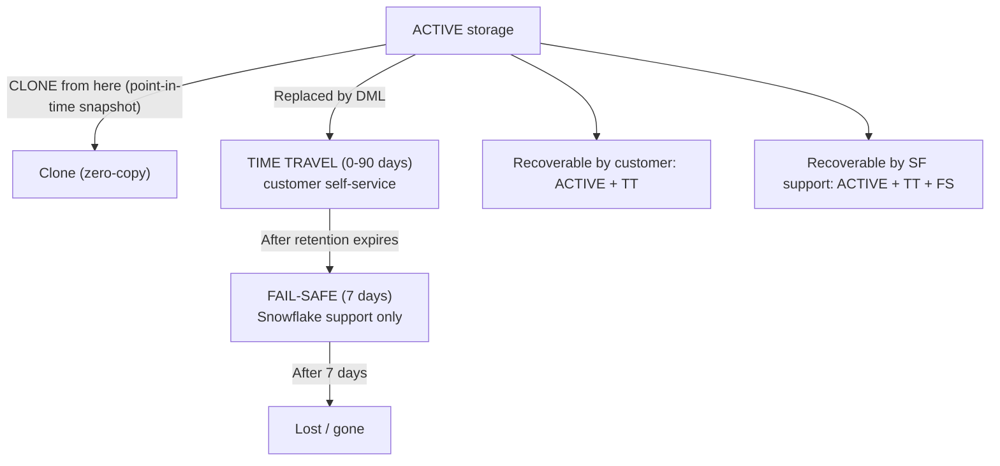

### Lab Exercise
```sql
-- Pre-change clone (free point-in-time backup)
CREATE TABLE orders_bak CLONE orders;

-- Risky change
ALTER TABLE orders DROP COLUMN important_col;

-- Restore via Time Travel (within retention)
CREATE TABLE orders_restored CLONE orders BEFORE(STATEMENT=>'<alter_stmt_id>');

-- If TT expired, open Snowflake support ticket for Fail-safe (permanent only)
```
**Expected outcome:** Clone is zero-cost pre-change backup; TT handles common accidents; FS is last resort.

### Gotchas / Exam Traps
- DDL ops (DROP COLUMN, DROP TABLE partial state) are NOT reversible via Time Travel for metadata changes. UNDROP works for TABLE/SCHEMA/DATABASE drops within retention.
- Clone + ALTER vs restore via Time Travel: clone makes a sibling; TT restores the current table — different outcomes.
- Fail-safe is per-permanent-table only — transient tables lose data at TT expiry.

---

## Q11: Explain storage cost drivers and how to optimize.
**Difficulty:** Advanced
**Exam relevance:** "Optimize storage spend"

### Answer
Storage bill = (active + TT + FS) × GB-months × region rate. Optimize:
1. **Reduce retention** on churny tables (`DATA_RETENTION_TIME_IN_DAYS=1`).
2. **Transient tables** for staging/scratch (no FS, max 1-day TT).
3. **Drop old data** proactively (DELETE WHERE old; purge Time Travel if needed via `ALTER TABLE ... UNSET DATA_RETENTION_TIME_IN_DAYS` and recreate, or just wait).
4. **Compress better**: columnar is already great; avoid storing uncompressed JSON; use VARIANT for naturally compressible shapes.
5. **Clean up clones** — divergence accrues cost; drop dev clones you don't use.
6. **Monitor** via `TABLE_STORAGE_METRICS` and `STORAGE_USAGE`.

### First Principles
Storage is cheap per GB but accumulates. The hidden costs are TT (every UPDATE/DELETE creates versions) and FS (7-day shadow of TT). On high-churn tables with long retention, storage can be 2-3× active data. Right-sizing retention is the biggest lever.

### Diagram
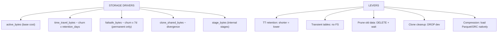

### Lab Exercise
```sql
-- Storage attribution
SELECT table_name, table_schema, table_type,
       active_bytes/(1024*1024*1024)      AS active_gb,
       time_travel_bytes/(1024*1024*1024) AS tt_gb,
       failsafe_bytes/(1024*1024*1024)    AS fs_gb,
       retained_for_clone_bytes/(1024*1024*1024) AS clone_gb,
       (active_bytes+time_travel_bytes+failsafe_bytes+retained_for_clone_bytes)/(1024*1024*1024) AS total_gb
FROM SNOWFLAKE.ACCOUNT_USAGE.TABLE_STORAGE_METRICS
WHERE deleted = FALSE
ORDER BY total_gb DESC LIMIT 50;

-- Fix: reduce retention on top offenders
ALTER TABLE churn_table SET DATA_RETENTION_TIME_IN_DAYS = 1;

-- Overall account storage
SELECT USAGE_DATE, STORAGE_BYTES/(1024*1024*1024*1024) AS tb_total
FROM SNOWFLAKE.ACCOUNT_USAGE.STORAGE_USAGE
ORDER BY usage_date DESC LIMIT 30;
```
**Expected outcome:** Identify top storage spenders; apply TT reduction / transient conversion to save.

### Gotchas / Exam Traps
- Reducing retention doesn't instantly free space; existing TT ages out at the old rate.
- Clone-retained bytes (`retained_for_clone_bytes`) are MPs kept because a clone references them; dropping the clone frees those.
- External tables don't contribute to Snowflake storage billing; they live in your bucket.

---

## Q12: Compare Permanent, Transient, and Temporary tables for storage.
**Difficulty:** Foundation
**Exam relevance:** "Choose table type for storage"

### Answer
- **Permanent**: default; TT 0-90 days, Fail-safe 7 days. Full durability.
- **Transient**: TT 0-1 day, no Fail-safe. Globally visible, cheaper. Good for staging / rebuildable.
- **Temporary**: session-scoped (dropped at session end); TT 0-1 day, no Fail-safe. Good for intermediate SP results.

### First Principles
Storage protection is a cost. Not all data needs the same protection. Transient saves ~1 week of FS plus up to 89 days of TT. Temporary is session-only. Picking the lightest sufficient type is the architect's job.

### Diagram
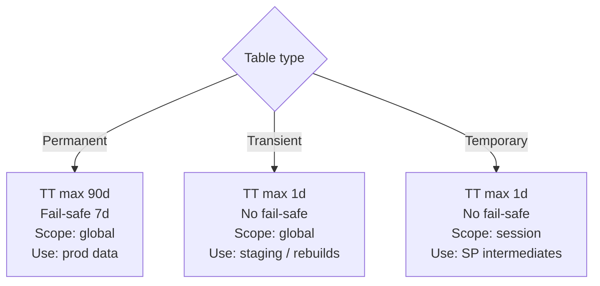

### Lab Exercise
```sql
CREATE TABLE prod.customers (...) DATA_RETENTION_TIME_IN_DAYS=90;
CREATE TRANSIENT TABLE staging.events_raw AS SELECT * FROM @stg/events/;
CREATE TEMPORARY TABLE tmp_calc AS SELECT customer_id, SUM(amount) FROM orders GROUP BY 1;

-- Verify
SELECT table_name, table_type, is_transient, retention_time
FROM INFORMATION_SCHEMA.TABLES WHERE table_schema IN ('PROD','STAGING');
```
**Expected outcome:** Each type has its storage protection; verify via INFORMATION_SCHEMA.

### Gotchas / Exam Traps
- Transient != Temporary. Transient is global and persistent (no auto-drop); just lacks FS.
- You cannot change table type after creation — must recreate.
- dbt's `transient=true` config is a storage optimization worth enforcing on all intermediate models.

---

## Q13: Explain how Snowflake handles failover for shared data consumers.
**Difficulty:** Advanced
**Exam relevance:** "DR for consumers of shares"

### Answer
Two patterns:
1. **Provider failover with shares**: include `SHARES` in a failover group. Primary promotion causes the share to serve from the DR region. Consumers in the primary's region may need to point to the DR account's URL and `CREATE DATABASE FROM SHARE` using the new share name.
2. **Auto-fulfill listings per region**: provider lists via Marketplace/Private Listing with auto-fulfill to each consumer's region. Each consumer has a regional replica already; a primary-region failure doesn't affect other regions. Consumer in the failed region has their own regional replica (unaffected if cross-region) or faces downtime proportional to their regional replica's own DR.

### First Principles
Shares are tied to accounts; accounts live in regions. If the account fails, the share stops. Failover groups transport the share definition but consumers must redirect; auto-fulfill creates regional endpoints that insulate from primary failure.

### Diagram
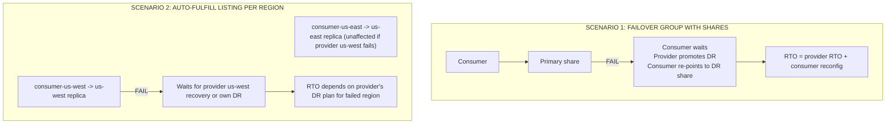

### Lab Exercise
```sql
-- Scenario 1
CREATE FAILOVER GROUP fg_shares
  OBJECT_TYPES=(DATABASES, SHARES, ROLES, USERS)
  ALLOWED_DATABASES=(db_shared)
  ALLOWED_SHARES=(sh_main)
  ALLOWED_ACCOUNTS=(acme.dr)
  REPLICATION_SCHEDULE='15 MINUTE';

-- Scenario 2
-- Create per-region listings via auto-fulfill (see domain 5)
```
**Expected outcome:** Scenario 1 gives tightly-controlled DR; scenario 2 gives regional isolation.

### Gotchas / Exam Traps
- Consumers of shares in a failover group must manually re-point post-promotion unless there's a coordinated DNS/config strategy.
- Auto-fulfill replicates on request + schedule; initial regional fulfillment adds latency on first consumer.
- A provider's DR plan must be communicated to consumers via listing docs / SLA.

---

## Q14: What is a Replication Group vs a Failover Group?
**Difficulty:** Intermediate
**Exam relevance:** "Choose group type"

### Answer
- **Replication Group** (Enterprise+): replicates a set of databases + some account-level objects to one or more target accounts. Target is **read-only**; no failover capability.
- **Failover Group** (BC+): replicates the same objects AND supports promotion to primary (failover). Required for DR with writable secondary.

Use Replication Group for read scale-out (regional read replicas). Use Failover Group when you need to switch primary in a disaster.

### First Principles
Not every replicated workload needs failover. Read-scale-out means replicas serve local reads (lower latency) without ever being promoted. BC pricing is justified only when real DR is required; Enterprise suffices for read replicas.

### Diagram
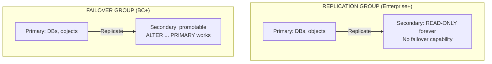

### Lab Exercise
```sql
-- Replication Group (Enterprise, read-only)
CREATE REPLICATION GROUP rg_read
  OBJECT_TYPES=(DATABASES)
  ALLOWED_DATABASES=(db_main)
  ALLOWED_ACCOUNTS=(acme.read_replica)
  REPLICATION_SCHEDULE='60 MINUTE';

-- Failover Group (BC)
CREATE FAILOVER GROUP fg_dr
  OBJECT_TYPES=(DATABASES, SHARES, ROLES, USERS, WAREHOUSES)
  ALLOWED_DATABASES=(db_main)
  ALLOWED_ACCOUNTS=(acme.dr)
  REPLICATION_SCHEDULE='15 MINUTE';
```
**Expected outcome:** Both replicate; only failover group supports promotion.

### Gotchas / Exam Traps
- You cannot convert a replication group into a failover group without recreating.
- An object (DB, user, etc.) can belong to only one replication/failover group across the account.
- Failover groups require BC on both source and target.

---

## Q15: Scenario — Design storage retention for a mix of tables (OLTP, DW, staging).
**Difficulty:** Advanced
**Exam relevance:** "Design retention policies"

### Answer
- **Dimension tables / small reference**: PERMANENT with retention 7-14 days. Low churn, moderate protection.
- **Large fact tables (DW)**: PERMANENT with retention 7-30 days depending on business rollback window. Fail-safe 7d. Storage cost significant; audit TT bytes monthly.
- **Staging / landing**: TRANSIENT with retention 0-1 day. Rebuild from source if lost.
- **Session scratch**: TEMPORARY, auto-dropped.
- **Hybrid tables (OLTP)**: PERMANENT with retention 1-7 days. Row-level durability already strong.

Apply via a schema-level default: `ALTER SCHEMA staging SET DATA_RETENTION_TIME_IN_DAYS=1;`.

### First Principles
Match protection to recovery requirement. Rebuilt-able data (staging) doesn't need Fail-safe. Audit-critical data (compliance DW) needs long TT. OLTP has its own durability + application rollback semantics — don't double-protect.

### Diagram
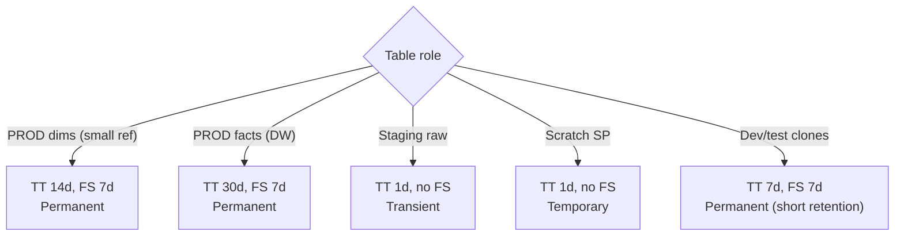

### Lab Exercise
```sql
-- Default by schema
ALTER SCHEMA prod SET DATA_RETENTION_TIME_IN_DAYS=14;
ALTER SCHEMA staging SET DATA_RETENTION_TIME_IN_DAYS=1;

-- Table overrides
ALTER TABLE prod.facts SET DATA_RETENTION_TIME_IN_DAYS=30;

-- Create as transient
CREATE TRANSIENT TABLE staging.raw_batch AS SELECT * FROM @stg;

-- Verify
SELECT schema_name, table_name, retention_time, is_transient
FROM INFORMATION_SCHEMA.TABLES
WHERE table_schema IN ('PROD','STAGING');
```
**Expected outcome:** Per-schema defaults with per-table overrides; staging has minimal protection.

### Gotchas / Exam Traps
- Table retention overrides schema; schema overrides database; database overrides account default (1 day).
- You can't set retention > the account's max (90 days on Enterprise+; 1 day on Standard).
- UNDROP of a dropped table respects the table's retention at drop time.

---

## Q16: Explain how CLONE interacts with Time Travel on both source and target.
**Difficulty:** Advanced
**Exam relevance:** "Understand clone + TT interaction"

### Answer
Clone creates a new table pointing at the source's current MPs. The clone has its OWN Time Travel history starting at creation (empty initially). The source retains its own TT. Shared MPs stay in storage as long as EITHER side references them — hence `retained_for_clone_bytes`. If you drop the source, the shared MPs stay (billed to the clone's account/schema).

### First Principles
MP accounting is reference-counted. A clone makes a new reference. TT on each side extends the reference window. Both can diverge. Dropping one doesn't delete shared MPs; it just removes one reference.

### Diagram
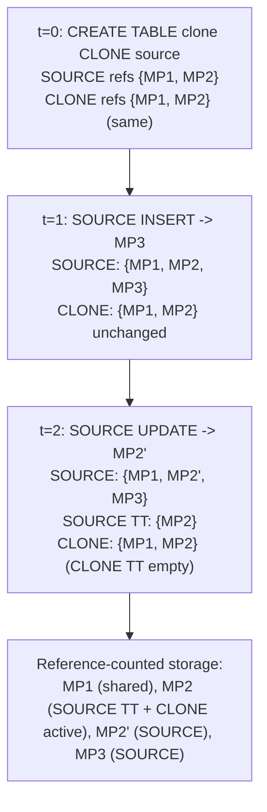

### Lab Exercise
```sql
CREATE TABLE src (id INT, v STRING);
INSERT INTO src VALUES (1,'a'),(2,'b');

CREATE TABLE clone_tbl CLONE src;

INSERT INTO src VALUES (3,'c');     -- source grows
UPDATE clone_tbl SET v='X' WHERE id=1;  -- clone diverges

SELECT * FROM src;                  -- 3 rows
SELECT * FROM clone_tbl;            -- 2 rows, 1 updated

-- Shared storage attribution
SELECT table_name, active_bytes, retained_for_clone_bytes
FROM SNOWFLAKE.ACCOUNT_USAGE.TABLE_STORAGE_METRICS
WHERE table_name IN ('SRC','CLONE_TBL');
```
**Expected outcome:** Divergent histories; shared MPs count once in storage but attributed to both.

### Gotchas / Exam Traps
- Dropping the source doesn't delete MPs referenced by clones; they're retained for the clone.
- A clone's `AT()` can go back only to the clone's creation time, not before — TT of the clone starts fresh.
- Clone of a clone works; the MP ref chain lengthens.

---

## Q17: Describe UNDROP and its limits.
**Difficulty:** Foundation
**Exam relevance:** "Recover dropped objects"

### Answer
`UNDROP TABLE|SCHEMA|DATABASE name;` restores a dropped object within its retention window. The dropped object remains discoverable via `SHOW TABLES HISTORY` / `SHOW SCHEMAS HISTORY` / `SHOW DATABASES HISTORY`. Limits: within TT retention only; if a new object was created with the same name, must drop/rename first.

### First Principles
Dropped doesn't mean deleted — it means "removed from the current catalog." The underlying MPs remain for the retention + FS window. UNDROP is a metadata operation that re-publishes them.

### Diagram
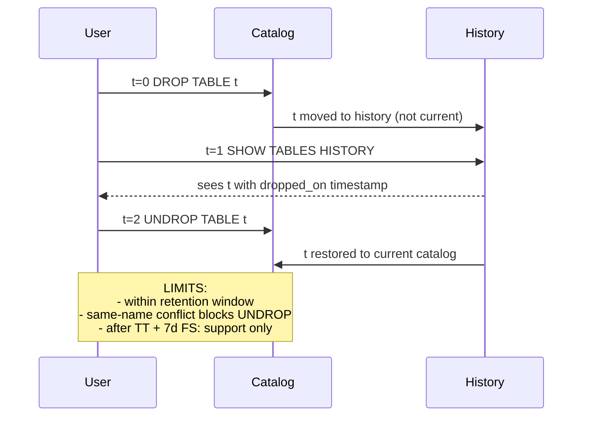

### Lab Exercise
```sql
CREATE TABLE test.t (id INT);
INSERT INTO test.t VALUES (1);
DROP TABLE test.t;

SHOW TABLES HISTORY IN test;   -- shows t with dropped_on
UNDROP TABLE test.t;
SELECT * FROM test.t;           -- row(s) still here

-- Collision case
CREATE TABLE test.t (id INT, v STRING);    -- new object with same name
DROP TABLE test.t;
UNDROP TABLE test.t;    -- fails: still a conflict in current
-- Fix: drop or rename the current one first
```
**Expected outcome:** UNDROP restores within retention; same-name conflicts need manual resolution.

### Gotchas / Exam Traps
- `UNDROP DATABASE` restores all contained schemas and tables transitively (if their own retention allows).
- UNDROP of a schema will fail if the parent database is dropped — restore database first.
- The exam loves name-collision scenarios.

---

## Q18: Explain the role of SYSTEM$CLUSTERING_DEPTH and related storage introspection.
**Difficulty:** Intermediate
**Exam relevance:** "Diagnose storage layout"

### Answer
- `SYSTEM$CLUSTERING_INFORMATION(table, cluster_key)` returns clustering stats: total_partition_count, average_depth, partition_depth_histogram.
- `SYSTEM$CLUSTERING_DEPTH` is the direct depth number (older API).
- `SNOWFLAKE.ACCOUNT_USAGE.TABLE_STORAGE_METRICS` gives active/TT/FS bytes per table.
- `SNOWFLAKE.ACCOUNT_USAGE.STORAGE_USAGE` gives daily account-level storage.
- `AUTOMATIC_CLUSTERING_HISTORY` tracks reclustering spend.

### First Principles
To optimize storage and pruning you need visibility. These introspection functions and views expose what's happening under the metadata layer so you can see TT bloat, clustering drift, and reclustering cost.

### Diagram
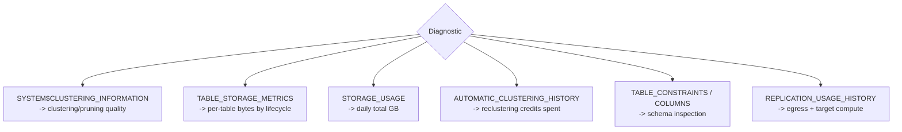

### Lab Exercise
```sql
-- Clustering health
SELECT SYSTEM$CLUSTERING_INFORMATION('orders','(order_date,region)');

-- Storage breakdown
SELECT table_schema, SUM(active_bytes)/(1024*1024*1024) AS gb_active,
       SUM(time_travel_bytes)/(1024*1024*1024) AS gb_tt,
       SUM(failsafe_bytes)/(1024*1024*1024) AS gb_fs
FROM SNOWFLAKE.ACCOUNT_USAGE.TABLE_STORAGE_METRICS
WHERE deleted=FALSE GROUP BY 1 ORDER BY gb_active DESC;

-- Reclustering cost
SELECT table_name, SUM(credits_used) AS total_credits
FROM SNOWFLAKE.ACCOUNT_USAGE.AUTOMATIC_CLUSTERING_HISTORY
WHERE start_time >= DATEADD(day,-30,CURRENT_TIMESTAMP())
GROUP BY 1 ORDER BY total_credits DESC;
```
**Expected outcome:** Clear picture of per-table storage, clustering quality, and reclustering spend.

### Gotchas / Exam Traps
- ACCOUNT_USAGE latency is up to 3 hours; INFORMATION_SCHEMA is live but limited history.
- Clustering depth of 1 is perfect; depth of 100 means every MP overlaps 100 others on the key.

---

## Q19: Scenario — You need to restore a specific table to its state 10 days ago but TT is set to 7 days.
**Difficulty:** Advanced
**Exam relevance:** "Recover beyond TT"

### Answer
Options:
1. **Fail-safe** (if permanent table and within 7 days after TT expiry): open Snowflake support ticket. Support will attempt restoration; not guaranteed, may take hours.
2. **External backup** if you implemented one (e.g., scheduled unload to S3 Parquet). Reload selected data.
3. **Secondary account replica**: if you have a replication/failover group with longer TT in the replica (uncommon), restore from there.

Prevention: review retention monthly on critical tables; increase TT or implement external backups for compliance.

### First Principles
Once TT + FS expires, Snowflake has no further obligation. Resilience beyond that depends on your external backup strategy. The exam tests scenarios where TT was too short and FS is the only recourse — and the recognition that FS is support-only.

### Diagram
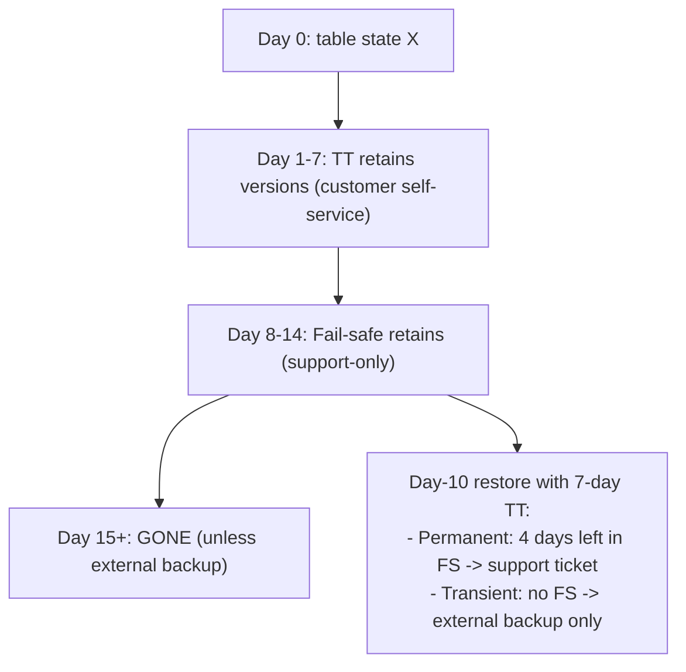

### Lab Exercise
```sql
-- Preventive: external backup pattern
CREATE TASK weekly_unload
  USER_TASK_MANAGED_INITIAL_WAREHOUSE_SIZE='MEDIUM'
  SCHEDULE='USING CRON 0 2 * * 0 UTC'
AS
COPY INTO @ext_backup/critical/${CURRENT_DATE()}
FROM critical_table
FILE_FORMAT=(TYPE=PARQUET COMPRESSION=SNAPPY)
OVERWRITE=TRUE;

-- Preventive: longer retention on critical
ALTER TABLE critical_table SET DATA_RETENTION_TIME_IN_DAYS=30;

-- Reactive: fail-safe support request (manual)
-- Snowsight -> Support -> Open Case
--   "Fail-safe restoration for TABLE X at TIMESTAMP Y"
```
**Expected outcome:** Longer-term protection via external backup + extended retention; fail-safe as emergency option.

### Gotchas / Exam Traps
- Fail-safe is NOT a disaster recovery feature — it's an accidental deletion safety net.
- Restoration from FS is best-effort; Snowflake makes no SLA.
- External Parquet backups cost storage in your bucket but no FS credits.

---

## Q20: Explain cross-cloud DR tradeoffs vs cross-region same-cloud.
**Difficulty:** Advanced
**Exam relevance:** "DR topology choice"

### Answer
- **Same-cloud cross-region** (e.g., AWS us-east-1 → us-west-2): cheaper egress, familiar tooling, protects against regional outages but not cloud-provider failures.
- **Cross-cloud** (e.g., AWS us-east-1 → Azure eastus2): protects against single-cloud failures (hypothetical global AWS outage), but higher egress, cross-cloud latency considerations, and operational complexity of running on two clouds.

Most customers use cross-region same-cloud; cross-cloud is reserved for regulated / critical infrastructure where cloud-provider failure is a stated threat.

### First Principles
Cross-region same-cloud handles the vast majority of real-world outages (localized regional events). Cross-cloud handles rare but systemic cloud-provider failures. The cost of cross-cloud is 2× tooling (AWS + Azure learning curve) + egress bills + often slower replication. Choose cross-cloud only when the threat model demands it.

### Diagram
```mermaid
flowchart TD
    Topo{"DR Topology"}
    Topo -->|"Same-cloud x-region"| SC["AWS us-east-1 -> AWS us-west-2<br/>- egress within AWS (cheap)<br/>- seconds-level latency<br/>- same tooling<br/>Protects: region outage"]
    Topo -->|"Cross-cloud"| CC["AWS us-east-1 -> Azure eastus2<br/>- egress AWS -> Azure (pricey)<br/>- tens of ms more latency<br/>- two clouds to operate<br/>Protects: region + cloud + vendor failure"]
```

### Lab Exercise
```sql
-- Cross-region same-cloud
CREATE FAILOVER GROUP fg_xregion
  OBJECT_TYPES=(DATABASES, SHARES, ROLES, USERS, WAREHOUSES)
  ALLOWED_DATABASES=(db_main)
  ALLOWED_ACCOUNTS=(acme.aws_usw2)
  REPLICATION_SCHEDULE='15 MINUTE';

-- Cross-cloud (same ORG, different cloud/region)
-- Both accounts must be in the same ORG with cross-cloud replication enabled
CREATE FAILOVER GROUP fg_xcloud
  OBJECT_TYPES=(DATABASES, SHARES, ROLES, USERS, WAREHOUSES)
  ALLOWED_DATABASES=(db_main)
  ALLOWED_ACCOUNTS=(acme.azure_eastus2)
  REPLICATION_SCHEDULE='60 MINUTE';

-- Costs
SELECT * FROM SNOWFLAKE.ACCOUNT_USAGE.REPLICATION_USAGE_HISTORY
WHERE database_name='DB_MAIN' ORDER BY start_time DESC;
-- Look at egress bytes in cross-cloud vs cross-region
```
**Expected outcome:** Cross-region same-cloud is a cost-efficient DR default; cross-cloud is a specific threat-model answer.

### Gotchas / Exam Traps
- Cross-cloud ingress to the receiving cloud is sometimes free; outbound from source is not.
- Not all features are supported in all clouds equally — check feature matrix.
- Snowflake's PrivateLink equivalents differ by cloud (AWS PrivateLink vs Azure Private Link vs GCP PSC) — DR + PrivateLink needs careful mapping.

---

## Summary of Protection Decisions

| Need | Primitive |
|------|-----------|
| Rollback a bad UPDATE | Time Travel |
| Protect against drop | UNDROP (within TT) |
| Last-resort recovery | Fail-safe (support ticket) |
| Instant dev copy | Zero-copy CLONE |
| Pre-change backup | CLONE before DDL |
| Read scale-out | Replication Group (Enterprise+) |
| DR with promotion | Failover Group (BC+) |
| 1-min RPO | REPLICATION_SCHEDULE='1 MINUTE' |
| Minimize storage cost | Transient / shorter TT |
| Long audit retention | DATA_RETENTION_TIME_IN_DAYS=90 |
| Cross-cloud DR | Failover group between clouds (BC+) |
| Shared data DR | SHARES in failover group OR auto-fulfill listings |
