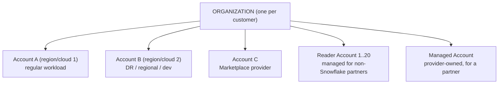
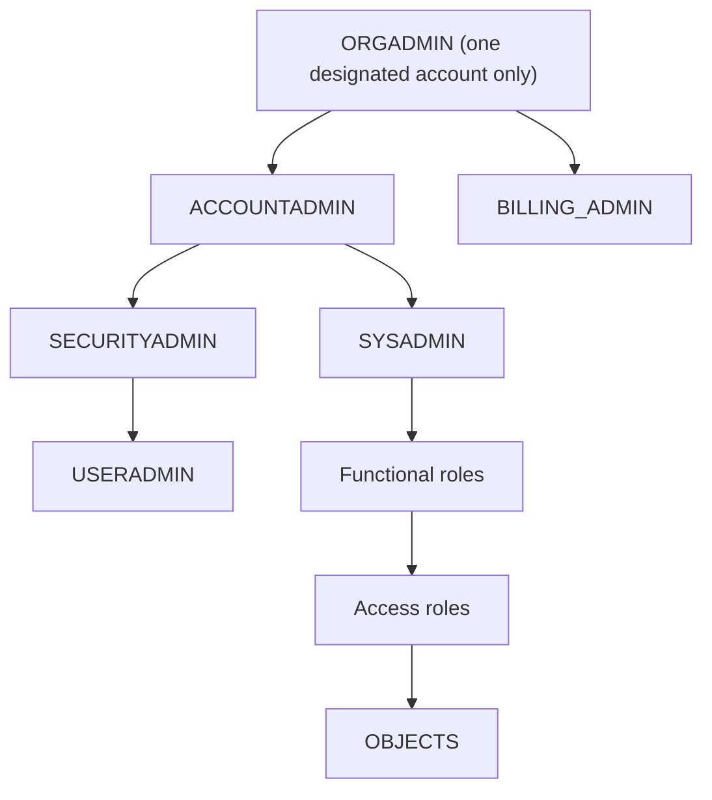
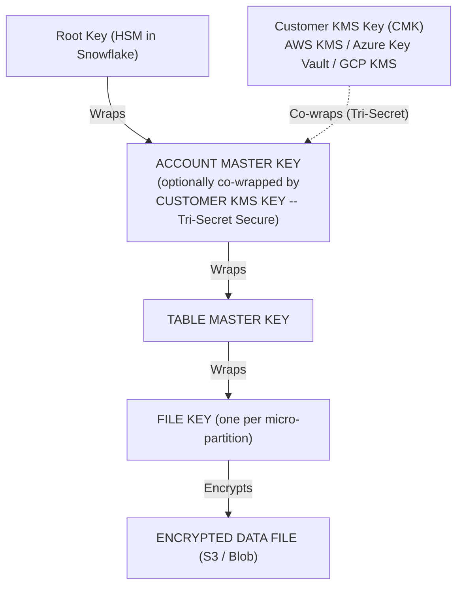
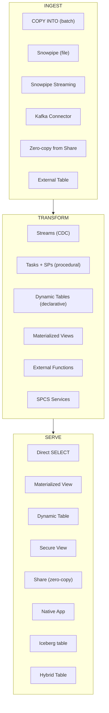

# ARA-C01 Cheatsheet

Dense single-document reference. Use for last-week consolidation and in-exam mental checks.

---

## 1. Edition Matrix

| Feature / Capability | Standard | Enterprise | Business Critical | VPS |
|----------------------|----------|------------|-------------------|-----|
| Time Travel max | 1 day | 90 days | 90 days | 90 days |
| Fail-safe (fixed) | 7 days | 7 days | 7 days | 7 days |
| Multi-cluster warehouses | NO | YES | YES | YES |
| Materialized views | NO | YES | YES | YES |
| Search Optimization Service | NO | YES | YES | YES |
| Dynamic data masking | NO | YES | YES | YES |
| Row access policies | NO | YES | YES | YES |
| External tokenization | NO | YES | YES | YES |
| ACCESS_HISTORY | NO | YES | YES | YES |
| Database Replication (read-only) | NO | YES | YES | YES |
| Query Acceleration Service | NO | YES | YES | YES |
| Column-level security tags | NO | YES | YES | YES |
| Tri-Secret Secure (customer-managed keys) | NO | NO | YES | YES |
| PrivateLink (AWS / Azure / GCP) | NO | NO | YES | YES |
| Failover Groups (promotable DR) | NO | NO | YES | YES |
| HIPAA / PCI / FedRAMP-Moderate | NO | NO | YES | YES |
| Dedicated Cloud Services (isolated metadata) | NO | NO | NO | YES |
| FedRAMP-High / IRAP / dedicated-services customers | NO | NO | NO | YES |

**Edition rules of thumb:**
- Standard = demo / dev only.
- Enterprise = most production workloads.
- Business Critical = PII, HIPAA, PCI, DR with failover, PrivateLink.
- VPS = defense, finance top-tier, FedRAMP-High.
- Edition is per-account; one org can mix editions.
- **Edition cannot be downgraded** — plan up, not down.

---

## 2. Replication: Database vs Replication Group vs Failover Group

| Attribute | Database Replication | Replication Group | Failover Group |
|-----------|----------------------|-------------------|----------------|
| Minimum edition (both sides) | Enterprise | Enterprise | Business Critical |
| Objects replicated | One database | Bundle: DBs + optional account objects | Bundle: DBs + shares + roles + users + warehouses + resource monitors + integrations |
| Secondary writable? | NO | NO | NO until promoted |
| Promotable (failover) | NO | NO | YES (`ALTER FAILOVER GROUP ... PRIMARY`) |
| Point-in-time consistency across DBs | NO | YES (within group) | YES |
| Replicates roles/users/warehouses | NO | Partial | YES |
| Min refresh schedule | 1 minute | 1 minute | 1 minute |
| Used for | Simple read replica | Read scale-out | DR with writable secondary |

**Key constraints:**
- A database/share/user/role can belong to **exactly one** replication or failover group.
- External tables, pipes, streams, tasks do **NOT** replicate — recreate in target.
- Promoted secondary resumes schedule; old primary becomes secondary (`ALTER FAILOVER GROUP ... RESUME` after re-promotion).

**Minimal failover group DDL:**
```sql
CREATE FAILOVER GROUP fg_core
  OBJECT_TYPES = (DATABASES, SHARES, ROLES, USERS, WAREHOUSES, RESOURCE MONITORS, INTEGRATIONS)
  ALLOWED_DATABASES = (db_main, db_analytics)
  ALLOWED_SHARES = (sh_main)
  ALLOWED_ACCOUNTS = (acme.acct_dr_usw2)
  REPLICATION_SCHEDULE = '15 MINUTE';
```

---

## 3. Account Types & Organization Structure



**Role landscape in each account:**


| Role | Scope |
|------|-------|
| ORGADMIN | Cross-account governance; `CREATE ACCOUNT`, enable replication. No data access in other accounts. |
| ACCOUNTADMIN | Top of account; owns billing, security, system. Avoid using for daily work. |
| SECURITYADMIN | Manages roles, grants, security integrations. Parent of USERADMIN. |
| USERADMIN | Create users and roles only. |
| SYSADMIN | Owns databases, warehouses, data objects. |
| PUBLIC | Default role; keep minimal privileges. |

**RBAC pattern (recommended):**
- Access roles: object privileges (`sales_db_r`, `sales_db_rw`).
- Functional roles: personas (`analyst_sales`, `engineer_sales`).
- Users → granted functional roles → granted access roles → object privileges.

**Account provisioning:**
```sql
USE ROLE ORGADMIN;
CREATE ACCOUNT acme_sandbox
  ADMIN_NAME='sbx_admin' ADMIN_PASSWORD='TempP@ss!'
  EMAIL='ops@acme.com' EDITION=ENTERPRISE
  REGION='aws_us_west_2';
```

---

## 4. Sharing: Direct Share vs Reader Account vs Marketplace vs Private Listing vs Clean Room

**Direct Share**
- Discoverability: None (explicit `ALTER SHARE ADD ACCOUNTS`)
- Consumer: Snowflake customer; Compute: Consumer
- Logic: Secure views + Secure UDFs; Monetization: None
- Use when: 1-to-few known partners

**Reader Account**
- Discoverability: None (provider provisions)
- Consumer: Non-Snowflake; Compute: **Provider**
- Logic: Same as direct; Monetization: Provider bills partner directly
- Use when: Partner has no Snowflake, you want to pay for them

**Private Listing**
- Discoverability: Allow-listed consumers see in Marketplace tab
- Consumer: Snowflake customer; Compute: Consumer
- Logic: Secure views + Secure UDFs; Monetization: Paid listings supported
- Use when: Curated 1-to-many; self-service accept

**Marketplace (public)**
- Discoverability: Any Snowflake customer
- Consumer: Snowflake customer; Compute: Consumer
- Logic: Secure views + Secure UDFs; Monetization: Paid or free
- Use when: Broad distribution, monetization

**Native App**
- Discoverability: Via Marketplace/Private Listing
- Consumer: Snowflake customer; Compute: Consumer
- Logic: Full (SPs, UDFs, Streamlit UI, versioning); Monetization: Yes
- Use when: Ship behavior, not just data

**Data Clean Room**
- Discoverability: Via Native App or custom pattern
- Consumer: Snowflake customer; Compute: Negotiated
- Logic: Approved queries only, min-k aggregation; Monetization: Possible
- Use when: Privacy-preserving multi-party join

**Shareable:** tables, external tables, secure views, secure UDFs, Iceberg (with limits).
**NOT shareable:** streams, tasks, pipes, sequences, stored procedures, materialized views (limited), dynamic tables (limited), hybrid tables (limited), temporary objects.
**Workaround for streams/tasks:** build a target table from stream + task, share the table.

**Cross-region/cloud sharing:**
- Native share: **same region, same cloud only**.
- Cross-region: database replication + share from replica, OR Marketplace/Private Listing with auto-fulfill.
- Auto-fulfill: Snowflake auto-replicates to each consumer's region on accept, maintains freshness.

**Secure View requirements:**
- MANDATORY for any view in a share.
- Hides SQL body from consumers.
- Blocks side-channel leaks via error messages and query plan.
- Trade-off: ~single-digit % performance overhead vs non-secure view.

**IMPORTED PRIVILEGES:** the only valid grant on a database created `FROM SHARE`.

---

## 5. DR Patterns & RPO / RTO Targets

| Scenario | Pattern | Edition | RPO target | RTO target |
|----------|---------|---------|------------|------------|
| Dev/test loss | Clone + source re-create | Any | N/A | N/A |
| Accidental DML | Time Travel (`AT`/`BEFORE`/UNDROP) | Any | N/A | seconds |
| Table-level corruption | Clone from past point + swap | Any | N/A | minutes |
| Account-level corruption | Fail-safe (support ticket) | Permanent tables only | N/A | hours (best-effort) |
| Regional outage (read-only acceptable) | Database Replication / Replication Group | Enterprise | = refresh schedule | n/a (no failover) |
| Regional outage (writable needed) | Failover Group | Business Critical | 1 min (minimum schedule) | 5-15 min end-to-end |
| Cloud outage | Cross-cloud Failover Group | Business Critical | 1-15 min | 15-30 min |
| Share continuity across regions | SHARES in Failover Group + consumer reconfig OR auto-fulfill listings | Business Critical | = schedule | varies |

**RPO = max data loss** = replication schedule interval.
**RTO = max downtime** = metadata promotion (seconds) + client reconfiguration (minutes).

**Monitoring replication lag:**
```sql
SELECT MAX(end_time)
FROM TABLE(INFORMATION_SCHEMA.REPLICATION_GROUP_REFRESH_HISTORY('fg_core'))
WHERE phase_name='COMPLETED';
-- Compare to CURRENT_TIMESTAMP; alert if gap > SLA
```

**Promotion (DR event):**
```sql
USE ROLE ACCOUNTADMIN;      -- in secondary account
ALTER FAILOVER GROUP fg_core PRIMARY;
-- Secondary becomes writable; clients reconnect to secondary URL
```

**DR checklist:**
1. Both accounts BC, same org.
2. Failover group with aggressive schedule.
3. Pre-warmed warehouses in secondary.
4. Automated promotion runbook (tested quarterly).
5. Lag monitoring + alerting < RPO SLA.
6. Client-side reconnection strategy (DNS, config, feature flags).
7. Consumer plan for shares (auto-fulfill listing or coordinated reconfig).

---

## 6. Encryption Hierarchy + Tri-Secret Secure



**All AES-256.** Key hierarchy enables:
- Scope-limited keys (compromising one TMK affects one table).
- Rotation without rewrite — new data uses new keys; `PERIODIC_DATA_REKEYING = TRUE` rewraps old files.
- Regulatory separation of duties via Tri-Secret: Snowflake cannot decrypt without customer's KMS key.

**Automatic rotation:** every 30 days new keys for new data.

**Tri-Secret Secure (BC+ only):**
- Add customer-managed key (CMK) from AWS KMS / Azure Key Vault / GCP KMS.
- CMK co-wraps the Account Master Key.
- Revoking the CMK = "cryptoshredding" = PERMANENTLY irrecoverable data.
- CMKs are regional — your DR account needs its own CMK in its own region's KMS.

**Separate from Tri-Secret:**
- Stage encryption (external stages use client-side or server-side keys independently).
- Tri-Secret protects data at rest in Snowflake storage, not in external stages or caches.

---

## 7. Clustering / SOS / MV / DT Decision Table

| Need | Primitive | Edition | Cost model | Best for |
|------|-----------|---------|------------|----------|
| Prune on range filter (`BETWEEN`, `>`, `<`) | Natural order OR `CLUSTER BY` | Any (manual on Enterprise+) | Serverless reclustering | Time-partitioned fact tables; low-cardinality equality |
| Prune on low-cardinality equality (`region='EU'`) | `CLUSTER BY (region, ...)` | Enterprise+ | Serverless reclustering | region, country, product_category |
| Point lookup on high-cardinality (`user_id=123`) | `SEARCH OPTIMIZATION ON EQUALITY(user_id)` | Enterprise+ | Serverless maintenance | Billion-row dim lookup |
| Substring filter (`email LIKE '%@acme%'`) | `SEARCH OPTIMIZATION ON SUBSTRING(email)` | Enterprise+ | Serverless maintenance | Freeform text search |
| Geo filter (`ST_WITHIN(geo, poly)`) | `SEARCH OPTIMIZATION ON GEO(geo)` | Enterprise+ | Serverless maintenance | Spatial queries |
| VARIANT path filter (`payload:user_id=123`) | `SEARCH OPTIMIZATION ON EQUALITY(payload:user_id)` or extract to typed col | Enterprise+ | Serverless maintenance | JSON-heavy events |
| Precompute single-table aggregation (optimizer-rewritten) | **Materialized View** | Enterprise+ | Serverless | Repeating `SUM/COUNT` on one table |
| Precompute multi-table pipeline (declarative, chainable) | **Dynamic Table** | All | User-managed WH | Join + aggregate + chain |
| Procedural pipeline, external calls | **Streams + Tasks** | All | User-managed WH or serverless tasks | Any logic, external fns, orchestration |
| Scan-heavy single query occasional speedup | **QAS** | Enterprise+ | Serverless (separate line) | Big scans + light post-processing |
| Many concurrent short queries | Multi-cluster warehouse | Enterprise+ | Compute | BI dashboards |
| One very expensive query | Scale UP (bigger size) | All | Compute | Parallelizable workloads |

**Decision shortcuts:**
- `WHERE col = const` on high-cardinality → **SOS** (not clustering).
- `WHERE col BETWEEN a AND b` → **Clustering**.
- Query shape fixed, want transparent speedup → **MV**.
- Query is complex, I want a derived model → **DT**.
- Need procedural control, external calls → **Streams + Tasks**.
- Big scan, light post → **QAS**.

**MV restrictions (common exam trap):** single table, no joins, no LIMIT, no ORDER BY, no outer joins, no UDFs. If you need any, use DT.

**Clustering keys guidance:**
- 3-4 keys max.
- Low-to-medium cardinality in the WHERE/JOIN.
- Column order matters: `(region, date)` ≠ `(date, region)`.

---

## 8. Caching Layers Summary

**Result Cache**
- Location: Cloud Services; Billing: FREE (CS, no compute)
- TTL: 24h / renewed up to 31 days / 1GB max result size
- Shared: Account-wide (same role)
- Invalidated by: base table change; non-deterministic fn (CURRENT_TIMESTAMP, UUID, RANDOM); different role; different session parameters; USE_CACHED_RESULT=FALSE; result > 1GB

**Metadata Cache**
- Location: Cloud Services; Billing: FREE (CS)
- TTL: Persistent; Shared: Account-wide
- Invalidated by: DML commits, metadata refresh

**Warehouse SSD Cache**
- Location: Per warehouse per cluster; Billing: Part of warehouse credits
- TTL: Lifetime of cluster; Shared: None (per-cluster)
- Invalidated by: suspend, resize, cluster drop, cluster not routed to

**Query execution order:**
1. Result Cache — hit = ~50ms return, zero credits.
2. Metadata Cache — pruning + plan.
3. SSD Cache (per-cluster) — warm partitions.
4. Remote Storage (S3 / Blob / GCS) — cold reads.

**Metadata-only operations** (no warehouse credits):
- `SELECT COUNT(*) FROM t` (no WHERE).
- `SELECT MIN(col), MAX(col) FROM t` (no WHERE).
- `SHOW TABLES`, `SHOW DATABASES`, `DESC TABLE`.
- `INFORMATION_SCHEMA.*` reads.
- Any WHERE clause → warehouse required.

**SSD cache size scales with WH size** — Large (8 nodes) has ~2× the aggregate SSD of Medium (4 nodes). Working set exceeding aggregate SSD = re-reads from S3.

**Resize wipes SSD cache on new nodes** — benchmarks right after resize miss cache.

**Multi-cluster SSD cache is NOT shared** across clusters — a query on cluster 2 reading data warm on cluster 1 misses cache.

---

## 9. Key Numbers to Memorize

| Metric | Value |
|--------|-------|
| Cloud Services billing threshold | 10% of daily compute credits |
| Max Time Travel (Enterprise+) | 90 days |
| Max Time Travel (Standard, transient, temp) | 1 day |
| Fail-safe (fixed) | 7 days |
| Default `MAX_CONCURRENCY_LEVEL` per cluster | 8 |
| Minimum `AUTO_SUSPEND` | 60 seconds |
| Billing granularity | 60 s minimum, per-second after |
| OAuth refresh token max validity | 90 days |
| OAuth access token default lifetime | 10 minutes |
| Snowpipe file dedupe window | 64 days |
| ACCESS_HISTORY latency | up to 3 hours |
| ACCESS_HISTORY retention | 365 days |
| ACCOUNT_USAGE view latency | up to 3 hours |
| INFORMATION_SCHEMA retention | 7 days |
| Max Reader Accounts per provider | 20 |
| Max micro-partition compressed size | ~500 MB |
| Min micro-partition compressed size | ~50 MB |
| Recommended COPY file size | 100-250 MB compressed |
| Min replication schedule | 1 minute |
| Session params that affect result cache | TIMEZONE, DATE_INPUT_FORMAT, more |
| Result cache max result size | 1 GB |

---

## 10. Auth Primitives Decision Matrix

| Need | Mechanism |
|------|-----------|
| Human SSO | SAML2 security integration + Okta/Azure AD |
| Auto-provision users | SCIM (maps IdP groups → Snowflake roles) |
| MFA | At IdP, or built-in `MFA_ENROLLMENT=REQUIRED` with Duo |
| Service account auth | Key-pair (RSA_PUBLIC_KEY, RSA_PUBLIC_KEY_2 for rotation) |
| Partner app auth (partner's IdP) | External OAuth |
| Partner app auth (Snowflake-centric) | Custom OAuth |
| Enforce specific auth methods | Authentication Policy (`AUTHENTICATION_METHODS`, `CLIENT_TYPES`) |
| Restrict by IP | Network Policy |
| No public internet route | PrivateLink (BC+) |
| Timeout idle sessions | Session Policy |
| Column-level data audit | ACCESS_HISTORY (Enterprise+) |
| Posture monitoring | Trust Center |

---

## 11. Governance Primitives

| Problem | Primitive |
|---------|-----------|
| Hide column values from unauthorized roles | Masking Policy (dynamic) |
| Replace values at load time (never store raw) | External Tokenization |
| Filter rows based on context | Row Access Policy |
| Only one masking policy allowed per column | Nest multiple rules inside one policy |
| Classify PII at scale | Snowflake Classification + Tags + policies on tags |
| Measure quality (null %, freshness, custom) | Data Metric Functions |
| Column-level lineage | ACCESS_HISTORY `direct_objects_accessed` / `objects_modified` |
| Grants over time (drift detection) | `GRANTS_TO_ROLES` + daily snapshot pattern |
| Posture scanning | Trust Center |

---

## 12. Ingest / Transform / Serve Primitives



**Latency ladder:**
| Pattern | Latency |
|---------|---------|
| Snowpipe Streaming + DT (`TARGET_LAG='30 SEC'`) | ~seconds |
| Snowpipe + Streams + Task every minute | ~1-3 min |
| COPY + Task hourly | ~hour |
| Scheduled replication | = schedule |

**Cost ladder (per GB ingested):**
| Pattern | Relative cost |
|---------|---------------|
| COPY (bulk) | lowest |
| Snowpipe (file-triggered) | medium |
| Snowpipe Streaming (row-level) | highest |

---

## 13. Common SQL Snippets (High-Yield)

**Query a table at a point in time:**
```sql
SELECT * FROM t AT(TIMESTAMP => '2024-11-01 10:00:00'::TIMESTAMP);
SELECT * FROM t AT(OFFSET => -3600);          -- 1h ago
SELECT * FROM t BEFORE(STATEMENT => '01abcde-...');
```

**Zero-copy clone:**
```sql
CREATE DATABASE dev CLONE prod;                               -- instant, zero bytes copied
CREATE TABLE t_bak CLONE t AT(OFFSET=>-86400);                -- yesterday's snapshot
CREATE SCHEMA sch_bak CLONE sch COPY GRANTS;                  -- carry current grants
```

**Set retention:**
```sql
ALTER TABLE t SET DATA_RETENTION_TIME_IN_DAYS = 30;
ALTER SCHEMA staging SET DATA_RETENTION_TIME_IN_DAYS = 1;
```

**Create failover group:**
```sql
CREATE FAILOVER GROUP fg_core
  OBJECT_TYPES = (DATABASES, SHARES, ROLES, USERS, WAREHOUSES)
  ALLOWED_DATABASES = (db_main)
  ALLOWED_ACCOUNTS = (acme.acct_dr)
  REPLICATION_SCHEDULE = '15 MINUTE';
```

**Share creation:**
```sql
CREATE SHARE sh_sales;
GRANT USAGE ON DATABASE db TO SHARE sh_sales;
GRANT USAGE ON SCHEMA db.sales TO SHARE sh_sales;
GRANT SELECT ON VIEW db.sales.customers_v TO SHARE sh_sales;  -- must be SECURE view
ALTER SHARE sh_sales ADD ACCOUNTS = consumer_acct;
```

**Dynamic Table:**
```sql
CREATE DYNAMIC TABLE dt_orders TARGET_LAG='5 MIN' WAREHOUSE=wh_etl AS
SELECT c.region, SUM(o.amount) tot
FROM orders o JOIN customers c USING(customer_id)
GROUP BY 1;
```

**Clustering + SOS on the same table:**
```sql
ALTER TABLE fact_orders CLUSTER BY (order_date, region);
ALTER TABLE fact_orders ADD SEARCH OPTIMIZATION
  ON EQUALITY(order_id)
  ON SUBSTRING(customer_email);
```

**Masking policy:**
```sql
CREATE MASKING POLICY mask_ssn AS (v STRING) RETURNS STRING ->
  CASE WHEN CURRENT_ROLE() IN ('PII_READER') THEN v
       ELSE REGEXP_REPLACE(v,'[0-9]','*') END;
ALTER TABLE t MODIFY COLUMN ssn SET MASKING POLICY mask_ssn;
```

**Row access policy:**
```sql
CREATE ROW ACCESS POLICY rap_region AS (region STRING) RETURNS BOOLEAN ->
  region = CURRENT_ACCOUNT_SESSION_VARIABLE('region')
  OR CURRENT_ROLE() = 'ACCOUNTADMIN';
ALTER TABLE orders ADD ROW ACCESS POLICY rap_region ON (region);
```

**Resource monitor:**
```sql
CREATE RESOURCE MONITOR rm_bi WITH CREDIT_QUOTA=500 FREQUENCY=DAILY
  TRIGGERS ON 80 PERCENT DO NOTIFY
           ON 100 PERCENT DO SUSPEND
           ON 110 PERCENT DO SUSPEND_IMMEDIATE;
ALTER WAREHOUSE wh_bi SET RESOURCE_MONITOR = rm_bi;
```

**Authentication Policy:**
```sql
CREATE AUTHENTICATION POLICY sso_only
  AUTHENTICATION_METHODS = ('SAML','KEYPAIR')
  CLIENT_TYPES = ('SNOWSIGHT','DRIVERS')
  SECURITY_INTEGRATIONS = ('OKTA_SAML');
ALTER ACCOUNT SET AUTHENTICATION POLICY sso_only;
```

**Observe query profile stats:**
```sql
SELECT query_id, warehouse_name, warehouse_size,
       partitions_scanned, partitions_total,
       bytes_scanned, percentage_scanned_from_cache,
       bytes_spilled_to_local_storage, bytes_spilled_to_remote_storage,
       compilation_time, execution_time,
       queued_overload_time, queued_provisioning_time
FROM SNOWFLAKE.ACCOUNT_USAGE.QUERY_HISTORY
WHERE query_id = '<id>';
```

---

## 14. Red Flags in Query Profile

| Signal | Diagnosis | Fix |
|--------|-----------|-----|
| `partitions_scanned / partitions_total ≈ 1.0` | No pruning | Rewrite WHERE as range; cluster or SOS the predicate column |
| `bytes_spilled_to_local_storage > 0` | WH memory pressure | Scale UP |
| `bytes_spilled_to_remote_storage > 0` | Severe spill | Scale UP (urgently); check joins |
| `queued_overload_time > 0` | WH saturated | Scale OUT (more clusters) or scale UP |
| `queued_provisioning_time > 0` | First-of-day resume | Not a tuning issue |
| Join output >> input | Exploding join | Missing predicate; cardinality miss; rewrite with CTE |
| Function on column in WHERE | Pruning killer | Rewrite as range (e.g., `ts BETWEEN a AND b`) |
| Unequal node times | Data skew | Salt the skewed key; aggregate before join |
| `is_cache_hit = FALSE` always | Non-determinism | Remove CURRENT_TIMESTAMP, UUID_STRING, etc. |
| Slow Python UDF | Row-at-a-time | Rewrite as vectorized Python or SQL UDF |

---

## 15. Common Exam Traps

- **ORGADMIN cannot access data** in other accounts — provisioning only.
- **Edition cannot be downgraded** — plan up.
- **`GRANT ... ON ALL TABLES`** is one-time; use `ON FUTURE TABLES` for new objects.
- **Schema-level FUTURE grants override database-level** FUTURE grants.
- **`UNSET PASSWORD`** doesn't force SSO alone — need Authentication Policy to enforce.
- **Snowpipe Streaming requires key-pair auth** — not password.
- **Shares work only same-region same-cloud** natively; use replication or auto-fulfill for cross.
- **Streams become stale** at retention + 14 days without consumption.
- **COPY INTO is idempotent on filename** for 64 days — rename or `FORCE=TRUE` to replay.
- **MERGE errors on non-deterministic match** by default — dedupe source upstream.
- **Dynamic Table on a Stream is NOT supported** — DTs read tables.
- **Materialized View restrictions**: single table, no joins, no LIMIT, no ORDER BY.
- **Secure View is mandatory** in shares (non-secure views cannot be shared).
- **Row access policies run per-row at scan time** — can defeat clustering.
- **Only ONE masking policy per column** — nest logic.
- **Only ONE failover group per database/user/role**.
- **Fail-safe is fixed at 7 days** — not configurable.
- **Resizing WH wipes SSD cache** on new nodes.
- **Multi-cluster SSD cache is per-cluster**, not shared.
- **QAS credits are separate** from WH credits; resource monitors don't cap QAS.
- **Result cache invalidates on any DML** to referenced tables.
- **Reader Accounts max 20 per provider**; provider pays all compute.
- **ACCESS_HISTORY is Enterprise+**, not Standard.
- **PrivateLink requires BC+**; Tri-Secret requires BC+; Failover Groups require BC+.
- **Cross-cloud replication incurs egress**.
- **Pipes, streams, tasks do NOT replicate** — recreate in target.
- **Tags do NOT replicate automatically** unless included in replication group.
- **CTAS from a share creates independent copy** that can bypass provider's governance.
- **`EXECUTE AS OWNER`** is the default for Snowpark SPs — security consideration.
- **`SELECT * FROM stream`** does NOT advance the offset — only DML consumes.
- **DDL ops (DROP COLUMN) are not reversible** via Time Travel — clone before DDL.
- **AUTO_SUSPEND of 0 means "never"**, not "immediately."

---

## 16. One-Line Decision Tree

| Need | Choice |
|------|--------|
| Restrict a service account auth method | Authentication Policy |
| Restrict IPs | Network Policy |
| Eliminate public internet route | PrivateLink (BC+) |
| Customer-managed keys | Tri-Secret Secure (BC+) |
| Automatic user provisioning from IdP | SCIM |
| Human SSO | SAML2 security integration |
| Service account auth | Key-pair |
| Partner app auth with partner's IdP | External OAuth |
| Prove column-level data access | ACCESS_HISTORY (Enterprise+) |
| Monitor posture (CIS) | Trust Center |
| Share live data, same region | Direct Share |
| Share live data, cross region | Replication + Share OR auto-fulfill listing |
| Share to non-Snowflake partner | Reader Account |
| Discoverable / monetizable share | Marketplace or Private Listing |
| Ship logic + UI + versioning | Native App |
| Privacy-preserving multi-party | Data Clean Room |
| 1-min RPO with promotable DR | Failover Group (BC+), 1-min schedule |
| Protect against regional outage (read) | Replication Group (Enterprise+) |
| Rollback a bad UPDATE | Time Travel AT/BEFORE |
| Recover a dropped table | UNDROP (within retention) |
| Last-resort recovery after TT expired | Fail-safe support ticket (permanent only) |
| Instant dev refresh | Zero-copy CLONE |
| Minimize storage cost | Transient tables + short retention |
| Range-filter prune | Clustering (manual on Enterprise+) |
| Point-lookup prune | Search Optimization (Enterprise+) |
| Transparent query-rewrite acceleration | Materialized View (Enterprise+) |
| Declarative multi-table pipeline | Dynamic Table |
| Scan-heavy single-query speedup | QAS (Enterprise+) |
| Many concurrent queries | Multi-cluster warehouse (Enterprise+) |
| Faster single query | Scale UP |
| OLTP + analytics on same table | Hybrid Table (Unistore) |
| Open format curated layer | Snowflake-managed Iceberg |
| Row ingest, seconds latency | Snowpipe Streaming (+ Kafka Connector if source is Kafka) |
| File ingest, minutes latency | Snowpipe |
| Scheduled bulk ingest | COPY INTO |
| Call external code with low latency | Snowpark Container Services |
| Call third-party API from SQL | External Function (via API Gateway) |
| Memory spill in a query | Scale UP the warehouse |
