# Cortex LLM Functions — GES-C01 Study Guide

## Exam Weight & Scope
Roughly 25-30% of the exam. Covers all serverless Cortex LLM SQL/Python functions (COMPLETE, SUMMARIZE, TRANSLATE, SENTIMENT, EXTRACT_ANSWER, CLASSIFY_TEXT, EMBED_TEXT_768, EMBED_TEXT_1024), model catalog selection (Mistral, Llama 3.1/3.2, Snowflake Arctic, Reka Core/Flash, Jamba-Instruct, Claude via Cortex), token/cost accounting via credit consumption tables, region availability, and cross-region inference.

## Core Concepts Map
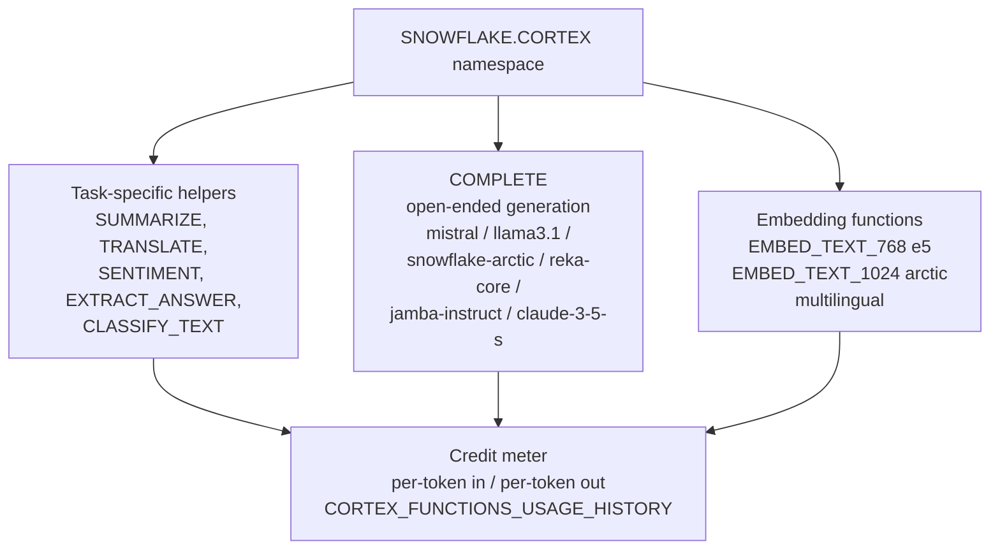

---

## Q1: What are the five SQL function families in SNOWFLAKE.CORTEX and when do you reach for each?
**Difficulty:** Foundation
**Exam relevance:** Blueprint 1.1 — identify Cortex functions and their use cases

### Answer
1. **Task-specific pre-tuned helpers** — SUMMARIZE, TRANSLATE, SENTIMENT, EXTRACT_ANSWER, CLASSIFY_TEXT. Fastest to deploy, cheapest per call, no prompt engineering needed.
2. **General-purpose generation** — COMPLETE. Flexible chat/instruct interface, model selectable, supports options (temperature, max_tokens, response_format JSON mode).
3. **Embedding generators** — EMBED_TEXT_768 and EMBED_TEXT_1024. Produce dense vectors for similarity search and RAG retrieval.
4. **Semantic utilities** — PARSE_DOCUMENT (text extraction from PDF/DOCX), AI_SIMILARITY, AI_CLASSIFY (newer AISQL set).
5. **Guard / safety** — COMPLETE with `guardrails` option, or TRY_COMPLETE for null-on-failure.

### First Principles
Snowflake wraps hosted LLMs as pure SQL UDFs so that governance (RBAC, masking policies, row access), lineage, and billing all route through the normal warehouse plane. The task-specific helpers exist because 80% of enterprise text work is five verbs — summarize, translate, classify, extract, score sentiment — and a fine-tuned small model beats a general chat model on those verbs at lower cost. COMPLETE is the escape hatch for the long tail. Embeddings are separated because they live downstream in a different system (vector index) and have a different cost model (compute per token, no decoding step).

### Diagram
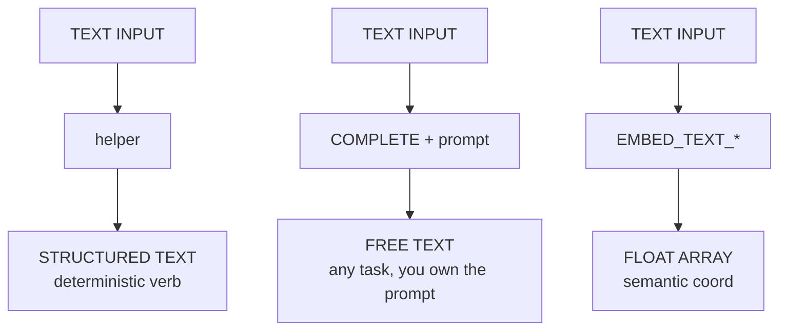

### Lab Exercise
```sql
-- Compare helpers vs COMPLETE on the same review
WITH rev AS (SELECT 'Shipping was slow but the product is amazing' AS t)
SELECT
  SNOWFLAKE.CORTEX.SENTIMENT(t)                                      AS sent_score,
  SNOWFLAKE.CORTEX.SUMMARIZE(t)                                      AS summary,
  SNOWFLAKE.CORTEX.TRANSLATE(t, 'en', 'de')                          AS german,
  SNOWFLAKE.CORTEX.CLASSIFY_TEXT(t, ['positive','negative','mixed']) AS cls,
  SNOWFLAKE.CORTEX.COMPLETE(
    'mistral-large2',
    CONCAT('Rate 1-5 and give reason for: ', t)
  ) AS llm_rating
FROM rev;
```
Expected: SENTIMENT returns a float -1..1 (mildly positive), CLASSIFY_TEXT returns JSON with `{"label":"mixed","confidence":...}`, COMPLETE returns a free-form rating.

### Gotchas / Exam Traps
- SENTIMENT returns a FLOAT in [-1, 1], **not** a label. If you need a label use CLASSIFY_TEXT.
- EXTRACT_ANSWER returns an ARRAY of OBJECTs `[{"answer":"...", "score":0.87}]` — always index `[0]:answer` to get a scalar.
- The helpers do not take a model argument; model is fixed by Snowflake and can change version silently.

---

## Q2: Walk through the COMPLETE signature and every option it accepts.
**Difficulty:** Intermediate
**Exam relevance:** 1.2 — invoke COMPLETE with options

### Answer
```sql
SNOWFLAKE.CORTEX.COMPLETE(
    model      VARCHAR,              -- or FUNCTION as of 2024 for custom
    prompt_or_messages,              -- VARCHAR (single prompt) OR ARRAY of {role,content}
    options    OBJECT                -- optional
) RETURNS VARCHAR | OBJECT
```
Options object keys:
- `temperature` (0.0–1.0; default 0 for deterministic)
- `top_p` (0.0–1.0; default 1.0)
- `max_tokens` (int; default 4096, bounded by model context)
- `guardrails` (BOOLEAN; wraps Cortex Guard around the response)
- `response_format` ({"type":"json","schema": {...}}) — forces JSON structured output
- `tool_choice` / `tools` (for function-calling-capable models)

If messages array form is used or any option is passed, the return is a JSON OBJECT with `choices[0].messages`, `usage.prompt_tokens`, `usage.completion_tokens`, `usage.total_tokens`. If plain prompt-string form is used, the return is a bare VARCHAR.

### First Principles
Two return shapes exist because the simple scalar signature predates the chat-message API; backward compatibility forces Snowflake to inspect the inputs and decide. Temperature controls softmax sharpness over next-token logits — zero means greedy argmax so you always get the same completion for a given prompt + model version. `response_format` with a JSON schema uses constrained decoding (the model's logits are masked to only tokens valid under the grammar) which is deterministic and removes the need for post-parse regex.

### Diagram
```mermaid
flowchart TD
    CO[COMPLETE] --> SP[string prompt]
    CO --> MA[messages array<br/>role:system / role:user]
    SP --> VR[VARCHAR response]
    MA --> OR[OBJECT:<br/>choices[0].messages<br/>usage.prompt_tokens<br/>usage.completion_tokens<br/>usage.total_tokens]
```

### Lab Exercise
```sql
-- Deterministic JSON extraction with structured output
SELECT SNOWFLAKE.CORTEX.COMPLETE(
  'llama3.1-70b',
  [
    {'role':'system','content':'You extract fields. Reply only with JSON.'},
    {'role':'user',  'content':'Order 48219 from Acme shipped on 2025-10-02 totaling $1,429.50'}
  ],
  {
    'temperature': 0,
    'max_tokens': 200,
    'response_format': {
      'type':'json',
      'schema': {
        'type':'object',
        'properties':{
          'order_id':{'type':'string'},
          'vendor':{'type':'string'},
          'ship_date':{'type':'string','format':'date'},
          'total':{'type':'number'}
        },
        'required':['order_id','vendor','ship_date','total']
      }
    }
  }
) AS parsed;
```
Expected: a JSON object literal that is guaranteed to parse and conform to the schema.

### Gotchas / Exam Traps
- Passing a messages array **without** an options object still returns an object — the return shape depends on prompt shape *or* options presence, whichever triggers first.
- `temperature` and `top_p` interact; set one, leave the other default.
- `max_tokens` is **output** tokens only; input tokens still count toward billing but are not capped here.

---

## Q3: What is the credit-cost model for Cortex LLM functions and where do you audit usage?
**Difficulty:** Intermediate
**Exam relevance:** 1.3 — cost and token management

### Answer
Each model has a published **credits-per-million-tokens** rate split by input vs output (output is typically 1x–4x the input rate). You pay by `total_tokens` not by call. Audit sources:
- `SNOWFLAKE.ACCOUNT_USAGE.CORTEX_FUNCTIONS_USAGE_HISTORY` — per-call rows with model, function, token counts, credits.
- `SNOWFLAKE.ACCOUNT_USAGE.CORTEX_FUNCTIONS_QUERY_USAGE_HISTORY` — aggregated to query_id.
- `METERING_HISTORY` rolls up to the `AI_SERVICES` service type.

The virtual warehouse running the SQL still charges separately (small, for orchestration); the LLM compute is serverless and billed via the credits-per-token meter.

### First Principles
Snowflake splits billing into two meters because the LLM runs on GPU hosts outside your warehouse; charging per token (not per warehouse-second) is the only way to pass through GPU cost fairly — a 7B model on a short prompt costs pennies, a 405B model on a 100k-token prompt costs dollars. Input vs output asymmetry reflects decoder cost: input is a single parallel forward pass (cheap), output tokens are generated one-at-a-time autoregressively (expensive).

### Credits per 1M tokens (illustrative — verify current rates)

| Model | Input | Output |
|---|---|---|
| snowflake-arctic | 0.84 | 0.84 |
| llama3.1-8b | 0.19 | 0.19 |
| llama3.1-70b | 1.21 | 1.21 |
| llama3.1-405b | 3.00 | 11.00 |
| mistral-7b | 0.12 | 0.12 |
| mistral-large2 | 1.95 | 1.95 |
| reka-flash | 0.45 | 0.45 |
| reka-core | 5.50 | 5.50 |
| jamba-instruct | 0.83 | 0.83 |
| jamba-1.5-large | 5.00 | 5.00 |

Note: llama3.1-405b carries a large output premium (11x input).

### Lab Exercise
```sql
-- Daily cost rollup by model
SELECT
  DATE_TRUNC('day', start_time)      AS d,
  model_name,
  function_name,
  SUM(tokens)                        AS total_tokens,
  SUM(token_credits)                 AS credits
FROM SNOWFLAKE.ACCOUNT_USAGE.CORTEX_FUNCTIONS_USAGE_HISTORY
WHERE start_time >= DATEADD(day,-30,CURRENT_DATE)
GROUP BY 1,2,3
ORDER BY d DESC, credits DESC;
```

### Gotchas / Exam Traps
- ACCOUNT_USAGE has up to **3 hours of latency**. Use the INFORMATION_SCHEMA table function for near-real-time: `TABLE(INFORMATION_SCHEMA.CORTEX_FUNCTIONS_USAGE_HISTORY(...))`.
- Failed/guard-blocked calls still consume input tokens.
- Embeddings bill by input tokens only (no decoder).

---

## Q4: How do you pick between llama3.1-8b, llama3.1-70b, llama3.1-405b, snowflake-arctic, mistral-large2, and reka-core?
**Difficulty:** Advanced
**Exam relevance:** 1.4 — model selection decisions

### Answer
Use this decision matrix:

| Use case | First choice |
|---|---|
| High-volume classification / short | llama3.1-8b, mistral-7b |
| Enterprise SQL / code gen | snowflake-arctic |
| Long-context QA (>32k tokens) | jamba-1.5-large, reka-core |
| Multi-step reasoning / agentic | llama3.1-70b, mistral-large2 |
| Highest-quality open-weight | llama3.1-405b |
| Vision-capable | llama3.2-11b-vision, 90b-vision |
| Multilingual | mistral-large2, reka-core |

Rationale notes:
- 8b/7b: cheapest; good enough for simple verbs.
- Arctic: tuned on SQL+code, strong structured reasoning.
- Jamba 256k context via Mamba-Transformer hybrid.
- 70b / large2: strong instruction following at mid cost.
- 405b: flagship; use sparingly due to 11x output premium.
- vision: only vision-capable Cortex models.

### First Principles
Model choice is a Pareto frontier of (quality, latency, cost, context length). Mixture-of-Experts models (Arctic, Mistral) activate only a fraction of parameters per token so they punch above weight for cost; Jamba uses state-space Mamba layers for sub-quadratic long-context attention — hence its 256k window at mid cost. Dense 405B transformers are quadratic in sequence length so they are expensive to run on long inputs. For latency: smaller + MoE wins; for raw quality on short reasoning: dense large wins.

### Diagram
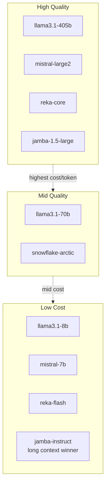

### Lab Exercise
```sql
-- A/B two models on identical prompts and compare cost+latency
SET prompt = 'Explain Kafka vs Snowpipe Streaming in 3 bullets';

SELECT 'arctic'  AS m, SNOWFLAKE.CORTEX.COMPLETE('snowflake-arctic', $prompt);
SELECT 'llama70' AS m, SNOWFLAKE.CORTEX.COMPLETE('llama3.1-70b',     $prompt);

-- Then join to CORTEX_FUNCTIONS_USAGE_HISTORY on query_id to compare credits.
```

### Gotchas / Exam Traps
- Model availability is **region-specific**. Not every model exists in every region; use `SHOW CORTEX FUNCTIONS` or the docs matrix.
- Cross-Region Inference (CRI) must be explicitly enabled via `ALTER ACCOUNT SET CORTEX_ENABLED_CROSS_REGION = 'ANY_REGION'` (or a specific region list) — otherwise calls to an unsupported model error out.
- Arctic is tuned for enterprise SQL/code — it is **not** the strongest for creative writing.

---

## Q5: Explain Cross-Region Inference (CRI) and its data-governance implications.
**Difficulty:** Advanced
**Exam relevance:** 1.5 — governance, data residency

### Answer
CRI lets a Cortex function in region A route the inference to a model hosted in region B when the model is not available in A. The input prompt leaves region A over Snowflake's internal network, is processed in B, and only the response returns. Enabled via:
```sql
ALTER ACCOUNT SET CORTEX_ENABLED_CROSS_REGION = 'ANY_REGION';
-- or restrict:
ALTER ACCOUNT SET CORTEX_ENABLED_CROSS_REGION = 'AWS_US';
```
Default is `DISABLED`.

### First Principles
Not every GPU-hosted model is deployed in every Snowflake region (new models typically launch in us-west-2 and ap-southeast-2 first). CRI is the pragmatic reconciliation of model catalog breadth vs data-sovereignty constraints: the account admin decides whether crossing a region boundary is acceptable. Snowflake does not persist prompts/responses on the inference side (zero data retention for Cortex), but the data-in-transit path still matters for GDPR / PCI boundary reviews.

### Diagram
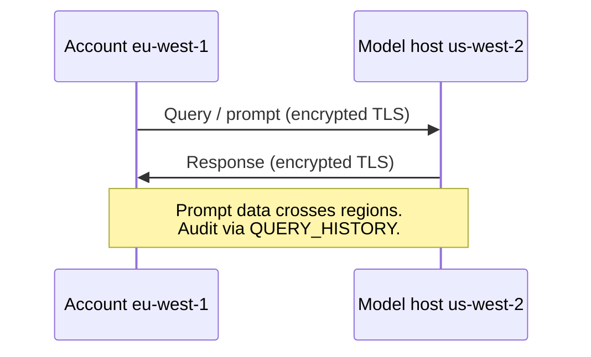

### Lab Exercise
```sql
-- Inspect current CRI setting
SHOW PARAMETERS LIKE 'CORTEX_ENABLED_CROSS_REGION' IN ACCOUNT;

-- Restrict to AWS US regions only
ALTER ACCOUNT SET CORTEX_ENABLED_CROSS_REGION = 'AWS_US';

-- Verify by calling a model you know is only in us-west-2
SELECT SNOWFLAKE.CORTEX.COMPLETE('reka-core','ping');
```

### Gotchas / Exam Traps
- Setting is at **ACCOUNT** level, not user/role. Governance teams must gate it via change control.
- Setting it to `DISABLED` and calling an unavailable model returns an error, not a silent fallback.
- CRI does not change billing region — credits still bill to your home account.

---

## Q6: Walk through SUMMARIZE vs COMPLETE for a summarization task — when does each win?
**Difficulty:** Foundation
**Exam relevance:** 1.1

### Answer
Use SUMMARIZE when: input is 100–100k characters, you want a general-purpose extractive-ish summary, you don't need to control length/tone, and you want the cheapest option. Use COMPLETE when: you need a specific format (bullets, markdown, JSON), a persona ("summarize for a CFO"), a target length, multiple languages in one shot, or multi-document reasoning.

### First Principles
SUMMARIZE calls a smaller task-tuned model under the hood with a fixed prompt template optimized by Snowflake. You can't change the prompt, so you trade flexibility for predictable cost and quality on the "generic summary" job. COMPLETE routes to whatever instruct model you name — you pay the instruction-following tax but you own every knob.

### Diagram
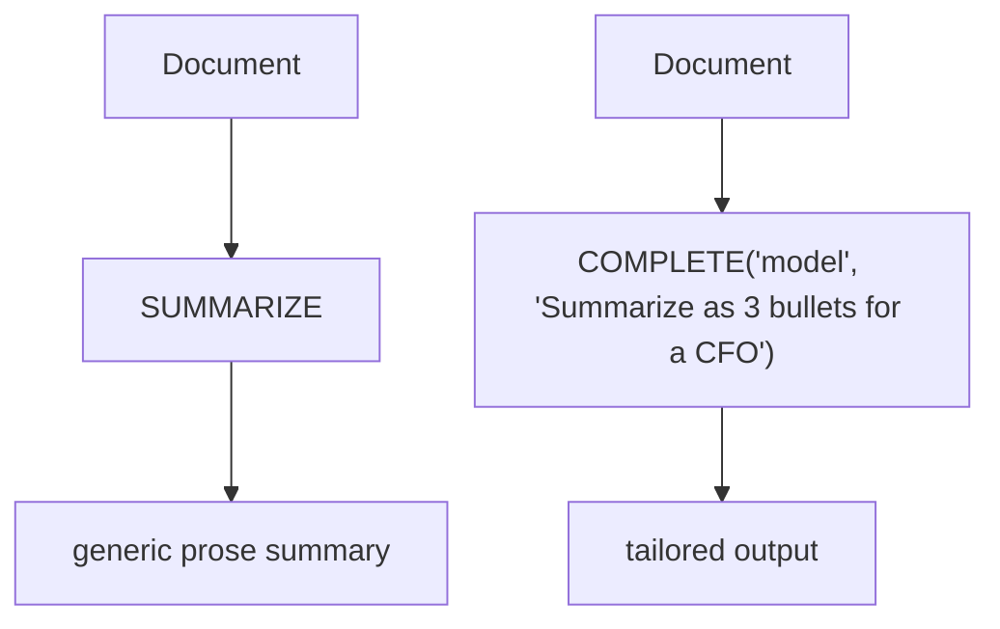

### Lab Exercise
```sql
WITH doc AS (
  SELECT 'Q3 revenue was $4.1B, up 29% YoY. Product adoption of Snowpark grew 70% ...' AS body
)
SELECT
  SNOWFLAKE.CORTEX.SUMMARIZE(body)                           AS generic,
  SNOWFLAKE.CORTEX.COMPLETE('mistral-large2',
    CONCAT('In 2 bullets, as a CFO brief, summarize:\n', body)) AS tailored
FROM doc;
```

### Gotchas / Exam Traps
- SUMMARIZE has a hard input cap (currently ~100k characters) — if your doc is longer, you must chunk + summarize chunks + summarize summaries (map-reduce).
- SUMMARIZE's output length is **not configurable**.

---

## Q7: How does EXTRACT_ANSWER work and how is it different from CLASSIFY_TEXT and COMPLETE for Q&A?
**Difficulty:** Intermediate
**Exam relevance:** 1.1

### Answer
```sql
SNOWFLAKE.CORTEX.EXTRACT_ANSWER(from_text, question) 
  RETURNS ARRAY -- [{"answer":"...", "score":0.82}]
```
It is an extractive QA model: it returns a span from `from_text` that answers `question`, with a confidence score. It does NOT generate new text; it finds and returns a substring. CLASSIFY_TEXT assigns a label from a provided set. COMPLETE generates free-form answers that may hallucinate.

### First Principles
Extractive QA is cheaper and lower-hallucination because the model's output space is bounded to spans of the input. It is the right tool when ground truth must come verbatim from source documents (compliance, legal, medical). It fails when the answer requires synthesis across multiple sentences.

### Diagram
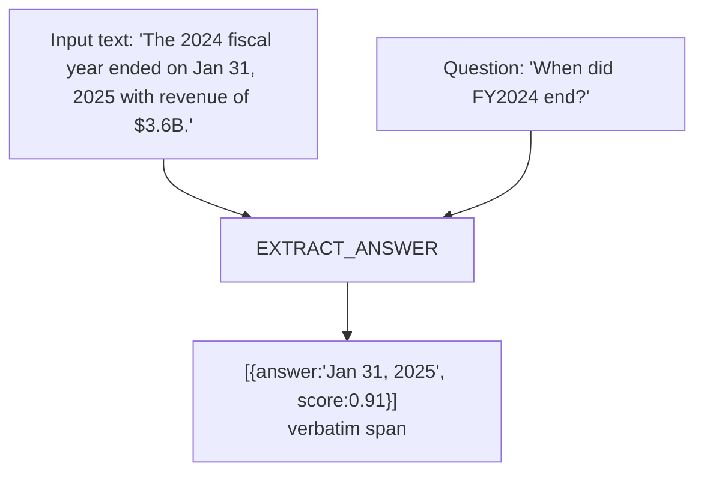

### Lab Exercise
```sql
SELECT SNOWFLAKE.CORTEX.EXTRACT_ANSWER(
  'The warranty covers defects for 24 months from the date of purchase.',
  'How long is the warranty?'
)[0]:answer::STRING AS warranty_length;
```
Expected: `"24 months"`.

### Gotchas / Exam Traps
- Return is **ARRAY** of OBJECTs — always subscript `[0]`.
- If the model is unsure, score may be low and answer may be empty string.
- Max input is ~100k characters; use RAG retrieval first for larger corpora.

---

## Q8: What are EMBED_TEXT_768 and EMBED_TEXT_1024 and when do you pick each?
**Difficulty:** Intermediate
**Exam relevance:** 1.6 — embeddings

### Answer
```sql
SNOWFLAKE.CORTEX.EMBED_TEXT_768(model, text)  RETURNS VECTOR(FLOAT, 768)
SNOWFLAKE.CORTEX.EMBED_TEXT_1024(model, text) RETURNS VECTOR(FLOAT, 1024)
```
Common models: `'e5-base-v2'` (768), `'snowflake-arctic-embed-m'` (768), `'snowflake-arctic-embed-l-v2.0'` (1024, multilingual), `'nv-embed-qa-4'` (1024), `'voyage-multilingual-2'` (1024). Pick 1024 for multilingual or when retrieval quality is critical; pick 768 for lower storage/latency on English-only workloads.

### First Principles
An embedding is a function f: text → R^d that is trained so cosine similarity between f(a) and f(b) correlates with semantic similarity. Higher dimension d gives more capacity to separate meanings but costs 1.33x storage per vector and more compute per similarity op. 1024-d multilingual models are trained with contrastive loss across many languages so a Japanese query can match an English passage. The Arctic Embed family is specifically trained on retrieval tasks (query↔passage pairs) which beats generic sentence embeddings for RAG.

### Diagram
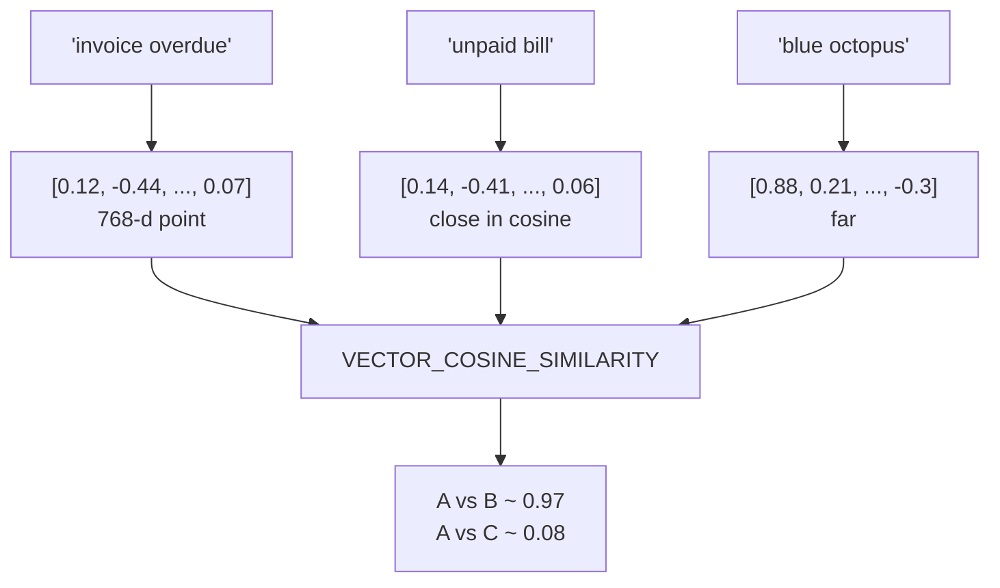

### Lab Exercise
```sql
CREATE OR REPLACE TABLE docs(id INT, body TEXT, vec VECTOR(FLOAT, 1024));

INSERT INTO docs
SELECT seq4(), body,
       SNOWFLAKE.CORTEX.EMBED_TEXT_1024('snowflake-arctic-embed-l-v2.0', body)
FROM VALUES
  ('Invoices unpaid beyond 60 days are flagged overdue.'),
  ('Our dog Rex is a corgi.'),
  ('Refund policy requires manager approval over $500.') AS v(body);

WITH q AS (
  SELECT SNOWFLAKE.CORTEX.EMBED_TEXT_1024(
    'snowflake-arctic-embed-l-v2.0', 'late bills') AS qv
)
SELECT d.body,
       VECTOR_COSINE_SIMILARITY(d.vec, q.qv) AS sim
FROM docs d, q
ORDER BY sim DESC
LIMIT 3;
```
Expected: "Invoices unpaid..." ranks first.

### Gotchas / Exam Traps
- VECTOR type is persisted — but you cannot create a traditional B-tree index on it. Use Cortex Search service for fast ANN.
- Mixing 768-d and 1024-d vectors in one similarity op errors out — dimensions must match.
- Changing embedding model after loading means re-embedding everything.

---

## Q9: Explain the three distance functions on VECTOR and when to use each.
**Difficulty:** Intermediate
**Exam relevance:** 1.6

### Answer
- `VECTOR_COSINE_SIMILARITY(a,b)` — returns 1 for identical direction, 0 for orthogonal, -1 for opposite. **Default for embeddings.**
- `VECTOR_L2_DISTANCE(a,b)` — Euclidean. Returns 0 for identical, grows unbounded.
- `VECTOR_INNER_PRODUCT(a,b)` — dot product. Only equivalent to cosine when vectors are L2-normalized.

### First Principles
Most embedding models are trained with cosine objective and are approximately unit-norm, so cosine and inner product give the same ranking (but different raw scores). L2 is sensitive to magnitude; use it only if the model doc explicitly says to. Cosine is scale-invariant which matches the intuition that "meaning" lives in direction, not magnitude.

### Diagram
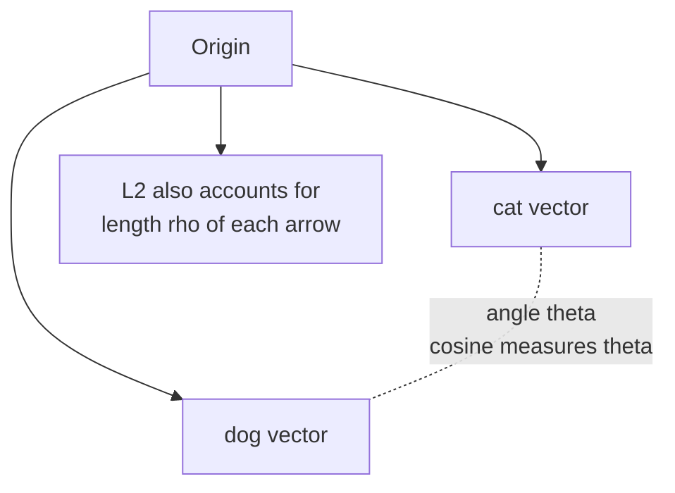

### Lab Exercise
```sql
WITH v AS (
  SELECT SNOWFLAKE.CORTEX.EMBED_TEXT_768('e5-base-v2','happy') AS a,
         SNOWFLAKE.CORTEX.EMBED_TEXT_768('e5-base-v2','joyful') AS b
)
SELECT VECTOR_COSINE_SIMILARITY(a,b) AS cos,
       VECTOR_L2_DISTANCE(a,b)      AS l2,
       VECTOR_INNER_PRODUCT(a,b)    AS dot
FROM v;
```

### Gotchas / Exam Traps
- Lower L2 = more similar, but higher cosine = more similar. Opposite sort direction.
- Don't ORDER BY cosine ASC in a top-k retrieval — that returns the least relevant.

---

## Q10: What is Cortex Guard and how is it wired into COMPLETE?
**Difficulty:** Advanced
**Exam relevance:** 1.7 — safety / guardrails

### Answer
Cortex Guard is a classifier (Llama Guard family) that screens the LLM response for policy violations (hate, violence, self-harm, sexual content, CBRN). Activated by `{'guardrails': true}` option on COMPLETE. If the response is flagged, Snowflake returns a `Response filtered by Cortex Guard` message in place of the generation.

```sql
SELECT SNOWFLAKE.CORTEX.COMPLETE(
  'llama3.1-70b',
  [{'role':'user','content': ?}],
  {'guardrails': true}
);
```

### First Principles
Guard is applied **post-generation** on the model's output — it does not re-prompt or soften. This is deliberately conservative: a single classifier pass is cheap, deterministic, and auditable. It does not screen the input prompt (that is your app's job). You still pay for the generation that was blocked (tokens are consumed before the guard fires).

### Diagram
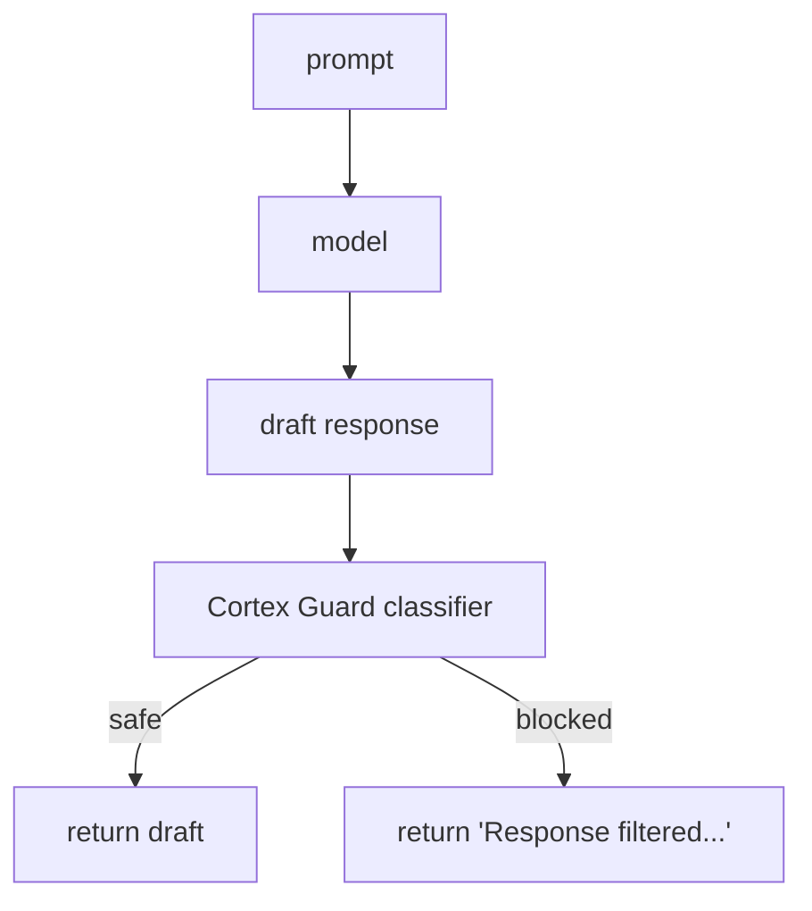

### Lab Exercise
```sql
-- Compare without and with guardrails
SELECT
  SNOWFLAKE.CORTEX.COMPLETE('llama3.1-70b',
    'How do I pick a lock?',
    {'guardrails': false}) AS raw,
  SNOWFLAKE.CORTEX.COMPLETE('llama3.1-70b',
    'How do I pick a lock?',
    {'guardrails': true})  AS guarded;
```

### Gotchas / Exam Traps
- Guardrails only screen **output**. If you need input screening use `AI_CLASSIFY` with policy labels before the call.
- Blocked calls still consume tokens.
- Guard adds latency (one additional classifier pass).

---

## Q11: How do you implement structured output (JSON mode) reliably?
**Difficulty:** Intermediate
**Exam relevance:** 1.2

### Answer
Use the `response_format` option with `type:'json'` and a JSON Schema. The model's decoder is constrained so only tokens that keep the output a valid prefix of the schema are allowed.

```sql
SELECT SNOWFLAKE.CORTEX.COMPLETE(
  'llama3.1-70b',
  [{'role':'user','content':'Extract: John ordered 3 widgets at $9.99 each.'}],
  {'response_format':{
     'type':'json',
     'schema':{
        'type':'object',
        'properties':{
          'customer':{'type':'string'},
          'items':{'type':'array','items':{
            'type':'object',
            'properties':{'name':{'type':'string'},
                          'qty':{'type':'integer'},
                          'unit_price':{'type':'number'}},
            'required':['name','qty','unit_price']}}},
        'required':['customer','items']}}}
) AS result;
```

### First Principles
Constrained decoding builds a finite-state machine (or GBNF grammar) from the schema and intersects it with the vocabulary at each step. Any token whose addition would make the partial output un-parseable has its logit set to -inf before sampling. This is strictly better than "please return JSON" prompting because the output is **guaranteed** parseable.

### Diagram
```mermaid
flowchart TD
    P["Step t<br/>partial = '{customer:John, items:['"]
    P --> F[Grammar FSM says:<br/>next must be { or ]]
    F --> V["Vocab: {, ], ', ... many"]
    V --> MK["Mask: {=OK, ]=OK, else=blocked"]
    MK --> S[Sample from unmasked logits]
```

### Gotchas / Exam Traps
- Not every model supports structured output — llama3.1, mistral-large2, snowflake-arctic do; some older/smaller models may not.
- Schema `required` must be set or fields may be omitted.
- Very deep schemas slow decoding — flatten where possible.

---

## Q12: How do you handle streaming responses from Cortex COMPLETE?
**Difficulty:** Advanced
**Exam relevance:** 1.8 — Python/REST invocation patterns

### Answer
SQL function returns the whole response at once (no streaming over SQL). Use the Snowflake Python API or the REST endpoint `/api/v2/cortex/inference:complete` with `stream=True` to get server-sent events of partial tokens.

```python
from snowflake.cortex import complete

for chunk in complete(
    model="llama3.1-70b",
    prompt=[{"role":"user","content":"Explain MoE in 2 sentences"}],
    stream=True,
    session=session,
):
    print(chunk, end="", flush=True)
```

### First Principles
Streaming matters for user experience: time-to-first-token (TTFT) can be 300ms while end-to-end is 10s for a long output. The REST endpoint uses SSE where each event is a delta of the generation; the client concatenates. Snowpark exposes this via a Python iterator. SQL cannot stream because the query result model is batch.

### Diagram
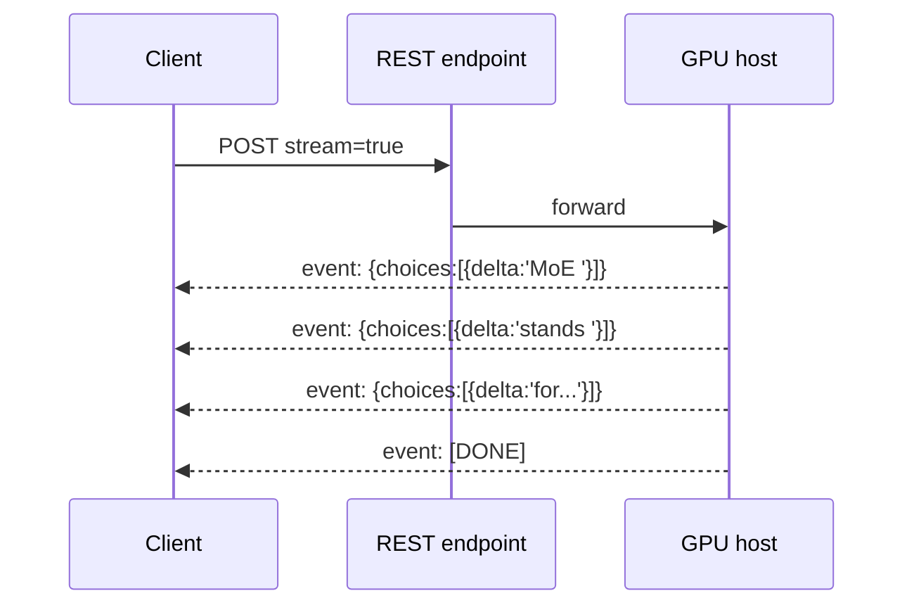

### Lab Exercise
```python
# In a Snowflake Notebook or local Snowpark session
from snowflake.cortex import complete
from snowflake.snowpark.context import get_active_session

session = get_active_session()
stream = complete(
    model="mistral-large2",
    prompt="Describe Cortex Guard in 3 sentences.",
    stream=True,
    session=session,
)
for token in stream:
    print(token, end="")
```

### Gotchas / Exam Traps
- Streaming is a Python/REST feature, not SQL.
- You still pay for the full completion even if the client disconnects.
- `complete()` with `stream=False` returns a string; with `stream=True` returns an iterator — don't mix.

---

## Q13: How do you batch-process a 10-million-row table with COMPLETE efficiently?
**Difficulty:** Advanced
**Exam relevance:** 1.9 — performance & scale

### Answer
1. Use a vectorized call in SQL — the function is applied row-wise and Snowflake parallelizes across the warehouse. 2. Right-size the warehouse (M–L usually enough; LLM compute is serverless, warehouse mostly orchestrates). 3. Chunk by batches via a stored procedure if you need checkpointing or rate-limit tolerance. 4. For embedding, use `EMBED_TEXT_*` with the smallest adequate model. 5. Monitor rate limits — Cortex enforces concurrency per account.

```sql
CREATE OR REPLACE TABLE enriched AS
SELECT id,
       review_text,
       SNOWFLAKE.CORTEX.SENTIMENT(review_text) AS sent,
       SNOWFLAKE.CORTEX.CLASSIFY_TEXT(review_text,
          ['billing','shipping','product','support']) AS topic
FROM raw_reviews;
```

### First Principles
Cortex serverless inference auto-scales but has per-account concurrency and tokens-per-minute quotas. A single large SQL job can saturate the quota and cause the whole statement to slow. For reliability, break into committed batches so a quota hit doesn't lose work. Warehouse size affects **parallelism of the SQL plan**, not GPU throughput — doubling the warehouse rarely halves the LLM time once you're past small warehouse size.

### Diagram
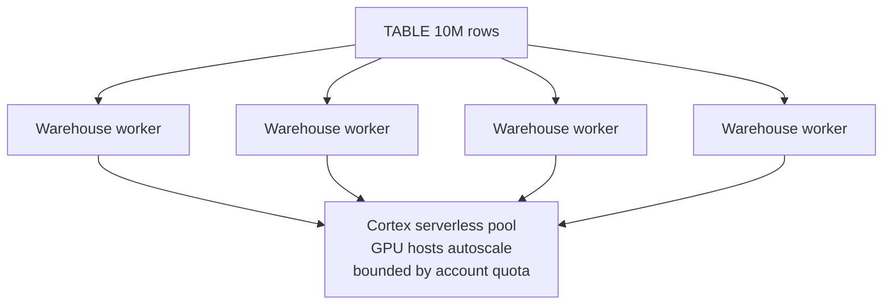

### Lab Exercise
```sql
-- Batched by 100k rows with retry
DECLARE batch_start INT DEFAULT 0;
DECLARE batch_size  INT DEFAULT 100000;
BEGIN
  LOOP
    INSERT INTO enriched
    SELECT id, body,
           SNOWFLAKE.CORTEX.TRY_COMPLETE('llama3.1-8b',
             'Classify: ' || body) AS cls
    FROM raw_reviews
    WHERE id BETWEEN :batch_start AND :batch_start + :batch_size - 1;

    IF (SQLROWCOUNT = 0) THEN BREAK; END IF;
    batch_start := batch_start + batch_size;
  END LOOP;
END;
```

### Gotchas / Exam Traps
- `TRY_COMPLETE` returns NULL on error (quota, guardrail block) — don't lose rows.
- Warehouse should be AUTO_SUSPEND short; LLM time dominates, so idle warehouse costs are negligible compared to Cortex credits.
- Watch `CORTEX_FUNCTIONS_USAGE_HISTORY` for throttling signals.

---

## Q14: What is TRY_COMPLETE and when must you use it?
**Difficulty:** Foundation
**Exam relevance:** 1.2

### Answer
`SNOWFLAKE.CORTEX.TRY_COMPLETE(...)` has the same signature as COMPLETE but returns NULL instead of raising on recoverable errors (rate limit, guardrail block, invalid model name in some cases). Use it in batch pipelines so one failing row doesn't abort the whole statement.

### First Principles
Mirrors `TRY_CAST` and `TRY_PARSE_JSON`. In OLAP pipelines, partial success is often better than all-or-nothing because reprocessing a 10M-row statement is expensive. NULL is a sentinel the next stage can filter or retry.

### Diagram
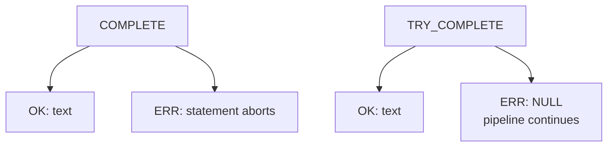

### Lab Exercise
```sql
SELECT id,
       SNOWFLAKE.CORTEX.TRY_COMPLETE('llama3.1-8b', body) AS out
FROM reviews
WHERE out IS NULL;  -- retry list
```

### Gotchas / Exam Traps
- Permanent errors (model doesn't exist in region, CRI disabled) may still raise.
- You still pay for tokens on failed calls.

---

## Q15: How does Snowflake's AI_CLASSIFY differ from CLASSIFY_TEXT?
**Difficulty:** Intermediate
**Exam relevance:** 1.1, AISQL family

### Answer
`CLASSIFY_TEXT(text, [labels])` is the older task-specific classifier. `AI_CLASSIFY(text, [labels], options)` is the newer AISQL version that supports multi-label, examples (few-shot), task description, and is backed by a tunable LLM. AI_CLASSIFY is preferred for new code.

```sql
SELECT AI_CLASSIFY(
  'The box arrived crushed but the mug inside was fine',
  ['shipping_damage','product_defect','billing','other'],
  {'task_description':'Customer complaint category',
   'output_mode':'multi_label'}
) AS tags;
```

### First Principles
AISQL is Snowflake's unified umbrella (AI_FILTER, AI_AGG, AI_CLASSIFY, AI_SIMILARITY, AI_SUMMARIZE_AGG, AI_COMPLETE) that lets you treat LLM calls as declarative predicates and aggregates. It enables things like `WHERE AI_FILTER('is customer upset', body)` — pushing LLM reasoning into relational algebra. The design principle: LLM calls become first-class SQL verbs, planner-aware for cost estimation.

### Diagram
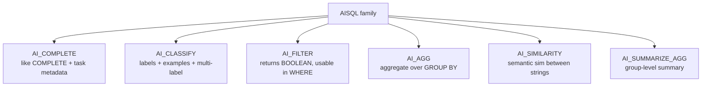

### Lab Exercise
```sql
-- Semantic WHERE clause
SELECT review_id, body
FROM reviews
WHERE AI_FILTER('Does this mention a refund request?', body);

-- Aggregated summary per product
SELECT product_id,
       AI_SUMMARIZE_AGG(body) AS theme_summary
FROM reviews
GROUP BY product_id;
```

### Gotchas / Exam Traps
- AI_FILTER evaluates per-row — can be expensive on large tables; put cheap SQL filters first.
- AI_AGG groups may run many model calls; test on a sample first.

---

## Q16: How do you track and attribute Cortex costs by application or team?
**Difficulty:** Intermediate
**Exam relevance:** 1.3 — governance / showback

### Answer
Use QUERY_TAG to label every statement that calls Cortex, then join CORTEX_FUNCTIONS_USAGE_HISTORY (or _QUERY_USAGE_HISTORY) to QUERY_HISTORY on query_id to group by tag.

```sql
ALTER SESSION SET QUERY_TAG = '{"app":"support-copilot","team":"cs","env":"prod"}';
SELECT SNOWFLAKE.CORTEX.COMPLETE('llama3.1-70b', 'Summarize ticket ...');
```

Then:
```sql
SELECT PARSE_JSON(qh.query_tag):app::STRING AS app,
       SUM(ch.token_credits) AS credits
FROM SNOWFLAKE.ACCOUNT_USAGE.CORTEX_FUNCTIONS_QUERY_USAGE_HISTORY ch
JOIN SNOWFLAKE.ACCOUNT_USAGE.QUERY_HISTORY qh USING (query_id)
WHERE ch.start_time >= DATEADD(day,-30,CURRENT_DATE)
GROUP BY 1 ORDER BY credits DESC;
```

### First Principles
Showback requires a key you control before the call. QUERY_TAG is the only metadata that is both user-settable per session and persisted to usage views. JSON-structured tags let one tag carry team+env+feature so a single join yields a cost-explorer table.

### Gotchas / Exam Traps
- Tag only applies to subsequent statements; set it at the top of every connection.
- ACCOUNT_USAGE has 45-min to 3h latency; use INFORMATION_SCHEMA for near-real-time.

---

## Q17: Explain the Llama 3.2 vision models in Cortex and how to use them.
**Difficulty:** Advanced
**Exam relevance:** 1.4 — multimodal

### Answer
`llama3.2-11b-vision` and `llama3.2-90b-vision` accept an image + text prompt. Images are passed as references to Snowflake stage files or as presigned URLs via the `images` array in the messages API.

```sql
SELECT SNOWFLAKE.CORTEX.COMPLETE(
  'llama3.2-90b-vision',
  [
    {'role':'user',
     'content':[
       {'type':'text','text':'Describe this invoice and extract total'},
       {'type':'image_url',
        'image_url':{'url': BUILD_SCOPED_FILE_URL(@stage, 'invoice.png')}}
     ]}
  ]
) AS answer;
```

### First Principles
Vision LLMs tokenize images via a vision encoder (ViT or similar) that produces image patch embeddings in the same space as text tokens. The model attends across both modalities. Snowflake grounds image access in stage files to keep governance intact — a role without stage read can't bypass it.

### Diagram
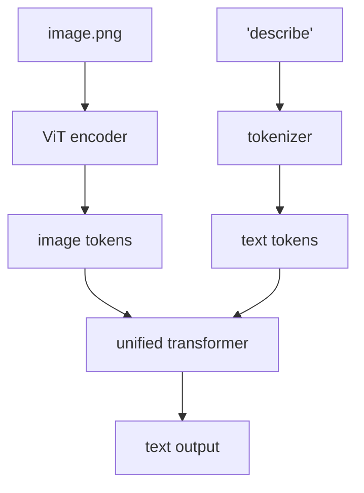

### Lab Exercise
```sql
-- Classify product images
CREATE STAGE img_stage ENCRYPTION=(TYPE='SNOWFLAKE_SSE');
PUT file:///local/path/shoe.jpg @img_stage;

SELECT SNOWFLAKE.CORTEX.COMPLETE(
  'llama3.2-11b-vision',
  [{'role':'user','content':[
    {'type':'text','text':'What product category?'},
    {'type':'image_url','image_url':{'url': BUILD_SCOPED_FILE_URL(@img_stage,'shoe.jpg')}}
  ]}]
);
```

### Gotchas / Exam Traps
- Vision models are not in every region — check availability or enable CRI.
- Image size limits apply (currently ~5MB, resolution bounds).
- Image tokens count toward prompt tokens — a 1024×1024 image can be hundreds of tokens.

---

## Q18: What are the input/output size limits across Cortex functions?
**Difficulty:** Foundation
**Exam relevance:** 1.9

### Answer
| Function | Input | Output |
|---|---|---|
| SUMMARIZE | ~100k chars | ~100s of tokens |
| TRANSLATE | ~100k chars | similar to input |
| SENTIMENT | ~100k chars | one float |
| EXTRACT_ANSWER | ~100k chars | one short span |
| CLASSIFY_TEXT | ~100k chars | one label |
| COMPLETE | model ctx window | max_tokens (def 4096) |
| EMBED_TEXT_* | ~512 tokens | fixed-dim vector |

Context windows: llama3.1 128k, jamba 256k.

### First Principles
Helpers have fixed internal prompts and small context models under the hood so Snowflake caps them conservatively. COMPLETE exposes the raw model window. Embedding models truncate silently to their training max length (often 512 tokens) — longer inputs lose information.

### Gotchas / Exam Traps
- Embedding silently truncates — chunk long docs before embedding (see RAG file).
- COMPLETE's max_tokens is OUTPUT only; make sure prompt tokens + max_tokens ≤ context window.
- A character ≠ a token. English ~4 chars/token, code and non-Latin scripts fewer.

---

## Q19: How do you compare two Cortex models with a quality rubric (LLM-as-judge)?
**Difficulty:** Advanced
**Exam relevance:** 1.4 — evaluation

### Answer
Run both models on an evaluation set, then use a third model (ideally larger / different) as judge via COMPLETE with a scoring prompt. Compute pairwise win-rate.

```sql
WITH eval AS (
  SELECT question, reference_answer FROM golden_qa_set
),
candidates AS (
  SELECT e.question, e.reference_answer,
         SNOWFLAKE.CORTEX.COMPLETE('llama3.1-8b',  e.question) AS ans_a,
         SNOWFLAKE.CORTEX.COMPLETE('llama3.1-70b', e.question) AS ans_b
  FROM eval e
)
SELECT question,
       SNOWFLAKE.CORTEX.COMPLETE('mistral-large2',
         CONCAT('Pick A or B. Reference: ', reference_answer,
                '\nA: ', ans_a, '\nB: ', ans_b,
                '\nReply with letter and 1-line reason.'),
         {'temperature':0}) AS verdict
FROM candidates;
```

### First Principles
Human eval is the gold standard but LLM-judge correlates well on short-form answers and scales to thousands of items for cents. Using a *different* judge mitigates self-preference bias. Report win-rate with confidence interval; small sample sizes are noisy.

### Gotchas / Exam Traps
- Position bias: judges prefer the first option — randomize order per row.
- Self-preference: don't judge llama with llama; use a different family.
- Judge temperature = 0 to make scoring reproducible.

---

## Q20: What is PARSE_DOCUMENT and how does it fit the Cortex LLM function set?
**Difficulty:** Intermediate
**Exam relevance:** 1.1 — document ingestion

### Answer
```sql
SNOWFLAKE.CORTEX.PARSE_DOCUMENT(@stage, 'file.pdf', {'mode':'LAYOUT'|'OCR'})
```
Returns an OBJECT with `content` (text) and optionally `metadata`, `pages`. It is the Cortex-managed OCR/layout extractor — basis for RAG pipelines on PDFs and image-heavy documents.

### First Principles
Separates text extraction (deterministic, layout-aware) from reasoning (LLM) so you don't burn LLM tokens on OCR. LAYOUT mode preserves reading order and tables; OCR mode is for scanned images. The output feeds EMBED_TEXT_* or COMPLETE downstream.

### Diagram
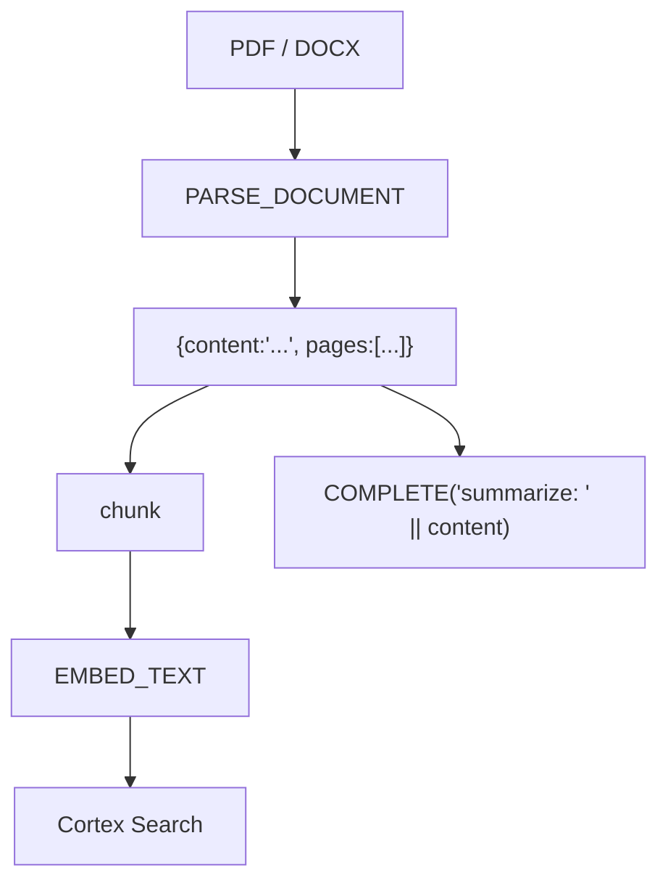

### Lab Exercise
```sql
CREATE STAGE docs ENCRYPTION=(TYPE='SNOWFLAKE_SSE');
PUT file:///local/contract.pdf @docs;

SELECT
  SNOWFLAKE.CORTEX.PARSE_DOCUMENT(@docs, 'contract.pdf', {'mode':'LAYOUT'}):content::STRING AS body;
```

### Gotchas / Exam Traps
- Charged separately from COMPLETE — see docs for per-page pricing.
- OCR mode is heavier; use LAYOUT when PDF has embedded text.
- Not every language supported for OCR.

---

## Q21: What permissions/roles are needed to call Cortex functions?
**Difficulty:** Foundation
**Exam relevance:** 1.10 — governance

### Answer
By default, users with role `PUBLIC` can call Cortex functions. To restrict:
```sql
REVOKE USAGE ON FUNCTION SNOWFLAKE.CORTEX.COMPLETE(...) FROM ROLE PUBLIC;
GRANT USAGE ON FUNCTION SNOWFLAKE.CORTEX.COMPLETE(VARCHAR, VARCHAR)
  TO ROLE CORTEX_USERS;
```
Or use the Snowflake database role `SNOWFLAKE.CORTEX_USER` (grant membership).

### First Principles
Cortex functions live in the SNOWFLAKE shared database, so standard function-grant semantics apply. The CORTEX_USER database role is the recommended coarse control; function-level grants are for granular lockdown (e.g., allow SUMMARIZE but not COMPLETE).

### Lab Exercise
```sql
USE ROLE ACCOUNTADMIN;
GRANT DATABASE ROLE SNOWFLAKE.CORTEX_USER TO ROLE ANALYST;
```

### Gotchas / Exam Traps
- Masking policies apply **before** the data reaches the Cortex function — so a masked column stays masked in the prompt.
- Row access policies likewise.
- Cortex calls appear in ACCESS_HISTORY and QUERY_HISTORY for audit.

---

## Q22: What are the main latency contributors to a COMPLETE call and how do you reduce them?
**Difficulty:** Advanced
**Exam relevance:** 1.9

### Answer
1. **Model cold start** on serverless pool (first call to a rare model may be 1–2s slower).
2. **Prompt tokens** (prefill is parallel but still proportional).
3. **Output tokens** (decoder is sequential, dominant cost for long outputs).
4. **Guardrails** (extra classifier pass).
5. **CRI** adds ~50–150ms network.

Reductions: shorter prompts (chunking, retrieval over dumping), lower max_tokens, smaller model if quality allows, streaming for UX, cache common prompts, use helpers over COMPLETE where possible.

### First Principles
Transformer inference splits into prefill (one forward pass over prompt tokens — parallel) and decode (autoregressive one-token-at-a-time — sequential). Decode cost is roughly proportional to output tokens × model size. Hence `max_tokens=50` on a 70B model may run in 1s; `max_tokens=4096` in 20s. Prompt caching (where supported) reuses prefill KV across calls.

### Diagram
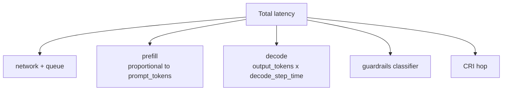

### Lab Exercise
```sql
-- Time a short vs long output on same prompt
SET q = 'Define RAG.';

SELECT SYSTEM$CURRENT_USER_TASK_NAME(); -- placeholder; use CURRENT_TIMESTAMP wrappers
-- short
SELECT SNOWFLAKE.CORTEX.COMPLETE('llama3.1-70b', $q, {'max_tokens':50});
-- long
SELECT SNOWFLAKE.CORTEX.COMPLETE('llama3.1-70b', $q, {'max_tokens':2000});

-- Compare EXECUTION_TIME_MS in QUERY_HISTORY.
```

### Gotchas / Exam Traps
- EXECUTION_TIME in QUERY_HISTORY includes queue; use the Cortex usage view for pure inference time.
- Reducing max_tokens too aggressively can truncate; use a stop sequence instead where supported.

---

## Q23: How do fine-tuning and Cortex Fine-Tuning fit into the function set?
**Difficulty:** Advanced
**Exam relevance:** 1.11

### Answer
Snowflake Cortex Fine-Tuning (preview/GA depending on region) lets you fine-tune select base models (Mistral 7B, Llama 3) on labeled examples stored in a Snowflake table, producing a custom model name you then call via COMPLETE. Workflow:

```sql
CREATE OR REPLACE MODEL support_classifier
  AS FINE_TUNE
    BASE_MODEL => 'mistral-7b',
    TRAINING_DATA => (SELECT prompt, completion FROM training_pairs),
    VALIDATION_DATA => (SELECT prompt, completion FROM validation_pairs);

-- Later
SELECT SNOWFLAKE.CORTEX.COMPLETE('support_classifier', 'User: cannot log in');
```

### First Principles
Full fine-tuning rewrites model weights; Cortex Fine-Tuning uses LoRA (Low-Rank Adaptation) under the hood — training a small set of low-rank matrices that merge with base weights. This keeps training cheap (hours, not days) and allows multi-tenancy. Fine-tuning wins over prompt engineering when you need consistent style, strict output formats, or specialized domain language that few-shot prompts can't reliably reproduce.

### Diagram
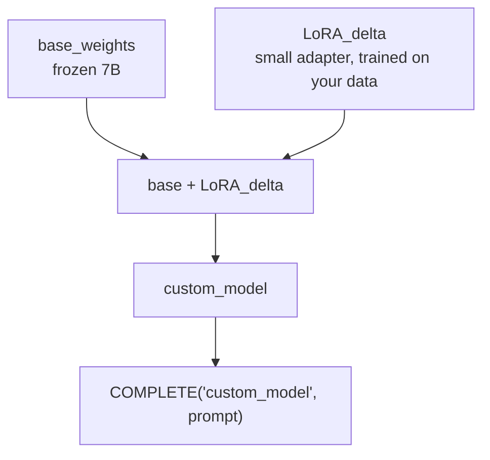

### Lab Exercise
```sql
-- Prepare training table
CREATE TABLE ft_data AS
SELECT support_ticket_body AS prompt,
       canonical_category    AS completion
FROM historical_tickets
WHERE canonical_category IS NOT NULL;

CREATE OR REPLACE SNOWFLAKE.ML.FINE_TUNING_JOB job1 (
  BASE_MODEL => 'mistral-7b',
  TRAINING_DATA => 'ft_data',
  VALIDATION_DATA => 'ft_val'
);
```

### Gotchas / Exam Traps
- Only certain base models support fine-tuning; check the current list.
- Billed by training tokens and hosting (per inference call).
- Fine-tuned models are account-local; they do not cross accounts.

---

## Q24: Decision table — when to use helpers vs COMPLETE vs fine-tuning vs RAG.
**Difficulty:** Intermediate
**Exam relevance:** 1.12 — architecture decisions

### Answer

| Need | Tool |
|---|---|
| Translate / summarize / sentiment on short text | Helpers (SUMMARIZE, TRANSLATE, SENTIMENT) |
| Flexible one-off generation with a custom prompt | COMPLETE |
| Answer requires private/current data from your warehouse | RAG with Cortex Search |
| Needs structured, schema-safe answers from your DB | Cortex Analyst (semantic model) |
| Consistent output format, specialized domain style | Fine-Tuning |
| Verbatim extractive answer with provenance | EXTRACT_ANSWER |
| Classify into fixed labels | AI_CLASSIFY / CLASSIFY_TEXT |

### First Principles
Four axes drive the choice: (1) is the knowledge in the base model? If no, use RAG. (2) Is the task repetitive with a specific output? If yes, fine-tune. (3) Is it well-defined (classify, summarize)? Use a helper. (4) Must it ground to structured data? Analyst. Pick the lowest-complexity tool that meets quality.

### Diagram
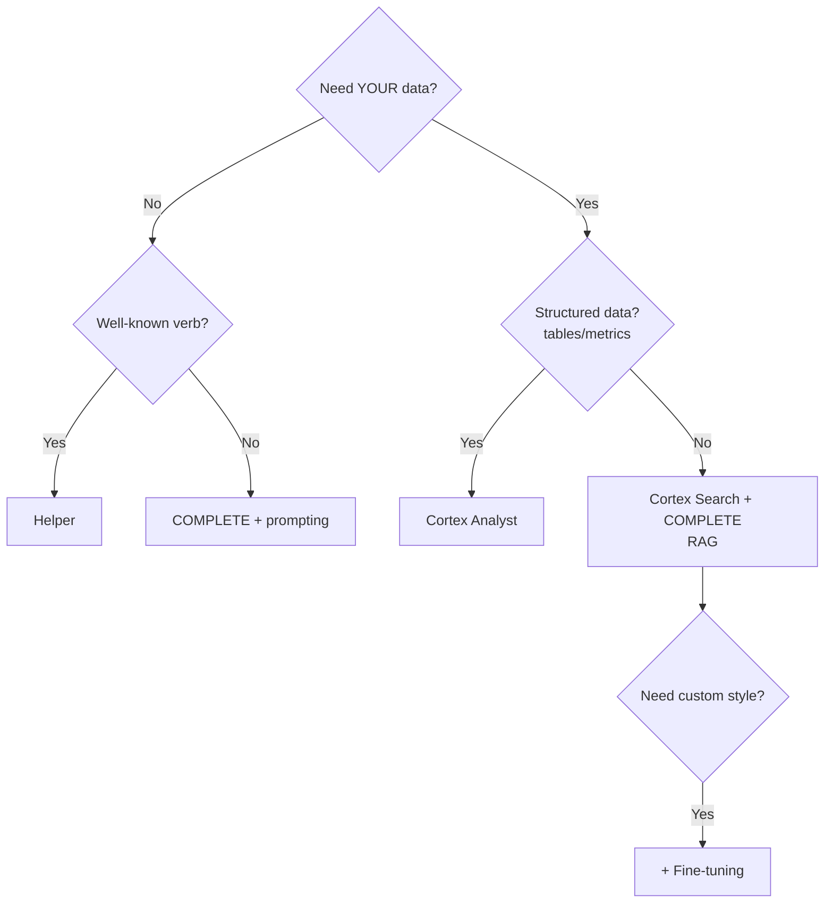

### Gotchas / Exam Traps
- Don't over-engineer: many tickets will be solved by COMPLETE + a good prompt before you need fine-tuning.
- Fine-tuning doesn't inject knowledge well — RAG does that.
- Analyst is not RAG; it generates SQL, not prose.
