# Cortex Search & RAG — GES-C01 Study Guide

## Exam Weight & Scope
Roughly 20-25% of the exam. Covers the Cortex Search service (managed hybrid retrieval), vector embeddings (dense) + lexical signal (sparse) fusion, chunking strategies (fixed, recursive, semantic), ingestion patterns from stages & tables, re-ranking and attribute filters, change-data-capture refresh (CORTEX_SEARCH_SERVICE auto-refresh), and the end-to-end RAG application pattern on Snowflake.

## Core Concepts Map
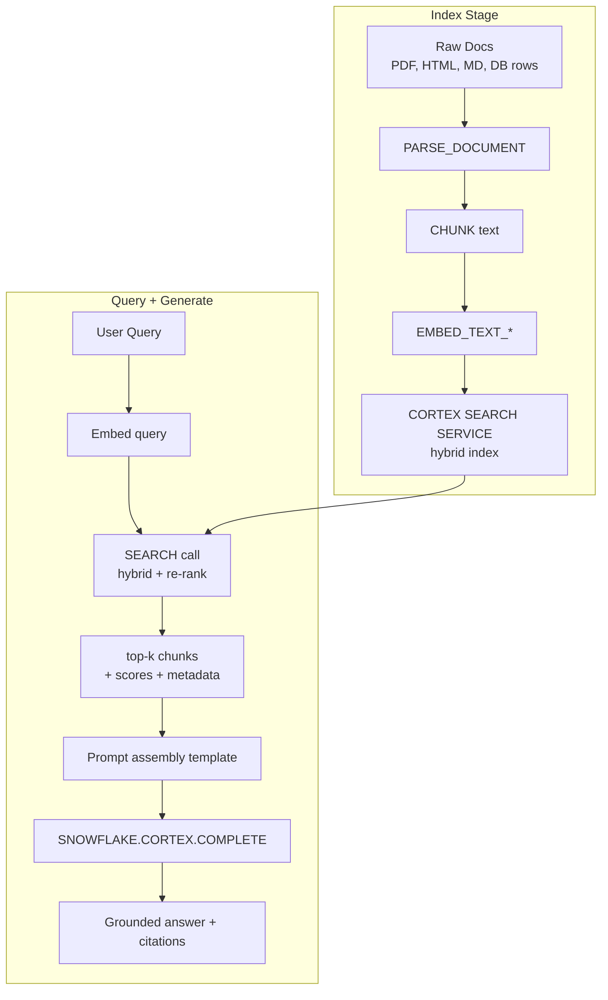

---

## Q1: What is Cortex Search and why does Snowflake offer it as a managed service?
**Difficulty:** Foundation
**Exam relevance:** 2.1

### Answer
Cortex Search is a fully managed retrieval service for RAG. You point it at a source table/view with a text column; Snowflake embeds, indexes (dense ANN + sparse BM25-style), serves hybrid search with re-ranking, and auto-refreshes on source changes. You query it via SQL (`SEARCH_PREVIEW`), Python (`snowflake.core.cortex_search_service`), or REST.

### First Principles
Running retrieval in-house means operating a vector DB, an embedder, a reranker, a refresh pipeline, and ACL glue — half a dozen moving parts. Snowflake collapses all that into one object co-located with the data, inheriting RBAC, masking, and lineage. Hybrid retrieval (dense + lexical) outperforms either alone because dense captures semantics while lexical nails exact tokens (product codes, names, IDs). The managed service also handles re-embedding when you change the embedding model and incremental index updates on CDC.

### Diagram
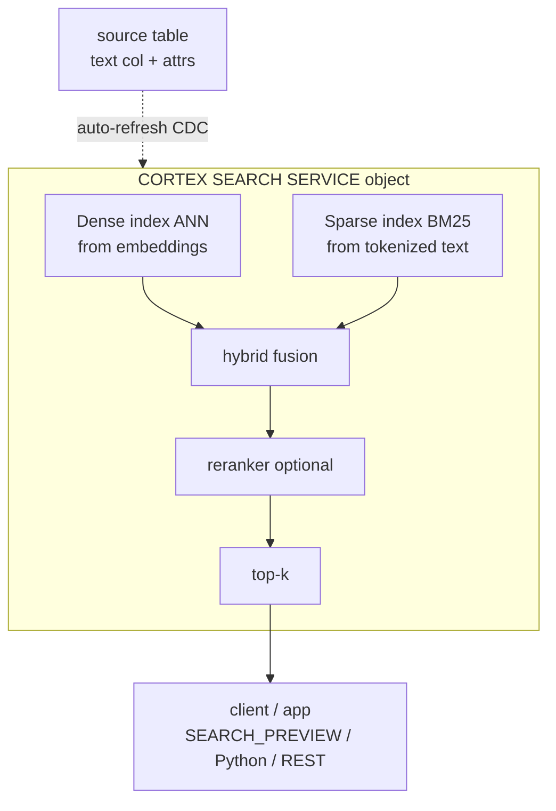

### Lab Exercise
```sql
-- 1. Prepare a source table
CREATE OR REPLACE TABLE docs (
  id      INT,
  title   STRING,
  body    STRING,
  region  STRING,
  updated_at TIMESTAMP
);

-- 2. Create the service
CREATE OR REPLACE CORTEX SEARCH SERVICE kb_search
  ON body
  ATTRIBUTES region, title
  WAREHOUSE = search_wh
  TARGET_LAG = '1 hour'
  AS (SELECT id, title, body, region, updated_at FROM docs);

-- 3. Query via SQL preview
SELECT PARSE_JSON(
  SNOWFLAKE.CORTEX.SEARCH_PREVIEW(
    'kb_search',
    OBJECT_CONSTRUCT(
      'query','refund policy for international orders',
      'columns', ARRAY_CONSTRUCT('title','body'),
      'filter', OBJECT_CONSTRUCT('@eq', OBJECT_CONSTRUCT('region','EMEA')),
      'limit', 5
    )::STRING
  )
):results;
```

### Gotchas / Exam Traps
- The service requires a **warehouse** for ingestion/refresh; it is NOT fully serverless.
- `TARGET_LAG` is the max freshness; shorter lag → more warehouse spend.
- `ATTRIBUTES` columns are usable in filters; non-attribute columns are returned but not filterable.

---

## Q2: What is RAG and why does it beat stuffing all your data into a prompt?
**Difficulty:** Foundation
**Exam relevance:** 2.2

### Answer
RAG = Retrieval-Augmented Generation. Instead of putting every document in the prompt, you (1) embed the user's question, (2) retrieve the top-k most relevant chunks from an index, (3) stuff only those chunks + the question into the LLM prompt, (4) generate. This bounds prompt size, respects the model's context window, grounds answers in current data, and allows provenance (which chunk was cited).

### First Principles
Context windows are finite (128k tokens for most Cortex models, 256k for Jamba) and performance degrades on long contexts (the "lost in the middle" effect — models attend less to tokens in the middle of long prompts). More fundamentally, token cost scales linearly with prompt size, so pushing 10 million rows through every call is uneconomic. RAG is the only architecture that lets you have arbitrary-sized knowledge bases serve a bounded-context LLM. Grounding also reduces hallucination because the model has the evidence inline.

### Diagram
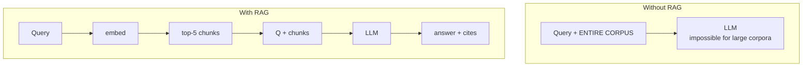

### Gotchas / Exam Traps
- RAG does not fix a bad embedding model; retrieval quality bounds generation quality.
- You still pay for the retrieved chunks as prompt tokens.
- RAG is not Analyst — RAG retrieves text; Analyst generates SQL over structured data.

---

## Q3: How does hybrid retrieval combine dense and sparse signals?
**Difficulty:** Intermediate
**Exam relevance:** 2.3

### Answer
Hybrid retrieval runs two retrieval passes and fuses them:
1. **Dense**: cosine similarity on embedding vectors — captures semantic/paraphrase match.
2. **Sparse (lexical, BM25-like)**: term frequency × inverse document frequency scoring — captures exact token matches.

Fusion is typically Reciprocal Rank Fusion (RRF): for each candidate doc, score = Σ 1/(k + rank_i) across each retrieval pass. Then an optional cross-encoder reranker scores query↔doc pairs for the final ordering.

### First Principles
Dense embeddings collapse "invoice" and "bill" to similar vectors — great for synonymy. But they can lose a specific product SKU like "WDGT-4198" because that string is rare in training data and lands in a noisy region. Sparse BM25 nails SKU-like tokens because they are discriminative under IDF. Combining both yields recall better than either. RRF is used because it doesn't require score calibration between heterogeneous retrievers — only ranks matter.

### Diagram
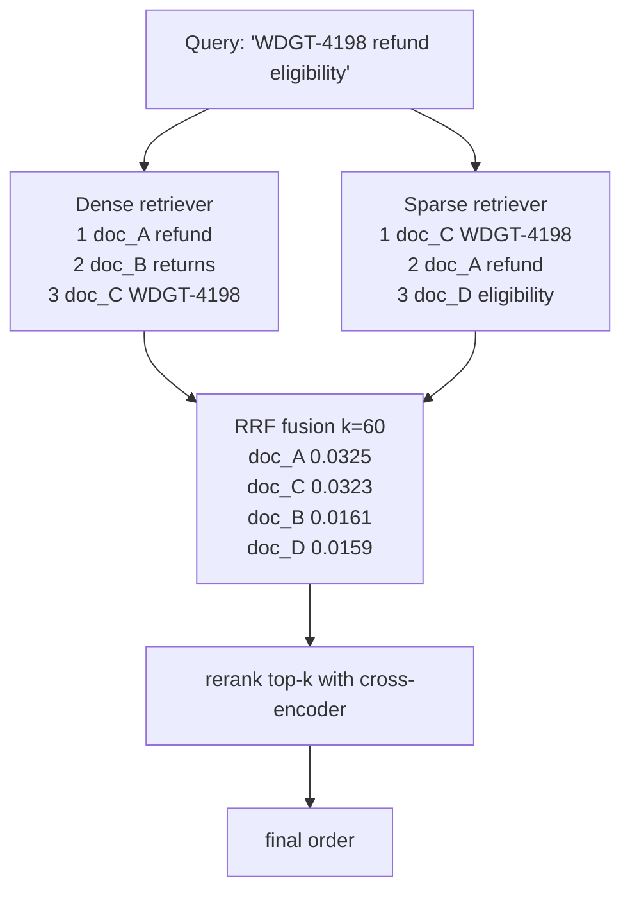

### Lab Exercise
```sql
-- See the fused ranking that Cortex Search returns
SELECT SNOWFLAKE.CORTEX.SEARCH_PREVIEW(
  'kb_search',
  OBJECT_CONSTRUCT(
    'query','WDGT-4198 refund eligibility',
    'columns', ARRAY_CONSTRUCT('title','body'),
    'limit', 10
  )::STRING
);
```

### Gotchas / Exam Traps
- Cortex Search applies hybrid automatically — you don't configure weights per call.
- Pure vector-only retrieval loses exact-match recall on IDs/SKUs/code.
- Rerankers are expensive; only re-rank the top-k, not the full corpus.

---

## Q4: Why do we chunk documents? Compare fixed-size, recursive, and semantic chunking.
**Difficulty:** Intermediate
**Exam relevance:** 2.4

### Answer
Chunking splits long documents into retrieval units because (a) embedders truncate past ~512 tokens so a whole PDF would lose information, and (b) you want retrieved context to be focused — a 50-page doc returned whole dilutes the useful section.

| Strategy | How | Pros / Cons |
|---|---|---|
| Fixed-size | Every N tokens, M overlap | +simple / -cuts mid-sentence |
| Recursive | Paragraphs → sentences → words | +respects structure / -variable size |
| Semantic | Embed sentences; break on cosine drop | +thematic coherence / -costly |
| Markdown/HTML | Split on headings | +great for docs / -needs structure |

### First Principles
Retrieval precision depends on chunk coherence: if a chunk mixes two topics, the embedding averages them and ranks mediocrely for both. Fixed overlap (10-20%) exists so a sentence straddling a boundary still appears whole in at least one chunk. Semantic chunking optimizes coherence directly but costs embeddings at index time; worth it for high-value corpora where retrieval quality dominates.

### Diagram
```mermaid
flowchart TD
    subgraph FS[Fixed-size chunk=400 overlap=50]
        C1[chunk 1] -. overlap .- C2[chunk 2]
        C2 -. overlap .- C3[chunk 3]
    end
    subgraph RE[Recursive]
        P[Paragraphs] --> SE[split by sentences if too big]
        SE --> W[split by words if too big]
        W --> R[variable-size chunks respecting boundaries]
    end
    subgraph SM[Semantic]
        X[s1 s2 s3 | s4 s5 | s6 s7 s8 s9]
        X --> Y[Break at cosine drop points]
    end
```

### Lab Exercise
```sql
-- Use the built-in text splitter
CREATE OR REPLACE TABLE chunks AS
SELECT
  d.id AS doc_id,
  c.index AS chunk_idx,
  c.value::STRING AS chunk_text
FROM docs d,
     LATERAL FLATTEN(
       input => SNOWFLAKE.CORTEX.SPLIT_TEXT_RECURSIVE_CHARACTER(
         d.body,
         'markdown',   -- format: 'none','markdown', etc.
         1500,         -- chunk_size in chars
         200           -- overlap in chars
       )
     ) c;

-- Then embed each chunk
UPDATE chunks SET vec = SNOWFLAKE.CORTEX.EMBED_TEXT_1024(
  'snowflake-arctic-embed-l-v2.0', chunk_text);
```

### Gotchas / Exam Traps
- Chunk size vs context window: too-small chunks hurt coherence; too-large chunks waste retrieval budget.
- Overlap avoids boundary loss but inflates corpus size proportionally.
- Keep chunk IDs stable across re-ingests for lineage.

---

## Q5: Walk through creating a Cortex Search service end to end.
**Difficulty:** Intermediate
**Exam relevance:** 2.1, 2.5

### Answer
```sql
-- 1. Chunked source table
CREATE OR REPLACE TABLE chunks (
  chunk_id STRING,
  doc_id   STRING,
  title    STRING,
  category STRING,
  content  STRING,
  updated  TIMESTAMP
);

-- 2. Load / populate chunks (chunking happens pre-service)

-- 3. Create the service
CREATE OR REPLACE CORTEX SEARCH SERVICE support_kb
  ON content
  ATTRIBUTES title, category, doc_id
  WAREHOUSE = cs_wh
  TARGET_LAG = '15 minutes'
  EMBEDDING_MODEL = 'snowflake-arctic-embed-l-v2.0'
  AS (SELECT chunk_id, doc_id, title, category, content, updated FROM chunks);

-- 4. Grant usage
GRANT USAGE ON CORTEX SEARCH SERVICE support_kb TO ROLE APP_RW;

-- 5. Query (SQL)
SELECT SNOWFLAKE.CORTEX.SEARCH_PREVIEW(
  'support_kb',
  OBJECT_CONSTRUCT(
    'query','how do I reset my password',
    'columns', ARRAY_CONSTRUCT('title','content'),
    'filter', OBJECT_CONSTRUCT('@eq', OBJECT_CONSTRUCT('category','auth')),
    'limit', 5
  )::STRING
);
```

### First Principles
The service is a derived object: changes in the source auto-propagate within TARGET_LAG via a background task Snowflake manages. You chose the embedding model at create time because the entire index must be homogeneous — changing it later requires recreating the service (which re-embeds the whole corpus). ATTRIBUTES vs columns-selected is a cost/latency tradeoff: attributes are indexed for filtering so queries are fast, non-attribute columns are retrievable but not filterable.

### Diagram
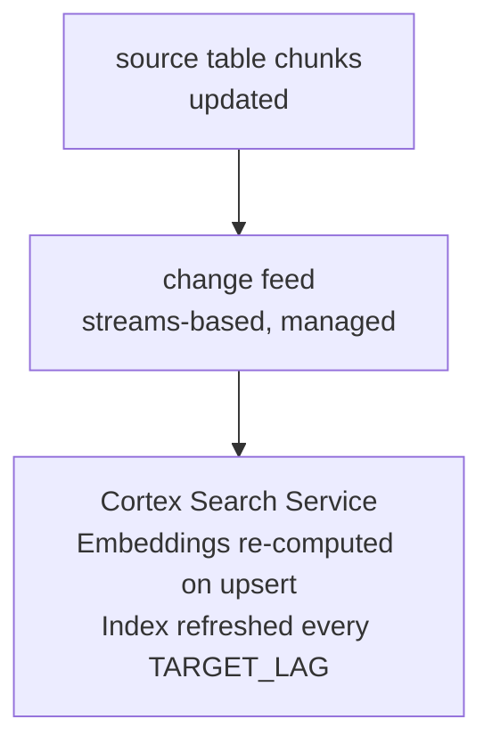

### Gotchas / Exam Traps
- Changing EMBEDDING_MODEL requires a service recreate.
- The warehouse is for refresh and embedding; serving is managed outside your warehouse.
- Billing: warehouse credits + embedding tokens for refresh + per-query search service credits.

---

## Q6: What does the SEARCH_PREVIEW response look like and how do you use the results in a RAG prompt?
**Difficulty:** Intermediate
**Exam relevance:** 2.6

### Answer
Response is JSON with a `results` array; each result has the selected `columns` plus `_score`.

```json
{
  "results":[
    {"title":"Password reset", "content":"To reset your password ...", "_score":0.831},
    {"title":"MFA basics",      "content":"Multi-factor ..."         , "_score":0.712}
  ]
}
```

Use results to assemble a prompt:

```sql
WITH hits AS (
  SELECT value:title::STRING AS title,
         value:content::STRING AS content
  FROM TABLE(FLATTEN(
    input => PARSE_JSON(SNOWFLAKE.CORTEX.SEARCH_PREVIEW(
      'support_kb',
      OBJECT_CONSTRUCT('query', $user_q, 'columns',
         ARRAY_CONSTRUCT('title','content'), 'limit', 5)::STRING)):results
  ))
),
ctx AS (
  SELECT LISTAGG(
    CONCAT('[', title, ']\n', content), '\n\n---\n\n'
  ) WITHIN GROUP (ORDER BY title) AS context
  FROM hits
)
SELECT SNOWFLAKE.CORTEX.COMPLETE(
  'llama3.1-70b',
  [
    {'role':'system','content':
      'Answer ONLY from the provided context. Cite [title] after each claim. If unknown, say so.'},
    {'role':'user','content': CONCAT('Context:\n', ctx.context, '\n\nQuestion: ', $user_q)}
  ],
  {'temperature':0}
) AS answer
FROM ctx;
```

### First Principles
Three must-haves in a grounded prompt: (1) system message that forbids off-source invention, (2) context block clearly delimited, (3) explicit citation instruction tying answers to retrieved docs. Temperature 0 for QA — you want deterministic, extractive-leaning answers.

### Diagram
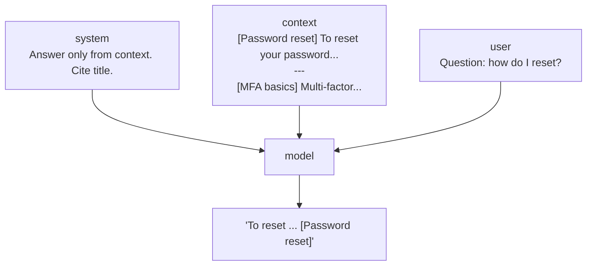

### Gotchas / Exam Traps
- Omitting the "answer only from context" rail invites hallucination.
- Listing citations by [title] is cheap; by [doc_id/chunk_id] is more auditable.
- Too few retrieved chunks (k=1) is brittle; too many dilutes.

---

## Q7: What filter operators does Cortex Search support?
**Difficulty:** Intermediate
**Exam relevance:** 2.7

### Answer
Filters are JSON expressions over ATTRIBUTE columns:
- `@eq`  equality
- `@contains` substring/array membership
- `@gte, @lte, @gt, @lt` numeric/time comparison
- `@and`, `@or`, `@not` logical combinators
- `@primarykey` for id lookups

```json
"filter": {
  "@and":[
    {"@eq":{"region":"EMEA"}},
    {"@gte":{"updated":"2025-01-01"}},
    {"@not":{"@eq":{"category":"deprecated"}}}
  ]
}
```

### First Principles
Filters are applied before retrieval scoring so they are a cheap pre-filter — equivalent to WHERE on an indexed column. Only ATTRIBUTE columns are filterable because only they are indexed; filtering on a non-attribute would require a full scan which defeats the point.

### Lab Exercise
```sql
SELECT SNOWFLAKE.CORTEX.SEARCH_PREVIEW(
  'support_kb',
  OBJECT_CONSTRUCT(
    'query','MFA setup',
    'columns', ARRAY_CONSTRUCT('title','content','updated'),
    'filter', OBJECT_CONSTRUCT(
      '@and', ARRAY_CONSTRUCT(
         OBJECT_CONSTRUCT('@eq', OBJECT_CONSTRUCT('category','auth')),
         OBJECT_CONSTRUCT('@gte', OBJECT_CONSTRUCT('updated','2025-01-01'))
      )
    ),
    'limit', 5
  )::STRING
);
```

### Gotchas / Exam Traps
- Attribute cardinality: very high-cardinality attributes (user_id) bloat the index; prefer category-like.
- Date comparisons use ISO 8601 strings in the JSON filter.
- `@contains` on arrays is per-element; on strings it's substring.

---

## Q8: How does Cortex Search auto-refresh when source data changes?
**Difficulty:** Advanced
**Exam relevance:** 2.5

### Answer
Snowflake uses a managed task bound to the source table that detects changes (via Streams semantics internally) and incrementally re-embeds + re-indexes within `TARGET_LAG`. Deleted rows are propagated. The refresh runs on the configured WAREHOUSE.

### First Principles
Full re-embedding on every change would be wasteful; incremental refresh re-embeds only changed rows. The TARGET_LAG parameter is the SLA you set; Snowflake sizes refresh frequency to meet it. Shorter lag = more frequent runs = more warehouse credits + embedding tokens, but fresher search.

### Diagram
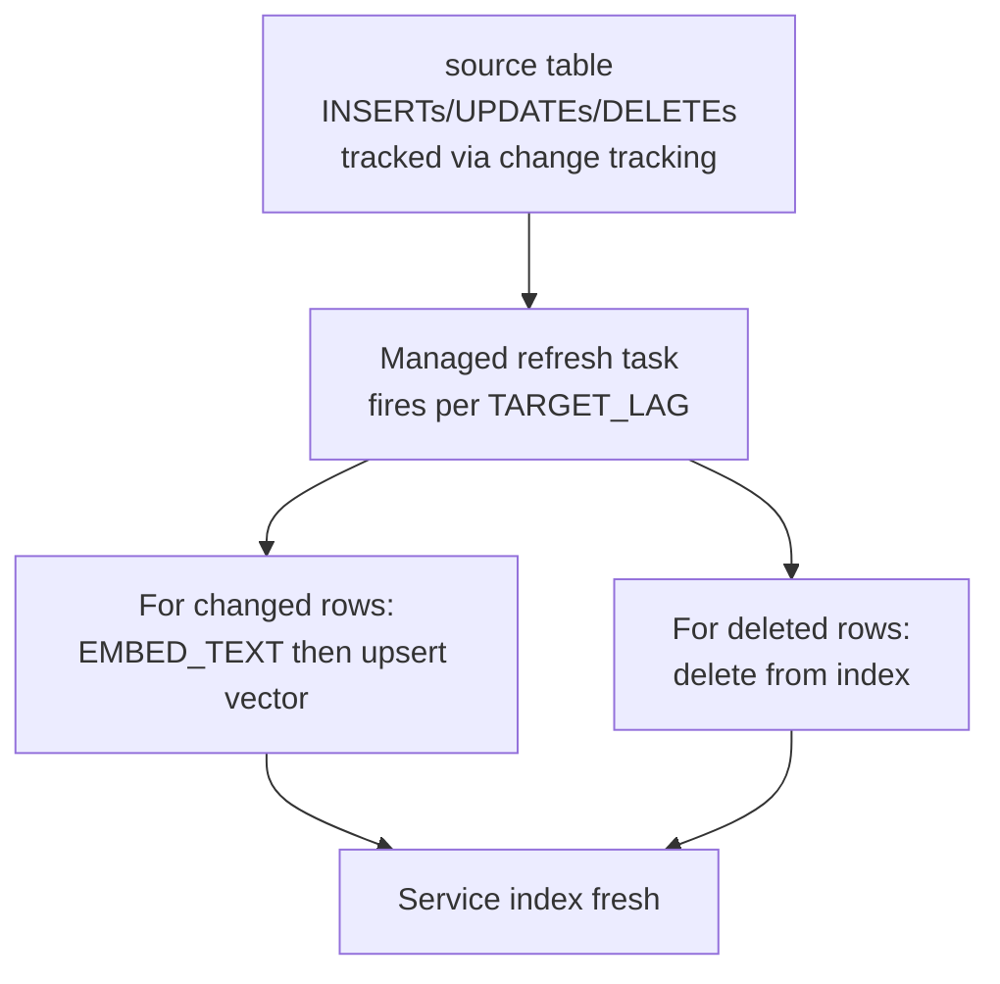

### Lab Exercise
```sql
-- Check lag / refresh health
DESC CORTEX SEARCH SERVICE support_kb;

SELECT SYSTEM$GET_CORTEX_SEARCH_SERVICE_STATUS('support_kb');
```

### Gotchas / Exam Traps
- Change tracking must be enabled on the base table (handled implicitly for most sources but confirm).
- A broken schema on refresh (e.g., content column renamed) stalls the service; monitor status.
- Billing: refresh warehouse + embedding tokens for every changed chunk.

---

## Q9: How do you call Cortex Search from Python / REST in an app?
**Difficulty:** Intermediate
**Exam relevance:** 2.8

### Answer
```python
from snowflake.core import Root
from snowflake.snowpark.context import get_active_session

root = Root(get_active_session())
svc = (root.databases["MY_DB"]
            .schemas["MY_SCHEMA"]
            .cortex_search_services["support_kb"])

resp = svc.search(
    query="how to reset password",
    columns=["title","content"],
    filter={"@eq":{"category":"auth"}},
    limit=5,
)
for row in resp.results:
    print(row["title"], row["_score"])
```

Or REST:
```
POST /api/v2/cortex/inference/cortex-search/<db>.<schema>.<service>
{
  "query": "...",
  "columns": [...],
  "filter": {...},
  "limit": 5
}
```

### First Principles
The Python SDK wraps the REST endpoint. Both authenticate via Snowflake credentials and inherit the caller's RBAC — a role without USAGE on the service gets 403. Keep the Streamlit/UI logic in Snowpark where possible so you don't manage API keys.

### Gotchas / Exam Traps
- REST endpoint requires an OAuth or key-pair token; don't embed static passwords.
- Rate limits apply per service; batch requests where possible.
- The `columns` parameter dictates returned fields; keep it narrow for latency.

---

## Q10: How do you build a full RAG app in Streamlit in Snowflake?
**Difficulty:** Advanced
**Exam relevance:** 2.9

### Answer
```python
import streamlit as st
from snowflake.snowpark.context import get_active_session
from snowflake.core import Root

session = get_active_session()
svc = (Root(session).databases["MY_DB"]
       .schemas["RAG"].cortex_search_services["support_kb"])

st.title("Support Copilot")
q = st.text_input("Ask a question")

if q:
    hits = svc.search(query=q, columns=["title","content"], limit=5).results
    context = "\n\n---\n\n".join(f"[{h['title']}]\n{h['content']}" for h in hits)

    prompt = [
        {"role":"system","content":
            "Answer ONLY from context. Cite [title] after each claim."},
        {"role":"user","content": f"Context:\n{context}\n\nQ: {q}"}
    ]
    answer = session.sql(
        "SELECT SNOWFLAKE.CORTEX.COMPLETE(?, ?, ?)",
        params=["llama3.1-70b", prompt, {"temperature":0}]
    ).collect()[0][0]

    st.markdown(answer)
    with st.expander("Sources"):
        for h in hits:
            st.markdown(f"**{h['title']}** — score {h['_score']:.2f}")
            st.text(h["content"][:400]+"...")
```

### First Principles
Streamlit in Snowflake runs the app inside the account's security boundary — no cross-cloud data movement, no API key management, inherits RBAC. The pattern is the canonical RAG loop: retrieve → ground → generate → cite. Keeping retrieval and generation separate (not one giant prompt) is what makes the app auditable and debuggable.

### Diagram
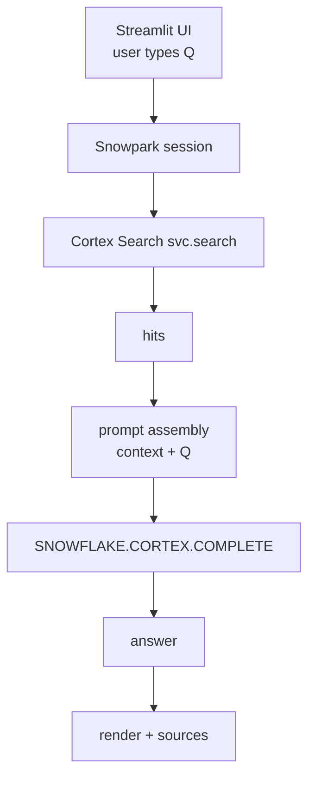

### Gotchas / Exam Traps
- Streamlit in Snowflake has a time/memory budget per session — long-running loops hit limits.
- Secrets are not needed for Cortex (same account) but ARE for external APIs — use External Access Integration.
- Deploy via `snowflake.yml` or the UI; version with Git integration.

---

## Q11: Compare direct COMPLETE with context stuffing vs RAG for different corpus sizes.
**Difficulty:** Intermediate
**Exam relevance:** 2.2

### Answer

| Corpus size | Pattern |
|---|---|
| < 10 KB (one FAQ page) | Stuff directly in prompt |
| 10 KB – 100 KB | Still stuff if context allows |
| 100 KB – 10 MB | RAG with chunking |
| > 10 MB | RAG mandatory (ANN index) |
| Multi-GB with structure | RAG + metadata filters |
| Structured tables | Cortex Analyst (not RAG) |

Why: context windows are finite; prompt tokens are billed; retrieval precision becomes the dominant quality lever at scale; Analyst solves a different problem (SQL vs prose).

### First Principles
Three limits: context window, cost (every token in-prompt is billed), and quality (long contexts suffer from attention dilution). As corpus grows, retrieval precision becomes the dominant quality lever; chunk size and overlap become tuning dials, and hybrid retrieval becomes necessary to handle both semantic queries and exact-match queries.

### Gotchas / Exam Traps
- Don't blindly default to RAG for small corpora; it adds moving parts and failure modes.
- Hybrid search isn't magic — if your chunks are poorly segmented, no fusion recovers.

---

## Q12: What are embedding model options for Cortex Search and how do you choose?
**Difficulty:** Intermediate
**Exam relevance:** 2.10

### Answer
Common EMBEDDING_MODEL values at service creation:
- `snowflake-arctic-embed-m-v1.5` (768-d, English, fast)
- `snowflake-arctic-embed-l-v2.0` (1024-d, multilingual, best general-purpose)
- `voyage-multilingual-2` (1024-d, strong multilingual)
- `nv-embed-qa-4` (1024-d, QA-tuned)
- `e5-base-v2` (768-d, English, cheap baseline)

Pick by: (1) language mix (multilingual if non-English present), (2) retrieval task (QA models for Q→passage), (3) latency/cost (768-d cheaper), (4) ceiling quality (Arctic-embed-l-v2 is Snowflake's current flagship).

### First Principles
Embedding models are trained with contrastive loss on query↔passage pairs; "QA-tuned" variants specifically trained on question/answer pairs beat generic sentence embedders on question-shaped queries. Multilingual models share a cross-lingual vector space so an English query retrieves German documents. Dimension trades expressiveness for storage/latency; 1024 is the current sweet spot.

### Gotchas / Exam Traps
- Model name is immutable per service — recreate to change.
- Mixing models across services is fine; mixing within one is impossible.
- Embedding tokens are billed separately from COMPLETE tokens.

---

## Q13: How do you add re-ranking on top of Cortex Search results?
**Difficulty:** Advanced
**Exam relevance:** 2.11

### Answer
Cortex Search includes an internal reranker (bi-encoder → cross-encoder cascade); for extra lift you can run a second-stage LLM-based reranker on the top-k.

```sql
WITH hits AS (
  SELECT value:content::STRING AS content, value:title::STRING AS title
  FROM TABLE(FLATTEN(
    input => PARSE_JSON(SNOWFLAKE.CORTEX.SEARCH_PREVIEW(
      'support_kb',
      OBJECT_CONSTRUCT('query', $q, 'columns',
         ARRAY_CONSTRUCT('title','content'), 'limit', 20)::STRING)):results))
),
scored AS (
  SELECT content, title,
         SNOWFLAKE.CORTEX.COMPLETE(
           'llama3.1-8b',
           CONCAT('Rate 0-10 how well this snippet answers "', $q,
                  '". Reply with ONLY a number.\n\n', content),
           {'temperature':0,'max_tokens':4}
         )::INT AS llm_score
  FROM hits
)
SELECT * FROM scored ORDER BY llm_score DESC LIMIT 5;
```

### First Principles
First-stage retrievers optimize recall@k with cheap scoring; rerankers optimize precision@k with expensive query-document joint scoring. The cascade pattern (cheap wide → expensive narrow) is standard IR. LLM-based rerankers can beat cross-encoders when the ranking criterion requires reasoning (e.g., "does this answer apply to a left-handed user?") but cost per call makes them impractical for all 20 unless truly needed.

### Diagram
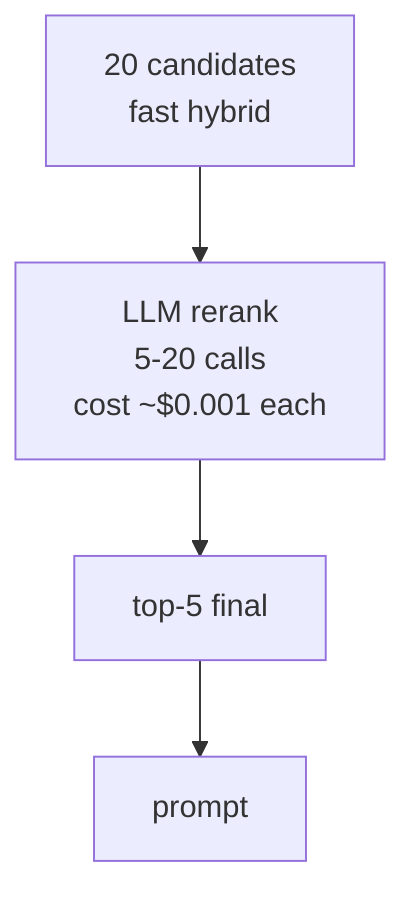

### Gotchas / Exam Traps
- Reranker budget: don't rerank 1000 docs; cap at 20-50.
- Score temperature=0 for determinism.
- Chain-of-thought rerankers (ask for reasoning + score) are higher quality but slower.

---

## Q14: What governance controls apply to Cortex Search?
**Difficulty:** Intermediate
**Exam relevance:** 2.12

### Answer
- RBAC: `GRANT USAGE ON CORTEX SEARCH SERVICE`.
- Row-level: row access policies on the **source table** flow through — rows the caller cannot see are excluded from the index at refresh and from result sets.
- Column masking: masking policies on the content column mean masked content gets embedded (as masked) — plan accordingly.
- Audit: ACCESS_HISTORY and QUERY_HISTORY log search calls.
- Lineage: service dependencies tracked in OBJECT_DEPENDENCIES.

### First Principles
Because the service re-reads from the source table during refresh under a service role, you must consider whose RBAC is applied: refresh uses the owner's privileges; serving applies the caller's. Row access policies evaluated at **serve time** mean a sensitive doc that was indexed will be filtered out of results for an unauthorized caller, but the vector itself still exists in the index — this is semantically secure but not a "zero-trust" indexed form.

### Diagram
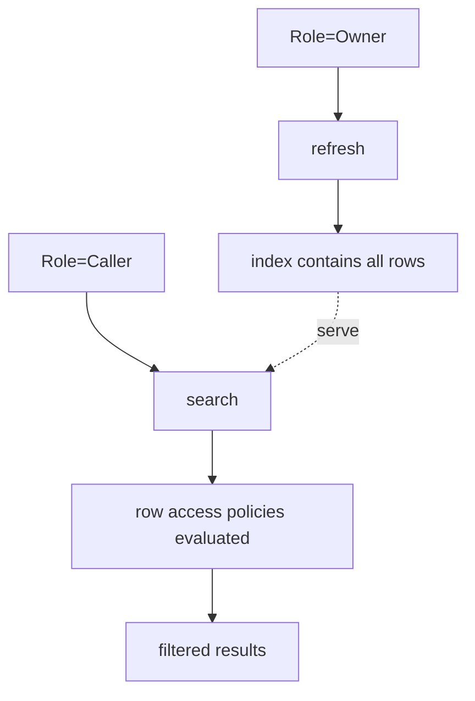

### Gotchas / Exam Traps
- A masking policy that returns `***` means your embeddings are of `***` — useless for retrieval. Choose: either exclude the column from indexing or accept semantic loss.
- Row access policies with user-dependent filters (e.g., CURRENT_USER()) still work — Snowflake handles this at serve time.
- Deleting a source row doesn't instantly purge the vector — purge happens on next refresh cycle.

---

## Q15: How do you measure retrieval quality (recall, precision, MRR, NDCG)?
**Difficulty:** Advanced
**Exam relevance:** 2.13

### Answer
Build a golden set of (query, relevant_doc_ids) pairs. For each query, run the retriever, compute:
- **Recall@k** = (relevant retrieved in top k) / (all relevant). Did you find them?
- **Precision@k** = (relevant retrieved in top k) / k. How much noise?
- **MRR** (Mean Reciprocal Rank) = mean of 1/rank of first relevant hit. Position-sensitive.
- **NDCG@k** = discounted gain weighted by position; standard for graded relevance.

```sql
WITH golden AS (
  SELECT query_id, query, ARRAY_CONSTRUCT('doc1','doc5') AS rel FROM eval_queries
),
retrieved AS (
  SELECT g.query_id, g.rel,
    ARRAY_AGG(value:doc_id::STRING) WITHIN GROUP (ORDER BY value:_score DESC) AS got
  FROM golden g,
       LATERAL FLATTEN(
         input => PARSE_JSON(SNOWFLAKE.CORTEX.SEARCH_PREVIEW(
           'support_kb',
           OBJECT_CONSTRUCT('query', g.query,'columns',
              ARRAY_CONSTRUCT('doc_id'),'limit',10)::STRING)):results)
  GROUP BY g.query_id, g.rel
)
SELECT AVG(ARRAY_SIZE(ARRAY_INTERSECTION(got, rel))::FLOAT / ARRAY_SIZE(rel)) AS recall_at_10
FROM retrieved;
```

### First Principles
Retrieval metrics decouple retrieval quality from generation quality — a broken retriever will cap your end-to-end quality no matter how good the LLM is. Build the golden set from real user queries + SME-validated answers; synthetic goldens drift from production distribution. NDCG is the gold-standard metric when relevance is graded (0-3) rather than binary.

### Gotchas / Exam Traps
- Small golden sets (<50) are noisy; aim for 200+ for stable metrics.
- Evaluation set contamination: don't include golden queries in the index with their answer labels.
- Metric at the wrong k: pick k that matches how many chunks you actually feed the LLM.

---

## Q16: What chunking parameters typically yield good results and why?
**Difficulty:** Intermediate
**Exam relevance:** 2.4

### Answer
For general prose (knowledge base articles, policy docs): **chunk size 1000-1500 characters, overlap 150-200**. For code or structured data: smaller chunks (400-600) because syntactic boundaries matter. For long-form (books, reports): consider larger (2000+) with recursive splitting on headings.

### First Principles
Chunk size balances two forces: (a) too small → fragments lose context, retrieval returns many partial chunks and the LLM must reassemble; (b) too large → embedding gets diluted (an averaged vector over many topics), retrieval precision drops. 1000-1500 chars ≈ 250-400 tokens is well below the embedder's 512-token ceiling and typically captures one or two paragraphs. Overlap 10-20% buffers against mid-sentence cuts.

### Diagram
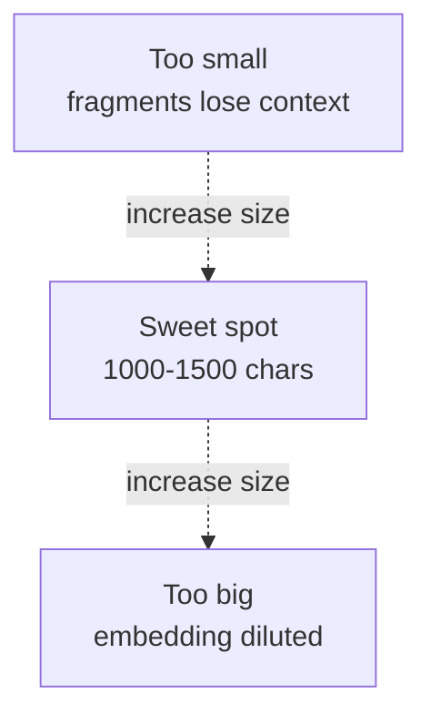

### Gotchas / Exam Traps
- Overlap too high (>30%) just inflates corpus cost.
- For code, overlap on class/function boundary not char count.
- Measure with the recall@k experiment — don't guess.

---

## Q17: How do you support multi-turn conversations in a RAG app?
**Difficulty:** Advanced
**Exam relevance:** 2.14

### Answer
Three patterns, often combined:
1. **Query rewriting**: Use the LLM to rewrite the follow-up ("how about overseas?") into a standalone query ("refund policy for overseas orders") using chat history as context, THEN retrieve.
2. **History passthrough**: Include the last N turns in the generation prompt so the model has conversational context.
3. **Summarized memory**: Periodically summarize older turns and prepend the summary.

```sql
-- Step 1: rewrite
WITH rewritten AS (
  SELECT SNOWFLAKE.CORTEX.COMPLETE(
    'mistral-large2',
    [
      {'role':'system','content':
        'Rewrite the user turn as a standalone question. Return ONLY the question.'},
      {'role':'user','content': CONCAT(
        'History:\n', $history, '\n\nFollow-up: ', $user_q)}
    ],
    {'temperature':0}
  ) AS q
)
-- Step 2: retrieve with rewritten q
SELECT ... FROM rewritten r,
  TABLE(FLATTEN(input => PARSE_JSON(SNOWFLAKE.CORTEX.SEARCH_PREVIEW(
    'support_kb', OBJECT_CONSTRUCT('query', r.q, ...)::STRING)):results));
```

### First Principles
Follow-up queries ("what about overseas?") have zero semantic content for a retriever — the embedding of three words lacks the topic. Rewriting restores the topic from conversational context so retrieval works. History passthrough during generation gives the model dialogic flow but is bounded by context window. For long conversations, summarization is the only scalable memory.

### Diagram
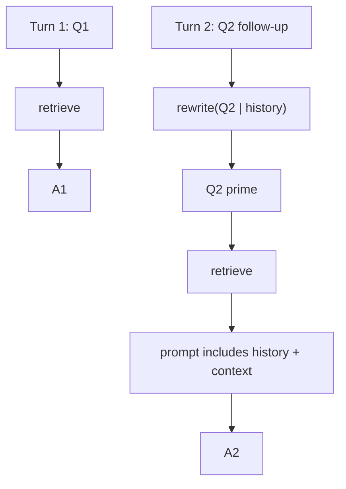

### Gotchas / Exam Traps
- Query rewriting adds one LLM call per turn — budget accordingly.
- Rewrite temperature 0; it's an extraction task not a creative one.
- Clear history on topic switch to avoid stale context pulls.

---

## Q18: How do document-level vs chunk-level retrieval differ, and when do you choose each?
**Difficulty:** Advanced
**Exam relevance:** 2.4

### Answer
- **Chunk-level**: index chunks; retrieve chunks; prompt gets chunks. Highest precision, best for QA on long docs.
- **Document-level**: index whole-doc embeddings or chunk embeddings aggregated per doc; retrieve docs; prompt gets whole docs (or doc summaries). Lower precision but preserves cross-section reasoning.
- **Hierarchical**: index both; retrieve top-k docs then top-m chunks within those docs.

### First Principles
Chunk retrieval wins when the answer is local to a passage ("what is the warranty period?"). Document retrieval wins when the answer requires synthesis across sections ("summarize the entire contract's position on IP"). Hierarchical is a cost-aware middle ground that bounds the LLM prompt while preserving global context.

### Diagram
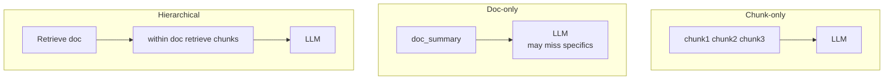

### Gotchas / Exam Traps
- Doc-level needs a strategy for long docs (summarize or truncate).
- Hierarchical doubles index storage and refresh cost.

---

## Q19: How do you handle images and tables inside RAG documents?
**Difficulty:** Advanced
**Exam relevance:** 2.15

### Answer
For PDFs with tables/images, use `SNOWFLAKE.CORTEX.PARSE_DOCUMENT(..., {'mode':'LAYOUT'})` which emits text with table structure preserved. For image-heavy content:
- Run a vision model (`llama3.2-vision`) to produce a textual caption, then index the caption alongside the extracted text.
- For complex tables, extract to Markdown or structured JSON before chunking.

```sql
WITH parsed AS (
  SELECT id, SNOWFLAKE.CORTEX.PARSE_DOCUMENT(@docs, filename, {'mode':'LAYOUT'}) AS p
  FROM files
)
SELECT id, p:content::STRING AS text,
       p:pages[0]:tables AS tables  -- if the parser emits them
FROM parsed;
```

### First Principles
Embedders are text-only, so images must become words via captioning. Tables lose meaning when flattened naively ("row1 col1 row1 col2 ..."); preserving table syntax (markdown pipes) keeps column↔value association intact so the LLM can answer "what was Q3 revenue?" correctly.

### Gotchas / Exam Traps
- OCR'd text has typos — embedders tolerate some but it hurts retrieval.
- Captions should mention entities visible, not just describe style ("a chart showing..." is weak; "quarterly revenue growth chart with Q3=4.1B" is strong).

---

## Q20: How do you cost-model a RAG deployment on Snowflake?
**Difficulty:** Intermediate
**Exam relevance:** 2.16

### Answer
Decompose into:
1. **Ingestion**: PARSE_DOCUMENT (per page), chunking (SQL, cheap), EMBED_TEXT (per token). One-time + on refresh.
2. **Index storage**: part of search service, bills with the service.
3. **Serving**: per-query credits for Cortex Search + embedding of the query (short, cheap) + COMPLETE (dominant).
4. **Refresh**: warehouse credits + embedding tokens on changed rows.
5. **Warehouse**: for ingestion jobs and the service's refresh.

Rule of thumb: for a 10M-chunk corpus with 1k ingest/day and 10k queries/day on llama3.1-70b with 2k-token prompts: expect low-single-digit credits per day for retrieval, double digits for generation. Embeddings dominate ingest cost.

### Diagram
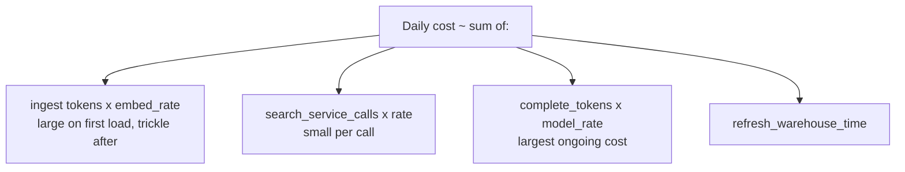

### Gotchas / Exam Traps
- COMPLETE output tokens dominate — short, structured answers save a lot.
- Over-shortening TARGET_LAG multiplies refresh cost without quality gain if source rarely changes.
- Monitor via CORTEX_FUNCTIONS_USAGE_HISTORY + WAREHOUSE_METERING_HISTORY.

---

## Q21: What are the differences between Cortex Search and bringing your own vector DB (Pinecone, Weaviate)?
**Difficulty:** Advanced
**Exam relevance:** 2.17

### Answer
| Dimension | Cortex Search | External Vector DB |
|---|---|---|
| Data movement | None, in Snowflake | Export then ingest |
| Governance | Snowflake RBAC | Separate IAM |
| Refresh | Managed | Build yourself |
| Hybrid retrieval | Built-in | Vendor-dependent |
| Cost | Credits + refresh | Vendor billing |
| Latency | Co-located | Cross-service hop |
| Features | Snowflake-native | More vector plugins |

### First Principles
The decisive factor is data gravity: if your corpus already lives in Snowflake, moving it out doubles storage and creates a sync problem. External vector DBs win when the data is predominantly outside Snowflake, when you need specialized ANN algorithms (HNSW tuning, SPLADE), or when you're multi-cloud without Snowflake coverage. For the vast majority of enterprise RAG on Snowflake data, Cortex Search is the lowest-friction choice.

### Gotchas / Exam Traps
- Governance alignment is a hidden cost of external DBs — row ACLs don't automatically transfer.
- Latency of a cross-cloud vector DB can be 50-200ms per query vs. in-account single-digit ms.

---

## Q22: How do you debug poor RAG answer quality?
**Difficulty:** Advanced
**Exam relevance:** 2.13

### Answer
Decompose the pipeline and inspect each stage:
1. **Retrieval**: Was the correct chunk retrieved? Run SEARCH_PREVIEW with the user's query and inspect top-10.
2. **Chunk quality**: Is the correct chunk even in the index? Query the chunks table.
3. **Chunking**: Was the answer split across chunks? Lower chunk size or add overlap.
4. **Embedding model**: Try a stronger model and re-run retrieval metrics.
5. **Prompt**: Is the system prompt enforcing grounding? Add "If not in context, say unknown."
6. **Model**: Try a larger model with the same context.
7. **Query**: Is the user query ambiguous? Add query rewriting.

### First Principles
RAG failures have three loci: can't find (retrieval), has it but confused (prompt/model), finds wrong one (ranking). Isolating which requires inspecting intermediate artifacts — logging retrieved chunk IDs with the final answer is essential. The common failure mode is "lost in the middle" with too many retrieved chunks — reducing k often helps.

### Diagram
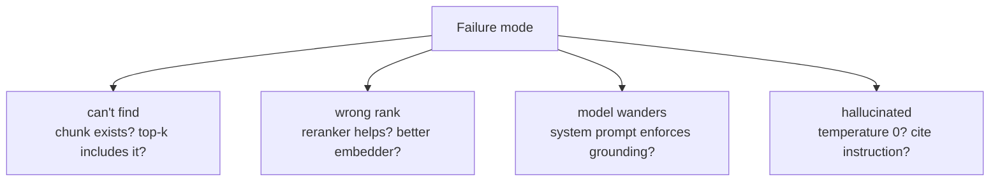

### Gotchas / Exam Traps
- Always log the retrieved chunk IDs with the response for post-hoc debugging.
- "The model is dumb" is almost never the first problem — retrieval or prompt is.
- A/B test one dimension at a time; otherwise results are uninterpretable.

---

## Q23: How does Cortex Search handle updates vs deletes vs schema changes?
**Difficulty:** Advanced
**Exam relevance:** 2.5

### Answer
- **UPDATE** on content column → re-embed on next refresh; vector replaced.
- **UPDATE** on attribute column → metadata reindex on next refresh; vector unchanged.
- **DELETE** → chunk purged from index on next refresh.
- **Schema change** (rename content column) → service likely stalls; recreate.
- **ALTER CORTEX SEARCH SERVICE** supports changing some params (TARGET_LAG, WAREHOUSE) without full recreate; EMBEDDING_MODEL requires recreate.

### First Principles
Decoupling the index from the source via a refresh task means the service tolerates most non-breaking changes, but the embedding dimension and vocabulary are baked into the index on creation so model change = full re-embed. This is why choosing the embedding model well at creation saves pain.

### Lab Exercise
```sql
ALTER CORTEX SEARCH SERVICE support_kb SET TARGET_LAG = '5 minutes';
-- OK, no recreate

ALTER CORTEX SEARCH SERVICE support_kb SET EMBEDDING_MODEL = 'voyage-multilingual-2';
-- fails or forces re-embed depending on version; prefer CREATE OR REPLACE
```

### Gotchas / Exam Traps
- Watch service status after large deletes — purge is eventually consistent.
- Column type change on source may force recreate.

---

## Q24: What's a safe default stack for a greenfield enterprise RAG on Snowflake?
**Difficulty:** Intermediate
**Exam relevance:** 2.18 — synthesis

### Answer
- Ingest: Snowpipe → raw table; PARSE_DOCUMENT for PDFs.
- Chunking: SPLIT_TEXT_RECURSIVE_CHARACTER, 1200 chars, 200 overlap.
- Embedding: `snowflake-arctic-embed-l-v2.0` (multilingual, 1024-d).
- Search: Cortex Search with TARGET_LAG = 1h; attribute columns for category, region, date.
- Generation: `llama3.1-70b` with temperature 0, response_format JSON when structured.
- Guardrails: `{'guardrails': true}` on output.
- UI: Streamlit in Snowflake, with sources panel.
- Governance: ROLE-based access on service and source tables; QUERY_TAG for showback.
- Monitoring: ACCOUNT_USAGE.CORTEX_FUNCTIONS_USAGE_HISTORY, SYSTEM$GET_CORTEX_SEARCH_SERVICE_STATUS.

### First Principles
Safe defaults optimize for the median enterprise workload: moderate corpora, English+major languages, QA-style queries, cost sensitivity, strong governance needs. You can tune up (larger model, stronger embedder) once you measure where the quality ceiling actually is.

### Gotchas / Exam Traps
- Don't skip the eval loop — bake golden-set recall@k into CI from day one.
- Don't skip query logging — you need it for all future quality work.
