# Cortex Analyst — GES-C01 Study Guide

## Exam Weight & Scope
Roughly 15-20% of the exam. Covers the Cortex Analyst service: text-to-SQL on structured warehouse data, authoring semantic models in YAML (tables, dimensions, measures, time dimensions, synonyms, filters), verified query repositories, deployment via REST API (`/api/v2/cortex/analyst/message`), authentication, result formats, guardrails and limitations, Streamlit/UI patterns, and governance via RBAC/row-access policies.

## Core Concepts Map
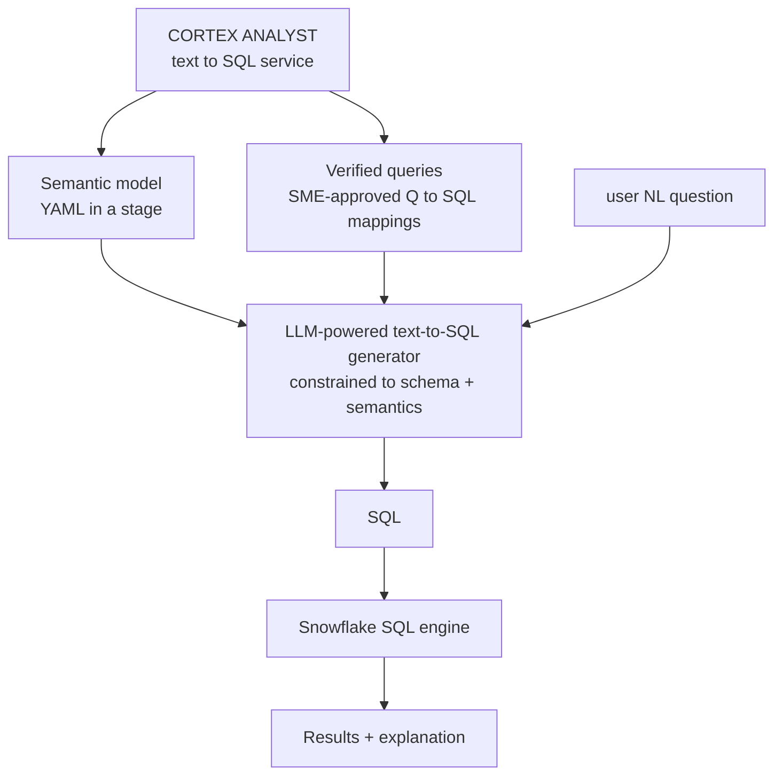

---

## Q1: What is Cortex Analyst and how is it different from RAG?
**Difficulty:** Foundation
**Exam relevance:** 3.1

### Answer
Cortex Analyst is a REST-based service that turns natural-language questions into **SQL** against your Snowflake data, grounded by a **semantic model** (YAML) that defines the tables, columns, metrics, and vocabulary the question answerer may use. The result is SQL + the executed answer. Different from RAG: RAG retrieves and summarizes **unstructured text**; Analyst generates and executes **SQL** over **structured** tables.

### First Principles
Business questions on tabular data decompose predictably: "revenue by region last quarter" maps to `SELECT region, SUM(amount) FROM sales WHERE date ...`. The challenge is not language understanding but schema grounding — picking the right tables, join keys, and aggregations without hallucination. A semantic model provides a constrained vocabulary (named dimensions and measures) that the LLM can only compose, not invent. That constraint is the entire reason Analyst is reliable where naive text-to-SQL is not.

### Diagram
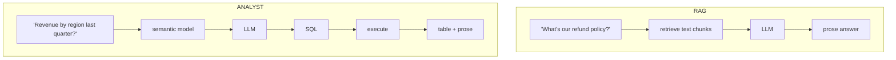

### Lab Exercise
```python
# Minimal REST call
import requests, json

response = requests.post(
    "https://<account>.snowflakecomputing.com/api/v2/cortex/analyst/message",
    headers={
        "Authorization": f"Bearer {token}",
        "Content-Type": "application/json",
    },
    json={
        "messages":[{"role":"user","content":[{"type":"text","text":"revenue by region last quarter"}]}],
        "semantic_model_file": "@mydb.myschema.models/sales_v1.yaml"
    }
)
print(response.json())
```

### Gotchas / Exam Traps
- Analyst does NOT execute the SQL for you by default — it returns the SQL; you run it. (Some wrappers like the Streamlit chat UI execute automatically.)
- No semantic model = no Analyst — the YAML is mandatory.
- Analyst is NOT a general text-to-SQL — it will refuse to generate SQL for things not in the semantic model.

---

## Q2: What is a semantic model and what are its top-level sections?
**Difficulty:** Foundation
**Exam relevance:** 3.2

### Answer
A YAML file that describes a slice of your warehouse for Analyst to use. Top-level sections:

```yaml
name: sales_v1
description: Sales analytics semantic model
tables:
  - name: SALES
    base_table:
      database: ANALYTICS
      schema: PROD
      table: FACT_SALES
    primary_key:
      columns: [order_id]
    dimensions:
      - name: region
        synonyms: ["area","territory"]
        expr: region_code
        data_type: VARCHAR
        description: 3-char region code
    time_dimensions:
      - name: order_date
        expr: order_dt
        data_type: DATE
    measures:
      - name: revenue
        expr: amount_usd
        data_type: NUMBER
        default_aggregation: sum
        description: Gross revenue in USD
    filters:
      - name: shipped_only
        expr: status = 'SHIPPED'
verified_queries:
  - name: "monthly revenue by region"
    question: "What was monthly revenue by region last year?"
    sql: |
      SELECT DATE_TRUNC('month', order_dt) m, region_code, SUM(amount_usd)
      FROM analytics.prod.fact_sales
      WHERE YEAR(order_dt) = YEAR(DATEADD(year,-1,CURRENT_DATE))
      GROUP BY 1,2
```

### First Principles
The YAML is a controlled vocabulary + metrics catalog. Dimensions are columns-you-can-group-by; measures are columns-you-can-aggregate; time_dimensions are the time axis for period-over-period; filters are reusable named predicates; verified_queries are SME-approved Q→SQL exemplars that constrain the model to patterns a human blessed. Synonyms close the terminology gap between business and schema.

### Diagram
```mermaid
flowchart TD
    SM[semantic_model.yaml]
    SM --> T[tables[]]
    SM --> VQ[verified_queries[]<br/>Q to SQL patterns]
    T --> BT[base_table<br/>which physical table]
    T --> DI[dimensions[]<br/>group-by candidates]
    T --> ME[measures[]<br/>aggregate candidates]
    T --> TD[time_dimensions[]<br/>time axis]
    T --> FI[filters[]<br/>reusable WHERE predicates]
    T --> RE[relationships[]<br/>joins to other tables]
```

### Lab Exercise
```sql
-- Upload the YAML to a stage
PUT file:///local/sales_v1.yaml @models AUTO_COMPRESS=FALSE OVERWRITE=TRUE;

-- Reference it in Analyst calls as @db.schema.models/sales_v1.yaml
```

### Gotchas / Exam Traps
- The YAML lives in a **stage**, not a table. Use `@stage/path/file.yaml` syntax.
- Measure `default_aggregation` is required — it's how the model knows SUM vs AVG when the user says "revenue."
- Analyst can only reference objects that exist in the YAML — a dimension not listed is invisible.

---

## Q3: What are dimensions, measures, and time_dimensions semantically, and why separate them?
**Difficulty:** Intermediate
**Exam relevance:** 3.2

### Answer
- **Dimension**: a categorical/discrete column you GROUP BY (region, product, customer_id).
- **Measure**: a numeric column you AGGREGATE (revenue, qty, cost). Has `default_aggregation`.
- **Time_dimension**: a date/timestamp column eligible for period logic (DATE_TRUNC, DATEADD, period-over-period comparisons).

Separation lets the LLM infer the right query shape: "sales by region last month" → dimension=region, time_dimension=last_month, measure=sales. The model knows measures need aggregation, dimensions go in GROUP BY, and time_dimensions can be bucketed.

### First Principles
This is a lightweight dimensional-modeling discipline encoded in YAML. The categorical/numeric/temporal trichotomy covers almost every analytics query. Measures are special because they have an implicit aggregation; dimensions are special because they define the result shape; time is special because it's the axis of change and supports comparison semantics (QoQ, YoY) the LLM can map to.

### Diagram
```mermaid
flowchart TD
    NL1["'revenue'"] --> SM1[measure[revenue] with SUM]
    NL2["'by region'"] --> SM2[dimension[region] GROUP BY]
    NL3["'last quarter'"] --> SM3["time_dimension[order_date]<br/>filter DATE_TRUNC('quarter',...) = ..."]
```

### Gotchas / Exam Traps
- Putting a numeric id in `measures` means Analyst will sum it ("sum of customer_id") — guard high-cardinality numeric IDs by placing them under dimensions.
- `time_dimension` must be a date/timestamp; VARCHAR dates confuse the model.

---

## Q4: What are synonyms and sample_values, and why do they matter?
**Difficulty:** Intermediate
**Exam relevance:** 3.3

### Answer
```yaml
dimensions:
  - name: region
    synonyms: ["area","territory","zone"]
    sample_values: ["AMER","EMEA","APAC"]
    expr: region_code
```

**Synonyms** are alternative natural-language names for a dimension/measure. "Area" and "zone" should both resolve to `region`. **Sample_values** are a short list of actual values that help the model recognize when a user types an entity name ("show me APAC results") that it should map to this column.

### First Principles
Business language is ambiguous and model-dependent. Without synonyms, a user asking for "territory revenue" might cause the model to invent a `territory` column. Sample values ground entity resolution: seeing "APAC" in the user's question, the model can match `sample_values` and know APAC is a value of `region`, not a separate table.

### Diagram
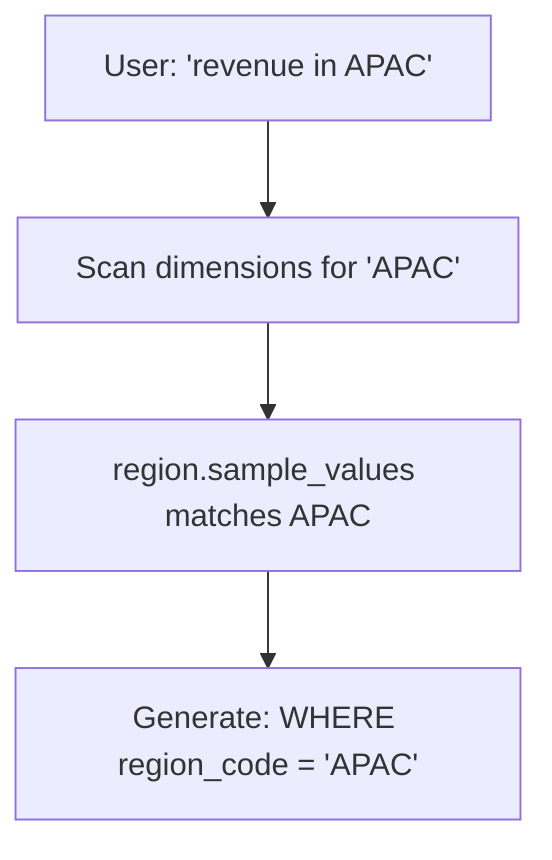

### Gotchas / Exam Traps
- Keep sample_values short (5-20 representative values). Don't dump every distinct value.
- Synonyms should be real business terms, not spelling variants.

---

## Q5: What are verified queries and how do they improve accuracy?
**Difficulty:** Advanced
**Exam relevance:** 3.4

### Answer
```yaml
verified_queries:
  - name: "revenue by region quarter"
    question: "What was revenue by region this quarter?"
    sql: |
      SELECT region_code, SUM(amount_usd)
      FROM analytics.prod.fact_sales
      WHERE DATE_TRUNC('quarter', order_dt) = DATE_TRUNC('quarter', CURRENT_DATE)
      GROUP BY region_code
    verified_at: "2025-02-01"
    verified_by: "jane@acme.com"
```

Verified queries are a repository of (question, SQL) pairs reviewed by a data engineer or SME. Analyst uses them for in-context few-shot: when a user asks something similar, the model is primed with the exact pattern. They are the single highest-ROI accuracy lever.

### First Principles
LLM-written SQL is good at patterns it has seen; it is unreliable on new patterns, especially window functions, nested CTEs, and company-specific business logic (fiscal calendars, join conventions). Verified queries bank the SME's judgment and let the model retrieve it rather than reinvent. Semantically they are a user-provided prior over SQL style.

### Diagram
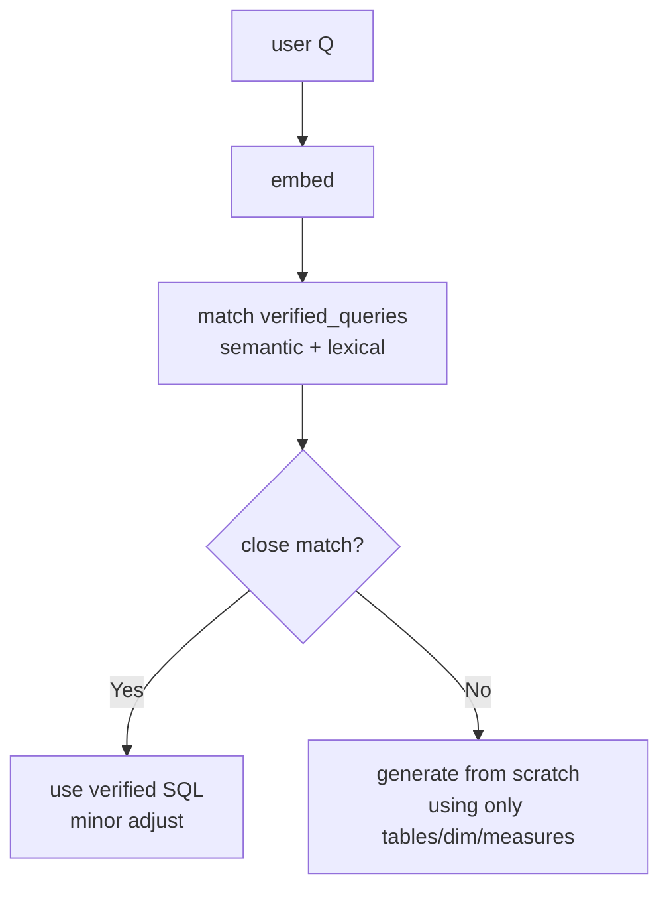

### Lab Exercise
```yaml
verified_queries:
  - name: "yoy_growth"
    question: "Year over year growth by product"
    sql: |
      WITH cur AS (
        SELECT product_id, SUM(amount_usd) r
        FROM analytics.prod.fact_sales
        WHERE YEAR(order_dt)=YEAR(CURRENT_DATE)
        GROUP BY 1),
      prev AS (
        SELECT product_id, SUM(amount_usd) r
        FROM analytics.prod.fact_sales
        WHERE YEAR(order_dt)=YEAR(CURRENT_DATE)-1
        GROUP BY 1)
      SELECT c.product_id, c.r cur_r, p.r prev_r,
             (c.r-p.r)/NULLIF(p.r,0) AS yoy
      FROM cur c LEFT JOIN prev p USING(product_id);
```

### Gotchas / Exam Traps
- Keep verified queries up to date — stale SQL referencing dropped columns breaks the model.
- Each verified query consumes prompt budget; curate (not dump) for the top business questions.

---

## Q6: How do you define relationships (joins) in the semantic model?
**Difficulty:** Intermediate
**Exam relevance:** 3.5

### Answer
```yaml
tables:
  - name: SALES
    primary_key: {columns: [order_id]}
    dimensions: [...]
    measures: [...]
  - name: CUSTOMERS
    primary_key: {columns: [customer_id]}
    dimensions:
      - name: customer_name
        expr: name
  - name: PRODUCTS
    primary_key: {columns: [product_id]}

relationships:
  - name: sales_to_customer
    left_table: SALES
    right_table: CUSTOMERS
    relationship_columns:
      - left_column: customer_id
        right_column: customer_id
    join_type: left_outer
    relationship_type: many_to_one
  - name: sales_to_product
    left_table: SALES
    right_table: PRODUCTS
    relationship_columns:
      - left_column: product_id
        right_column: product_id
```

### First Principles
Analyst won't invent joins — it only joins where you've declared a relationship. Explicit join declarations prevent cartesian products and ambiguous paths. Specifying cardinality (many_to_one) lets the model reason about aggregation safety (fan-out). Join type signals business semantics: left_outer preserves orders without matching customers (bad data) vs. inner drops them.

### Diagram
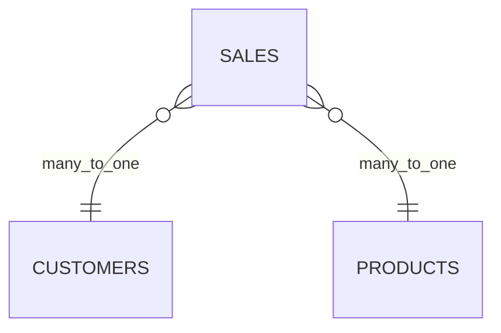

### Gotchas / Exam Traps
- A missing relationship means Analyst cannot answer questions spanning those tables — it returns "I don't have that information."
- Many-to-many requires a bridge table modeled explicitly.
- Cycles in relationships cause ambiguity — prune.

---

## Q7: How does Analyst's REST API work, including auth and payload?
**Difficulty:** Intermediate
**Exam relevance:** 3.6

### Answer
Endpoint: `POST /api/v2/cortex/analyst/message`
Auth: Snowflake OAuth or key-pair JWT.
Payload:
```json
{
  "messages":[
    {"role":"user","content":[
      {"type":"text","text":"What was Q3 revenue by region?"}
    ]}
  ],
  "semantic_model_file":"@mydb.myschema.models/sales_v1.yaml",
  "stream": false
}
```
Response includes a `message` with content array holding:
- `{"type":"text","text":"..."}` — natural language commentary
- `{"type":"sql","statement":"SELECT..."}` — the generated SQL
- `{"type":"suggestions","suggestions":[...]}` — follow-ups

Multi-turn: pass previous assistant messages back in the `messages` array.

### First Principles
A chat-style messages API because Analyst conversations are multi-turn — "and by product?" requires prior context. The semantic model is referenced not inlined so the service can cache it and so you can version it in a stage with Git integration. Returning SQL (not just a table) is intentional: lets the caller apply row ACLs, logging, retry logic, cache.

### Diagram
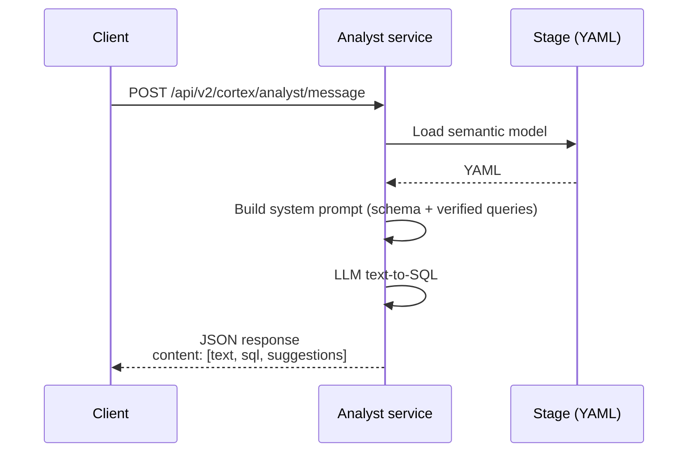

### Lab Exercise
```python
import snowflake.connector, requests, json

conn = snowflake.connector.connect(user=..., account=..., private_key_file=...)
token = conn.rest.token  # or OAuth

r = requests.post(
    f"https://<account>.snowflakecomputing.com/api/v2/cortex/analyst/message",
    headers={"Authorization": f"Bearer {token}", "Content-Type":"application/json"},
    json={
        "messages":[{"role":"user","content":[{"type":"text","text":"Top 5 products by revenue this quarter"}]}],
        "semantic_model_file":"@MYDB.MYSCHEMA.MODELS/sales_v1.yaml"
    }
)
resp = r.json()
sql = next(c["statement"] for c in resp["message"]["content"] if c["type"]=="sql")

# Execute the SQL yourself
cur = conn.cursor()
rows = cur.execute(sql).fetchall()
```

### Gotchas / Exam Traps
- Analyst does not execute SQL — your app must.
- Rate limits per account apply; expect 429s under burst.
- The semantic_model_file path must be resolvable by the role the caller is using.

---

## Q8: How do you handle multi-turn conversations in Analyst?
**Difficulty:** Intermediate
**Exam relevance:** 3.6

### Answer
Include prior assistant turns in the `messages` array:
```json
{
  "messages":[
    {"role":"user","content":[{"type":"text","text":"revenue by region last quarter"}]},
    {"role":"assistant","content":[
      {"type":"sql","statement":"SELECT region, SUM(amount) ..."},
      {"type":"text","text":"Here is Q3 revenue by region..."}
    ]},
    {"role":"user","content":[{"type":"text","text":"and by product"}]}
  ],
  "semantic_model_file":"@..."
}
```
The service uses prior turns as context — the follow-up "and by product" is resolved against the previous intent.

### First Principles
State is passed back to the stateless service each turn — standard chat API design. The service does its own query-rewriting internally to resolve pronouns and ellipsis. Keeping full history grows prompt cost linearly; prune old turns when they stop influencing the current question.

### Gotchas / Exam Traps
- Dropping the assistant SQL from history makes follow-ups blind to what was computed.
- Very long histories (10+ turns) can exceed service limits; truncate oldest turns.

---

## Q9: What are the limitations and failure modes of Cortex Analyst?
**Difficulty:** Advanced
**Exam relevance:** 3.7

### Answer
- **Scope-bound**: can only use tables/columns in the semantic model. Questions outside scope return "I don't have that information."
- **No fuzzy string matching invented**: can't find "Johnson" without the right dimension + sample values.
- **Limited to defined aggregations**: can't synthesize novel metrics on the fly beyond `default_aggregation` or ad-hoc SUM/AVG/COUNT.
- **Complex SQL (window functions, pivots, nested CTEs)**: works but less reliably without verified_queries exemplars.
- **No cross-model federation**: one semantic model per call.
- **Latency** 1-5s per call; not for subsecond needs.
- **Non-deterministic**: same question may yield slightly different SQL; verified_queries help.

### First Principles
Analyst trades flexibility for reliability by constraining the search space. Every limitation is a direct consequence of the semantic model being the ground truth. If you need to query data not in the YAML, the solution is to extend the YAML — not to prompt-engineer around it.

### Gotchas / Exam Traps
- Don't use Analyst for free-text search in a text column — that's RAG territory.
- Don't rely on Analyst for operational transactional queries where SQL must be perfect; keep humans in the loop.

---

## Q10: How do you deploy Analyst with Streamlit in Snowflake?
**Difficulty:** Advanced
**Exam relevance:** 3.8

### Answer
Streamlit in Snowflake supports Analyst via the Snowpark session's REST capability or the `snowflake.core` client. Common pattern:

```python
import streamlit as st
import json
import _snowflake
from snowflake.snowpark.context import get_active_session

session = get_active_session()
st.title("Ask the Data")

if "msgs" not in st.session_state:
    st.session_state.msgs = []

q = st.chat_input("Your question")

if q:
    st.session_state.msgs.append({"role":"user","content":[{"type":"text","text":q}]})

    resp = _snowflake.send_snow_api_request(
        "POST",
        "/api/v2/cortex/analyst/message",
        {},
        {},
        {
            "messages": st.session_state.msgs,
            "semantic_model_file": "@MYDB.MYSCHEMA.MODELS/sales_v1.yaml"
        },
        None,
        30000  # ms
    )
    body = json.loads(resp["content"])
    msg  = body["message"]
    st.session_state.msgs.append(msg)

    for part in msg["content"]:
        if part["type"] == "text":
            st.markdown(part["text"])
        elif part["type"] == "sql":
            st.code(part["statement"], language="sql")
            df = session.sql(part["statement"]).to_pandas()
            st.dataframe(df)
```

### First Principles
`_snowflake.send_snow_api_request` is Streamlit-in-Snowflake's safe way to call Snowflake REST endpoints without managing credentials — the SPCS runtime provides implicit auth. Executing the returned SQL via the session respects the caller's RBAC; a user who can't see a table gets a permission error, not leaked data.

### Diagram
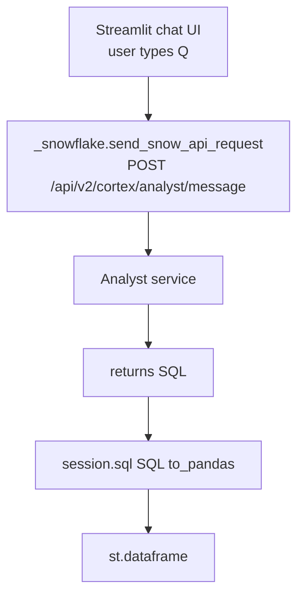

### Gotchas / Exam Traps
- Row access policies apply when YOU execute the SQL — Analyst doesn't bypass them.
- Streamlit session_state must carry the full `messages` list for multi-turn.
- Service account for the Streamlit app needs USAGE on the semantic model stage AND SELECT on referenced tables.

---

## Q11: How does governance work with Analyst (RBAC, masking, row access)?
**Difficulty:** Advanced
**Exam relevance:** 3.9

### Answer
Analyst inherits standard Snowflake governance:
- **RBAC**: the role executing the SQL must have SELECT on tables; otherwise the final `session.sql(...)` fails.
- **Masking policies**: applied at execution — the LLM sees schema, not data, so masks don't affect SQL generation; results reflect masks when run.
- **Row access policies**: identical story — filter happens at exec time.
- **Semantic model stage**: USAGE on the stage is required to read the YAML.

Audit via QUERY_HISTORY on executed SQL and via Analyst service logs (API call history).

### First Principles
Analyst generates SQL — it does not read data at generation time (only schema metadata, dimension sample values, verified queries). This is a critical governance property: the LLM never sees your raw PII rows. The actual data access happens when the application executes the SQL under the caller's role, so all existing enforcement engines apply unchanged.

### Diagram
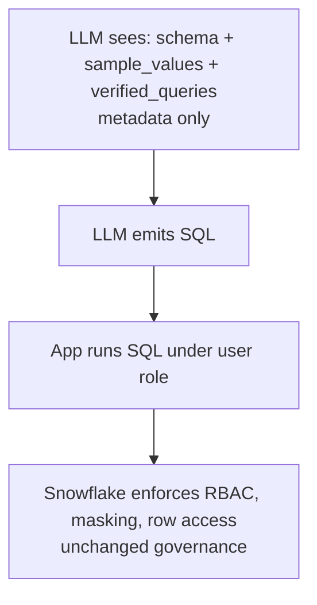

### Gotchas / Exam Traps
- `sample_values` in the YAML CAN include values that would otherwise be masked — carefully choose non-sensitive examples.
- A row access policy on a dim table that filters by region means two users asking the same NL get different answer sets — correct behavior but surprising.

---

## Q12: How do you version and update a semantic model safely?
**Difficulty:** Intermediate
**Exam relevance:** 3.10

### Answer
Store YAML in a stage with a version suffix: `sales_v1.yaml`, `sales_v2.yaml`. In the Analyst call, point to the exact version. Promote via a release process:
1. Create `sales_v2.yaml` with changes.
2. Deploy a staging app that references v2.
3. Run eval set; if pass, flip prod app to v2.
4. Keep v1 for rollback.

Prefer stage with Git integration (Snowflake Git integration) so YAML is Git-versioned.

### First Principles
Semantic models are code — treat them with CI/CD. A rename or deletion of a dimension can silently break production. Versioning + an eval set (list of Q→expected-SQL pairs) is the only way to catch regressions.

### Lab Exercise
```sql
-- Git integration
CREATE API INTEGRATION git_api_int
  API_PROVIDER = git_https_api
  API_ALLOWED_PREFIXES = ('https://github.com/myorg/')
  ENABLED = TRUE;

CREATE GIT REPOSITORY semantic_models
  API_INTEGRATION = git_api_int
  ORIGIN = 'https://github.com/myorg/semantic-models.git';

ALTER GIT REPOSITORY semantic_models FETCH;

-- Reference YAML from Git
-- semantic_model_file: "@my_db.public.semantic_models/branches/main/sales/v2.yaml"
```

### Gotchas / Exam Traps
- Watch for breaking changes: renaming a measure invalidates verified_queries that reference it by name.
- Keep an eval harness that runs on PR.

---

## Q13: How do you add computed/derived measures?
**Difficulty:** Advanced
**Exam relevance:** 3.2

### Answer
```yaml
measures:
  - name: revenue
    expr: amount_usd
    data_type: NUMBER
    default_aggregation: sum
  - name: cost
    expr: cogs_usd
    default_aggregation: sum
  - name: gross_margin
    expr: amount_usd - cogs_usd
    default_aggregation: sum
    description: Revenue minus COGS
  - name: margin_pct
    expr: SUM(amount_usd - cogs_usd) / NULLIF(SUM(amount_usd),0)
    default_aggregation: none
    description: Gross margin percent
```

### First Principles
Composed metrics are the semantic model's main value-add: encode "gross margin" once and every user asking in any phrasing gets the same formula. Pre-aggregated expressions (like `margin_pct` using nested SUM) require `default_aggregation: none` because they are already an aggregate. Mixing additive measures (revenue, cost) with ratio measures (margin_pct) is the common gotcha — ratios don't aggregate linearly.

### Gotchas / Exam Traps
- Ratios: never let the model SUM a percent. Use `default_aggregation: none` and write a correct formula.
- Null handling: wrap denominators with NULLIF to avoid div-by-zero.

---

## Q14: What are custom instructions and how do they shape Analyst behavior?
**Difficulty:** Advanced
**Exam relevance:** 3.11

### Answer
```yaml
custom_instructions: |
  - Always exclude internal test customers (customer_id starting with 'TEST').
  - Fiscal year starts February 1; map FY references accordingly.
  - Default region ordering: AMER, EMEA, APAC.
```

Custom instructions are a free-text block appended to the system prompt per model. Use them to codify business rules the model should always obey.

### First Principles
Rules that span many queries (fiscal calendar, exclusions, naming conventions) don't belong duplicated in every verified_query. Centralize in custom_instructions. Think of this as the "handbook" the Analyst internalizes. Keep it tight (fewer than ~20 lines) — long handbooks bloat every prompt and dilute attention.

### Gotchas / Exam Traps
- Rules the model can't verify from the schema (e.g., "exclude test customers") must be enforceable via WHERE clauses the model can write.
- Don't put secrets, API keys, or sensitive patterns here — it is embedded in prompts.

---

## Q15: What is the role of Cortex Search within Analyst (hybrid Analyst+Search)?
**Difficulty:** Advanced
**Exam relevance:** 3.12

### Answer
For high-cardinality string dimensions (customer_name, product_name), Analyst can optionally delegate value lookup to a Cortex Search service, letting fuzzy name resolution scale beyond sample_values.

```yaml
dimensions:
  - name: customer_name
    expr: name
    cortex_search_service:
      service: "@mydb.myschema.cust_name_search"
      literal_column: name
```

When a user asks "revenue for Acme Co", Analyst calls the search service to resolve "Acme Co" to the actual spelling in the table, then injects it into the SQL.

### First Principles
Sample_values is a hard-coded list — fine for 10 regions, not for 10 million customers. A dedicated search index gives semantic + lexical lookup over the full set at query time, bridging unstructured NL to structured data without manual enumeration.

### Diagram
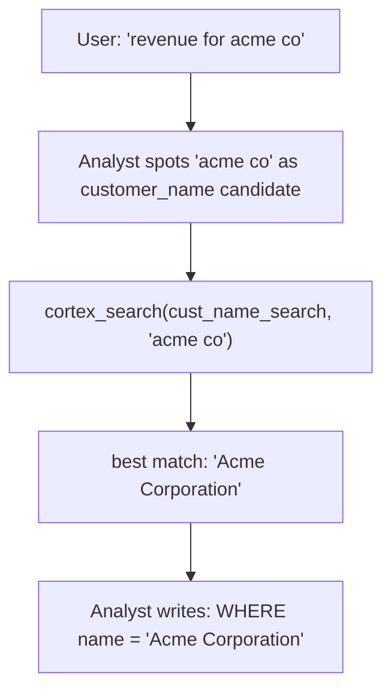

### Gotchas / Exam Traps
- Only one search service per dimension.
- Requires maintaining a search service over distinct values of the column.
- Extra latency and credit cost per call.

---

## Q16: How do you build an evaluation set to test Analyst accuracy?
**Difficulty:** Advanced
**Exam relevance:** 3.13

### Answer
Create a table of (question, expected_sql_or_result) pairs. Run each through Analyst, compare generated SQL to expected or compare query result sets.

```sql
CREATE OR REPLACE TABLE analyst_eval (
  qid STRING, question STRING, expected_sql STRING, expected_result_hash STRING
);

-- harness pseudocode (Python)
for row in rows:
  resp = call_analyst(row.question)
  got_sql = extract_sql(resp)
  got_result = session.sql(got_sql).to_pandas()
  got_hash = hash_df(got_result)
  record(qid=row.qid, pass=(got_hash==row.expected_result_hash))
```

Metric: exact-match SQL is too strict (many SQLs are correct). Prefer **result-set equivalence** (same rows under set semantics) or execution success + spot-check.

### First Principles
NL→SQL has many correct answers. Evaluating by SQL string equality is like grading essays by character match. Result-set equivalence is the real correctness criterion. Keep an SME-reviewed golden set and run on every semantic-model change.

### Gotchas / Exam Traps
- Non-deterministic queries (ORDER BY optional, LIMIT with ties) require normalization before hashing.
- Floats in result sets: round or compare with tolerance.

---

## Q17: How do you handle "I don't know" and ambiguous questions?
**Difficulty:** Intermediate
**Exam relevance:** 3.7

### Answer
Analyst will return a `text` message explaining it can't answer, optionally with `suggestions` for related questions it can answer. The app should surface this honestly rather than fabricate SQL. For ambiguity ("revenue" when you have gross and net), Analyst asks a clarifying question or picks a default (whichever your custom_instructions dictate).

### First Principles
Honest refusal is a feature, not a bug. The semantic model is a closed world; the right behavior when a question falls outside is to say so. Suggestions are a UX nicety that guide the user to in-scope questions.

### Gotchas / Exam Traps
- Don't auto-execute an "I don't know" response — check content type.
- Collect refusals; they are feedback for extending the YAML.

---

## Q18: How do time dimensions enable period comparisons?
**Difficulty:** Advanced
**Exam relevance:** 3.2

### Answer
A time_dimension registers a date column for the model's special-case time logic: period-to-date, period-over-period, moving windows.

```yaml
time_dimensions:
  - name: order_date
    expr: order_dt
    data_type: DATE
    grain: day
```

Analyst understands:
- "this quarter" → `DATE_TRUNC('quarter', order_dt) = DATE_TRUNC('quarter', CURRENT_DATE)`
- "YoY" → self-join or window function comparing current to CURRENT_DATE - 1 year
- "last 30 days" → `order_dt >= DATEADD(day,-30,CURRENT_DATE)`

### First Principles
Time is uniquely expressive in business language ("last quarter", "YoY", "rolling 90-day"). Treating it as a regular dimension would be lossy. By marking it `time_dimension`, you tell Analyst to apply its time-aware prompt library for these natural phrases.

### Diagram
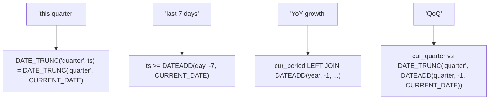

### Gotchas / Exam Traps
- Only one primary time_dimension per table is a good practice; multiple confuses.
- Fiscal vs calendar quarters: either override in `custom_instructions` or compute with explicit SQL.

---

## Q19: What's the right way to log and monitor Analyst in production?
**Difficulty:** Intermediate
**Exam relevance:** 3.14

### Answer
Log each turn with:
- user id / role
- raw question
- selected semantic model + version
- returned SQL
- execution result (success/fail, row_count, duration)
- cost (via QUERY_HISTORY + Cortex usage views)
- user feedback (thumbs up/down)

```sql
CREATE OR REPLACE TABLE analyst_log (
  ts TIMESTAMP, user_id STRING, question STRING,
  model_version STRING, generated_sql STRING,
  success BOOLEAN, row_count INT, duration_ms INT,
  user_feedback STRING
);
```

Monitor: refusal rate, feedback score, repeat-question rate (indicator of unmet needs).

### First Principles
Analyst quality degrades silently as data drifts (new values, renamed columns). Logging + feedback is the only early-warning system. Thumbs down + the exact SQL is the raw material for extending verified_queries.

### Gotchas / Exam Traps
- GDPR/PII: user questions may contain PII; apply the same governance to the log table as to source data.
- Don't block user flow waiting for the log write; async it.

---

## Q20: How does Analyst compare with external text-to-SQL tools (OpenAI function calling, LangChain SQL agents)?
**Difficulty:** Advanced
**Exam relevance:** 3.15

### Answer
| Dimension | Cortex Analyst | External text-to-SQL |
|---|---|---|
| Data residency | In Snowflake | Leaves Snowflake |
| Grounding | Semantic model YAML | Schema introspection |
| Verified queries | First-class | Build yourself |
| Governance | Native RBAC/mask | Must duplicate |
| Model | Snowflake Cortex | GPT/Claude/etc. |
| Latency | Single call | Multi-hop |
| Cost | Credit-based | External + warehouse |

### First Principles
Analyst's constraints (semantic model + Snowflake-only) are its reliability advantages. External agents are more flexible but you pay for that in guardrails you must author yourself. For regulated data stacks, Analyst wins on compliance posture.

### Gotchas / Exam Traps
- "I'll use GPT-4" sounds nice until you realize schema + sample data is going out to an external vendor.
- External agents can hallucinate column names more easily without a semantic model as a constraint.

---

## Q21: What's a comprehensive semantic model example for a sales warehouse?
**Difficulty:** Advanced
**Exam relevance:** 3.16 — synthesis

### Answer
```yaml
name: enterprise_sales_v3
description: Enterprise sales analytics
custom_instructions: |
  - Exclude test accounts: WHERE customer_id NOT LIKE 'TEST%'
  - Fiscal year starts Feb 1
  - Default currency is USD; convert via fx_rate if needed

tables:
  - name: SALES
    base_table: {database: PROD, schema: SALES, table: FACT_ORDERS}
    primary_key: {columns: [order_id]}
    dimensions:
      - {name: region, synonyms: [area, territory], expr: region_code,
         data_type: VARCHAR, sample_values: [AMER, EMEA, APAC, LATAM]}
      - {name: channel, expr: sales_channel, data_type: VARCHAR,
         sample_values: [direct, partner, online]}
    time_dimensions:
      - {name: order_date, expr: order_dt, data_type: DATE}
    measures:
      - {name: revenue, expr: amount_usd, default_aggregation: sum, data_type: NUMBER}
      - {name: units,   expr: qty,        default_aggregation: sum, data_type: NUMBER}
      - {name: aov,     expr: amount_usd/NULLIF(qty,0),
         default_aggregation: avg, description: Avg order value}
    filters:
      - {name: shipped, expr: "status = 'SHIPPED'"}
      - {name: non_test, expr: "customer_id NOT LIKE 'TEST%'"}

  - name: CUSTOMERS
    base_table: {database: PROD, schema: CRM, table: DIM_CUSTOMER}
    primary_key: {columns: [customer_id]}
    dimensions:
      - {name: customer_name, expr: name,
         cortex_search_service: {service: "@PROD.CRM.CUST_SRCH", literal_column: name}}
      - {name: segment, expr: segment, sample_values: [SMB, MID, ENT]}

relationships:
  - {name: s_c, left_table: SALES, right_table: CUSTOMERS,
     relationship_columns: [{left_column: customer_id, right_column: customer_id}],
     join_type: left_outer, relationship_type: many_to_one}

verified_queries:
  - name: fy_rev_by_region
    question: "What was fiscal YTD revenue by region?"
    sql: |
      SELECT region_code, SUM(amount_usd) AS revenue
      FROM prod.sales.fact_orders
      WHERE order_dt >= DATE_FROM_PARTS(
          CASE WHEN MONTH(CURRENT_DATE) < 2 THEN YEAR(CURRENT_DATE)-1
               ELSE YEAR(CURRENT_DATE) END, 2, 1)
        AND customer_id NOT LIKE 'TEST%'
      GROUP BY region_code
```

### First Principles
A production semantic model is a living contract between data engineering and the business. It encodes every subtle rule (fiscal calendar, test exclusions, fx conversion) that lives in analysts' heads. Done well, Analyst becomes the trusted self-serve layer; done poorly, it's a sophisticated hallucination machine.

### Gotchas / Exam Traps
- Big YAMLs are hard to maintain; split by subject area (one semantic model per domain).
- Review every custom_instruction change via PR; they silently change SQL for all users.

---

## Q22: What is the "message" response structure and how do you parse it defensively?
**Difficulty:** Intermediate
**Exam relevance:** 3.6

### Answer
```json
{
  "request_id":"uuid",
  "message":{
    "role":"assistant",
    "content":[
      {"type":"text","text":"Here's the revenue by region..."},
      {"type":"sql","statement":"SELECT region, SUM(amount) ..."},
      {"type":"suggestions","suggestions":["Compare this to last quarter","Break down by product"]}
    ]
  },
  "warnings":[]
}
```

Parse by iterating `content` and dispatching on `type`:
```python
for part in resp["message"]["content"]:
    if part["type"] == "sql":
        sql = part["statement"]
    elif part["type"] == "text":
        commentary = part["text"]
    elif part["type"] == "suggestions":
        suggs = part["suggestions"]
```

### First Principles
Content array supports future types (chart, table, etc.) without breaking clients. Always type-check; a response can be text-only (refusal) with no SQL. Warnings surface non-fatal issues (e.g., deprecated field in YAML).

### Gotchas / Exam Traps
- Assuming content[0] is always SQL will break on refusals and suggestions-only responses.
- Warnings may contain actionable info — log them.

---

## Q23: How do you combine Analyst (structured) with RAG (unstructured) in a single app?
**Difficulty:** Advanced
**Exam relevance:** 3.17

### Answer
Route the question. Use a classifier LLM call that tags each incoming query as `structured`, `unstructured`, or `both`; then dispatch:

```python
route = complete("llama3.1-8b",
   f"Classify: structured|unstructured|both — '{q}'",
   {"temperature":0, "max_tokens":5})

if route.startswith("structured"):
    answer = call_analyst(q)
elif route.startswith("unstructured"):
    answer = call_rag(q)
else:
    sql_answer = call_analyst(q)
    doc_answer = call_rag(q)
    answer = compose(sql_answer, doc_answer)
```

### First Principles
A single agent that tries to be both is worse than two specialized tools behind a classifier. Analyst excels at tabular queries; RAG at textual knowledge. Routing is cheap (one small-model call) and quality is dramatically better.

### Diagram
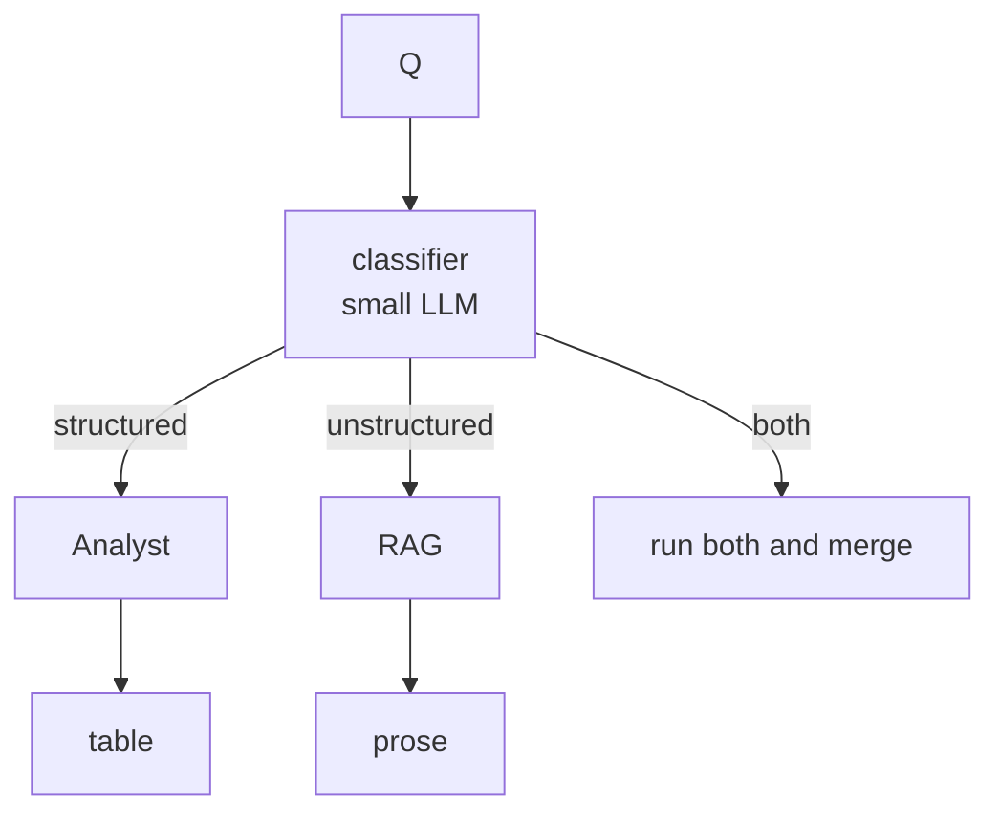

### Gotchas / Exam Traps
- Classifier wrong 10% of the time: build a "both" fallback.
- Latency: run analyst/rag in parallel for "both" to keep UX snappy.

---

## Q24: What's a safe deployment checklist for Analyst?
**Difficulty:** Intermediate
**Exam relevance:** 3.18 — synthesis

### Answer
Before go-live:
- [ ] Semantic model peer-reviewed by SME + data engineer.
- [ ] Verified_queries cover top-20 business questions.
- [ ] Eval set run; result-set match rate > 90%.
- [ ] Governance: role grants, masking, row access tested end-to-end.
- [ ] Logging table + feedback capture wired.
- [ ] Query budget alerts configured (CORTEX_FUNCTIONS_USAGE_HISTORY).
- [ ] Streamlit app pinned to specific YAML version (not "latest").
- [ ] Rollback plan: previous YAML version in stage.
- [ ] "I don't know" responses surface cleanly in UI.
- [ ] Rate limit retries + exponential backoff in client.

### Gotchas / Exam Traps
- Skipping SME review is the single biggest cause of production regressions.
- Analyst usage can be bursty (end-of-month reporting) — stress-test rate limits.
