# Document AI — GES-C01 Study Guide

## Exam Weight & Scope
Roughly 10-15% of the exam. Covers Snowflake Document AI: Arctic-TILT model for layout-aware document understanding, model build workflow (upload sample docs → define extraction schema → review predictions → fine-tune → publish), extraction via `<model>!PREDICT()` function, versioning, integration with pipelines (Streams/Tasks), governance, and comparison with `PARSE_DOCUMENT` / Cortex Search.

## Core Concepts Map
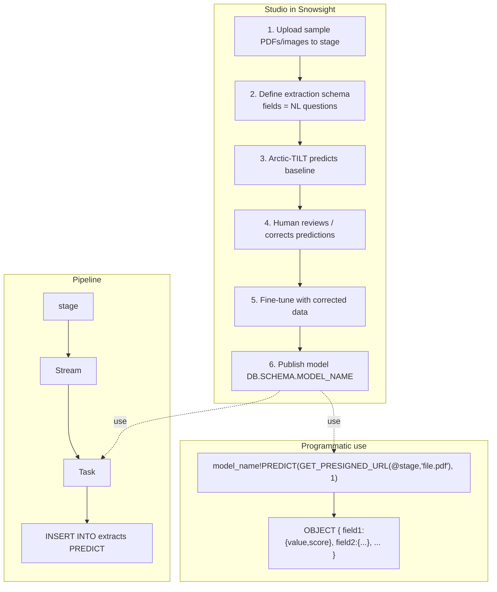

---

## Q1: What is Snowflake Document AI and what problem does it solve?
**Difficulty:** Foundation
**Exam relevance:** 4.1

### Answer
Document AI is a managed service that extracts structured data (named fields, tables) from unstructured documents (PDFs, scanned images, DOCX) using a layout-aware ML model (Arctic-TILT) built and refined inside Snowsight. You define a schema as a set of natural-language questions ("What is the invoice number?") and the model returns typed answers with confidence scores. The whole lifecycle — upload, annotate, train, publish, infer — stays inside Snowflake.

### First Principles
Enterprises receive millions of PDFs that no SQL can read directly: invoices, bills of lading, insurance claims, loan docs. The traditional path (OCR → regex → brittle rules) breaks on layout changes. Document AI treats extraction as a question-answering problem conditioned on both the document's text AND its 2D layout (where fields sit on the page), so the model can learn that "invoice number" is usually top-right regardless of whether the exact label is "Inv #" or "Document ID."

### Diagram
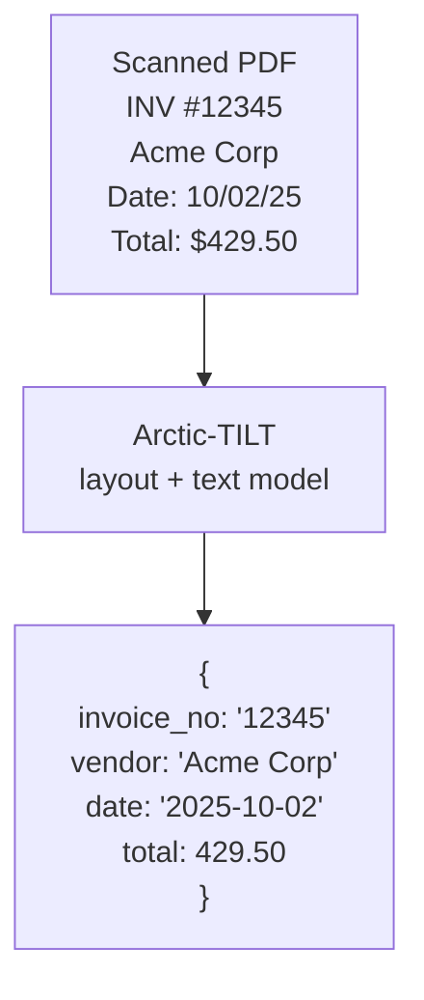

### Lab Exercise
```sql
-- After publishing a model named INVOICE_EXTRACTOR
SELECT my_db.my_schema.INVOICE_EXTRACTOR!PREDICT(
  GET_PRESIGNED_URL(@docs_stage,'invoice_sample.pdf'), 1
) AS extracted;

-- Returns OBJECT:
-- { "invoice_no":{"value":"12345","score":0.98},
--   "vendor":{"value":"Acme Corp","score":0.94},
--   "date":{"value":"2025-10-02","score":0.91},
--   "total":{"value":429.50,"score":0.96} }
```

### Gotchas / Exam Traps
- Document AI is NOT the same as `PARSE_DOCUMENT`. PARSE_DOCUMENT extracts raw text; Document AI extracts named structured fields using a trained model.
- Models are **account-local** — not shareable to other accounts without replication.
- Billing is a mix of training (one-time) and inference (per-page).

---

## Q2: What is Arctic-TILT and why is layout awareness necessary?
**Difficulty:** Intermediate
**Exam relevance:** 4.2

### Answer
Arctic-TILT (Text-Image-Layout Transformer) is the Snowflake Arctic family's multimodal document understanding model. It encodes three signals jointly: (1) OCR'd text tokens, (2) their 2D bounding-box coordinates, (3) visual features of each region. It is tuned for document question answering (DocVQA-style). This is what powers Document AI's zero-shot and fine-tuned extraction.

### First Principles
A pure text model sees "Invoice 12345 Date 10/02/25 Total $429.50" as a stream and must guess which number is total. A layout-aware model sees that "Total" and "$429.50" are spatially adjacent (same row, next column), so the association is almost deterministic. Position embeddings add 2D coordinates to the usual sequence embeddings so attention can learn spatial patterns. On real-world documents (invoices, forms) layout-aware models beat text-only models by 15-30 F1 points.

### Diagram
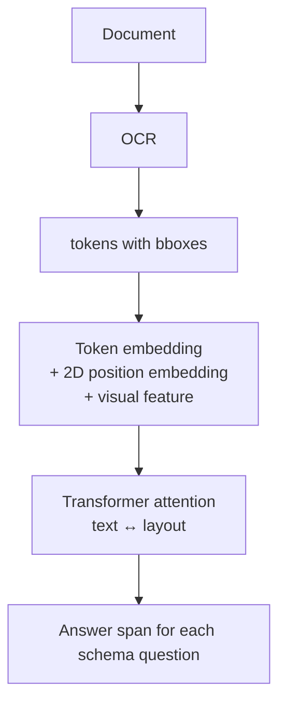

### Gotchas / Exam Traps
- Arctic-TILT handles typical invoice/form layouts well; highly stylized designs (brochures, infographics) are harder.
- Scanned document quality matters — low DPI or heavy skew hurts OCR which bounds the model's input.

---

## Q3: Walk through the end-to-end Document AI build workflow in Snowsight.
**Difficulty:** Intermediate
**Exam relevance:** 4.3

### Answer
1. **Create model build** in Snowsight → AI & ML → Document AI → New Build. Choose database/schema/name.
2. **Upload sample documents** (10-100 representative docs) to the backing stage.
3. **Define extraction schema** — add fields, each as a NL question: `invoice_number: "What is the invoice number?"`. For table fields, mark as a repeated/table field.
4. **Review predictions** — the base Arctic-TILT model auto-predicts on uploads. For each doc, verify or correct each field.
5. **Train** (optional, recommended) — click "Train model" to fine-tune on your corrections. Minimum ~20 reviewed docs for meaningful lift.
6. **Publish** version 1. The model becomes callable: `<db>.<schema>.<name>!PREDICT(...)`.
7. **Iterate** — new sample docs → re-review → re-train → publish v2.

### First Principles
Each step addresses a specific risk. Base-model prediction surfaces where it already succeeds (saves annotation effort); human review captures domain-specific nuance; fine-tuning absorbs that nuance into weights so inference is self-sufficient. Versioning lets you deploy without breaking downstream pipelines.

### Diagram
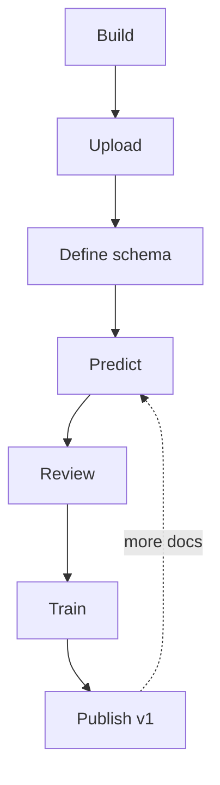

### Lab Exercise
```sql
-- After publishing, test via SQL
SELECT my_db.my_schema.INVOICE_EXTRACTOR!PREDICT(
  GET_PRESIGNED_URL(@docs_stage,'test_invoice.pdf'), 2  -- version 2
) AS r;

-- Extract a specific field
SELECT r:invoice_number.value::STRING, r:invoice_number.score::FLOAT
FROM (SELECT ... AS r);
```

### Gotchas / Exam Traps
- Training requires a minimum number of reviewed documents (varies; ~20+).
- Published model name must be referenced with the `!PREDICT` method syntax (not a regular function).
- Each publish creates a new version; old versions remain callable until dropped.

---

## Q4: How do you design an extraction schema (what makes a good field definition)?
**Difficulty:** Advanced
**Exam relevance:** 4.4

### Answer
Each field has: a **name** (SQL-safe identifier), a **question** (NL prompt), and a **type** (scalar or table). Guidelines:
- Phrase as a specific question: "What is the invoice number?" not "invoice no."
- Avoid combined fields: separate "ship date" and "due date" rather than "dates."
- For tables (line items), define the table with child fields: description, qty, unit_price, total.
- Add synonyms in the question when needed: "What is the invoice number (also called INV # or Document ID)?"
- Match the type to downstream use: dates as date-strings, amounts as numbers.

### First Principles
The schema is a prompt. Clear, singular, specific questions elicit higher-confidence answers from the model. Overloaded questions (multiple intents in one field) force the model to pick one, often the wrong one. Separate fields allow separate confidence tracking and separate review loops. Table fields are special because the model must detect row boundaries from layout, which is harder than single-span extraction.

### Diagram
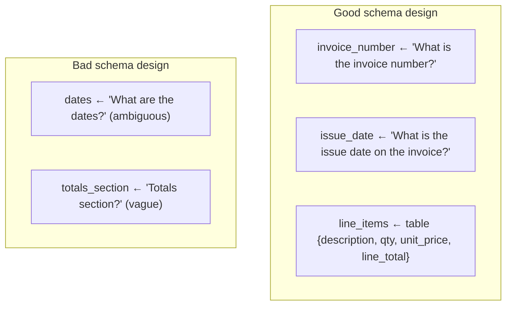

### Gotchas / Exam Traps
- Questions in the schema are **what the model sees** — invest time crafting them.
- Field names must be SQL identifiers (no spaces, no special chars).
- Changing field names after training requires retraining.

---

## Q5: What is the PREDICT function syntax and return structure?
**Difficulty:** Intermediate
**Exam relevance:** 4.5

### Answer
```sql
<database>.<schema>.<model_name>!PREDICT(
    document_input,      -- presigned URL from GET_PRESIGNED_URL, or stage reference
    model_version        -- INTEGER
) RETURNS OBJECT
```
Return shape:
```json
{
  "__documentMetadata":{"ocrScore": 0.97},
  "field_a":{"value":"...", "score": 0.95},
  "field_b":{"value": 123, "score": 0.88},
  "line_items":[
    {"description":{"value":"Widget","score":0.92},
     "qty":{"value":3,"score":0.98}}
  ]
}
```

Each scalar field is `{value, score}`. Table fields are arrays of row-objects.

### First Principles
Returning score alongside value is critical: downstream pipelines need to decide auto-approve vs route to human review based on confidence. The nested structure mirrors the schema. Metadata (OCR score) exposes a quality signal that can trigger an "image too blurry" branch upstream of field consumption.

### Lab Exercise
```sql
WITH files AS (
  SELECT relative_path, GET_PRESIGNED_URL(@docs_stage, relative_path, 3600) AS url
  FROM DIRECTORY(@docs_stage)
  WHERE relative_path ILIKE '%.pdf'
),
extracted AS (
  SELECT f.relative_path,
         my_db.my_schema.INVOICE_EXTRACTOR!PREDICT(f.url, 1) AS r
  FROM files f
)
SELECT relative_path,
       r:invoice_number.value::STRING  AS inv_no,
       r:total.value::NUMBER(18,2)    AS total,
       r:total.score::FLOAT           AS total_conf,
       r:__documentMetadata.ocrScore::FLOAT AS ocr_conf
FROM extracted;
```

### Gotchas / Exam Traps
- Model name must be referenced with the `!PREDICT` method syntax, not called as `PREDICT(model, ...)`.
- Presigned URL has an expiration — call it inline, not store-then-use.
- Model version is an INTEGER; omitting defaults to latest but be explicit in prod.

---

## Q6: How do you build a production pipeline with Document AI?
**Difficulty:** Advanced
**Exam relevance:** 4.6

### Answer
Pattern: stage → directory table → stream → task → extract table.

```sql
-- 1. Stage receives documents (via Snowpipe or external integration)
CREATE OR REPLACE STAGE incoming_docs
  DIRECTORY = (ENABLE = TRUE AUTO_REFRESH = TRUE)
  ENCRYPTION = (TYPE = 'SNOWFLAKE_SSE');

-- 2. Stream over the directory table
CREATE OR REPLACE STREAM new_docs_stream
  ON DIRECTORY TABLE incoming_docs;

-- 3. Target table
CREATE OR REPLACE TABLE invoice_extracts (
  file_name STRING,
  processed_at TIMESTAMP,
  invoice_no STRING, invoice_no_conf FLOAT,
  vendor STRING, vendor_conf FLOAT,
  total NUMBER(18,2), total_conf FLOAT,
  needs_review BOOLEAN,
  raw_prediction VARIANT
);

-- 4. Task runs every N minutes
CREATE OR REPLACE TASK extract_invoices
  WAREHOUSE = docai_wh
  SCHEDULE = '2 MINUTE'
  WHEN SYSTEM$STREAM_HAS_DATA('new_docs_stream')
AS
INSERT INTO invoice_extracts
SELECT
  relative_path AS file_name,
  CURRENT_TIMESTAMP AS processed_at,
  r:invoice_no.value::STRING,
  r:invoice_no.score::FLOAT,
  r:vendor.value::STRING,
  r:vendor.score::FLOAT,
  r:total.value::NUMBER(18,2),
  r:total.score::FLOAT,
  (LEAST(r:invoice_no.score, r:vendor.score, r:total.score) < 0.85) AS needs_review,
  r AS raw_prediction
FROM (
  SELECT relative_path,
         my_db.my_schema.INVOICE_EXTRACTOR!PREDICT(
           GET_PRESIGNED_URL(@incoming_docs, relative_path, 3600), 1) AS r
  FROM new_docs_stream
  WHERE metadata$action = 'INSERT' AND relative_path ILIKE '%.pdf'
);

ALTER TASK extract_invoices RESUME;
```

### First Principles
Streams track "what's new" on the directory table so each task run only processes recent uploads. Keeping the full `raw_prediction` as VARIANT preserves auditability — if the schema changes, you can re-flatten old rows without re-running inference. The confidence threshold (`needs_review`) splits auto-pass from human-in-the-loop.

### Diagram
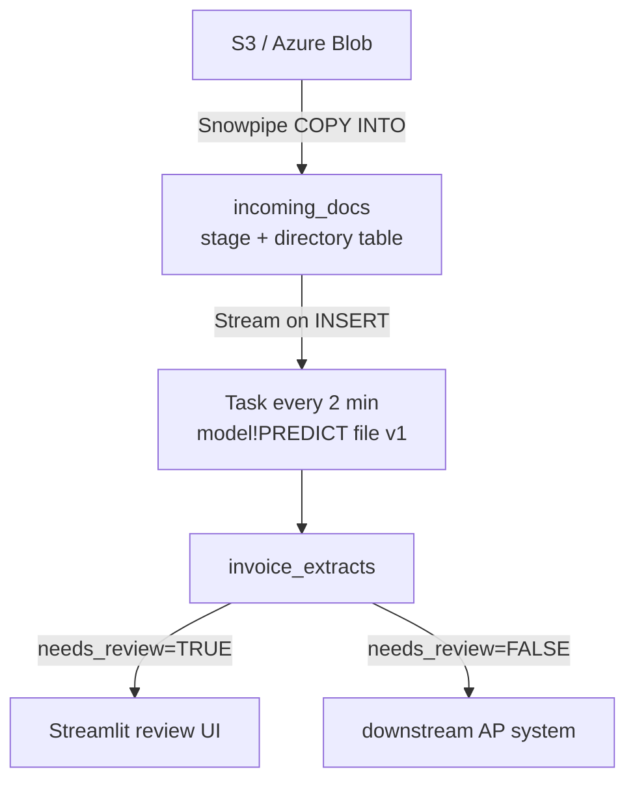

### Gotchas / Exam Traps
- Directory tables need AUTO_REFRESH or manual REFRESH to see new files.
- Streams on directory tables emit rows for both INSERT and DELETE — filter by `metadata$action`.
- Task warehouse billing is separate from Document AI inference cost.

---

## Q7: How does Document AI billing work?
**Difficulty:** Intermediate
**Exam relevance:** 4.7

### Answer
Three cost dimensions:
1. **Model training** — fine-tuning jobs priced per processed page.
2. **Inference** — per-page cost each time PREDICT is called.
3. **Warehouse** — the warehouse that runs the SQL/pipeline (small, usually negligible).
4. **Storage** — the stage holding documents.

Audit:
```sql
SELECT * FROM SNOWFLAKE.ACCOUNT_USAGE.DOCUMENT_AI_USAGE_HISTORY
WHERE start_time >= DATEADD(day,-7,CURRENT_DATE);
```

### First Principles
Per-page cost reflects the per-page GPU inference cost of running Arctic-TILT. A 20-page PDF costs 20 units regardless of how many fields you extract (one forward pass extracts all schema fields). This encourages consolidating related fields into one schema rather than running multiple models over the same doc.

### Gotchas / Exam Traps
- A 1-page scanned invoice processed 10 times = 10 page-charges.
- Caching: if your pipeline reprocesses the same files, cache the result to a table.
- Fine-tuning is a lumpy cost — budget for retrain cycles.

---

## Q8: How do you measure and improve extraction accuracy?
**Difficulty:** Advanced
**Exam relevance:** 4.8

### Answer
1. Hold out a labeled test set (never trained on).
2. Compare predicted vs ground truth per field: exact match for strings, tolerance for numbers.
3. Compute **field-level F1**: TP = exact match, FP = wrong value, FN = empty when truth exists.
4. Also track **confidence-score calibration**: for each 0.1 bin of score, what % are correct?
5. For low-performing fields: add training examples, rephrase questions, or split into sub-fields.

```sql
WITH preds AS (
  SELECT doc_id,
         my_db.my_schema.INVOICE_EXTRACTOR!PREDICT(
            GET_PRESIGNED_URL(@test, filename, 3600), 1) AS p
  FROM test_set
)
SELECT
  SUM(CASE WHEN p:invoice_no.value::STRING = truth_inv_no THEN 1 ELSE 0 END) /
    COUNT(*)::FLOAT AS inv_no_accuracy,
  AVG(CASE WHEN p:total.value::NUMBER = truth_total THEN 1 ELSE 0 END) AS total_acc
FROM preds JOIN test_truth USING(doc_id);
```

### First Principles
Field-level metrics beat document-level accuracy because a doc with 10 fields can have 1 wrong field but still provide 9 correct — document-level counts it a complete loss. Calibration matters because downstream pipelines rely on confidence thresholds; if scores are not calibrated, your `needs_review` threshold is noise.

### Diagram
```mermaid
flowchart TD
    subgraph PF[Per field]
        TP[TP: predicted = truth]
        FP[FP: predicted != truth, both non-empty]
        FN[FN: predicted empty, truth non-empty]
        F1[F1 = 2 x P x R / (P+R)]
    end
    subgraph CA[Calibration]
        C1[score bin 0.9-1.0 → want ~95% correct]
        C2[score bin 0.5-0.6 → expect ~55% correct]
    end
```

### Gotchas / Exam Traps
- String matching is harsh — `"Acme Corp"` vs `"Acme Corporation"` is "wrong" unless you normalize.
- Numbers: compare with tolerance (e.g., ±$0.01).
- Over-fine-tuning on small sets causes brittle improvements that don't generalize.

---

## Q9: When should you use Document AI vs PARSE_DOCUMENT vs Cortex Search?
**Difficulty:** Advanced
**Exam relevance:** 4.9

### Answer
| Need | Tool |
|---|---|
| Structured fields from forms/invoices with layout | Document AI |
| Raw text out of PDFs for RAG downstream | PARSE_DOCUMENT |
| Semantic search over document bodies | Cortex Search (feed it PARSE_DOCUMENT output) |
| Fully free-form QA over docs | PARSE_DOCUMENT → chunk → Cortex Search → COMPLETE |
| Named entity extraction from narrative text | COMPLETE with structured output JSON mode |

### First Principles
Document AI is for extraction where the schema is known in advance and the documents are forms-like. PARSE_DOCUMENT is a universal text extractor. Cortex Search is a retrieval index — orthogonal to extraction. They stack: PARSE_DOCUMENT → chunking → Cortex Search for retrieval, OR Document AI → structured table for analytics.

### Diagram
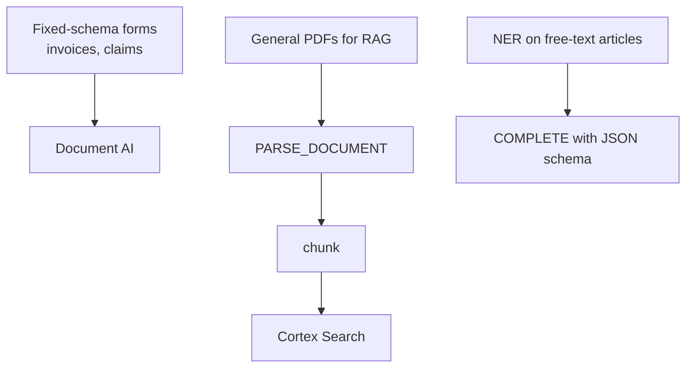

### Gotchas / Exam Traps
- Document AI is overkill for one-off extraction — PARSE_DOCUMENT + a COMPLETE prompt is faster to prototype.
- PARSE_DOCUMENT is cheaper per page than Document AI inference.
- Cortex Search does not extract — it retrieves.

---

## Q10: How does fine-tuning in Document AI actually work?
**Difficulty:** Advanced
**Exam relevance:** 4.10

### Answer
After you've reviewed N sample documents (correcting predictions as needed), you click "Train." Snowflake runs a supervised fine-tuning job on Arctic-TILT using your (document, field, correct-answer) triples. Technique: parameter-efficient fine-tuning (LoRA-style adapters) that adjusts a small subset of weights so the base model specializes to your doc layouts and vocabulary. The result is a new model version that you publish.

### First Principles
A base model does zero-shot well on common layouts but drifts on your specific vendor templates, abbreviations, and field names. Fine-tuning absorbs those into the weights so inference needs no in-context examples. LoRA (vs full fine-tuning) keeps training cheap and compact — the adapter is small and can be merged with base weights for inference. Minimum data (~20 docs) is required to produce a stable gradient signal.

### Diagram
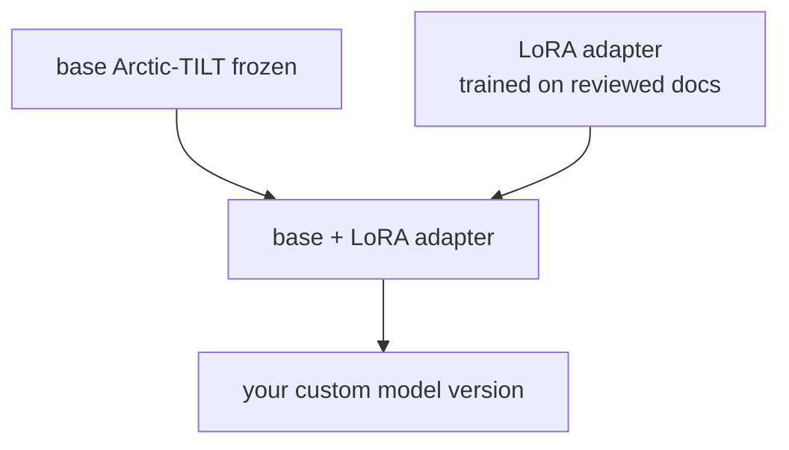

### Lab Exercise
```
1. Snowsight → Document AI → <your build>
2. Review 20-30 docs, correct every field
3. Click "Train"
4. Wait (minutes to tens of minutes)
5. Compare metrics on hold-out
6. Publish v2
7. ALTER PIPELINE to use v2
```

### Gotchas / Exam Traps
- Fine-tuning doesn't magically add new fields — you must add them to the schema and re-annotate.
- If your sample mix is biased (one vendor), the fine-tuned model may overfit — diversify.
- Each train is billed per processed page.

---

## Q11: How do you handle multi-page documents and page-level predictions?
**Difficulty:** Intermediate
**Exam relevance:** 4.5

### Answer
PREDICT accepts the whole document; Arctic-TILT processes all pages jointly up to a context limit (typically ~hundreds of pages per call, but check current docs). For each schema field, the model returns the best-matching value from anywhere in the document. For page-specific extraction (e.g., "signature on page 3"), split the PDF upstream or add page_number as part of the question.

### First Principles
Processing all pages jointly lets the model use cross-page context (e.g., totals usually on last page, header on first). But longer docs cost more and may hit page caps. For very large docs, pre-splitting on logical boundaries (one invoice per PDF rather than a 500-page batch) is operationally cleaner.

### Gotchas / Exam Traps
- Very long docs may truncate silently — check `__documentMetadata` for page counts.
- Table extraction across page breaks requires the model to stitch — pre-split or ensure clear table markers.

---

## Q12: What governance controls apply to Document AI?
**Difficulty:** Intermediate
**Exam relevance:** 4.11

### Answer
- **Model as a Snowflake object**: GRANT USAGE ON MODEL `<name>` TO ROLE ...
- **Underlying stage**: GRANT READ ON STAGE ... (needed to call PREDICT).
- **PII**: masking policies on extracted columns, tagging via object tags.
- **Audit**: ACCESS_HISTORY tracks model usage; DOCUMENT_AI_USAGE_HISTORY tracks inference metering.

### First Principles
Models and stages are first-class governable objects. The role calling PREDICT needs both model USAGE and stage READ (and permission to call GET_PRESIGNED_URL on the stage). Fine-grained privilege prevents a Streamlit app's role from inadvertently exfiltrating documents.

### Lab Exercise
```sql
GRANT USAGE ON MODEL my_db.my_schema.INVOICE_EXTRACTOR TO ROLE AP_READ;
GRANT READ ON STAGE my_db.my_schema.incoming_docs TO ROLE AP_READ;
GRANT USAGE ON FUNCTION GET_PRESIGNED_URL(VARCHAR,VARCHAR,NUMBER) TO ROLE AP_READ;
```

### Gotchas / Exam Traps
- PII fields extracted into a table inherit masking only if you apply the policy — the model doesn't mask.
- Document AI builds in Snowsight require role on the build object; share carefully.

---

## Q13: What are the typical failure modes and how do you debug?
**Difficulty:** Advanced
**Exam relevance:** 4.12

### Answer
Common failures:
- **Low OCR score**: scan quality bad; preprocess (binarize, deskew) upstream, or re-scan.
- **Field returned with low confidence**: question is ambiguous; refine wording or add training examples.
- **Wrong field extracted**: the model latched onto a plausible-but-wrong span; add negative examples or rephrase.
- **Table rows missed**: layout detection weak; try fine-tuning with more table-heavy samples.
- **Hallucinated value**: should be rare with layout-aware extraction, but can happen on sparse docs; filter by low confidence.

Debug by inspecting `__documentMetadata` and comparing predicted bbox (visible in Snowsight review UI) against truth.

### First Principles
Low OCR → bad input. Low confidence → model uncertainty, often fixable by better data. Wrong-span errors are structural — more training examples teach the model what NOT to pick. Treat Document AI like any ML system: observe, hypothesize, test with annotated data.

### Gotchas / Exam Traps
- Don't lower the review threshold to make auto-pass numbers look better — that hides error.
- Rare templates in production will underperform if under-represented in training.

---

## Q14: How do you call Document AI from a Streamlit review UI?
**Difficulty:** Advanced
**Exam relevance:** 4.6

### Answer
```python
import streamlit as st
from snowflake.snowpark.context import get_active_session

s = get_active_session()
st.title("Invoice Review")

# Fetch low-confidence rows
df = s.sql("""
    SELECT file_name, invoice_no, invoice_no_conf, vendor, total, raw_prediction
    FROM invoice_extracts
    WHERE needs_review = TRUE
    ORDER BY processed_at DESC LIMIT 20
""").to_pandas()

for _, row in df.iterrows():
    with st.expander(f"{row['file_name']} (conf {row['invoice_no_conf']:.2f})"):
        inv = st.text_input("Invoice no", row["invoice_no"], key=f"i_{row['file_name']}")
        vendor = st.text_input("Vendor", row["vendor"], key=f"v_{row['file_name']}")
        total = st.number_input("Total", value=float(row["total"]), key=f"t_{row['file_name']}")
        if st.button(f"Approve {row['file_name']}"):
            s.sql(f"""
              UPDATE invoice_extracts
              SET invoice_no = ?, vendor = ?, total = ?, needs_review = FALSE
              WHERE file_name = ?
            """, params=[inv, vendor, total, row['file_name']]).collect()
            st.success("Approved")
```

### First Principles
Confidence-gated review completes the auto/human loop. High-confidence predictions bypass the UI; low-confidence surface here. Approved rows close the loop and (optionally) feed back into the next training round for continuous improvement.

### Gotchas / Exam Traps
- Save corrections to a separate `training_feedback` table if you plan to re-train — never mix "approved" with "corrected" without a flag.
- Keep display of raw_prediction for auditors.

---

## Q15: How does Document AI integrate with Snowpark Container Services?
**Difficulty:** Advanced
**Exam relevance:** 4.13

### Answer
Document AI itself runs on Snowflake-managed infrastructure (not SPCS). You can, however, build custom document pipelines in SPCS that call `PREDICT` via Snowpark connections. For custom pre-processing (image cleanup, PDF splitting) that Snowflake doesn't offer natively, SPCS is where you run those steps.

### First Principles
Separation of concerns: Document AI = extraction model; SPCS = your custom code. The glue is SQL. Keep heavy custom logic in SPCS, use PREDICT as a hosted service.

### Gotchas / Exam Traps
- Don't try to deploy your own Arctic-TILT in SPCS — use the managed service.
- SPCS egress charges apply if you pull documents out; keep in-stage where possible.

---

## Q16: How do you handle schema drift (new document types)?
**Difficulty:** Advanced
**Exam relevance:** 4.14

### Answer
Three strategies:
1. **One model per doc type**: separate build for each (invoices, POs, contracts); route by doc classifier upstream.
2. **Union schema**: single build with the union of fields; nulls are OK where field doesn't apply.
3. **Hierarchical**: top-level classifier → doc-type-specific model.

For brand-new doc types, start a new build; retire old versions when deprecated.

### First Principles
Separate models per type give best accuracy but complicate ops. Union schemas simplify ops at some accuracy cost. The hierarchical approach is the gold standard for scale: a cheap classifier decides which specialist runs, each specialist is tight on its domain.

### Diagram
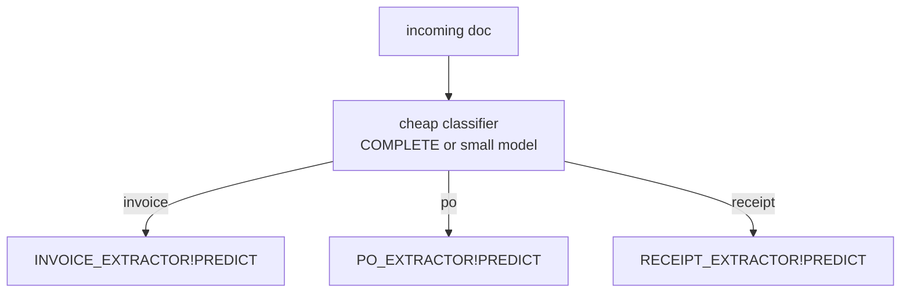

### Gotchas / Exam Traps
- Classifier wrong 5-10% of the time: have a fallback "general" extractor.
- Each model incurs its own training/inference bill.

---

## Q17: How do you compare Document AI with 3rd party extractors (AWS Textract, Azure Form Recognizer)?
**Difficulty:** Advanced
**Exam relevance:** 4.15

### Answer
| Dimension | Document AI | External (Textract/FR) |
|---|---|---|
| Data residency | In Snowflake | Leaves Snowflake |
| Governance | Native RBAC + masking | Separate IAM |
| Customization | Fine-tune in Studio | Templates / limited |
| Layout model | Arctic-TILT | Vendor-specific |
| Pipeline | Native SQL/Streams | External Function + API |
| Cost | Per page in Snowflake | External API billing |

### First Principles
Document AI's win is single-plane: data, extraction, downstream analytics all in Snowflake with one identity. 3rd parties may have more mature feature sets (handwritten text, specialized template libraries) but require data movement and separate security. For regulated enterprises on Snowflake, Document AI is usually the right default.

### Gotchas / Exam Traps
- If you need specialized domains (medical forms, legal contracts) 3rd parties sometimes have better pre-built templates.
- Latency may differ: Document AI is in-plane; external has network round-trip.

---

## Q18: How do you version models and roll back?
**Difficulty:** Intermediate
**Exam relevance:** 4.16

### Answer
Each publish creates an incrementing integer version. Reference by version in `PREDICT`:
```sql
SELECT my_db.my_schema.INVOICE_EXTRACTOR!PREDICT(url, 3); -- version 3
```
To "roll back," just use the older version number in your pipeline. Drop old versions when no longer needed to save storage.

### First Principles
Immutable versioning is the only safe way to upgrade an extraction pipeline — flipping a model globally without versions means one bad train breaks everything. Pin production to a known-good version; test v+1 on staging; promote via config change.

### Lab Exercise
```sql
-- List versions
DESC MODEL my_db.my_schema.INVOICE_EXTRACTOR;
SHOW MODEL VERSIONS IN MODEL my_db.my_schema.INVOICE_EXTRACTOR;

-- Drop old
DROP MODEL VERSION my_db.my_schema.INVOICE_EXTRACTOR!v1;
```

### Gotchas / Exam Traps
- Don't drop a version a pipeline is still referencing — the pipeline will fail.
- Keep at least the last-known-good version as rollback.

---

## Q19: How do you handle handwriting and signatures?
**Difficulty:** Advanced
**Exam relevance:** 4.17

### Answer
Arctic-TILT handles printed text well; handwritten content is harder and accuracy varies by legibility. For signatures (presence/absence), a bounding-box detection question works ("Is there a signature on page 3?"). For handwritten numbers (checks, forms), expect lower confidence; consider human review threshold at a higher score.

### First Principles
Handwriting OCR is a harder problem than print OCR — the error rate upstream of extraction is higher. Confidence scores reflect this: expect lower scores on handwritten fields, calibrate thresholds accordingly.

### Gotchas / Exam Traps
- Don't auto-approve handwritten extractions at the same threshold as print.
- Signature verification (is it the right person's signature?) is NOT what Document AI does — it only detects presence.

---

## Q20: What's a safe default architecture for a greenfield invoice processing pipeline?
**Difficulty:** Intermediate
**Exam relevance:** 4.18 — synthesis

### Answer
1. **Ingest**: Snowpipe from vendor email/SFTP into `@incoming_docs` stage with directory table.
2. **Classify** (optional): small Cortex COMPLETE call tagging doc type.
3. **Extract**: Document AI model `INVOICE_EXTRACTOR` v1 via task triggered by stream.
4. **Threshold**: `needs_review = TRUE` where any critical field confidence < 0.90.
5. **Review UI**: Streamlit app listing low-confidence rows, writing back approved values.
6. **Downstream**: approved rows into `AP_INVOICES_APPROVED` table consumed by ERP sync.
7. **Feedback loop**: approved + corrected rows feed quarterly re-training.
8. **Monitor**: metrics dashboard over DOCUMENT_AI_USAGE_HISTORY + extraction accuracy on golden set.

### Diagram
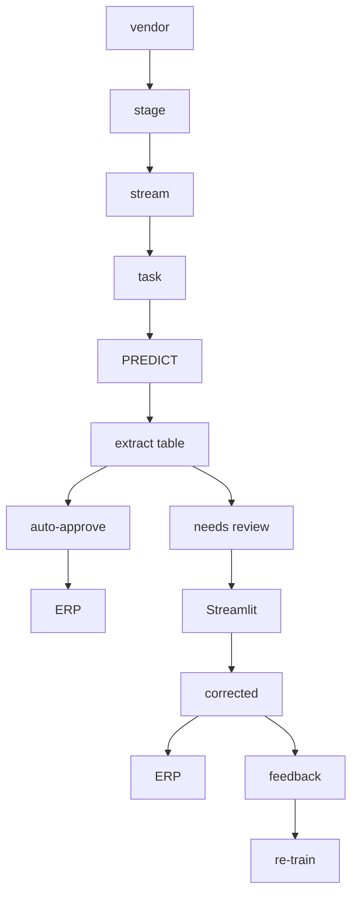

### Gotchas / Exam Traps
- Build the review UI before go-live — low-confidence rows will exist in production from day one.
- Threshold is per-field: `invoice_no` may need 0.95; `comments` may be fine at 0.70.
- Monitor OCR score — a sudden drop often means a new scanner or new vendor template.

---

## Q21: How do you handle multilingual documents?
**Difficulty:** Advanced
**Exam relevance:** 4.19

### Answer
Arctic-TILT supports multiple languages, with English strongest. For predominantly non-English docs, test with sample docs; if accuracy is lacking, consider:
- Separate build per language (train on language-specific samples).
- Pre-translating with `TRANSLATE` is NOT recommended because it loses layout fidelity.
- Fine-tuning on your multilingual sample set.

### First Principles
The model's layout attention is language-agnostic (positions don't change by language) but token embeddings are language-sensitive. Fine-tuning on your language mix teaches the model your specific vocabulary. Translating destroys 2D structure, which was the whole point of layout-aware extraction.

### Gotchas / Exam Traps
- Right-to-left scripts (Arabic, Hebrew) may need extra care.
- Mixed-language docs (en-header + de-body) can confuse — fine-tune.

---

## Q22: How do you cost-model a Document AI deployment at scale?
**Difficulty:** Advanced
**Exam relevance:** 4.7

### Answer
Variables: pages_per_doc × docs_per_day × days + fine_tune_pages × train_cycles. Add warehouse credits for pipeline tasks and storage credits for the stage.

Example back-of-envelope:
- 10k invoices/day × 2 pages avg = 20k pages/day.
- At $X per 1000 pages (check current pricing) = 20X per day.
- Add: 1-min warehouse XS task (negligible), stage storage ~GB (negligible).
- Fine-tune: 500 pages × 4 cycles/year = 2000 train-pages/year.

Monitor:
```sql
SELECT DATE_TRUNC('day',start_time), SUM(pages_processed), SUM(credits_used)
FROM SNOWFLAKE.ACCOUNT_USAGE.DOCUMENT_AI_USAGE_HISTORY
GROUP BY 1 ORDER BY 1 DESC;
```

### Gotchas / Exam Traps
- Re-processing (bugfix, model upgrade) doubles the inference cost — plan a one-time budget line.
- Caching results in a table is almost always cheaper than re-inference.

---

## Q23: What are output types the model can return (dates, numbers, strings, booleans)?
**Difficulty:** Intermediate
**Exam relevance:** 4.4

### Answer
Each field is defined with a type: STRING (default), NUMBER, DATE, BOOLEAN. The model outputs the extracted value coerced to that type (or NULL if extraction fails). For custom patterns, extract as STRING and post-process.

### First Principles
Typing at the schema level pushes validation into the extraction step rather than SQL downstream. A field declared NUMBER returns a NUMBER or NULL — simpler for the caller. BOOLEAN fields are typically "Yes/No" questions ("Is there a signature?").

### Lab Exercise
```sql
-- Schema (in Snowsight) declares types
--   invoice_no:   STRING, "What is the invoice number?"
--   total:        NUMBER, "What is the total amount?"
--   issue_date:   DATE,   "What is the issue date?"
--   is_signed:    BOOLEAN,"Is the invoice signed?"

SELECT my_db.my_schema.INVOICE_EXTRACTOR!PREDICT(url,1):is_signed.value::BOOLEAN
FROM test;
```

### Gotchas / Exam Traps
- Date parsing is best-effort; ambiguous formats (02/03/2025) may yield the wrong order. Prefer a question like "What is the issue date in YYYY-MM-DD?" to nudge format.
- NUMBER coercion fails silently on "N/A" strings — handle NULLs downstream.

---

## Q24: What ties Document AI, Cortex Search, Analyst, and COMPLETE together into a full enterprise AI stack?
**Difficulty:** Advanced
**Exam relevance:** 4.20 — synthesis

### Answer
- **Document AI** turns PDFs into structured rows (invoices, claims, forms).
- **Cortex Search** indexes the narrative text content from docs that don't fit a structured schema.
- **Cortex Analyst** lets business users query the structured output in natural language.
- **COMPLETE/AISQL** wraps everything — classification, summarization, Q&A over mixed-shape workloads.

Together: Document AI extracts → structured table → Analyst answers "what was AR aging last quarter?"; raw text goes to Cortex Search → RAG app answers "what does our contract say about late fees?"; all in one Snowflake account.

### Diagram
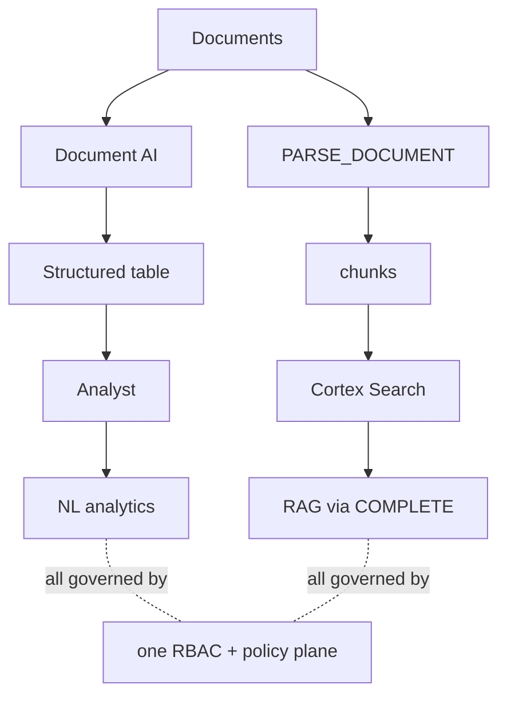

### Gotchas / Exam Traps
- Don't pick between tools; use each for the data shape it fits.
- Keep extraction output immutable; let analysts query it via Analyst, not edit it.
