# AI/ML Studio & Notebooks — GES-C01 Study Guide

## Exam Weight & Scope
Roughly 10-15% of the exam. Covers Snowflake Notebooks (both Warehouse-backed and Snowpark Container Services runtimes), AI & ML Studio flows for Cortex Analyst/Search/Fine-Tuning/Document AI, Snowpark ML integration (model registry, feature store) with Generative AI, package management, GPU runtime options, Git integration, scheduling, and governance.

## Core Concepts Map
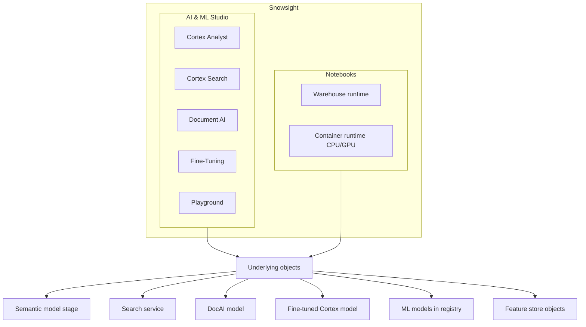

---

## Q1: What is a Snowflake Notebook and how is it different from a Jupyter notebook?
**Difficulty:** Foundation
**Exam relevance:** 5.1

### Answer
A Snowflake Notebook is a Snowsight-hosted notebook with Python + SQL cells, running against a Snowflake warehouse or on Snowpark Container Services. It persists as a Snowflake object (not a `.ipynb` file in your filesystem), inherits Snowflake RBAC, supports Git integration, and can be scheduled as a task. Difference from vanilla Jupyter: no local kernel; execution is remote; identity flows via Snowflake auth; data stays inside Snowflake.

### First Principles
Data gravity: analyst/ML work needs the data, and the data is in Snowflake. Running the notebook where the data lives eliminates egress, token management, and local resource constraints. The notebook as a first-class governed object means version control via Git, access via RBAC, auditing via QUERY_HISTORY — closing the operational gap that plain Jupyter leaves open.

### Diagram
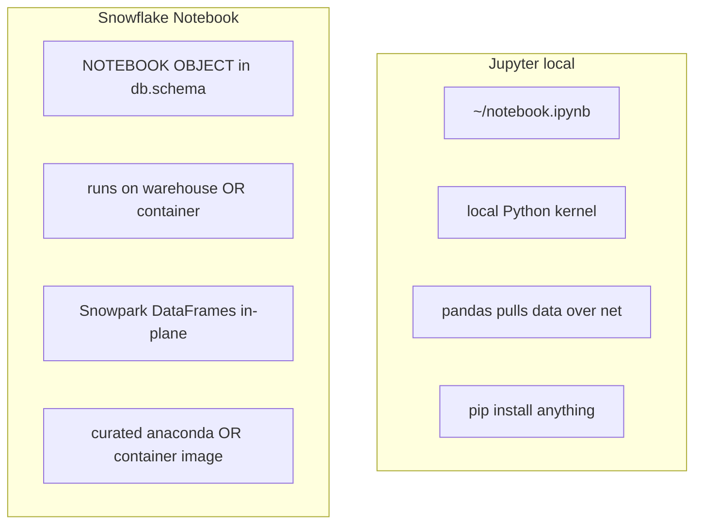

### Lab Exercise
```sql
-- Create a Notebook via SQL (also doable via UI)
CREATE OR REPLACE NOTEBOOK my_db.my_schema.exploration
  FROM '@my_db.my_schema.notebook_stage'
  MAIN_FILE = 'notebook.ipynb'
  QUERY_WAREHOUSE = compute_wh
  RUNTIME_NAME = 'SYSTEM$BASIC_RUNTIME';

ALTER NOTEBOOK my_db.my_schema.exploration ADD LIVE VERSION FROM LAST;
```

### Gotchas / Exam Traps
- Notebook is a schema-level object — needs CREATE NOTEBOOK privilege.
- You can import an existing `.ipynb` from a stage.
- Deleting a notebook does not delete the underlying warehouse or data.

---

## Q2: What's the difference between Warehouse runtime and Container runtime for Notebooks?
**Difficulty:** Intermediate
**Exam relevance:** 5.2

### Answer
| Dimension | Warehouse runtime | Container runtime (SPCS) |
|---|---|---|
| Compute | Virtual warehouse | Compute pool (CPU/GPU) |
| Packages | Anaconda channel | pip, Conda, Docker |
| GPU | No | Yes (A10/A100) |
| External net | Limited (EAI) | Supported |
| Startup | Immediate | Pool spin-up |
| Pricing | Warehouse credits | Pool credits (higher) |
| Best for | SQL + Cortex calls | DL, HF, GPU inference |

### First Principles
Warehouses are MPP SQL engines retrofitted to run Python — great for data manipulation but limited for arbitrary ML stacks and no GPUs. Container runtime adds a full container runtime with GPU access so you can train PyTorch models, serve custom LLMs, or run OSS libraries not in Anaconda. The trade is cost and startup time — pick container only when you need those capabilities.

### Diagram
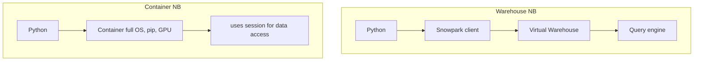

### Lab Exercise
```sql
-- Compute pool for container runtime
CREATE COMPUTE POOL ml_gpu
  MIN_NODES = 1 MAX_NODES = 2
  INSTANCE_FAMILY = GPU_NV_S;

CREATE OR REPLACE NOTEBOOK my_db.my_schema.gpu_training
  COMPUTE_POOL = ml_gpu
  RUNTIME_NAME = 'SYSTEM$GPU_BASIC_RUNTIME';
```

### Gotchas / Exam Traps
- GPU runtimes cost multiples of warehouse credits per hour — auto-suspend aggressively.
- Container runtime needs a compute pool pre-created with GPU_* instance family.
- Some packages (e.g., deepspeed) only work on container.

---

## Q3: What is AI & ML Studio and what workflows does it host?
**Difficulty:** Foundation
**Exam relevance:** 5.3

### Answer
AI & ML Studio is a Snowsight section that hosts guided builders for:
- **Cortex Analyst** semantic model studio (build/test YAML).
- **Cortex Search** service wizard (choose source, embedding, attributes).
- **Document AI** build / review / train workflow.
- **Cortex Fine-Tuning** (if available) job builder.
- **ML Playground** (sometimes bundled) for quick model experiments.

Each wizard produces first-class Snowflake objects you can also create via SQL.

### First Principles
Studio is a UX layer over the SQL-level objects. For complex configuration (semantic models, extraction schemas, training data selection) a visual tool reduces errors; for CI/CD and automation you still drop to SQL. Think of Studio as a "paved road" for setup — not the only road.

### Diagram
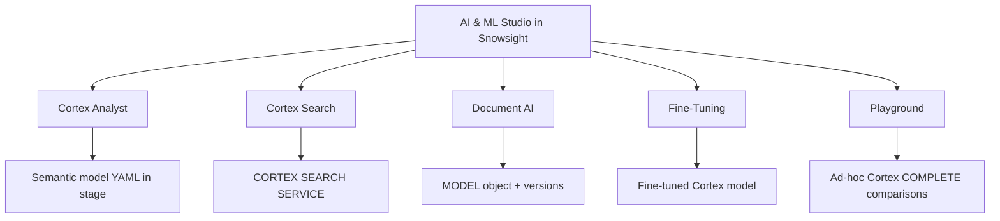

### Gotchas / Exam Traps
- Studio-created objects are editable via SQL (same object underneath).
- Role-based access: Studio tiles are hidden if your role lacks relevant privileges.

---

## Q4: How does Snowpark ML's Model Registry interact with Gen AI workflows?
**Difficulty:** Advanced
**Exam relevance:** 5.4

### Answer
`snowflake.ml.registry.Registry` is a schema-level catalog for ML models (sklearn, XGBoost, PyTorch, Hugging Face transformers, custom). You log a model version with signatures, then call it via SQL as a UDF-style function. For Gen AI: you can register (a) a wrapper around Cortex calls, (b) an embedding model you want to run as a function, (c) a fine-tuned LLM served from container runtime.

```python
from snowflake.ml.registry import Registry
reg = Registry(session)
mv = reg.log_model(
    model=my_hf_pipeline,
    model_name="sentence_embedder",
    version_name="v1",
    conda_dependencies=["transformers","torch","sentence-transformers"]
)
```

Call from SQL:
```sql
SELECT my_db.my_schema.SENTENCE_EMBEDDER!EMBED('text here');
```

### First Principles
Registry centralizes "what model is in production" with versioning, metadata, and signatures. It's the bridge between notebook experimentation and warehouse-callable deployment. For Gen AI, it's especially useful for OSS embedding models you want to run locally in Snowflake (cheaper or more private than hosted APIs) and custom finetuned transformers.

### Diagram
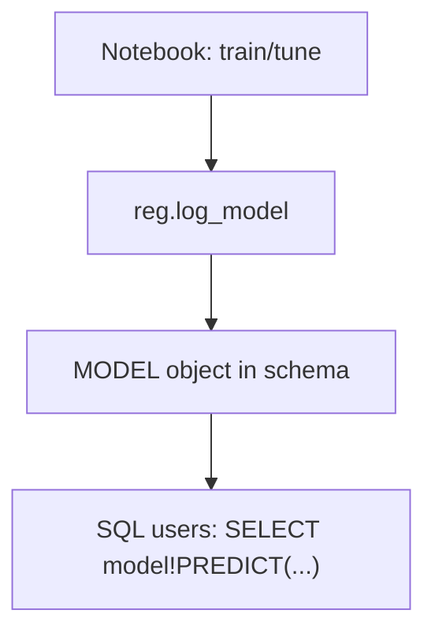

### Lab Exercise
```python
# From a Snowflake Notebook container runtime
from sentence_transformers import SentenceTransformer
from snowflake.ml.registry import Registry

model = SentenceTransformer('all-MiniLM-L6-v2')
reg = Registry(session, database_name="MY_DB", schema_name="ML")
mv = reg.log_model(
    model=model,
    model_name="mini_lm_embedder",
    version_name="v1",
    sample_input_data=[["hello world"]],
    conda_dependencies=["sentence-transformers","torch"]
)
# Then from SQL:
#   SELECT MY_DB.ML.MINI_LM_EMBEDDER!ENCODE('hello')
```

### Gotchas / Exam Traps
- Model object includes serialized weights; large models mean larger storage.
- Inference happens on the compute that calls PREDICT (warehouse or container).
- Conda dependencies must be available on the Snowflake Anaconda channel OR packaged in a container.

---

## Q5: What is the Snowpark ML Feature Store and when does it matter for Gen AI?
**Difficulty:** Advanced
**Exam relevance:** 5.5

### Answer
Feature Store is a schema-level service for defining, materializing, and serving ML features with lineage and point-in-time correctness. For Gen AI: use it when you build hybrid LLM+ML systems — e.g., a retrieval system that combines user embeddings, product embeddings, and behavioral features, served as a joined feature set to a reranker or recommender.

```python
from snowflake.ml.feature_store import FeatureStore, Entity, FeatureView

fs = FeatureStore(session, database="MY_DB", name="RETAIL_FS",
                  default_warehouse="FS_WH", creation_mode="CREATE_IF_NOT_EXIST")

e_user = Entity(name="USER", join_keys=["user_id"])
fs.register_entity(e_user)

fv = FeatureView(
    name="user_profile",
    entities=[e_user],
    feature_df=session.sql("SELECT user_id, lifetime_value, pref_vec FROM ..."),
    refresh_freq="1 hour",
)
fs.register_feature_view(fv, version="v1")
```

### First Principles
Features over time + joined to events require point-in-time correctness (no leakage from future). Feature Store builds the discipline into the API. Gen AI apps often need both structured features (user_lifetime_value) and vector features (user_pref_embedding) — Feature Store handles both.

### Diagram
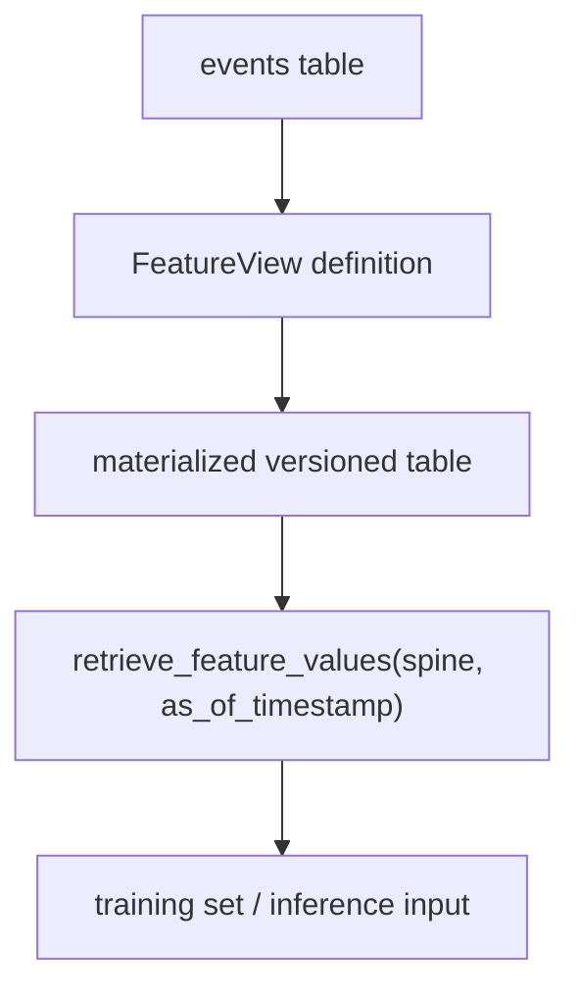

### Gotchas / Exam Traps
- Point-in-time join needs an `as_of_timestamp` column on the spine — forgetting leads to leakage.
- Feature views refresh on a schedule; align with your SLA.

---

## Q6: How do you install and manage Python packages in Snowflake Notebooks?
**Difficulty:** Intermediate
**Exam relevance:** 5.6

### Answer
- **Warehouse runtime**: Pick from the Snowflake Anaconda channel via the Packages dropdown in Snowsight; the environment is defined per notebook.
- **Container runtime**: `pip install` works at the start of the notebook; packages persist for the session; pin via a requirements file in the container image or at the top of the notebook.
- Snowpark ML, Snowpark Core, Streamlit, pandas, numpy are pre-installed.
- External Access Integrations are needed to reach external pip indices from warehouse runtime.

### First Principles
Warehouse runtime uses a curated channel for security/stability — Snowflake vets packages. Container runtime trusts you to manage the image. In both, pinning versions matters because unpinned installs produce non-reproducible notebooks.

### Lab Exercise
```python
# Container runtime
import subprocess
subprocess.check_call(['pip','install','sentence-transformers==2.7.0','faiss-cpu==1.8.0'])
# Or in a top-level markdown cell, use the %pip magic if supported.
```

### Gotchas / Exam Traps
- Warehouse runtime: not every PyPI package is on the Anaconda channel. Check availability.
- Container runtime: `pip install` doesn't survive compute pool restarts unless baked into the image.
- Private packages: use Snowflake Private Package repository or a stage-based wheel install.

---

## Q7: How do you integrate a Snowflake Notebook with Git for versioning?
**Difficulty:** Intermediate
**Exam relevance:** 5.7

### Answer
1. Create an API integration for Git provider.
2. Create a Git repository object pointing to your repo.
3. Reference files via `@repo/branches/main/path/to/notebook.ipynb`.
4. Fetch to update local view: `ALTER GIT REPOSITORY ... FETCH`.
5. Notebook can be created from a Git-backed file; changes committed back require your CI (Snowflake Git is primarily read-direction for referencing files).

```sql
CREATE API INTEGRATION git_int
  API_PROVIDER = git_https_api
  API_ALLOWED_PREFIXES = ('https://github.com/myorg/')
  ENABLED = TRUE;

CREATE GIT REPOSITORY ml_repo
  API_INTEGRATION = git_int
  ORIGIN = 'https://github.com/myorg/ml-notebooks.git';

ALTER GIT REPOSITORY ml_repo FETCH;

CREATE OR REPLACE NOTEBOOK my_db.ml.training
  FROM '@my_db.ml.ml_repo/branches/main/notebooks/'
  MAIN_FILE = 'training.ipynb'
  QUERY_WAREHOUSE = ml_wh;
```

### First Principles
Notebooks are code — treat them like code with Git for diffs, PRs, and promotion. Snowflake Git integration gives notebooks a stable source of truth outside Snowsight so collaboration and CI/CD are possible.

### Gotchas / Exam Traps
- Credentials: use secrets referenced by the API integration; never embed PATs.
- Branches: path is `/branches/<name>` or `/tags/<name>` or `/commits/<sha>`.
- Writing back to Git requires an external pipeline (Snowflake doesn't natively git-push).

---

## Q8: How do you schedule a Notebook to run on a cadence?
**Difficulty:** Intermediate
**Exam relevance:** 5.8

### Answer
Create a Task that executes `EXECUTE NOTEBOOK`:

```sql
CREATE OR REPLACE TASK nightly_rag_eval
  WAREHOUSE = ml_wh
  SCHEDULE = 'USING CRON 0 2 * * * UTC'
AS
  EXECUTE NOTEBOOK my_db.ml.rag_eval();

ALTER TASK nightly_rag_eval RESUME;
```

Parameters can be passed as a dict:
```sql
EXECUTE NOTEBOOK my_db.ml.rag_eval(
  OBJECT_CONSTRUCT('k',10,'golden_set','v2')
);
```

### First Principles
Notebooks are now first-class executables — same orchestration primitives as stored procs (Tasks, Streams). This lets Gen AI quality checks, retraining, and reporting run on a cadence without external schedulers.

### Lab Exercise
```sql
-- A notebook that writes RAG recall@k to a metrics table nightly
CREATE OR REPLACE TASK rag_metrics_task
  WAREHOUSE = metrics_wh
  SCHEDULE = '1 DAY'
  AS EXECUTE NOTEBOOK my_db.ml.rag_recall_notebook();

ALTER TASK rag_metrics_task RESUME;
```

### Gotchas / Exam Traps
- Notebook must have a "live version" set — scheduled runs use the pinned version, not the open draft.
- Role used by task must have USAGE on the notebook.
- Long-running notebooks may hit task timeout; chunk.

---

## Q9: What are the Streamlit-in-Notebook patterns for interactive dev?
**Difficulty:** Advanced
**Exam relevance:** 5.9

### Answer
Snowflake Notebooks support inline Streamlit components via `streamlit as st` (even outside Streamlit apps):

```python
import streamlit as st
import pandas as pd
from snowflake.snowpark.context import get_active_session

session = get_active_session()

q = st.text_input("Query")
if q:
    hits = session.sql(
        f"SELECT SNOWFLAKE.CORTEX.SEARCH_PREVIEW('kb', OBJECT_CONSTRUCT('query',?,'limit',5)::STRING)",
        params=[q]
    ).collect()
    st.json(hits[0][0])
```

This lets you prototype RAG apps inline before promoting to a full Streamlit-in-Snowflake app.

### First Principles
Blurring the line between notebook (exploration) and app (deployment) accelerates the dev loop. The same code can later be exported as a Streamlit app.

### Gotchas / Exam Traps
- Not every Streamlit component works identically in-notebook (session_state nuances).
- Promote to a standalone Streamlit app before sharing with users.

---

## Q10: How do you use the Playground in AI & ML Studio?
**Difficulty:** Foundation
**Exam relevance:** 5.3

### Answer
Playground is a Snowsight UI for running Cortex COMPLETE calls side-by-side with different models, prompts, and options. Enter a prompt, pick models, inspect responses + token counts + credits. Useful for model selection and prompt engineering before you bake into SQL.

### First Principles
Rapid iteration without SQL overhead. Supports A/B comparison which is exactly what prompt engineering needs.

### Diagram
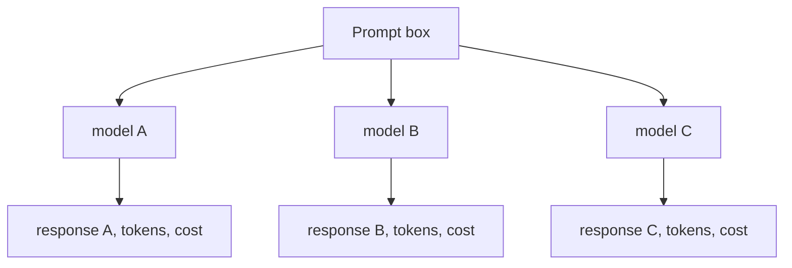

### Gotchas / Exam Traps
- Playground is for exploration — production prompts should live in a managed location (not Playground).
- Credits still bill from the Playground.

---

## Q11: How do you run a Hugging Face model inside Snowflake?
**Difficulty:** Advanced
**Exam relevance:** 5.10

### Answer
Two paths:
1. **Register as Snowpark ML model** — load the HF model in a container-runtime notebook, log via `Registry.log_model`, call via `!PREDICT`. Runs on warehouse (CPU) or container (GPU).
2. **Serve via Snowpark Container Services** — build a container image with your model + an inference server (FastAPI, Triton), deploy as an SPCS service with a public or internal endpoint.

```python
# Path 1: register HF classifier
from transformers import pipeline
from snowflake.ml.registry import Registry

pipe = pipeline("zero-shot-classification", model="facebook/bart-large-mnli")
reg = Registry(session)
reg.log_model(
    model=pipe, model_name="zero_shot", version_name="v1",
    sample_input_data=[{"text":"hello","candidate_labels":["pos","neg"]}],
    conda_dependencies=["transformers","torch"]
)
```

### First Principles
Not every model is in Cortex's catalog. HF has hundreds of thousands of OSS models — most enterprises will eventually want to run one in-house. Snowflake supports two deployment modes to match ops preference: Registry (simple, function-call-like) vs SPCS (service-oriented, autoscales, more config).

### Diagram
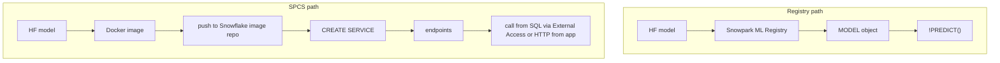

### Gotchas / Exam Traps
- Large models (7B+) require GPU — plan for container runtime + GPU compute pool.
- License: ensure the HF model's license permits your use.

---

## Q12: How does the ML Observability framework help monitor Gen AI apps?
**Difficulty:** Advanced
**Exam relevance:** 5.11

### Answer
Snowpark ML Observability (preview/GA depending on region) lets you log inference traces (inputs, outputs, latencies, errors) into Snowflake tables for monitoring. For LLMs you can track prompt/response pairs, token counts, feedback scores, and compute drift metrics or quality trends over time.

```python
# Pseudocode: wrap your COMPLETE call
log_trace(
    model="llama3.1-70b",
    prompt=prompt,
    response=response,
    latency_ms=t,
    user_id=u,
    feedback=None
)
```

### First Principles
Models (and especially LLM-powered apps) have invisible failure modes: slow degradation, prompt injection, drift of user queries. Monitoring = early warning. Observability framework provides the storage model + dashboards for this.

### Gotchas / Exam Traps
- Don't log PII unmasked — tag/mask the trace table.
- Observability tables grow fast; partition by date and apply retention.

---

## Q13: How does a typical "AI/ML Studio → Notebook → Streamlit" dev lifecycle look?
**Difficulty:** Intermediate
**Exam relevance:** 5.12

### Answer
1. **Studio** — stand up objects: semantic model for Analyst, Cortex Search service, Document AI model.
2. **Notebook** — prototype pipeline: ingest → extract → index → query → eval; iterate with inline Streamlit.
3. **Package** — move stable code into a Snowpark stored proc or Streamlit app.
4. **Deploy** — publish Streamlit app in Snowflake; wire tasks for scheduled jobs.
5. **Monitor** — add logging + feedback capture; dashboard trends.
6. **Iterate** — notebook stays alive for debugging + offline eval.

### First Principles
Studio for objects, Notebook for logic, Streamlit for UX — three personas (admin, data scientist, business user) each get a tool tuned to their needs, but all against the same underlying data and governance.

### Diagram
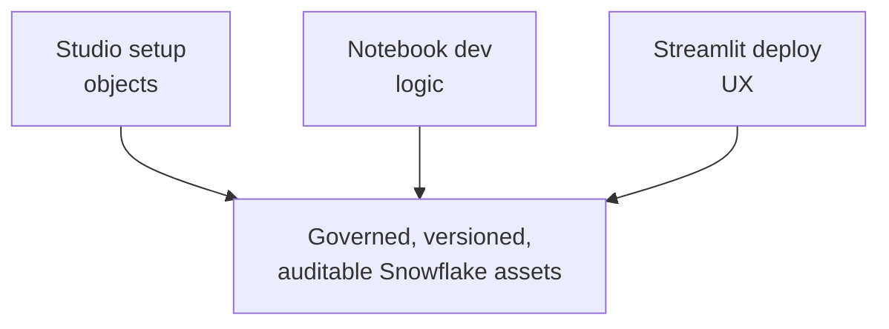

### Gotchas / Exam Traps
- Don't duplicate prompt logic across notebook, Streamlit, and stored proc; put it in one function.
- Promote via Git — don't hand-copy notebook code into Streamlit.

---

## Q14: How does the Container Runtime's GPU support work?
**Difficulty:** Advanced
**Exam relevance:** 5.13

### Answer
Create a compute pool with GPU family (`GPU_NV_S` A10, `GPU_NV_M` A10 larger, or A100 variants), attach the notebook to that pool. CUDA, PyTorch GPU, Transformers all work out of the box in Snowflake's GPU runtime image. You can train small models (<13B parameters), fine-tune with LoRA, or run inference for OSS LLMs.

```sql
CREATE COMPUTE POOL ml_a10
  MIN_NODES = 1 MAX_NODES = 1
  INSTANCE_FAMILY = GPU_NV_S
  AUTO_SUSPEND_SECS = 300;

CREATE OR REPLACE NOTEBOOK my_db.ml.finetune_small
  COMPUTE_POOL = ml_a10
  RUNTIME_NAME = 'SYSTEM$GPU_BASIC_RUNTIME';
```

### First Principles
GPUs are expensive — Snowflake decouples storage from compute, so a compute pool only costs while running. Auto-suspend is critical. The container runtime uses standard CUDA so most OSS deep learning stacks work unmodified.

### Gotchas / Exam Traps
- GPU_NV_S has limited memory (~24GB) — a 7B model with activations easily OOMs; use mixed precision.
- Auto-suspend MUST be set; a forgotten GPU pool is expensive.
- Compute pools require ACCOUNTADMIN or specific grants to create.

---

## Q15: How do you wire a Notebook to call Cortex functions from Python idiomatically?
**Difficulty:** Intermediate
**Exam relevance:** 5.14

### Answer
Use `snowflake.cortex` helpers:
```python
from snowflake.cortex import complete, summarize, translate, sentiment, extract_answer, embed_text_1024
from snowflake.snowpark.context import get_active_session

session = get_active_session()

print(complete("llama3.1-70b", "Explain Cortex Guard in 2 sentences", session=session))
print(sentiment("The product is terrible", session=session))
vec = embed_text_1024("snowflake-arctic-embed-l-v2.0", "hello world", session=session)
```

Or raw SQL:
```python
session.sql(
  "SELECT SNOWFLAKE.CORTEX.COMPLETE(?, ?)",
  params=["llama3.1-70b", "hello"]
).collect()
```

### First Principles
Thin Python wrappers around SQL calls give an idiomatic feel while preserving the fact that execution happens inside Snowflake. The wrapper also supports streaming for COMPLETE.

### Lab Exercise
```python
from snowflake.cortex import complete
for token in complete("mistral-large2", "Describe RAG", stream=True, session=session):
    print(token, end="")
```

### Gotchas / Exam Traps
- `snowflake.cortex` package must be available (included in default Snowflake Python environment).
- For streaming, you must iterate the returned object; don't `print()` it directly.

---

## Q16: What are the primary governance controls for notebooks and ML objects?
**Difficulty:** Intermediate
**Exam relevance:** 5.15

### Answer
- Notebook object: GRANT USAGE, OPERATE (to run), MONITOR, OWNERSHIP as appropriate.
- Compute pool: GRANT USAGE, OPERATE.
- Model object (from Registry): GRANT USAGE.
- Underlying tables: standard SELECT/INSERT grants + row access + masking.
- Secrets for external calls: SNOWFLAKE SECRET object with GRANT USAGE.
- External Access Integration for outbound network: integration grants.

### First Principles
Every ML asset — notebook, pool, model, feature view — is a governable Snowflake object. Avoid shadow IT by using these primitives rather than external SaaS platforms whose governance you duplicate.

### Lab Exercise
```sql
GRANT USAGE ON NOTEBOOK my_db.ml.training TO ROLE DS_READER;
GRANT OPERATE ON NOTEBOOK my_db.ml.training TO ROLE DS_RUNNER;
GRANT USAGE ON COMPUTE POOL ml_gpu TO ROLE DS_RUNNER;
GRANT USAGE ON MODEL my_db.ml.MINI_LM_EMBEDDER TO ROLE APP_RW;
```

### Gotchas / Exam Traps
- Running a notebook as owner vs caller changes what data it can see; prefer caller's rights for interactive, owner's rights for scheduled.
- Scheduled runs use the task owner's role unless you explicitly configure caller rights.

---

## Q17: How do you handle secrets (API keys for 3rd party APIs) inside a Notebook?
**Difficulty:** Intermediate
**Exam relevance:** 5.16

### Answer
Use Snowflake SECRET + External Access Integration:
```sql
CREATE OR REPLACE SECRET openai_key TYPE = GENERIC_STRING SECRET_STRING = 'sk-...';

CREATE OR REPLACE NETWORK RULE openai_rule
  TYPE = HOST_PORT
  VALUE_LIST = ('api.openai.com:443')
  MODE = EGRESS;

CREATE OR REPLACE EXTERNAL ACCESS INTEGRATION openai_eai
  ALLOWED_NETWORK_RULES = (openai_rule)
  ALLOWED_AUTHENTICATION_SECRETS = (openai_key)
  ENABLED = TRUE;

-- Grant on the integration + secret to the notebook role
GRANT USAGE ON INTEGRATION openai_eai TO ROLE DS;
GRANT READ ON SECRET openai_key TO ROLE DS;
```

Then attach to the notebook:
```sql
ALTER NOTEBOOK my_db.ml.external_calls
  SET EXTERNAL_ACCESS_INTEGRATIONS = (openai_eai)
      SECRETS = ('openai_key'=openai_key);
```

Inside the notebook:
```python
import _snowflake
key = _snowflake.get_generic_secret_string('openai_key')
```

### First Principles
Secrets must never land in notebook text. Snowflake's secret store + EAI bind credentials to the notebook object with RBAC on the secret itself — a stolen notebook code dump leaks nothing.

### Gotchas / Exam Traps
- EAI must enumerate every outbound host; wildcards work with care.
- Running sensitive outbound from a Streamlit-in-Snowflake app follows the same pattern.
- Not every runtime supports EAI identically; check your runtime version.

---

## Q18: Comparison table — notebook vs stored proc vs Streamlit vs scheduled task.
**Difficulty:** Intermediate
**Exam relevance:** 5.12

### Answer

| Need | Use |
|---|---|
| Interactive exploration | Notebook |
| Repeatable business logic in SQL | Stored Procedure |
| UI for end users | Streamlit in Snowflake |
| Scheduled background job | Task (over notebook, SP, or SQL) |
| Long-running ML training | Notebook on container runtime, driven by task |
| Reusable Python logic for warehouse SQL | UDF/UDTF |

### First Principles
Each primitive solves a specific job. Mixing them (e.g., Streamlit calling a stored proc, task running a notebook) is the typical production pattern — not a single "all-in-notebook" monolith.

### Diagram
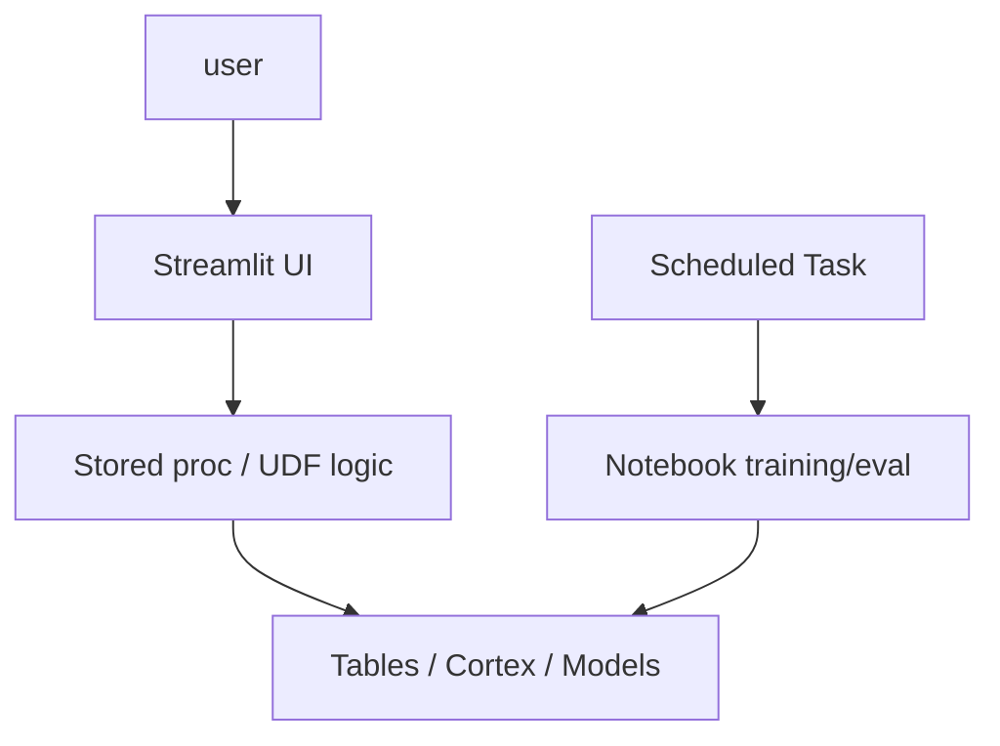

### Gotchas / Exam Traps
- Don't ship notebooks to end users; wrap in Streamlit.
- Tasks over notebooks are great for scheduled offline work, not for user requests.

---

## Q19: How do you parameterize a Notebook for different environments (dev/stage/prod)?
**Difficulty:** Advanced
**Exam relevance:** 5.17

### Answer
Pass parameters at EXECUTE time:
```sql
EXECUTE NOTEBOOK my_db.ml.training(
  OBJECT_CONSTRUCT('env','prod','sample_size',100000)
);
```

Inside the notebook:
```python
import snowflake.cortex  # just example import
# Snowflake injects params via the SP arguments mechanism (notebook-dependent)
params = session.sql("SELECT $PARAM_env, $PARAM_sample_size").collect()  # pseudo
```

Alternatively, parameterize via environment variables (container runtime) or by reading a config table.

### First Principles
Hard-coded paths/DBs mean the same notebook can't ship across environments. Parameters + config tables + environment-dependent role resolution yield a single codebase that behaves correctly in dev/stage/prod.

### Gotchas / Exam Traps
- Keep env-specific config in a table so it's easy to inspect and audit.
- Don't branch on CURRENT_ACCOUNT() inside logic — too fragile.

---

## Q20: How do you train a small LLM with LoRA inside Snowflake Container Runtime?
**Difficulty:** Advanced
**Exam relevance:** 5.18

### Answer
Container runtime with GPU → load base model → wrap with PEFT/LoRA → train on labeled data pulled from Snowflake → save adapter → optionally register with Registry.

```python
# Container runtime, GPU_NV_S
from transformers import AutoTokenizer, AutoModelForCausalLM, TrainingArguments, Trainer
from peft import LoraConfig, get_peft_model
import torch
from snowflake.snowpark.context import get_active_session

session = get_active_session()
df = session.sql("SELECT prompt, completion FROM train_pairs").to_pandas()

base = "mistralai/Mistral-7B-Instruct-v0.2"
tok = AutoTokenizer.from_pretrained(base)
model = AutoModelForCausalLM.from_pretrained(base, torch_dtype=torch.bfloat16)
lora = LoraConfig(r=16, lora_alpha=32, lora_dropout=0.05, target_modules=["q_proj","v_proj"])
model = get_peft_model(model, lora)

# ... tokenize df, build dataset, Trainer(...).train()
model.save_pretrained("/opt/data/lora_adapter")
```

### First Principles
Full fine-tune of a 7B dense model needs 100s of GB VRAM; LoRA trains a tiny adapter (<1% params) that merges with base at inference. Cheap, fast, deployable. Keeping training inside Snowflake avoids moving training data out.

### Gotchas / Exam Traps
- GPU memory: load in bfloat16 or 4-bit quantization for 7B+ models on A10.
- Checkpointing to a stage: periodic `session.file.put` to preserve against pool suspend.
- For Cortex-native fine-tune, use Cortex Fine-Tuning service, not this flow — this is only when you need a custom OSS model.

---

## Q21: How do you serve a container-runtime trained model via Snowpark Container Services?
**Difficulty:** Advanced
**Exam relevance:** 5.19

### Answer
Package model + inference server (FastAPI / TorchServe / Triton) into a Docker image, push to Snowflake image repo, create a SERVICE:

```sql
CREATE SERVICE my_db.ml.lora_mistral_svc
  IN COMPUTE POOL ml_gpu_pool
  FROM SPECIFICATION '
    spec:
      containers:
        - name: inference
          image: /my_db/ml/images/lora_mistral:v1
          resources:
            limits:
              nvidia.com/gpu: 1
      endpoints:
        - name: predict
          port: 8080
          public: false'
  MIN_INSTANCES = 1 MAX_INSTANCES = 3;

-- Call it via a Service Function
CREATE OR REPLACE FUNCTION my_db.ml.LORA_COMPLETE(prompt STRING)
RETURNS STRING
SERVICE = my_db.ml.lora_mistral_svc
ENDPOINT = 'predict'
MAX_BATCH_ROWS = 10;
```

Now `SELECT my_db.ml.LORA_COMPLETE('hello')` routes to your service.

### First Principles
SPCS lets you host long-running services inside the Snowflake network, callable as SQL functions. Great for private LLMs, embedding models, or any inference endpoint you want co-located with data.

### Gotchas / Exam Traps
- Startup latency: service may have cold start; keep MIN_INSTANCES >= 1 for low-latency.
- MAX_BATCH_ROWS controls how many rows the function batches per service call.
- Service billing is per-second compute pool, not per-call.

---

## Q22: How does caller vs owner privilege context affect a scheduled notebook?
**Difficulty:** Advanced
**Exam relevance:** 5.20

### Answer
A scheduled notebook (run via task) executes as the task's role by default (owner's rights). This means it sees data the task's role sees, which may differ from the user who created the task. For some use cases (e.g., per-user personalization), you want caller-rights behavior — Snowflake supports EXECUTE AS CALLER on stored procs; for notebooks via tasks, model the data boundary carefully.

### First Principles
Owner's-rights execution is standard for scheduled jobs (deterministic, no caller to speak of). But for user-facing dynamic work (triggered by a Streamlit, for example), caller-rights is often correct. Pick with intent.

### Gotchas / Exam Traps
- A task running a notebook under a privileged role is a security surface — minimize privilege.
- Secrets granted to the task role are the ones available at execution.

---

## Q23: How do you clean up and manage costs across the ML/AI Studio stack?
**Difficulty:** Intermediate
**Exam relevance:** 5.21

### Answer
- **Auto-suspend** on all warehouses and compute pools (short — 60-300s).
- **Max concurrency** on compute pools to cap burst.
- **Drop old model versions** in Registry.
- **Retention** on observability/logging tables.
- **Resource monitors** on warehouses tied to notebook roles.
- **QUERY_TAG** per notebook/app for showback.

```sql
CREATE OR REPLACE RESOURCE MONITOR ml_rm
  CREDIT_QUOTA = 500
  FREQUENCY = MONTHLY
  START_TIMESTAMP = CURRENT_TIMESTAMP
  TRIGGERS
    ON 80 PERCENT DO NOTIFY
    ON 100 PERCENT DO SUSPEND;

ALTER WAREHOUSE ml_wh SET RESOURCE_MONITOR = ml_rm;
```

### First Principles
Idle GPUs and forgotten compute pools are the top budget leaks. Resource monitors and auto-suspend are mandatory, not nice-to-have.

### Gotchas / Exam Traps
- Auto-suspend of a container is longer than warehouse — tune.
- Dropping a model version while a pipeline still references it breaks the pipeline.

---

## Q24: What's the end-to-end mental model tying this file to the exam's other domains?
**Difficulty:** Advanced
**Exam relevance:** 5.22 — synthesis

### Answer
AI/ML Studio and Notebooks are **where you build and operate** everything else in the GES-C01 syllabus:
- Studio sets up Cortex Analyst (file 3), Cortex Search (file 2), Document AI (file 4), Fine-tuning (file 1/6).
- Notebooks are where you prototype RAG apps (file 2), run eval loops, train custom models (file 6).
- Streamlit (file 6) is the UX layer.
- Snowpark ML Registry extends the stack beyond Cortex to any OSS model.

Think of the exam as testing both **what each service does** and **how a practitioner wires them together** in a Snowflake-native dev lifecycle.

### Diagram
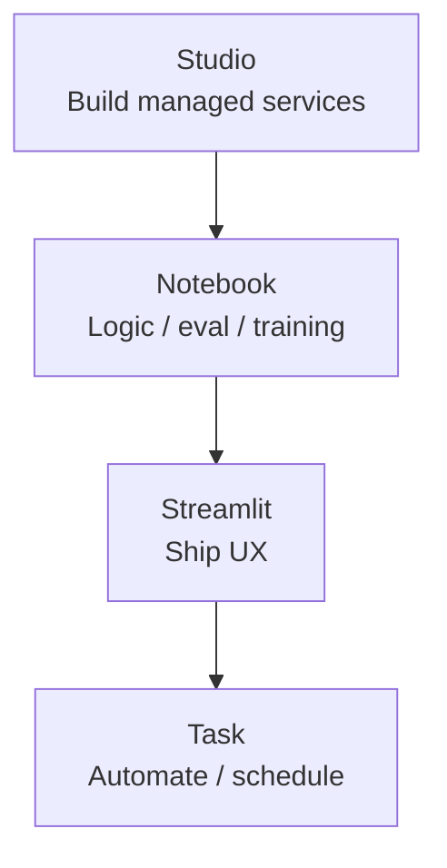

### Gotchas / Exam Traps
- The exam asks "where would you build X" — expect answers like "AI & ML Studio → Document AI wizard" vs "Snowflake Notebook with Snowpark ML Registry."
- Know when a notebook is overkill (a scheduled task running SQL) and when Streamlit is overkill (a one-off report).
