# AI Governance Frameworks — GAS-C01 Study Guide

## Exam Weight & Scope

**Weight on GAS-C01:** ~15-20% (foundational domain — appears in every scenario)

**Scope:**
- NIST AI Risk Management Framework (AI RMF 1.0) — Govern, Map, Measure, Manage
- EU AI Act — risk tiers (unacceptable/high/limited/minimal), GPAI obligations
- ISO/IEC 42001:2023 — AI Management System (AIMS)
- ISO/IEC 23894 — AI risk guidance
- OECD AI Principles & NIST GAI Profile (Generative AI)
- Responsible AI pillars: fairness, accountability, transparency, explainability, privacy, safety, security
- Model lineage (training data → model → outputs → consumers)
- Bias/fairness measurement (demographic parity, equal opportunity, disparate impact)
- Snowflake Horizon as the implementation substrate for AI governance

## Core Concepts Map

**AI Governance Framework Stack**

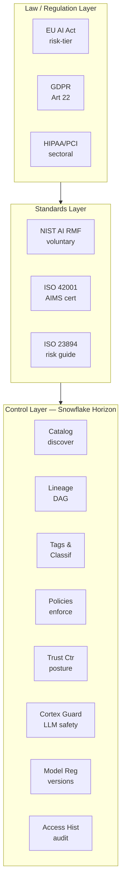

**NIST AI RMF — 4 Functions Cycle**

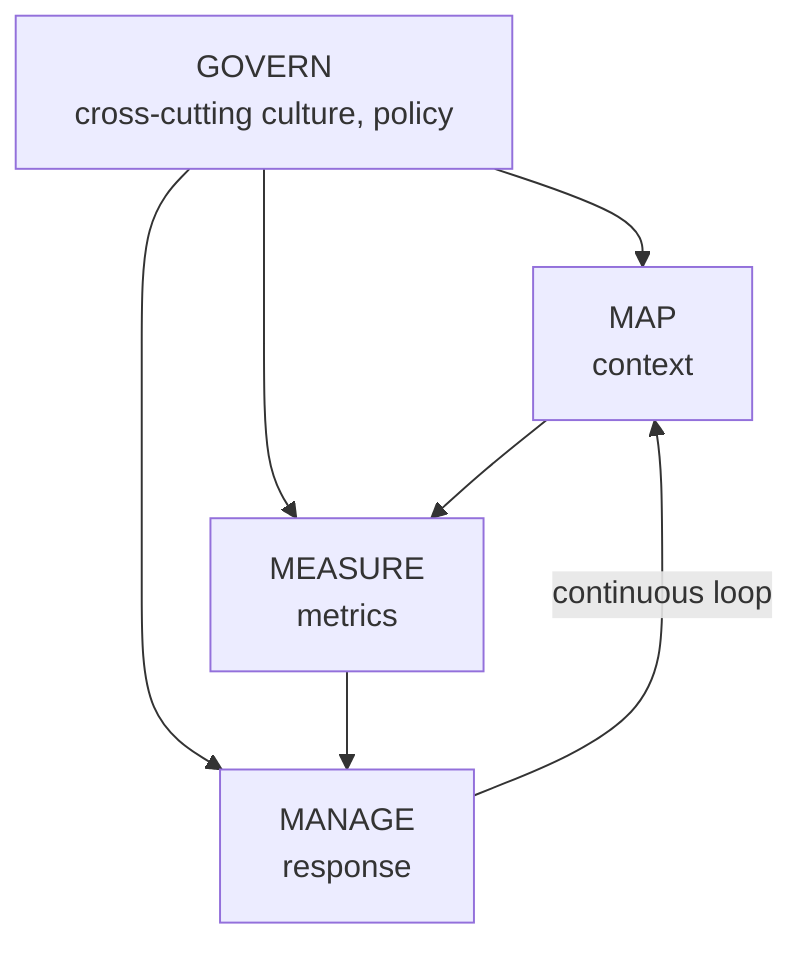

---

## Q1: Which NIST AI RMF function establishes organizational culture and oversight structures for AI, and why is it treated as cross-cutting rather than sequential?

**Difficulty:** Foundation
**Exam relevance:** NIST AI RMF 1.0 — Govern function

### Answer
**GOVERN** is the cross-cutting function. Unlike MAP, MEASURE, and MANAGE (which iterate on specific systems), GOVERN defines the policies, roles, accountability lines, risk tolerance, and training that apply across every AI system in the organization. It's cross-cutting because the other three functions cannot operate correctly without governance scaffolding — e.g., you can't MEASURE bias without first GOVERNing what thresholds are acceptable.

### First Principles
AI risk is not a point-in-time property of a model; it's a property of a sociotechnical system (model + data + humans + deployment context). Governance must therefore be a *standing* capability that persists across model versions and system boundaries. If governance were sequential (Govern → Map → Measure → Manage), each new model would require re-governing from scratch, which is operationally infeasible. By making GOVERN cross-cutting, NIST aligns AI oversight with existing enterprise risk management (ERM) patterns — the same reason SOX controls are organizational, not per-project.

### Diagram
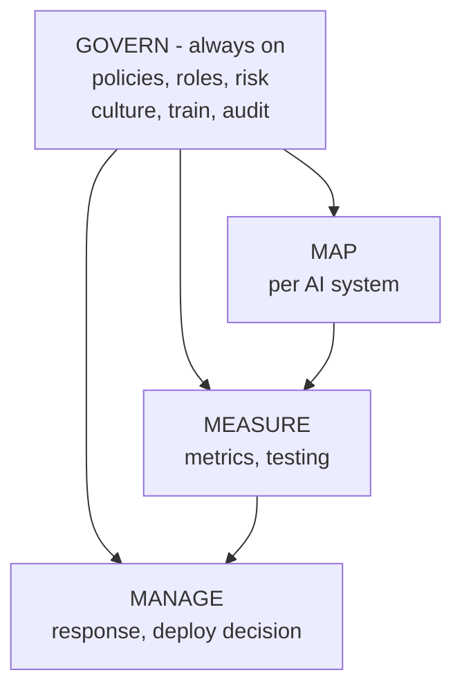

### Lab Exercise
```sql
-- Model the four functions as Snowflake artifacts.
-- GOVERN: a tag namespace that encodes org policy
USE ROLE SECURITYADMIN;
CREATE DATABASE IF NOT EXISTS GOVERNANCE;
CREATE SCHEMA GOVERNANCE.AI_RMF;

CREATE TAG GOVERNANCE.AI_RMF.AI_SYSTEM_RISK_TIER
  ALLOWED_VALUES 'UNACCEPTABLE','HIGH','LIMITED','MINIMAL'
  COMMENT 'EU AI Act risk tier — set by Governance Committee';

CREATE TAG GOVERNANCE.AI_RMF.RMF_FUNCTION
  ALLOWED_VALUES 'GOVERN','MAP','MEASURE','MANAGE'
  COMMENT 'Which RMF function this object supports';

-- MAP: register an AI system via tagging a model object
ALTER MODEL ML.PROD.LOAN_SCORER
  SET TAG GOVERNANCE.AI_RMF.AI_SYSTEM_RISK_TIER = 'HIGH';

-- MEASURE: expose metrics table
CREATE TABLE GOVERNANCE.AI_RMF.MODEL_METRICS (
  model_name STRING, version STRING,
  metric_name STRING, metric_value FLOAT,
  measured_at TIMESTAMP_NTZ
);

-- MANAGE: approval table (deployment gate)
CREATE TABLE GOVERNANCE.AI_RMF.DEPLOYMENT_APPROVALS (
  model_name STRING, version STRING,
  approver STRING, approved_at TIMESTAMP_NTZ,
  status STRING
);
```

### Gotchas / Exam Traps
- NIST AI RMF is **voluntary**, not legally binding. Trap: being asked which framework is "required" in the US — the answer is "none at federal level" (sectoral only).
- GOVERN is **not** the first step; it's the containing step. Expect a distractor saying "complete GOVERN before MAP."
- The RMF has a **Generative AI Profile** (NIST AI 600-1, 2024) that adds LLM-specific risks (confabulation, data poisoning, CBRN info). GAS-C01 may test knowledge of the Profile vs. core RMF.

---

## Q2: Under the EU AI Act, a healthcare provider uses a Snowflake-hosted LLM to summarize patient records for clinicians. Which risk tier applies, and what are the three most consequential obligations?

**Difficulty:** Intermediate
**Exam relevance:** EU AI Act — risk classification, high-risk obligations

### Answer
**High-risk** (Annex III — medical devices + decision support in regulated sectors). The three most consequential obligations:
1. **Risk management system** (Art. 9) — documented, continuous, covering foreseeable misuse.
2. **Data governance** (Art. 10) — training/validation/test datasets must be relevant, representative, free of errors, with documented provenance.
3. **Human oversight** (Art. 14) — a clinician must be able to review, override, and refuse the summary; "stop" controls must exist.

Also required: logging (Art. 12 — maps to Snowflake ACCESS_HISTORY), transparency, technical documentation, conformity assessment, post-market monitoring.

### First Principles
The EU AI Act's risk-tier model mirrors product liability law — the regulator wants obligations to scale with potential harm. Healthcare summarization combines two amplifiers: (a) direct impact on a natural person's health decision, and (b) the clinician's reliance on an opaque output. The Act therefore pulls this into high-risk even though the model is "just summarizing," because the summary becomes the decision substrate. Snowflake's role is to be the **evidence substrate**: lineage proves data provenance (Art. 10), ACCESS_HISTORY proves logging (Art. 12), tags prove human-oversight routing (Art. 14).

### Diagram
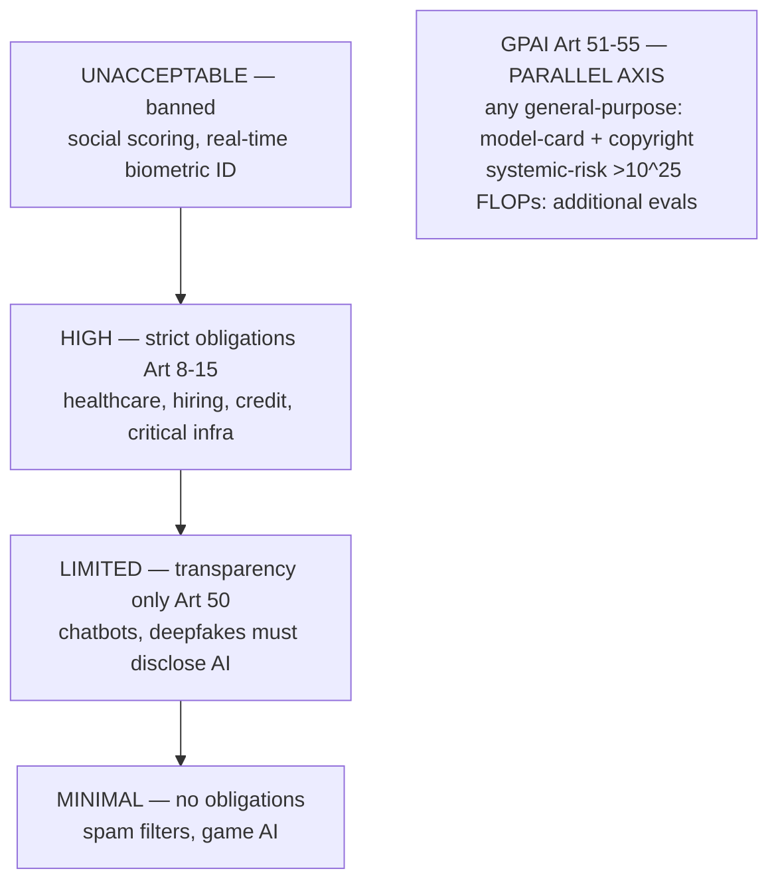

### Lab Exercise
```sql
-- Encode EU AI Act tiers as governance tags, then enforce human-review
-- gating via a row-access policy for high-risk model outputs.

USE ROLE SECURITYADMIN;

CREATE TAG GOVERNANCE.AI_RMF.EU_AI_ACT_TIER
  ALLOWED_VALUES 'UNACCEPTABLE','HIGH','LIMITED','MINIMAL';

CREATE TAG GOVERNANCE.AI_RMF.REQUIRES_HUMAN_OVERSIGHT
  ALLOWED_VALUES 'TRUE','FALSE';

-- Tag the model
ALTER MODEL ML.PROD.CLINICAL_SUMMARIZER
  SET TAG GOVERNANCE.AI_RMF.EU_AI_ACT_TIER = 'HIGH',
          GOVERNANCE.AI_RMF.REQUIRES_HUMAN_OVERSIGHT = 'TRUE';

-- Output table: only reviewed rows visible to downstream apps
CREATE OR REPLACE ROW ACCESS POLICY GOVERNANCE.AI_RMF.P_HIGH_RISK_HITL
  AS (reviewer STRING, review_status STRING) RETURNS BOOLEAN ->
  CASE
    WHEN CURRENT_ROLE() = 'CLINICIAN_REVIEWER' THEN TRUE
    WHEN review_status = 'APPROVED' AND reviewer IS NOT NULL THEN TRUE
    ELSE FALSE
  END;

ALTER TABLE ML.PROD.CLINICAL_SUMMARIES
  ADD ROW ACCESS POLICY GOVERNANCE.AI_RMF.P_HIGH_RISK_HITL
    ON (reviewer, review_status);
```

### Gotchas / Exam Traps
- The Act applies **extraterritorially**: a US company's AI output used in the EU is covered.
- "High-risk" ≠ "systemic-risk GPAI" — different axes. A small fine-tuned medical model is high-risk but not systemic.
- Fines: up to **€35M or 7% of global turnover** for prohibited practices (higher than GDPR's 4%).
- Grace period: most high-risk obligations apply 24 months after entry into force (Aug 2026); GPAI obligations earlier (12 months, Aug 2025).

---

## Q3: What does ISO/IEC 42001:2023 require that NIST AI RMF does not, and when would an organization pursue it?

**Difficulty:** Intermediate
**Exam relevance:** ISO 42001 AI Management System vs. NIST RMF

### Answer
ISO 42001 is a **certifiable AI Management System (AIMS)** standard — it specifies auditable *clauses* an organization must implement (context, leadership, planning, support, operation, performance evaluation, improvement — the standard ISO MS structure) and includes **Annex A controls** (38 controls across 9 categories). NIST AI RMF is a **framework of guidance** with no certification.

Organizations pursue ISO 42001 when:
- They sell AI products to enterprises/governments requiring third-party assurance.
- They operate in multiple jurisdictions and want a globally recognized attestation.
- They want to layer AI governance onto existing ISO 27001 (security) or ISO 27701 (privacy) programs.

### First Principles
Certifiability requires **auditable artifacts**: documented policies, assigned responsibilities, measurable objectives, management review minutes, corrective actions. NIST RMF intentionally leaves implementation open so it can accommodate any organizational maturity, which makes it unauditable in the ISO sense. The two are complementary: NIST tells you *what to think about*; ISO tells you *how to prove you're doing it*. In Snowflake terms, ISO 42001 forces you to materialize governance as queryable, versioned objects — exactly what Horizon Catalog, tags, and policies provide.

### Diagram

NIST AI RMF vs ISO/IEC 42001:
- NIST: Framework (guidance), voluntary, 4 functions, playbook, risk-focused, no cert body, free
- ISO 42001: Standard (certifiable), voluntary auditable, 10 clauses + Annex A (38 ctrls), mgmt system, governance-focused, accredited cert bodies, paid

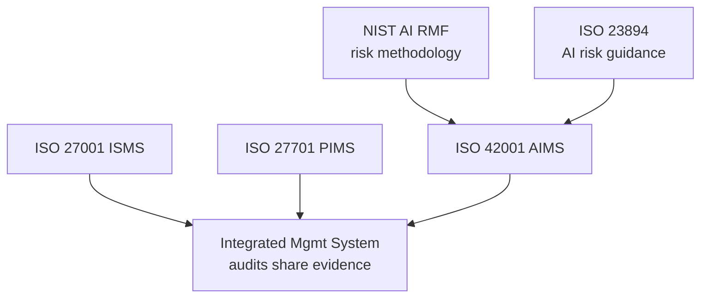

### Lab Exercise
```sql
-- Create an evidence-collection view that an ISO 42001 auditor could query
-- to see every AI system's governance state (Clause 7.5 — Documented Info).

CREATE OR REPLACE VIEW GOVERNANCE.AI_RMF.V_AIMS_EVIDENCE AS
SELECT
  m.model_name,
  m.model_version,
  OBJECT_AGG(t.tag_name, t.tag_value::VARIANT) AS governance_tags,
  l.training_dataset,                          -- Clause 7.5 (lineage)
  a.approver,                                   -- Clause 5.3 (accountability)
  a.approved_at,
  met.bias_score,                               -- Clause 9 (perf. eval)
  met.drift_score
FROM SNOWFLAKE.ML.MODELS m
LEFT JOIN SNOWFLAKE.ACCOUNT_USAGE.TAG_REFERENCES t
       ON t.object_name = m.model_name
LEFT JOIN GOVERNANCE.AI_RMF.MODEL_LINEAGE l
       ON l.model_name = m.model_name AND l.model_version = m.model_version
LEFT JOIN GOVERNANCE.AI_RMF.DEPLOYMENT_APPROVALS a
       ON a.model_name = m.model_name AND a.model_version = m.model_version
LEFT JOIN GOVERNANCE.AI_RMF.MODEL_METRICS met
       ON met.model_name = m.model_name AND met.version = m.model_version
GROUP BY ALL;
```

### Gotchas / Exam Traps
- ISO 42001 is **new** (Dec 2023). It supersedes nothing but complements ISO 27001.
- Annex A controls are **recommendations**; organizations may select applicable ones via a Statement of Applicability (SoA), just like ISO 27001.
- Certification requires a Stage 1 (documentation review) and Stage 2 (implementation audit); surveillance audits annually.

---

## Q4: Define model lineage in the context of AI governance, and explain why it is more demanding than classical data lineage.

**Difficulty:** Intermediate
**Exam relevance:** Model lineage, Snowflake Lineage/Horizon

### Answer
**Model lineage** is the end-to-end provenance chain:

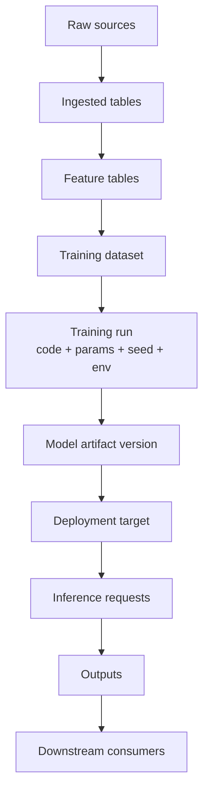

It's more demanding than data lineage because:
1. **Non-deterministic transforms** — a training run depends on random seed, GPU nondeterminism, data shuffling.
2. **Code is a first-class edge** — different training script versions produce different models from the same data.
3. **Hyperparameters and environment** — library versions, framework versions, hardware are lineage inputs.
4. **Outputs feed back as inputs** (RLHF, synthetic data, self-training) — lineage becomes cyclic.
5. **Prompts and system instructions** for LLMs are runtime inputs that affect every output.

### First Principles
Classical lineage answers "which column fed which column." Model lineage answers "if a regulator asked us to explain this specific prediction, could we reproduce the exact state of the system — data, code, config, environment — that generated it?" Reproducibility is the goal; without it, you cannot do root-cause analysis of bias, audit discrimination claims, or satisfy EU AI Act Art. 11 (technical documentation). Snowflake Horizon's lineage (built on object dependencies + ACCESS_HISTORY) handles the data edges; the model-registry and tags handle the code/config edges.

### Diagram

Data lineage (classical) — static deterministic DAG:
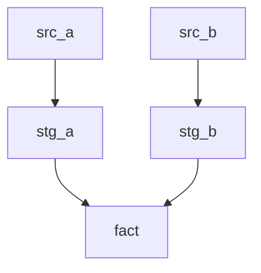

Model lineage (AI) — includes training edges + feedback loops:
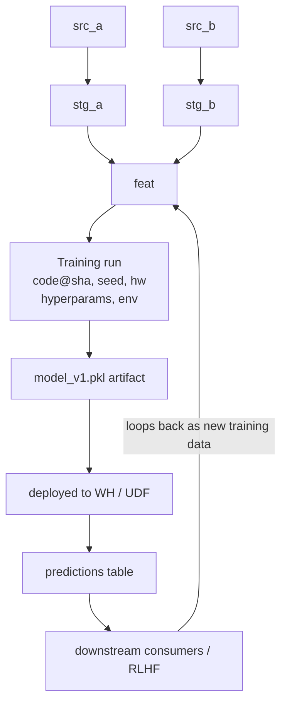

### Lab Exercise
```sql
-- Build a model-lineage table and populate from Snowflake's ACCOUNT_USAGE.
-- Using Horizon's native lineage view (GET_LINEAGE) + custom edges.

CREATE OR REPLACE TABLE GOVERNANCE.AI_RMF.MODEL_LINEAGE (
  model_name          STRING,
  model_version       STRING,
  training_dataset    STRING,       -- fully-qualified table
  training_code_sha   STRING,       -- git commit
  random_seed         NUMBER,
  framework_version   STRING,
  hyperparameters     VARIANT,
  trained_at          TIMESTAMP_NTZ,
  trained_by          STRING,
  parent_model        STRING        -- for fine-tunes / RLHF loops
);

-- Query Horizon lineage for upstream data of the training dataset
SELECT *
FROM TABLE(SNOWFLAKE.CORE.GET_LINEAGE(
  'ML.PROD.TRAINING_DATASET_V3', 'TABLE', 'UPSTREAM'
));

-- Join with model registry to produce a full lineage DAG query
SELECT
  l.model_name, l.model_version,
  up.source_object_name   AS raw_source,
  up.distance             AS hops_from_training_set,
  l.training_code_sha, l.random_seed, l.hyperparameters
FROM GOVERNANCE.AI_RMF.MODEL_LINEAGE l
JOIN TABLE(SNOWFLAKE.CORE.GET_LINEAGE(l.training_dataset, 'TABLE', 'UPSTREAM')) up;
```

### Gotchas / Exam Traps
- **ACCESS_HISTORY** tells you *who read what*, not *what trained from what*. For training lineage you need explicit instrumentation (model registry + training-run logs) in addition to Horizon's object dependencies.
- Snowflake's **OBJECT_DEPENDENCIES** view captures structural dependencies (views → tables); it does not capture ML training edges.
- A fine-tuned model has a `parent_model` edge — exam may test whether lineage must traverse fine-tuning (yes).

---

## Q5: What is the difference between demographic parity and equal opportunity as fairness metrics, and why does Snowflake make neither a default?

**Difficulty:** Advanced
**Exam relevance:** Fairness metrics, responsible AI

### Answer
- **Demographic parity (statistical parity):** P(ŷ=1 | A=a) = P(ŷ=1 | A=b) — selection rates equal across groups.
- **Equal opportunity:** P(ŷ=1 | Y=1, A=a) = P(ŷ=1 | Y=1, A=b) — true-positive rates equal across groups (conditioned on the actual positive class).

Snowflake doesn't default to either because fairness is **context-dependent and often mutually exclusive** (Chouldechova 2017: you cannot satisfy demographic parity + equalized odds + calibration simultaneously when base rates differ). The platform supplies the measurement substrate (SQL + Cortex functions + ML model monitoring) and lets governance teams pick the metric aligned to their legal/ethical context.

### First Principles
Fairness is not a property; it's a choice between competing fairness definitions, each embedding a value judgment:
- Demographic parity → outcome equality, ignores ground truth.
- Equal opportunity → procedural fairness among qualified individuals.
- Calibration → predictions mean the same thing across groups.

The impossibility theorem (Kleinberg/Chouldechova) forces trade-offs. A platform that *imposed* one metric would make a political choice for its customers; a platform that *measures* all three leaves the choice to the deployer — the position both EU AI Act (Art. 10 says "appropriate" measures) and NIST RMF take.

### Diagram

Confusion matrix (per group a / b):

| Pred \ Actual | y=1 | y=0 |
|---|---|---|
| ŷ=1 | TP | FP |
| ŷ=0 | FN | TN |

Fairness definitions:
- Demographic parity: (TP+FP)/N_a = (TP+FP)/N_b
- Equal opportunity: TP/(TP+FN)_a = TP/(TP+FN)_b (TPR equal)
- Equalized odds: TPR equal AND FPR equal
- Predictive parity: PPV equal across groups
- Calibration: P(y=1|score=s,A=a) = P(y=1|score=s,A=b)

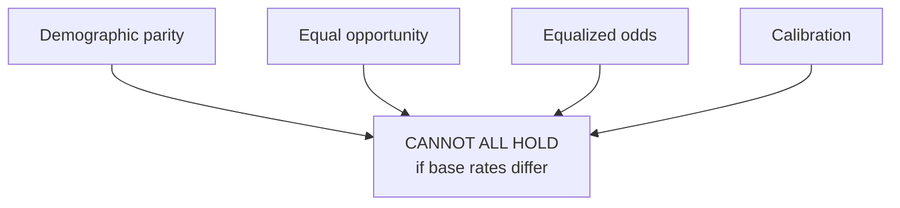

### Lab Exercise
```sql
-- Compute demographic parity + equal opportunity on a predictions table.
WITH labeled AS (
  SELECT
    protected_attr,       -- e.g., 'female' / 'male'
    actual_label,
    predicted_label
  FROM ML.PROD.LOAN_PREDICTIONS
  WHERE prediction_date >= DATEADD('day', -30, CURRENT_DATE())
),
by_group AS (
  SELECT
    protected_attr,
    COUNT(*)                                         AS n,
    SUM(IFF(predicted_label=1,1,0))                  AS n_pos_pred,
    SUM(IFF(actual_label=1,1,0))                     AS n_pos_actual,
    SUM(IFF(predicted_label=1 AND actual_label=1,1,0)) AS tp
  FROM labeled GROUP BY 1
)
SELECT
  protected_attr,
  n_pos_pred::FLOAT / n           AS selection_rate,       -- demographic parity
  tp::FLOAT / NULLIF(n_pos_actual,0) AS tpr                 -- equal opportunity
FROM by_group;
-- An auditor compares the ratios: < 0.8 ratio = 4/5ths rule violation (EEOC).
```

### Gotchas / Exam Traps
- "**4/5ths rule**" (EEOC) is a US employment-law heuristic (ratio of selection rates ≥ 0.8); it's a *legal threshold*, not a mathematical definition of fairness.
- Fairness metrics require **ground-truth labels** — you can measure demographic parity without them, but not equal opportunity.
- Protected attributes may themselves be sensitive — storing them for measurement needs its own access policy (see domain 04).

---

## Q6: How does Snowflake Horizon operationalize NIST AI RMF's "Measure" function for an LLM application?

**Difficulty:** Intermediate
**Exam relevance:** Horizon Catalog + Measure function

### Answer
Horizon operationalizes **Measure** through five layered capabilities:
1. **Discovery (Catalog)** — surfaces all AI assets (tables, models, apps) so measurement scope is complete.
2. **Classification** — auto-labels columns (PII, PHI, PCI), feeding into risk scoring.
3. **Lineage** — enables measuring *where* a risky input flows (impact analysis).
4. **Access History & Query History** — enables measuring *who used the model, how often, with what inputs.*
5. **Trust Center** — produces a continuously scored posture metric across security + governance controls.

For LLM apps specifically, **Cortex AI Observability** adds prompt/response logging, token usage, and evaluation metrics (faithfulness, relevance, groundedness).

### First Principles
NIST RMF's "Measure" is about *continuous quantitative assessment*, not one-off tests. Measurement must be: (a) always-on (not sampled), (b) at the granularity of the risk (per-request for LLMs), and (c) correlatable with system state. Horizon's design — metadata is a first-class citizen stored in ACCOUNT_USAGE, queryable with standard SQL — makes measurement a *data problem* rather than a *tooling problem*. The alternative (external observability stacks) breaks when the lineage edges cross tool boundaries.

### Diagram
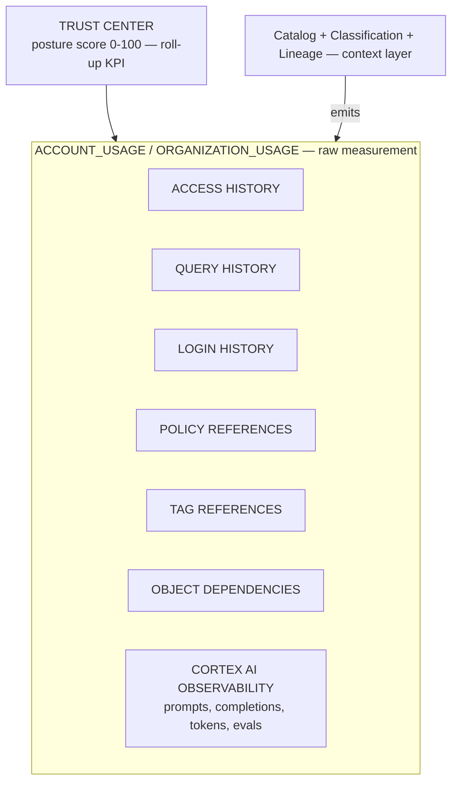

### Lab Exercise
```sql
-- Measure LLM usage posture: inputs with PII, which users invoked, token spend.

-- 1. Find columns classified as PII that are used as LLM inputs via Cortex.
WITH pii_cols AS (
  SELECT table_catalog, table_schema, table_name, column_name
  FROM SNOWFLAKE.ACCOUNT_USAGE.DATA_CLASSIFICATION_LATEST
  WHERE semantic_category IN ('EMAIL','NAME','PHONE','SSN')
),
cortex_calls AS (
  SELECT query_id, user_name, query_text, start_time, total_elapsed_time
  FROM SNOWFLAKE.ACCOUNT_USAGE.QUERY_HISTORY
  WHERE query_text ILIKE '%SNOWFLAKE.CORTEX.COMPLETE%'
    AND start_time >= DATEADD('day',-7,CURRENT_TIMESTAMP())
)
SELECT c.user_name, p.table_name, p.column_name, COUNT(*) AS calls
FROM cortex_calls c
JOIN pii_cols p
  ON c.query_text ILIKE '%' || p.column_name || '%'
GROUP BY ALL
ORDER BY calls DESC;

-- 2. Pull Trust Center scorecard (requires enablement)
SELECT * FROM SNOWFLAKE.TRUST_CENTER.FINDINGS
WHERE at_risk IS TRUE AND severity IN ('HIGH','CRITICAL');
```

### Gotchas / Exam Traps
- **ACCOUNT_USAGE has latency** (up to ~45 min for most views, 2h for some). For near-real-time measurement use **INFORMATION_SCHEMA** or event tables.
- Trust Center requires explicit enablement and a role with the right privileges (`SNOWFLAKE.TRUST_CENTER_ADMIN`).
- Cortex AI Observability writes to event tables you provision — it's not automatic without configuration.

---

## Q7: An auditor asks: "Prove that no model trained on EU-citizen data was deployed to US-only workloads." How do you answer in Snowflake?

**Difficulty:** Advanced
**Exam relevance:** Cross-border governance, lineage + tagging

### Answer
You produce a query that joins three facts:
1. **Data residency tag** on upstream tables (`DATA_RESIDENCY='EU'`).
2. **Lineage** linking those tables to a training dataset to a model.
3. **Deployment target tag** on the model/UDF/warehouse (`DEPLOYMENT_REGION`).

If any model has an EU-sourced upstream and a US-only deployment target, it's a violation. The audit evidence is the reproducible query itself + its ACCESS_HISTORY entry.

### First Principles
Residency compliance is a graph-reachability problem: "is there a path from an EU-tagged node to a non-EU deployment node?" Classical access controls (RBAC) cannot answer this because they don't model data flow. Lineage + tags make it a SQL join. Snowflake's single-source-of-truth metadata (ACCOUNT_USAGE + Horizon) is what makes this feasible — the alternative is manual spreadsheet reconciliation across teams, which fails every real audit.

### Diagram
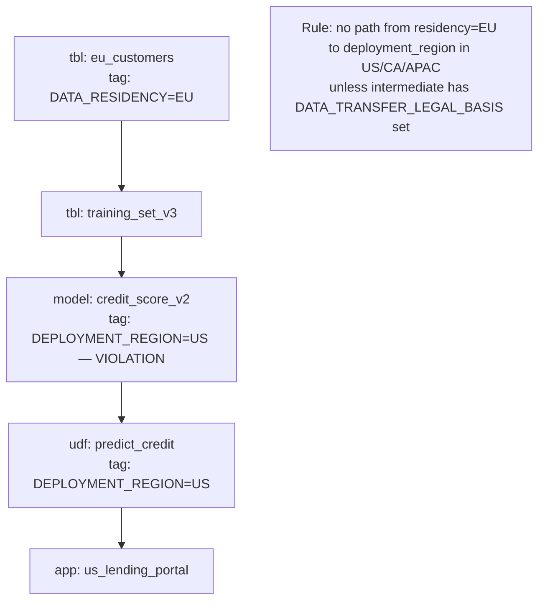

### Lab Exercise
```sql
-- Residency + deployment conflict detection
WITH eu_sources AS (
  SELECT object_name
  FROM SNOWFLAKE.ACCOUNT_USAGE.TAG_REFERENCES
  WHERE tag_name = 'DATA_RESIDENCY' AND tag_value = 'EU'
),
model_deployments AS (
  SELECT object_name AS model_name, tag_value AS deployment_region
  FROM SNOWFLAKE.ACCOUNT_USAGE.TAG_REFERENCES
  WHERE tag_name = 'DEPLOYMENT_REGION'
    AND domain = 'MODEL'
)
SELECT DISTINCT md.model_name, md.deployment_region, es.object_name AS eu_source
FROM model_deployments md
JOIN GOVERNANCE.AI_RMF.MODEL_LINEAGE ml
  ON ml.model_name = md.model_name
JOIN TABLE(SNOWFLAKE.CORE.GET_LINEAGE(ml.training_dataset,'TABLE','UPSTREAM')) up
  ON TRUE
JOIN eu_sources es
  ON up.source_object_name = es.object_name
WHERE md.deployment_region NOT IN ('EU','EU_WEST','EU_CENTRAL');
-- Any row returned is an audit finding.
```

### Gotchas / Exam Traps
- Tag propagation **does not** automatically copy from upstream to downstream — you must either (a) propagate manually, or (b) query the lineage graph. Many candidates assume automatic propagation.
- Replication to another region creates a **copy**, not a lineage edge in the receiving account — residency controls must gate replication itself (Replication Groups + Failover Groups).

---

## Q8: What are the OECD AI Principles, and how do they relate to the frameworks tested on GAS-C01?

**Difficulty:** Foundation
**Exam relevance:** OECD AI Principles context

### Answer
The OECD AI Principles (2019, updated 2024) are the first intergovernmental AI standard, adopted by 47 countries including the US and EU members. Five value-based principles:
1. Inclusive growth, sustainable development, and well-being.
2. Human rights and democratic values, including fairness and privacy.
3. Transparency and explainability.
4. Robustness, security, and safety.
5. Accountability.

Plus five government recommendations (investment, enabling ecosystem, policy environment, international cooperation, measurement).

Relation: NIST AI RMF, EU AI Act, and ISO 42001 all cite OECD Principles as a conceptual foundation. For GAS-C01, know they exist as the **conceptual root**; detailed implementation is tested through NIST/EU/ISO.

### First Principles
The OECD Principles were deliberately high-level to achieve consensus across jurisdictions with different legal traditions. Their value is as a **common vocabulary** — when the EU AI Act talks about "trustworthy AI," it's using OECD terminology. Snowflake aligns product capabilities to these principles in marketing/positioning (e.g., "Trust Center" = accountability + security pillars).

### Diagram
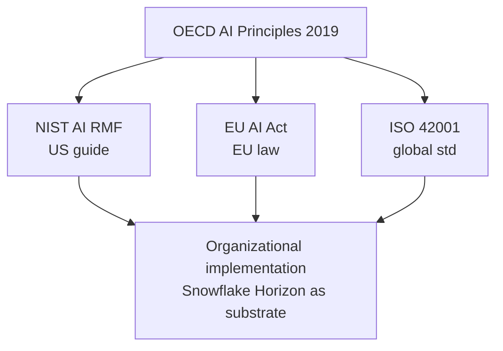

### Lab Exercise
```sql
-- Not applicable (conceptual). Instead, map Horizon features to principles:

CREATE OR REPLACE TABLE GOVERNANCE.AI_RMF.PRINCIPLE_MAPPING (
  framework STRING, principle STRING, snowflake_feature STRING
);
INSERT INTO GOVERNANCE.AI_RMF.PRINCIPLE_MAPPING VALUES
  ('OECD','Transparency','Horizon Catalog + Lineage'),
  ('OECD','Accountability','Trust Center + Access History'),
  ('OECD','Robustness','Cortex Guard + Model Monitoring'),
  ('OECD','Human rights/privacy','Masking + Row Access + Agg policies'),
  ('OECD','Inclusive growth','Snowpark + Native Apps (open ecosystem)');
```

### Gotchas / Exam Traps
- OECD Principles are **non-binding**. The G20 AI Principles (2019) adopt OECD language verbatim.
- Updated 2024 version adds explicit coverage of generative AI (misinformation, info integrity).

---

## Q9: What is the NIST Generative AI Profile (NIST AI 600-1), and which risks does it add beyond the core AI RMF?

**Difficulty:** Intermediate
**Exam relevance:** GenAI Profile — 12 risk categories

### Answer
NIST AI 600-1 (July 2024) is a **companion** to the AI RMF 1.0 that catalogues 12 risks unique or amplified for generative AI:

1. **CBRN information** — chemical, biological, radiological, nuclear harm uplift.
2. **Confabulation** — plausible-sounding false outputs ("hallucination").
3. **Dangerous/violent/hateful content**.
4. **Data privacy** — training data extraction, membership inference, PII leakage.
5. **Environmental impacts** — energy/water use.
6. **Harmful bias/homogenization**.
7. **Human-AI configuration** — over-reliance, automation bias.
8. **Information integrity** — misinformation, deepfakes.
9. **Information security** — prompt injection, model theft, jailbreaks.
10. **Intellectual property** — training data IP, output IP.
11. **Obscene, degrading, abusive content (CSAM)**.
12. **Value chain / component integration** — opaque upstream model risks.

For each, the Profile lists suggested actions mapped to RMF functions (Govern/Map/Measure/Manage).

### First Principles
GenAI breaks several assumptions of pre-generative ML: outputs are open-ended (not classification/regression), training data is web-scale and can memorize, deployments are user-facing with natural-language inputs. These shift the attack surface and the risk categories. The Profile exists to re-anchor the RMF to those shifts without rewriting it.

### Diagram

GenAI Profile — risk to Snowflake control map:

| Risk | Mitigation |
|---|---|
| Confabulation | Cortex Search (grounding) + eval |
| Data privacy | Masking + Cortex Guard + classif |
| Harmful bias | Model Monitoring + fairness SQL |
| Info security | Cortex Guard (prompt injection) |
| Human-AI config | Row access (HITL) + audit |
| IP | Lineage of training data |
| Value chain | Tags + lineage of external models |
| CBRN | Cortex Guard content filters |

### Lab Exercise
```sql
-- Register per-model residual risk against the GenAI Profile categories.
CREATE TABLE GOVERNANCE.AI_RMF.GENAI_RISK_REGISTER (
  model_name STRING,
  risk_category STRING,   -- from NIST AI 600-1 list
  residual_rating STRING, -- LOW/MED/HIGH/CRITICAL
  mitigation STRING,
  owner STRING,
  reviewed_at TIMESTAMP_NTZ
);

INSERT INTO GOVERNANCE.AI_RMF.GENAI_RISK_REGISTER VALUES
  ('CLINICAL_SUMMARIZER','CONFABULATION','MEDIUM',
   'Cortex Search grounding + clinician HITL','clinical-ai@co','2026-10-30'),
  ('CLINICAL_SUMMARIZER','DATA_PRIVACY','LOW',
   'All PHI columns masked pre-inference','clinical-ai@co','2026-10-30');
```

### Gotchas / Exam Traps
- "Hallucination" is the colloquial term; NIST uses **confabulation**.
- CBRN risk is specifically **uplift** — making dangerous info easier to get, not creating new risk.
- The Profile is a **companion** doc, not a replacement — exam may test knowing both exist.

---

## Q10: Explain the concept of a "model card" and where it fits in a Snowflake AI governance program.

**Difficulty:** Foundation
**Exam relevance:** Transparency artifacts, EU AI Act Art. 11 technical documentation

### Answer
A **model card** is a standardized document (introduced Mitchell et al. 2019) summarizing a model's intended use, training data, performance across subgroups, limitations, ethical considerations, and version. Both the EU AI Act (Art. 11 for high-risk, Art. 53 for GPAI) and ISO 42001 (Clause 7.5) require equivalent documentation.

In Snowflake, model cards live naturally as:
- Rows in a `MODEL_CARDS` table with VARIANT columns, or
- Attached as COMMENT metadata on model objects, or
- Linked via tag reference to a Native App.

The Cortex Model Registry supports structured metadata that functions as model-card content.

### First Principles
Transparency is a precondition for accountability — without a public (or at least auditor-visible) description of a model's intended scope and known limitations, downstream users cannot assess suitability. The model card standardizes *what questions to answer* so comparison across models is possible. Treating the card as data (not a PDF) means it's queryable, versionable, and lineage-attached.

### Diagram
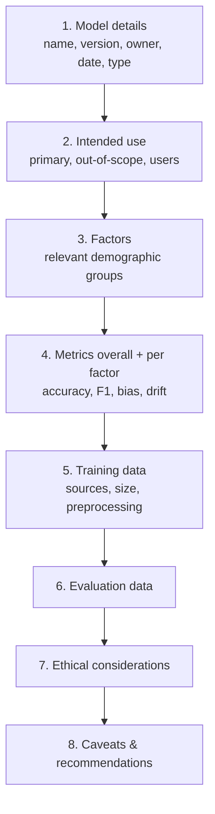

### Lab Exercise
```sql
CREATE TABLE GOVERNANCE.AI_RMF.MODEL_CARDS (
  model_name       STRING,
  model_version    STRING,
  card             VARIANT,   -- JSON of all 8 sections
  created_at       TIMESTAMP_NTZ,
  created_by       STRING,
  PRIMARY KEY (model_name, model_version)
);

INSERT INTO GOVERNANCE.AI_RMF.MODEL_CARDS
SELECT
  'LOAN_SCORER','v2.1',
  OBJECT_CONSTRUCT(
    'intended_use', 'Score consumer unsecured loans in US only',
    'out_of_scope', 'Business loans; non-US jurisdictions',
    'factors', ARRAY_CONSTRUCT('age_band','race','gender','state'),
    'metrics', OBJECT_CONSTRUCT(
       'auc',0.84,'demographic_parity_ratio',0.86,'equal_opp_ratio',0.91),
    'training_data', 'LOAN_HISTORY 2018-2024, 2.3M rows',
    'ethical', 'Disparate impact monitored monthly; owner: risk-ai@co',
    'caveats', 'Not valid for borrowers under age 21'),
  CURRENT_TIMESTAMP(), CURRENT_USER();
```

### Gotchas / Exam Traps
- EU AI Act requires **technical documentation** (Art. 11) which is broader than a model card but includes model-card content.
- GPAI providers must publish a **training data summary** (not full dataset) — this is new in the Act.
- Model cards are **per-version** — a fine-tune gets its own card.

---

## Q11: An AI incident is defined by NIST how, and what Snowflake capabilities support incident response?

**Difficulty:** Intermediate
**Exam relevance:** Incident management under RMF Manage function

### Answer
NIST defines an **AI incident** as "an event, circumstance, or series of events where the development, use, or malfunction of one or more AI systems directly or indirectly leads to actual or potential harm." Snowflake incident-response capabilities:

- **ACCESS_HISTORY / QUERY_HISTORY** — forensic reconstruction of what the model saw and who invoked it.
- **Cortex AI Observability** — prompt/response capture.
- **Time Travel** — recover pre-incident state of data (up to 90 days on Enterprise+).
- **Fail-safe** — 7-day disaster recovery window.
- **Model Registry versioning** — roll back to prior model version.
- **Row access policies** — add emergency blocklist row.
- **Tag-driven policies** — flip a `KILL_SWITCH='TRUE'` tag that any policy inspects.
- **Trust Center alerts** — detect misconfigurations contributing to the incident.

### First Principles
Incident response needs three capabilities: *detect*, *contain*, *investigate*. Snowflake separates these cleanly: Trust Center + alerts detect, policies + tags contain (fast, reversible), Access/Query History investigate (immutable record). The design pattern is that **containment should not require code deploys** — flipping a tag is faster and auditable, which matches NIST's "ability to respond quickly" criterion.

### Diagram
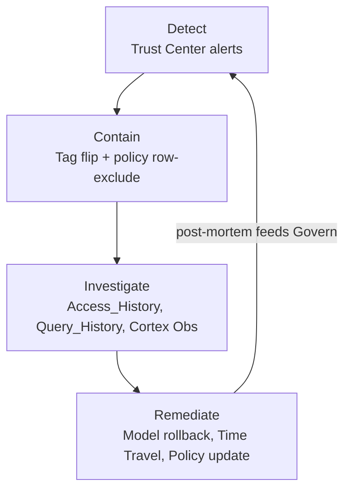

### Lab Exercise
```sql
-- Emergency kill-switch pattern: a tag read by a row-access policy.
USE ROLE SECURITYADMIN;

CREATE TAG GOVERNANCE.AI_RMF.KILL_SWITCH ALLOWED_VALUES 'TRUE','FALSE';

CREATE OR REPLACE ROW ACCESS POLICY GOVERNANCE.AI_RMF.P_KILL_AWARE
AS () RETURNS BOOLEAN ->
  (SELECT MAX(tag_value)
   FROM TABLE(SNOWFLAKE.CORE.GET_TAG_REFERENCES_ON_OBJECT(
     'ML.PROD.LOAN_SCORER_OUTPUT','TABLE'))
   WHERE tag_name = 'KILL_SWITCH') != 'TRUE';

ALTER TABLE ML.PROD.LOAN_SCORER_OUTPUT
  ADD ROW ACCESS POLICY GOVERNANCE.AI_RMF.P_KILL_AWARE ON ();

-- During incident:
ALTER TABLE ML.PROD.LOAN_SCORER_OUTPUT
  SET TAG GOVERNANCE.AI_RMF.KILL_SWITCH = 'TRUE';
-- All reads immediately return empty; model is effectively off.
```

### Gotchas / Exam Traps
- `UNDROP` works up to Time Travel retention; **fail-safe is not user-accessible** (requires Snowflake Support).
- ACCESS_HISTORY retention is **365 days** in ACCOUNT_USAGE regardless of account edition.
- You can't roll back a model with Time Travel directly — the Model Registry stores versions explicitly.

---

## Q12: Differentiate "AI governance" from "AI security" and explain why Snowflake positions them as one specialty exam.

**Difficulty:** Foundation
**Exam relevance:** Scope framing for GAS-C01

### Answer
- **AI governance** addresses *appropriate use, fairness, transparency, accountability, lifecycle oversight* — "are we doing the right thing with AI?"
- **AI security** addresses *confidentiality, integrity, availability of AI assets and their inputs/outputs* — "are we protecting the AI?"

Snowflake fuses them because the controls overlap heavily: tags that drive governance also drive security policies; the same ACCESS_HISTORY serves both audit (governance) and intrusion detection (security); masking policies protect PII (security) and support consent (governance). Horizon is the single control plane.

### First Principles
Historically these were separate — governance in the compliance team, security in InfoSec. For AI, the attack vectors (prompt injection, data poisoning, model inversion) have governance consequences (bias, leaked PII, discriminatory outputs). Treating them separately creates control gaps. The unified exam reflects the unified product reality.

### Diagram
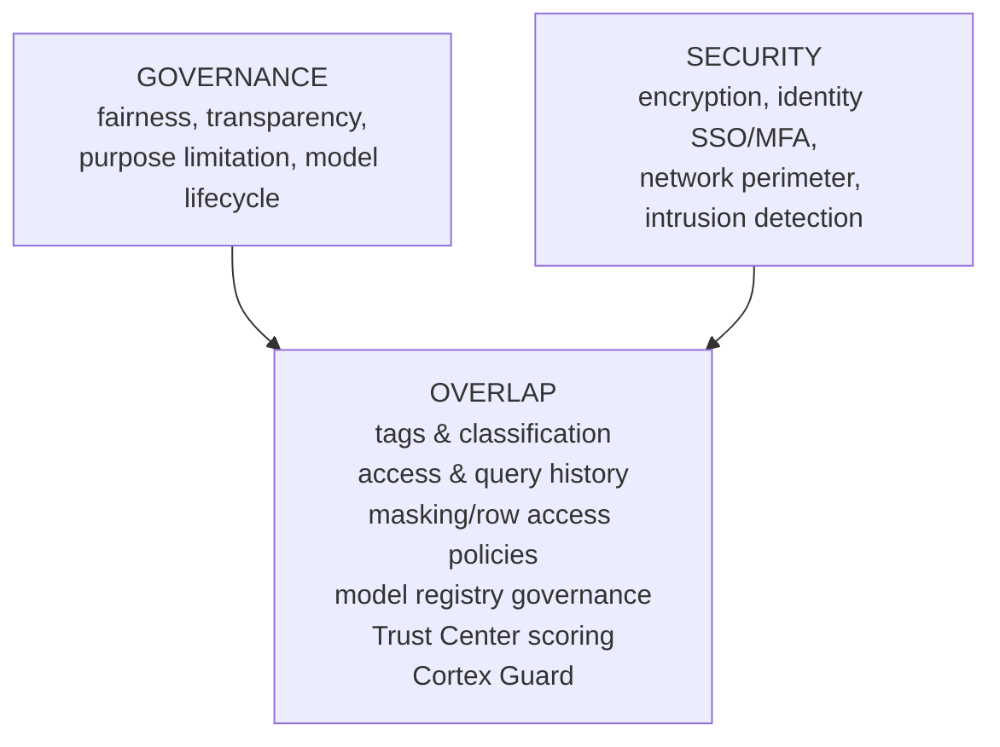

### Lab Exercise
```sql
-- A tag feeds BOTH a security policy (encrypt-at-rest check) AND a governance
-- policy (consent-check). One source of truth.

CREATE TAG GOVERNANCE.AI_RMF.SENSITIVITY
  ALLOWED_VALUES 'PUBLIC','INTERNAL','CONFIDENTIAL','RESTRICTED';

-- Security use: audit which RESTRICTED tables lack row-access policy
SELECT tr.object_name
FROM SNOWFLAKE.ACCOUNT_USAGE.TAG_REFERENCES tr
LEFT JOIN SNOWFLAKE.ACCOUNT_USAGE.POLICY_REFERENCES pr
  ON pr.ref_entity_name = tr.object_name AND pr.policy_kind = 'ROW_ACCESS_POLICY'
WHERE tr.tag_name = 'SENSITIVITY' AND tr.tag_value = 'RESTRICTED'
  AND pr.policy_name IS NULL;

-- Governance use: same tag drives consent check in a masking policy
CREATE MASKING POLICY GOVERNANCE.AI_RMF.MP_CONSENT_AWARE
AS (val STRING) RETURNS STRING ->
  CASE WHEN SYSTEM$GET_TAG_ON_CURRENT_COLUMN(
        'GOVERNANCE.AI_RMF.SENSITIVITY') IN ('CONFIDENTIAL','RESTRICTED')
       AND NOT EXISTS (SELECT 1 FROM GOVERNANCE.CONSENT
                       WHERE user_name = CURRENT_USER()
                         AND granted = TRUE) THEN '***'
       ELSE val END;
```

### Gotchas / Exam Traps
- Expect questions phrased as "Is X a governance or security control?" where the answer is "both."
- The exam blueprint lists them as separate domains but overlapping objectives — don't memorize them as disjoint.

---

## Q13: What is "purpose limitation" in AI/data governance, and how is it enforced technically in Snowflake?

**Difficulty:** Intermediate
**Exam relevance:** GDPR Art. 5(1)(b), consent management for AI training

### Answer
**Purpose limitation** (GDPR Art. 5(1)(b)): personal data collected for one specified purpose cannot be processed for an incompatible purpose. For AI, this is critical because training on data collected for "service delivery" and using it for "model training" is typically a *new* purpose requiring new legal basis.

Technical enforcement in Snowflake:
1. **Tags** encode purpose on each column/table (`PURPOSE='service_delivery'`).
2. **Row-access policies** check consent for each row's declared purposes.
3. **Masking policies** redact when the invoking role's purpose doesn't match.
4. **Lineage** audits whether data flowed into a disallowed purpose.
5. **Access history** reconstructs post-hoc whether a query served the declared purpose.

### First Principles
Purpose is a *semantic* property that can't be inferred from a column's data type — email can be used for marketing, authentication, or password reset. Encoding purpose as metadata (tags) and binding policy evaluation to that metadata is the only scalable approach. The alternative (duplicating data per purpose) breaks lineage and bloats storage.

### Diagram
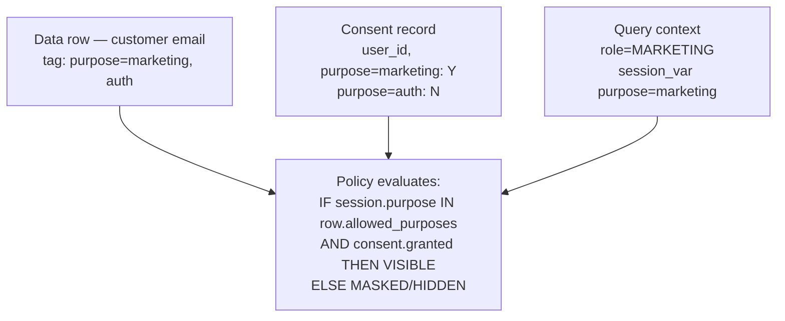

### Lab Exercise
```sql
-- Encode purpose + consent and gate access
CREATE TABLE GOVERNANCE.CONSENT (
  data_subject_id STRING,
  purpose STRING,
  granted BOOLEAN,
  granted_at TIMESTAMP_NTZ
);

-- Session-level declared purpose
EXECUTE IMMEDIATE $$
BEGIN
  LET session_purpose STRING := 'MODEL_TRAINING';
  EXECUTE IMMEDIATE 'SET SESSION_PURPOSE = ''' || :session_purpose || '''';
END;
$$;

CREATE ROW ACCESS POLICY GOVERNANCE.AI_RMF.P_PURPOSE_LIMIT
AS (data_subject_id STRING, allowed_purposes ARRAY) RETURNS BOOLEAN ->
  ARRAY_CONTAINS($SESSION_PURPOSE::VARIANT, allowed_purposes)
  AND EXISTS (SELECT 1 FROM GOVERNANCE.CONSENT c
              WHERE c.data_subject_id = data_subject_id
                AND c.purpose = $SESSION_PURPOSE
                AND c.granted = TRUE);

ALTER TABLE CUSTOMERS
  ADD ROW ACCESS POLICY GOVERNANCE.AI_RMF.P_PURPOSE_LIMIT
    ON (customer_id, allowed_purposes);
```

### Gotchas / Exam Traps
- GDPR allows "compatible" secondary uses (Art. 6(4)) — compatibility is case-by-case; the controller must assess.
- Pseudonymization (Art. 25) can enable broader secondary use but doesn't remove GDPR applicability.
- "Statistical purposes" (Art. 89) have special carve-outs — can be relevant for aggregated model training.

---

## Q14: Why is explainability a governance requirement for high-stakes AI, and what Snowflake-friendly techniques exist?

**Difficulty:** Intermediate
**Exam relevance:** Explainability under EU AI Act Art. 13, 14

### Answer
Explainability is required because:
- **Legal** — EU AI Act Art. 13 (transparency to users), GDPR Art. 22 (right to explanation for automated decisions).
- **Operational** — debugging, auditing, trust-building.
- **Ethical** — contestability by affected individuals.

Snowflake-friendly techniques:
1. **SHAP values** computed in Snowpark + stored as a column alongside each prediction.
2. **Feature importance** from Snowflake ML models exposed via `GET_FEATURE_IMPORTANCE()`.
3. **Counterfactual explanations** generated via Snowpark Python UDF.
4. **Reasoning traces** from Cortex `COMPLETE` with structured output (chain-of-thought captured).
5. **Example-based** — "nearest neighbors" from Cortex Search as explanations.

### First Principles
Automated decision-making concentrates causal responsibility in opaque systems. The right to contest requires a *grounds* for contestation — contestability without reasons is theater. Snowflake's integration of ML (Snowpark ML, Cortex ML Functions) with its data plane makes it natural to compute, store, and audit explanations as *data*, which is the governance-friendly form.

### Diagram

Prediction + explanation table:

| prediction_id | score | decision | top_features | shap_vals |
|---|---|---|---|---|
| p-001 | 0.73 | APPROVE | [income,credit,age] | [.3,.2,.1] |
| p-002 | 0.21 | DENY | [debt_ratio,late_pay] | [.4,.2] |

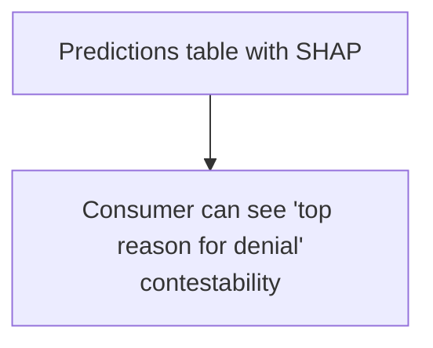

### Lab Exercise
```sql
-- Store SHAP alongside predictions
CREATE TABLE ML.PROD.PREDICTIONS_EXPLAINED (
  prediction_id STRING,
  model_version STRING,
  score FLOAT,
  decision STRING,
  shap VARIANT,                   -- {feature:value, feature:value}
  top3_features ARRAY,
  explanation_text STRING,
  predicted_at TIMESTAMP_NTZ
);

-- Snowflake ML has native explain
SELECT
  MODEL_PRED_ID AS prediction_id,
  MODEL!PREDICT(INPUT_DATA => {*})           AS score,
  MODEL!EXPLAIN(INPUT_DATA => {*})           AS shap
FROM NEW_APPLICATIONS;
```

### Gotchas / Exam Traps
- GDPR Art. 22 right-to-explanation is **contested in interpretation** — many practitioners treat it as "meaningful information" rather than full technical explanation.
- SHAP is *local* (per-prediction); feature importance is *global* — they answer different questions.
- Explanations themselves can leak training-data details (membership inference) — treat explanation storage with the same classification as inputs.

---

## Q15: Describe the "AI value chain" concept in governance frameworks and the Snowflake controls that address value-chain risk.

**Difficulty:** Advanced
**Exam relevance:** NIST GenAI Profile, EU AI Act GPAI value chain

### Answer
The **AI value chain** is the sequence of actors: foundation-model developer → fine-tuner → application integrator → deployer → end-user. Each handoff creates a governance gap because downstream parties may lack visibility into upstream training data, evaluations, and known risks.

Snowflake value-chain controls:
1. **Model Registry** stores provenance (parent model, fine-tuning dataset) as metadata.
2. **Native Apps** package AI logic with manifest declaring data access needs — consumer can audit before install.
3. **Cortex functions** on managed foundation models carry Snowflake's attestations (SOC 2, etc.).
4. **Lineage** across cross-account shares (External Data Sharing with provenance).
5. **Tags on models** (`SOURCE='bedrock-claude'`, `FINE_TUNED_FROM='base-v1'`).
6. **Clean Rooms** for sharing training data without disclosing it.

### First Principles
Trust must be *delegable*. If every deployer re-audits every foundation model, nothing scales. The framework-level answer is "upstream parties produce attestations and documentation; downstream parties verify they're sufficient." Snowflake makes this concrete: a Native App's manifest and model-registry metadata are the attestation substrate.

### Diagram
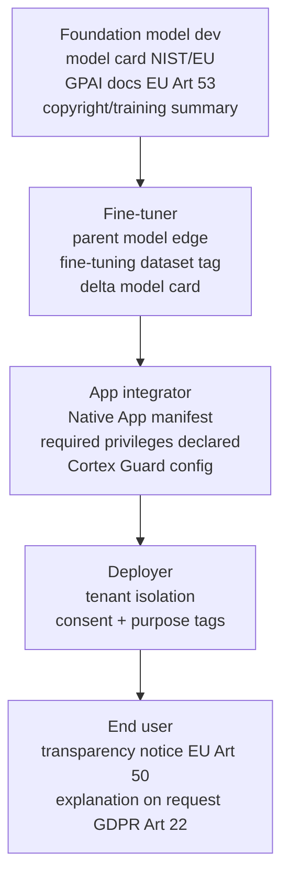

### Lab Exercise
```sql
-- Model-registry entry capturing value-chain metadata
CREATE OR REPLACE TABLE GOVERNANCE.AI_RMF.VALUE_CHAIN_LEDGER (
  model_name STRING, model_version STRING,
  foundation_model STRING,          -- e.g., 'claude-3-5-sonnet'
  foundation_provider STRING,
  fine_tune_dataset STRING,
  fine_tune_approver STRING,
  gpai_system_doc_link STRING,
  copyright_summary_link STRING,
  registered_at TIMESTAMP_NTZ
);

-- Query: which deployed models rely on a now-deprecated upstream?
SELECT * FROM GOVERNANCE.AI_RMF.VALUE_CHAIN_LEDGER
WHERE foundation_model IN (
  SELECT model FROM GOVERNANCE.DEPRECATED_UPSTREAM
);
```

### Gotchas / Exam Traps
- EU AI Act **Art. 25** places liability on the party that "substantially modifies" a model — fine-tuning typically qualifies.
- GPAI providers must share information with downstream deployers (Annex XII) — this is a *supply-chain documentation* obligation.

---

## Q16: What's the relationship between Trust Center and the governance frameworks you've seen so far?

**Difficulty:** Intermediate
**Exam relevance:** Trust Center as framework-implementation surface

### Answer
Trust Center is Snowflake's native security/governance posture-management product. It:
- Runs continuous **scanners** that check configuration against reference standards (CIS Snowflake Benchmark, Snowflake Security Reference Architecture).
- Produces **findings** with severity, remediation guidance, and references.
- Rolls up a **posture score** and tracks remediation over time.
- Supports **custom scanners** written as SQL.

It implements the "continuous monitoring" leg of NIST RMF Measure, ISO 42001 Clause 9 (Performance evaluation), and SOC 2 CC7 (System operations monitoring) — a single surface mapped to multiple frameworks.

### First Principles
Frameworks require *evidence of continuous compliance*, not point-in-time audits. Trust Center is Snowflake's answer: configuration drift is detected automatically, findings become tickets, and the posture score is a KPI that executives can track. It converts governance from a project to an operational discipline.

### Diagram
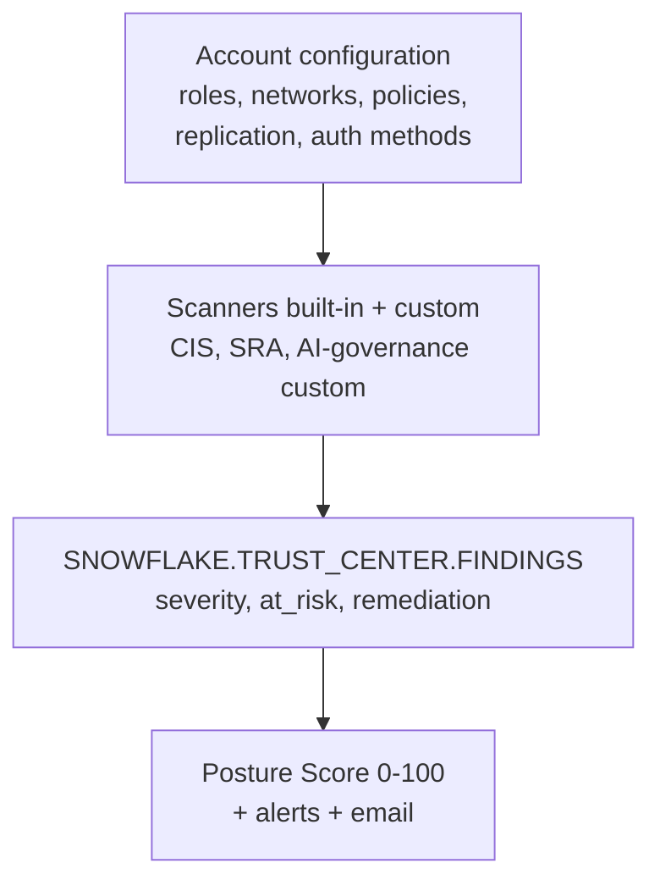

### Lab Exercise
```sql
USE ROLE ACCOUNTADMIN;
GRANT APPLICATION ROLE SNOWFLAKE.TRUST_CENTER_ADMIN TO ROLE SECURITY_OPS;

-- Enable a scanner package
CALL SNOWFLAKE.TRUST_CENTER.ENABLE_SCANNER_PACKAGE('CIS_BENCHMARKS');

-- Query critical findings
SELECT scanner_name, entity_name, severity, remediation
FROM SNOWFLAKE.TRUST_CENTER.FINDINGS
WHERE at_risk = TRUE AND severity IN ('CRITICAL','HIGH')
ORDER BY severity, scanner_name;

-- Custom scanner for AI: find untagged ML models
CREATE OR REPLACE PROCEDURE CHECK_MODEL_TAGGING()
RETURNS TABLE()
LANGUAGE SQL AS $$
BEGIN
  LET rs RESULTSET := (
    SELECT model_name
    FROM SNOWFLAKE.ML.MODELS
    WHERE model_name NOT IN (
      SELECT object_name FROM SNOWFLAKE.ACCOUNT_USAGE.TAG_REFERENCES
      WHERE tag_name = 'EU_AI_ACT_TIER'));
  RETURN TABLE(rs);
END; $$;
```

### Gotchas / Exam Traps
- Trust Center scanners run on a schedule — findings aren't instantaneous.
- The CIS Benchmark package covers security; **governance** scanners are often custom.
- Trust Center access requires the application role `SNOWFLAKE.TRUST_CENTER_VIEWER` or `TRUST_CENTER_ADMIN`.

---

## Q17: What are "responsible AI principles" per Snowflake's own published policy, and how do they translate to platform features?

**Difficulty:** Foundation
**Exam relevance:** Snowflake Responsible AI (align with product positioning)

### Answer
Snowflake's Responsible AI commitments typically align to these pillars (phrased slightly differently in marketing material but consistent in substance):

1. **Fairness & inclusion** — Cortex ML Observability + fairness SQL.
2. **Reliability & safety** — Cortex Guard, model monitoring, Trust Center.
3. **Privacy & security** — masking, external tokenization, row/aggregation policies, differential privacy (preview).
4. **Transparency & explainability** — Horizon Catalog, Lineage, model-explain functions.
5. **Accountability** — ACCESS_HISTORY, Model Registry, Trust Center scoring.
6. **Human oversight** — row-access policies that gate on `review_status`, Native App manifests.

### First Principles
Vendor principle statements only matter if backed by features. The GAS-C01 exam wants candidates who can trace a principle to a *concrete, examinable* Snowflake capability — not candidates who can recite marketing bullets. The pillars above all map 1:1 to features tested in subsequent domains.

### Diagram

Principle to feature matrix:

| Principle | Feature |
|---|---|
| Fairness | ML Observability, Snowpark SHAP |
| Reliability | Cortex Guard, Model Monitoring |
| Privacy | Masking, DP, Agg policies |
| Transparency | Horizon Catalog, Lineage |
| Accountability | Access_History, Model Registry |
| Human oversight | Row Access, Native App manifest |

### Lab Exercise
```sql
-- Verify every production model is covered by all six principles.
CREATE OR REPLACE VIEW GOVERNANCE.AI_RMF.V_RAI_COVERAGE AS
SELECT
  m.model_name, m.model_version,
  EXISTS (SELECT 1 FROM METRICS WHERE model=m.model_name AND metric='bias') AS fairness_ok,
  EXISTS (SELECT 1 FROM CORTEX_GUARD_CONFIG WHERE model=m.model_name)        AS safety_ok,
  EXISTS (SELECT 1 FROM MASKING_APPLIED WHERE source=m.training_dataset)     AS privacy_ok,
  EXISTS (SELECT 1 FROM MODEL_CARDS WHERE model=m.model_name)                AS transparency_ok,
  EXISTS (SELECT 1 FROM DEPLOYMENT_APPROVALS WHERE model=m.model_name)       AS accountability_ok,
  EXISTS (SELECT 1 FROM HITL_POLICIES WHERE target_model=m.model_name)       AS oversight_ok
FROM SNOWFLAKE.ML.MODELS m;
```

### Gotchas / Exam Traps
- These are **principles**, not **controls** — exam distractors may describe one as the other.
- "Human in the loop" (HITL) is a *method* for human oversight, not a synonym.

---

## Q18: An auditor requests "evidence of bias testing on each production model, dated within 30 days of deployment." How do you design this in Snowflake?

**Difficulty:** Advanced
**Exam relevance:** Audit evidence pipelines

### Answer
Design pattern:
1. A **required** stored procedure runs bias tests and inserts into `MODEL_METRICS` with `metric_name='bias_*'` on every model deploy.
2. **Deployment gate** (CI/CD or stored proc): the `DEPLOY_MODEL` procedure checks for recent metrics; refuses deploy if missing.
3. An **audit view** joins model registry with metrics filtered on date.
4. **Access History** on the audit view proves the auditor consulted it.
5. **Immutable store**: use Snowflake Data Clean Rooms or Iceberg tables with versioning for tamper-evidence.

### First Principles
Audit evidence must be: (a) auto-generated (humans forget), (b) tamper-evident (append-only), (c) queryable (not PDFs), (d) linked to the artifact it describes (model version). Pre-commit style gates — refuse to deploy without evidence — convert evidence collection from aspirational to mandatory.

### Diagram
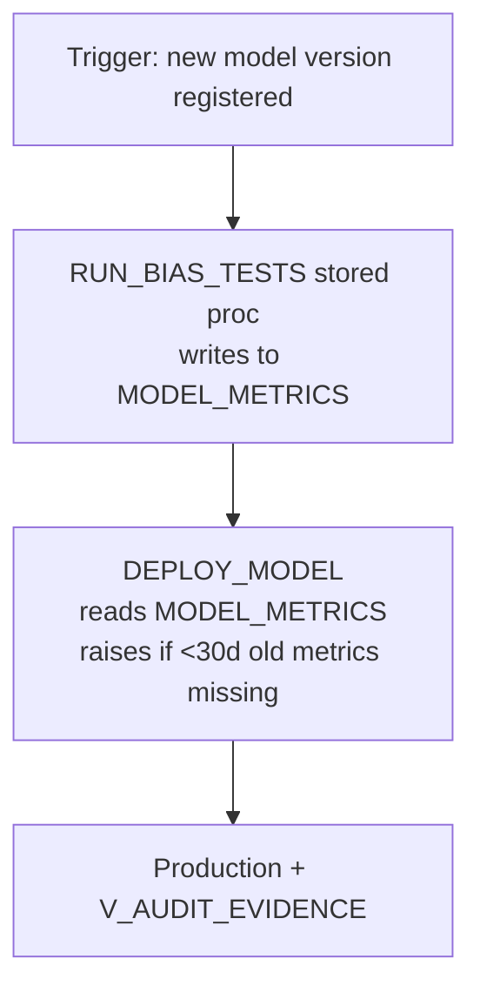

### Lab Exercise
```sql
CREATE OR REPLACE PROCEDURE DEPLOY_MODEL(MODEL STRING, VERSION STRING)
RETURNS STRING LANGUAGE SQL AS $$
DECLARE
  recent_bias_count INT;
BEGIN
  SELECT COUNT(*) INTO :recent_bias_count
  FROM GOVERNANCE.AI_RMF.MODEL_METRICS
  WHERE model_name = :MODEL AND version = :VERSION
    AND metric_name LIKE 'bias_%'
    AND measured_at >= DATEADD('day',-30,CURRENT_TIMESTAMP());
  IF (recent_bias_count = 0) THEN
    RETURN 'BLOCKED: bias metrics missing in last 30 days';
  END IF;
  -- proceed with deployment
  INSERT INTO GOVERNANCE.AI_RMF.DEPLOYMENT_APPROVALS
    VALUES (:MODEL, :VERSION, CURRENT_USER(), CURRENT_TIMESTAMP(), 'DEPLOYED');
  RETURN 'OK';
END; $$;

CREATE OR REPLACE VIEW GOVERNANCE.AI_RMF.V_AUDIT_EVIDENCE AS
SELECT m.model_name, m.version, m.metric_name, m.metric_value,
       m.measured_at, a.approver, a.approved_at
FROM GOVERNANCE.AI_RMF.MODEL_METRICS m
JOIN GOVERNANCE.AI_RMF.DEPLOYMENT_APPROVALS a
  USING (model_name, version)
WHERE m.measured_at BETWEEN DATEADD('day',-30,a.approved_at) AND a.approved_at;
```

### Gotchas / Exam Traps
- Audit evidence must be **immutable** — grant SELECT only on views, lock down DELETE/UPDATE on metrics tables via policy.
- Iceberg tables with time travel + Polaris Catalog can provide cross-platform tamper-evidence.

---

## Q19: What's the difference between a "foundation model" and a "general-purpose AI (GPAI) model" in regulatory language?

**Difficulty:** Intermediate
**Exam relevance:** EU AI Act terminology

### Answer
- **Foundation model** is an informal/academic term (Bommasani et al., Stanford 2021) — a model trained on broad data at scale, adaptable to many tasks.
- **GPAI model** is the EU AI Act's *legal* definition (Art. 3(63)): an AI model trained with a large amount of data using self-supervision at scale, displaying significant generality and competent to perform a wide range of distinct tasks.

A **GPAI system with systemic risk** (Art. 51) is additionally classified if training compute exceeds 10^25 FLOPs or by Commission designation.

For GAS-C01 purposes, "foundation" and "GPAI" are nearly synonymous but the Act uses GPAI consistently and imposes documentation obligations (Art. 53) on GPAI providers.

### First Principles
Legal regimes need bright-line definitions to be enforceable. "Foundation model" was coined to describe a research phenomenon; "GPAI" codifies it with measurable thresholds (compute as a proxy for capability). Snowflake-hosted Cortex functions call into GPAI models (Claude, Llama, etc.) — the account holder's obligations depend on their role (deployer vs. provider).

### Diagram
```mermaid
flowchart TD
    AI[AI system<br/>any AI, Act Art 3-1]
    GPAI[GPAI model<br/>large, general, Art 3-63]
    SYS[GPAI with systemic risk<br/>training compute >10^25 FLOPs or designated<br/>Art 51 — strict obligations]
    AI --> GPAI --> SYS
```

### Lab Exercise
```sql
-- Tag Cortex-hosted LLMs with their classification
CREATE TAG GOVERNANCE.AI_RMF.GPAI_CLASSIFICATION
  ALLOWED_VALUES 'NON_GPAI','GPAI','GPAI_SYSTEMIC';

-- Example registry entries
INSERT INTO GOVERNANCE.AI_RMF.VALUE_CHAIN_LEDGER
VALUES
 ('claude-3-5-sonnet','N/A','claude-3-5-sonnet','Anthropic',
  NULL,NULL,'https://...','https://...',CURRENT_TIMESTAMP()),
 ('internal-churn-classifier','v3','N/A','self',
  'CHURN_TRAIN_V3','ml-ops',NULL,NULL,CURRENT_TIMESTAMP());
-- Only Claude is GPAI; the churn classifier is a narrow model.
```

### Gotchas / Exam Traps
- A **narrow** model (churn, loan score) is **not** GPAI — different obligations.
- Open-source GPAI providers have **reduced** obligations under Art. 53(2) (model-card + copyright policy, but not full technical documentation to Commission).
- "Foundation model" appears in US EO 14110 (now repealed in 2025) with different definition than EU — don't conflate.

---

## Q20: Define "bias" vs. "fairness" vs. "disparate impact" precisely, and give the Snowflake-relevant measurement SQL for each.

**Difficulty:** Advanced
**Exam relevance:** Fairness measurement vocabulary

### Answer
- **Bias (statistical)** — systematic deviation of predictions from truth, which may be group-conditioned. "Error rate differs across groups."
- **Fairness** — a *normative* property; a model is fair if it satisfies a chosen fairness criterion. "The model meets equal-opportunity criterion."
- **Disparate impact** — a *legal/outcome* property; one group experiences meaningfully worse outcomes regardless of intent. Often operationalized as selection-rate ratio < 0.8 (4/5ths rule).

### First Principles
These three are confused constantly because colloquial English uses "biased" and "unfair" synonymously. Precise usage: measurement produces bias statistics; a *fairness definition* judges those statistics; a *legal threshold* (disparate impact) says when the gap becomes actionable. All three are measurable in SQL from a predictions table.

### Diagram
```mermaid
flowchart TD
    P[Predictions]
    CM[Per-group confusion matrices]
    BS[Bias stats]
    FD[Fairness def chosen<br/>eq opp? demographic?]
    PF[Pass / fail judgment]
    LC[Legal check 4/5ths]
    P --> CM --> BS --> FD --> PF --> LC
```

### Lab Exercise
```sql
WITH grp AS (
  SELECT
    protected_attr,
    AVG(IFF(predicted_label=1,1,0))               AS selection_rate,
    AVG(IFF(predicted_label=1 AND actual_label=1,1,0)) /
    NULLIF(AVG(IFF(actual_label=1,1,0)),0)        AS tpr,
    AVG(IFF(predicted_label=1 AND actual_label=0,1,0)) /
    NULLIF(AVG(IFF(actual_label=0,1,0)),0)        AS fpr
  FROM ML.PROD.PREDICTIONS
  GROUP BY 1)
SELECT
  MIN(selection_rate)/MAX(selection_rate) AS disp_impact_ratio,   -- <0.8 flags
  MAX(tpr) - MIN(tpr)                     AS eq_opp_gap,          -- bias stat
  MAX(fpr) - MIN(fpr)                     AS fpr_gap
FROM grp;
```

### Gotchas / Exam Traps
- 4/5ths rule is a **heuristic for triggering further analysis**, not a legal verdict.
- "Statistical parity" = "demographic parity"; both names appear.
- A model can be **unbiased statistically** (equal error rates) but still produce **disparate impact** if base rates differ — bias and impact are not the same.

---

## Q21: How does Snowflake's "data clean room" concept intersect with AI governance?

**Difficulty:** Advanced
**Exam relevance:** Multi-party AI governance

### Answer
A **Data Clean Room (DCR)** lets two or more parties collaborate on datasets without exposing raw data to each other. Each party contributes data; agreed-upon queries (or models) run; only aggregate outputs are returned.

Governance intersections:
1. **Training data from multiple parties** — a model can learn from combined data without any party seeing the other's raw rows (satisfies GDPR purpose/minimization).
2. **Approved queries only** — the DCR orchestrator approves the exact SQL/UDF list.
3. **Audit** — Clean room's query log is the audit trail.
4. **No raw egress** — row-count floors, aggregation policies.
5. **Differential privacy** — DP can be layered on DCR outputs.

### First Principles
Many AI governance tensions arise from the assumption that training requires centralization. DCRs break that assumption: collaboration without data movement. The governance payoff is purpose-limitation (purpose is encoded in the approved query), minimization (only aggregates leave), and accountability (joint approver list).

### Diagram
```mermaid
flowchart TD
    A[Party A — provides consented data]
    B[Party B — provides consented data]
    CR[CLEAN ROOM<br/>approved query e.g. TRAIN LOGISTIC]
    MA[Model artifact<br/>coefficients only]
    USE[Each party receives, uses<br/>under their own license]
    A --> CR
    B --> CR
    CR --> MA --> USE
```

### Lab Exercise
```sql
-- Simplified: an aggregation policy that acts as a floor for a shared view
CREATE AGGREGATION POLICY GOVERNANCE.AI_RMF.AGG_FLOOR_CLEAN_ROOM
AS () RETURNS AGGREGATION_CONSTRAINT ->
  AGGREGATION_CONSTRAINT(MIN_GROUP_SIZE => 50);

-- Apply to a joint analytics table
ALTER TABLE SHARED.JOINT_ANALYTICS
  SET AGGREGATION POLICY GOVERNANCE.AI_RMF.AGG_FLOOR_CLEAN_ROOM;
```

### Gotchas / Exam Traps
- DCRs do **not** make reidentification impossible — DP + k-anonymity are complementary.
- Snowflake's native Clean Room (Clean Rooms App) differs from the generic "clean room" pattern — exam may test knowledge of the native product.

---

## Gotchas Recap — Framework Domain Cheat Sheet

| Framework | Legal force | Scope | Snowflake artifact |
|-----------|-------------|-------|--------------------|
| NIST AI RMF 1.0 | Voluntary (US) | All AI | Horizon + Trust Ctr |
| NIST GenAI Profile | Voluntary (US) | GenAI only | Cortex Guard + Obs |
| EU AI Act | Binding (EU + extraterritorial) | Risk-tiered | Tags + policies |
| ISO 42001 | Voluntary cert | AIMS | Evidence views |
| ISO 23894 | Voluntary guidance | AI risk | Risk register table |
| OECD AI Principles | Non-binding | Values | Principle mapping |
| GDPR Art. 22 | Binding (EU) | Automated decisions | Explanations table |
