# Data Governance for AI — GAS-C01 Study Guide

## Exam Weight & Scope

**Weight on GAS-C01:** ~20-25% (largest single domain — anchors the exam)

**Scope:**
- Snowflake Horizon Catalog — discovery, documentation, search, dependencies
- Data classification (auto + manual) — categories, semantic categories, privacy categories
- Object tagging — allowed values, propagation (inheritance semantics), tag-based policy binding
- Data lineage (table-level + column-level) — upstream/downstream, GET_LINEAGE
- Access history (ACCESS_HISTORY base objects / direct objects / modified objects / objects_modified)
- Object dependencies (OBJECT_DEPENDENCIES vs. lineage)
- PII detection in AI training data
- Classification for Cortex / Snowpark pipelines
- Policy references and binding patterns
- Classification of unstructured data (document AI, text)

## Core Concepts Map

**Horizon Catalog — AI Governance Substrate**

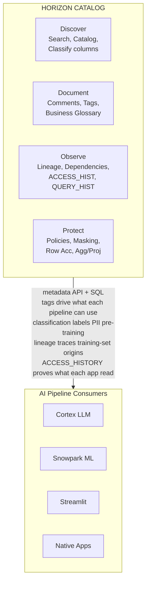

**Classification output (3-tuple per column)**

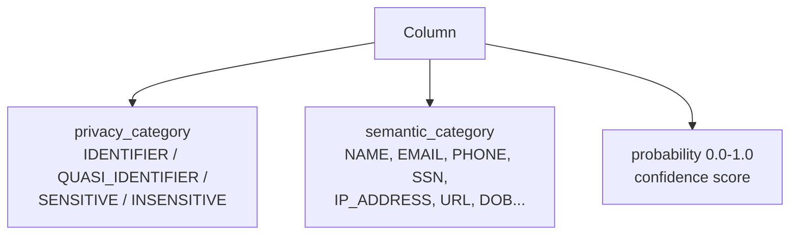

---

## Q1: What is Snowflake Horizon and why is it the foundation of AI governance in Snowflake?

**Difficulty:** Foundation
**Exam relevance:** Horizon as the governance product umbrella

### Answer
**Horizon** is Snowflake's unified governance and discovery product bundle — not a single feature but the collective brand covering:

- **Catalog** — searchable inventory of databases, schemas, tables, views, UDFs, procedures, models, tasks, apps.
- **Classification** — automated detection of column semantics and privacy categories.
- **Tagging** — key-value governance metadata with allowed values and inheritance.
- **Lineage** — table-level and column-level data flow.
- **Access History** — who read/modified which objects.
- **Policies** — masking, row-access, aggregation, projection, password.
- **Trust Center** — posture scoring.
- **Universal Search / Snowflake Copilot** — natural-language discovery.
- **Internal Marketplace / Data Products** — curated share.

Horizon is foundational to AI governance because **AI training pipelines consume data that must be discoverable, classified, policy-protected, and traceable** — and all those capabilities live in Horizon. Without Horizon you cannot: find the right training table, know whether it contains PII, apply consistent masking across downstream models, or prove to an auditor which data trained which model.

### First Principles
Governance scales when metadata is a *first-class, queryable, policy-bindable asset* — not an external wiki. Horizon's design keeps metadata inside the data plane (ACCOUNT_USAGE, INFORMATION_SCHEMA, Horizon API). This gives three properties:
1. **Co-location** — a policy can reference a tag in the same statement that references the column.
2. **Consistency** — metadata is transactional with its object (dropping a table drops its tags).
3. **Composability** — SQL can join metadata with data, so audits are just queries.

### Diagram
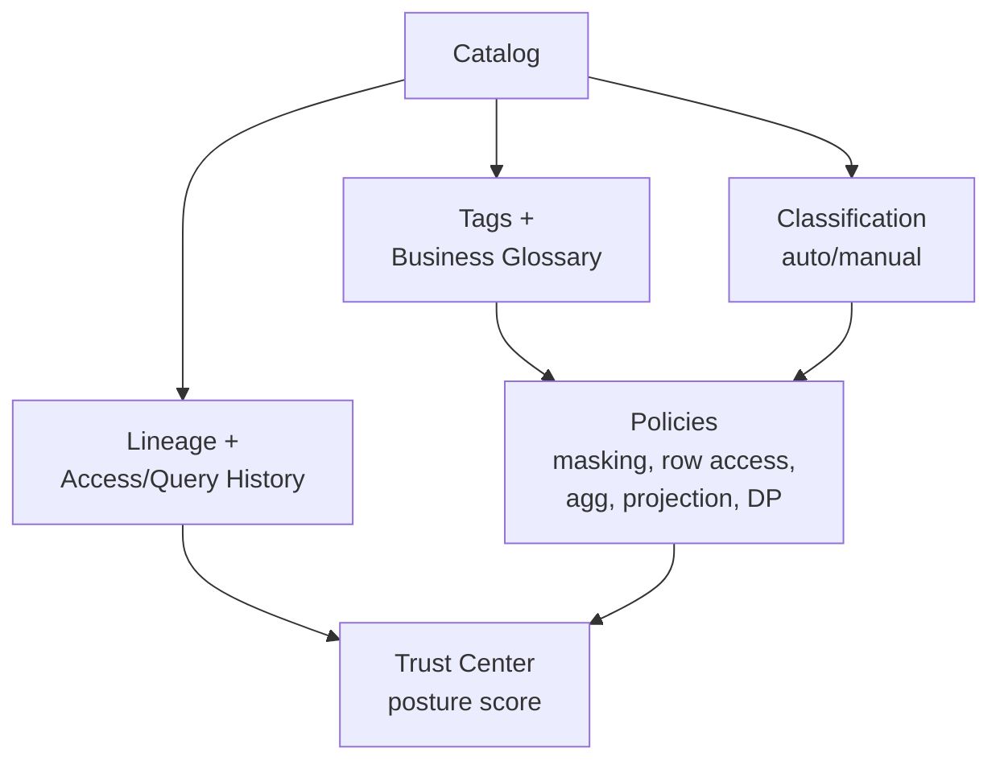

### Lab Exercise
```sql
-- Horizon surfaces: show the main views and functions
USE ROLE ACCOUNTADMIN;

-- 1. Catalog + search
SHOW DATABASES;
SELECT * FROM SNOWFLAKE.ACCOUNT_USAGE.TABLES
WHERE DELETED IS NULL LIMIT 20;

-- 2. Classification (auto)
CALL SYSTEM$CLASSIFY('MY_DB.MY_SCHEMA.CUSTOMERS', {'auto_tag': TRUE});

-- 3. Lineage
SELECT * FROM TABLE(SNOWFLAKE.CORE.GET_LINEAGE(
  'MY_DB.MY_SCHEMA.ORDERS', 'TABLE', 'UPSTREAM', 1, 10));

-- 4. Access history
SELECT query_id, user_name, base_objects_accessed, direct_objects_accessed
FROM SNOWFLAKE.ACCOUNT_USAGE.ACCESS_HISTORY
WHERE query_start_time > DATEADD('hour',-1,CURRENT_TIMESTAMP())
LIMIT 10;

-- 5. Tag references
SELECT * FROM SNOWFLAKE.ACCOUNT_USAGE.TAG_REFERENCES
WHERE tag_name='SENSITIVITY' LIMIT 10;

-- 6. Policy references
SELECT * FROM SNOWFLAKE.ACCOUNT_USAGE.POLICY_REFERENCES
WHERE policy_kind IN ('MASKING_POLICY','ROW_ACCESS_POLICY');
```

### Gotchas / Exam Traps
- "Horizon" refers to the umbrella; individual features (classification, lineage) are also valid answers depending on question specificity.
- Some Horizon features require **Enterprise or Business Critical** edition (e.g., row access policies, aggregation policies, dynamic masking).
- ACCOUNT_USAGE lag can be up to **45 min for most views, 2 h for some** (ACCESS_HISTORY is ~45 min).

---

## Q2: Explain the difference between privacy_category and semantic_category produced by auto-classification, and give a worked example.

**Difficulty:** Intermediate
**Exam relevance:** Classification output structure

### Answer
Snowflake auto-classification produces **two orthogonal categorizations per column**:

- **privacy_category** — regulatory/legal sensitivity:
  - `IDENTIFIER` — directly identifies an individual (SSN, email).
  - `QUASI_IDENTIFIER` — combines with others to identify (ZIP + DOB + gender).
  - `SENSITIVE` — sensitive personal data (health, race, religion).
  - `INSENSITIVE` — not personally identifying.

- **semantic_category** — what the column *is* (type of data): `NAME`, `EMAIL`, `PHONE`, `SSN`, `IP_ADDRESS`, `URL`, `DATE_OF_BIRTH`, `AGE`, `GENDER`, `ETHNICITY`, `LATITUDE`, `LONGITUDE`, `CREDIT_CARD`, etc.

Example — a column `email`:
- `privacy_category = 'IDENTIFIER'` (an email identifies a person)
- `semantic_category = 'EMAIL'` (the data is email format)
- `probability = 0.95`

A column `age_band` (e.g., "30-40"):
- `privacy_category = 'QUASI_IDENTIFIER'`
- `semantic_category = 'AGE'`

### First Principles
Separating privacy level from data type is critical because **policies depend on legal sensitivity but routing depends on data type**. A masking policy for "any IDENTIFIER" is a legal control; a validation rule for "any EMAIL" is a schema control. Snowflake stores both so the same classification output serves both compliance and engineering.

### Diagram

Two-axis classification:

| Semantic \ Privacy | IDENT | QUASI | SENS | INSENS |
|---|---|---|---|---|
| NAME | yes | | | |
| EMAIL | yes | | | |
| SSN | yes | | | |
| DOB | | yes | | |
| ZIP | | yes | | |
| GENDER | | yes | yes | context |
| RACE | | | yes | |
| HEALTH | | | yes | |
| PURCHASE$ | | | | yes |

Rule: pick policies by privacy_category; pick validations/UDFs by semantic_category.

### Lab Exercise
```sql
-- Run classification and inspect both axes
CALL SYSTEM$CLASSIFY(
  'MY_DB.PUBLIC.CUSTOMERS',
  {'auto_tag': TRUE, 'overwrite_existing_tags': FALSE}
);

SELECT
  table_name,
  column_name,
  privacy_category,
  semantic_category,
  probability,
  alternative_classifications
FROM SNOWFLAKE.ACCOUNT_USAGE.DATA_CLASSIFICATION_LATEST
WHERE table_name = 'CUSTOMERS'
ORDER BY privacy_category, semantic_category;

-- Example output row:
-- CUSTOMERS | email_addr | IDENTIFIER | EMAIL | 0.98 | []
```

### Gotchas / Exam Traps
- Classification is **sample-based** (default 10,000 rows); accuracy depends on sample quality.
- `auto_tag => TRUE` applies **system tags** `SNOWFLAKE.CORE.PRIVACY_CATEGORY` and `SNOWFLAKE.CORE.SEMANTIC_CATEGORY` — don't confuse with custom tags.
- Classification does not run automatically; it must be invoked (`SYSTEM$CLASSIFY` or auto-classification feature on schema).
- To **auto-classify** on ingest, enable schema-level auto-classification: `ALTER SCHEMA … SET AUTO_CLASSIFY = TRUE`.

---

## Q3: What is the difference between tags and classifications, and when does each belong to which workflow?

**Difficulty:** Intermediate
**Exam relevance:** Tags vs. classification

### Answer
- **Classifications** are *inferred, system-managed* labels from data content (via `SYSTEM$CLASSIFY`). Values come from Snowflake's fixed taxonomy. Written to `SNOWFLAKE.CORE.PRIVACY_CATEGORY` / `SEMANTIC_CATEGORY` system tags.
- **Tags** are *declared, user-managed* key-value metadata. Custom namespaces (e.g., `GOV.AI_SYSTEM_TIER`), allowed values enforced, applied to any object (table, column, warehouse, role, model).

Workflow:
1. **Classify first** — content-based inference labels columns automatically.
2. **Apply custom tags** — e.g., `SENSITIVITY='CONFIDENTIAL'`, `PURPOSE='MODEL_TRAINING'`, `OWNER_TEAM='risk-ai'`.
3. **Bind policies to tags** — masking/row-access policies attach to tag names so coverage is automatic across new objects.

### First Principles
Classification answers "what's in this column?" — an *empirical* question answerable by sampling data. Tagging answers "what should we do with this column?" — a *policy* question answerable only by humans. Confusing them produces governance that's either too permissive (relying on inference for policy decisions) or unscalable (hand-labeling every new column semantically).

### Diagram

| Dimension | Classification | Tags |
|---|---|---|
| Source | Content sampling | Human decision |
| Taxonomy | Fixed (Snowflake) | Custom (you define) |
| Scope | Columns | Any object |
| Mutability | Recomputed | Sticky unless altered |
| Policy bind | Via system tags | Directly via tag ref |
| Audit cmnt | Probability score | Allowed-values guard |

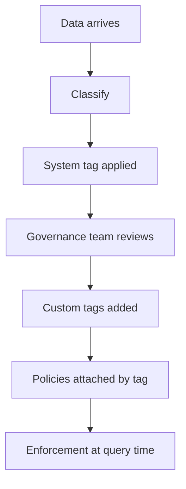

### Lab Exercise
```sql
-- 1) Classification produces system tags
CALL SYSTEM$CLASSIFY('MY_DB.PUBLIC.CUSTOMERS',{'auto_tag':TRUE});

-- 2) Custom tags for policy binding
USE ROLE SECURITYADMIN;
CREATE TAG GOV.DATA.SENSITIVITY
  ALLOWED_VALUES 'PUBLIC','INTERNAL','CONFIDENTIAL','RESTRICTED';

CREATE TAG GOV.DATA.AI_USE
  ALLOWED_VALUES 'TRAINING_ALLOWED','TRAINING_FORBIDDEN','INFERENCE_ONLY';

-- 3) Tag the table / column
ALTER TABLE MY_DB.PUBLIC.CUSTOMERS
  SET TAG GOV.DATA.SENSITIVITY = 'CONFIDENTIAL',
          GOV.DATA.AI_USE      = 'INFERENCE_ONLY';

ALTER TABLE MY_DB.PUBLIC.CUSTOMERS
  MODIFY COLUMN email_addr
    SET TAG GOV.DATA.SENSITIVITY = 'RESTRICTED';

-- 4) Policy binds to tag — new objects with the tag get covered automatically
CREATE MASKING POLICY GOV.POL.EMAIL_MASK
AS (val STRING) RETURNS STRING ->
  CASE WHEN CURRENT_ROLE() IN ('PII_READER') THEN val ELSE '***@***' END;

ALTER TAG GOV.DATA.SENSITIVITY
  SET MASKING POLICY GOV.POL.EMAIL_MASK FOR (STRING);
```

### Gotchas / Exam Traps
- **Tag-based masking policy** (step 4) applies to **every column tagged with that tag value** — exam often tests whether this scales (yes) and the limitations (one masking policy per data type per tag).
- You can only set **one masking policy per column** either directly or via one tag — not both.
- `SYSTEM$CLASSIFY` requires `IMPORTED PRIVILEGES ON DATABASE SNOWFLAKE` for the role (via `SNOWFLAKE.CORE_VIEWER` or similar).

---

## Q4: Explain tag inheritance semantics in Snowflake and why they matter for AI pipelines.

**Difficulty:** Intermediate
**Exam relevance:** Tag propagation / inheritance rules

### Answer
Snowflake tags **inherit downward** in the object hierarchy:

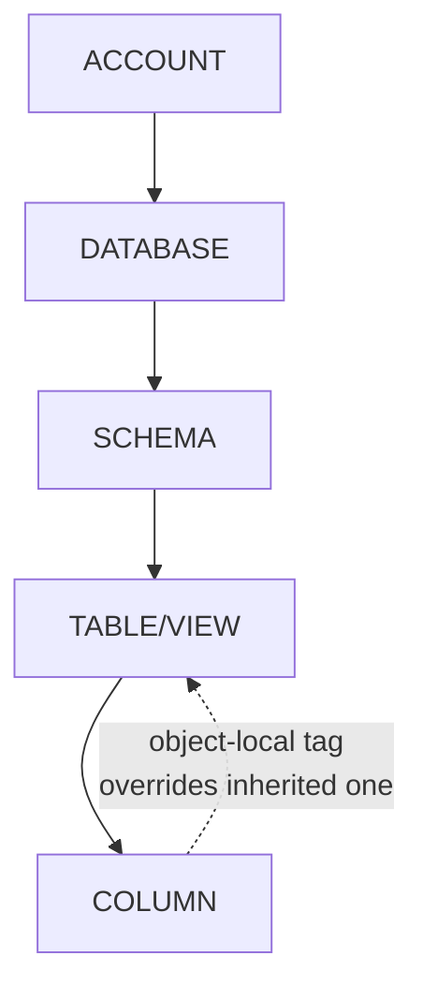

Rules:
- Setting a tag on a schema makes every table in that schema inherit it (unless overridden).
- A tag set directly on a lower object **overrides** inherited value.
- Removing (`UNSET`) a direct tag re-exposes the inherited value.
- Tags inherited from a parent are not duplicated in `TAG_REFERENCES` — they appear in `TAG_REFERENCES_WITH_LINEAGE`.
- Column-level tags do **not** inherit from table tags automatically — column tags are independent (but you can query the table's tag + column's tag separately).

Why it matters for AI:
A tag like `GOV.DATA.AI_USE='TRAINING_FORBIDDEN'` set at schema level automatically protects every table added to that schema. A pipeline reading from that schema can be gated by policy without being updated per-table.

### First Principles
Inheritance makes governance **declarative and prospective** — you set the rule once at the right scope, and new objects inherit the constraint. The alternative (set tag on each object) violates governance's cardinal rule: new assets must not require manual onboarding to be protected.

### Diagram
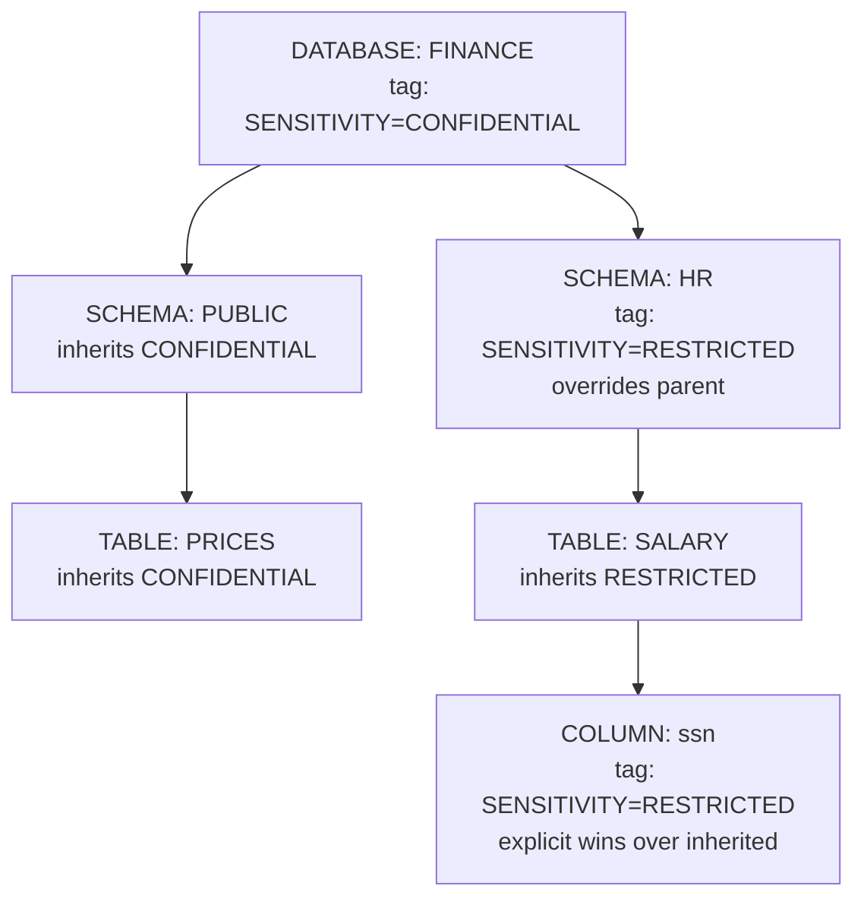

- `TAG_REFERENCES` shows only direct
- `TAG_REFERENCES_WITH_LINEAGE` shows inherited too

### Lab Exercise
```sql
-- Set at schema; observe inheritance on new table
USE ROLE SECURITYADMIN;

CREATE TAG GOV.DATA.AI_USE
  ALLOWED_VALUES 'TRAINING_ALLOWED','TRAINING_FORBIDDEN','INFERENCE_ONLY';

ALTER SCHEMA FINANCE.HR
  SET TAG GOV.DATA.AI_USE = 'TRAINING_FORBIDDEN';

CREATE TABLE FINANCE.HR.SALARY (id INT, salary NUMBER);

-- Inherited (not in direct):
SELECT * FROM SNOWFLAKE.ACCOUNT_USAGE.TAG_REFERENCES
WHERE object_name = 'SALARY' AND tag_name='AI_USE';
--  (empty)

SELECT * FROM TABLE(
  INFORMATION_SCHEMA.TAG_REFERENCES_WITH_LINEAGE('FINANCE.HR.SALARY','TABLE')
);
-- shows AI_USE='TRAINING_FORBIDDEN', LEVEL='SCHEMA'

-- Override at table
ALTER TABLE FINANCE.HR.SALARY SET TAG GOV.DATA.AI_USE = 'INFERENCE_ONLY';
-- now table has its own tag; schema value is masked
```

### Gotchas / Exam Traps
- Tag inheritance uses `TAG_REFERENCES_WITH_LINEAGE`, **not** `TAG_REFERENCES`. Many exam questions trap on this difference.
- Column-level tags are independent of table-level tags **in the SAME tag namespace** — a table tag does not propagate to columns.
- Tag changes don't retroactively apply policies if the policy already exists on the column — order of operations matters.

---

## Q5: What is a "tag-based masking policy" and why is it the preferred pattern for AI data governance at scale?

**Difficulty:** Intermediate
**Exam relevance:** Tag-driven policy binding

### Answer
A **tag-based masking policy** attaches a masking policy to a tag (not directly to a column). Every column that has that tag value automatically gets the policy applied.

Syntax: `ALTER TAG <tag_name> SET MASKING POLICY <policy_name> FOR (<data_type>)`.

Why preferred for AI:
1. **Automatic coverage** — tagging a new PII column with `SENSITIVITY='RESTRICTED'` immediately applies masking without re-grants.
2. **Centralized policy logic** — one policy per data type across the account.
3. **Decoupling** — data engineers tag; security team authors policy; neither blocks the other.
4. **Consistent across pipelines** — Cortex functions, Snowpark UDFs, external shares all see the masked value.

Limits:
- One masking policy **per tag per data type**.
- A column can only have **one effective masking policy** (either direct OR tag-based, not both).
- Tag-based policies apply by **tag value** — you can author different policies for `RESTRICTED` vs. `CONFIDENTIAL` by using separate tags or by branching inside one policy.

### First Principles
At scale, the number of columns grows faster than the number of policies. Binding policies to *categories* (tags) rather than *instances* (columns) collapses the policy surface to the number of categories (small). This is the standard "policy-as-metadata" pattern mirrored in AWS Lake Formation LF-Tags and GCP's policy tags.

### Diagram
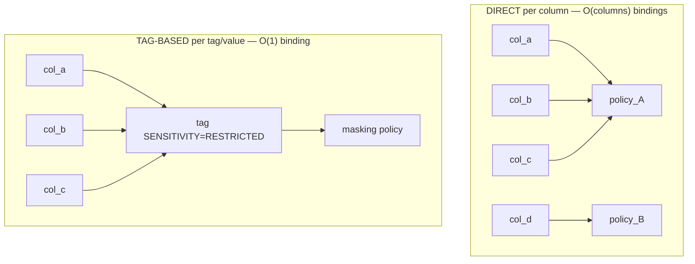

### Lab Exercise
```sql
USE ROLE SECURITYADMIN;

CREATE TAG GOV.DATA.PII_LEVEL
  ALLOWED_VALUES 'NONE','LOW','MEDIUM','HIGH';

CREATE MASKING POLICY GOV.POL.PII_STRING
AS (val STRING) RETURNS STRING ->
  CASE
    WHEN IS_ROLE_IN_SESSION('PII_READER') THEN val
    WHEN SYSTEM$GET_TAG_ON_CURRENT_COLUMN('GOV.DATA.PII_LEVEL') = 'HIGH' THEN '***'
    WHEN SYSTEM$GET_TAG_ON_CURRENT_COLUMN('GOV.DATA.PII_LEVEL') = 'MEDIUM'
      THEN REGEXP_REPLACE(val, '.', '*', 1, LENGTH(val)-2)
    ELSE val
  END;

-- Bind to tag
ALTER TAG GOV.DATA.PII_LEVEL
  SET MASKING POLICY GOV.POL.PII_STRING FOR (STRING);

-- Now any column tagged gets masked
ALTER TABLE MY_DB.PUBLIC.CUSTOMERS
  MODIFY COLUMN email SET TAG GOV.DATA.PII_LEVEL = 'HIGH';
```

### Gotchas / Exam Traps
- `FOR (<data_type>)` is required because policies are type-specific — one tag can carry a policy per data type family.
- `SYSTEM$GET_TAG_ON_CURRENT_COLUMN` is scoped to the column in the policy — great for branching inside one policy body.
- You cannot combine tag-based + direct masking on the same column.

---

## Q6: How does Snowflake lineage differentiate from OBJECT_DEPENDENCIES, and which should you use for AI training-data audits?

**Difficulty:** Intermediate
**Exam relevance:** Lineage vs. dependencies

### Answer
- **OBJECT_DEPENDENCIES** (ACCOUNT_USAGE view) captures **structural** dependencies — a view depends on its referenced tables, a UDF depends on tables it names in its body, a masking policy depends on tables it references. Static DDL-time relationship.
- **Data Lineage** (via `SNOWFLAKE.CORE.GET_LINEAGE` and the Horizon UI) captures **data-flow** relationships produced by DML — `INSERT ... SELECT`, `CREATE TABLE AS SELECT`, `MERGE`, etc. Dynamic query-produced edges.

For AI training-data audits, you need **lineage** because training sets are typically materialized via CTAS/INSERT, and you need to answer "which source rows fed this training set?" Dependencies won't show you that an ad-hoc CTAS created the training table.

### First Principles
Dependencies are a *compile-time* graph; lineage is a *runtime* graph. AI pipelines generate many intermediate materializations, so audit evidence must be runtime-aware. Snowflake's data-plane lineage is derived from query parse trees + ACCESS_HISTORY, giving automatic DAG construction without manual annotation.

### Diagram

| Dimension | OBJECT_DEPENDENCIES | LINEAGE |
|---|---|---|
| Edge type | view V depends-on table T | table B created-from table A |
| How formed | DDL reference | CTAS, MERGE, INSERT...SELECT |
| Captured at | DDL time | DML execution |
| View/API | ACCOUNT_USAGE.OBJECT_DEPENDENCIES | Horizon API / GET_LINEAGE() |

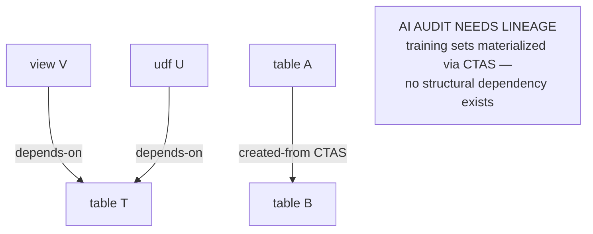

### Lab Exercise
```sql
-- Dependencies: structural
SELECT referenced_object_name, referencing_object_name, dependency_type
FROM SNOWFLAKE.ACCOUNT_USAGE.OBJECT_DEPENDENCIES
WHERE referenced_object_name = 'RAW_CUSTOMERS';

-- Lineage: data flow (upstream of a training set)
SELECT *
FROM TABLE(SNOWFLAKE.CORE.GET_LINEAGE(
  'ML.PROD.TRAINING_SET_V3', 'TABLE', 'UPSTREAM', 1, 5
));
-- distance=1: TRAINING_SET_V3 was CREATE AS SELECT from CLEAN_FEATURES
-- distance=2: CLEAN_FEATURES was INSERT…SELECT from RAW_CUSTOMERS

-- Column-level lineage
SELECT *
FROM TABLE(SNOWFLAKE.CORE.GET_LINEAGE(
  'ML.PROD.TRAINING_SET_V3','TABLE','UPSTREAM', 1, 5,
  {'column_name':'customer_zip'}
));
```

### Gotchas / Exam Traps
- `GET_LINEAGE` requires the role to have `MONITOR USAGE` on the account or the appropriate privilege on the object.
- Lineage only tracks SQL-driven flows — if data is exported to S3 and reimported via COPY, the lineage edge **is captured** on reimport (COPY INTO is tracked); but external transformations outside Snowflake are opaque.
- `OBJECT_DEPENDENCIES` has latency (~45 min in ACCOUNT_USAGE); `INFORMATION_SCHEMA` version is near real-time but scoped to a database.

---

## Q7: What does ACCESS_HISTORY actually record, and what are the four columns critical for AI data-use auditing?

**Difficulty:** Advanced
**Exam relevance:** ACCESS_HISTORY semantics

### Answer
`SNOWFLAKE.ACCOUNT_USAGE.ACCESS_HISTORY` records every data access with the following key columns:

1. **`DIRECT_OBJECTS_ACCESSED`** — objects named explicitly in the query (e.g., a view).
2. **`BASE_OBJECTS_ACCESSED`** — underlying base tables resolved through views, including transitively (critical for AI: tells you *what data actually fed the computation*).
3. **`OBJECTS_MODIFIED`** — objects written to (CTAS target, INSERT target).
4. **`OBJECT_MODIFIED_BY_DDL`** — objects affected by DDL (ALTER TABLE, etc.).

Also: `QUERY_ID`, `USER_NAME`, `QUERY_START_TIME`, `POLICIES_REFERENCED` (which masking/row-access policies evaluated).

For AI auditing:
- **BASE_OBJECTS_ACCESSED** proves which raw tables trained the model.
- **OBJECTS_MODIFIED** proves which materialized training set was built.
- **POLICIES_REFERENCED** proves which protections were enforced.
- **COLUMNS** (array inside each object) proves column-level access.

### First Principles
Views and UDFs abstract source data from queries. For AI audit, you need to see *through* those abstractions — "the user queried `V_SAFE_CUSTOMERS` but which base tables did that view read?" ACCESS_HISTORY resolves that automatically. Without it you'd need to parse SQL + walk view definitions manually.

### Diagram
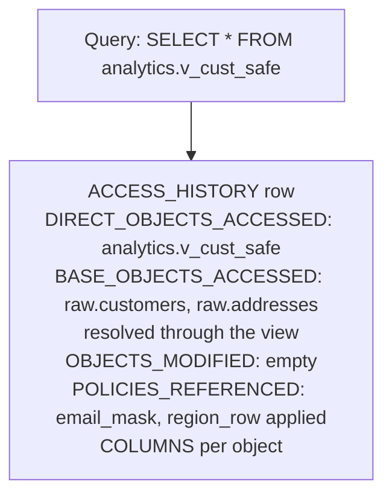

### Lab Exercise
```sql
-- Find every query that read PII columns in the last 7 days (AI leakage check)
WITH pii_cols AS (
  SELECT ARRAY_AGG(column_name) AS cols
  FROM SNOWFLAKE.ACCOUNT_USAGE.DATA_CLASSIFICATION_LATEST
  WHERE privacy_category = 'IDENTIFIER'
)
SELECT ah.query_id, ah.user_name, ah.query_start_time,
       obj.value:objectName::STRING AS object_accessed,
       col.value:columnName::STRING AS column_accessed
FROM SNOWFLAKE.ACCOUNT_USAGE.ACCESS_HISTORY ah,
     LATERAL FLATTEN(input => ah.base_objects_accessed) obj,
     LATERAL FLATTEN(input => obj.value:columns) col,
     pii_cols p
WHERE ARRAY_CONTAINS(col.value:columnName::VARIANT, p.cols)
  AND ah.query_start_time >= DATEADD('day',-7,CURRENT_TIMESTAMP());

-- Which queries invoked masking policies (proves protection was in play)
SELECT query_id, user_name, policies_referenced
FROM SNOWFLAKE.ACCOUNT_USAGE.ACCESS_HISTORY
WHERE policies_referenced IS NOT NULL
  AND ARRAY_SIZE(policies_referenced) > 0
LIMIT 20;
```

### Gotchas / Exam Traps
- ACCESS_HISTORY has **~45 min latency** in ACCOUNT_USAGE and retains **365 days**.
- `BASE_OBJECTS_ACCESSED` **transitively** resolves views and secure views — this is the key insight.
- Shared data from a Data Share also appears in ACCESS_HISTORY (good for provider-side audit).
- `OBJECTS_MODIFIED` on a CTAS has the **target table** (the new one) — this is how you link training-set creation to source reads.

---

## Q8: Describe column-level lineage and why it's critical for proving which PII fields a model learned from.

**Difficulty:** Advanced
**Exam relevance:** Column-level lineage for AI

### Answer
Column-level lineage traces data flow at **individual-column granularity** rather than table granularity. Example: `training_set.customer_segment` was derived from `raw_customers.purchase_history` + `raw_demographics.age` via a UDF.

Critical for PII auditing because:
- Table-level lineage says "training set came from customer table" (true but imprecise).
- Column-level says **which columns from that table** became **which columns** in the training set.
- A regulator asks "did my client's SSN feed your model?" — table-level is ambiguous; column-level is a definitive answer.

Snowflake's lineage API (`GET_LINEAGE` with `column_name` parameter) returns column-granularity edges when derivable from query parse trees.

### First Principles
PII leakage often occurs when a sensitive column is unintentionally included in a `SELECT *` or a feature engineering pipeline. Column lineage makes this discoverable retrospectively. Prospectively, it enables policies that *prevent* a specific column from flowing into training sets (combined with projection policies — see domain 04).

### Diagram
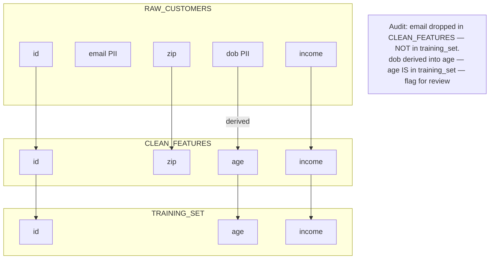

### Lab Exercise
```sql
-- Column lineage upstream for a training-set column
SELECT *
FROM TABLE(SNOWFLAKE.CORE.GET_LINEAGE(
  'ML.PROD.TRAINING_SET_V3','TABLE','UPSTREAM',1,5,
  OBJECT_CONSTRUCT('column_name','customer_segment')
));

-- Does any PII column reach any training set?
WITH pii AS (
  SELECT table_catalog||'.'||table_schema||'.'||table_name AS t, column_name
  FROM SNOWFLAKE.ACCOUNT_USAGE.DATA_CLASSIFICATION_LATEST
  WHERE privacy_category = 'IDENTIFIER'
),
training_sets AS (
  SELECT object_name AS t FROM SNOWFLAKE.ACCOUNT_USAGE.TAG_REFERENCES
  WHERE tag_name='DATASET_PURPOSE' AND tag_value='MODEL_TRAINING'
)
SELECT ts.t AS training_set, pii.t AS pii_source, pii.column_name
FROM training_sets ts
JOIN LATERAL (
   SELECT source_object_name, source_column_name
   FROM TABLE(SNOWFLAKE.CORE.GET_LINEAGE(ts.t,'TABLE','UPSTREAM',1,10))
) l
JOIN pii ON pii.t = l.source_object_name
       AND pii.column_name = l.source_column_name;
```

### Gotchas / Exam Traps
- Column lineage breaks across **UDFs that aren't Snowflake-native** (external functions, external Python with raw code) — lineage is based on parse trees.
- Dropping and recreating a column can cause lineage gaps.
- The lineage graph has **depth limits** (default 10 hops in `GET_LINEAGE`) — training pipelines with many intermediate tables may need manual stitching.

---

## Q9: How do you auto-classify newly created tables continuously (not one-shot) for an AI data ingestion pipeline?

**Difficulty:** Intermediate
**Exam relevance:** Schema-level auto-classification

### Answer
Enable **schema-level auto-classification**:

```sql
ALTER SCHEMA <db>.<schema> SET AUTO_CLASSIFY = TRUE;
```

Effect: Snowflake runs classification on every new table created or new column added, every 30 days thereafter, and after large data changes. The results are stored in `SNOWFLAKE.ACCOUNT_USAGE.DATA_CLASSIFICATION_LATEST` and system tags are auto-applied if `auto_tag` is enabled.

To attach **custom tags** automatically on classification, use a stream+task pattern or Snowflake's SYSTEM$CLASSIFY callback via a stored procedure on INFORMATION_SCHEMA table changes.

### First Principles
AI ingestion creates new tables continuously (raw loads, feature snapshots, model inputs). A one-shot classification approach guarantees unclassified data by Monday morning. Automation at the schema level matches governance's "default-safe" requirement: new objects are classified before they can be queried in production.

### Diagram
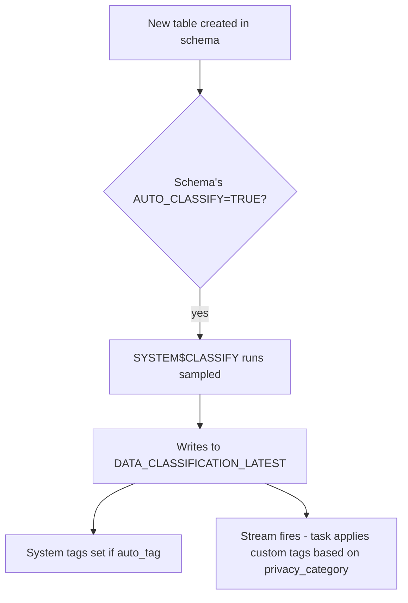

### Lab Exercise
```sql
USE ROLE ACCOUNTADMIN;

-- Enable at schema level
ALTER SCHEMA ANALYTICS.RAW SET AUTO_CLASSIFY = TRUE;

-- Verify
SHOW PARAMETERS LIKE 'AUTO_CLASSIFY' IN SCHEMA ANALYTICS.RAW;

-- Create a table — classification will run automatically
CREATE TABLE ANALYTICS.RAW.USER_SIGNUPS AS
SELECT 1 id, 'a@b.co' email, '2001-01-01'::DATE dob;

-- After classification completes:
SELECT * FROM SNOWFLAKE.ACCOUNT_USAGE.DATA_CLASSIFICATION_LATEST
WHERE table_name = 'USER_SIGNUPS';

-- Attach custom tag based on privacy_category via a task
CREATE OR REPLACE PROCEDURE TAG_FROM_CLASS()
RETURNS STRING LANGUAGE SQL AS $$
BEGIN
  LET cur CURSOR FOR
    SELECT table_catalog,table_schema,table_name,column_name,privacy_category
    FROM SNOWFLAKE.ACCOUNT_USAGE.DATA_CLASSIFICATION_LATEST
    WHERE last_altered >= DATEADD('hour',-1,CURRENT_TIMESTAMP())
      AND privacy_category = 'IDENTIFIER';
  FOR r IN cur DO
    LET stmt STRING := 'ALTER TABLE '||r.table_catalog||'.'||r.table_schema||
      '.'||r.table_name||' MODIFY COLUMN '||r.column_name||
      ' SET TAG GOV.DATA.PII_LEVEL = ''HIGH''';
    EXECUTE IMMEDIATE :stmt;
  END FOR;
  RETURN 'OK';
END; $$;

CREATE TASK TAG_FROM_CLASS_TASK
  SCHEDULE = '15 MINUTE'
  AS CALL TAG_FROM_CLASS();
```

### Gotchas / Exam Traps
- Auto-classification runs on a **schedule** (first on create, then every 30 days by default) — not real-time.
- Classification uses a **sample** — small or atypical data may misclassify.
- Enabling AUTO_CLASSIFY requires `IMPORTED PRIVILEGES ON DATABASE SNOWFLAKE` for the invoking role.

---

## Q10: What is a "business glossary" in Horizon, and how does it support AI model governance?

**Difficulty:** Foundation
**Exam relevance:** Business Glossary feature

### Answer
A **Business Glossary** in Snowflake Horizon is a catalog of business terms (e.g., "Active Customer," "Churned," "Lifetime Value") with definitions, synonyms, owners, and references to the physical columns that implement each term. Terms are stored as objects with their own privileges and can be tagged.

For AI governance:
- Ensures **consistent interpretation** of features — "Active Customer" means the same thing across all training sets.
- Enables **traceability** — a model's feature list links back to glossary terms, which link to source columns.
- Supports **cross-team collaboration** — data scientists and business stakeholders share vocabulary.
- Feeds **Cortex Analyst** / Copilot — natural-language queries resolve to the correct columns via glossary terms.

### First Principles
Semantic drift is a leading cause of AI governance failures: a model trained on "revenue" (gross) deployed where downstream consumers read "revenue" (net) produces predictions that look wrong but are definitionally correct. The glossary makes semantic contracts explicit and machine-readable.

### Diagram
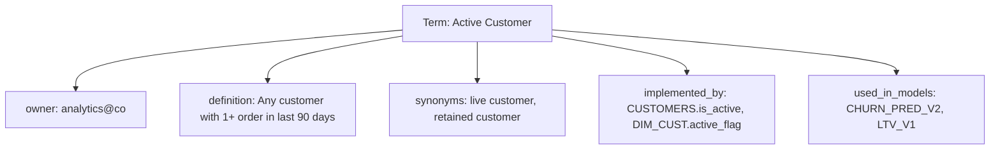

### Lab Exercise
```sql
-- Business glossary scaffolding (schema-level pattern; Snowflake also provides
-- a native glossary feature in Horizon UI with underlying metadata.)
CREATE SCHEMA GOV.GLOSSARY;

CREATE TABLE GOV.GLOSSARY.TERMS (
  term_name STRING, definition STRING, owner STRING,
  synonyms ARRAY, status STRING,
  implemented_by ARRAY,          -- fully qualified columns
  used_in_models ARRAY
);

INSERT INTO GOV.GLOSSARY.TERMS VALUES
  ('Active Customer',
   'Customer with ≥1 order in last 90 days',
   'analytics@co',
   ARRAY_CONSTRUCT('live customer','retained customer'),
   'APPROVED',
   ARRAY_CONSTRUCT('ANALYTICS.DIM_CUSTOMER.IS_ACTIVE'),
   ARRAY_CONSTRUCT('CHURN_V2','LTV_V1'));

-- Impact analysis: terms used in models
SELECT g.term_name, g.definition, m.model_name
FROM GOV.GLOSSARY.TERMS g,
     LATERAL FLATTEN(input => g.used_in_models) m(model_name);
```

### Gotchas / Exam Traps
- Business Glossary is distinct from the metadata catalog — a term can map to multiple physical implementations and vice versa.
- Glossary access controls are **separate** from data access — read-only vs. edit roles.

---

## Q11: How do you detect PII in unstructured text fields (e.g., LLM inputs) within Snowflake?

**Difficulty:** Advanced
**Exam relevance:** Unstructured classification + Cortex PII functions

### Answer
Three complementary approaches:

1. **Cortex AISQL / string functions** — `SNOWFLAKE.CORTEX.EXTRACT_ANSWER`, `COMPLETE` with a PII-detection prompt. Returns PII spans and labels.
2. **Classification on text columns** — `SYSTEM$CLASSIFY` can detect common PII patterns (emails, phone, SSN via regex within the sample).
3. **Pattern matching / UDFs** — Snowpark Python UDF running presidio, spaCy NER, or regex library.

Pre-ingest or pre-inference, run the function across text columns and either (a) mask detected spans, (b) tag the column, or (c) refuse to process.

### First Principles
Classification was built for structured data; LLM inputs are unstructured. The semantics of PII in free text (names in context, addresses in narratives) require NLP, not pattern matching alone. Cortex places NLP close to the data — detection runs where the data lives, avoiding egress to third-party scanners.

### Diagram
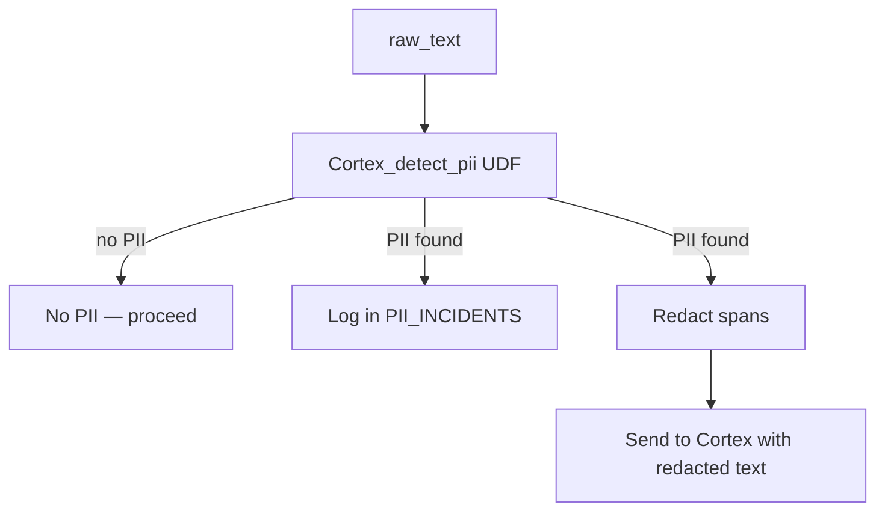

### Lab Exercise
```sql
-- Pattern 1: Cortex-driven PII extraction
CREATE OR REPLACE FUNCTION DETECT_PII(TXT STRING)
RETURNS VARIANT LANGUAGE SQL AS $$
  SELECT PARSE_JSON(
    SNOWFLAKE.CORTEX.COMPLETE('llama3.1-70b',
      'Return JSON array of PII spans found in the text. ' ||
      'Each span: {"text":"...", "type":"EMAIL|PHONE|SSN|NAME|ADDRESS", "start":n, "end":n}. ' ||
      'Text: ' || TXT))
$$;

-- Classify each row's narrative column
CREATE OR REPLACE TABLE TICKETS_WITH_PII AS
SELECT
  ticket_id,
  narrative,
  DETECT_PII(narrative) AS pii_spans,
  ARRAY_SIZE(DETECT_PII(narrative)) > 0 AS has_pii
FROM SUPPORT.TICKETS;

-- Redaction UDF
CREATE OR REPLACE FUNCTION REDACT_PII(TXT STRING)
RETURNS STRING LANGUAGE SQL AS $$
  SELECT SNOWFLAKE.CORTEX.COMPLETE('llama3.1-70b',
    'Replace any PII with [REDACTED-{type}]. Return only cleaned text. Text: ' || TXT)
$$;
```

### Gotchas / Exam Traps
- Cortex functions **send data to Snowflake-hosted LLMs** — they run inside the account's region but still constitute processing — document in records of processing.
- Deterministic (regex) detection misses contextual PII (names); LLM-based detection is probabilistic and should be audited.
- When PII is found, logging **the PII itself** in an incidents table creates another PII table — redact or vault.

---

## Q12: Explain POLICY_REFERENCES and how to use it to audit AI pipeline coverage.

**Difficulty:** Intermediate
**Exam relevance:** POLICY_REFERENCES view

### Answer
`SNOWFLAKE.ACCOUNT_USAGE.POLICY_REFERENCES` records every binding of a policy to an object (table/column/view). Columns include `policy_name`, `policy_kind` (MASKING_POLICY, ROW_ACCESS_POLICY, AGGREGATION_POLICY, PROJECTION_POLICY, PASSWORD_POLICY, SESSION_POLICY, NETWORK_POLICY), `ref_entity_name`, `ref_entity_domain`, `ref_column_name`, `tag_name`/`tag_value` (if applied via tag).

Use for AI audits:
- Find columns classified as PII with **no masking policy** → coverage gap.
- Find tables with **no row-access policy** that contain quasi-identifiers → re-identification risk.
- Count policies per schema → governance maturity metric.

### First Principles
A policy's existence doesn't guarantee application; a policy must be *bound* to an object to take effect. POLICY_REFERENCES is the authoritative "is this column protected" view. Pairing it with DATA_CLASSIFICATION_LATEST gives the compliance team a single query to find uncovered PII.

### Diagram
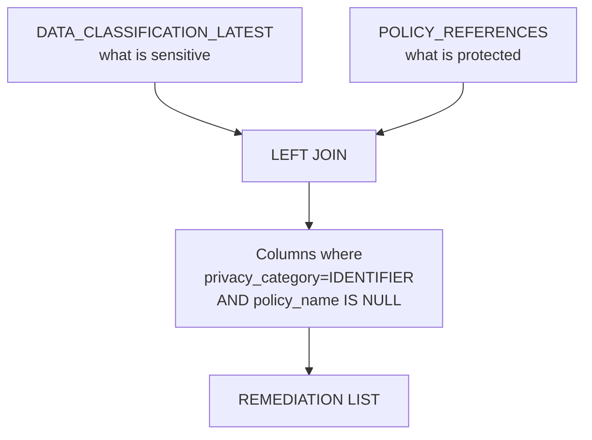

### Lab Exercise
```sql
-- Find PII columns without any masking policy
WITH pii AS (
  SELECT table_catalog, table_schema, table_name, column_name
  FROM SNOWFLAKE.ACCOUNT_USAGE.DATA_CLASSIFICATION_LATEST
  WHERE privacy_category IN ('IDENTIFIER','SENSITIVE')
),
masked AS (
  SELECT ref_database_name, ref_schema_name, ref_entity_name AS table_name,
         ref_column_name AS column_name
  FROM SNOWFLAKE.ACCOUNT_USAGE.POLICY_REFERENCES
  WHERE policy_kind = 'MASKING_POLICY'
)
SELECT p.*
FROM pii p
LEFT JOIN masked m
  ON (p.table_catalog, p.table_schema, p.table_name, p.column_name)
   = (m.ref_database_name, m.ref_schema_name, m.table_name, m.column_name)
WHERE m.column_name IS NULL;

-- Count policies per schema
SELECT ref_database_name, ref_schema_name, policy_kind, COUNT(*) policies
FROM SNOWFLAKE.ACCOUNT_USAGE.POLICY_REFERENCES
GROUP BY ALL ORDER BY 1,2,3;
```

### Gotchas / Exam Traps
- POLICY_REFERENCES also includes **tag-based** bindings — `tag_name` populated means the policy applies via a tag, not directly.
- Latency: ~2 hours in ACCOUNT_USAGE.
- `INFORMATION_SCHEMA.POLICY_REFERENCES` is a **table function**, scoped to one database — different signature from the ACCOUNT_USAGE view.

---

## Q13: Describe how Cortex Analyst / Copilot interacts with Horizon metadata and the governance implications.

**Difficulty:** Advanced
**Exam relevance:** Natural-language AI + metadata-driven governance

### Answer
Cortex Analyst (semantic layer) and Copilot (SQL-generation assistant) consume Horizon metadata:
- **Table/column names + comments** (Catalog) → schema understanding.
- **Business Glossary terms** → semantic resolution.
- **Tags** → access-aware query generation (do not propose columns the user can't see).
- **Policies** → effective-privilege awareness (if a view is masked, suggest the view, not the base).
- **Access history** → suggest frequently-used joins/filters.

Governance implications:
1. **Over-sharing risk** — if the semantic model (YAML) exposes a column, Analyst will reference it even if other guards hide it. Semantic model must be reviewed as a governance artifact.
2. **Prompt → SQL audit trail** — Analyst's generated SQL still runs under the caller's role; ACCESS_HISTORY captures it like any query.
3. **Data for training** — Copilot's prompt may be sent to a Cortex LLM; configure data residency and privacy settings.
4. **Explanations contain data** — Analyst explanations may echo data values; treat explanation outputs with the same classification.

### First Principles
AI-generated SQL does not bypass access control (good — same engine runs it) but **does expand the surface area of accidental disclosure**: a well-crafted prompt may trick Analyst into revealing data via an aggregation or join the user wouldn't have composed. Governance must therefore treat the semantic model as a *contract* that defines the exposed surface.

### Diagram
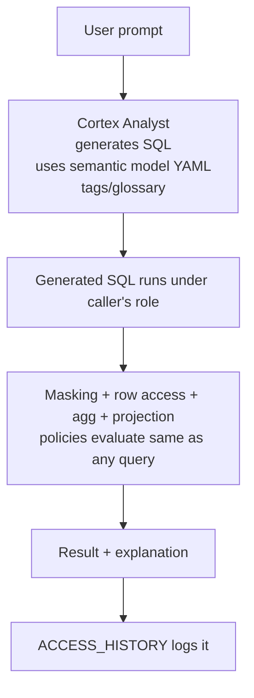

### Lab Exercise
```sql
-- Audit NL queries by looking at Cortex Analyst calls in QUERY_HISTORY
SELECT user_name, query_id, query_text, start_time
FROM SNOWFLAKE.ACCOUNT_USAGE.QUERY_HISTORY
WHERE query_text ILIKE '%CORTEX_ANALYST%'
   OR query_text ILIKE '%COPILOT%'
ORDER BY start_time DESC LIMIT 50;

-- Create a semantic model governance tag
CREATE TAG GOV.DATA.SEMANTIC_MODEL_EXPOSED
  ALLOWED_VALUES 'TRUE','FALSE';

-- Mark columns exposed via semantic model (must match YAML definitions)
ALTER TABLE ANALYTICS.CUSTOMERS MODIFY COLUMN email
  SET TAG GOV.DATA.SEMANTIC_MODEL_EXPOSED = 'FALSE';
```

### Gotchas / Exam Traps
- The semantic model file is **a governance artifact** — version it in git, review for over-exposure.
- Cortex Analyst's generated SQL **still respects masking/row-access** — but may surprise users whose prompt looks safe but joins to protected data.

---

## Q14: What are "semantic categories" that Snowflake can detect, and how does the catalog use them?

**Difficulty:** Foundation
**Exam relevance:** Semantic category list

### Answer
Semantic categories include (non-exhaustive):

| Category | Examples |
|----------|----------|
| NAME | first/last name, full name |
| EMAIL | email@example.com |
| PHONE | phone numbers (various formats) |
| SSN | US Social Security Number |
| CREDIT_CARD | 16-digit cards |
| IP_ADDRESS | IPv4/IPv6 |
| URL | https:// |
| DATE_OF_BIRTH | DOB |
| AGE | age in years / bands |
| GENDER | gender/sex |
| ETHNICITY | race/ethnicity |
| LATITUDE / LONGITUDE | geocoordinates |
| COUNTRY, STATE_OR_PROVINCE, CITY, ZIP_CODE | geographic |
| IBAN, BIC, SWIFT | banking |
| VIN | vehicle |
| MAC_ADDRESS | hardware |

The catalog uses them for:
- Search facets ("show me all SSN columns").
- Policy routing (apply SSN-specific masking to all SSN columns).
- Risk scoring (count of IDENTIFIER semantic categories per table).
- Documentation auto-generation.

### First Principles
Standardized vocabulary enables cross-schema governance. Without it, "email," "e-mail," and "address_email" are different; with semantic categories they're all `EMAIL`. This makes policy coverage computable rather than heuristic.

### Diagram

| Semantic cat | Policy routing | Audit metric |
|---|---|---|
| EMAIL | Email mask policy | Count of EMAIL cols |
| SSN | Full-redact mask | SSN cols w/o mask? |
| LAT/LONG | Aggregation policy | Geo-cluster risk |
| DOB | k-anonymity on quasi | Reidentif risk |
| CREDIT_CARD | External tokenization | PCI scope |

### Lab Exercise
```sql
-- Find all SSN columns across the account
SELECT table_catalog||'.'||table_schema||'.'||table_name AS tbl, column_name
FROM SNOWFLAKE.ACCOUNT_USAGE.DATA_CLASSIFICATION_LATEST
WHERE semantic_category = 'SSN';

-- Audit metric: # of IDENTIFIER cats per table (risk score proxy)
SELECT table_catalog, table_schema, table_name,
       COUNT(*) AS pii_cols
FROM SNOWFLAKE.ACCOUNT_USAGE.DATA_CLASSIFICATION_LATEST
WHERE privacy_category = 'IDENTIFIER'
GROUP BY ALL
HAVING COUNT(*) >= 3
ORDER BY pii_cols DESC;
```

### Gotchas / Exam Traps
- Classification won't label a column as `SSN` unless the sampled values match the SSN pattern — synthetic or hashed data may be unclassified.
- Snowflake continues to add semantic categories — expect new ones over time.

---

## Q15: How do manual classification corrections work, and when should they override automatic classification?

**Difficulty:** Intermediate
**Exam relevance:** Manual classification correction

### Answer
Automatic classification outputs a `probability` and may be wrong (e.g., a product-code column of digits classified as SSN). You can **override** by:
1. Running `SYSTEM$SET_CLASSIFICATION_PROFILE` or editing the classification output directly via tag changes.
2. Setting the system tags (`SNOWFLAKE.CORE.PRIVACY_CATEGORY`, `SNOWFLAKE.CORE.SEMANTIC_CATEGORY`) manually to the correct values.
3. Marking a column with `SNOWFLAKE.CORE.EXCLUDE_FROM_CLASSIFICATION='TRUE'` to prevent re-classification from overwriting.

Override when:
- The pattern misleads (ID numbers vs. SSN).
- Business context changes meaning (e.g., `region_code=1,2,3` vs. race codes).
- Legal classification differs from pattern-based (e.g., not every email is PII — public info).

### First Principles
Classification is probabilistic; policy decisions are binary. The system must give the governance team the authoritative word, with the automatic result as a *recommendation*. Overrides must be auditable (they are — tag changes land in ACCOUNT_USAGE).

### Diagram
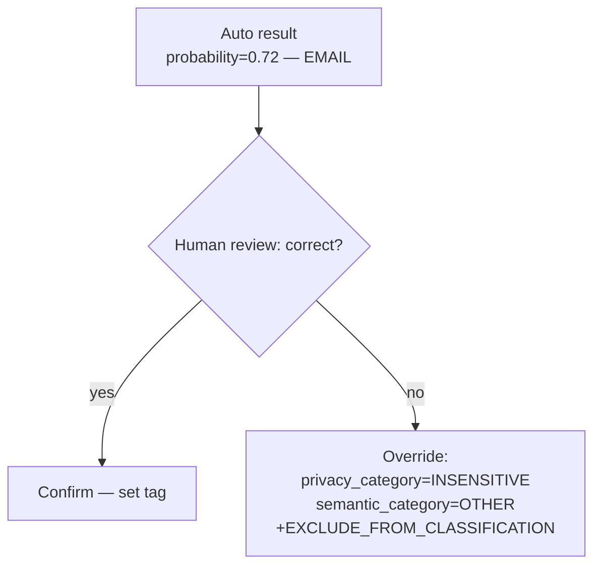

### Lab Exercise
```sql
-- Manual override on a mis-classified column
ALTER TABLE PRODUCTS MODIFY COLUMN product_code
  UNSET TAG SNOWFLAKE.CORE.SEMANTIC_CATEGORY;

ALTER TABLE PRODUCTS MODIFY COLUMN product_code
  SET TAG SNOWFLAKE.CORE.SEMANTIC_CATEGORY = 'OTHER',
          SNOWFLAKE.CORE.PRIVACY_CATEGORY  = 'INSENSITIVE';

-- Prevent re-classification from overwriting
ALTER TABLE PRODUCTS MODIFY COLUMN product_code
  SET TAG GOV.DATA.EXCLUDE_FROM_CLASSIFICATION = 'TRUE';
```

### Gotchas / Exam Traps
- System tags live in the `SNOWFLAKE.CORE` schema and have restricted modify privileges — need `APPLY TAG` or appropriate role.
- Overrides are per-column; running classification on the schema will not reset manually set system tags if `overwrite_existing_tags => FALSE`.

---

## Q16: What's the difference between SNOWFLAKE.ACCOUNT_USAGE and SNOWFLAKE.ORGANIZATION_USAGE, and which is appropriate for cross-account AI governance?

**Difficulty:** Intermediate
**Exam relevance:** Account vs. org-level metadata

### Answer
- **ACCOUNT_USAGE** — views scoped to a single Snowflake account. Access history, classification, policies, lineage all live here.
- **ORGANIZATION_USAGE** — views in the Organization that aggregate selected metadata across all accounts in the org. Includes credit usage, replication activity, warehouse metering, data transfer, and a subset of security events.

For **cross-account AI governance** (e.g., prod + dev + DR accounts, or regional accounts):
- Credit/cost oversight → ORGANIZATION_USAGE (account summaries).
- Model deployment / data lineage spanning accounts → ACCOUNT_USAGE per account, with cross-account querying via **account replication** or **cross-account shares**.
- Posture scoring across accounts → **Trust Center at the Organization level** (preview/GA depending on edition).

### First Principles
Governance perimeters often span accounts (prod/dev, geographic regions). Snowflake separates account-level operational data from org-level roll-ups to avoid noisy aggregates and to respect per-account access control. Enterprise governance aggregates by replicating ACCOUNT_USAGE data to a central governance account or by using the Org views where available.

### Diagram
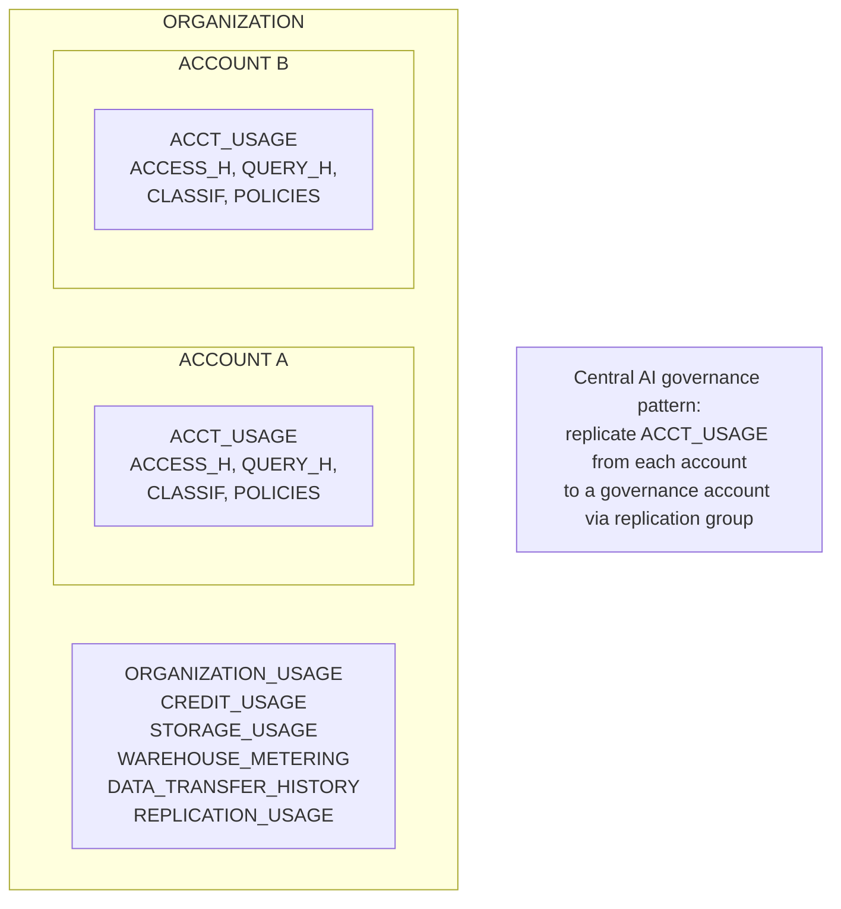

### Lab Exercise
```sql
-- Organization usage view (requires ORGADMIN or ORG_USAGE_VIEWER)
USE ROLE ORGADMIN;
SELECT account_name, SUM(credits_used) credits
FROM SNOWFLAKE.ORGANIZATION_USAGE.CREDIT_USAGE
WHERE usage_date >= DATEADD('day',-7,CURRENT_DATE())
GROUP BY 1 ORDER BY 2 DESC;

-- Central AI governance pattern: replicate ACCOUNT_USAGE for correlation
CREATE REPLICATION GROUP ACCT_USAGE_REPL
  OBJECT_TYPES = DATABASES
  ALLOWED_DATABASES = (SNOWFLAKE)
  ALLOWED_ACCOUNTS = ('<governance_account>')
  REPLICATION_SCHEDULE = '60 MINUTE';
```

### Gotchas / Exam Traps
- ORGANIZATION_USAGE has **separate retention/latency** (typically ~3h latency).
- SNOWFLAKE share's ACCOUNT_USAGE is **not writable** — you can only query it.
- For cross-account lineage, Snowflake's native lineage does not natively span accounts; you must replicate or export.

---

## Q17: How do custom data metric functions (DMFs) complement classification for AI data quality + governance?

**Difficulty:** Advanced
**Exam relevance:** DMFs for data quality signals

### Answer
**Data Metric Functions (DMFs)** are user-defined or Snowflake-provided functions that compute a scalar quality signal on a column or table — e.g., NULL_COUNT, UNIQUE_COUNT, DUPLICATE_COUNT, BLANK_COUNT, or custom like "percent of rows with valid email format."

For AI governance, DMFs complement classification:
- Classification says **"this is an email column."**
- DMF says **"8% of emails are malformed."**
- Together: the training-set engineer sees "PII column with 8% junk — don't use as feature without cleaning."

DMFs run on a schedule or on-demand; results land in `SNOWFLAKE.LOCAL.DATA_QUALITY_MONITORING_RESULTS` and `SNOWFLAKE.ACCOUNT_USAGE.DATA_QUALITY_MONITORING_RESULTS`.

### First Principles
AI model performance is dominated by data quality. Governance is the practice of making quality *visible and enforceable*. DMFs turn quality into a continuously measured, queryable signal. Combined with lineage, you can trace a model's performance drop to a quality drop in an upstream column.

### Diagram
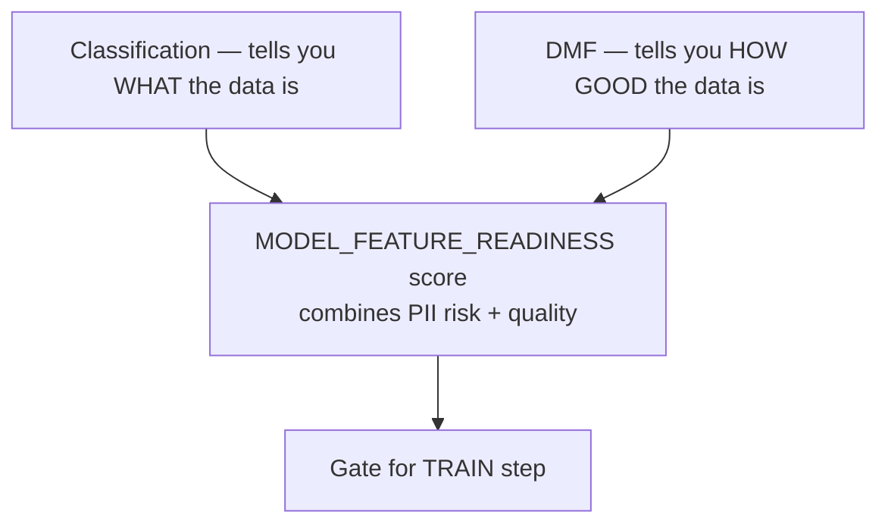

### Lab Exercise
```sql
-- Attach built-in NULL_COUNT and a custom DMF to a column
USE ROLE DATA_ENGINEER;

CREATE DATA METRIC FUNCTION GOV.DMF.PCT_INVALID_EMAIL(ARG_T TABLE(C STRING))
RETURNS NUMBER AS
  'SELECT 100 * COUNT_IF(C NOT RLIKE ''^[^@\\s]+@[^@\\s]+\\.[^@\\s]+$'')
                 / NULLIF(COUNT(C),0) FROM ARG_T';

ALTER TABLE ANALYTICS.CUSTOMERS
  ADD DATA METRIC FUNCTION SNOWFLAKE.CORE.NULL_COUNT ON (email),
      DATA METRIC FUNCTION GOV.DMF.PCT_INVALID_EMAIL ON (email);

ALTER TABLE ANALYTICS.CUSTOMERS
  SET DATA_METRIC_SCHEDULE = '60 MINUTE';

-- Observe results
SELECT * FROM SNOWFLAKE.LOCAL.DATA_QUALITY_MONITORING_RESULTS
WHERE table_name = 'CUSTOMERS'
ORDER BY measurement_time DESC LIMIT 20;
```

### Gotchas / Exam Traps
- DMFs require **Enterprise or higher** edition.
- DMFs consume **serverless credits** — monitor cost.
- DMF scheduling is per-table — set once, applies to all DMFs on the table.

---

## Q18: What is the Snowflake Internal Marketplace / Data Products pattern, and how does it serve AI governance?

**Difficulty:** Intermediate
**Exam relevance:** Internal data products

### Answer
Internal Marketplace (also called "Private Listings") lets producers package curated datasets, Native Apps, or ML models as **data products** published within the org. Consumers discover them through the Marketplace UI, request access, and are granted via standard shares.

Governance payoffs:
- **Discoverability** — AI teams find governed datasets instead of making their own.
- **Approval workflow** — access to each product requires producer approval; auditable.
- **Documentation** — product description, usage terms, SLAs, contact.
- **Versioning** — producers publish new versions; consumers migrate.
- **Lineage** — consumer accounts see the share, which flows into ACCESS_HISTORY.

### First Principles
Shadow data proliferation (teams building their own copies) is a leading cause of governance drift. Making the "golden" dataset *easy to find and consume* is more effective than policing data duplication. The Marketplace pattern treats data as a product with producers, consumers, and SLAs.

### Diagram
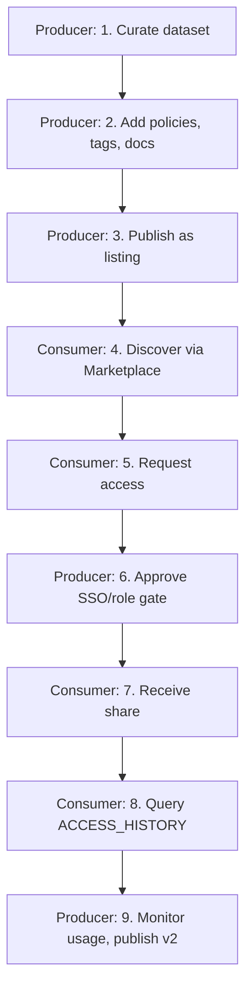

### Lab Exercise
```sql
-- Create a listing (simplified)
USE ROLE ACCOUNTADMIN;
CREATE SHARE FEATURE_STORE_SHARE;
GRANT USAGE ON DATABASE FEATURE_STORE TO SHARE FEATURE_STORE_SHARE;
GRANT USAGE ON SCHEMA FEATURE_STORE.PUBLIC TO SHARE FEATURE_STORE_SHARE;
GRANT SELECT ON ALL TABLES IN SCHEMA FEATURE_STORE.PUBLIC TO SHARE FEATURE_STORE_SHARE;

-- Register the share as an internal listing (via UI typically; API also exists)
-- Monitor consumption:
SELECT share_name, consumer_account_name, usage_date, bytes_transferred
FROM SNOWFLAKE.ORGANIZATION_USAGE.DATA_TRANSFER_HISTORY
WHERE share_name = 'FEATURE_STORE_SHARE' LIMIT 20;
```

### Gotchas / Exam Traps
- Private Listings differ from public Marketplace listings — different approval workflows.
- Access via a share is **read-only**; consumers cannot write back without replication.

---

## Q19: How do you prove to a GDPR DPO that a specific data subject's row was never used for AI training?

**Difficulty:** Advanced
**Exam relevance:** Right to object, GDPR Art. 21

### Answer
Design pattern:
1. **Row-access policy** on all training-eligible tables that filters out rows where `training_opt_out = TRUE`.
2. **ACCESS_HISTORY** proves that queries from training roles invoked the policy.
3. **Lineage** from the training set to source tables confirms the policy was in the path.
4. **Audit query**: did the training-set CREATE statement run with the opt-out policy attached? Yes → the specific row couldn't have been included.

Alternative, stronger pattern:
- **Vault** opt-outs in a separate table with `consent_history` and join on every training query. Store the join plan artifact.

### First Principles
Negative proof ("X did not happen") is hard. You prove it structurally: if every training-eligible path is gated by a policy, and the policy's condition is logged and auditable, then rows failing the condition could not have flowed. This is why policies, not application code, must enforce consent — application code paths cannot be exhaustively audited.

### Diagram
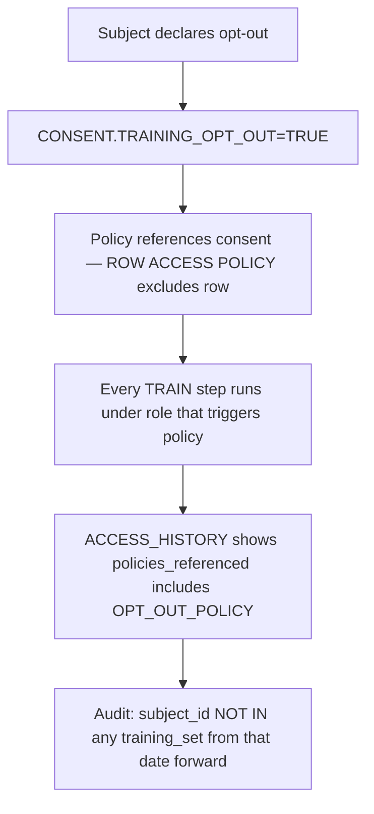

### Lab Exercise
```sql
CREATE TABLE GOV.CONSENT.TRAINING_OPT_OUT (
  subject_id STRING PRIMARY KEY,
  opt_out_at TIMESTAMP_NTZ,
  source STRING
);

CREATE OR REPLACE ROW ACCESS POLICY GOV.POL.OPT_OUT_FILTER
AS (subject_id STRING) RETURNS BOOLEAN ->
  NOT EXISTS (
    SELECT 1 FROM GOV.CONSENT.TRAINING_OPT_OUT
    WHERE GOV.CONSENT.TRAINING_OPT_OUT.subject_id = subject_id
  );

ALTER TABLE CUSTOMERS
  ADD ROW ACCESS POLICY GOV.POL.OPT_OUT_FILTER ON (customer_id);

-- Audit: training queries referenced the policy?
SELECT query_id, user_name, policies_referenced
FROM SNOWFLAKE.ACCOUNT_USAGE.ACCESS_HISTORY
WHERE ARRAY_TO_STRING(policies_referenced,',') ILIKE '%OPT_OUT_FILTER%'
  AND user_name = 'ML_TRAINING_SA';
```

### Gotchas / Exam Traps
- Policies apply at query time — rows ingested **before** opt-out but used in training **after** opt-out are still excluded on re-reads but may already be in a materialized training set (requires rebuild).
- GDPR right to erasure is distinct from opt-out — may require deletion, not just filtering.

---

## Q20: What's the governance significance of ACCESS_HISTORY's POLICIES_REFERENCED column, and how do you prove continuous policy enforcement over time?

**Difficulty:** Advanced
**Exam relevance:** Policy enforcement audit

### Answer
`POLICIES_REFERENCED` in ACCESS_HISTORY lists every policy evaluated for a query, including whether it was **applied** (true=effective) or **masked out** (role was exempt). This is the forensic record of "did governance actually run?"

To prove continuous enforcement:
1. Pick a protected column.
2. Query ACCESS_HISTORY for every access over the audit window.
3. Confirm every row's POLICIES_REFERENCED includes the expected masking policy.
4. Any row without the policy = enforcement gap (policy wasn't attached at that time, or the column wasn't actually accessed).

Over time, this becomes a continuous attestation that policies have been in place since date X.

### First Principles
Compliance frameworks demand "continuous enforcement" not just "policy exists." ACCESS_HISTORY gives per-query attestation. The pattern separates *authoring* a policy (POLICY_REFERENCES — was it bound?) from *invoking* a policy (ACCESS_HISTORY.POLICIES_REFERENCED — did it run?). Both must be true for enforcement.

### Diagram
```mermaid
flowchart TD
    L1[Layer 1: POLICY_REFERENCES<br/>the policy is bound<br/>static — is attached?]
    L2[Layer 2: ACCESS_HISTORY.POLICIES_REFERENCED<br/>the policy ran each time<br/>dynamic — per-query trace]
    C[Combined: continuous enforcement<br/>audit-ready evidence]
    L1 --> L2 --> C
```

### Lab Exercise
```sql
-- Attest continuous enforcement of a given masking policy
WITH expected_policy AS (
  SELECT 'GOV.POL.PII_STRING' AS pol
),
accesses AS (
  SELECT query_id, query_start_time, user_name,
         base_objects_accessed, policies_referenced
  FROM SNOWFLAKE.ACCOUNT_USAGE.ACCESS_HISTORY
  WHERE query_start_time BETWEEN '2026-01-01' AND '2026-10-30'
)
SELECT
  COUNT(*)                                    AS total_queries,
  COUNT_IF(ARRAY_TO_STRING(policies_referenced,',') ILIKE '%PII_STRING%')
                                              AS queries_with_policy,
  100.0 * COUNT_IF(ARRAY_TO_STRING(policies_referenced,',') ILIKE '%PII_STRING%')
         / NULLIF(COUNT(*),0)                 AS enforcement_pct
FROM accesses a, expected_policy e
WHERE EXISTS (
  SELECT 1 FROM LATERAL FLATTEN(input=>a.base_objects_accessed) b,
                 LATERAL FLATTEN(input=>b.value:columns) c
  WHERE c.value:columnName::STRING = 'EMAIL'
);
```

### Gotchas / Exam Traps
- `POLICIES_REFERENCED` is NULL for queries that didn't reference any protected object.
- A role exempt from a policy still shows the policy in `POLICIES_REFERENCED` with an indication of the branch taken.
- Row-access policies that return FALSE (no rows) still show as referenced.

---

## Q21: What is "Document AI" in Snowflake's unstructured-data governance, and what are its specific governance requirements?

**Difficulty:** Intermediate
**Exam relevance:** Document AI + unstructured governance

### Answer
**Document AI** is Snowflake's capability to extract structured information from documents (PDFs, images, scanned forms) using LLMs, directly in Snowflake. It stores raw files in **stages**, model outputs in tables, and provides functions like `PREDICT` on a trained document model.

Governance requirements:
1. **Stage-level encryption + access control** — raw documents often contain PII in free-form; stages must have minimum access and server-side encryption.
2. **File-level tagging** — tag stage directories with sensitivity.
3. **Classification on extracted fields** — once documents are parsed, run `SYSTEM$CLASSIFY` on the output tables.
4. **Retention** — original documents may fall under records-retention rules; align stage lifecycle with policy.
5. **Model-prompt audit** — the prompt or extraction template is itself a governance artifact.

### First Principles
Unstructured data is governance's hardest surface because content is opaque until processed. Document AI inverts this: extract first, classify extracted fields, then apply standard governance. The raw stage remains the "source of truth" with the strictest controls; extracted tables inherit sensitivity.

### Diagram
```mermaid
flowchart TD
    PDF[PDF arrives]
    ST[STAGE<br/>encrypted, access-controlled, tagged]
    DM[Document AI model<br/>prompts versioned, approved]
    EF[EXTRACTED_FIELDS table]
    SYS[SYSTEM$CLASSIFY — auto-tag PII cols]
    LIN[Lineage edge from stage to table]
    DN[Downstream models consume with masking]
    PDF --> ST --> DM --> EF
    EF --> SYS
    EF --> LIN
    EF --> DN
```

### Lab Exercise
```sql
-- Encrypted internal stage for documents
CREATE OR REPLACE STAGE DOC_INGEST
  ENCRYPTION = (TYPE = 'SNOWFLAKE_SSE')
  DIRECTORY = (ENABLE = TRUE);

-- Tag stage
ALTER STAGE DOC_INGEST SET TAG GOV.DATA.SENSITIVITY = 'CONFIDENTIAL';

-- Extract fields via Document AI (schematic)
CREATE OR REPLACE TABLE DOC_EXTRACT AS
SELECT
  METADATA$FILENAME AS file,
  MY_DOC_MODEL!PREDICT(GET_PRESIGNED_URL(@DOC_INGEST, file))
       AS fields,
  CURRENT_TIMESTAMP() AS extracted_at
FROM DIRECTORY(@DOC_INGEST);

-- Classify extracted fields
CALL SYSTEM$CLASSIFY('MY_DB.PUBLIC.DOC_EXTRACT',{'auto_tag':TRUE});
```

### Gotchas / Exam Traps
- Document AI model artifacts live in a schema with their own privileges — treat `USAGE ON MODEL` with care.
- `GET_PRESIGNED_URL` for stage files is **time-limited**; audit via QUERY_HISTORY for presigned-URL grants.

---

## Q22: Compare manual tag application vs. tag-propagation-via-lineage for AI governance scalability.

**Difficulty:** Advanced
**Exam relevance:** Governance operating-model

### Answer
- **Manual tag application** — explicit `ALTER … SET TAG` on every object. Precise but doesn't scale.
- **Tag propagation via lineage** — a scheduled job walks the lineage DAG and applies/suggests tags downstream when upstream has sensitivity tags.

Snowflake does **not** auto-propagate tags along lineage out of the box. You implement propagation via:
1. Stream + task on `TAG_REFERENCES`.
2. Scheduled task that calls `GET_LINEAGE` for each tagged source and applies tags downstream.
3. Human review step for suggested tags (don't auto-apply security-impacting tags).

For AI pipelines, propagation prevents the common bug where a derived training-set table inherits none of the source's sensitivity.

### First Principles
Lineage captures causality; sensitivity should flow with causality. Automating this requires a feedback loop with human oversight, because propagation errors can either over-restrict (block legitimate use) or under-restrict (leak PII). The best model is "propose, don't dictate."

### Diagram
```mermaid
flowchart TD
    SRC[source_tbl tag=HIGH]
    FT[feature_tbl]
    PT[Propagation task reads lineage]
    PROP[Proposed tag=HIGH]
    TS[training_set]
    HR[Human reviews, confirms]
    TSH[training_set tagged=HIGH]
    SRC -->|lineage edge| FT
    FT --> PT --> PROP
    FT --> TS
    PROP --> HR --> TSH
```

### Lab Exercise
```sql
-- Simplified: propose tags for downstream objects of a tagged source
CREATE OR REPLACE PROCEDURE PROPAGATE_TAGS()
RETURNS INT LANGUAGE SQL AS $$
DECLARE
  cnt INT := 0;
BEGIN
  LET cur CURSOR FOR
    SELECT tr.object_name AS src, tr.tag_value, down.target_object_name AS dn
    FROM SNOWFLAKE.ACCOUNT_USAGE.TAG_REFERENCES tr,
         LATERAL (
           SELECT target_object_name
           FROM TABLE(SNOWFLAKE.CORE.GET_LINEAGE(
                       tr.object_name,'TABLE','DOWNSTREAM',1,5))
         ) down
    WHERE tr.tag_name='SENSITIVITY' AND tr.tag_value IN ('HIGH','RESTRICTED');
  FOR r IN cur DO
    INSERT INTO GOV.PROPAGATION_PROPOSALS
    VALUES (r.src, r.dn, 'SENSITIVITY', r.tag_value, CURRENT_TIMESTAMP());
    cnt := cnt + 1;
  END FOR;
  RETURN cnt;
END; $$;
```

### Gotchas / Exam Traps
- Native tag inheritance (schema→table→column) is **structural**, not **lineage-based** — exam may test the difference.
- Over-propagation can block legitimate use; always include a review step.

---

## Q23: What is "data residency" tagging in Snowflake, and how do you enforce it for AI training that must stay in-region?

**Difficulty:** Advanced
**Exam relevance:** Residency enforcement

### Answer
Residency tagging encodes the geographic jurisdiction of data (`DATA_RESIDENCY='EU'`, `='US'`). For AI training in-region:
1. **Residency tag on sources** — identifies which rows/tables are EU-resident.
2. **Warehouse region tag** — the compute warehouse is in a specific cloud region.
3. **Policy check** — a row-access policy or stored procedure asserts `source.residency = warehouse.region` before training.
4. **Replication boundaries** — Replication Groups restrict which accounts can receive the data; residency tags cross-reference the destination account's region.

Snowflake accounts live in a region (e.g., AWS us-east-1, Azure West Europe). Compute within an account cannot leave that region. The governance task is to prevent data from being **replicated** or **shared** outside its residency.

### First Principles
Residency is a non-functional data property; enforcing it is a *routing* concern. Tagging + replication group ACLs is the Snowflake-native way to encode residency as a programmable control rather than paperwork.

### Diagram
```mermaid
flowchart TD
    EU[EU account eu-west-1<br/>data tagged DATA_RESIDENCY=EU<br/>warehouse in-region<br/>policy: residency = region]
    US[US account us-east-1<br/>cannot receive via replication<br/>REPL group ALLOWED_ACCOUNTS<br/>excludes US for EU-tagged DBs]
    EU -.->|BLOCKED| US
```

### Lab Exercise
```sql
-- Residency tag + enforcement UDF
CREATE TAG GOV.DATA.RESIDENCY ALLOWED_VALUES 'EU','US','APAC','GLOBAL';

ALTER DATABASE EU_SALES SET TAG GOV.DATA.RESIDENCY = 'EU';

CREATE OR REPLACE FUNCTION ASSERT_REGION_MATCH(SOURCE_DB STRING)
RETURNS BOOLEAN LANGUAGE SQL AS $$
  WITH r AS (SELECT tag_value FROM SNOWFLAKE.ACCOUNT_USAGE.TAG_REFERENCES
             WHERE object_name = SOURCE_DB AND tag_name='RESIDENCY'),
       c AS (SELECT CURRENT_REGION() AS reg)
  SELECT
    CASE WHEN r.tag_value='EU' AND c.reg ILIKE 'AWS_EU_%' THEN TRUE
         WHEN r.tag_value='US' AND c.reg ILIKE 'AWS_US_%' THEN TRUE
         ELSE FALSE END
  FROM r, c
$$;

-- Replication group restricted to in-region accounts
CREATE REPLICATION GROUP EU_SALES_REPL
  OBJECT_TYPES = DATABASES
  ALLOWED_DATABASES = (EU_SALES)
  ALLOWED_ACCOUNTS = ('OTHER_EU_ACCOUNT.AWS_EU_WEST_1');
```

### Gotchas / Exam Traps
- `CURRENT_REGION()` returns the Snowflake-formatted region (e.g., `AWS_EU_WEST_1`), not AWS format.
- Sharing data to a consumer in a different region requires the data to be **replicated** to that region first; a bare SHARE won't cross regions.

---

## Q24: What's the role of Snowflake's "secure data sharing" in AI governance, and how does the consumer prove compliance of inbound shared data?

**Difficulty:** Intermediate
**Exam relevance:** Share governance

### Answer
Secure Data Sharing exposes data to another account via a **share** — no copy, read-only, revocable. Governance implications on both sides:

Producer:
- The share runs under the producer account's masking/row-access policies — tag before sharing.
- Secure views/UDFs hide implementation details.
- Share access logs appear in producer's ACCESS_HISTORY.

Consumer:
- Inbound share appears as a database; ACCESS_HISTORY logs queries including the share's objects.
- Consumer **cannot** apply its own masking policies to shared columns (shared data is read-only metadata too).
- Consumer must document the inbound provenance separately (external lineage).

Consumer compliance proof:
- Record metadata received at share creation (manifest, SLA, source attestations).
- Join `ACCESS_HISTORY` with inbound share objects to prove how shared data was used.
- Tag inbound share database with its origin/compliance posture.

### First Principles
Shared data is an *external dependency*. Governance can't be imposed cross-account because privilege boundaries differ; the consumer must accept the producer's controls. The consumer's defense is: (a) record what was shared, (b) record how it was used, (c) tag inbound objects to drive downstream policies.

### Diagram
```mermaid
flowchart TD
    subgraph P["PRODUCER acct"]
        MP[Masking policies]
        SV[Secure views]
        PAH[ACCESS_HISTORY — producer sees consumer reads]
    end
    SH[Share — readonly shared objects]
    subgraph C["CONSUMER acct"]
        TAG[Tag inbound DB with origin+tier]
        POL[Policies on consumer-side derived tables only]
        CAH[ACCESS_HISTORY logs reads]
    end
    MP --> SH
    SV --> SH
    SH --> TAG
    SH --> POL
    SH --> CAH
```

### Lab Exercise
```sql
-- Consumer-side: tag the inbound share db
ALTER DATABASE SHARED_FINANCE
  SET TAG GOV.DATA.SOURCE_OF_RECORD = 'FINANCE_PROD_PRODUCER',
          GOV.DATA.RESIDENCY = 'EU',
          GOV.DATA.SENSITIVITY = 'CONFIDENTIAL';

-- Audit: what did we read from the share?
SELECT query_id, user_name, query_start_time, base_objects_accessed
FROM SNOWFLAKE.ACCOUNT_USAGE.ACCESS_HISTORY
WHERE ARRAY_TO_STRING(
       (SELECT ARRAY_AGG(obj.value:objectName::STRING)
        FROM LATERAL FLATTEN(input=>base_objects_accessed) obj),
       ',') ILIKE '%SHARED_FINANCE%'
LIMIT 50;
```

### Gotchas / Exam Traps
- Consumer **cannot** attach masking policies to shared objects — must materialize to apply.
- Replication is **different** from sharing — replication copies, sharing references.

---

## Gotchas Recap — Data Governance Cheat Sheet

| Capability | View / Function | Latency |
|------------|-----------------|---------|
| Classification | `DATA_CLASSIFICATION_LATEST` + `SYSTEM$CLASSIFY` | On demand / schema auto |
| Tag catalog | `TAG_REFERENCES` (direct) / `TAG_REFERENCES_WITH_LINEAGE` (inherited) | ~2 h |
| Lineage | `SNOWFLAKE.CORE.GET_LINEAGE()` | Near real-time |
| Dependencies | `OBJECT_DEPENDENCIES` | ~45 min |
| Access audit | `ACCESS_HISTORY` | ~45 min |
| Policy audit | `POLICY_REFERENCES` | ~2 h |
| Quality | `DATA_QUALITY_MONITORING_RESULTS` | Per DMF schedule |
| Trust posture | `SNOWFLAKE.TRUST_CENTER.FINDINGS` | Scanner schedule |
