# Access Control & RBAC — GAS-C01 Study Guide

## Exam Weight & Scope

**Weight on GAS-C01:** ~15-20%

**Scope:**
- RBAC fundamentals: users, roles, privileges, grants, role hierarchies
- Role-activation model (primary vs. secondary roles, `USE SECONDARY ROLES ALL`)
- System roles (ACCOUNTADMIN, SECURITYADMIN, USERADMIN, SYSADMIN, PUBLIC, ORGADMIN, OWNERSHIP)
- Functional vs. access roles pattern
- Service accounts for AI workloads (key pair auth, programmatic access tokens)
- OAuth, SCIM, SSO/SAML for AI apps
- Secure Views and Secure UDFs
- Future grants, managed access schemas
- `APPLY` on tag/policy — the governance grant chain
- Trust Center security scanners
- Network Policies for AI workload isolation
- Authentication policies and session policies for interactive AI tools

## Core Concepts Map

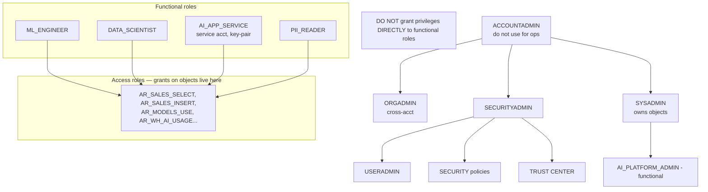

---

## Q1: Describe Snowflake's RBAC model: what are the five core concepts, and what does the "DAC" aspect add?

**Difficulty:** Foundation
**Exam relevance:** RBAC fundamentals

### Answer
Five concepts:
1. **User** — a login identity (human or service).
2. **Role** — a named collection of privileges; users activate roles to perform actions.
3. **Privilege** — a specific permission on a securable object (SELECT, USAGE, APPLY, CREATE, OWNERSHIP…).
4. **Securable object** — anything grantable (database, schema, table, view, warehouse, stage, UDF, model, task, procedure, pipe, policy, tag, role, user, account).
5. **Grant** — assigns a privilege on an object to a role, or assigns a role to another role or user.

The **DAC (Discretionary Access Control)** aspect: the **OWNER** of an object (the role with OWNERSHIP) can grant further access to others at their discretion. Pure RBAC has centralized grants; DAC decentralizes to owners. Snowflake blends both.

### First Principles
Pure RBAC scales for well-defined enterprise permissions but doesn't let data producers delegate access to their own derived objects. DAC lets a team own and share its own work without filing central tickets, improving velocity. The trade-off: owners can grant beyond what central security intended. Snowflake mitigates with:
- `MANAGED ACCESS` schemas (schema owner — not object owner — grants).
- Role-hierarchy constraints (only ADMIN roles can create higher-level roles).
- `GRANT APPLY` separation (policy use ≠ data access).

### Diagram
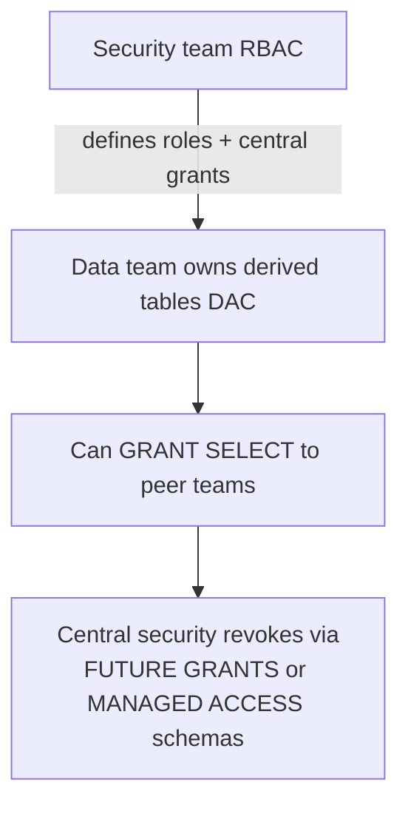

### Lab Exercise
```sql
-- Minimum RBAC skeleton
USE ROLE USERADMIN;
CREATE USER alice LOGIN_NAME='alice' PASSWORD='…' MUST_CHANGE_PASSWORD=TRUE;
CREATE ROLE data_scientist;
GRANT ROLE data_scientist TO USER alice;

USE ROLE SECURITYADMIN;
GRANT USAGE ON DATABASE AI_DB TO ROLE data_scientist;
GRANT USAGE ON SCHEMA AI_DB.FEATURES TO ROLE data_scientist;
GRANT SELECT ON ALL TABLES IN SCHEMA AI_DB.FEATURES TO ROLE data_scientist;

-- DAC: alice (as data_scientist) owns a derived table; she can grant on it
USE ROLE data_scientist;
CREATE TABLE AI_DB.FEATURES.MY_MODEL_OUTPUT AS SELECT ...;
GRANT SELECT ON TABLE AI_DB.FEATURES.MY_MODEL_OUTPUT TO ROLE analyst;
-- SECURITY team doesn't need to be involved for this derived-object share.
```

### Gotchas / Exam Traps
- "DAC" only applies to **non-system** owners — SYSADMIN/SECURITYADMIN can always re-grant/revoke.
- OWNERSHIP is a **privilege**, not an attribute — can be transferred (`GRANT OWNERSHIP … REVOKE CURRENT GRANTS`).
- Only one role holds OWNERSHIP of an object at a time.

---

## Q2: What is the Snowflake-recommended "functional roles + access roles" pattern, and why is it the right model for AI workloads?

**Difficulty:** Intermediate
**Exam relevance:** RBAC design pattern

### Answer
**Access roles** group privileges on specific objects (one role per object or per bundle):
- `AR_AI_DB_FEATURES_READ` — SELECT on all tables in AI_DB.FEATURES.
- `AR_AI_DB_FEATURES_WRITE` — INSERT/UPDATE/DELETE on same.
- `AR_WH_AI_USAGE` — USAGE on warehouse WH_AI.
- `AR_MODELS_USE` — USAGE on all models in a schema.

**Functional roles** represent personas (what people do):
- `FR_DATA_SCIENTIST` — gets `AR_AI_DB_FEATURES_READ`, `AR_WH_AI_USAGE`, `AR_MODELS_USE`.
- `FR_ML_ENGINEER` — gets WRITE access roles plus function registration.
- `FR_AI_APP_SERVICE` — minimum access roles for a specific app.

Users and services only receive **functional roles**, never access roles directly. New objects → add to one access role; changes propagate to all functional roles that include it.

Right for AI because:
- AI workflows cross many objects (features, models, warehouses, stages, Cortex functions). Functional roles compose them.
- Service accounts for pipelines need stable, well-scoped bundles.
- Model promotions change ownership — access roles remain stable while functional membership can be re-mapped.

### First Principles
Direct grants from users to objects create O(users × objects) bindings — unmanageable. Two-layer indirection makes it O(objects) + O(personas), with the roles-roles mapping as the only churning edge. This is the same insight behind UNIX groups, SELinux types, AWS IAM policies — separation of *what* from *who*.

### Diagram
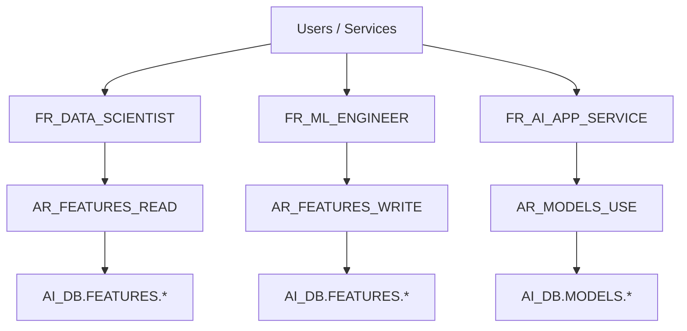

### Lab Exercise
```sql
USE ROLE SECURITYADMIN;

-- Access roles
CREATE ROLE AR_AI_FEATURES_READ;
CREATE ROLE AR_AI_FEATURES_WRITE;
CREATE ROLE AR_WH_AI_USAGE;
CREATE ROLE AR_AI_MODELS_USE;

GRANT USAGE   ON DATABASE AI_DB                     TO ROLE AR_AI_FEATURES_READ;
GRANT USAGE   ON SCHEMA   AI_DB.FEATURES            TO ROLE AR_AI_FEATURES_READ;
GRANT SELECT  ON ALL TABLES IN SCHEMA AI_DB.FEATURES TO ROLE AR_AI_FEATURES_READ;
GRANT SELECT  ON FUTURE TABLES IN SCHEMA AI_DB.FEATURES TO ROLE AR_AI_FEATURES_READ;

GRANT INSERT, UPDATE, DELETE ON ALL TABLES IN SCHEMA AI_DB.FEATURES
  TO ROLE AR_AI_FEATURES_WRITE;

GRANT USAGE ON WAREHOUSE WH_AI TO ROLE AR_WH_AI_USAGE;
GRANT USAGE ON ALL MODELS IN SCHEMA AI_DB.MODELS TO ROLE AR_AI_MODELS_USE;

-- Functional roles compose access roles
CREATE ROLE FR_DATA_SCIENTIST;
GRANT ROLE AR_AI_FEATURES_READ TO ROLE FR_DATA_SCIENTIST;
GRANT ROLE AR_WH_AI_USAGE      TO ROLE FR_DATA_SCIENTIST;
GRANT ROLE AR_AI_MODELS_USE    TO ROLE FR_DATA_SCIENTIST;

-- Users receive only functional roles
GRANT ROLE FR_DATA_SCIENTIST TO USER alice;

-- Role hierarchy linked to SYSADMIN for central oversight
GRANT ROLE FR_DATA_SCIENTIST TO ROLE SYSADMIN;
```

### Gotchas / Exam Traps
- Always `GRANT role TO ROLE SYSADMIN` so SYSADMIN sees all; this is a Snowflake-documented best practice.
- `FUTURE` grants exist at **database** and **schema** scope — remember to add both if you want new schemas to inherit.
- Access roles must own future-grant chains to survive object recreation.

---

## Q3: Explain primary vs. secondary roles and how `USE SECONDARY ROLES ALL` changes effective privilege evaluation.

**Difficulty:** Advanced
**Exam relevance:** Role-activation model

### Answer
- **Primary role** — the single active role set via `USE ROLE <name>`. Determines ownership of objects created in the session, defaults for role-conditional policies, and the role shown in ACCESS_HISTORY.
- **Secondary roles** — additional roles whose privileges augment the primary for *access evaluation only*. Set via `USE SECONDARY ROLES ALL` (all granted roles) or `USE SECONDARY ROLES role_a, role_b`.

Effect:
- SELECT/USAGE/etc. succeed if the primary OR any secondary role has the privilege.
- Object ownership (CREATE) always uses the **primary** role.
- `CURRENT_ROLE()` returns the primary.
- `CURRENT_SECONDARY_ROLES()` returns the active secondary set.
- Masking/row-access policies evaluating `CURRENT_ROLE()` see only the primary — this is a common policy design gotcha. Use `IS_ROLE_IN_SESSION('name')` to check any active role.

### First Principles
Users often legitimately combine responsibilities (data scientist who also owns a specific app). Pre-secondary roles, this forced users to flip `USE ROLE` repeatedly or to grant one role everything (least-privilege violation). Secondary roles let a user operate with the *union* of their granted privileges while keeping ownership attribution clean. For AI governance, this matters because audit queries must know whether a privilege came from primary or secondary.

### Diagram
```mermaid
flowchart TD
    S[Session: primary=FR_DATA_SCIENTIST<br/>secondary={FR_PII_READER, FR_MODEL_OWNER}]
    Q[Query: SELECT ssn FROM customers]
    PC[Privilege check: SELECT on customers?]
    P1[primary FR_DATA_SCIENTIST — no]
    P2[secondary FR_PII_READER — yes — succeeds]
    P3[secondary FR_MODEL_OWNER — no]
    BUG[Masking policy: IF CURRENT_ROLE=PII_READER THEN val ELSE ***<br/>Returns *** because CURRENT_ROLE is primary!]
    FIX[Fix: IF IS_ROLE_IN_SESSION 'PII_READER']
    S --> Q --> PC
    PC --> P1
    PC --> P2
    PC --> P3
    P2 --> BUG --> FIX
```

### Lab Exercise
```sql
-- Activate secondary roles
USE ROLE FR_DATA_SCIENTIST;
USE SECONDARY ROLES ALL;

SELECT CURRENT_ROLE(), CURRENT_SECONDARY_ROLES();
-- CURRENT_ROLE = FR_DATA_SCIENTIST
-- CURRENT_SECONDARY_ROLES = {"roles":"...","value":"FR_PII_READER,..."}

-- Masking policy aware of secondary roles
CREATE OR REPLACE MASKING POLICY GOV.POL.PII_AWARE
AS (val STRING) RETURNS STRING ->
  CASE
    WHEN IS_ROLE_IN_SESSION('FR_PII_READER') THEN val
    ELSE '***'
  END;

ALTER TABLE customers MODIFY COLUMN ssn SET MASKING POLICY GOV.POL.PII_AWARE;

-- Audit: which role actually ran the query
SELECT query_id, user_name, role_name, secondary_roles_in_use
FROM SNOWFLAKE.ACCOUNT_USAGE.QUERY_HISTORY
WHERE user_name = 'alice' ORDER BY start_time DESC LIMIT 10;
```

### Gotchas / Exam Traps
- Policies using `CURRENT_ROLE()` **don't see** secondary roles — classic bug. Use `IS_ROLE_IN_SESSION()`.
- `USE SECONDARY ROLES ALL` is set per session; it does not persist like a default role.
- Object creation uses primary — if a user runs CREATE while secondary roles are active, the new object is owned by the primary.
- `DEFAULT_SECONDARY_ROLES` can be set at user level with `('ALL')` to auto-enable at login.

---

## Q4: Describe each Snowflake system role and the correct separation of duties for an AI governance team.

**Difficulty:** Foundation
**Exam relevance:** System roles

### Answer

| Role | Purpose | AI Governance Separation |
|------|---------|--------------------------|
| **ORGADMIN** | Org-level: create accounts, replication groups | Separate team, scheduled break-glass only |
| **ACCOUNTADMIN** | Full account control; parent of SYSADMIN+SECURITYADMIN | NEVER day-to-day; break-glass + billing |
| **SECURITYADMIN** | Manage grants, policies, network/session policies | Governance / security team |
| **USERADMIN** | Create users and roles | Identity team |
| **SYSADMIN** | Create warehouses, databases; owns objects | Platform team |
| **PUBLIC** | Default role for every user; grant nothing sensitive | Avoid granting access role to PUBLIC |
| **ORGADMIN** (preview roles) | NET_ADMIN, BILLING_ADMIN, AUDIT_VIEWER | Specialized separation |

For AI governance separation of duties (SOD):
- Security team owns policies (SECURITYADMIN).
- Identity team owns user lifecycle (USERADMIN).
- Platform team owns warehouses/compute (SYSADMIN).
- Audit/compliance has **read-only** access via `SECURITY_VIEWER` or `GOVERNANCE_VIEWER` application roles.
- Model owners get functional roles tied to their models only.

### First Principles
SOD is a classical security control: no one role can both perform and conceal an action. Snowflake pre-wires this with system roles, but each organization must map personas to those roles with discipline. Giving everyone ACCOUNTADMIN is the single most common governance failure.

### Diagram
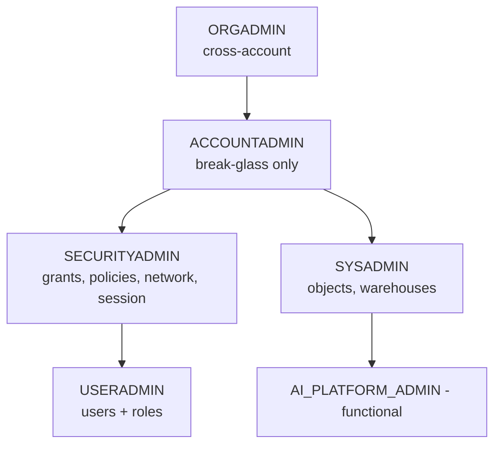

### Lab Exercise
```sql
-- Confirm who has ACCOUNTADMIN (should be few)
USE ROLE SECURITYADMIN;
SELECT grantee_name
FROM SNOWFLAKE.ACCOUNT_USAGE.GRANTS_TO_USERS
WHERE role = 'ACCOUNTADMIN' AND deleted_on IS NULL;

-- Set up break-glass alert on ACCOUNTADMIN usage
CREATE ALERT ACCOUNTADMIN_USAGE_ALERT
  WAREHOUSE = ALERT_WH
  SCHEDULE  = '15 MINUTE'
  IF (EXISTS (
    SELECT 1 FROM SNOWFLAKE.ACCOUNT_USAGE.QUERY_HISTORY
    WHERE role_name = 'ACCOUNTADMIN'
      AND start_time >= DATEADD('minute',-15,CURRENT_TIMESTAMP())
      AND user_name NOT IN ('BREAK_GLASS_USER')))
  THEN CALL SYSTEM$SEND_EMAIL('security_alerts','security@co',
         'ACCOUNTADMIN usage','Non-break-glass ACCOUNTADMIN activity detected.');
```

### Gotchas / Exam Traps
- Granting ACCOUNTADMIN to a service account is a frequent audit finding.
- PUBLIC role is granted to every user — never grant privileges to PUBLIC unless intentional.
- USERADMIN is the parent of SECURITYADMIN in the default hierarchy — remember this when planning privilege revocations.

---

## Q5: What is a Secure View, how does it differ from a non-secure view, and why do AI use cases prefer it?

**Difficulty:** Intermediate
**Exam relevance:** Secure views for data egress protection

### Answer
A **Secure View** is a view marked with the `SECURE` keyword. Differences from a regular view:
- The view **definition is hidden** from users without OWNERSHIP (via `GET_DDL`, `INFORMATION_SCHEMA.VIEWS`).
- The optimizer **does not expose underlying predicates** that could leak information through query plans (e.g., predicate pushdown that reveals row counts of excluded data).
- Row-level filtering embedded in the view **cannot be bypassed** by crafted predicates (certain optimizations are disabled).

AI use cases prefer secure views because:
- LLM-generated SQL may construct unexpected predicates — security must be unbypassable.
- Data shared externally (via secure sharing or Native Apps) uses secure views to prevent reverse-engineering.
- Audit evidence that "the view was secure" is a point-in-time compliance assertion.

Trade-off: secure views have slower optimization (some predicate pushdowns disabled). For high-volume AI inference, benchmark.

### First Principles
Non-secure views are *abstraction*; secure views are *protection*. If you use a view to hide complexity, non-secure is fine. If you use a view to **restrict visibility**, you must use SECURE because the optimizer has latitude to leak information otherwise — demonstrated academic attacks on non-secure views include side-channel row-count inference.

### Diagram
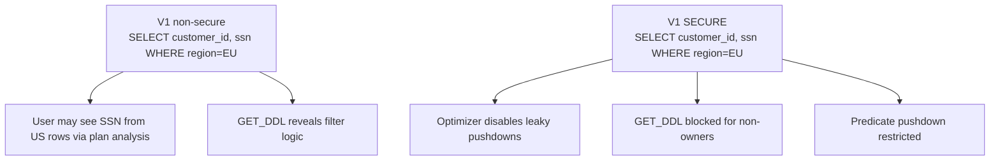

### Lab Exercise
```sql
-- Non-secure vs secure
CREATE VIEW V_EU_CUSTOMERS AS
  SELECT id, email FROM customers WHERE region='EU';

CREATE SECURE VIEW V_EU_CUSTOMERS_SAFE AS
  SELECT id, email FROM customers WHERE region='EU';

-- Non-owner attempts to see definition
USE ROLE FR_DATA_SCIENTIST;
SELECT GET_DDL('VIEW','V_EU_CUSTOMERS');            -- allowed
SELECT GET_DDL('VIEW','V_EU_CUSTOMERS_SAFE');       -- blocked

-- Confirm secure flag
SELECT table_name, is_secure
FROM INFORMATION_SCHEMA.VIEWS
WHERE table_name LIKE 'V_EU_%';
```

### Gotchas / Exam Traps
- Secure views **are** more expensive to query than non-secure.
- A view referenced inside a non-secure view may still be queryable via side-channels — chain secure all the way down.
- Secure UDF is the function equivalent: `CREATE SECURE FUNCTION …`.

---

## Q6: What are Secure UDFs/UDTFs, and when must you prefer them for AI pipelines?

**Difficulty:** Intermediate
**Exam relevance:** Secure functions

### Answer
A **Secure UDF** (or Secure UDTF/SP) is created with the `SECURE` keyword. Properties:
- Function body hidden from non-owners.
- Query optimizations that could leak values from the function's internals are disabled.
- The function's error messages (that might echo values) are sanitized.

Prefer secure UDFs for AI pipelines when:
- The function implements business logic you don't want callers to see (e.g., a fraud-score formula).
- The function references **sensitive data** inside its body (lookup tables with SSN mappings).
- The function is **shared externally** via a Native App or Data Share.
- The function uses secrets (API keys for external AI services) — body hiding prevents accidental disclosure via GET_DDL.

### First Principles
A UDF body is code; code is a disclosure surface. Shared data products commonly expose UDFs; secure variants separate the ability to *invoke* from the ability to *inspect*. This is especially important for AI pipelines where feature engineering logic encodes business IP.

### Diagram
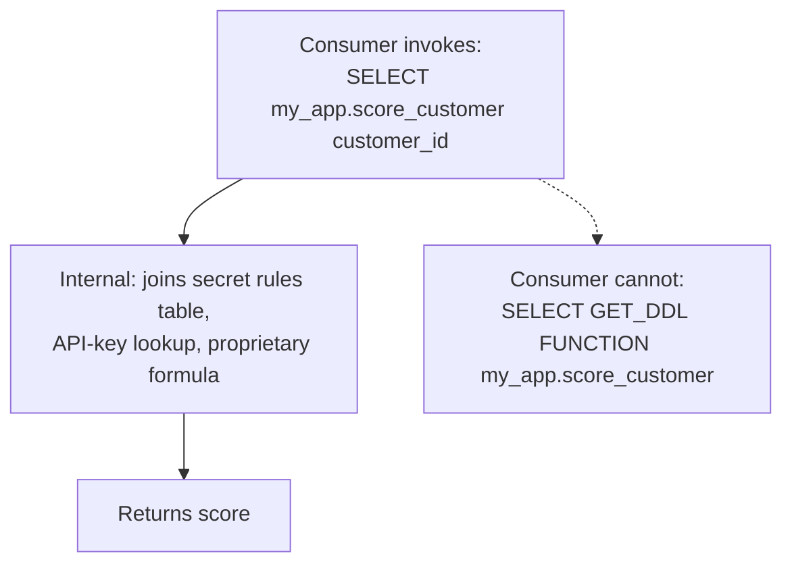

### Lab Exercise
```sql
CREATE OR REPLACE SECURE FUNCTION AI_APP.FRAUD_SCORE(txn VARIANT)
RETURNS FLOAT
LANGUAGE PYTHON RUNTIME_VERSION='3.10'
PACKAGES=('scikit-learn==1.3.*')
HANDLER='score'
AS $$
import snowflake.ml
# proprietary logic, model lookup, API key…
def score(txn):
    # … hidden body …
    return float(score_value)
$$;

-- Grant invoke only
GRANT USAGE ON FUNCTION AI_APP.FRAUD_SCORE(VARIANT) TO ROLE FR_AI_APP_SERVICE;
```

### Gotchas / Exam Traps
- Secure functions still log their *name* in QUERY_HISTORY — only the body is hidden.
- Secrets inside function bodies are not an audit-approved pattern; use `SECRET` objects for API keys.

---

## Q7: Design a service-account authentication scheme for an AI pipeline. What are the three authentication methods and when do you use each?

**Difficulty:** Advanced
**Exam relevance:** Programmatic access for AI apps

### Answer
Three Snowflake-supported methods for service accounts:

1. **Key pair authentication (RSA)** — generate RSA key pair; set public key on user; service holds private key.
   - Use for: automated pipelines, scheduled jobs, Snowflake connectors (SnowSQL, Snowpark, drivers).
   - Pros: rotation via key swap; no password; strongest for programmatic.
   - Cons: key management infrastructure needed.

2. **OAuth (external or Snowflake)** — service exchanges tokens with an IdP or Snowflake OAuth server.
   - Use for: integrations with 3rd-party platforms that already speak OAuth (Tableau, custom web apps).
   - Pros: short-lived tokens, scoped.
   - Cons: more moving parts.

3. **Programmatic Access Tokens (PATs)** — short-lived tokens generated for a user, usable with specific role and network policy.
   - Use for: CI/CD, developer tooling, where OAuth is overkill but keys are too persistent.
   - Pros: expiring, revocable per-token, bound to network policy and role.
   - Cons: still a shared secret while valid.

Snowflake is **deprecating password-only auth for programmatic access** — exam will test awareness.

### First Principles
Service identity differs from human identity: no MFA interactively, must rotate without downtime, must be bound to specific workloads. Each method answers a different constraint:
- Key pair = asymmetric strong auth for arbitrary workloads.
- OAuth = federated identity, delegated authorization.
- PATs = short-term tokens for ephemeral needs.

### Diagram

| Dimension | Key pair | OAuth | PAT |
|---|---|---|---|
| Mechanism | RSA 2048/4096 | IdP mediated | Snowflake-issued |
| Secret | Public on user | Token exchange | Token on user |
| Format | Signed JWT | Access token | Bearer |
| Lifetime | Long-lived | Short-lived | Short-lived |
| Rotate | Swap | Refresh | New issue |
| Support | Driver | SDK/HTTP | Driver |

Use when:
- AI pipeline on-prem: key pair
- AI app behind SaaS IdP: OAuth
- CI/CD GitHub Action: PAT

### Lab Exercise
```sql
-- Key-pair setup for a service account
USE ROLE USERADMIN;
CREATE USER svc_ai_pipeline
  LOGIN_NAME='svc_ai_pipeline'
  TYPE=SERVICE
  COMMENT='AI feature engineering pipeline'
  DEFAULT_ROLE='FR_AI_PIPELINE'
  DEFAULT_WAREHOUSE='WH_AI';

-- Set public key (generated client-side with openssl)
ALTER USER svc_ai_pipeline SET RSA_PUBLIC_KEY='MIIBIjANBg...';

-- Add a second key for rotation
ALTER USER svc_ai_pipeline SET RSA_PUBLIC_KEY_2='MIIBIj...';

-- Restrict network
CREATE NETWORK POLICY NP_AI_PIPELINE
  ALLOWED_IP_LIST=('10.42.0.0/16','54.1.2.3/32');
ALTER USER svc_ai_pipeline SET NETWORK_POLICY = NP_AI_PIPELINE;

-- PAT (programmatic access token) example
ALTER USER alice ADD PROGRAMMATIC ACCESS TOKEN pat_ci
  ROLE_RESTRICTION='FR_CI'
  DAYS_TO_EXPIRY=14
  COMMENT='GitHub Actions deploy pipeline';
-- Returns one-time token value

-- OAuth integration
CREATE SECURITY INTEGRATION ai_app_oauth
  TYPE = OAUTH
  ENABLED = TRUE
  OAUTH_CLIENT = CUSTOM
  OAUTH_CLIENT_TYPE = 'CONFIDENTIAL'
  OAUTH_REDIRECT_URI = 'https://aiapp.example.com/callback'
  OAUTH_ISSUE_REFRESH_TOKENS = TRUE
  OAUTH_REFRESH_TOKEN_VALIDITY = 86400;
```

### Gotchas / Exam Traps
- Snowflake **deprecated passwords for programmatic access** as of 2025; exam will test awareness. Service users should use `TYPE=SERVICE` and key-pair/PAT/OAuth.
- `TYPE=SERVICE` disables MFA/password flows automatically — forces strong auth.
- PATs are bound to **one role** at issue time; cannot switch roles mid-session.

---

## Q8: Explain SCIM and how it supports AI governance of user lifecycle.

**Difficulty:** Intermediate
**Exam relevance:** SCIM provisioning

### Answer
**SCIM** (System for Cross-domain Identity Management) is an open standard for automated user provisioning. Snowflake supports SCIM 2.0 with Okta, Azure AD/Entra ID, and generic providers.

What SCIM automates:
- **Create/update/delete users** in Snowflake from the IdP.
- **Group → role mapping** — IdP groups become Snowflake roles.
- **Deprovisioning on IdP removal** — the user is disabled/deleted automatically.

AI governance payoff:
- When an employee leaves, their access to AI models disappears automatically.
- Role assignment is centralized in the IdP (one source of truth).
- Audit tracks user lifecycle events via QUERY_HISTORY on SCIM API calls.

### First Principles
Manual user lifecycle is the primary source of orphan access and audit findings. SCIM makes the identity provider authoritative, enforcing the principle that identity is defined once. For AI, this closes the "data scientist left but still has prod model access" gap.

### Diagram
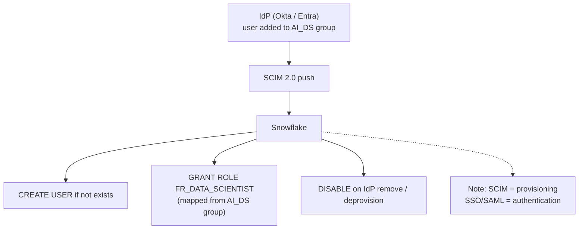

### Lab Exercise
```sql
-- Create SCIM integration (schematic — actual SCIM is HTTP, not SQL)
USE ROLE ACCOUNTADMIN;
CREATE SECURITY INTEGRATION OKTA_SCIM
  TYPE = SCIM
  SCIM_CLIENT = 'OKTA'
  RUN_AS_ROLE = 'OKTA_PROVISIONER';
-- Returns credentials for Okta to call Snowflake SCIM endpoint.

-- SCIM then provisions users; group mapping becomes role grants.
-- Audit via QUERY_HISTORY looking for SCIM calls
SELECT user_name, role_name, start_time, query_text
FROM SNOWFLAKE.ACCOUNT_USAGE.QUERY_HISTORY
WHERE query_text ILIKE '%CREATE USER%' OR query_text ILIKE '%GRANT ROLE%'
  AND user_name = 'OKTA_PROVISIONER'
ORDER BY start_time DESC LIMIT 50;
```

### Gotchas / Exam Traps
- SCIM for provisioning is **separate** from SSO/SAML for authentication; AI governance may require both.
- The SCIM provisioner role must have USERADMIN privileges — compromise of the IdP compromises identity.
- SCIM deletes are **soft** by default — users are disabled; retention controls hard delete.

---

## Q9: What is a Trust Center scanner, and which built-in packages are most relevant to AI governance?

**Difficulty:** Intermediate
**Exam relevance:** Trust Center scanners

### Answer
Trust Center scanners are automated checks that evaluate account configuration against a reference standard. Each scanner produces findings with severity.

Built-in packages relevant to AI governance:
- **CIS Snowflake Benchmark** — baseline security (MFA, network policies, no-password-expiry, encryption).
- **Snowflake Security Reference Architecture (SRA)** — Snowflake-recommended patterns.
- **Threat Intelligence** — detect accounts/users with risky patterns.
- (Potentially) **Custom scanner packages** — user-defined SQL for AI-specific checks (e.g., untagged models, missing masking on PII cols).

Enable packages, run scanners, review findings, remediate. Findings land in `SNOWFLAKE.TRUST_CENTER.FINDINGS`.

### First Principles
Governance posture decays if not continuously measured. Trust Center converts governance from a project (quarterly audit) to a service (continuous scoring). For AI, custom scanners add domain-specific checks (e.g., does every production model have a model card?).

### Diagram
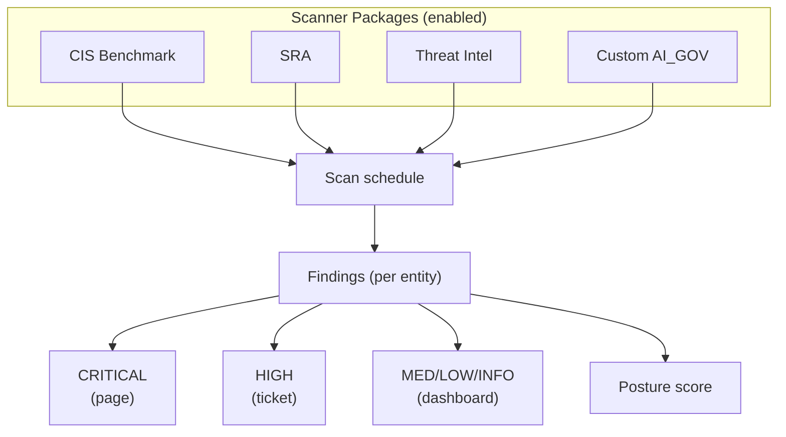

### Lab Exercise
```sql
USE ROLE ACCOUNTADMIN;

-- Enable scanner packages
CALL SNOWFLAKE.TRUST_CENTER.ENABLE_SCANNER_PACKAGE('CIS_BENCHMARKS');
CALL SNOWFLAKE.TRUST_CENTER.ENABLE_SCANNER_PACKAGE('SECURITY_ESSENTIALS');

-- Check findings
SELECT scanner_name, entity_name, severity, at_risk, remediation
FROM SNOWFLAKE.TRUST_CENTER.FINDINGS
WHERE at_risk = TRUE AND severity IN ('CRITICAL','HIGH')
ORDER BY severity;

-- Custom scanner: production models without model cards
CREATE OR REPLACE PROCEDURE GOV.SCAN.MODELS_WITHOUT_CARDS()
RETURNS TABLE(entity_name STRING, severity STRING, remediation STRING)
LANGUAGE SQL AS $$
BEGIN
  LET rs RESULTSET := (
    SELECT m.model_name AS entity_name,
           'HIGH' AS severity,
           'Create a model card in GOV.AI_RMF.MODEL_CARDS' AS remediation
    FROM SNOWFLAKE.ML.MODELS m
    LEFT JOIN GOV.AI_RMF.MODEL_CARDS c
      ON c.model_name = m.model_name
    WHERE c.model_name IS NULL);
  RETURN TABLE(rs);
END; $$;
```

### Gotchas / Exam Traps
- Trust Center scanners run on a **schedule**, not on-demand continuously.
- The posture score includes findings from all enabled packages — enabling more packages can drop the score.
- `SNOWFLAKE.TRUST_CENTER_ADMIN` is required to enable packages; `TRUST_CENTER_VIEWER` for read-only.

---

## Q10: What is a Network Policy, and how do you use it to isolate AI service workloads?

**Difficulty:** Intermediate
**Exam relevance:** Network isolation

### Answer
A **Network Policy** restricts which IP addresses (and optionally AWS/GCP/Azure VPC endpoints via `ALLOWED_INTEGRATIONS`) can authenticate to Snowflake. Can be set:
- Account-wide (default policy).
- Per user (e.g., service account tied to a VPC CIDR).
- Per security integration.

AI workload patterns:
- Service account `svc_ai_pipeline` has a per-user network policy allowing only its VPC's NAT egress IP range.
- External apps use **PrivateLink** + network rules referencing the PrivateLink endpoint ID.
- Analyst users with MFA may have a broader policy (home + office).

### First Principles
Even with strong authentication, limiting network ingress reduces the attack surface. For AI pipelines running on specific infrastructure, restricting to known CIDRs ensures that stolen credentials from off-network are useless. Combines with key-pair auth and MFA for defense-in-depth.

### Diagram
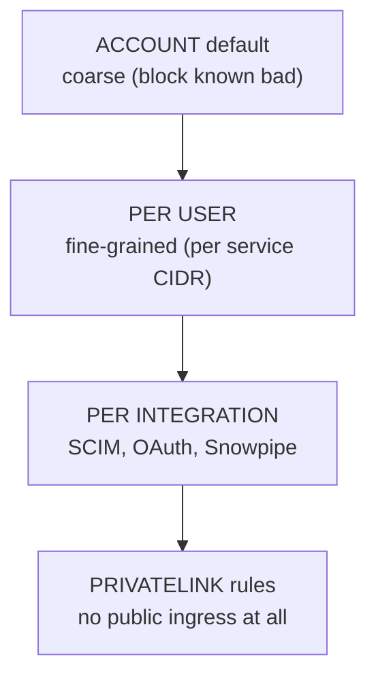

### Lab Exercise
```sql
-- Fine-grained for an AI pipeline service user
CREATE NETWORK RULE AI_PIPELINE_RULE
  MODE = INGRESS
  TYPE = IPV4
  VALUE_LIST = ('10.42.0.0/16','203.0.113.42/32');

CREATE NETWORK POLICY NP_AI_PIPELINE
  ALLOWED_NETWORK_RULE_LIST = ('AI_PIPELINE_RULE')
  COMMENT='AI feature pipeline — VPC NAT only';

ALTER USER svc_ai_pipeline SET NETWORK_POLICY = NP_AI_PIPELINE;

-- Account default (fallback)
CREATE NETWORK POLICY NP_ACCOUNT_DEFAULT
  BLOCKED_IP_LIST=('0.0.0.0/0');   -- then allow via per-user
  -- (More typical: allow corporate + per-user overrides)

ALTER ACCOUNT SET NETWORK_POLICY = NP_ACCOUNT_DEFAULT;
```

### Gotchas / Exam Traps
- Setting a wrong account-level policy can lock you out — always test with a per-user policy first.
- Network policy evaluates **before** authentication — invalid credentials from allowed IPs still fail, but denied IPs never see auth.
- PrivateLink + network policy with integration references is the strongest config.

---

## Q11: What's the `APPLY` privilege on tags/policies, and why is it the critical "governance grant"?

**Difficulty:** Advanced
**Exam relevance:** APPLY privilege chain

### Answer
`APPLY` is a privilege that lets a role **attach** a tag or policy to an object (table, column, warehouse, etc.) without owning the tag/policy or the object.

Specific grants:
- `GRANT APPLY ON TAG <tag> TO ROLE <r>` — role can `SET TAG <tag>=…`.
- `GRANT APPLY MASKING POLICY TO ROLE <r>` — role can set any masking policy on any owned object (coarse).
- `GRANT APPLY ROW ACCESS POLICY TO ROLE <r>` — same for row access.
- `GRANT APPLY <policy_type> ON <policy> TO ROLE <r>` — fine-grained per-policy.

Why critical:
- Separates **policy authoring** (SECURITYADMIN) from **policy application** (data owners).
- Enables data teams to attach existing policies to their tables without touching policy bodies.
- Audit trail: who applied a tag/policy is in `TAG_REFERENCES` and `POLICY_REFERENCES`.

### First Principles
Governance scales when policies are centrally defined but widely applied. Without `APPLY`, every tag or policy attachment requires SECURITYADMIN — a bottleneck. `APPLY` is the mediating privilege that enables delegation without decentralizing authorship.

### Diagram
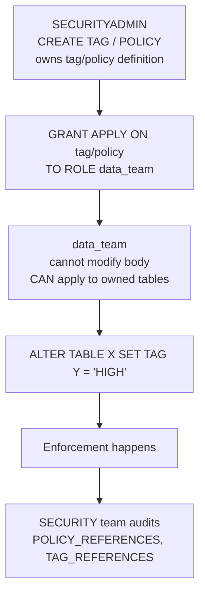

### Lab Exercise
```sql
USE ROLE SECURITYADMIN;

-- Create tag + policy
CREATE TAG GOV.DATA.PII_LEVEL ALLOWED_VALUES 'NONE','LOW','HIGH';
CREATE MASKING POLICY GOV.POL.PII_STRING AS (val STRING) RETURNS STRING ->
  CASE WHEN IS_ROLE_IN_SESSION('PII_READER') THEN val ELSE '***' END;

-- Grant APPLY to data team (not ownership)
GRANT APPLY ON TAG GOV.DATA.PII_LEVEL TO ROLE DATA_ENGINEER;
GRANT APPLY ON MASKING POLICY GOV.POL.PII_STRING TO ROLE DATA_ENGINEER;

-- Data engineer applies but cannot modify
USE ROLE DATA_ENGINEER;
ALTER TABLE AI_DB.FEATURES.CUSTOMER
  MODIFY COLUMN email SET TAG GOV.DATA.PII_LEVEL = 'HIGH';
ALTER TABLE AI_DB.FEATURES.CUSTOMER
  MODIFY COLUMN email SET MASKING POLICY GOV.POL.PII_STRING;

-- But this fails:
ALTER TAG GOV.DATA.PII_LEVEL ADD ALLOWED_VALUES 'ULTRA';   -- not owner
```

### Gotchas / Exam Traps
- Account-level `APPLY MASKING POLICY` is **very broad** — avoid; prefer per-policy grants.
- `APPLY` doesn't let you SELECT data — just attach the policy. The role still needs USAGE on database/schema/table.
- Tag-based masking: setting a tag triggers the policy — `APPLY` on tag is sufficient to invoke policy coverage.

---

## Q12: What is a Managed Access Schema, and when do you use it for AI governance?

**Difficulty:** Intermediate
**Exam relevance:** Managed access schemas

### Answer
A **Managed Access schema** is a schema created with `WITH MANAGED ACCESS`. In such a schema:
- Only the schema **owner** can grant privileges on objects in the schema.
- Object owners (DAC) cannot grant to others.

Use for AI governance when:
- A shared schema contains sensitive tables (e.g., PII features) and you want to centralize grant authority.
- You want to disable DAC so object owners can't accidentally over-share.
- Compliance requires explicit approval for every access grant.

### First Principles
DAC's flexibility can be a governance liability. Managed access schemas invert the default: the schema owner must explicitly grant each access, meaning no "owner-of-owner" sprawl. This matches the "centralized grant model" required by frameworks like SOX and HIPAA.

### Diagram
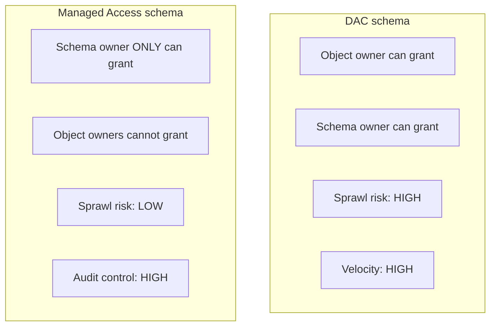

### Lab Exercise
```sql
USE ROLE SYSADMIN;

CREATE SCHEMA AI_DB.PII_FEATURES WITH MANAGED ACCESS;

-- Data engineer creates a table — becomes owner, but cannot grant
USE ROLE DATA_ENGINEER;
CREATE TABLE AI_DB.PII_FEATURES.PATIENT_FEATS (id INT, feat FLOAT);

-- Attempt to grant — FAILS
GRANT SELECT ON AI_DB.PII_FEATURES.PATIENT_FEATS TO ROLE FR_DATA_SCIENTIST;
-- error: insufficient privileges (owner lacks grant option in managed schema)

-- Only schema owner can grant
USE ROLE SYSADMIN;
GRANT SELECT ON AI_DB.PII_FEATURES.PATIENT_FEATS TO ROLE FR_DATA_SCIENTIST;
```

### Gotchas / Exam Traps
- You cannot convert a non-managed schema to managed in place — recreate.
- `GRANT OWNERSHIP ON SCHEMA` transfers the ability to grant; plan carefully.

---

## Q13: Describe FUTURE GRANTS and the pitfalls specific to AI pipelines creating many tables.

**Difficulty:** Intermediate
**Exam relevance:** FUTURE GRANTS

### Answer
`GRANT <priv> ON FUTURE <object_type>s IN SCHEMA|DATABASE … TO ROLE <r>` applies the privilege to objects created **after** the grant. Only one FUTURE grant per object type per container.

Pitfalls for AI pipelines:
1. **Only applies to new objects** — existing tables need a parallel `ON ALL`.
2. **Schema-level + database-level don't stack** — if both exist, schema-level wins. Set at the lowest scope that covers your use case.
3. **Owner changes** — if a FUTURE grant is set via `OWNERSHIP`, re-granted on object creation; but if a role creates and then transfers ownership, the FUTURE grant is still from the schema's config.
4. **Replication** — FUTURE grants are **not replicated** to secondary replicas (as of writing); you must re-create on replicas.
5. **Dropped+recreated schemas** lose their FUTURE grants.

### First Principles
Pipelines create tables continuously. Without FUTURE grants, every new table needs a manual grant — governance drift guaranteed. The pattern: set FUTURE grants once, and future-objects inherit, matching the pipeline's velocity.

### Diagram
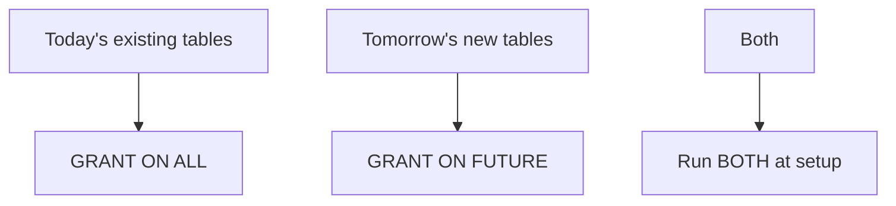

### Lab Exercise
```sql
USE ROLE SECURITYADMIN;

-- Access role gets both
GRANT SELECT ON ALL TABLES    IN SCHEMA AI_DB.FEATURES TO ROLE AR_AI_READ;
GRANT SELECT ON FUTURE TABLES IN SCHEMA AI_DB.FEATURES TO ROLE AR_AI_READ;

-- Same for views
GRANT SELECT ON ALL VIEWS    IN SCHEMA AI_DB.FEATURES TO ROLE AR_AI_READ;
GRANT SELECT ON FUTURE VIEWS IN SCHEMA AI_DB.FEATURES TO ROLE AR_AI_READ;

-- For AI: dynamic tables, functions, models
GRANT SELECT ON FUTURE DYNAMIC TABLES IN SCHEMA AI_DB.FEATURES TO ROLE AR_AI_READ;
GRANT USAGE  ON FUTURE FUNCTIONS      IN SCHEMA AI_DB.FEATURES TO ROLE AR_AI_READ;
GRANT USAGE  ON FUTURE MODELS         IN SCHEMA AI_DB.MODELS   TO ROLE AR_AI_MODEL_USE;

-- Verify
SHOW FUTURE GRANTS IN SCHEMA AI_DB.FEATURES;
```

### Gotchas / Exam Traps
- Schema-level FUTURE grants **take precedence over database-level** — common surprise.
- Only `SECURITYADMIN` (or role with MANAGE GRANTS) can set FUTURE grants.
- Running `REVOKE … ON FUTURE` doesn't affect already-created objects.

---

## Q14: What is a Session Policy, and how does it support AI developer tooling access control?

**Difficulty:** Intermediate
**Exam relevance:** Session policies

### Answer
A **Session Policy** controls session timeouts: inactivity timeout and total session timeout. Can be set per user, per account, or per role.

Use for AI developer tooling:
- Snowsight / Snowflake Copilot interactive sessions: short inactivity (15 min).
- Service accounts: long or unlimited (handled by key rotation).
- Human users with sensitive roles: enforce re-auth.

Session policies help satisfy SOC 2 CC6 (logical access) and NIST 800-53 AC-12 (session termination).

### First Principles
Idle sessions are an attack surface — walked-away laptops, forgotten tabs. Short session timeouts reduce exposure. For AI, where interactive LLM queries can be stateful, timeouts prevent context leaks.

### Diagram
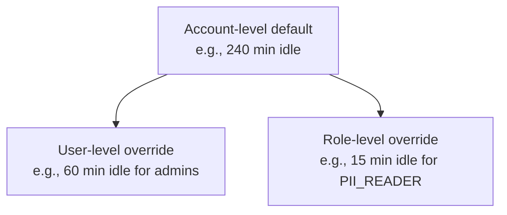

### Lab Exercise
```sql
USE ROLE SECURITYADMIN;

CREATE SESSION POLICY SP_SENSITIVE_AI
  SESSION_IDLE_TIMEOUT_MINS = 15
  SESSION_UI_IDLE_TIMEOUT_MINS = 15
  COMMENT='Short idle for roles touching production AI';

ALTER USER alice SET SESSION POLICY = SP_SENSITIVE_AI;

-- Or at account default
ALTER ACCOUNT SET SESSION POLICY = SP_ACCOUNT_DEFAULT;
```

### Gotchas / Exam Traps
- Session policies at account level do not apply to users with their own session policy — specificity wins.
- `SESSION_IDLE_TIMEOUT_MINS` applies to connections generally; `SESSION_UI_IDLE_TIMEOUT_MINS` is Snowsight-specific.

---

## Q15: What is an Authentication Policy, and how do you enforce MFA for AI admin roles?

**Difficulty:** Intermediate
**Exam relevance:** Authentication policies

### Answer
An **Authentication Policy** controls which authentication methods are allowed and whether MFA is required. Replaces older per-user authentication settings. Scopes: account, user.

Fields:
- `AUTHENTICATION_METHODS` — allowed methods (`PASSWORD`, `SAML`, `OAUTH`, `KEYPAIR`, …).
- `MFA_AUTHENTICATION_METHODS` — which methods require MFA.
- `MFA_ENROLLMENT` — `REQUIRED` or `OPTIONAL`.
- `CLIENT_TYPES` — restrict driver types (`DRIVERS`, `SNOWFLAKE_UI`, …).
- `SECURITY_INTEGRATIONS` — allowed SSO/OAuth integrations.

For AI admin roles:
- `MFA_ENROLLMENT = REQUIRED` for anyone with ACCOUNTADMIN/SECURITYADMIN.
- Disable PASSWORD for service users (`TYPE=SERVICE` with keypair/OAuth only).

### First Principles
Authentication policy is the enforcement layer for the identity controls other policies describe. For AI, where models and training sets are high-value targets, authentication strength must match data sensitivity. MFA is table stakes.

### Diagram
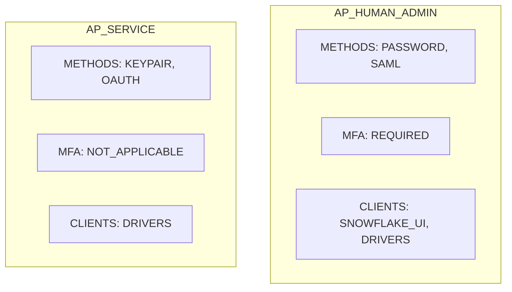

### Lab Exercise
```sql
USE ROLE SECURITYADMIN;

CREATE AUTHENTICATION POLICY AP_HUMAN_ADMIN
  AUTHENTICATION_METHODS = ('PASSWORD','SAML')
  MFA_AUTHENTICATION_METHODS = ('PASSWORD')
  MFA_ENROLLMENT = REQUIRED
  CLIENT_TYPES = ('SNOWFLAKE_UI','DRIVERS');

CREATE AUTHENTICATION POLICY AP_SERVICE
  AUTHENTICATION_METHODS = ('KEYPAIR','OAUTH')
  MFA_ENROLLMENT = OPTIONAL
  CLIENT_TYPES = ('DRIVERS');

ALTER USER alice           SET AUTHENTICATION POLICY = AP_HUMAN_ADMIN;
ALTER USER svc_ai_pipeline SET AUTHENTICATION POLICY = AP_SERVICE;

-- Account default
ALTER ACCOUNT SET AUTHENTICATION POLICY = AP_HUMAN_ADMIN;
```

### Gotchas / Exam Traps
- Snowflake is moving to **MFA-required** for all password-based auth by 2025/2026 — exam will test awareness.
- You can only have **one** authentication policy per user or account at a time.
- Breaking the policy locks users out — stage carefully.

---

## Q16: Describe how OAuth flows work with Snowflake for an AI web application.

**Difficulty:** Advanced
**Exam relevance:** OAuth for AI apps

### Answer
Two OAuth flavors in Snowflake:
1. **Snowflake OAuth** — Snowflake is the authorization server. Suitable for OAuth clients where Snowflake is the identity.
2. **External OAuth** — Snowflake validates tokens issued by an external IdP (Okta, Entra, PingFederate). Snowflake is a resource server.

For an AI web app:
- User logs into app via SSO at IdP.
- App obtains OAuth access token for Snowflake audience.
- App calls Snowflake with `Authorization: Bearer <token>`.
- Snowflake maps the token's subject claim (`sub`) to a Snowflake user and executes as that user with the user's role.

Scopes:
- Snowflake OAuth supports `SESSION:ROLE-ANY` or scoped (`SESSION:ROLE:<role>`).
- External OAuth is validated by issuer + audience + signature; role claim can be mapped.

### First Principles
OAuth delegates authorization: the user authenticates once with the IdP; the app receives a short-lived token to act on their behalf. For AI apps, this preserves user identity through to Snowflake queries so ACCESS_HISTORY shows the actual user, not a shared service account. Row/column policies then apply correctly to the real user.

### Diagram
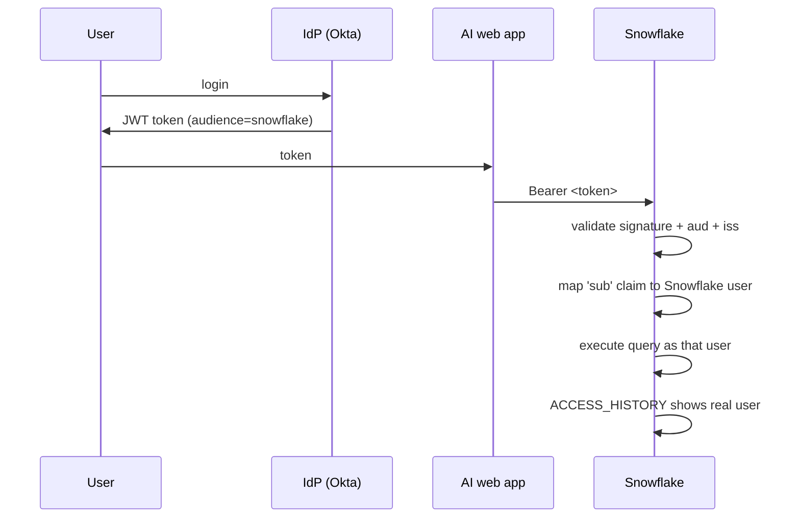

### Lab Exercise
```sql
-- External OAuth integration (Entra ID example)
USE ROLE ACCOUNTADMIN;

CREATE SECURITY INTEGRATION entra_oauth
  TYPE = EXTERNAL_OAUTH
  ENABLED = TRUE
  EXTERNAL_OAUTH_TYPE = AZURE
  EXTERNAL_OAUTH_ISSUER = 'https://sts.windows.net/<tenant_id>/'
  EXTERNAL_OAUTH_JWS_KEYS_URL = 'https://login.microsoftonline.com/<tenant_id>/discovery/v2.0/keys'
  EXTERNAL_OAUTH_AUDIENCE_LIST = ('https://<account>.snowflakecomputing.com')
  EXTERNAL_OAUTH_TOKEN_USER_MAPPING_CLAIM = 'upn'
  EXTERNAL_OAUTH_SNOWFLAKE_USER_MAPPING_ATTRIBUTE = 'LOGIN_NAME'
  EXTERNAL_OAUTH_ANY_ROLE_MODE = 'ENABLE_FOR_PRIVILEGE';
```

### Gotchas / Exam Traps
- `EXTERNAL_OAUTH_ANY_ROLE_MODE = 'DISABLE'` locks tokens to a single pre-configured role.
- Token subject mapping failures silently reject — enable `OAUTH_LOG_PROPERTIES` for debugging.
- Short-lived tokens (minutes) are preferred; refresh tokens must be handled by the app.

---

## Q17: What's the difference between a "shared" service user and a per-user flow for AI apps, and when is each appropriate?

**Difficulty:** Advanced
**Exam relevance:** Identity propagation design

### Answer
Two patterns:

**Shared service user:**
- One Snowflake user represents the app.
- All queries run as that user; app enforces user filtering in code.
- Simple to operate but loses end-user attribution.
- Suitable when the app is the "data owner" (e.g., aggregation dashboards).

**Per-user flow (OAuth passthrough):**
- Each app user authenticates to Snowflake via OAuth.
- Queries run under the real user's Snowflake identity.
- Snowflake policies (row access, masking) apply per user automatically.
- ACCESS_HISTORY correctly attributes.
- Suitable when data is user-specific (customer portal, PII viewer).

Hybrid: service account for batch, OAuth passthrough for interactive.

### First Principles
Attribution is a governance requirement; delegation is an engineering concern. Per-user flow aligns both — same identity for enforcement and audit. Shared service user is simpler but requires the app to re-implement row-level security, duplicating what Snowflake offers natively.

### Diagram
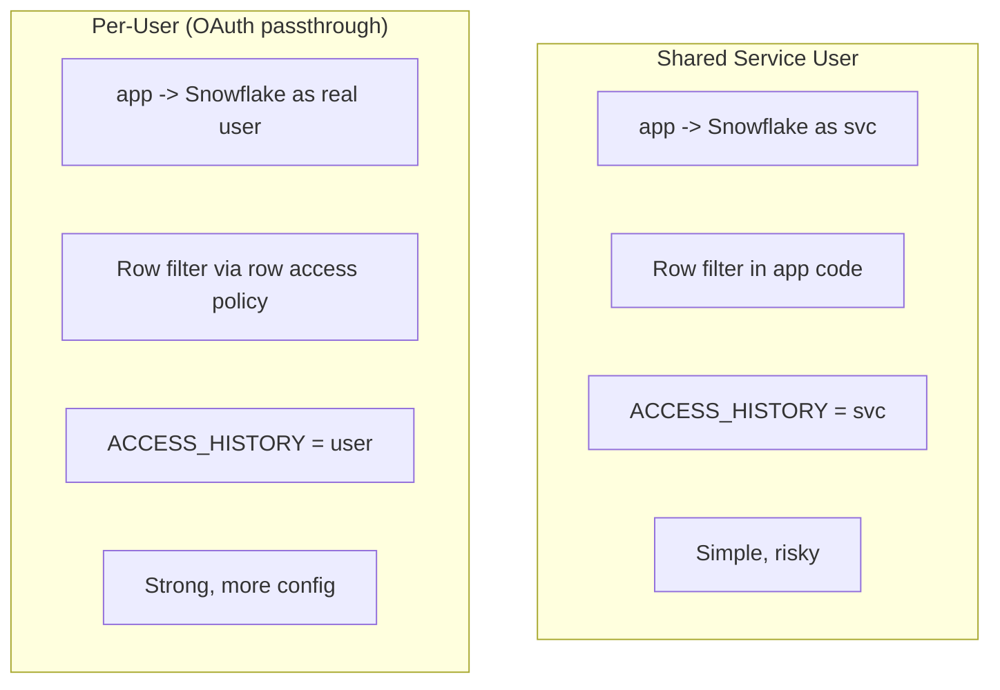

### Lab Exercise
```sql
-- Per-user: row access policy that uses CURRENT_USER()
CREATE ROW ACCESS POLICY GOV.POL.CUSTOMER_SELF
AS (owner STRING) RETURNS BOOLEAN ->
  CURRENT_USER() = owner
  OR IS_ROLE_IN_SESSION('CUSTOMER_SERVICE_READER');

ALTER TABLE CUSTOMER_DATA ADD ROW ACCESS POLICY GOV.POL.CUSTOMER_SELF ON (owner);

-- Audit: identity actually used for the query
SELECT user_name, role_name, COUNT(*) q
FROM SNOWFLAKE.ACCOUNT_USAGE.QUERY_HISTORY
WHERE start_time >= DATEADD('day',-1,CURRENT_TIMESTAMP())
GROUP BY ALL
ORDER BY q DESC;
```

### Gotchas / Exam Traps
- Shared service user cannot leverage per-user row policies — defeats the purpose.
- OAuth passthrough requires the OAuth claim to map correctly to a Snowflake user; failed mapping = failed login.

---

## Q18: What is role-based masking policy logic, and how do you structure it to support complex AI use cases?

**Difficulty:** Advanced
**Exam relevance:** Masking policy structure

### Answer
A masking policy body is SQL that returns the masked value given the raw. Logic can branch on:
- `CURRENT_ROLE()` — primary role.
- `IS_ROLE_IN_SESSION('name')` — any active role.
- `INVOKER_ROLE()` — role at the point of invocation (for secure views).
- `CURRENT_USER()`.
- `SYSTEM$GET_TAG_ON_CURRENT_COLUMN(...)` — tag of the column being masked.
- Session variables (`$VAR`).
- Context functions (`CURRENT_IP_ADDRESS()`, `CURRENT_WAREHOUSE()`).

Structure for complex AI:
- Role-based: full access for `PII_READER`, partial for `ANALYST`, redact for others.
- Tag-based branching: policy varies output based on tag value.
- Context-based: unredact only when invoked from an allowed warehouse (e.g., model training WH).

### First Principles
Masking policies are **last-mile enforcement**; they run at query execution regardless of how the SQL got there (ad hoc, LLM-generated, Native App). Making them context-aware (role + tag + warehouse) handles the full matrix of AI access patterns without duplicating columns or views.

### Diagram
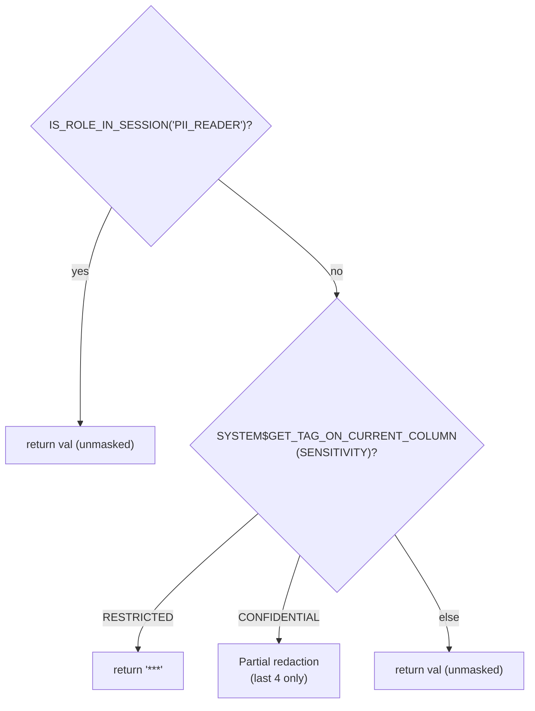

### Lab Exercise
```sql
CREATE OR REPLACE MASKING POLICY GOV.POL.MULTI_LEVEL
AS (val STRING) RETURNS STRING ->
  CASE
    -- Full access
    WHEN IS_ROLE_IN_SESSION('FR_PII_READER') THEN val
    -- Training workloads from approved WH see unmasked
    WHEN CURRENT_WAREHOUSE() = 'WH_AI_TRAINING_APPROVED'
         AND IS_ROLE_IN_SESSION('FR_ML_ENGINEER') THEN val
    -- Analysts see partial
    WHEN IS_ROLE_IN_SESSION('FR_ANALYST')
         AND SYSTEM$GET_TAG_ON_CURRENT_COLUMN('GOV.DATA.SENSITIVITY') = 'CONFIDENTIAL'
      THEN REGEXP_REPLACE(val, '.', '*', 1, GREATEST(LENGTH(val)-4,0))
    -- Default: redact
    ELSE '***'
  END;

ALTER TABLE CUSTOMERS MODIFY COLUMN email SET MASKING POLICY GOV.POL.MULTI_LEVEL;
```

### Gotchas / Exam Traps
- Masking policies cannot invoke non-deterministic UDFs that reach external services (would make query planning impossible).
- A masking policy on a column prevents that column from being used as a **clustering key** or **partition expression** in some contexts.
- Case-insensitive role names: `IS_ROLE_IN_SESSION('fr_pii_reader')` works regardless of case.

---

## Q19: Explain OWNERSHIP transfer and the governance implications for AI model objects.

**Difficulty:** Intermediate
**Exam relevance:** Ownership transfer

### Answer
`GRANT OWNERSHIP ON <object> TO ROLE <new_owner> [REVOKE CURRENT GRANTS | COPY CURRENT GRANTS]` transfers ownership.

- `COPY CURRENT GRANTS` — keep existing non-OWNERSHIP grants intact.
- `REVOKE CURRENT GRANTS` — remove all other grants; new owner must re-grant.

For AI model objects:
- When a model moves from a data scientist's dev role to a production role, transfer ownership to the prod functional role.
- Use `REVOKE CURRENT GRANTS` to force explicit production authorization.
- Lineage and metadata survive ownership transfer; policies on the object are preserved.

### First Principles
Ownership determines who can `DROP`, `ALTER`, and `GRANT`. A model's lifecycle commonly includes an authorship phase (dev) and a stewardship phase (prod). Transferring ownership encodes this handoff; `REVOKE CURRENT GRANTS` enforces explicit re-authorization at the handoff boundary.

### Diagram
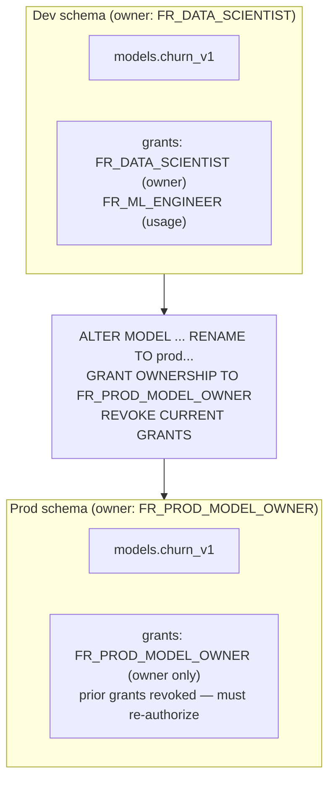

### Lab Exercise
```sql
USE ROLE SECURITYADMIN;

-- Transfer ownership of a model with revoke
GRANT OWNERSHIP ON MODEL AI_DB.MODELS.CHURN_V1 TO ROLE FR_PROD_MODEL_OWNER
  REVOKE CURRENT GRANTS;

-- Re-authorize downstream usage
GRANT USAGE ON MODEL AI_DB.MODELS.CHURN_V1 TO ROLE FR_INFERENCE_SERVICE;

-- Audit transfers
SELECT query_text, user_name, start_time
FROM SNOWFLAKE.ACCOUNT_USAGE.QUERY_HISTORY
WHERE query_text ILIKE '%GRANT OWNERSHIP%'
ORDER BY start_time DESC LIMIT 20;
```

### Gotchas / Exam Traps
- Ownership transfer requires the executing role to have `MANAGE GRANTS` or be the current owner.
- Tags and policies **remain** on the object through transfer.
- `COPY CURRENT GRANTS` vs. `REVOKE` is case-sensitive to governance posture; the exam often tests this choice.

---

## Q20: What is the Snowflake "Trust Center identity-risk" scanner, and what AI-governance incidents does it detect?

**Difficulty:** Advanced
**Exam relevance:** Identity-focused Trust Center scanners

### Answer
Snowflake Trust Center includes scanners targeting identity misconfiguration and risk, such as:
- Users without MFA.
- Users with ACCOUNTADMIN or SECURITYADMIN not using MFA.
- Service users with password auth (should be key/OAuth).
- Users without network policies.
- Shared logins / inactive users.
- Users with excessive role grants (role explosion).
- Suspicious login patterns (new geography, new client).

For AI governance:
- Detect a data scientist who gained ACCOUNTADMIN temporarily and wasn't demoted.
- Detect a service account with weak auth that touches models.
- Detect accounts creating objects in production without approvals.

### First Principles
Identity is the perimeter in cloud architectures. Model-grade protections mean nothing if the users accessing those models are poorly configured. Continuous identity scanning catches drift between policy and reality.

### Diagram
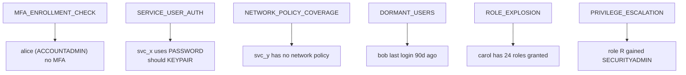

### Lab Exercise
```sql
-- Identity scanner equivalents in SQL
-- 1) Users with ACCOUNTADMIN but no MFA
SELECT u.name, u.ext_authn_duo, u.ext_authn_methods
FROM SNOWFLAKE.ACCOUNT_USAGE.USERS u
JOIN SNOWFLAKE.ACCOUNT_USAGE.GRANTS_TO_USERS g
  ON g.grantee_name = u.name
WHERE g.role = 'ACCOUNTADMIN'
  AND u.ext_authn_duo = FALSE
  AND u.deleted_on IS NULL
  AND g.deleted_on IS NULL;

-- 2) Dormant users
SELECT name, last_success_login
FROM SNOWFLAKE.ACCOUNT_USAGE.USERS
WHERE last_success_login < DATEADD('day',-90,CURRENT_TIMESTAMP())
  AND deleted_on IS NULL;

-- 3) Role explosion
SELECT grantee_name, COUNT(*) AS n_roles
FROM SNOWFLAKE.ACCOUNT_USAGE.GRANTS_TO_USERS
WHERE deleted_on IS NULL
GROUP BY 1 HAVING COUNT(*) > 10;
```

### Gotchas / Exam Traps
- `USERS.LAST_SUCCESS_LOGIN` may be NULL for new users — handle with `COALESCE`.
- Role-grant counts can be misleading if roles are heavily hierarchical.

---

## Q21: Describe how to design RBAC for a Cortex-powered chat assistant that serves customer-support agents.

**Difficulty:** Advanced
**Exam relevance:** End-to-end RBAC design for GenAI

### Answer
Design elements:

**Roles:**
- `FR_SUPPORT_AGENT` — human agents (via SSO).
- `FR_SUPPORT_ASSISTANT_SERVICE` — the Cortex-invoking app (service account; OAuth-on-behalf-of-user or shared).
- `FR_CORTEX_INVOKER` — least-privilege role for Cortex functions.
- `AR_SUPPORT_KB_READ` — read KB tables.
- `AR_SUPPORT_TICKETS_READ` — read tickets with masking on PII.
- `AR_CORTEX_FUNCTIONS` — USAGE on `SNOWFLAKE.CORTEX.COMPLETE` etc.

**Policies:**
- Row access on tickets: agents see only tickets in their queue.
- Masking on customer PII except for `FR_SUPPORT_SUPERVISOR`.
- Cortex Guard enabled on completions.
- Network policy restricting app servers.

**Identity flow:**
- Agent SSO → OAuth to Snowflake → runs as themselves (per-user) OR app uses service account with agent context passed as session variable.
- Query logs attribute to the agent.

### First Principles
LLM-powered apps compound governance challenges: data read by the LLM is implicitly readable by the end-user. RBAC must therefore enforce *data-access* constraints before the LLM sees anything. The right design is "LLM sees only what the user could see" — not more.

### Diagram
```mermaid
flowchart TD
    AGENT["Agent (SSO)"]
    APP["App"]
    SF["Snowflake as agent<br/>session role = FR_SUPPORT_AGENT"]
    QUERY["Query joins tickets + KB<br/>row-access: queue = agent's queue<br/>masking: PII hidden"]
    CORTEX["CORTEX.COMPLETE<br/>(sees only visible rows)"]
    RESP["Response returned<br/>(logged for audit)"]
    AGENT --> APP -->|OAuth| SF --> QUERY --> CORTEX --> RESP
```

### Lab Exercise
```sql
-- Setup roles + grants (abbreviated)
USE ROLE SECURITYADMIN;
CREATE ROLE FR_SUPPORT_AGENT;
CREATE ROLE AR_SUPPORT_KB_READ;
CREATE ROLE AR_SUPPORT_TICKETS_READ;
CREATE ROLE AR_CORTEX_FUNCTIONS;

GRANT USAGE ON DATABASE SUPPORT TO ROLE AR_SUPPORT_KB_READ;
GRANT USAGE ON SCHEMA SUPPORT.KB TO ROLE AR_SUPPORT_KB_READ;
GRANT SELECT ON ALL TABLES IN SCHEMA SUPPORT.KB TO ROLE AR_SUPPORT_KB_READ;
GRANT SELECT ON FUTURE TABLES IN SCHEMA SUPPORT.KB TO ROLE AR_SUPPORT_KB_READ;

GRANT USAGE ON SCHEMA SUPPORT.TICKETS TO ROLE AR_SUPPORT_TICKETS_READ;
GRANT SELECT ON ALL TABLES IN SCHEMA SUPPORT.TICKETS TO ROLE AR_SUPPORT_TICKETS_READ;

GRANT USAGE ON FUNCTION SNOWFLAKE.CORTEX.COMPLETE TO ROLE AR_CORTEX_FUNCTIONS;
GRANT USAGE ON FUNCTION SNOWFLAKE.CORTEX.SEARCH TO ROLE AR_CORTEX_FUNCTIONS;

GRANT ROLE AR_SUPPORT_KB_READ, AR_SUPPORT_TICKETS_READ, AR_CORTEX_FUNCTIONS
  TO ROLE FR_SUPPORT_AGENT;

-- Row-access on tickets: agent sees own queue
CREATE ROW ACCESS POLICY GOV.POL.AGENT_QUEUE
AS (queue STRING) RETURNS BOOLEAN ->
  queue = (SELECT queue FROM AGENT_QUEUE_MAP WHERE user_login = CURRENT_USER())
  OR IS_ROLE_IN_SESSION('FR_SUPPORT_SUPERVISOR');

ALTER TABLE SUPPORT.TICKETS.TICKETS
  ADD ROW ACCESS POLICY GOV.POL.AGENT_QUEUE ON (queue);
```

### Gotchas / Exam Traps
- If the app calls Cortex as a shared service user, every user "appears" the same to Cortex — breaks personalization and audit.
- Cortex Guard applies to completions; it does not inspect data read upstream — enforce PII masking separately.

---

## Q22: What's the role of INVOKER rights vs. OWNER rights on stored procedures and UDFs for AI pipelines?

**Difficulty:** Advanced
**Exam relevance:** Function execution rights

### Answer
Stored procedures and UDFs can run as:
- **OWNER rights** — execute under the owner's role; the body sees what the owner can see.
- **INVOKER rights** — execute under the caller's role; the body sees only what the caller can see.

For AI pipelines:
- **OWNER rights** for feature-engineering procs that must access multiple source tables the caller doesn't need direct access to. Encapsulates sensitive data behind the proc.
- **INVOKER rights** when the proc should respect caller's own access (e.g., a general-purpose predict function that uses the caller's data filters).

Syntax: `EXECUTE AS CALLER` / `EXECUTE AS OWNER` on procedures; UDFs default to CALLER but can specify `CALLED ON NULL INPUT` style attributes.

### First Principles
Mediated access patterns are a form of privilege encapsulation: the caller gets a function, not direct data access. OWNER rights make the function the trust boundary; INVOKER rights make it transparent. For AI governance, OWNER rights enable "safe prediction" without exposing training data.

### Diagram
```mermaid
flowchart TD
    subgraph OWN["OWNER rights proc"]
        O1["Caller role: X"]
        O2["Proc body runs as owner Y"]
        O3["Reads Y's tables"]
        O4["ACCESS_HISTORY shows Y"]
    end
    subgraph INV["INVOKER rights proc"]
        I1["Caller role: X"]
        I2["Proc body runs as X"]
        I3["Reads X's tables only"]
        I4["ACCESS_HISTORY shows X"]
    end
```

### Lab Exercise
```sql
CREATE OR REPLACE PROCEDURE AI_DB.FUNC.PREDICT_FRAUD(txn VARIANT)
RETURNS FLOAT LANGUAGE SQL
EXECUTE AS OWNER
AS $$
  -- Procedure can read restricted feature tables that caller cannot
  DECLARE score FLOAT;
BEGIN
  SELECT MY_MODEL!PREDICT(FEATURES) INTO :score
  FROM AI_DB.RESTRICTED_FEATURES
  WHERE txn_id = txn:id;
  RETURN score;
END; $$;

-- Grant execute to callers who don't have access to RESTRICTED_FEATURES
GRANT USAGE ON PROCEDURE AI_DB.FUNC.PREDICT_FRAUD(VARIANT) TO ROLE FR_APP_SERVICE;
```

### Gotchas / Exam Traps
- Secure UDF + OWNER rights is a common "walled garden" pattern — body hidden, data access elevated.
- Side effects (INSERTs) in OWNER-rights procs run as owner — be careful of logging to tables.

---

## Q23: Describe how to audit "who deployed which model when, under which role" using Snowflake metadata only.

**Difficulty:** Advanced
**Exam relevance:** Model deployment auditing

### Answer
Combine these sources:
1. `SNOWFLAKE.ACCOUNT_USAGE.QUERY_HISTORY` — find queries like `CREATE MODEL …` or `ALTER MODEL … SET VERSION …`.
2. `SNOWFLAKE.ACCOUNT_USAGE.ACCESS_HISTORY` — `OBJECTS_MODIFIED` for model objects.
3. `SNOWFLAKE.ACCOUNT_USAGE.GRANTS_TO_ROLES` — history of USAGE grants on the model.
4. `SNOWFLAKE.ML.MODELS` + `MODEL_VERSIONS` system views — the model registry's own history.
5. Custom `DEPLOYMENT_APPROVALS` table that your `DEPLOY_MODEL` SP writes to.

The combination gives: when the DDL ran, by whom, under which role, with what prior grants, and what approval it had.

### First Principles
Audit evidence is a *multi-source join* because no single view answers "who did what when." Snowflake provides atomic facts; the governance team composes them. Having a dedicated procedure (`DEPLOY_MODEL`) that writes a canonical row is the single most useful pattern — it makes "deployment" an auditable event.

### Diagram
```mermaid
flowchart TD
    QH["QUERY_HISTORY<br/>who, when, role, SQL"]
    AH["ACCESS_HISTORY<br/>base/direct<br/>objects_modified"]
    SM["SYSTEM$MODEL<br/>version info, parent, trainer"]
    JOIN["Joined on query_id"]
    APPR["Custom DEPLOYMENT_APPROVALS<br/>(approver, review, status)"]
    REC["COMPLETE AUDIT RECORD"]
    QH --> JOIN
    AH --> JOIN
    SM --> JOIN
    JOIN --> APPR --> REC
```

### Lab Exercise
```sql
WITH deploy_sqls AS (
  SELECT query_id, user_name, role_name, start_time, query_text
  FROM SNOWFLAKE.ACCOUNT_USAGE.QUERY_HISTORY
  WHERE query_text ILIKE '%CREATE MODEL%'
     OR query_text ILIKE '%ALTER MODEL%VERSION%'
     OR query_text ILIKE 'CALL DEPLOY_MODEL%'
),
mods AS (
  SELECT query_id, obj.value:objectName::STRING AS model_name
  FROM SNOWFLAKE.ACCOUNT_USAGE.ACCESS_HISTORY,
       LATERAL FLATTEN(input=>objects_modified) obj
  WHERE obj.value:objectDomain::STRING = 'MODEL'
),
approvals AS (
  SELECT model_name, model_version, approver, approved_at, status
  FROM GOV.AI_RMF.DEPLOYMENT_APPROVALS
)
SELECT d.start_time, d.user_name, d.role_name, m.model_name,
       a.approver, a.status, d.query_id
FROM deploy_sqls d
LEFT JOIN mods m USING (query_id)
LEFT JOIN approvals a USING (model_name)
ORDER BY d.start_time DESC;
```

### Gotchas / Exam Traps
- Model Registry uses its own object type `MODEL`; `objectDomain` in ACCESS_HISTORY may be `MODEL` or `FUNCTION` depending on the registry layer.
- Query history retention: 365 days in ACCOUNT_USAGE; near real-time in INFORMATION_SCHEMA.

---

## Gotchas Recap — RBAC Cheat Sheet

| Topic | Trap | Right answer |
|-------|------|--------------|
| Masking policy on secondary roles | `CURRENT_ROLE()` doesn't see them | `IS_ROLE_IN_SESSION()` |
| FUTURE grants scope | Database + schema stack | Schema wins; set at narrowest |
| OWNERSHIP transfer | Grants orphaned | Choose COPY vs REVOKE explicitly |
| Secure view perf | Slower than non-secure | Benchmark; use when protection matters |
| SCIM vs SSO | Confused as one | SCIM=provision, SAML=auth |
| Service account auth | Password still allowed historically | Deprecated; key-pair/OAuth/PAT |
| APPLY privilege | Grants data access | No — only policy attachment |
| Managed access schema | Owner can grant | Only schema owner |
| Session vs auth policy | Overlap confusion | Session=idle; Auth=method/MFA |
| INVOKER vs OWNER rights | Which sees what | OWNER mediates; INVOKER transparent |
