# Data Protection & Masking — GAS-C01 Study Guide

## Exam Weight & Scope

**Weight on GAS-C01:** ~20-25%

**Scope:**
- Dynamic Data Masking (DDM) — column-level masking policies
- External Tokenization — reversible masking via external token vaults
- Row Access Policies (RAP) — row-level filtering
- Aggregation Policies — minimum group size enforcement
- Projection Policies — control which columns can be selected
- Differential Privacy policies (preview/GA) — ε-DP output
- Synthetic data generation — Cortex synthetic data
- Policy evaluation order and composition
- Policy references, change tracking
- Encryption at rest + in transit (TLS 1.2+), Tri-Secret Secure, HSM, customer-managed keys
- Clean rooms as a protection pattern

## Core Concepts Map

```
                    DATA PROTECTION LAYER STACK
                    ============================

   ┌───────────────────────────────────────────────────┐
   │  POLICY-DRIVEN ENFORCEMENT (runtime)              │
   │                                                   │
   │  ┌─────────┐ ┌──────┐ ┌──────┐ ┌──────┐ ┌─────┐  │
   │  │ Masking │ │ Row  │ │ Agg  │ │ Proj │ │ DP  │  │
   │  │ (col)   │ │ Acc  │ │(group│ │(col  │ │(ε)  │  │
   │  │         │ │(rows)│ │ size)│ │ pick)│ │     │  │
   │  └─────────┘ └──────┘ └──────┘ └──────┘ └─────┘  │
   │                                                   │
   │        External Tokenization                      │
   │        (reversible via token vault)               │
   │                                                   │
   │        Synthetic Data (Cortex)                    │
   │        (model-trained surrogate dataset)          │
   └───────────────────────────────────────────────────┘
                           │
                           ▼
   ┌───────────────────────────────────────────────────┐
   │  INFRASTRUCTURE PROTECTION (always-on)            │
   │                                                   │
   │  Encryption at rest (AES-256, auto key rotation)  │
   │  Encryption in transit (TLS 1.2+)                 │
   │  Tri-Secret Secure (customer HSM-held key)        │
   │  Key hierarchy: master → account → file           │
   └───────────────────────────────────────────────────┘


                 POLICY EVALUATION ORDER
                 =======================

   query arrives
        │
        ▼
   1. parse + resolve objects
        │
        ▼
   2. SECURE VIEW layer (hide definition)
        │
        ▼
   3. ROW ACCESS POLICY (filter rows out)
        │
        ▼
   4. AGGREGATION POLICY (enforce min group size)
        │
        ▼
   5. PROJECTION POLICY (block disallowed columns)
        │
        ▼
   6. MASKING POLICY (transform surviving values)
        │
        ▼
   7. result returned
```

---

## Q1: What is Dynamic Data Masking (DDM), and why is "dynamic" the critical word?

**Difficulty:** Foundation
**Exam relevance:** Masking policy basics

### Answer
**Dynamic Data Masking** applies a transformation to a column's values at query time, based on a policy that evaluates context (role, user, warehouse, tags). The data at rest is **unchanged**; the mask is computed each query.

"Dynamic" means:
- No duplicate copies for different audiences.
- Policy changes take effect immediately for next query — no re-materialization.
- Different users querying the same table see different values.

Contrast with **static masking** (copy-and-redact to a separate table) — one-time, requires copies, breaks consistency.

### First Principles
AI workloads cross many consumer boundaries (data science, product analytics, external shares). Static masking creates O(audiences × tables) copies — unmanageable and inconsistent. DDM keeps one source of truth; policy decides visibility per request. The runtime cost is small vs. the governance benefit (consistency + no stale copies).

### Diagram
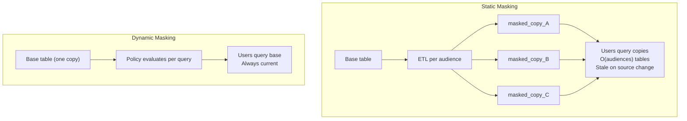

### Lab Exercise
```sql
USE ROLE SECURITYADMIN;

CREATE OR REPLACE MASKING POLICY GOV.POL.MASK_EMAIL
AS (val STRING) RETURNS STRING ->
  CASE WHEN IS_ROLE_IN_SESSION('PII_READER') THEN val
       ELSE REGEXP_REPLACE(val,'(^[^@]{2}).*(@.*$)','\\1***\\2')
  END;

ALTER TABLE CUSTOMERS MODIFY COLUMN email
  SET MASKING POLICY GOV.POL.MASK_EMAIL;

-- User A (no role): sees jo***@acme.com
-- User B (PII_READER): sees john.doe@acme.com
-- SAME ROW. Policy evaluates per query.

-- Change the policy — immediate effect, no re-materialize
ALTER MASKING POLICY GOV.POL.MASK_EMAIL
SET BODY -> CASE WHEN IS_ROLE_IN_SESSION('PII_READER') THEN val ELSE '***' END;
```

### Gotchas / Exam Traps
- Masking policies don't support most non-deterministic functions in the body (e.g., `UUID_STRING`) because queries must be re-evaluatable.
- The masked column still participates in joins — if the policy returns a constant, joins behave accordingly.
- Masking policies on a `TIMESTAMP` return `TIMESTAMP` — the mask must preserve type.

---

## Q2: Explain External Tokenization — when do you use it over DDM?

**Difficulty:** Advanced
**Exam relevance:** External Tokenization

### Answer
**External Tokenization** replaces sensitive values with tokens stored externally in a token vault (e.g., Protegrity, Voltage, your own service). The tokenization and detokenization are performed by an **external function** called from a masking policy.

Use over DDM when:
- You need **reversible** masking — authorized users retrieve the original.
- You need **referential integrity** across systems (same value → same token everywhere).
- You need to **remove sensitive data from Snowflake storage** entirely (store only tokens in Snowflake; raw lives in the vault).
- Compliance requires a **separate key custodian** (vault's HSM, not Snowflake's).
- You need **cross-system format preservation** (Format-Preserving Encryption).

Trade-offs:
- Latency: each detokenization is a function call.
- Dependency: vault availability becomes query dependency.
- Complexity: additional system to secure and audit.

### First Principles
DDM is one-way redaction; tokenization is reversible with external authority. The reversibility matters when business processes require matching on sensitive values across systems (e.g., card numbers across billing + fraud + analytics). Keeping raw values out of Snowflake also reduces blast radius if Snowflake is breached.

### Diagram
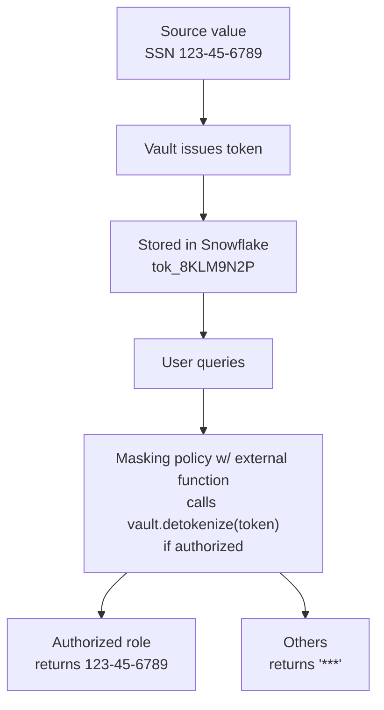

### Lab Exercise
```sql
-- External function to tokenize/detokenize via vault
CREATE OR REPLACE EXTERNAL FUNCTION VAULT.DETOKENIZE(token STRING)
RETURNS STRING
API_INTEGRATION = my_vault_api_integration
AS 'https://vault.example.com/detokenize';

CREATE OR REPLACE MASKING POLICY GOV.POL.PCI_TOKEN
AS (val STRING) RETURNS STRING ->
  CASE WHEN IS_ROLE_IN_SESSION('FR_PCI_READER')
       THEN VAULT.DETOKENIZE(val)
       ELSE val   -- show token (not raw PAN) to unauthorized
  END;

ALTER TABLE PAYMENTS MODIFY COLUMN card_number_token
  SET MASKING POLICY GOV.POL.PCI_TOKEN;
```

### Gotchas / Exam Traps
- External function calls are **synchronous** per batch — add latency; cache judiciously.
- Vault outage → query failure for authorized users; design for degraded mode.
- Snowflake stores the token, not the plaintext — PCI scope **may** be reduced (confirm with QSA).

---

## Q3: Describe Row Access Policies (RAP), their key use cases for AI, and how they compose with masking policies.

**Difficulty:** Intermediate
**Exam relevance:** Row-level filtering

### Answer
A **Row Access Policy** returns BOOLEAN per row; rows where the policy returns FALSE are invisible to the caller. Attached per table/view, policy signature matches column(s) passed from the row.

AI use cases:
- Tenant isolation in multi-tenant AI apps.
- Residency filtering (EU rows only in EU warehouses).
- Consent gating (hide rows for opted-out subjects).
- HITL review gates (only approved rows visible to downstream).
- Agent-queue restriction (support agent sees only own queue).

Composition with masking policies:
- Order: **row access runs FIRST**, then masking on surviving rows.
- A row removed by RAP is not even evaluated for masking.
- Both can share tags for consistent control.

### First Principles
Access control at the row level matches how data is often shared — tenants, regions, cases. Classical GRANT-based access is table-level; RAP decomposes it to the row grain. Combined with masking (cell-grain) and projection (column-grain), you get three-dimensional protection.

### Diagram
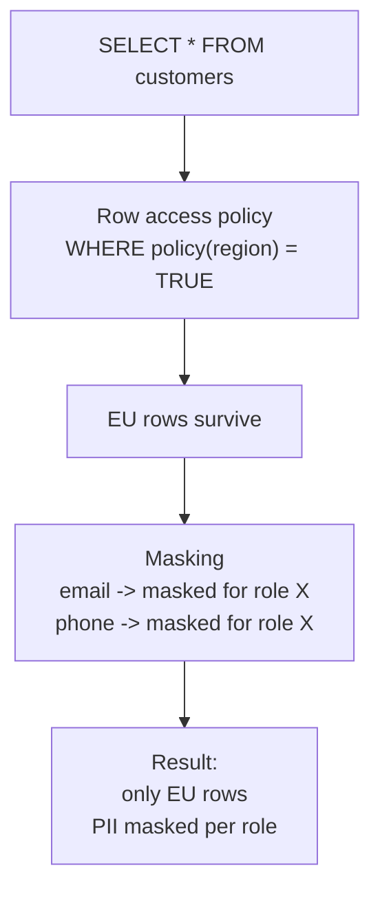

### Lab Exercise
```sql
USE ROLE SECURITYADMIN;

CREATE OR REPLACE ROW ACCESS POLICY GOV.POL.REGION_RAP
AS (region STRING) RETURNS BOOLEAN ->
  CASE
    WHEN IS_ROLE_IN_SESSION('FR_GLOBAL_ANALYST') THEN TRUE
    WHEN IS_ROLE_IN_SESSION('FR_EU_ANALYST') AND region = 'EU' THEN TRUE
    WHEN IS_ROLE_IN_SESSION('FR_US_ANALYST') AND region = 'US' THEN TRUE
    ELSE FALSE
  END;

ALTER TABLE CUSTOMERS ADD ROW ACCESS POLICY GOV.POL.REGION_RAP ON (region);

-- A role can be filtered to zero rows (returns no results — not an error)
```

### Gotchas / Exam Traps
- Row access policy signature must include each column from the row that the policy inspects.
- A table can have **only one** row access policy; combine logic inside one policy if multiple conditions needed.
- Combining tables with different RAPs via JOIN produces the intersection of visibility — row filtering is per-table.

---

## Q4: What is an Aggregation Policy, and why is minimum group size the key defense against re-identification?

**Difficulty:** Advanced
**Exam relevance:** Aggregation policy

### Answer
An **Aggregation Policy** enforces that queries can only return aggregated results where each group includes at least N rows (`MIN_GROUP_SIZE`). Direct row-level `SELECT *` is blocked; only `GROUP BY ... HAVING COUNT(*) >= N`-compatible queries work.

Policy structure:
```sql
AGGREGATION_CONSTRAINT(MIN_GROUP_SIZE => N)
```

Minimum group size prevents re-identification because:
- A group of size 1 reveals an individual's exact values (that single row).
- A group of size 2 reveals one by comparing to the other.
- At N ≥ 50 (common choice), combined with k-anonymity principles, individuals blend into the group.

### First Principles
Even without PII columns, quasi-identifiers (ZIP + DOB + sex) can re-identify. Aggregation policies prevent fine-grained slicing that would isolate individuals. The policy enforces a **minimum anonymity set** at query time — the same guarantee as k-anonymity (k=N) but without physically binning the data.

### Diagram
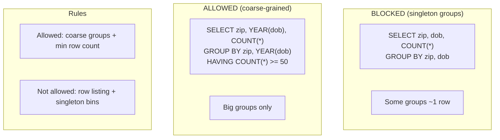

### Lab Exercise
```sql
USE ROLE SECURITYADMIN;

CREATE OR REPLACE AGGREGATION POLICY GOV.POL.AGG_50
AS () RETURNS AGGREGATION_CONSTRAINT ->
  CASE
    WHEN IS_ROLE_IN_SESSION('FR_ANALYTICS_SAFE_READ')
      THEN AGGREGATION_CONSTRAINT(MIN_GROUP_SIZE => 50)
    WHEN IS_ROLE_IN_SESSION('FR_UNRESTRICTED')
      THEN NO_AGGREGATION_CONSTRAINT()
    ELSE AGGREGATION_CONSTRAINT(MIN_GROUP_SIZE => 100)
  END;

ALTER TABLE CUSTOMER_METRICS SET AGGREGATION POLICY GOV.POL.AGG_50;

-- User under FR_ANALYTICS_SAFE_READ:
SELECT state, COUNT(*) FROM CUSTOMER_METRICS GROUP BY 1;  -- OK (states >50)
SELECT * FROM CUSTOMER_METRICS LIMIT 1;                   -- blocked
SELECT state, zip FROM CUSTOMER_METRICS GROUP BY 1,2;     -- some groups <50 → values redacted
```

### Gotchas / Exam Traps
- Aggregation policies return `AGGREGATION_CONSTRAINT` type, not BOOLEAN.
- Rows that would fall into undersized groups are **replaced with sentinel values** (NULL) in the output, not dropped — groups merge visually.
- Entitlement columns can be designated so the policy allows direct access to specific values (e.g., a user's own data) via the `ENTITY KEY` concept in multi-tenant Snowflake patterns.

---

## Q5: Describe Projection Policies and when you need them in AI pipelines.

**Difficulty:** Advanced
**Exam relevance:** Projection policies

### Answer
A **Projection Policy** controls whether a column can be **projected** (`SELECT col`) in a query. A projection-restricted column:
- Can be used in WHERE, JOIN, GROUP BY (predicate use).
- Cannot be returned in the SELECT list.

Return type: `PROJECTION_CONSTRAINT`.

Use cases in AI pipelines:
- A `training_only_feature` column can feed model training (JOIN/GROUP BY) but cannot be exported.
- A `linking_key` for internal joins is not exposable to downstream apps.
- A sensitive attribute used for fairness measurement but not for display.

### First Principles
Access control historically has two grains: row (RAP) and column value (masking). Projection policies add a third: *selectability*. Some columns legitimately feed computation but should never leave the server. The policy encodes "use is fine; disclosure is not."

### Diagram
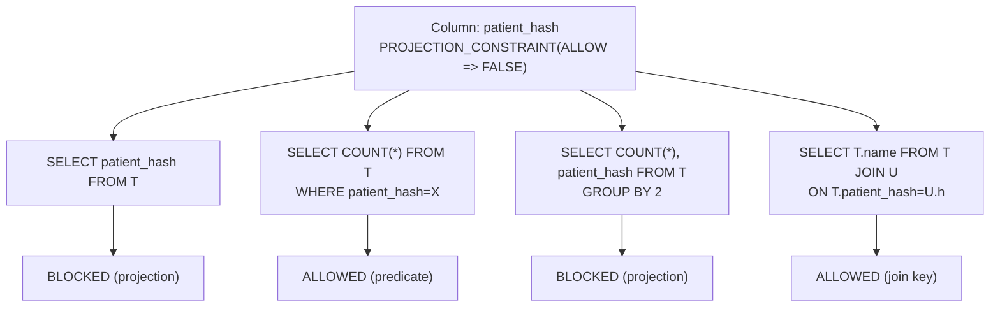

### Lab Exercise
```sql
USE ROLE SECURITYADMIN;

CREATE OR REPLACE PROJECTION POLICY GOV.POL.NO_PROJECT_HASH
AS () RETURNS PROJECTION_CONSTRAINT ->
  CASE
    WHEN IS_ROLE_IN_SESSION('FR_LINK_PRIVILEGED') THEN PROJECTION_CONSTRAINT(ALLOW => TRUE)
    ELSE PROJECTION_CONSTRAINT(ALLOW => FALSE)
  END;

ALTER TABLE PATIENT_LINK
  MODIFY COLUMN patient_hash
  SET PROJECTION POLICY GOV.POL.NO_PROJECT_HASH;

-- Query under restricted role:
SELECT patient_hash FROM PATIENT_LINK;                -- fails
SELECT COUNT(*) FROM PATIENT_LINK WHERE patient_hash = 'abc'; -- succeeds
```

### Gotchas / Exam Traps
- Projection policies don't hide the column from `DESCRIBE TABLE`; they just block projection in SELECT.
- Combining projection + aggregation: a column can be a join key but not shown, even in aggregates.

---

## Q6: What is Differential Privacy, and how does Snowflake's Differential Privacy policy work?

**Difficulty:** Advanced
**Exam relevance:** Differential privacy

### Answer
**Differential Privacy (DP)** adds calibrated noise to query results so that the inclusion or exclusion of any single individual does not meaningfully change the output. Formalized by ε (epsilon) — the privacy budget. Lower ε = more privacy, more noise.

Snowflake's DP (preview/early-GA at exam time) provides a policy that, when attached to a table or view, injects noise into aggregate query results. Common functions supported: COUNT, SUM, AVG, histogram-style.

Properties:
- Each query consumes **privacy budget**; a running total is tracked.
- Repeated queries can be answered within budget before noise becomes misleading.
- Snowflake's implementation integrates with the aggregation enforcement framework.

### First Principles
DP is the gold-standard formal privacy guarantee: no individual's data can be reverse-engineered from outputs. It is mathematically provable (unlike k-anonymity, which has well-known attacks). For AI, DP is critical because models trained on individual data can memorize; DP-trained models have formal privacy guarantees.

Caveat: DP is a trade-off between utility and privacy. Low-ε settings crush AI model accuracy.

### Diagram
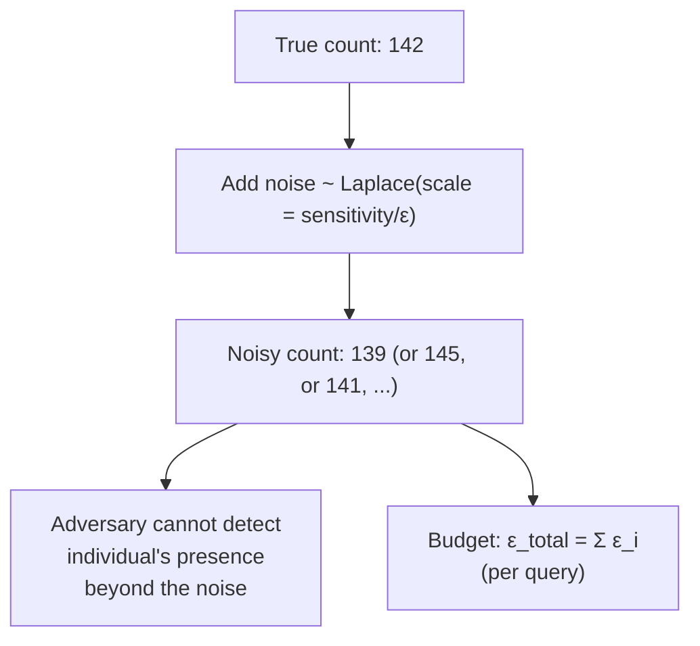

### Lab Exercise
```sql
-- Simplified: Snowflake's DP policy syntax (depending on release)
CREATE OR REPLACE PRIVACY POLICY GOV.POL.DP_SMALL
AS () RETURNS PRIVACY_CONSTRAINT ->
  PRIVACY_CONSTRAINT(
    EPSILON => 1.0,
    DELTA   => 1e-6,
    PRIVACY_UNIT_COLUMN => 'customer_id'
  );

ALTER TABLE CUSTOMER_METRICS
  SET PRIVACY POLICY GOV.POL.DP_SMALL;

-- Query returns noisy aggregates for roles without exemption
-- Budget tracked in SNOWFLAKE.ACCOUNT_USAGE.PRIVACY_BUDGET_USAGE
```

### Gotchas / Exam Traps
- DP is **not** a drop-in replacement for masking — it's for aggregate release; it does not hide values in `SELECT *`.
- Budget exhaustion means subsequent queries either get more noise or are blocked — plan accordingly.
- Group-size enforcement (aggregation policy) is **not** DP — it's k-anonymity-style and vulnerable to composition attacks across queries.

---

## Q7: Compare synthetic data generation to masking for AI training data preparation.

**Difficulty:** Advanced
**Exam relevance:** Synthetic data via Cortex

### Answer
**Synthetic data** is generated data that mimics statistical properties of real data without containing real records. Snowflake Cortex provides synthetic data generation functions / Snowpark ML models to train a generator (e.g., based on real schema + distributions) and produce new rows.

Comparison:
| Property | Masking (DDM) | Synthetic data |
|----------|---------------|----------------|
| Original rows | preserved, redacted | discarded, synthetic |
| Referential integrity | broken (random masks) | can be enforced per generator |
| Privacy risk | some (quasi-identifiers) | lower (no real individuals) |
| Utility for training | partial (masked cols useless) | high (statistical) |
| Compliance posture | still PII (masked PII) | typically out of scope if truly synthetic |

Use synthetic for:
- Early-stage model prototyping without PII exposure.
- Dev/test environments that must mirror prod.
- Model demo / sales environments.

Caveats:
- Synthetic generators can memorize training data (membership inference). Use DP during training for strong guarantees.
- Synthetic data may embed biases from the generator — same fairness considerations.

### First Principles
Masking says "same data, visible differently." Synthetic says "different data, statistically similar." For AI training, the latter is sometimes essential — a masked SSN column has no training signal; a synthetic one has distribution. The trade-off is realism vs. generalization.

### Diagram
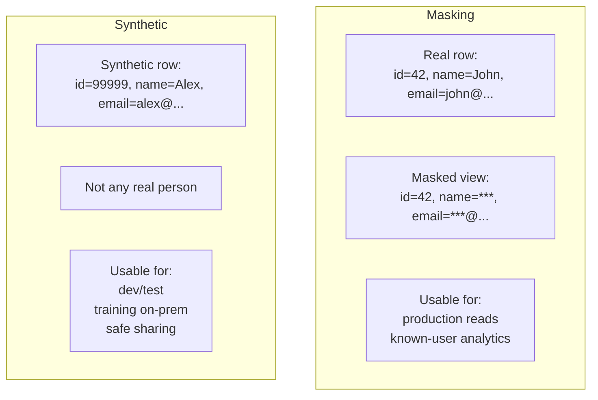

### Lab Exercise
```sql
-- Illustrative Snowpark Python pattern (actual Cortex synthetic data via function
-- or Snowpark ML's SyntheticData class, depending on release)
USE WAREHOUSE WH_AI;
CREATE OR REPLACE TABLE CUSTOMERS_SYN AS
SELECT
  OBJECT_CONSTRUCT_KEEP_NULL(
    'customer_id', UUID_STRING(),
    'age',  UNIFORM(18,80,RANDOM()),
    'state', UNIFORM(1,50,RANDOM())
  ) AS synthetic_row
FROM TABLE(GENERATOR(ROWCOUNT => 100000));

-- Statistical mimic: more realistic generators via Snowpark ML
```

### Gotchas / Exam Traps
- Truly synthetic data (no deterministic mapping from a real row) is **not personal data under GDPR**.
- Pseudonymized or k-anonymized data **is still personal data** — compliance scope remains.

---

## Q8: Explain policy evaluation order precisely, and show an example where order matters.

**Difficulty:** Advanced
**Exam relevance:** Policy composition

### Answer
Snowflake evaluates policies in this order:
1. **Row Access Policy** — determines which rows are visible.
2. **Aggregation / Projection** — restricts query shape or columns.
3. **Masking** — transforms surviving column values.

Order matters:
- A row removed by RAP never contributes to aggregates; aggregation can't "see" filtered rows.
- Masking happens AFTER row filtering — mask functions are not applied to invisible rows (good for perf).
- Aggregation enforcement operates on *post-RAP* row counts — minimum-group thresholds reflect visible rows.

### First Principles
Policies are composable only if evaluation order is well-defined. The row → shape → value sequence matches the mental model: "what's visible, in what form, with what masking." Reversing would break anonymity (masking before row filter means masked rows still count toward re-identification).

### Diagram
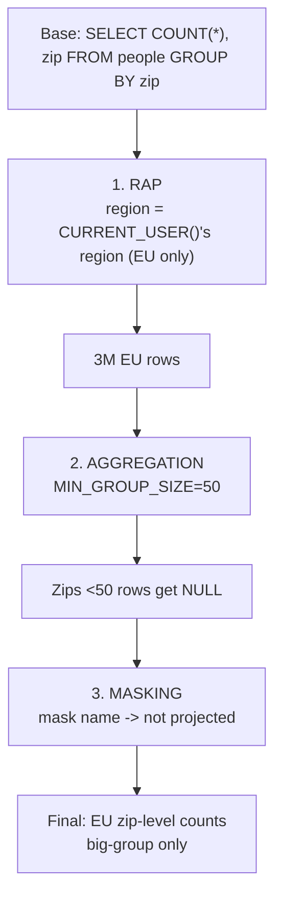

### Lab Exercise
```sql
-- Apply all three
ALTER TABLE PEOPLE ADD ROW ACCESS POLICY GOV.POL.REGION_RAP ON (region);
ALTER TABLE PEOPLE SET AGGREGATION POLICY GOV.POL.AGG_50;
ALTER TABLE PEOPLE MODIFY COLUMN email SET MASKING POLICY GOV.POL.MASK_EMAIL;

-- Query trace in QUERY_HISTORY shows all three evaluated
SELECT query_id, policies_referenced
FROM SNOWFLAKE.ACCOUNT_USAGE.ACCESS_HISTORY
WHERE query_id = LAST_QUERY_ID();
```

### Gotchas / Exam Traps
- You can set at most one of each policy type per column/table.
- Row access policies on views cascade from the base table; a secure view with RAP on it adds filtering again (effectively intersects).
- JOINs: each table's RAP evaluates independently; final result is the AND.

---

## Q9: How does Snowflake's encryption-at-rest hierarchy work, and when is customer-managed key (CMK) required?

**Difficulty:** Intermediate
**Exam relevance:** Tri-Secret Secure

### Answer
Snowflake uses a **hierarchical key model**:
```
Account Master Key (AMK)
    │
    ▼
Table Master Keys (TMK)   — per table
    │
    ▼
File Keys (FK)            — per micropartition file
    │
    ▼
Data encrypted AES-256-GCM
```

Keys are **auto-rotated** (default 30 days for AMK; 1 year for inactive data).

**Tri-Secret Secure (TSS)** adds a **customer-managed key (CMK)** held in the customer's HSM/KMS (AWS KMS, Azure Key Vault, GCP Cloud KMS). The CMK wraps the AMK; without the CMK, Snowflake cannot decrypt data.

When required:
- Regulatory mandates (some healthcare, financial, government contexts).
- Customer insists on break-glass "cut off Snowflake" capability.
- Multi-cloud / sovereign-cloud mandates.

### First Principles
Encryption at rest in a managed service means "the service decrypts for you." That's fine for most compliance regimes. For higher assurance, the customer holds the top of the key chain so revocation is unilateral. Tri-Secret Secure gives this with minimal operational burden.

### Diagram
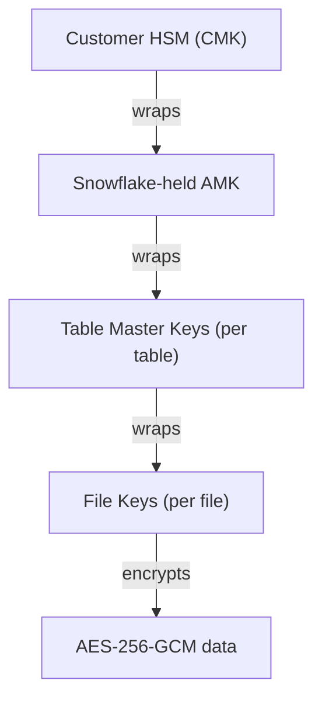

### Lab Exercise
```sql
-- TSS is configured via Snowflake Support, not SQL. SQL to confirm:
SHOW ACCOUNT PARAMETERS LIKE 'PERIODIC_DATA_REKEYING';

-- Enable periodic re-keying (rotates TMKs more frequently)
ALTER ACCOUNT SET PERIODIC_DATA_REKEYING = TRUE;

-- Verify encryption posture via Trust Center
SELECT scanner_name, severity, remediation
FROM SNOWFLAKE.TRUST_CENTER.FINDINGS
WHERE scanner_name ILIKE '%ENCRYPT%';
```

### Gotchas / Exam Traps
- Enabling TSS does not change your query flow — transparent decryption still happens.
- TSS does not alter time-to-decrypt materially; latency is in the key-wrap, not per-row.
- Deleting the CMK **permanently** destroys data access — one-way; have a key recovery plan.

---

## Q10: Describe end-to-end encryption in transit for Snowflake and the implications for AI service workloads.

**Difficulty:** Intermediate
**Exam relevance:** TLS, PrivateLink

### Answer
All Snowflake client connections use **TLS 1.2+** (TLS 1.3 preferred). Snowflake certificates are issued by trusted CAs; cert pinning is recommended for highly-sensitive apps.

Connection options:
- **Public internet** — TLS; works but exposes DNS/metadata.
- **PrivateLink / Private Service Connect** — traffic stays on cloud provider private network; no public endpoint.
- **Account URL** — must match pinned cert; privatelink URLs differ from public.

For AI service workloads:
- Service running in a VPC → PrivateLink to Snowflake; combine with network policy restricting source CIDRs.
- Cortex external functions call outbound to external services; TLS required.
- Snowpark Container Services (SPCS) → network ingress controlled by Snowflake-managed service rules.

### First Principles
Encryption in transit is table stakes; the governance question is "is traffic private-pathed?" PrivateLink elevates the trust boundary from "the Internet trusted TLS" to "cloud provider private network." For AI, where credentials and prompts/completions flow repeatedly, private-pathing closes the metadata leak surface.

### Diagram
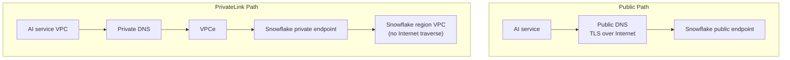

### Lab Exercise
```sql
-- Configure PrivateLink (configured in cloud + Snowflake)
SELECT SYSTEM$GET_PRIVATELINK_CONFIG();   -- returns per-region endpoints

-- Network policy that integrates with PrivateLink
CREATE NETWORK RULE PL_RULE
  MODE = INGRESS
  TYPE = AWSVPCEID
  VALUE_LIST = ('vpce-0123456789abcdef0');

CREATE NETWORK POLICY NP_PRIVATELINK_ONLY
  ALLOWED_NETWORK_RULE_LIST = ('PL_RULE');

ALTER ACCOUNT SET NETWORK_POLICY = NP_PRIVATELINK_ONLY;
```

### Gotchas / Exam Traps
- PrivateLink URL differs from the public URL — update drivers and connection strings.
- TLS cert verification can fail if clients don't trust the CA chain in private environments.

---

## Q11: What are the common masking policy patterns, and when do you use each?

**Difficulty:** Intermediate
**Exam relevance:** Masking patterns

### Answer
Common patterns:

1. **Full redaction** — `'***'` for all unauthorized.
2. **Partial redaction** — show last 4 digits, first letter.
3. **Hash** — `SHA2(val)` — deterministic, preserves referential join across roles that see the hash.
4. **Format-preserving** — email → `x***@y.com`; preserves type/shape.
5. **Date generalization** — truncate timestamp to year/month.
6. **Null replacement** — `NULL` for unauthorized.
7. **Tokenization** — external function to vault.
8. **Conditional on tag** — branch on column tag.
9. **Role-value mapping** — a lookup table maps role→visibility.

### First Principles
Different downstream needs require different masks: joins need deterministic hashing, UIs need format-preserving, aggregates can tolerate full redaction. One policy per column but policy logic can branch on calling context.

### Diagram
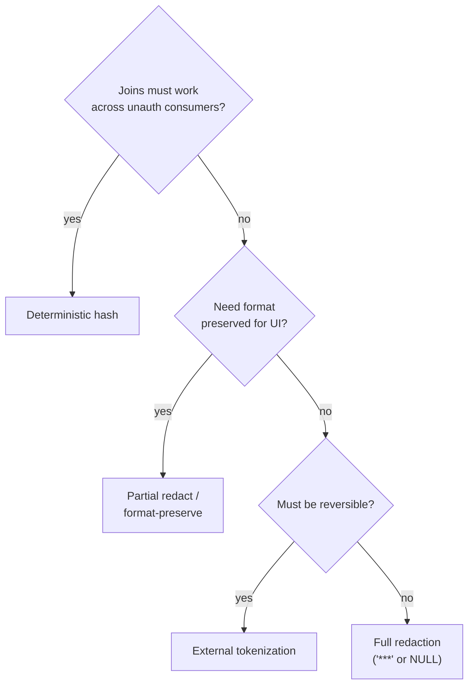

### Lab Exercise
```sql
-- Pattern library
CREATE MASKING POLICY GOV.POL.FULL_REDACT AS (v STRING) RETURNS STRING ->
  CASE WHEN IS_ROLE_IN_SESSION('FR_PII_READER') THEN v ELSE '***' END;

CREATE MASKING POLICY GOV.POL.LAST4 AS (v STRING) RETURNS STRING ->
  CASE WHEN IS_ROLE_IN_SESSION('FR_PII_READER') THEN v
       ELSE REPEAT('*', GREATEST(LENGTH(v)-4,0)) || RIGHT(v,4) END;

CREATE MASKING POLICY GOV.POL.HASH AS (v STRING) RETURNS STRING ->
  CASE WHEN IS_ROLE_IN_SESSION('FR_PII_READER') THEN v
       ELSE SHA2(v, 256) END;

CREATE MASKING POLICY GOV.POL.DATE_YEAR AS (v DATE) RETURNS DATE ->
  CASE WHEN IS_ROLE_IN_SESSION('FR_PII_READER') THEN v
       ELSE DATE_TRUNC('year', v)::DATE END;

CREATE MASKING POLICY GOV.POL.EMAIL_FORMAT AS (v STRING) RETURNS STRING ->
  CASE WHEN IS_ROLE_IN_SESSION('FR_PII_READER') THEN v
       ELSE REGEXP_REPLACE(v,'(^.).*(@.*$)','\\1***\\2') END;
```

### Gotchas / Exam Traps
- Hash masks must use a **secret salt** to prevent dictionary attacks; store the salt out-of-band.
- Format-preserving but obvious patterns can leak (e.g., all `***@example.com` reveals domain).

---

## Q12: What are the limits of masking policies for AI model training, and how do you work around them?

**Difficulty:** Advanced
**Exam relevance:** Masking + training interaction

### Answer
Limits:
1. **Loss of statistical signal** — a masked (constant) column has no predictive value.
2. **Join breakage** — random masks break referential joins across tables.
3. **Deterministic hashes preserve joins but leak counts** (same raw → same hash).
4. **Policy evaluated at query time** — training reads from the base table; the training process sees masked values based on its role.
5. **Model inversion risk** — if the training role sees unmasked, the model may memorize PII; downstream inference may leak it.

Work-arounds:
1. **Separate training role** with elevated access, but training **outputs** are themselves protected (model stored as artifact, access controlled).
2. **Train on synthetic data** generated to preserve statistics without real values.
3. **Train on tokenized data** — model learns on tokens; detokenize at inference boundary only if needed.
4. **Differential privacy during training** — formal privacy guarantee against memorization.
5. **Projection policy** — keep PII columns usable as JOIN keys but not SELECT-able into model inputs.

### First Principles
Masking is designed for *display*; training is *reading at scale*. The two interact awkwardly: masked data loses signal; unmasked training risks memorization. The right pattern is **context-aware access** — training workloads use elevated roles with corresponding controls (restricted outputs, DP, monitoring).

### Diagram
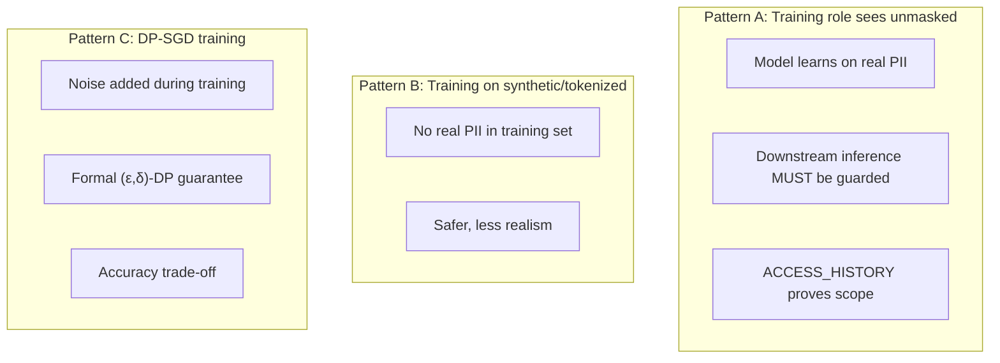

### Lab Exercise
```sql
-- Dedicated training role with elevated read + output constraints
CREATE ROLE FR_MODEL_TRAINER;
GRANT USAGE   ON DATABASE AI_DB TO ROLE FR_MODEL_TRAINER;
GRANT USAGE   ON SCHEMA   AI_DB.FEATURES TO ROLE FR_MODEL_TRAINER;
GRANT SELECT  ON ALL TABLES IN SCHEMA AI_DB.FEATURES TO ROLE FR_MODEL_TRAINER;

-- Policy carve-out: trainer sees unmasked
ALTER MASKING POLICY GOV.POL.MASK_EMAIL
SET BODY -> CASE
  WHEN IS_ROLE_IN_SESSION('FR_PII_READER')     THEN val
  WHEN IS_ROLE_IN_SESSION('FR_MODEL_TRAINER')  THEN val
  ELSE '***' END;

-- Compensating control: FR_MODEL_TRAINER can write only to AI_DB.MODELS
GRANT CREATE MODEL ON SCHEMA AI_DB.MODELS TO ROLE FR_MODEL_TRAINER;
-- No write access to export locations
```

### Gotchas / Exam Traps
- A model's weights are not covered by the source table's masking — governance of the model itself is a separate domain.
- Cortex `COMPLETE` on a sensitive text column: masking is applied before Cortex sees the value — if the role is unmasked, the LLM gets the raw.

---

## Q13: Explain the difference between a secure view's protection and a masking policy's protection.

**Difficulty:** Intermediate
**Exam relevance:** Secure view vs masking

### Answer
- **Secure view** hides *definition* and prevents *optimizer-leaked predicates*; the data returned is the same as the view's SELECT list. Protection is at the **view boundary**.
- **Masking policy** transforms *column values* based on context; the column is defined on the **base table** and the policy applies to all queries, including non-view direct queries.

Combine:
- Secure view that selects a subset of columns + masking policies on base → policy applies even when queried through the secure view.
- Masking policy's output IS the value returned by the view.

### First Principles
Views abstract; masking enforces value-level transforms. Together: the view decides *what fields exist*; the policy decides *what the fields contain*. The combination is Snowflake's recommended data-sharing pattern — curated view + policies.

### Diagram
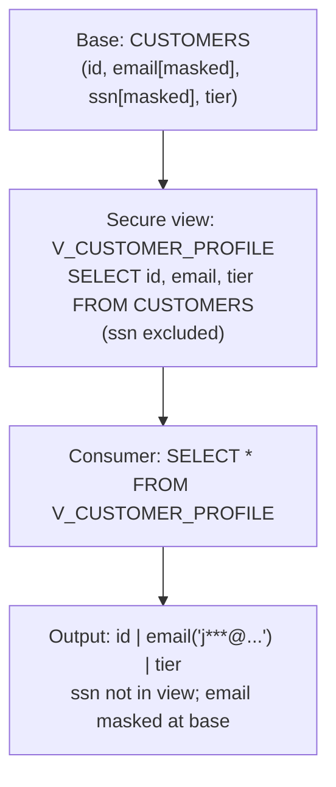

### Lab Exercise
```sql
-- Base table with masking
CREATE TABLE CUSTOMERS (id INT, email STRING, ssn STRING, tier STRING);
ALTER TABLE CUSTOMERS MODIFY COLUMN email SET MASKING POLICY GOV.POL.MASK_EMAIL;
ALTER TABLE CUSTOMERS MODIFY COLUMN ssn   SET MASKING POLICY GOV.POL.FULL_REDACT;

-- Secure view curating columns
CREATE SECURE VIEW V_CUSTOMER_PROFILE AS
  SELECT id, email, tier FROM CUSTOMERS;

-- Grant usage of view only
GRANT SELECT ON VIEW V_CUSTOMER_PROFILE TO ROLE FR_ANALYST;
-- SSN not visible via view; email is masked at base level still
```

### Gotchas / Exam Traps
- Masking policies evaluate even when queried through a view — the base column's policy wins.
- A view can have its own RAP; it stacks with the base's RAP.

---

## Q14: How do Clean Rooms protect data in multi-party AI collaboration?

**Difficulty:** Advanced
**Exam relevance:** Clean rooms as protection mechanism

### Answer
Snowflake Data Clean Rooms let two or more parties compute joint analyses or train models without exposing raw rows to each other. Protection mechanisms:

1. **No raw egress** — only agreed-upon query outputs leave the clean room.
2. **Approved query list** — producers whitelist exact SQL/UDFs allowed.
3. **Aggregation thresholds** — min group size enforced via aggregation policies.
4. **Audit** — all clean-room queries logged with full attribution.
5. **No persistence outside** — intermediate results don't escape the clean room.
6. **Row-level consent integration** — only consented rows participate.
7. **Optional DP** — layer differential privacy on outputs.

### First Principles
Multi-party AI (ad targeting, fraud consortia, healthcare registries) traditionally requires one party to trust the other with raw data. Clean rooms replace trust with cryptographic + policy enforcement: computation is public (query is agreed), data is private, outputs are aggregated. The governance payoff is massive — parties can collaborate without a legal agreement giving one party access to the other's data.

### Diagram
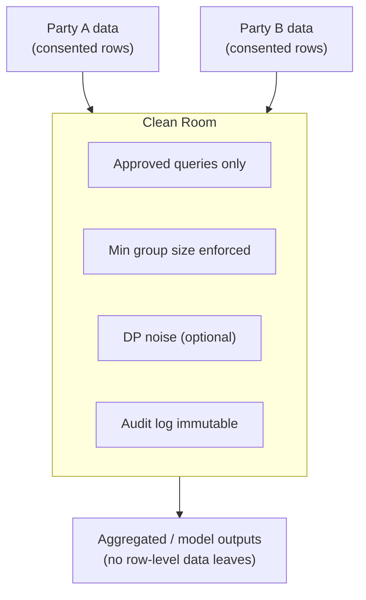

### Lab Exercise
```sql
-- Clean Rooms App (actual API uses Snowflake Clean Rooms providers)
-- Simplified: enforce min group size as a cross-party control
CREATE AGGREGATION POLICY GOV.POL.CR_MIN50
AS () RETURNS AGGREGATION_CONSTRAINT ->
  AGGREGATION_CONSTRAINT(MIN_GROUP_SIZE => 50);

-- Apply to a shared view
ALTER TABLE JOINT_ANALYTICS.OVERLAPPING_CUSTOMERS
  SET AGGREGATION POLICY GOV.POL.CR_MIN50;

-- Add RAP to only allow consented rows
CREATE ROW ACCESS POLICY GOV.POL.CR_CONSENT
AS (customer_id STRING) RETURNS BOOLEAN ->
  customer_id IN (SELECT customer_id FROM BOTH_CONSENTED_IDS);

ALTER TABLE JOINT_ANALYTICS.OVERLAPPING_CUSTOMERS
  ADD ROW ACCESS POLICY GOV.POL.CR_CONSENT ON (customer_id);
```

### Gotchas / Exam Traps
- Clean rooms require **both** parties to opt in to each approved query — not unilateral.
- A clean room doesn't make reidentification impossible; combined with DP and k-anonymity, risk is minimized but non-zero.

---

## Q15: What's the difference between "mask value" and "block query" protection, and how does Snowflake implement each?

**Difficulty:** Intermediate
**Exam relevance:** Protection mode semantics

### Answer
- **Mask value** — the query succeeds; the value is transformed. User sees result but masked. Example: masking policy returning `'***'`.
- **Block query** — the query fails with an error. User sees nothing (or error). Example: lack of SELECT privilege, aggregation policy violation.

Snowflake:
- Masking policies → mask value.
- Row access policies → silently exclude rows (not blocked, just empty).
- Aggregation policies → silent empty + partial for undersized groups.
- Projection policies → **block query** (compile-time error).
- Lack of USAGE/SELECT privilege → **block query**.

### First Principles
Blocking is visible failure; masking is invisible success. For AI workloads, invisible success is often preferred — the query returns a result, so downstream code doesn't crash, but the result is privacy-safe. Visible failure (projection) is used when the attempted operation is clearly wrong and should be stopped early.

### Diagram
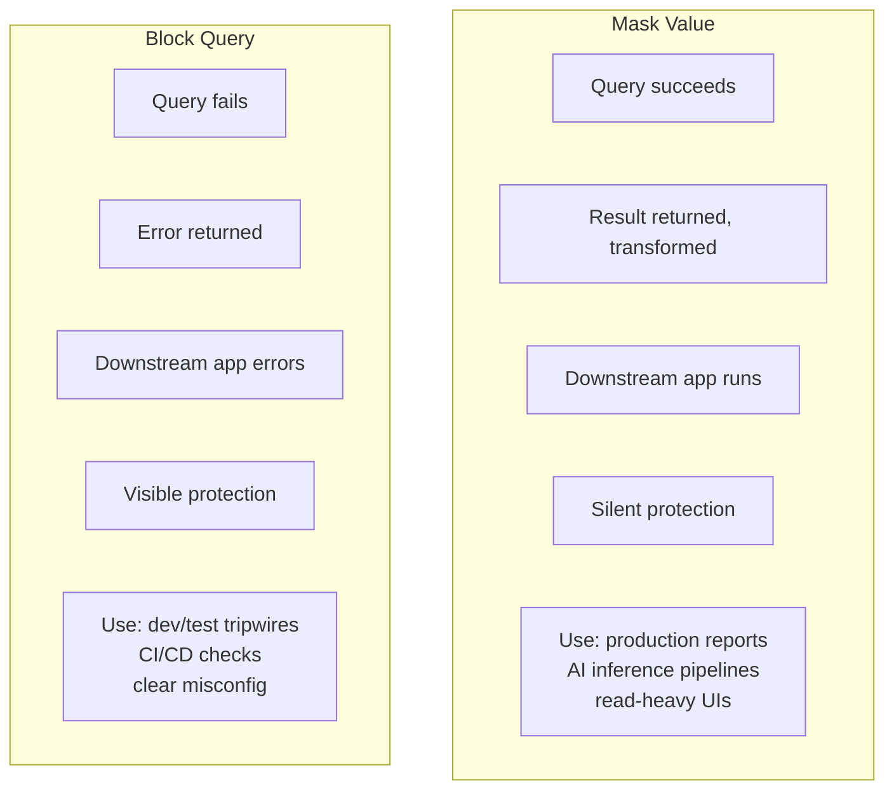

### Lab Exercise
```sql
-- Mask value: policy returns '***'
CREATE MASKING POLICY GOV.POL.SOFT AS (v STRING) RETURNS STRING ->
  CASE WHEN IS_ROLE_IN_SESSION('OK') THEN v ELSE '***' END;

-- Block query: projection policy
CREATE PROJECTION POLICY GOV.POL.HARD AS () RETURNS PROJECTION_CONSTRAINT ->
  CASE WHEN IS_ROLE_IN_SESSION('OK') THEN PROJECTION_CONSTRAINT(ALLOW=>TRUE)
       ELSE PROJECTION_CONSTRAINT(ALLOW=>FALSE) END;

-- Attempt
SELECT masked_col FROM T;        -- '***' (success)
SELECT projected_col FROM T;     -- error (blocked)
```

### Gotchas / Exam Traps
- Mixed mode (RAP + masking) can confuse users: they get no rows but no error.
- Projection policy error messages are generic (don't leak which column) — intentional.

---

## Q16: Describe External Tokenization integration end-to-end: setup, call, audit.

**Difficulty:** Advanced
**Exam relevance:** External tokenization integration

### Answer
Setup:
1. **API Integration** — defines allowed outbound endpoints and auth (OAuth or managed secret).
2. **External Function** — wraps the vault's tokenize/detokenize endpoints.
3. **Masking Policy** — body calls the external function conditionally.
4. **Grant USAGE** on function to roles that attach the policy.
5. **Vault auth** — vault authorizes based on Snowflake's integration identity (SigV4 for AWS Lambda-fronted vault, OAuth client credentials, etc.).

Call:
- Query reads token column → masking policy fires → external function detokenizes → vault returns plaintext → policy returns plaintext to authorized role.

Audit:
- QUERY_HISTORY shows the external function invocation.
- ACCESS_HISTORY shows the column access.
- Vault's own audit log shows detokenize events.
- Correlate via trace IDs.

### First Principles
External tokenization is a **mediated access** pattern: the vault is the authority on what plaintext looks like. Snowflake delegates to it. The governance guarantee is that the plaintext never persists in Snowflake, so the data residency / HSM custody is in the vault.

### Diagram
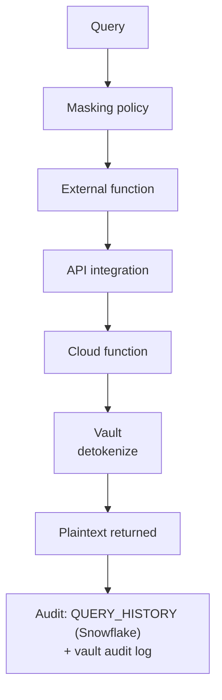

### Lab Exercise
```sql
CREATE OR REPLACE API INTEGRATION VAULT_API
  API_PROVIDER = AWS_API_GATEWAY
  API_AWS_ROLE_ARN = 'arn:aws:iam::123:role/snowflake-vault'
  API_ALLOWED_PREFIXES = ('https://api.vault.example.com/')
  ENABLED = TRUE;

CREATE OR REPLACE EXTERNAL FUNCTION VAULT.DETOKENIZE(tok STRING)
RETURNS STRING
API_INTEGRATION = VAULT_API
AS 'https://api.vault.example.com/detok';

CREATE MASKING POLICY GOV.POL.PAN_TOKEN AS (val STRING) RETURNS STRING ->
  CASE WHEN IS_ROLE_IN_SESSION('FR_PCI_READER') THEN VAULT.DETOKENIZE(val)
       ELSE val END;

GRANT USAGE ON INTEGRATION VAULT_API TO ROLE SECURITYADMIN;
GRANT USAGE ON FUNCTION VAULT.DETOKENIZE(STRING) TO ROLE FR_PCI_READER;
```

### Gotchas / Exam Traps
- External function latency compounds on large result sets — Snowflake batches, but still noticeable.
- Vault IAM/auth must trust Snowflake's integration identity — misconfig = silent failure.

---

## Q17: What is "Replica Encryption Key" and how do you govern cross-region AI training data?

**Difficulty:** Advanced
**Exam relevance:** Cross-region data protection

### Answer
When data is **replicated** to another region (via Replication Groups), the replica has its own encryption keys in the destination region. Keys don't cross regions.

For cross-region AI training data governance:
1. Replication Groups define **which objects** and **to which accounts** data flows.
2. The destination account can have **its own TSS CMK**.
3. Policies (RAP, masking) **replicate with the data** — same enforcement everywhere.
4. Tags **replicate** too — residency controls follow the data.

Issues:
- Dropping a replica deletes its keys; the source is unaffected.
- If source is dropped and only replica remains, promote replica or data is lost.
- `FUTURE GRANTS` do NOT replicate (as of writing) — reapply on replica.

### First Principles
Cross-region replication crosses sovereignty boundaries. Encryption keys per region ensure the destination jurisdiction can control its own copy. Governance (policies, tags) replicating ensures consistency; grants not replicating is a known gap that must be addressed operationally.

### Diagram
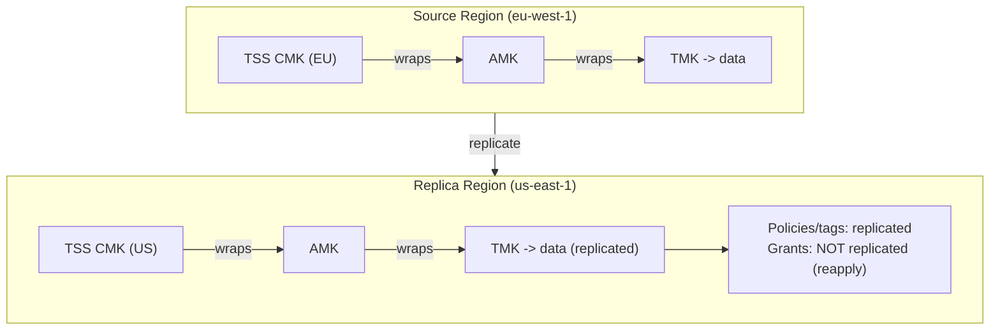

### Lab Exercise
```sql
-- Primary (source) account
USE ROLE ACCOUNTADMIN;

CREATE REPLICATION GROUP AI_FEATURES_REPL
  OBJECT_TYPES = (DATABASES, ROLES)
  ALLOWED_DATABASES = (AI_DB)
  ALLOWED_ACCOUNTS = ('org.account_us_replica')
  REPLICATION_SCHEDULE = '60 MINUTE';

-- Secondary account: create replication group link
CREATE REPLICATION GROUP AI_FEATURES_REPL
  AS REPLICA OF org.account_eu_primary.AI_FEATURES_REPL;

-- Trigger initial sync
ALTER REPLICATION GROUP AI_FEATURES_REPL REFRESH;
```

### Gotchas / Exam Traps
- Replication is one-way; failover switches direction.
- Replication latency depends on data volume; monitor `SNOWFLAKE.ORGANIZATION_USAGE.REPLICATION_USAGE_HISTORY`.
- Account-level tags/policies on the source do not replicate to the destination account.

---

## Q18: Explain the role of Secrets and how they protect credentials in AI pipelines.

**Difficulty:** Intermediate
**Exam relevance:** SECRET objects

### Answer
A Snowflake `SECRET` is a securable object that stores credentials (OAuth client secret, password, generic string, cloud provider keypair). Secrets:
- Encrypted at rest.
- Referenced by **external functions / integrations / UDFs** without inlining the value.
- Granted via USAGE.
- Rotatable.

For AI pipelines:
- Store API keys for Cortex external services, third-party APIs, custom LLM endpoints.
- Use in UDFs via `SNOWFLAKE_INTERNAL.get_secret()` or integration references.
- Prevent key exposure in GET_DDL on functions.

### First Principles
Hardcoded secrets in UDF bodies or stored procedure code are a classic leak surface. A `SECRET` object decouples value from use: the function body references the secret, the secret value lives in encrypted store, and GET_DDL shows the reference only.

### Diagram
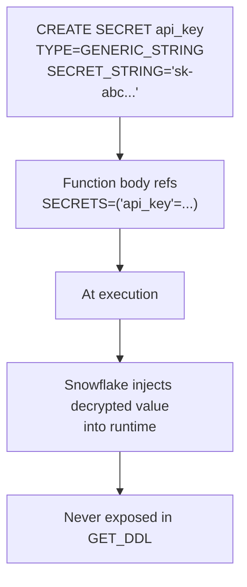

### Lab Exercise
```sql
CREATE SECRET MY_API_KEY
  TYPE = GENERIC_STRING
  SECRET_STRING = 'sk-abcdef123456';

CREATE EXTERNAL ACCESS INTEGRATION EAI_CORTEX_CUSTOM
  ALLOWED_NETWORK_RULES = (ALLOW_CUSTOM_LLM_ENDPOINT)
  ALLOWED_AUTHENTICATION_SECRETS = (MY_API_KEY)
  ENABLED = TRUE;

CREATE OR REPLACE FUNCTION CALL_CUSTOM_LLM(prompt STRING)
RETURNS STRING
LANGUAGE PYTHON RUNTIME_VERSION='3.11'
PACKAGES=('requests')
EXTERNAL_ACCESS_INTEGRATIONS=(EAI_CORTEX_CUSTOM)
SECRETS=('api_key'=MY_API_KEY)
HANDLER='run'
AS $$
import _snowflake, requests
def run(prompt):
    key = _snowflake.get_generic_secret_string('api_key')
    r = requests.post('https://api.custom-llm.co/chat',
                      headers={'Authorization': f'Bearer {key}'},
                      json={'prompt': prompt})
    return r.json()['completion']
$$;

-- Rotate the secret
ALTER SECRET MY_API_KEY SET SECRET_STRING='sk-newvalue';
```

### Gotchas / Exam Traps
- Secrets are **not** sent to query logs; they're injected at runtime.
- The caller needs USAGE on the SECRET + the EXTERNAL ACCESS INTEGRATION.

---

## Q19: What are the specific regulatory mappings — which Snowflake protection satisfies which GDPR/HIPAA control?

**Difficulty:** Advanced
**Exam relevance:** Regulatory feature mapping

### Answer
Representative mapping:

| Regulation / Control | Snowflake protection |
|----------------------|----------------------|
| GDPR Art. 32 (Security of processing) | Encryption at rest + TLS + CMK via TSS |
| GDPR Art. 25 (Privacy by design) | Classification + tag-based policy coverage |
| GDPR Art. 17 (Right to erasure) | DELETE + Time Travel considerations; row-level filters for soft erasure |
| GDPR Art. 22 (Automated decisions) | Explanation tables, row-access policies (HITL) |
| GDPR Art. 5(1)(b) (Purpose limitation) | Tag-based policy, consent table joins |
| HIPAA § 164.312(a) (Access control) | RBAC, row access policies |
| HIPAA § 164.312(b) (Audit controls) | ACCESS_HISTORY, QUERY_HISTORY |
| HIPAA § 164.312(c) (Integrity) | Immutable audit (views + no DELETE/UPDATE grant) |
| HIPAA § 164.312(e) (Transmission security) | TLS 1.2+, PrivateLink |
| HIPAA Minimum Necessary | Projection policies, masking, aggregation |
| PCI DSS Req 3 (Protect stored data) | External tokenization + CMK |
| PCI DSS Req 4 (Encrypt transmission) | TLS 1.2+ |
| PCI DSS Req 7 (Need-to-know) | RBAC + row access |
| PCI DSS Req 10 (Monitor access) | ACCESS_HISTORY |
| SOC 2 CC6.1 (Logical access) | RBAC + MFA + Network Policies |
| SOC 2 CC6.6 (Transmission) | TLS + PrivateLink |
| SOC 2 CC7 (System monitoring) | Trust Center + alerts |

### First Principles
Regulations describe outcomes (confidentiality, auditability); Snowflake features implement mechanisms. The governance team's job is to maintain the mapping as both evolve. Having the mapping as a queryable table makes audits efficient.

### Diagram
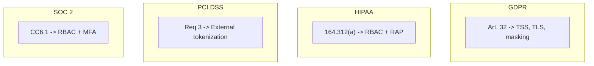

### Lab Exercise
```sql
CREATE TABLE GOV.MAPPING.CONTROL_IMPLEMENTATION (
  framework STRING, control_id STRING, control_name STRING,
  snowflake_feature STRING, implementation_notes STRING, status STRING
);

INSERT INTO GOV.MAPPING.CONTROL_IMPLEMENTATION VALUES
  ('GDPR','Art.32','Security of processing',
   'TSS + masking + TLS','TSS enabled; policies on all PII','ACTIVE'),
  ('HIPAA','§164.312(b)','Audit controls',
   'ACCESS_HISTORY','365-day retention; export monthly','ACTIVE'),
  ('PCI DSS','Req 3','Protect stored cardholder data',
   'External Tokenization','Vault handles PAN; Snowflake stores tokens','ACTIVE');

-- Audit query: which controls lack ACTIVE implementation
SELECT * FROM GOV.MAPPING.CONTROL_IMPLEMENTATION WHERE status != 'ACTIVE';
```

### Gotchas / Exam Traps
- One feature often maps to multiple controls — maintain many-to-many.
- Policy *presence* ≠ *effectiveness*; combine mapping with POLICY_REFERENCES to prove coverage.

---

## Q20: Describe how change tracking (`CHANGE_TRACKING`) and streams compose with masking for AI feature engineering.

**Difficulty:** Advanced
**Exam relevance:** Streams + masking

### Answer
`CHANGE_TRACKING=TRUE` on a table enables Snowflake to track row-level changes (inserts, updates, deletes) via metadata columns. Streams consume this to produce CDC-style records.

For AI feature engineering:
- Stream picks up new rows → feature job processes → writes to feature store.
- Masking applies at the stream consumer's role — if the job runs under a role that sees unmasked, it processes raw; if masked, it processes masked values.
- To process raw data in a feature job while blocking downstream exposure, use OWNER-rights procedures to encapsulate.

### First Principles
Streams expose change data to pipeline-style processing — common for incremental training. The governance question is "what does the pipeline see?" Role-based masking still applies at the stream read, so the pipeline's identity determines data visibility. Design the role carefully.

### Diagram
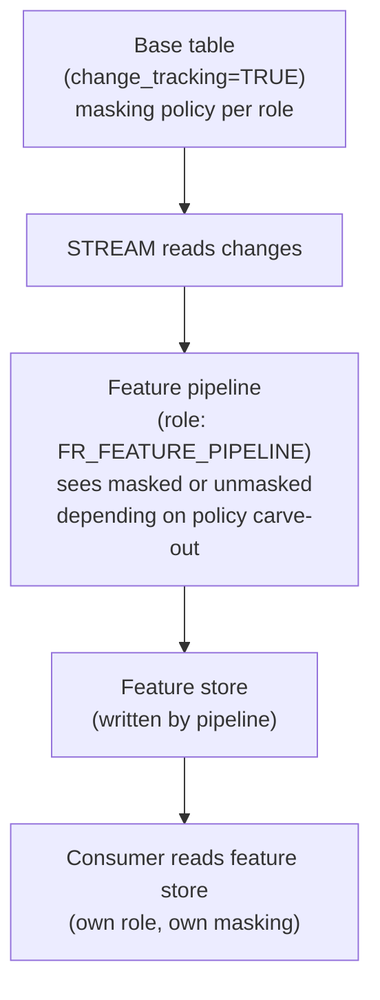

### Lab Exercise
```sql
ALTER TABLE CUSTOMERS SET CHANGE_TRACKING = TRUE;

CREATE STREAM CUSTOMERS_STREAM ON TABLE CUSTOMERS;

-- Pipeline role: carved out from masking so it sees unmasked
ALTER MASKING POLICY GOV.POL.MASK_EMAIL
SET BODY -> CASE
  WHEN IS_ROLE_IN_SESSION('FR_FEATURE_PIPELINE') THEN val
  WHEN IS_ROLE_IN_SESSION('FR_PII_READER')       THEN val
  ELSE '***' END;

-- Feature pipeline (runs as FR_FEATURE_PIPELINE)
CREATE OR REPLACE PROCEDURE PROCESS_CUSTOMER_CHANGES()
RETURNS STRING LANGUAGE SQL AS $$
BEGIN
  INSERT INTO FEATURES.CUSTOMER_FEATS
  SELECT id, FEATURE_FROM_EMAIL(email), tier
  FROM CUSTOMERS_STREAM
  WHERE METADATA$ACTION = 'INSERT';
  RETURN 'OK';
END; $$;

-- Downstream readers: see masked FEATURE_FROM_EMAIL output or masking on feature table
```

### Gotchas / Exam Traps
- Change tracking has **storage overhead**; monitor.
- Streams can be `APPEND_ONLY` or standard; append-only is cheaper.
- Masking policy evaluation on streams happens the same as on tables.

---

## Q21: Describe how to protect LLM prompts and completions as sensitive data.

**Difficulty:** Advanced
**Exam relevance:** LLM data protection

### Answer
Prompts and completions themselves can contain sensitive data (user queries about their own PHI, LLM outputs quoting training data). Protection pattern:

1. **Capture** — log prompts/completions in a table (Cortex AI Observability or custom event table).
2. **Classify** — run `SYSTEM$CLASSIFY` or Cortex PII detection on both columns.
3. **Mask** — apply masking policy to prompt/completion columns.
4. **Row access** — users see only their own session's prompts; auditors see all.
5. **Retention** — short retention (e.g., 30 days) with hard-delete for old entries.
6. **Encryption** — leverage TSS CMK for prompt logs.

### First Principles
LLM interactions are a new high-value PII channel. Treating prompts/completions as first-class sensitive data closes the "we only protect the source tables" gap. The challenge is that prompts arrive as unstructured strings, so Cortex-based detection is the appropriate tool.

### Diagram
```mermaid
flowchart TD
    USR["User prompt"]
    CTX["Cortex COMPLETE / Guard"]
    LOG["Logged -> PROMPT_LOGS table"]
    MP["Masking policy on prompt_text"]
    MC["Masking policy on completion_text"]
    RAP["Row access policy (user sees own)"]
    AGG["Aggregation policy on usage stats"]
    RET["Retention: 30 days<br/>(periodic delete task)"]
    USR --> CTX --> LOG
    LOG --> MP
    LOG --> MC
    LOG --> RAP
    LOG --> AGG
    LOG --> RET
```

### Lab Exercise
```sql
CREATE TABLE AI_OBS.PROMPT_LOGS (
  log_id STRING,
  user_name STRING,
  session_id STRING,
  prompt_text STRING,
  completion_text STRING,
  model STRING,
  tokens_in INT, tokens_out INT,
  guardrail_triggered BOOLEAN,
  created_at TIMESTAMP_NTZ
);

-- Classify
CALL SYSTEM$CLASSIFY('AI_OBS.PROMPT_LOGS',{'auto_tag':TRUE});

-- Mask
ALTER TABLE AI_OBS.PROMPT_LOGS
  MODIFY COLUMN prompt_text     SET MASKING POLICY GOV.POL.FULL_REDACT,
         COLUMN completion_text SET MASKING POLICY GOV.POL.FULL_REDACT;

-- Row access: own session or auditor
CREATE ROW ACCESS POLICY GOV.POL.OWN_PROMPTS
AS (user_name STRING) RETURNS BOOLEAN ->
  user_name = CURRENT_USER() OR IS_ROLE_IN_SESSION('FR_AUDITOR');

ALTER TABLE AI_OBS.PROMPT_LOGS
  ADD ROW ACCESS POLICY GOV.POL.OWN_PROMPTS ON (user_name);

-- Retention task
CREATE TASK PRUNE_LOGS SCHEDULE='USING CRON 0 2 * * * UTC'
AS DELETE FROM AI_OBS.PROMPT_LOGS WHERE created_at < DATEADD('day',-30,CURRENT_TIMESTAMP());
```

### Gotchas / Exam Traps
- Logging prompts creates a new PII store — governance applies the same as any other PII.
- Over-redaction destroys the ability to debug — balance via role-carve-outs for incident response.

---

## Q22: What is "Attribute-Based Access Control (ABAC)" relative to Snowflake's RBAC + tags, and how do you implement ABAC-like patterns?

**Difficulty:** Advanced
**Exam relevance:** ABAC-via-tags pattern

### Answer
**ABAC** grants access based on **attributes** of the subject (role, department), object (sensitivity, project), and context (time, location). Snowflake is formally RBAC but ABAC-like patterns are achievable:

- **Subject attributes** → role claims + session variables + custom tag on user.
- **Object attributes** → tags on tables/columns.
- **Context** → session functions (`CURRENT_WAREHOUSE()`, `CURRENT_IP_ADDRESS()`, `CURRENT_TIMESTAMP()`).

A row-access or masking policy that reads tag values and session variables implements ABAC. The compilation into policy bodies is explicit; it scales to many attributes.

### First Principles
Pure RBAC has combinatorial explosion with many attributes (role per department × region × project). ABAC collapses that: fewer roles, more attribute checks. Snowflake's hybrid lets you use RBAC for coarse structure and tag-driven policy for fine attributes. This is the standard enterprise approach.

### Diagram
```mermaid
flowchart TD
    subgraph RBAC["RBAC"]
        R1["Role per dept × region"]
        R2["Many roles"]
        R3["Explicit grants"]
        R4["Simple audit"]
    end
    subgraph ABAC["ABAC-via-tags"]
        A1["One role + attr checks"]
        A2["Few roles"]
        A3["Policy evaluates attrs"]
        A4["Attr source matters"]
    end
```

### Lab Exercise
```sql
-- Session variable + tag-driven ABAC
EXECUTE IMMEDIATE 'SET SESSION_PROJECT = ''project-alpha''';

CREATE OR REPLACE ROW ACCESS POLICY GOV.POL.ABAC_PROJECT
AS (project STRING) RETURNS BOOLEAN ->
  project = $SESSION_PROJECT
  OR IS_ROLE_IN_SESSION('FR_PROJECT_ADMIN');

ALTER TABLE EXPERIMENTS ADD ROW ACCESS POLICY GOV.POL.ABAC_PROJECT ON (project);

-- Context: enforce time-of-day
CREATE OR REPLACE ROW ACCESS POLICY GOV.POL.BUSINESS_HOURS
AS (region STRING) RETURNS BOOLEAN ->
  (EXTRACT(HOUR FROM CURRENT_TIMESTAMP()) BETWEEN 7 AND 19)
  OR IS_ROLE_IN_SESSION('FR_24x7_OPS');
```

### Gotchas / Exam Traps
- Session variables must be set at session start; refresh across pool connections.
- ABAC policies are harder to audit statically — require runtime trace via POLICIES_REFERENCED.

---

## Gotchas Recap — Protection Cheat Sheet

| Protection | Evaluated | Returns | Mode |
|------------|-----------|---------|------|
| Row Access Policy | row scan | BOOLEAN | silent filter |
| Aggregation Policy | aggregation plan | AGGREGATION_CONSTRAINT | enforce + sentinel |
| Projection Policy | plan compile | PROJECTION_CONSTRAINT | hard block |
| Masking Policy | per cell | typed value | transform |
| Differential Privacy | aggregates | noisy value | add noise, budget |
| External Tokenization | per cell | STRING | callout, slower |
| Encryption at rest | always-on | — | transparent |
| TSS CMK | always-on | — | adds revocation axis |
| PrivateLink | network | — | path-level |
