# Model Governance & Monitoring — GAS-C01 Study Guide

## Exam Weight & Scope

**Weight on GAS-C01:** ~15-20%

**Scope:**
- Cortex Guard — content safety filtering for LLMs
- Prompt injection defenses, jailbreak detection
- Model Registry governance — versioning, lineage, tags, access
- LLM observability — Cortex AI Observability, event tables, SPANs/traces
- Prompt / response logging patterns
- Drift detection — data drift, concept drift, performance drift
- Model monitoring with Snowflake ML Monitoring
- Approval workflows and deployment gates
- Model cards, model lineage, feature store governance
- PII leakage detection in LLM outputs
- Cortex Analyst / Search governance (semantic model)

## Core Concepts Map

```
                MODEL LIFECYCLE WITH GOVERNANCE GATES
                =====================================

   ┌───────────────────────────────────────────────────────┐
   │  BUILD        TRAIN       EVALUATE     DEPLOY     RUN │
   │  ─────        ─────       ────────     ──────    ──── │
   │                                                       │
   │  features     model       bias/fair    gates     obs. │
   │  tagged       registry    tests        approvals Guard│
   │  classified   lineage     drift        tags           │
   │               params      cards        model mon      │
   │                                        row acc        │
   └───────────────────────────────────────────────────────┘


              LLM INPUT/OUTPUT GUARDRAIL STACK
              =================================

   ┌───────────────────────────┐
   │  PROMPT                   │
   │     │                     │
   │     ▼                     │
   │  prompt-injection check   │  ◄── Cortex Guard
   │  PII detection on input   │  ◄── classification + policy
   │  context grounding        │  ◄── Cortex Search / RAG
   │     │                     │
   │     ▼                     │
   │  COMPLETE call            │
   │     │                     │
   │     ▼                     │
   │  content safety on output │  ◄── Cortex Guard
   │  PII leakage check        │
   │  factuality / groundedness│  ◄── Cortex evals
   │     │                     │
   │     ▼                     │
   │  logged to AI Observ.     │  ◄── event table
   └───────────────────────────┘
```

---

## Q1: What is Cortex Guard and what categories of harm does it detect?

**Difficulty:** Foundation
**Exam relevance:** Cortex Guard

### Answer
**Cortex Guard** is Snowflake's native content-safety filter for LLM inputs and outputs. It runs inline as part of `SNOWFLAKE.CORTEX.COMPLETE` (or similar functions) when enabled via `guardrails` parameter or via account/role-level default.

Categories detected (based on Meta Llama Guard and Snowflake extensions):
- Violent crimes
- Non-violent crimes
- Sex-related crimes
- Child sexual exploitation (CSAM)
- Defamation
- Specialized advice (medical, legal, financial — risky prescriptive advice)
- Privacy violations (PII leakage)
- Intellectual property violations
- Indiscriminate weapons (CBRN)
- Hate speech
- Suicide and self-harm
- Sexual content

For each category, Cortex Guard flags the input/output as safe/unsafe. The application can block, redact, or log.

### First Principles
LLMs produce text that can harm. Content classification is a well-understood NLP task; building it into the inference call means every Cortex-based app gets consistent, auditable guardrails without each team re-implementing. Keeping guardrails near the model avoids the race condition of out-of-band filtering.

### Diagram
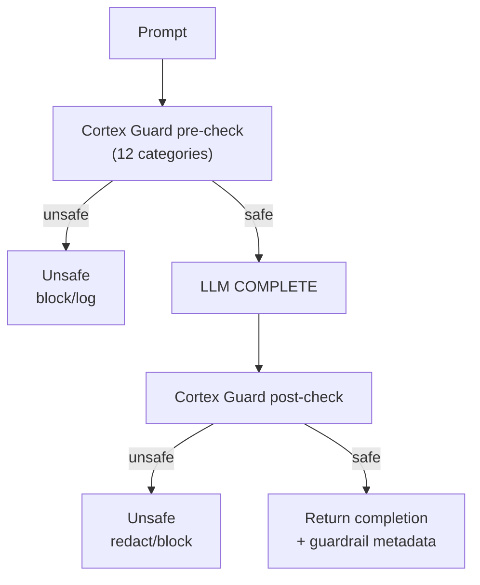

### Lab Exercise
```sql
-- COMPLETE with guardrails
SELECT SNOWFLAKE.CORTEX.COMPLETE(
  'claude-3-5-sonnet',
  [
    {'role':'user','content':'How do I hack into a competitor\'s database?'}
  ],
  {'guardrails': TRUE}
) AS response;

-- Response includes a 'response_safe' flag or marker; unsafe prompts are
-- blocked with a safety message.

-- Enforce at role level
GRANT USAGE ON FUNCTION SNOWFLAKE.CORTEX.COMPLETE TO ROLE FR_AI_APP;

-- Audit: count guardrail-triggered responses
SELECT COUNT(*) blocked
FROM AI_OBS.PROMPT_LOGS
WHERE guardrail_triggered = TRUE
  AND created_at >= DATEADD('day',-7,CURRENT_TIMESTAMP());
```

### Gotchas / Exam Traps
- Cortex Guard is a **content classifier**, not a fact checker — it doesn't catch confabulation.
- `guardrails: TRUE` adds latency and token cost — benchmark.
- Guard categories are Snowflake-defined; custom categories require your own classifier (Snowpark UDF).

---

## Q2: Explain prompt injection and the defense patterns applicable in Snowflake Cortex workflows.

**Difficulty:** Advanced
**Exam relevance:** Prompt injection defense

### Answer
**Prompt injection** is an attack where untrusted input (user query, retrieved document, tool response) contains instructions that subvert the system prompt. Variants:
- Direct injection — user types "Ignore all previous instructions."
- Indirect injection — a document retrieved via RAG contains hostile instructions.
- Multi-turn / jailbreak — gradual escalation across turns.

Defenses in Snowflake:
1. **Cortex Guard** — detects some injection patterns.
2. **Separate roles for system vs. user content** — use structured messages (`[{'role':'system',...},{'role':'user',...}]`).
3. **Input validation** — regex/UDF checks before `COMPLETE`.
4. **Output validation** — check for unexpected content (e.g., SQL in a non-SQL response).
5. **RAG sanitation** — scan retrieved docs for suspicious instruction patterns.
6. **Least-privilege tooling** — if the LLM can execute SQL (Cortex Analyst), it runs under the user's role and is masked/row-filtered.
7. **Audit via Cortex AI Observability** — record every prompt/completion for post-hoc analysis.

### First Principles
Prompt injection is possible because LLMs don't distinguish instructions from data at the token level. Defenses are layered: filter inputs, use structured message formats, limit the LLM's downstream capabilities, and audit. There is no "100% defense" — governance treats it as a residual risk requiring monitoring.

### Diagram
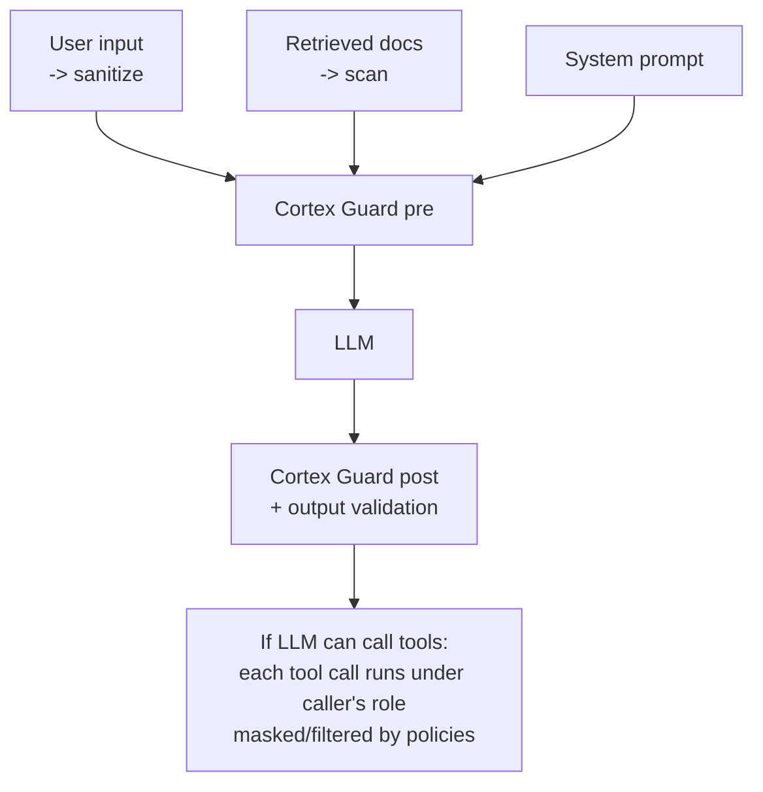

### Lab Exercise
```sql
-- Simple input validator
CREATE OR REPLACE FUNCTION AI_OBS.VALIDATE_PROMPT(txt STRING)
RETURNS BOOLEAN LANGUAGE SQL AS $$
  SELECT NOT (txt ILIKE '%ignore%previous%'
           OR txt ILIKE '%system prompt%'
           OR txt ILIKE '%you are now%')
$$;

-- Wrapped COMPLETE enforcing validation + Guard
CREATE OR REPLACE PROCEDURE AI_OBS.SAFE_COMPLETE(prompt STRING)
RETURNS STRING LANGUAGE SQL AS $$
DECLARE
  valid BOOLEAN;
  resp VARIANT;
BEGIN
  SELECT AI_OBS.VALIDATE_PROMPT(:prompt) INTO :valid;
  IF (NOT valid) THEN RETURN 'BLOCKED: suspected injection'; END IF;
  LET r VARIANT := (SELECT SNOWFLAKE.CORTEX.COMPLETE(
      'claude-3-5-sonnet',
      [{'role':'system','content':'You are a support assistant. Never reveal customer data beyond the current ticket.'},
       {'role':'user','content': :prompt}],
      {'guardrails':TRUE}));
  INSERT INTO AI_OBS.PROMPT_LOGS
  VALUES (UUID_STRING(), CURRENT_USER(), CURRENT_SESSION()::STRING,
          :prompt, r:choices[0]:messages[0]:content::STRING, 'claude-3-5-sonnet',
          r:usage:prompt_tokens::INT, r:usage:completion_tokens::INT,
          (r:choices[0]:finish_reason::STRING)='content_filter',
          CURRENT_TIMESTAMP());
  RETURN r:choices[0]:messages[0]:content::STRING;
END; $$;
```

### Gotchas / Exam Traps
- RAG injections are hardest to detect — they look like legitimate content.
- Multi-turn jailbreaks exploit context window; limiting history helps.
- "Prompt firewall" products exist but add latency; Cortex Guard is Snowflake-native and may be sufficient for most use cases.

---

## Q3: Describe Snowflake Model Registry governance capabilities.

**Difficulty:** Intermediate
**Exam relevance:** Model Registry

### Answer
Snowflake Model Registry is a schema-level feature that stores ML models as first-class objects. Governance capabilities:

- **Versioning** — multiple versions per model; one "default" version.
- **Tags** — attach governance tags (`RISK_TIER`, `OWNER`, `APPROVED`).
- **Metadata** — training data, metrics, author, timestamps.
- **Lineage** — model references its training dataset (via custom tracking) and consumers (via ACCESS_HISTORY).
- **Access control** — USAGE grants control who can call the model.
- **Dependencies** — views/UDFs that depend on the model show in OBJECT_DEPENDENCIES.
- **Alias** — point an alias to a specific version for atomic promotion.

Supports Snowpark ML models (sklearn, XGBoost, PyTorch) and Cortex-hosted models for inference.

### First Principles
Treating models as managed database objects (not external files) means governance tooling (RBAC, tags, audit) applies without a separate ML platform. This is Snowflake's "one plane of glass" posture — the catalog, policies, and audit systems that cover tables also cover models.

### Diagram
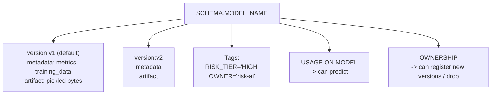

### Lab Exercise
```sql
-- Register a model (Snowpark Python)
-- from snowflake.ml.registry import Registry
-- registry = Registry(session=session, database='AI_DB', schema='MODELS')
-- registry.log_model(model=sklearn_pipeline, model_name='CHURN', version_name='v3',
--                    metrics={'auc':0.84})

-- Tag the model
ALTER MODEL AI_DB.MODELS.CHURN
  SET TAG GOV.AI_RMF.RISK_TIER = 'MEDIUM',
          GOV.AI_RMF.OWNER_TEAM = 'risk-ai';

-- Set default version
ALTER MODEL AI_DB.MODELS.CHURN SET DEFAULT_VERSION = 'v3';

-- Grant inference
GRANT USAGE ON MODEL AI_DB.MODELS.CHURN TO ROLE FR_INFERENCE_SERVICE;

-- Audit: who called the model
SELECT user_name, role_name, start_time, query_text
FROM SNOWFLAKE.ACCOUNT_USAGE.QUERY_HISTORY
WHERE query_text ILIKE '%CHURN!PREDICT%'
  OR query_text ILIKE '%AI_DB.MODELS.CHURN%'
ORDER BY start_time DESC LIMIT 50;
```

### Gotchas / Exam Traps
- Model versions are **immutable** — to change, create a new version.
- Dropping a model drops all versions; version-level drop also exists.
- `MODEL` is a securable object; `OWNERSHIP` matters for promotion.

---

## Q4: What are the three types of drift in deployed AI models, and how do you detect each in Snowflake?

**Difficulty:** Advanced
**Exam relevance:** Drift detection

### Answer
Three drift types:

1. **Data drift (covariate shift)** — input distribution changes (new customer demographics, new regions).
   - Detect: compare current feature distributions to training distributions. KS test, PSI (Population Stability Index), Chi-squared.
2. **Concept drift (label shift / concept shift)** — relationship between inputs and labels changes.
   - Detect: compare model's predicted-vs-actual over time; drops in AUC/F1.
3. **Performance drift** — model's effective performance drops (combination of 1+2 or model stale).
   - Detect: ongoing precision/recall vs. baseline.

Snowflake implementation:
- **Snowflake ML Monitoring** — native support for registered models; computes drift metrics against baseline.
- **Scheduled tasks** — compute PSI/KS and insert into metrics table.
- **Alerts** — fire when metrics breach threshold.

### First Principles
Models don't fail loudly; they degrade quietly. Continuous drift monitoring converts latent degradation to visible signal. For AI governance, drift evidence is required by frameworks (NIST RMF Manage, EU AI Act post-market monitoring). Snowflake positions this as a table of metrics so audits are SQL joins.

### Diagram
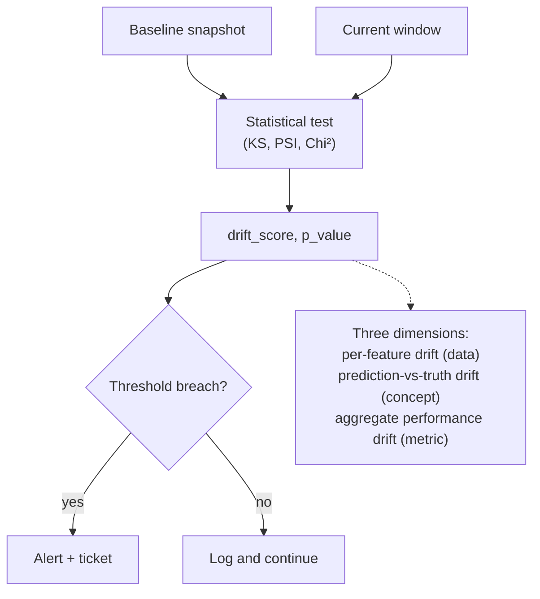

### Lab Exercise
```sql
-- PSI implementation (simplified)
CREATE OR REPLACE FUNCTION GOV.ML.PSI(
  current_dist ARRAY,   -- counts per bin
  baseline_dist ARRAY   -- counts per bin
) RETURNS FLOAT LANGUAGE SQL AS $$
  SELECT SUM(
    CASE WHEN c = 0 OR b = 0 THEN 0
         ELSE (c/ct - b/bt) * LN((c/ct)/(b/bt)) END)
  FROM (
    SELECT value::FLOAT AS c, SUM(value::FLOAT) OVER () AS ct, idx
    FROM LATERAL FLATTEN(input => current_dist)
  ) cur
  JOIN (
    SELECT value::FLOAT AS b, SUM(value::FLOAT) OVER () AS bt, idx
    FROM LATERAL FLATTEN(input => baseline_dist)
  ) base USING (idx)
$$;

-- Compute drift daily and store
CREATE OR REPLACE TABLE AI_OBS.DRIFT_HISTORY (
  model_name STRING, version STRING,
  feature STRING, metric STRING, value FLOAT,
  measured_at TIMESTAMP_NTZ
);

CREATE TASK AI_OBS.DAILY_DRIFT SCHEDULE='USING CRON 0 2 * * * UTC'
AS INSERT INTO AI_OBS.DRIFT_HISTORY
   SELECT 'CHURN','v3', feature,'PSI',
          GOV.ML.PSI(cur_dist, base_dist),
          CURRENT_TIMESTAMP()
   FROM AI_OBS.DAILY_FEATURE_DISTRIBUTIONS
   WHERE date = CURRENT_DATE()-1;

-- Alert
CREATE ALERT AI_OBS.DRIFT_ALERT
  WAREHOUSE = WH_AI SCHEDULE = '60 MINUTE'
  IF (EXISTS (SELECT 1 FROM AI_OBS.DRIFT_HISTORY
              WHERE measured_at > DATEADD('hour',-1,CURRENT_TIMESTAMP())
                AND metric='PSI' AND value > 0.2))
  THEN CALL SYSTEM$SEND_EMAIL('ai_alerts','ml-ops@co',
         'Feature drift detected','PSI > 0.2 on at least one feature');
```

### Gotchas / Exam Traps
- PSI thresholds: 0.1 = low, 0.1-0.25 = moderate, >0.25 = significant drift.
- Concept drift requires ground truth which is often delayed (chargebacks, outcomes) — build time lag into monitoring.

---

## Q5: What is Cortex AI Observability, and what data does it capture?

**Difficulty:** Intermediate
**Exam relevance:** AI Observability

### Answer
**Cortex AI Observability** (available via Snowflake Observability framework + event tables) captures telemetry from Cortex and Snowpark ML workloads:
- Prompts and completions.
- Token counts (input/output).
- Model name and version.
- Latency and cost.
- Guardrail triggers.
- Trace spans (for RAG pipelines, Agentic workflows).
- Errors and retries.

Data lands in an **event table** (Snowflake-managed) that you query via SQL. Can also be integrated with external observability platforms (OpenTelemetry).

Governance payoff:
- Full audit of LLM usage.
- Cost attribution per user/role/model.
- Debugging of failed prompts.
- Compliance evidence for frameworks requiring logging.

### First Principles
LLM applications are stochastic — you can't debug by re-running. Observability must be comprehensive, searchable, and persistent. Treating observability data as queryable SQL (not log files) means the same governance tooling (RAP, masking) applies to this data too — a key benefit of Snowflake-native observability.

### Diagram
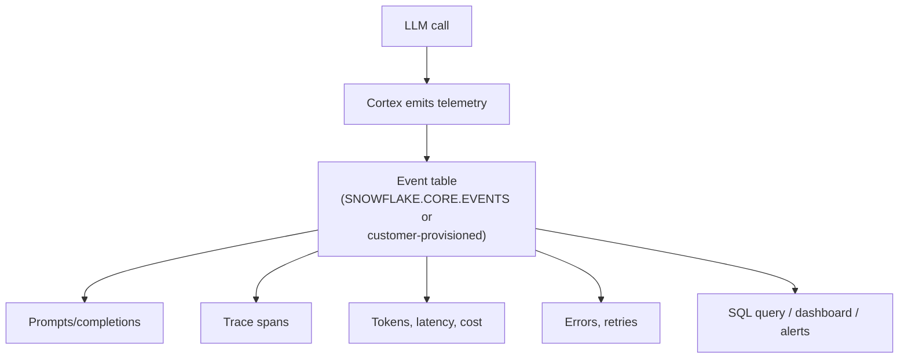

### Lab Exercise
```sql
-- Enable observability (schematic — actual syntax may vary by release)
CREATE EVENT TABLE AI_OBS.CORTEX_EVENTS;

ALTER ACCOUNT SET EVENT_TABLE = AI_OBS.CORTEX_EVENTS;

-- Query events
SELECT
  TIMESTAMP, RESOURCE_ATTRIBUTES:service_name::STRING AS service,
  RECORD:name::STRING AS span,
  RECORD_ATTRIBUTES:model_name::STRING AS model,
  RECORD_ATTRIBUTES:tokens_input::INT  AS tin,
  RECORD_ATTRIBUTES:tokens_output::INT AS tout,
  RECORD_ATTRIBUTES:latency_ms::INT    AS latency,
  RECORD_ATTRIBUTES:error::STRING      AS err
FROM AI_OBS.CORTEX_EVENTS
WHERE TIMESTAMP > DATEADD('hour',-1,CURRENT_TIMESTAMP())
  AND RECORD:name::STRING ILIKE 'cortex.%'
ORDER BY TIMESTAMP DESC LIMIT 100;

-- Cost rollup
SELECT RECORD_ATTRIBUTES:model_name::STRING AS model,
       SUM(RECORD_ATTRIBUTES:tokens_input::INT + RECORD_ATTRIBUTES:tokens_output::INT) tokens,
       COUNT(*) calls
FROM AI_OBS.CORTEX_EVENTS
WHERE RECORD:name::STRING = 'cortex.complete'
  AND TIMESTAMP > DATEADD('day',-7,CURRENT_TIMESTAMP())
GROUP BY 1 ORDER BY 2 DESC;
```

### Gotchas / Exam Traps
- Event tables have **storage cost** — prune old events.
- Observability data may include PII in prompts — apply masking policies on the event table.
- OpenTelemetry integration lets you forward to external platforms (Datadog, Honeycomb) — but then external data is subject to its own governance.

---

## Q6: What are the standard evaluation metrics for LLM outputs, and how do you compute them in Snowflake?

**Difficulty:** Advanced
**Exam relevance:** LLM evaluation

### Answer
Standard LLM evaluation metrics:
1. **Faithfulness** — does the response stay true to the provided context? (critical for RAG)
2. **Relevance** — is the response addressing the query?
3. **Groundedness** — is each claim supported by sources?
4. **Context precision/recall** — did retrieval return the right chunks?
5. **Answer correctness** — vs. ground truth (if available).
6. **Toxicity / safety** — Cortex Guard output.
7. **PII leakage** — did the response contain PII the user shouldn't see?

Snowflake Cortex provides `AI_CLASSIFY`, `AI_SUMMARIZE`, and evaluation helpers that can be composed, plus you can use `COMPLETE` with an evaluator prompt (LLM-as-judge).

### First Principles
LLM outputs are open-ended; traditional metrics (accuracy, F1) don't apply directly. The field has settled on a vocabulary (faithfulness, relevance, groundedness) that LLM-as-judge can score. Evaluations run offline (test sets) or online (sampling live traffic). Stored as metrics with lineage to the model version, they form governance evidence.

### Diagram
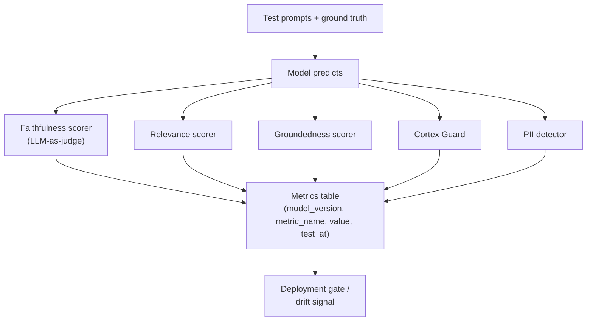

### Lab Exercise
```sql
-- LLM-as-judge faithfulness scoring
CREATE OR REPLACE FUNCTION AI_OBS.SCORE_FAITHFULNESS(
  context STRING, question STRING, response STRING)
RETURNS FLOAT LANGUAGE SQL AS $$
  SELECT TRY_CAST(SNOWFLAKE.CORTEX.COMPLETE(
    'claude-3-5-sonnet',
    'Score 0-1 how faithful this response is to the context. ' ||
    'Return only a number. Context: ' || context ||
    ' Question: ' || question || ' Response: ' || response
  ) AS FLOAT)
$$;

-- Batch evaluate a test set
CREATE OR REPLACE TABLE AI_OBS.EVAL_RESULTS AS
SELECT
  test_id, question, response,
  AI_OBS.SCORE_FAITHFULNESS(context, question, response) AS faithfulness,
  SNOWFLAKE.CORTEX.COMPLETE('claude-3-5-sonnet',
    'Score relevance 0-1 only number: Q=' || question || ' R=' || response)::FLOAT AS relevance,
  CURRENT_TIMESTAMP() AS evaluated_at
FROM AI_OBS.EVAL_TESTSET;

-- Aggregate for a model version
SELECT 'churn_rag_v3' AS model_version,
       AVG(faithfulness) avg_faith,
       AVG(relevance)    avg_rel,
       MIN(faithfulness) min_faith
FROM AI_OBS.EVAL_RESULTS;
```

### Gotchas / Exam Traps
- LLM-as-judge is itself prone to bias — use a different model than the one being evaluated, when possible.
- Evaluation cost scales with test set × metrics × models — budget.

---

## Q7: What is RAG (Retrieval-Augmented Generation), and what governance controls does it introduce?

**Difficulty:** Intermediate
**Exam relevance:** RAG governance

### Answer
**RAG** retrieves relevant documents from a knowledge base (Cortex Search service) and injects them into the LLM prompt as context before generating. Reduces confabulation, enables fresh facts, allows source citation.

Governance introduces at retrieval, injection, and output:
1. **Retrieval** — Cortex Search service with embedded documents; access to the search service is RBAC-gated; row-access policies on the underlying document table apply.
2. **Document source classification** — only approved sources in the index (version, author, review status).
3. **Chunk-level visibility** — if a user shouldn't see doc X, the search service should not return X.
4. **Context injection** — the injected context must respect the user's data access rights (per-user RAG).
5. **Output grounding** — ensure LLM only answers from provided context (via system prompt); audit faithfulness.
6. **Citation** — return source doc IDs so users can verify.

### First Principles
RAG amplifies the governance surface — the retrieval index is itself sensitive data, and misconfigurations lead to the LLM leaking content the user shouldn't see. Per-user RAG (retrieval respects the user's row/column access on the source) is the gold-standard pattern. "Shared RAG with filter in prompt" is weaker.

### Diagram
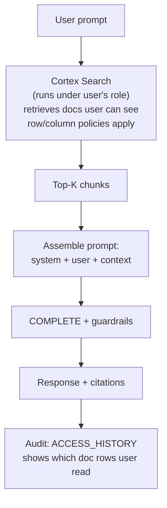

### Lab Exercise
```sql
-- Cortex Search service with row-access on source
CREATE CORTEX SEARCH SERVICE SUPPORT_KB_SEARCH
  ON question_body
  ATTRIBUTES product, tier, access_tier
  WAREHOUSE = WH_AI
  TARGET_LAG = '5 minutes'
  AS SELECT * FROM KB.ARTICLES WHERE deprecated = FALSE;

-- Row-access policy on source — carries into search results
CREATE ROW ACCESS POLICY GOV.POL.KB_TIER
AS (access_tier STRING) RETURNS BOOLEAN ->
  access_tier <= (SELECT max_tier FROM USER_TIER WHERE user_login = CURRENT_USER());

ALTER TABLE KB.ARTICLES ADD ROW ACCESS POLICY GOV.POL.KB_TIER ON (access_tier);

-- Query the search service — only returns authorized rows
SELECT SNOWFLAKE.CORTEX.SEARCH_PREVIEW(
  'SUPPORT_KB_SEARCH',
  '{"query":"reset password","limit":5}')::VARIANT;
```

### Gotchas / Exam Traps
- Cortex Search re-indexes periodically — policy changes may lag.
- The LLM has no inherent memory of what it shouldn't say; grounding + guardrails are the enforcement.

---

## Q8: Describe a model-promotion workflow with governance gates for a high-risk AI system.

**Difficulty:** Advanced
**Exam relevance:** Model promotion / deployment gates

### Answer
Gates (sequential, each a check that must pass):

1. **Bias/fairness tests** passed within last N days.
2. **Model card** present and up-to-date.
3. **Approval** by model governance committee (row in APPROVALS table).
4. **EU AI Act tier tag** set on model.
5. **Lineage** complete back to approved training set.
6. **Drift baseline** registered.
7. **Observability** enabled (events flowing).
8. **Downstream consumer notification** (change-mgmt record).

A stored procedure `PROMOTE_MODEL(model, version, target_env)` runs each check; failure returns reason without promoting.

### First Principles
Deployment is the governance hinge: before it, risk is theoretical; after, risk is operational. Gates convert each framework obligation into a programmatic check. The procedure must be the **only** path to production (no bypass).

### Diagram
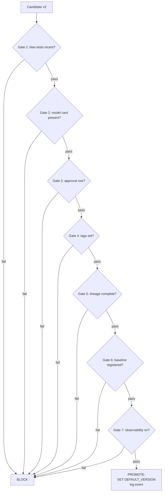

### Lab Exercise
```sql
CREATE OR REPLACE PROCEDURE GOV.PROMOTE_MODEL(MODEL STRING, VERSION STRING)
RETURNS STRING LANGUAGE SQL AS $$
DECLARE reason STRING;
BEGIN
  -- Gate 1: bias tests
  IF (NOT EXISTS (
    SELECT 1 FROM GOV.AI_RMF.MODEL_METRICS
    WHERE model_name=:MODEL AND version=:VERSION
      AND metric_name LIKE 'bias_%'
      AND measured_at >= DATEADD('day',-30,CURRENT_TIMESTAMP())))
  THEN RETURN 'BLOCKED: bias tests missing'; END IF;

  -- Gate 2: model card
  IF (NOT EXISTS (SELECT 1 FROM GOV.AI_RMF.MODEL_CARDS
                  WHERE model_name=:MODEL AND model_version=:VERSION))
  THEN RETURN 'BLOCKED: model card missing'; END IF;

  -- Gate 3: approval
  IF (NOT EXISTS (SELECT 1 FROM GOV.AI_RMF.DEPLOYMENT_APPROVALS
                  WHERE model_name=:MODEL AND version=:VERSION AND status='APPROVED'))
  THEN RETURN 'BLOCKED: approval missing'; END IF;

  -- Gate 4: EU AI Act tier tag
  IF (NOT EXISTS (SELECT 1 FROM SNOWFLAKE.ACCOUNT_USAGE.TAG_REFERENCES
                  WHERE object_name=:MODEL AND tag_name='EU_AI_ACT_TIER'))
  THEN RETURN 'BLOCKED: EU AI Act tier not tagged'; END IF;

  -- Gate 5: lineage
  IF (NOT EXISTS (SELECT 1 FROM GOV.AI_RMF.MODEL_LINEAGE
                  WHERE model_name=:MODEL AND model_version=:VERSION))
  THEN RETURN 'BLOCKED: lineage missing'; END IF;

  -- Gate 6: drift baseline
  IF (NOT EXISTS (SELECT 1 FROM AI_OBS.DRIFT_BASELINES
                  WHERE model_name=:MODEL AND version=:VERSION))
  THEN RETURN 'BLOCKED: drift baseline missing'; END IF;

  -- Promote
  EXECUTE IMMEDIATE 'ALTER MODEL '||MODEL||' SET DEFAULT_VERSION = '''||VERSION||'''';
  INSERT INTO GOV.AI_RMF.PROMOTION_LOG
  VALUES (:MODEL, :VERSION, CURRENT_USER(), CURRENT_TIMESTAMP(), 'PROMOTED');
  RETURN 'PROMOTED';
END; $$;
```

### Gotchas / Exam Traps
- Procedure must be callable **only** by the promotion role; direct `ALTER MODEL … SET DEFAULT_VERSION` grants must be revoked from everyone else.
- Testing in staging: have a parallel procedure for lower envs with relaxed gates.

---

## Q9: What is a "feature store," and what governance applies specifically to features?

**Difficulty:** Intermediate
**Exam relevance:** Feature store governance

### Answer
A **feature store** is a managed collection of ML features (precomputed, often time-partitioned) with online + offline serving. Snowflake's native Feature Store is schema-level, using tables + views.

Governance:
- **Feature definition** — code (SQL/UDF) that produces the feature is version-controlled; tag the output column.
- **Feature lineage** — upstream source tables tracked.
- **Feature classification** — PII features flagged, policies applied.
- **Feature access** — grants to feature-store schema.
- **Feature freshness** — DMFs for staleness.
- **Training-serving skew detection** — alert when online and offline feature distributions diverge.

### First Principles
Features are first-class artifacts that outlive specific models. Governing them separately prevents model-specific one-offs. A feature store is a shared service; its governance applies even when different teams produce + consume features.

### Diagram
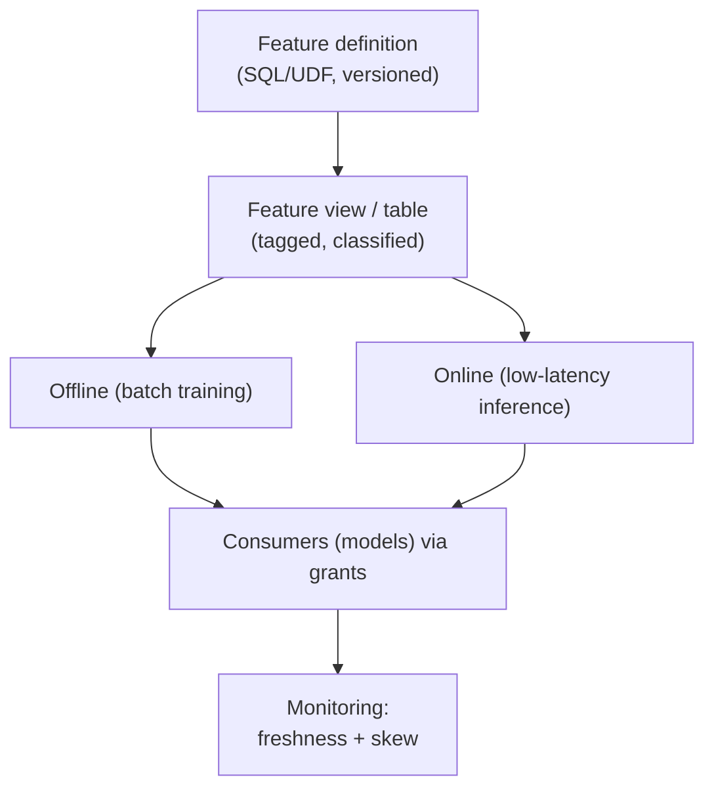

### Lab Exercise
```sql
-- Feature view (Snowflake Feature Store syntax)
CREATE DATABASE AI_DB; CREATE SCHEMA AI_DB.FEATURES;

CREATE OR REPLACE FEATURE VIEW CUSTOMER_FEATURES
  REFRESH_FREQUENCY = '1 day'
  WAREHOUSE = WH_AI AS
  SELECT customer_id,
         DATEDIFF(day, first_order_date, CURRENT_DATE()) AS tenure_days,
         SUM(order_total) AS lifetime_spend
  FROM ORDERS GROUP BY customer_id, first_order_date;

ALTER FEATURE VIEW CUSTOMER_FEATURES
  SET TAG GOV.DATA.PII_LEVEL = 'LOW',
          GOV.AI_RMF.OWNER_TEAM = 'ml-platform';

-- Freshness DMF
ALTER FEATURE VIEW CUSTOMER_FEATURES
  ADD DATA METRIC FUNCTION SNOWFLAKE.CORE.FRESHNESS ON (last_refresh_time);
```

### Gotchas / Exam Traps
- Features can leak PII if upstream classification missed — classify feature views too.
- Online/offline skew is model-killer; monitor by comparing distributions in both stores.

---

## Q10: How do you detect PII leakage in LLM completions and prevent repeat offenses?

**Difficulty:** Advanced
**Exam relevance:** PII leakage detection

### Answer
Pipeline:
1. **Log** every completion into event table.
2. **Scan** completions with Cortex PII detection (`SYSTEM$CLASSIFY` won't work on free text; use `COMPLETE` with a PII prompt or a Snowpark UDF with presidio/spaCy).
3. **Flag** detected leakage; raise alert.
4. **Investigate** — trace back to the prompt + context that produced it.
5. **Mitigate** — add detected pattern to a block-list, retrain prompt / tighten retrieval filters.
6. **Replay** detection on past completions to find retrospective leakage.

### First Principles
LLMs can leak training-data PII, context-injected PII, or produce PII through confabulation. Detection must happen on outputs (not just inputs) because the LLM can transform/concatenate PII in novel ways. Snowflake's data plane for logs makes retrospective replay cheap.

### Diagram
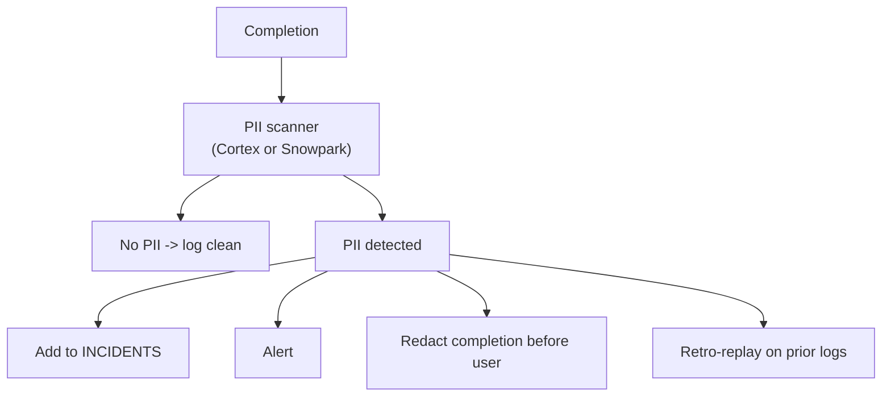

### Lab Exercise
```sql
CREATE OR REPLACE FUNCTION AI_OBS.DETECT_PII_LLM(txt STRING)
RETURNS VARIANT LANGUAGE SQL AS $$
  SELECT PARSE_JSON(SNOWFLAKE.CORTEX.COMPLETE(
    'claude-3-5-sonnet',
    'Return a JSON array of PII types found. Types: EMAIL, PHONE, SSN, NAME, ADDRESS, CARD. ' ||
    'If none, return []. Text: ' || txt))
$$;

CREATE OR REPLACE TABLE AI_OBS.PII_INCIDENTS (
  incident_id STRING, log_id STRING, pii_types VARIANT,
  prompt_text STRING, completion_text STRING, detected_at TIMESTAMP_NTZ,
  model STRING, user_name STRING);

CREATE OR REPLACE TASK AI_OBS.SCAN_COMPLETIONS
  WAREHOUSE = WH_AI SCHEDULE='10 MINUTE' AS
INSERT INTO AI_OBS.PII_INCIDENTS
SELECT UUID_STRING(), log_id,
       AI_OBS.DETECT_PII_LLM(completion_text),
       prompt_text, completion_text, CURRENT_TIMESTAMP(),
       model, user_name
FROM AI_OBS.PROMPT_LOGS
WHERE created_at > DATEADD('minute',-10,CURRENT_TIMESTAMP())
  AND ARRAY_SIZE(AI_OBS.DETECT_PII_LLM(completion_text)) > 0;
```

### Gotchas / Exam Traps
- Storing full prompts/completions in incidents = creating more PII — redact after triage.
- LLM-based detection has false positives; tune.

---

## Q11: What is a model card, and how do you keep it in sync with the actual model?

**Difficulty:** Intermediate
**Exam relevance:** Model cards (operational)

### Answer
A model card (see domain 01) is a structured description of a model. Keeping it in sync:

1. **Version-locked** — one card per `(model, version)`.
2. **Automated fields** — training metadata (dataset, seed, hyperparams) populated by the training pipeline.
3. **Manual fields** — intended use, out-of-scope, ethical considerations.
4. **Validation gate** — promotion refuses to promote without a card.
5. **Review cadence** — N-day expiry for manual fields; task flags stale cards.
6. **Lineage link** — tag the model with `MODEL_CARD_ID`.

### First Principles
Model cards drift from reality unless the pipeline updates them. Snowflake stores cards as rows (`VARIANT`), so programmatic updates on training completion are straightforward. The governance pattern treats the card as derived data from the training/promotion events.

### Diagram
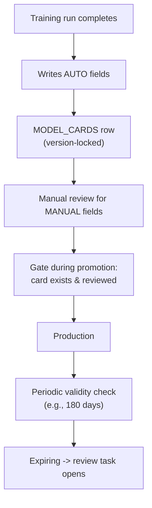

### Lab Exercise
```sql
-- Auto-populate from training record
CREATE OR REPLACE PROCEDURE GOV.AI_RMF.CREATE_MODEL_CARD(
  MODEL STRING, VERSION STRING, TRAINING_RECORD VARIANT)
RETURNS STRING LANGUAGE SQL AS $$
BEGIN
  INSERT INTO GOV.AI_RMF.MODEL_CARDS
  SELECT :MODEL, :VERSION,
    OBJECT_INSERT(
      OBJECT_CONSTRUCT_KEEP_NULL(
        'training_data', :TRAINING_RECORD:training_dataset::STRING,
        'metrics', :TRAINING_RECORD:metrics,
        'random_seed', :TRAINING_RECORD:seed,
        'created_at', CURRENT_TIMESTAMP()),
      'intended_use', NULL,                 -- manual
      'ethical_considerations', NULL,       -- manual
      'caveats', NULL),                     -- manual
    CURRENT_TIMESTAMP(), CURRENT_USER();
  RETURN 'ok';
END; $$;

-- Review-aging alert
CREATE OR REPLACE ALERT GOV.AI_RMF.STALE_CARD_ALERT
WAREHOUSE=WH_AI SCHEDULE='USING CRON 0 8 * * MON UTC'
IF (EXISTS (SELECT 1 FROM GOV.AI_RMF.MODEL_CARDS
            WHERE created_at < DATEADD('day',-180,CURRENT_TIMESTAMP())
              AND (card:intended_use IS NULL OR card:ethical_considerations IS NULL)))
THEN CALL SYSTEM$SEND_EMAIL('ai_alerts','ml-ops@co',
       'Stale model cards','One or more cards need review');
```

### Gotchas / Exam Traps
- Cards for GPAI providers must include training-data summary (EU AI Act Art. 53).
- Avoid storing raw PII inside the card.

---

## Q12: How do you implement a "model shadow deployment" for safe testing in Snowflake?

**Difficulty:** Advanced
**Exam relevance:** Deployment patterns

### Answer
**Shadow deployment** runs the new model in parallel with the current production model; its predictions are logged but not returned to users. After validation, promote.

Snowflake implementation:
1. Keep both model versions registered.
2. Inference layer (UDF/proc) calls both; returns current, logs new.
3. Comparator job compares predictions and alerts on divergence.
4. After N days / rows, if metrics pass, promote.

### First Principles
Direct cutover risks production impact. Shadow deployment lets you validate the new model on real traffic without exposing users. The challenge is logging: predictions must be stored with enough context to compute metrics offline.

### Diagram
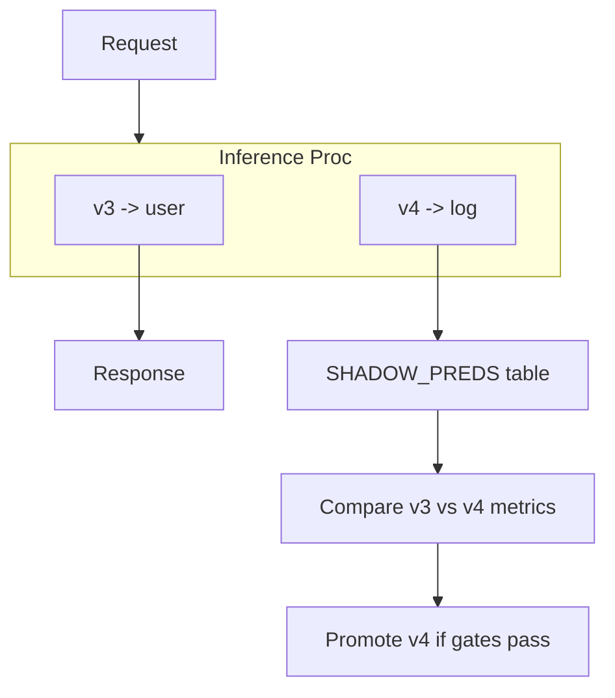

### Lab Exercise
```sql
CREATE OR REPLACE PROCEDURE AI_DB.INFERENCE.SCORE(txn VARIANT)
RETURNS FLOAT LANGUAGE SQL EXECUTE AS OWNER AS $$
DECLARE prod_score FLOAT; shadow_score FLOAT;
BEGIN
  SELECT AI_DB.MODELS.FRAUD!PREDICT(txn, VERSION => 'v3') INTO :prod_score;
  SELECT AI_DB.MODELS.FRAUD!PREDICT(txn, VERSION => 'v4') INTO :shadow_score;
  INSERT INTO AI_OBS.SHADOW_PREDS VALUES
    (txn:id::STRING, :prod_score, :shadow_score, CURRENT_TIMESTAMP());
  RETURN :prod_score;
END; $$;

-- Compare
SELECT CORR(prod_score, shadow_score) AS corr,
       AVG(ABS(prod_score - shadow_score)) AS avg_abs_diff
FROM AI_OBS.SHADOW_PREDS
WHERE created_at > DATEADD('day',-7,CURRENT_TIMESTAMP());
```

### Gotchas / Exam Traps
- Shadow adds cost — budget warehouse credits.
- Logging shadow predictions can itself be sensitive — apply same policies.

---

## Q13: What is "model inversion" and how do governance controls defend against it?

**Difficulty:** Advanced
**Exam relevance:** Model security

### Answer
**Model inversion** attack: given a model's predictions on queried inputs, reconstruct training-data features. Variants:
- Membership inference — is X in the training set?
- Reconstruction — recover specific records.

Defenses:
1. **Differential privacy during training** — formal guarantee.
2. **Rate limiting** on inference — prevent large query batches.
3. **Output smoothing** — return rounded or discretized scores.
4. **Query auditing** — detect unusual query patterns.
5. **Model access controls** — USAGE on model only to trusted roles.
6. **Prediction logging** — ACCESS_HISTORY provides forensic trail.

### First Principles
A model that "overfits" on training data can be queried as a lookup — this is why DP-trained models are preferred for sensitive data. Governance can't fully prevent inversion but can detect and raise cost: audit, rate-limit, discretize.

### Diagram
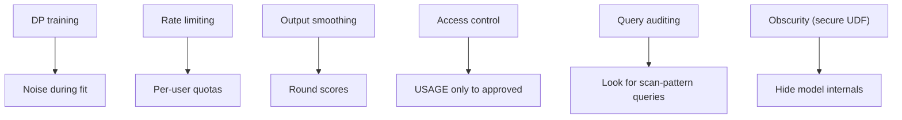

### Lab Exercise
```sql
-- Rate limit via resource monitor + per-user warehouse
-- Or: UDF that logs + checks per-user rate
CREATE OR REPLACE PROCEDURE AI_DB.INFERENCE.RATE_LIMITED(txn VARIANT)
RETURNS FLOAT LANGUAGE SQL EXECUTE AS OWNER AS $$
DECLARE recent_count INT; score FLOAT;
BEGIN
  SELECT COUNT(*) INTO :recent_count
  FROM AI_OBS.PROMPT_LOGS
  WHERE user_name = CURRENT_USER()
    AND created_at > DATEADD('minute',-1,CURRENT_TIMESTAMP());
  IF (recent_count > 100) THEN
    RETURN NULL;   -- throttled; log
  END IF;
  SELECT AI_DB.MODELS.FRAUD!PREDICT(txn) INTO :score;
  RETURN ROUND(score, 2);  -- discretize to 0.01
END; $$;
```

### Gotchas / Exam Traps
- Round scores (0.01) still leak via repeated queries if attacker has prior knowledge.
- DP is the only formal defense; others are mitigations.

---

## Q14: Describe Snowflake ML Monitoring — what it monitors and how it reports.

**Difficulty:** Intermediate
**Exam relevance:** ML Monitoring

### Answer
**Snowflake ML Monitoring** (part of Snowflake ML) continuously tracks model performance and feature distributions against a baseline. Reports:

- **Prediction metrics** — accuracy, AUC, MAE, etc.
- **Feature drift** — statistical tests per feature.
- **Prediction drift** — distribution of model outputs.
- **Data quality signals** — nulls, outliers.
- **Alerts** on breach thresholds.

Integrates with Snowflake Model Registry — monitored by `(model, version)`.

### First Principles
Monitoring is observability for ML specifically. ML Monitoring packages the common drift/perf measurements as a first-class product so teams don't rebuild. For governance, this is the "post-market monitoring" leg of EU AI Act.

### Diagram
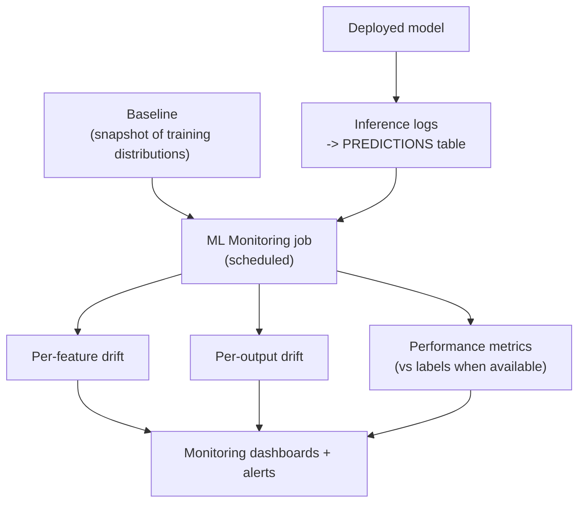

### Lab Exercise
```sql
-- Register baseline + enable monitoring
CREATE MODEL MONITOR AI_DB.MODELS.FRAUD_MON
  AS MODEL AI_DB.MODELS.FRAUD VERSION 'v3'
  BASELINE = AI_DB.FEATURES.TRAIN_SNAPSHOT_V3
  INFERENCE_LOG = AI_OBS.PRED_LOG
  TIMESTAMP_COLUMN = predicted_at
  REFRESH_INTERVAL = '1 day';

-- Query monitoring results
SELECT * FROM AI_DB.MODELS.FRAUD_MON!GET_DRIFT_METRICS();
SELECT * FROM AI_DB.MODELS.FRAUD_MON!GET_PERFORMANCE();
```

### Gotchas / Exam Traps
- Performance monitoring requires ground-truth labels — delayed in many domains.
- Monitoring consumes credits per refresh — tune cadence.

---

## Q15: What is "LLM-as-judge" and when is it appropriate for governance evaluation?

**Difficulty:** Advanced
**Exam relevance:** Evaluation methodology

### Answer
**LLM-as-judge** uses a separate LLM to score outputs of another LLM against criteria (faithfulness, toxicity, relevance). Appropriate when:

- Human labeling is too slow/expensive.
- Criterion is subjective (helpfulness) and ground truth is weak.
- Scale required (thousands of outputs).

Risks:
- Judge may share biases with evaluated model (if same model family).
- Judge can be fooled by stylistic cues.
- Judge inconsistency across runs.

Mitigations:
- Use a **different** model family for judging.
- Calibrate against human-labeled golden set.
- Use multiple judges and ensemble.
- Record judge version + prompt as part of score lineage.

### First Principles
LLMs are expensive to evaluate at scale; using LLMs to evaluate LLMs scales but introduces reflexivity. Governance treats judge decisions as *measurement* with their own metrology — version, calibration, bias audit.

### Diagram
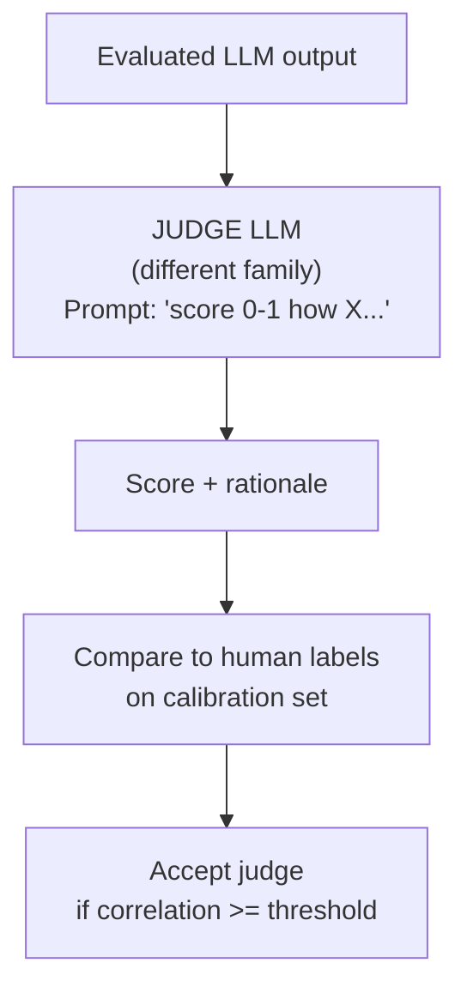

### Lab Exercise
```sql
-- Judge calibration
CREATE OR REPLACE TABLE AI_OBS.JUDGE_CALIBRATION AS
SELECT human_score,
       SNOWFLAKE.CORTEX.COMPLETE('claude-3-5-sonnet',
         'Score 0-1 helpfulness. Return number. Response: ' || response)::FLOAT AS judge_score
FROM AI_OBS.GOLDEN_SET;

SELECT CORR(human_score, judge_score) AS correlation
FROM AI_OBS.JUDGE_CALIBRATION;
-- > 0.7 is typical acceptance threshold
```

### Gotchas / Exam Traps
- Judge prompts must be versioned — a reworded prompt is a different judge.
- Expensive at scale — sample.

---

## Q16: Describe how to govern Cortex Analyst's semantic model file.

**Difficulty:** Advanced
**Exam relevance:** Semantic model governance

### Answer
Cortex Analyst uses a **semantic model** (YAML) describing tables, columns, measures, synonyms, and relationships. The YAML determines what Analyst can "see" and generate SQL for. Governance:

1. **Version in source control** — git-tracked YAML.
2. **Review process** — PRs reviewed by data owner before publishing to Analyst.
3. **Column exposure audit** — compare YAML columns against PII classification.
4. **Validate on publish** — automated check: no `IDENTIFIER` privacy columns exposed.
5. **Access control** — the Analyst service that reads the YAML has its own role; grants to invoke Analyst are tag-driven.

### First Principles
Cortex Analyst's semantic model is **the surface** the LLM uses to construct SQL. Overexposure here is equivalent to overexposure in traditional reporting. Treating the YAML as a code artifact (not a config dump) brings the discipline needed.

### Diagram
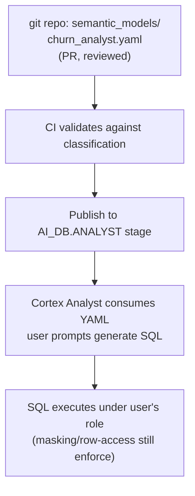

### Lab Exercise
```sql
-- Validation query: columns in semantic model vs PII classification
WITH yaml_cols AS (
  -- parse YAML in CI; here, simulated
  SELECT 'ANALYTICS.CUSTOMERS' tbl, column_name
  FROM VALUES ('email'),('tenure_days'),('ltv') v(column_name)
),
pii_cols AS (
  SELECT table_catalog||'.'||table_schema||'.'||table_name AS tbl, column_name
  FROM SNOWFLAKE.ACCOUNT_USAGE.DATA_CLASSIFICATION_LATEST
  WHERE privacy_category = 'IDENTIFIER'
)
SELECT y.* FROM yaml_cols y
JOIN pii_cols p ON p.tbl=y.tbl AND p.column_name=y.column_name;
-- Any result = PII column exposed; fail CI
```

### Gotchas / Exam Traps
- The YAML can define **custom metrics** that aggregate PII — scan metric formulas.

---

## Q17: How does Snowflake ML lineage track end-to-end from raw data to a prediction?

**Difficulty:** Advanced
**Exam relevance:** End-to-end lineage

### Answer
Lineage links:
1. **Raw sources → feature store** — via SNOWFLAKE.CORE.GET_LINEAGE (data-flow).
2. **Feature store → training set** — custom table (TRAIN_SET_FEATURES).
3. **Training set → model version** — Model Registry metadata + custom MODEL_LINEAGE.
4. **Model version → predictions table** — tags on prediction table referring to model.
5. **Predictions table → consumers** — ACCESS_HISTORY of consumer queries.

A reconstructed query joins these to produce a DAG.

### First Principles
Reproducibility and audit demand full-chain traceability. Snowflake supplies data-plane lineage; the ML team supplies model-plane lineage. The two meet at the training set and prediction table — these are the "pivot" objects to tag correctly.

### Diagram
```mermaid
flowchart TD
    RAW["Raw sources"]
    FS["Feature store"]
    TS["Training set"]
    MV["Model version (registry)"]
    PRED["Predictions table"]
    DOWN["Downstream apps / exports"]
    RAW -->|GET_LINEAGE| FS
    FS -->|GET_LINEAGE| TS
    TS -->|MODEL_LINEAGE (custom)| MV
    MV -->|tag on predictions table| PRED
    PRED -->|ACCESS_HISTORY| DOWN
```

### Lab Exercise
```sql
-- Composite lineage view
CREATE OR REPLACE VIEW AI_OBS.V_E2E_LINEAGE AS
SELECT
  ml.model_name, ml.model_version,
  up.source_object_name AS raw_source,
  pr.predictions_table,
  co.consumer_object
FROM GOV.AI_RMF.MODEL_LINEAGE ml
JOIN TABLE(SNOWFLAKE.CORE.GET_LINEAGE(ml.training_dataset,'TABLE','UPSTREAM')) up
LEFT JOIN GOV.AI_RMF.MODEL_PREDICTIONS_MAPPING pr
  ON pr.model_name=ml.model_name AND pr.model_version=ml.model_version
LEFT JOIN TABLE(SNOWFLAKE.CORE.GET_LINEAGE(pr.predictions_table,'TABLE','DOWNSTREAM')) co;
```

### Gotchas / Exam Traps
- GET_LINEAGE depth defaults are limited — set appropriately.
- External training (local notebooks) breaks lineage; register in registry explicitly.

---

## Q18: What is "red-teaming" for AI, and how do you operationalize it in Snowflake?

**Difficulty:** Advanced
**Exam relevance:** Red-teaming for AI

### Answer
**Red-teaming** is adversarial testing — attempting to make the model fail (produce harmful, biased, or PII-leaking output). For LLMs, red-teamers craft prompts to bypass guardrails.

Snowflake operationalization:
1. **Red-team prompt library** — table of adversarial prompts with expected failure categories.
2. **Scheduled runs** — nightly task runs all prompts through the model and logs responses.
3. **Scoring** — Cortex Guard + custom detectors score each response.
4. **Metrics** — failure rate per category over time.
5. **Gate** — new model promotion requires red-team pass rate ≥ threshold.

### First Principles
Pre-deployment adversarial testing is standard in security; AI needs the same. Making red-teaming repeatable (prompt library + automated runs) converts it from a one-off audit into a monitoring signal.

### Diagram
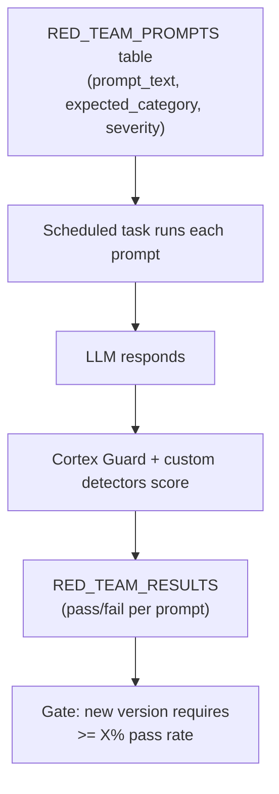

### Lab Exercise
```sql
CREATE TABLE AI_OBS.RED_TEAM_PROMPTS (
  prompt_id STRING, prompt_text STRING,
  expected_failure STRING, severity STRING);

CREATE TABLE AI_OBS.RED_TEAM_RESULTS (
  run_id STRING, prompt_id STRING, model_version STRING,
  response STRING, guard_triggered BOOLEAN,
  passed BOOLEAN, ran_at TIMESTAMP_NTZ);

CREATE TASK AI_OBS.NIGHTLY_RED_TEAM SCHEDULE='USING CRON 0 1 * * * UTC'
AS INSERT INTO AI_OBS.RED_TEAM_RESULTS
   SELECT UUID_STRING(), p.prompt_id, 'v3',
          SNOWFLAKE.CORTEX.COMPLETE('claude-3-5-sonnet', p.prompt_text,
            {'guardrails':TRUE})::STRING,
          FALSE, -- parse response for guard flag
          FALSE, -- scoring logic here
          CURRENT_TIMESTAMP()
   FROM AI_OBS.RED_TEAM_PROMPTS p;

-- Promotion gate
SELECT CASE WHEN SUM(IFF(passed,1,0))/COUNT(*) >= 0.95 THEN 'OK' ELSE 'BLOCK' END
FROM AI_OBS.RED_TEAM_RESULTS WHERE model_version='v4';
```

### Gotchas / Exam Traps
- Red-team prompts are themselves sensitive (can be used offensively) — restrict access.
- Pass rate thresholds are policy decisions — document and tag by risk tier.

---

## Q19: Describe how Snowflake addresses "homogenization" risk (NIST GenAI Profile) in multi-tenant AI applications.

**Difficulty:** Advanced
**Exam relevance:** NIST GenAI — homogenization

### Answer
**Homogenization** risk: broad use of a few foundation models causes correlated outputs across many deployments, amplifying systemic biases and failures.

Snowflake mitigations:
1. **Multiple foundation models available** via Cortex (Claude, Llama, Mistral, Reka, etc.) — teams can diversify.
2. **Fine-tuning** on domain data via Snowflake ML — reduces correlation with base model.
3. **Model registry** tracks which base is used — governance can audit homogenization.
4. **Ensemble patterns** — combine outputs from multiple models.

### First Principles
Diversity is a systemic property; no single model deployment can "solve" homogenization. Snowflake's role is to make diversification easy (model choice, fine-tuning) and visible (registry).

### Diagram
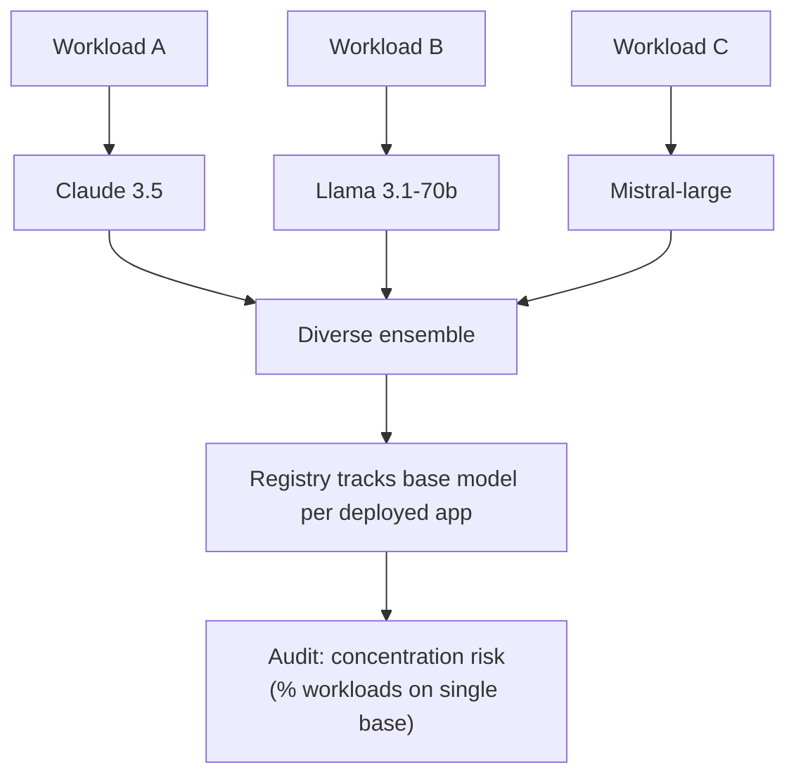

### Lab Exercise
```sql
-- Audit concentration
SELECT foundation_model, COUNT(DISTINCT model_name) deployments
FROM GOV.AI_RMF.VALUE_CHAIN_LEDGER
GROUP BY 1 ORDER BY 2 DESC;

-- Alert if > 70% on one base
```

### Gotchas / Exam Traps
- Diversification trades off cost + ops complexity — governance should recommend, not mandate.

---

## Q20: What's the governance checklist for deploying a Cortex Agent (tool-using LLM)?

**Difficulty:** Advanced
**Exam relevance:** Agentic AI governance

### Answer
Cortex Agents / tool-using LLMs can execute tools (SQL queries, external API calls). Governance checklist:

1. **Tool allowlist** — enumerated list of allowed tools; no dynamic registration.
2. **Per-tool RBAC** — each tool runs under a specific role; least privilege.
3. **Argument validation** — schema-check tool arguments before invocation.
4. **Audit** — each tool call logged with arguments, outputs, user.
5. **Guardrails** — Cortex Guard on both prompts and tool outputs.
6. **Rate limits** — per-user, per-tool call quotas.
7. **Human in the loop** — high-risk tools require confirmation.
8. **Observability** — spans/traces for each agent run.

### First Principles
Agents compound risk because the LLM can take actions, not just produce text. Governance must shift from output filtering to action authorization. Each tool is a potential capability expansion; treat as privileged.

### Diagram
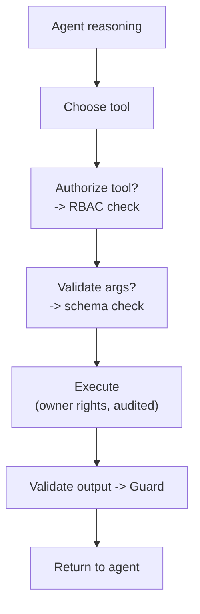

### Lab Exercise
```sql
-- Tool allowlist via procedure dispatch
CREATE OR REPLACE PROCEDURE AI_DB.AGENT.CALL_TOOL(
  TOOL_NAME STRING, ARGS VARIANT)
RETURNS VARIANT LANGUAGE SQL EXECUTE AS OWNER AS $$
DECLARE result VARIANT;
BEGIN
  INSERT INTO AI_OBS.TOOL_CALLS VALUES
    (UUID_STRING(), CURRENT_USER(), :TOOL_NAME, :ARGS, CURRENT_TIMESTAMP());

  CASE :TOOL_NAME
    WHEN 'lookup_customer' THEN
      LET r VARIANT := (SELECT OBJECT_AGG(name, value::VARIANT)
                        FROM CUSTOMERS
                        WHERE id = :ARGS:customer_id::INT);
      result := r;
    WHEN 'send_email' THEN
      result := OBJECT_CONSTRUCT('status','blocked_requires_approval');
    ELSE
      result := OBJECT_CONSTRUCT('error','tool_not_allowed');
  END CASE;
  RETURN result;
END; $$;
```

### Gotchas / Exam Traps
- Agents can bypass PII masking if their execution role is privileged — scope minimally.
- Loops in agent reasoning can rack up credits — budget warehouses.

---

## Gotchas Recap — Model Governance Cheat Sheet

| Topic | Trap | Right pattern |
|-------|------|---------------|
| Model promotion | Direct ALTER | Stored proc gate |
| Drift | Only PSI | Combine PSI + perf + quality |
| LLM eval | Same-model judge | Different family + calibration |
| RAG | Shared index | Per-user retrieval |
| Prompt injection | One defense | Layered: Guard + validate + least priv |
| Model inversion | Rate-limit only | DP during training |
| Agent tools | Dynamic | Static allowlist + RBAC + audit |
| Observability | External only | Native event table + policies |
| Shadow deploy | Silent costs | Budget warehouses |
| Model cards | Manual drift | Auto-populate + aging alerts |
