# Compliance & Audit — GAS-C01 Study Guide

## Exam Weight & Scope

**Weight on GAS-C01:** ~15-20%

**Scope:**
- Snowflake's compliance attestations: SOC 1/2, ISO 27001/27701/27017/27018, PCI DSS, HIPAA/HITRUST, FedRAMP, IRAP, StateRAMP, C5
- Shared responsibility model
- ACCOUNT_USAGE schema catalog — the audit backbone
- LOGIN_HISTORY, QUERY_HISTORY, ACCESS_HISTORY, SESSIONS, GRANTS_TO_*, OBJECT_DEPENDENCIES
- Audit retention and immutability patterns
- Native Compliance / Horizon audit features
- GDPR data subject rights (DSAR, erasure, portability) workflows
- HIPAA technical safeguards mapping
- PCI DSS scoping for AI pipelines
- FedRAMP / government cloud considerations
- Audit trail design for AI (what to log, how long, how to prove)
- Legal holds and litigation preservation
- Breach notification signals

## Core Concepts Map

```
                    COMPLIANCE EVIDENCE STACK
                    ==========================

   ┌────────────────────────────────────────────────┐
   │  LEGAL REQUIREMENTS                            │
   │  GDPR │ HIPAA │ PCI DSS │ SOC2 │ FedRAMP │ ... │
   └──────────────────────┬─────────────────────────┘
                          │
                          ▼
   ┌────────────────────────────────────────────────┐
   │  CONTROL FRAMEWORKS                            │
   │  ISO 27001 │ NIST 800-53 │ CSA CCM │ CIS       │
   └──────────────────────┬─────────────────────────┘
                          │
                          ▼
   ┌────────────────────────────────────────────────┐
   │  SNOWFLAKE EVIDENCE SOURCES                    │
   │                                                │
   │  ACCOUNT_USAGE                 TRUST CENTER   │
   │  ├─ ACCESS_HISTORY             ├─ findings    │
   │  ├─ QUERY_HISTORY              ├─ score       │
   │  ├─ LOGIN_HISTORY              └─ scanners    │
   │  ├─ SESSIONS                                  │
   │  ├─ GRANTS_TO_*                                │
   │  ├─ POLICY_REFERENCES                         │
   │  ├─ TAG_REFERENCES                            │
   │  ├─ OBJECT_DEPENDENCIES                       │
   │  ├─ DATA_CLASSIFICATION_LATEST                │
   │  └─ DATA_TRANSFER_HISTORY                     │
   │                                                │
   │  ORGANIZATION_USAGE  (cross-account roll-up)   │
   │                                                │
   │  CUSTOMER-WRITTEN artifacts:                   │
   │    model cards, deployment approvals,          │
   │    control mapping, risk register              │
   └────────────────────────────────────────────────┘


              SHARED RESPONSIBILITY (SIMPLIFIED)
              ===================================

   SNOWFLAKE                    CUSTOMER
   ─────────                    ────────
   physical/env security        user access management
   platform encryption          data classification
   platform certifications      data policies
   infra patching               app code / Snowpark
   platform logs                audit queries & retention
   cert audits                  compliance scoping
```

---

## Q1: Describe Snowflake's shared responsibility model and give three AI-governance-relevant examples.

**Difficulty:** Foundation
**Exam relevance:** Shared responsibility

### Answer
Shared responsibility: Snowflake secures **the platform**; the customer secures **their configuration + data + use**.

| Aspect | Snowflake | Customer |
|--------|-----------|----------|
| Hardware/network | ✓ | — |
| Encryption at rest/transit | ✓ | configure CMK (TSS) |
| User identity | — | ✓ (SSO/SCIM/MFA) |
| Data classification | — | ✓ (`SYSTEM$CLASSIFY` enabled by customer) |
| Policies (masking, RAP) | engine | ✓ author + bind |
| Compliance certifications | attestations | ✓ scope + evidence |
| Model governance | registry provided | ✓ model cards, approvals |
| Audit log collection | ✓ (ACCOUNT_USAGE) | ✓ retention beyond 365d, export |

Three AI-relevant examples:
1. Snowflake provides ACCESS_HISTORY; customer defines what counts as a reportable event.
2. Snowflake provides Cortex Guard; customer configures thresholds and reviews incidents.
3. Snowflake provides TSS CMK capability; customer manages key rotation and revocation.

### First Principles
Platforms cannot comply on behalf of customers; they can only make compliance achievable. The division makes it explicit which attestations customer teams must still produce (data-level evidence, user-management, policy enforcement). Confusing the line is the leading audit finding for Snowflake customers.

### Diagram
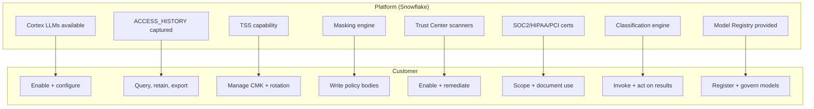

### Lab Exercise
```sql
-- Customer-side evidence: who read what, under what controls
SELECT user_name, COUNT(*) queries,
       COUNT_IF(ARRAY_SIZE(policies_referenced) > 0) protected_q,
       100.0 * COUNT_IF(ARRAY_SIZE(policies_referenced) > 0) / COUNT(*) pct_prot
FROM SNOWFLAKE.ACCOUNT_USAGE.ACCESS_HISTORY
WHERE query_start_time >= DATEADD('day',-30,CURRENT_TIMESTAMP())
GROUP BY 1 ORDER BY queries DESC;
```

### Gotchas / Exam Traps
- Snowflake's certs cover the platform; the customer's **use** of the platform may be in scope for their own cert audit.
- "Snowflake is SOC 2 compliant" does **not** mean the customer's workloads are SOC 2 compliant.

---

## Q2: Which Snowflake compliance certifications are relevant to AI governance, and what does each cover?

**Difficulty:** Intermediate
**Exam relevance:** Snowflake attestations

### Answer

| Attestation | Scope | AI Governance Relevance |
|-------------|-------|-------------------------|
| **SOC 1 Type II** | Financial controls | Financial AI (credit scoring) |
| **SOC 2 Type II** (Security, Availability, Confidentiality, Processing Integrity, Privacy) | Service-org controls | All AI workloads |
| **ISO 27001** | ISMS | Baseline infosec |
| **ISO 27017** | Cloud-specific infosec | Snowflake cloud posture |
| **ISO 27018** | PII in cloud | PII handling for AI |
| **ISO 27701** | Privacy information mgmt | GDPR alignment |
| **PCI DSS Level 1** | Cardholder data | Payment-adjacent AI |
| **HIPAA / HITRUST** | PHI | Healthcare AI |
| **FedRAMP Moderate / High** | US federal | Government AI |
| **IRAP (AU)** | Australian govt | Regional govt AI |
| **StateRAMP** | US state govt | State-level AI |
| **C5 (DE)** | German govt | EU public sector AI |

Snowflake publishes attestation reports in the Trust Center / Trust Reports; customers reference them in their own compliance programs.

### First Principles
Attestations are *inheritable trust*. Rather than audit the cloud vendor independently, customers reference the vendor's third-party audit. Each cert has specific scope — a HIPAA attestation does not cover PCI data; a FedRAMP Moderate authorization doesn't cover High-impact workloads. Mapping your AI workload to the right cert is a customer responsibility.

### Diagram
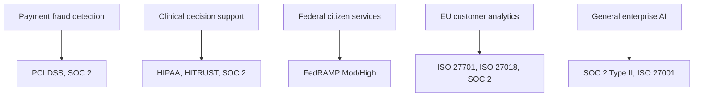

### Lab Exercise
```sql
-- Customer-side mapping registry
CREATE TABLE GOV.COMPLIANCE.APPLICABILITY (
  workload STRING, framework STRING, scope_notes STRING,
  snowflake_attestation STRING, our_responsibility STRING
);

INSERT INTO GOV.COMPLIANCE.APPLICABILITY VALUES
  ('loan_scorer','PCI DSS','Scores users with card-linked history',
   'PCI DSS L1','Keep PANs out of Snowflake via tokenization'),
  ('clinical_summarizer','HIPAA','Processes PHI narratives',
   'HIPAA attestation','BAA signed; PHI handling policies');
```

### Gotchas / Exam Traps
- Not all Snowflake editions have all certs — e.g., HIPAA/PCI require **Business Critical** or **Virtual Private Snowflake**.
- FedRAMP authorizations are region-specific — US GovCloud only.

---

## Q3: What are the primary ACCOUNT_USAGE views for audit, and what unique question does each answer?

**Difficulty:** Foundation
**Exam relevance:** ACCOUNT_USAGE catalog

### Answer

| View | Primary question answered |
|------|---------------------------|
| **LOGIN_HISTORY** | Who logged in / failed to log in, from where, with what client |
| **QUERY_HISTORY** | What SQL ran, by whom, with what cost and outcome |
| **ACCESS_HISTORY** | Which objects/columns were read/written, which policies evaluated |
| **SESSIONS** | What sessions existed, duration, client info |
| **GRANTS_TO_USERS** / **GRANTS_TO_ROLES** | Who has what access |
| **OBJECT_DEPENDENCIES** | Which views/UDFs depend on which base objects |
| **POLICY_REFERENCES** | Which policies are bound to which objects |
| **TAG_REFERENCES** | Which tags are set on which objects (direct) |
| **TAG_REFERENCES_WITH_LINEAGE** (table function) | Including inherited tags |
| **DATA_CLASSIFICATION_LATEST** | What's classified where |
| **COLUMNS**, **TABLES**, **VIEWS** | Schema catalog |
| **WAREHOUSE_METERING_HISTORY** | Compute cost |
| **DATA_TRANSFER_HISTORY** | Cross-region/share egress |
| **REPLICATION_USAGE_HISTORY** | Replication activity |
| **COPY_HISTORY** | COPY INTO ingest/export events |

Together: full forensic reconstruction of account activity.

### First Principles
A compliance audit answers questions like "did user X read PHI column Y on date Z?" Each question maps to one or two views. Memorizing which view answers which question is the backbone of audit-SQL fluency. Snowflake's design — metadata as queryable tables — is intentional: audit evidence lives next to the data.

### Diagram
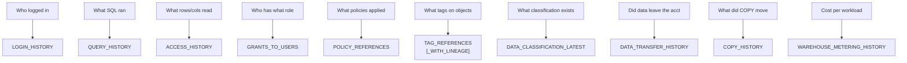

### Lab Exercise
```sql
-- Example multi-view audit: did user X access PHI table in last 30 days?
SELECT
  qh.start_time, qh.user_name, qh.role_name, qh.query_text,
  ah.base_objects_accessed, ah.policies_referenced
FROM SNOWFLAKE.ACCOUNT_USAGE.QUERY_HISTORY qh
JOIN SNOWFLAKE.ACCOUNT_USAGE.ACCESS_HISTORY ah USING (query_id)
WHERE qh.start_time >= DATEADD('day',-30,CURRENT_TIMESTAMP())
  AND qh.user_name = 'ALICE'
  AND EXISTS (
    SELECT 1 FROM LATERAL FLATTEN(input => ah.base_objects_accessed) obj
    WHERE obj.value:objectName::STRING = 'PHI_DB.PATIENT.ENCOUNTERS');
```

### Gotchas / Exam Traps
- **Latency**: ACCESS_HISTORY ~45 min; POLICY_REFERENCES ~2h; LOGIN_HISTORY ~15 min.
- **Retention**: 365 days in ACCOUNT_USAGE. Longer retention requires export.
- **Scope**: ACCOUNT_USAGE is per-account; cross-account requires replication or ORGANIZATION_USAGE.

---

## Q4: Design an immutable audit log pattern using Snowflake. What are the key defensive controls?

**Difficulty:** Advanced
**Exam relevance:** Audit immutability

### Answer
Design:
1. **Append-only landing table** — ACCESS_HISTORY copied to a customer-owned table on a schedule.
2. **No DELETE/UPDATE grants** — only INSERT and SELECT; strict ownership (dedicated service role).
3. **Row-access policy** blocks modifications even for owners (`FALSE` for non-SELECT contexts).
4. **Streams + tasks** to pull from `SNOWFLAKE.ACCOUNT_USAGE` to customer table.
5. **Replication to a separate account** for air-gapped preservation.
6. **Iceberg table** with external storage for cross-platform tamper-evidence.
7. **Trust Center alerts** on grant changes to the audit table.

### First Principles
Audit logs must be tamper-evident for most compliance regimes (SOX, HIPAA § 164.312(c), PCI 10.5). Snowflake's ACCOUNT_USAGE is read-only to customers but has only 365-day retention. The customer-side append-only pattern extends retention and adds a second trust boundary — if an attacker gained ACCOUNTADMIN, they could in theory tamper with customer tables; replicating to a separate account breaks that.

### Diagram
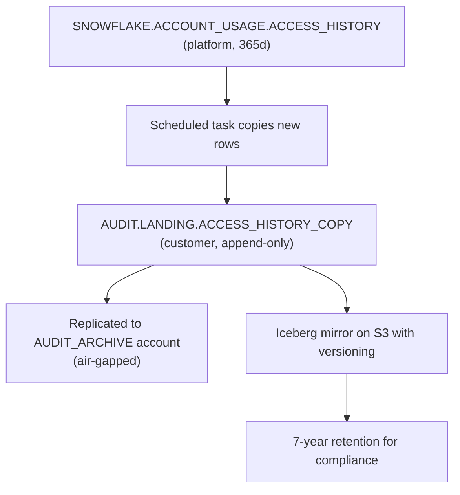

### Lab Exercise
```sql
-- Append-only pattern
USE ROLE SECURITYADMIN;
CREATE DATABASE AUDIT_DB;
CREATE SCHEMA AUDIT_DB.LANDING;

CREATE ROLE AUDIT_WRITER;
CREATE ROLE AUDIT_READER;

CREATE TABLE AUDIT_DB.LANDING.ACCESS_HISTORY_COPY
  LIKE SNOWFLAKE.ACCOUNT_USAGE.ACCESS_HISTORY;

GRANT INSERT ON TABLE AUDIT_DB.LANDING.ACCESS_HISTORY_COPY TO ROLE AUDIT_WRITER;
GRANT SELECT ON TABLE AUDIT_DB.LANDING.ACCESS_HISTORY_COPY TO ROLE AUDIT_READER;
-- NO DELETE/UPDATE grants to anyone

-- Row access denying modifications even from owners (belt + suspenders)
CREATE ROW ACCESS POLICY GOV.POL.AUDIT_READONLY
AS (query_id STRING) RETURNS BOOLEAN -> TRUE;   -- read-only; policy present prevents some DMLs

-- Replication to isolated account
CREATE REPLICATION GROUP AUDIT_RG
  OBJECT_TYPES = DATABASES
  ALLOWED_DATABASES = (AUDIT_DB)
  ALLOWED_ACCOUNTS = ('org.audit_archive_acct')
  REPLICATION_SCHEDULE = '60 MINUTE';

-- Task to copy new ACCESS_HISTORY rows
CREATE TASK AUDIT_DB.LANDING.LOAD_ACCESS SCHEDULE='60 MINUTE' AS
INSERT INTO AUDIT_DB.LANDING.ACCESS_HISTORY_COPY
SELECT * FROM SNOWFLAKE.ACCOUNT_USAGE.ACCESS_HISTORY
WHERE query_start_time >= DATEADD('hour',-2,CURRENT_TIMESTAMP())
  AND query_id NOT IN (SELECT query_id FROM AUDIT_DB.LANDING.ACCESS_HISTORY_COPY);
```

### Gotchas / Exam Traps
- Snowflake Time Travel on audit tables adds another layer — if someone deletes, you can UNDROP. But Time Travel retention is bounded.
- Iceberg + external storage lets you leverage S3 Object Lock for true immutability.

---

## Q5: How do you support a GDPR Data Subject Access Request (DSAR) in Snowflake?

**Difficulty:** Advanced
**Exam relevance:** GDPR DSAR workflow

### Answer
Workflow for a DSAR (GDPR Art. 15 — right of access):

1. **Identify the subject** — map user-facing ID to internal keys (lookup table).
2. **Discover all tables with subject's data** — classification + lineage + custom "has subject identifier" tag.
3. **Query each table** — extract rows pertaining to the subject.
4. **Package response** — PII decoded, model inferences explained.
5. **Audit the DSAR itself** — log which tables were queried, who ran the DSAR, what was returned.
6. **Return within 30 days** (GDPR deadline).

Reusable procedure:
```sql
CALL GOV.DSAR.EXTRACT_ALL_FOR_SUBJECT(:subject_id, :ticket_id);
```

Supporting infrastructure:
- Catalog of tables with `CONTAINS_SUBJECT_ID='TRUE'` tag.
- DSAR audit table.
- Masking role carve-out for DSAR operator.

### First Principles
DSAR is a *discovery* problem (find all data about this person) plus a *disclosure* problem (format and ship). The discovery scales only if tagging is comprehensive. "I don't know where this person's data lives" is the leading cause of GDPR fines. Snowflake's catalog + lineage makes discovery queryable — if used.

### Diagram
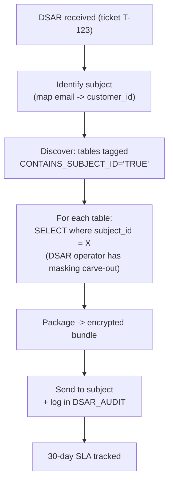

### Lab Exercise
```sql
-- Tag tables that contain subject data
CREATE TAG GOV.DATA.CONTAINS_SUBJECT_ID ALLOWED_VALUES 'TRUE','FALSE';

ALTER TABLE ORDERS      SET TAG GOV.DATA.CONTAINS_SUBJECT_ID='TRUE';
ALTER TABLE CUSTOMERS   SET TAG GOV.DATA.CONTAINS_SUBJECT_ID='TRUE';
ALTER TABLE SUPPORT.TICKETS SET TAG GOV.DATA.CONTAINS_SUBJECT_ID='TRUE';

-- Discovery view
CREATE OR REPLACE VIEW GOV.DSAR.V_TABLES_WITH_SUBJECT AS
SELECT object_name
FROM SNOWFLAKE.ACCOUNT_USAGE.TAG_REFERENCES
WHERE tag_name='CONTAINS_SUBJECT_ID' AND tag_value='TRUE' AND object_deleted IS NULL;

-- Extraction procedure
CREATE OR REPLACE PROCEDURE GOV.DSAR.EXTRACT_ALL_FOR_SUBJECT(
  SUBJECT_ID STRING, TICKET STRING)
RETURNS STRING LANGUAGE SQL AS $$
DECLARE sql STRING; result VARIANT := {};
BEGIN
  FOR tbl IN (SELECT object_name FROM GOV.DSAR.V_TABLES_WITH_SUBJECT) DO
    sql := 'INSERT INTO GOV.DSAR.EXTRACTS '
         || 'SELECT ''' || TICKET || ''', ''' || tbl.object_name || ''', '
         || 'OBJECT_AGG(COLUMN_NAME, VALUE::VARIANT), CURRENT_TIMESTAMP() '
         || 'FROM ' || tbl.object_name
         || ' WHERE subject_id = ''' || SUBJECT_ID || '''';
    EXECUTE IMMEDIATE sql;
  END FOR;
  INSERT INTO GOV.DSAR.AUDIT VALUES
    (TICKET, SUBJECT_ID, CURRENT_USER(), CURRENT_TIMESTAMP(), 'COMPLETED');
  RETURN 'OK';
END; $$;
```

### Gotchas / Exam Traps
- GDPR DSARs have a **free, 30-day** response obligation.
- "Pseudonymized" data is still personal data if the controller holds the mapping — include in DSAR.
- Model predictions on the subject may count as data **about** them → include derived data.

---

## Q6: Describe the GDPR right-to-erasure workflow for AI training data.

**Difficulty:** Advanced
**Exam relevance:** GDPR Art. 17

### Answer
Right to erasure (Art. 17) requires deletion of personal data on request, unless an exception applies (legal claims, free expression, scientific research).

Snowflake workflow:
1. **Receive erasure request** — ticket raised.
2. **Discover tables** — same as DSAR.
3. **Delete rows** — physical DELETE on all discovered tables.
4. **Time Travel considerations** — the data remains recoverable via Time Travel for retention period; shorten retention if required by regulator.
5. **Fail-safe** — 7-day disaster recovery; cannot be user-purged.
6. **Clone / backup** — must also delete from clones that contain the data.
7. **Training sets** — if the subject was in a training set, the model has already seen them; retrain OR document legitimate interest.
8. **Audit** — log deletion with before/after row counts.

Fail-safe is a known gotcha: Snowflake Support can purge if legally required, but it's manual.

### First Principles
Erasure in a data warehouse is subtle because of versioning (Time Travel) and derived artifacts (models trained on the data). The regulator typically accepts "data is physically deleted and cannot be routinely accessed" — Time Travel windows are usually acceptable if the retention is reasonable (within 30 days typical). Model retraining is not legally required in all cases; document your position.

### Diagram
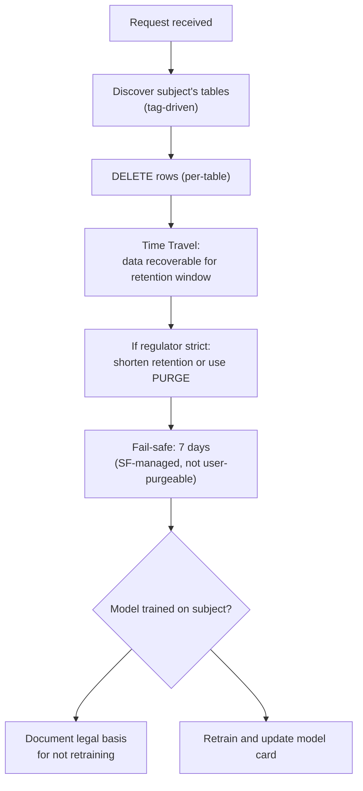

### Lab Exercise
```sql
CREATE OR REPLACE PROCEDURE GOV.DSAR.ERASE_SUBJECT(
  SUBJECT_ID STRING, TICKET STRING)
RETURNS STRING LANGUAGE SQL AS $$
DECLARE sql STRING; total_rows INT := 0; this_rows INT;
BEGIN
  FOR tbl IN (SELECT object_name FROM GOV.DSAR.V_TABLES_WITH_SUBJECT) DO
    sql := 'DELETE FROM ' || tbl.object_name ||
           ' WHERE subject_id = ''' || SUBJECT_ID || '''';
    EXECUTE IMMEDIATE sql;
    this_rows := SQLROWCOUNT;
    INSERT INTO GOV.DSAR.ERASURE_AUDIT VALUES
      (TICKET, SUBJECT_ID, tbl.object_name, this_rows, CURRENT_TIMESTAMP());
    total_rows := total_rows + this_rows;
  END FOR;
  RETURN 'Erased ' || total_rows || ' rows across ' ||
         (SELECT COUNT(*) FROM GOV.DSAR.V_TABLES_WITH_SUBJECT) || ' tables';
END; $$;

-- Shorten Time Travel on sensitive tables
ALTER TABLE PHI_DB.PATIENT.ENCOUNTERS SET DATA_RETENTION_TIME_IN_DAYS = 1;
```

### Gotchas / Exam Traps
- Fail-safe data is **not deletable** by users; a BAA or legal process may be required.
- Clones share partitions until modified — deleting from source may still leave data in clones (COW semantics mean the clone retained the row).

---

## Q7: Explain HIPAA Technical Safeguards mapped to Snowflake features.

**Difficulty:** Advanced
**Exam relevance:** HIPAA mapping

### Answer

HIPAA Security Rule § 164.312 Technical Safeguards:

| Safeguard | Required/Addressable | Snowflake implementation |
|-----------|----------------------|--------------------------|
| § 164.312(a)(1) Access control | Required | RBAC + Row Access Policies + Managed Access Schemas |
| § 164.312(a)(2)(i) Unique user identification | Required | USER objects; no shared logins |
| § 164.312(a)(2)(ii) Emergency access | Required | Break-glass ACCOUNTADMIN with alerts |
| § 164.312(a)(2)(iii) Automatic logoff | Addressable | Session Policy with SESSION_IDLE_TIMEOUT |
| § 164.312(a)(2)(iv) Encryption/decryption | Addressable | Encryption at rest (default) + TSS |
| § 164.312(b) Audit controls | Required | ACCESS_HISTORY + QUERY_HISTORY + LOGIN_HISTORY |
| § 164.312(c)(1) Integrity | Required | Append-only audit tables; Time Travel |
| § 164.312(c)(2) Integrity authentication | Addressable | Not applicable to data; MFA for users |
| § 164.312(d) Person/entity authentication | Required | MFA via Authentication Policy; SSO/SAML |
| § 164.312(e)(1) Transmission security | Required | TLS 1.2+ enforced |
| § 164.312(e)(2)(i) Integrity controls | Addressable | TLS integrity |
| § 164.312(e)(2)(ii) Encryption | Addressable | TLS + PrivateLink |

For AI: PHI used in training must stay inside the HIPAA-attested boundary (Business Critical edition or above); BAA required.

### First Principles
HIPAA is prescriptive at the control level but tech-agnostic. Mapping each safeguard to a Snowflake feature produces an audit-ready document. Addressable safeguards still require documented decision (implement OR document equivalent alternative).

### Diagram
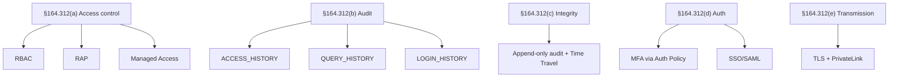

### Lab Exercise
```sql
CREATE TABLE GOV.HIPAA.CONTROL_MATRIX (
  reference STRING, required_or_addressable STRING,
  description STRING, snowflake_feature STRING, implemented BOOLEAN,
  evidence_query STRING);

INSERT INTO GOV.HIPAA.CONTROL_MATRIX VALUES
  ('§164.312(a)','Required','Access control','RBAC + RAP + MAS',TRUE,
   'SELECT COUNT(*) FROM SNOWFLAKE.ACCOUNT_USAGE.POLICY_REFERENCES WHERE policy_kind=''ROW_ACCESS_POLICY'''),
  ('§164.312(b)','Required','Audit controls','ACCESS_HISTORY',TRUE,
   'SELECT COUNT(*) FROM SNOWFLAKE.ACCOUNT_USAGE.ACCESS_HISTORY WHERE query_start_time >= DATEADD(day,-1,CURRENT_TIMESTAMP())');
```

### Gotchas / Exam Traps
- Snowflake HIPAA requires **Business Critical** edition and a signed BAA.
- Shared accounts violate § 164.312(a)(2)(i) — avoid.

---

## Q8: Describe PCI DSS scoping for an AI pipeline that uses card data.

**Difficulty:** Advanced
**Exam relevance:** PCI DSS AI scope

### Answer
PCI DSS scope includes any system that **stores, processes, or transmits** cardholder data (CHD) or sensitive authentication data. Scoping goals: minimize scope by minimizing CHD footprint.

Snowflake patterns:
1. **Tokenization at the edge** — PAN never enters Snowflake; only tokens (via external tokenization).
2. **Scope confinement** — if PAN must be in Snowflake, isolate in a dedicated database with no outbound shares.
3. **Encryption** — TSS CMK + TLS; PCI Req 3 + 4.
4. **Access control** — RBAC with MFA; PCI Req 7 + 8.
5. **Audit** — ACCESS_HISTORY retained 1 year; PCI Req 10.
6. **No AI training on PAN** — model learns on token/last-4; detokenize at inference only if required.

Scope reduction via tokenization is dramatic — many PCI AI deployments keep raw PAN out of Snowflake entirely.

### First Principles
PCI's cost of ownership scales with the number of in-scope systems. Minimizing CHD presence is the single most effective PCI strategy. Snowflake's external tokenization pattern lets AI pipelines leverage CHD-adjacent attributes (BIN, last-4, transaction history) without pulling raw PAN into scope.

### Diagram
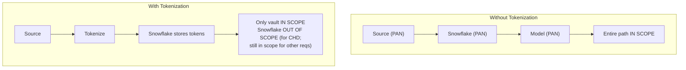

### Lab Exercise
```sql
-- Validate PCI scope: find any columns semantically classified as CREDIT_CARD
SELECT table_catalog, table_schema, table_name, column_name
FROM SNOWFLAKE.ACCOUNT_USAGE.DATA_CLASSIFICATION_LATEST
WHERE semantic_category = 'CREDIT_CARD';
-- Any hits = in-scope database; must have external tokenization or justify

-- Check masking coverage on card columns
WITH cc AS (
  SELECT table_catalog, table_schema, table_name, column_name
  FROM SNOWFLAKE.ACCOUNT_USAGE.DATA_CLASSIFICATION_LATEST
  WHERE semantic_category = 'CREDIT_CARD'
),
masked AS (
  SELECT ref_database_name, ref_schema_name, ref_entity_name, ref_column_name
  FROM SNOWFLAKE.ACCOUNT_USAGE.POLICY_REFERENCES
  WHERE policy_kind = 'MASKING_POLICY'
)
SELECT cc.* FROM cc
LEFT JOIN masked m ON
  (cc.table_catalog, cc.table_schema, cc.table_name, cc.column_name) =
  (m.ref_database_name, m.ref_schema_name, m.ref_entity_name, m.ref_column_name)
WHERE m.ref_column_name IS NULL;
```

### Gotchas / Exam Traps
- PCI DSS v4.0 (effective 2025) adds AI-specific considerations and continuous monitoring expectations.
- Even if PAN is tokenized, other PCI reqs (10, logging; 11, testing; 12, policy) still apply.

---

## Q9: What's the difference between ACCESS_HISTORY retention in Snowflake vs. what compliance usually requires?

**Difficulty:** Intermediate
**Exam relevance:** Retention gap

### Answer
- Snowflake ACCOUNT_USAGE.ACCESS_HISTORY retains **365 days**.
- Compliance commonly requires:
  - SOX — **7 years** for financial system records.
  - HIPAA — **6 years**.
  - PCI DSS — **1 year** audit logs, 3 months immediately accessible.
  - GDPR — depends on purpose, typically bounded.
  - FINRA — 6 years for broker-dealers.

Gap: Snowflake's 1 year is sufficient for PCI but not SOX, HIPAA, or FINRA. Customers must **export + retain** audit evidence externally (or in a dedicated Snowflake database with long-retention policies).

### First Principles
Platform retention is a baseline; compliance retention is often multiples. The customer's responsibility is to **continuously export** audit data so a gap doesn't develop. This is a one-time setup (scheduled task) but a critical control.

### Diagram
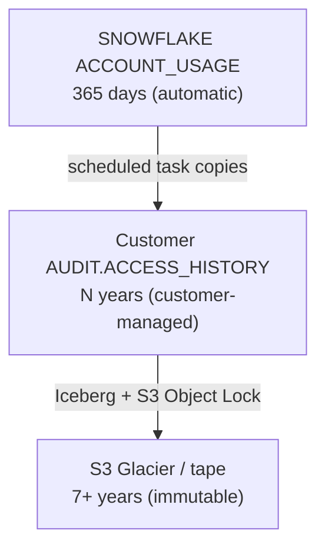

### Lab Exercise
```sql
-- Multi-year retention table + copy task
CREATE OR REPLACE TABLE AUDIT_DB.LANDING.ACCESS_HISTORY_7Y
  LIKE SNOWFLAKE.ACCOUNT_USAGE.ACCESS_HISTORY;

ALTER TABLE AUDIT_DB.LANDING.ACCESS_HISTORY_7Y
  SET DATA_RETENTION_TIME_IN_DAYS = 90;   -- enough time-travel for ops

CREATE TASK AUDIT_DB.LANDING.COPY_HOURLY
  WAREHOUSE=WH_AUDIT SCHEDULE='60 MINUTE' AS
INSERT INTO AUDIT_DB.LANDING.ACCESS_HISTORY_7Y
SELECT * FROM SNOWFLAKE.ACCOUNT_USAGE.ACCESS_HISTORY
WHERE query_start_time BETWEEN
      (SELECT COALESCE(MAX(query_start_time),'1900-01-01'::TIMESTAMP)
       FROM AUDIT_DB.LANDING.ACCESS_HISTORY_7Y)
      AND CURRENT_TIMESTAMP();

-- Lifecycle: oldest rows → Iceberg → S3 Glacier via external policy
```

### Gotchas / Exam Traps
- 365-day retention applies to **all** ACCOUNT_USAGE views, not just ACCESS_HISTORY. QUERY_HISTORY in ACCOUNT_USAGE is also 365 days.
- INFORMATION_SCHEMA.QUERY_HISTORY has only 7-14 day retention — not for compliance.

---

## Q10: What is the Snowflake Trust Center from a compliance perspective, and how does its scoring feed into audits?

**Difficulty:** Intermediate
**Exam relevance:** Trust Center for compliance

### Answer
From a compliance perspective, Trust Center provides:
- **Continuous controls monitoring** — scanners run against CIS/SRA.
- **Posture score** — board-reportable KPI.
- **Finding register** — per-entity audit items with severity.
- **Remediation guidance** — pointer to resolution.
- **Historical trend** — score over time demonstrates improvement.

Audits use Trust Center outputs as **evidence of continuous monitoring** (SOC 2 CC7, ISO 27001 A.12.4). Combined with ACCESS_HISTORY for enforcement evidence, Trust Center + ACCOUNT_USAGE substitutes for many external GRC tools.

### First Principles
"We passed an audit six months ago" is not evidence; "the posture score has been ≥ 95 for 180 days with no critical findings" is. Trust Center converts compliance from attestation-at-a-point to posture-over-time, which matches modern audit philosophy (continuous assurance).

### Diagram
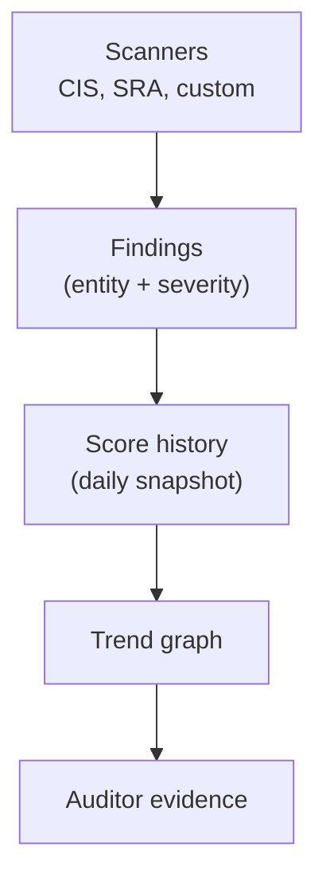

### Lab Exercise
```sql
-- Snapshot posture score daily into a trend table
CREATE TABLE AUDIT_DB.TRUST_CENTER.POSTURE_HISTORY (
  snapshot_at TIMESTAMP_NTZ,
  critical INT, high INT, medium INT, low INT, info INT,
  posture_score FLOAT);

CREATE TASK AUDIT_DB.TRUST_CENTER.DAILY_SNAPSHOT
  WAREHOUSE=WH_AUDIT SCHEDULE='USING CRON 0 1 * * * UTC' AS
INSERT INTO AUDIT_DB.TRUST_CENTER.POSTURE_HISTORY
SELECT CURRENT_TIMESTAMP(),
       COUNT_IF(severity='CRITICAL' AND at_risk),
       COUNT_IF(severity='HIGH'     AND at_risk),
       COUNT_IF(severity='MEDIUM'   AND at_risk),
       COUNT_IF(severity='LOW'      AND at_risk),
       COUNT_IF(severity='INFO'     AND at_risk),
       100 - (COUNT_IF(severity IN ('CRITICAL','HIGH') AND at_risk) * 5
            + COUNT_IF(severity='MEDIUM' AND at_risk) * 1)
FROM SNOWFLAKE.TRUST_CENTER.FINDINGS;
```

### Gotchas / Exam Traps
- Posture score formula is customer-defined — document how you compute it.
- A dropped scanner (disabled package) can inflate score artificially — audit the scanner enablement set.

---

## Q11: Describe FedRAMP implications for AI workloads in Snowflake.

**Difficulty:** Advanced
**Exam relevance:** FedRAMP

### Answer
FedRAMP = standardized security assessment for US federal cloud services. Snowflake has **FedRAMP Moderate** authorization (and High in some regions).

Implications for AI workloads:
- Must deploy in a FedRAMP-authorized region (**AWS US GovCloud** or specific commercial regions depending on authorization).
- Cortex Guard and model registry inherit FedRAMP controls when run in the authorized region.
- NIST 800-53 controls apply (AU, AC, SC families).
- Boundary includes any external integrations — external functions calling non-FedRAMP endpoints break the boundary.
- IL4 / IL5 (DoD impact levels) may require additional controls.

### First Principles
FedRAMP is an *authorization boundary* concept. Everything inside the boundary must be FedRAMP-authorized; anything outside is a boundary violation. For AI, external LLM calls, model artifact exports, and third-party services must either be inside the boundary or explicitly waived.

### Diagram
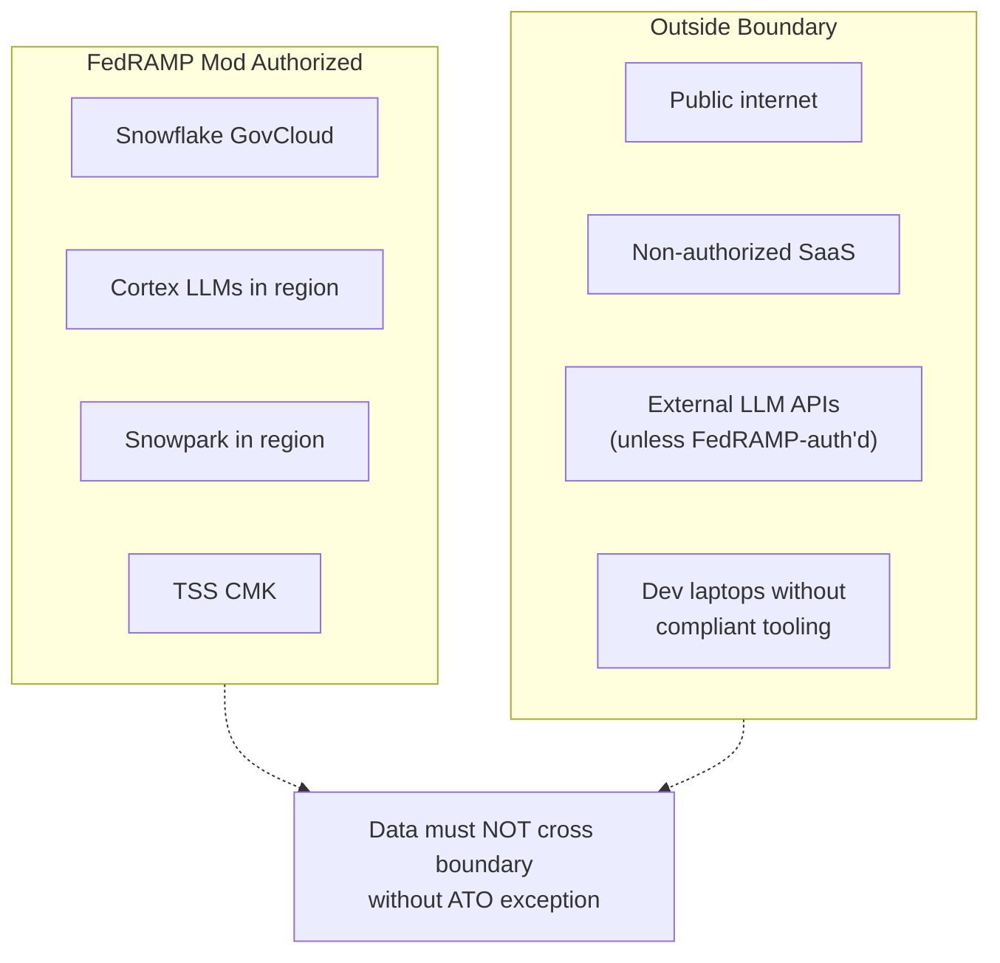

### Lab Exercise
```sql
-- Boundary enforcement: tag external integrations
CREATE TAG GOV.COMPLIANCE.FEDRAMP_IN_BOUNDARY ALLOWED_VALUES 'TRUE','FALSE';

ALTER API INTEGRATION VAULT_API
  SET TAG GOV.COMPLIANCE.FEDRAMP_IN_BOUNDARY = 'TRUE'
  COMMENT='Vault is FedRAMP-authorized endpoint';

-- Audit: external functions calling out-of-boundary endpoints
SELECT ef.function_name, ei.api_integration, ei.api_allowed_prefixes
FROM SNOWFLAKE.ACCOUNT_USAGE.FUNCTIONS ef
JOIN SNOWFLAKE.ACCOUNT_USAGE.EXTERNAL_INTEGRATIONS ei
  ON ef.api_integration = ei.integration_name
WHERE ei.tag_value_boundary IS NULL OR ei.tag_value_boundary = 'FALSE';
```

### Gotchas / Exam Traps
- FedRAMP controls are updated — new revisions can require re-attestation.
- Not all Cortex models are FedRAMP-authorized at all times; check the current catalog.

---

## Q12: Explain legal hold and litigation preservation in Snowflake.

**Difficulty:** Advanced
**Exam relevance:** Legal hold

### Answer
A **legal hold** suspends normal retention/deletion for data pertinent to litigation. Snowflake-side techniques:

1. **Clone + lock** — zero-copy clone the pertinent databases/tables; place in a "legal_hold" schema with no DELETE grants.
2. **Zero-copy clone** means no additional storage cost initially — ideal for holds.
3. **Suspend tasks** that might modify data.
4. **Change retention** — extend `DATA_RETENTION_TIME_IN_DAYS` on relevant tables.
5. **Replicate** to a dedicated hold account.
6. **Export** evidence to immutable S3 (Iceberg + Object Lock).
7. **Audit the hold** — log who was notified, when the hold starts, scope.

### First Principles
Legal holds freeze a point-in-time state and all activity on it. Snowflake's zero-copy clone is uniquely suited: an atomic snapshot without full copy cost. Combining with tight RBAC on the clone makes the preservation legally defensible.

### Diagram
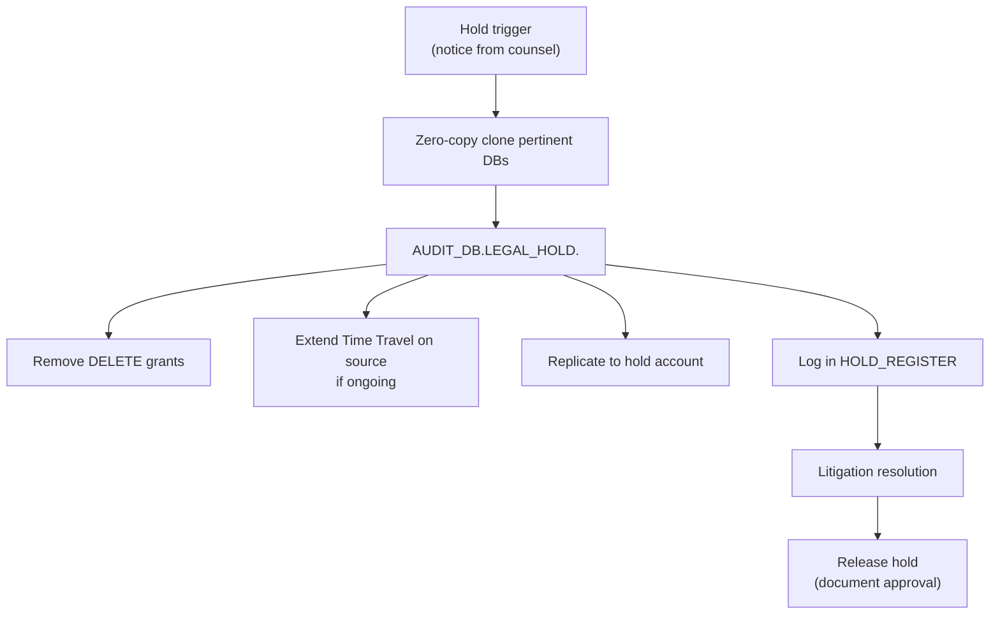

### Lab Exercise
```sql
CREATE DATABASE AUDIT_DB.LEGAL_HOLD.CASE_2026_42
  CLONE PROD.FINANCE AT (TIMESTAMP => '2026-10-30 00:00:00'::TIMESTAMP);

-- Restrict access
REVOKE ALL ON DATABASE AUDIT_DB.LEGAL_HOLD.CASE_2026_42 FROM ROLE SYSADMIN;
GRANT USAGE ON DATABASE AUDIT_DB.LEGAL_HOLD.CASE_2026_42 TO ROLE LEGAL_HOLD_READER;
GRANT SELECT ON ALL TABLES IN SCHEMA AUDIT_DB.LEGAL_HOLD.CASE_2026_42.PUBLIC
  TO ROLE LEGAL_HOLD_READER;

-- Register
CREATE TABLE AUDIT_DB.LEGAL_HOLD.REGISTER (
  case_id STRING, triggered_at TIMESTAMP_NTZ, scope STRING,
  responsible STRING, released_at TIMESTAMP_NTZ);
INSERT INTO AUDIT_DB.LEGAL_HOLD.REGISTER VALUES
  ('CASE_2026_42', CURRENT_TIMESTAMP(), 'Finance DB snapshot 2026-10-30',
   CURRENT_USER(), NULL);
```

### Gotchas / Exam Traps
- Zero-copy clones diverge from source as source changes — the clone preserves the point-in-time view regardless.
- Legal hold trumps GDPR erasure in most jurisdictions during the hold.

---

## Q13: What signals in Snowflake can indicate a potential data breach, and how do you detect them?

**Difficulty:** Advanced
**Exam relevance:** Breach detection

### Answer
Potential breach signals:
1. **Unusual login patterns** — new geography, new IP, impossible travel.
2. **High-volume data exfil** — large COPY INTO external stages, large result sets.
3. **Privilege escalation** — role granted ACCOUNTADMIN unexpectedly.
4. **Access anomalies** — service account querying unusual tables.
5. **Share creation** — new shares to unknown accounts.
6. **Replication to unknown accounts** — ALLOWED_ACCOUNTS modified.
7. **Policy bypass** — user with masking carve-out querying en masse.
8. **Failed MFA** — spike in failures.

Detection via scheduled queries + alerts.

### First Principles
Detection is signal processing: expected baseline vs. observed. Snowflake makes the data easy to query; the governance team defines what counts as anomalous for their environment. Baselines may evolve — periodically retune.

### Diagram
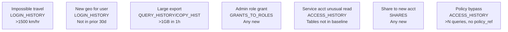

### Lab Exercise
```sql
-- Alert on impossible travel
CREATE OR REPLACE ALERT GOV.SEC.IMPOSSIBLE_TRAVEL
WAREHOUSE=WH_SEC SCHEDULE='15 MINUTE'
IF (EXISTS (
  WITH logins AS (
    SELECT user_name, event_timestamp, client_ip,
           LAG(event_timestamp) OVER (PARTITION BY user_name ORDER BY event_timestamp) prev_t,
           LAG(client_ip)       OVER (PARTITION BY user_name ORDER BY event_timestamp) prev_ip
    FROM SNOWFLAKE.ACCOUNT_USAGE.LOGIN_HISTORY
    WHERE event_timestamp >= DATEADD('hour',-1,CURRENT_TIMESTAMP())
      AND is_success = 'YES')
  SELECT 1 FROM logins
  WHERE prev_t IS NOT NULL
    AND DATEDIFF('minute', prev_t, event_timestamp) < 60
    AND client_ip != prev_ip
    -- (In practice, geo-resolve IPs and compute distance)
    AND SPLIT_PART(client_ip,'.',1) != SPLIT_PART(prev_ip,'.',1)))
THEN CALL SYSTEM$SEND_EMAIL('sec_alerts','soc@co',
       'Impossible travel','Review LOGIN_HISTORY for last hour.');

-- Alert on large exports
CREATE ALERT GOV.SEC.LARGE_EXPORT WAREHOUSE=WH_SEC SCHEDULE='15 MINUTE'
IF (EXISTS (
  SELECT 1 FROM SNOWFLAKE.ACCOUNT_USAGE.COPY_HISTORY
  WHERE last_load_time >= DATEADD('minute',-15,CURRENT_TIMESTAMP())
    AND row_count > 1000000
    AND status = 'LOADED')
) THEN CALL SYSTEM$SEND_EMAIL('sec_alerts','soc@co','Large export','Review COPY_HISTORY.');
```

### Gotchas / Exam Traps
- Not every anomaly is malicious — tune thresholds to minimize alert fatigue.
- Scheduled alerts have minimum frequencies — real-time detection may require streams or external SIEM.

---

## Q14: Describe how Snowflake supports breach notification obligations.

**Difficulty:** Advanced
**Exam relevance:** Breach notification

### Answer
Many regulations impose breach-notification timelines:
- **GDPR Art. 33** — notify supervisory authority within 72 hours.
- **HIPAA Breach Notification Rule** — 60 days to affected individuals.
- **State laws** (California CCPA, NY SHIELD, etc.) — varying.

Snowflake supports via:
1. **Rapid forensic reconstruction** — ACCESS_HISTORY + QUERY_HISTORY shows exactly what was read when.
2. **Scope determination** — join classification + lineage to count affected rows/subjects.
3. **Notification templates** — Snowflake tables with contact info, affected subject IDs.
4. **Snowflake side** — if the breach originates on Snowflake's platform, Snowflake notifies customers per contract.

### First Principles
The clock starts at awareness, not discovery of full scope. Fast scoping (hours, not weeks) is critical. Snowflake's queryable audit lets a SOC team compute "affected subject IDs" in minutes — a huge improvement over log parsing.

### Diagram
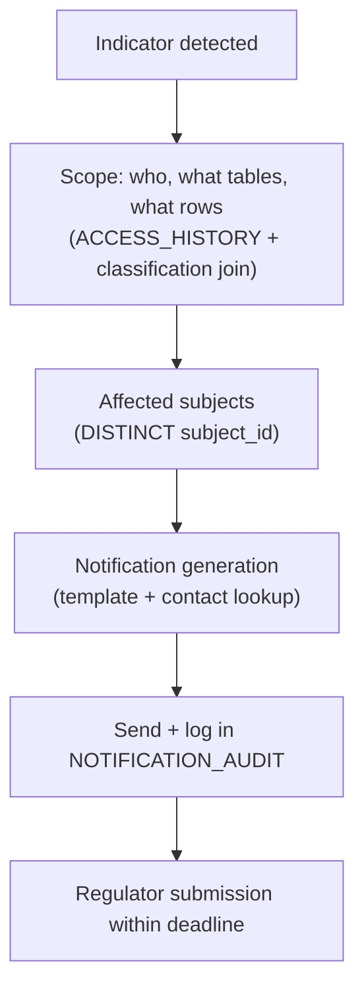

### Lab Exercise
```sql
-- Scope affected subjects from a suspect query
WITH suspect AS (
  SELECT * FROM SNOWFLAKE.ACCOUNT_USAGE.ACCESS_HISTORY
  WHERE query_id = 'XXXX-SUSPECT-QUERY-ID'
),
objects_read AS (
  SELECT obj.value:objectName::STRING AS obj,
         col.value:columnName::STRING AS col
  FROM suspect s,
       LATERAL FLATTEN(input=>s.base_objects_accessed) obj,
       LATERAL FLATTEN(input=>obj.value:columns) col
)
SELECT DISTINCT 'Table ' || o.obj || ' contains PII column ' || o.col AS incident_scope
FROM objects_read o
JOIN SNOWFLAKE.ACCOUNT_USAGE.DATA_CLASSIFICATION_LATEST d
  ON (d.table_catalog||'.'||d.table_schema||'.'||d.table_name = o.obj
      AND d.column_name = o.col AND d.privacy_category='IDENTIFIER');
```

### Gotchas / Exam Traps
- 72-hour clock in GDPR is from **awareness**, not confirmation of impact.
- "Unauthorized" doesn't necessarily mean malicious — a role grant error that exposed PII counts.

---

## Q15: What is the relationship between QUERY_HISTORY and ACCESS_HISTORY, and why do both matter?

**Difficulty:** Intermediate
**Exam relevance:** Audit view distinction

### Answer
- **QUERY_HISTORY** — one row per executed query. Contains SQL text, user, role, warehouse, cost, errors, status.
- **ACCESS_HISTORY** — one row per query (same QUERY_ID), focused on objects accessed/modified and policies invoked.

Both matter because:
- QUERY_HISTORY has the **SQL** and **cost** (useful for debugging and finops).
- ACCESS_HISTORY has the **resolved objects** (base vs. direct) and **policies** (enforcement proof).
- Join on `query_id` for the full picture.

Example: QUERY_HISTORY shows `SELECT * FROM v_cust_safe`; ACCESS_HISTORY shows this read `raw.customers` with masking policy X applied.

### First Principles
Snowflake separates "what SQL" from "what data" because the resolution between them is non-trivial (views + policies abstract the mapping). Keeping them in separate views lets queries target only the needed data; joining them is cheap when the full view is required.

### Diagram
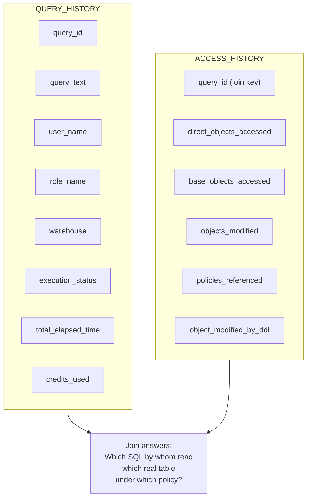

### Lab Exercise
```sql
-- Join example
SELECT qh.start_time, qh.user_name, qh.role_name, qh.query_text,
       ah.base_objects_accessed, ah.policies_referenced,
       qh.credits_used_cloud_services
FROM SNOWFLAKE.ACCOUNT_USAGE.QUERY_HISTORY qh
LEFT JOIN SNOWFLAKE.ACCOUNT_USAGE.ACCESS_HISTORY ah USING (query_id)
WHERE qh.start_time >= DATEADD('hour',-1,CURRENT_TIMESTAMP())
  AND qh.execution_status = 'SUCCESS'
ORDER BY qh.start_time DESC LIMIT 50;
```

### Gotchas / Exam Traps
- A query that only touches session-local tables (temp tables) won't appear in ACCESS_HISTORY.
- Query cancellation populates QUERY_HISTORY with status='CANCELLED'; ACCESS_HISTORY may still show partial access.

---

## Q16: Describe the audit flow for proving that a Cortex LLM call did not leak PII.

**Difficulty:** Advanced
**Exam relevance:** AI audit evidence

### Answer
Flow:
1. **PROMPT_LOGS** table captures every Cortex call (prompt, completion, user, model, timestamp).
2. **PII scanner** runs post-hoc on completions (SYSTEM$CLASSIFY or Cortex-based).
3. **Join** PROMPT_LOGS with ACCESS_HISTORY to show what data the invoking role had access to (what could it have seen).
4. **Evidence query**: for a given query_id, show prompt + completion + accessed objects + classification of those objects + scan result on completion.
5. **Retention**: PROMPT_LOGS retained per compliance window.

### First Principles
The question "did PII leak" has two parts: (a) was PII in the input and (b) did PII appear in the output. Both need evidence. The invoking role's access rights provide the "could have seen" boundary; the PII scanner on completions provides the "did output" check. Together, they bound the risk.

### Diagram
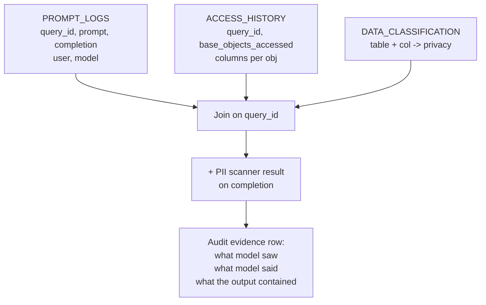

### Lab Exercise
```sql
CREATE OR REPLACE VIEW AI_OBS.V_LLM_AUDIT AS
SELECT
  pl.log_id, pl.user_name, pl.model, pl.created_at,
  pl.prompt_text, pl.completion_text,
  ah.base_objects_accessed, ah.policies_referenced,
  AI_OBS.DETECT_PII_LLM(pl.completion_text) AS pii_in_output
FROM AI_OBS.PROMPT_LOGS pl
LEFT JOIN SNOWFLAKE.ACCOUNT_USAGE.ACCESS_HISTORY ah
  ON ah.query_id = pl.cortex_query_id;

-- Prove no leakage
SELECT COUNT(*) incidents
FROM AI_OBS.V_LLM_AUDIT
WHERE ARRAY_SIZE(pii_in_output) > 0
  AND created_at >= DATEADD('day',-30,CURRENT_TIMESTAMP());
```

### Gotchas / Exam Traps
- Cortex calls are internal; their `query_id` is in QUERY_HISTORY — ensure PROMPT_LOGS stores it.
- PII scanner itself consumes credits — scope.

---

## Q17: What are "non-production access" controls and how do you enforce them for AI dev/test environments?

**Difficulty:** Advanced
**Exam relevance:** Env separation + non-prod

### Answer
Compliance frameworks (SOC 2, PCI, HIPAA) require separation of production and non-production environments. For AI:
- **Separate accounts** — dev, qa, prod are distinct Snowflake accounts in some org deployments.
- **Separate databases** within one account for lower-impact separation.
- **Role-based gating** — PROD role cannot access DEV and vice versa.
- **No PROD data in DEV** — refresh with synthetic / masked data only.
- **Tagging** — `ENV=PROD/DEV/QA` enforced via policies.

AI-specific:
- No production training on dev data (and vice versa).
- Models in dev registry cannot be deployed to prod inference service.
- Dev warehouses have no outbound share permissions.

### First Principles
Env mixing is a common SOC 2 finding. "Realistic data in dev" is a tempting shortcut that creates compliance scope creep — dev data is now PII, and your dev systems are now in scope. Synthetic/masked dev data breaks that.

### Diagram
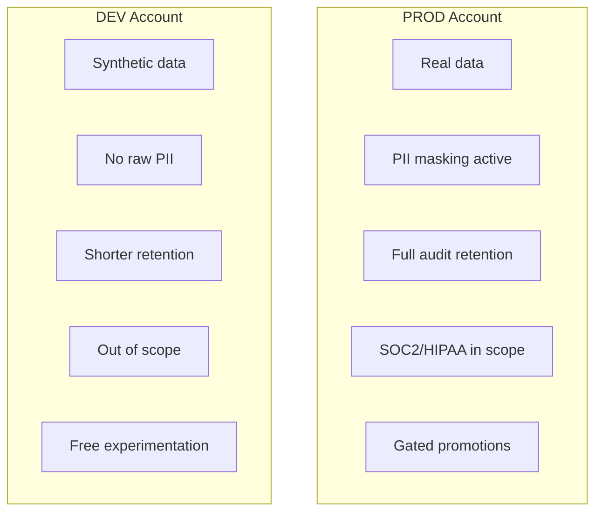

### Lab Exercise
```sql
-- Tag + enforcement
CREATE TAG GOV.COMPLIANCE.ENV ALLOWED_VALUES 'PROD','QA','DEV';

ALTER DATABASE PROD_DB SET TAG GOV.COMPLIANCE.ENV='PROD';
ALTER DATABASE DEV_DB  SET TAG GOV.COMPLIANCE.ENV='DEV';

-- Prevent cross-env access via row access policy on a shared config table
CREATE ROW ACCESS POLICY GOV.POL.ENV_MATCH
AS (env STRING) RETURNS BOOLEAN ->
  env = (SELECT tag_value FROM SNOWFLAKE.ACCOUNT_USAGE.TAG_REFERENCES
         WHERE object_name = CURRENT_DATABASE() AND tag_name='ENV' LIMIT 1);
```

### Gotchas / Exam Traps
- Replication from prod to dev creates PII in dev — avoid; use synthetic or masked clones only.
- Dev warehouses sharing network with prod violates isolation; separate network policies.

---

## Q18: Describe the governance pattern for Snowpark Container Services (SPCS) running AI workloads.

**Difficulty:** Advanced
**Exam relevance:** SPCS governance

### Answer
**Snowpark Container Services** lets you run containerized AI workloads (custom models, inference servers, frameworks like Ray) inside Snowflake. Governance:

1. **Service specification** — manifest declares resources, endpoints, mounts.
2. **Image registry** — containers from Snowflake-hosted registry; images are scanned.
3. **Service role** — the service runs as a role with specific grants.
4. **Networking** — ingress/egress rules via `EXTERNAL ACCESS INTEGRATIONS`.
5. **Secrets** — mounted from SECRET objects.
6. **Audit** — service logs via event tables; service queries show in QUERY_HISTORY.
7. **Deployment gate** — service spec approved before deploy.

### First Principles
Containers in a data warehouse enlarge the governance surface: now you have arbitrary code with network and compute capabilities. Snowflake's design pushes the governance primitives (RBAC, secrets, network rules) around the container, so the control plane is familiar even if the workload is new.

### Diagram
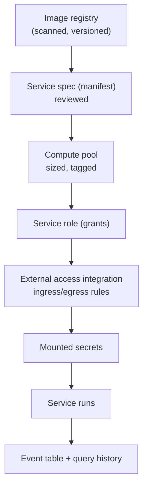

### Lab Exercise
```sql
-- Compute pool with environment tag
CREATE COMPUTE POOL AI_INFERENCE_POOL
  MIN_NODES=1 MAX_NODES=4 INSTANCE_FAMILY=CPU_X64_S;

ALTER COMPUTE POOL AI_INFERENCE_POOL
  SET TAG GOV.COMPLIANCE.ENV = 'PROD';

-- Service spec (simplified)
CREATE SERVICE AI_SVC.INFERENCE
IN COMPUTE POOL AI_INFERENCE_POOL
FROM SPECIFICATION $$
spec:
  containers:
  - name: inference
    image: /ai_db/images/inference:v3
    env:
      MODEL_VERSION: v3
    volumeMounts:
    - name: secrets
      mountPath: /secrets
  endpoints:
  - name: predict
    port: 8080
    public: false
  volumes:
  - name: secrets
    source: '@SECURE_STAGE/secrets'
$$;

-- Audit
SELECT * FROM SNOWFLAKE.ACCOUNT_USAGE.SERVICE_ENTITY_HISTORY
WHERE service_name='INFERENCE' ORDER BY event_timestamp DESC;
```

### Gotchas / Exam Traps
- SPCS billing differs from warehouse billing — compute pool credits.
- Public endpoints bypass warehouse-based network policies — scrutinize.

---

## Q19: What is Snowflake's data residency guarantee, and how do you verify it?

**Difficulty:** Intermediate
**Exam relevance:** Residency verification

### Answer
Snowflake accounts are deployed in a specific **region** (e.g., AWS us-east-1, Azure westeurope). Data remains in that region unless the customer explicitly:
- Shares with an account in another region (requires **replication** to that region first).
- Replicates to another region via Replication Groups.
- Exports via COPY INTO an external stage in another region.

Verification:
- `SELECT CURRENT_REGION();`
- `SELECT CURRENT_ACCOUNT();` + account URL confirms region.
- `SHOW ACCOUNTS;` at org level shows regions.
- Replication groups' `ALLOWED_ACCOUNTS` + their regions.
- `DATA_TRANSFER_HISTORY` shows cross-region egress.

### First Principles
Residency is a geographic property of the storage. For AI, where training can accidentally pull in cross-region data, verification matters. Snowflake's region-pinning is strict unless explicit replication/sharing/export occurs — but each of those actions is customer-initiated and auditable.

### Diagram
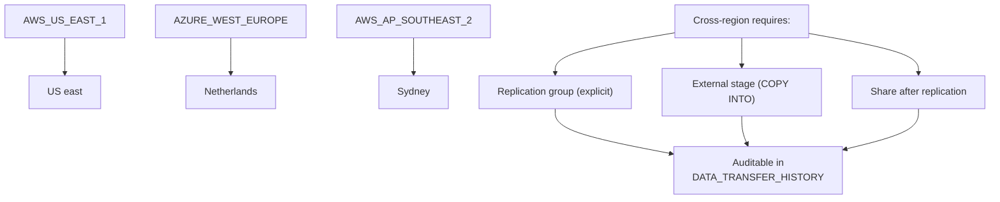

### Lab Exercise
```sql
-- Verify
SELECT CURRENT_ACCOUNT(), CURRENT_REGION();

-- Cross-region transfer audit
SELECT source_region, target_region, bytes_transferred, start_time
FROM SNOWFLAKE.ACCOUNT_USAGE.DATA_TRANSFER_HISTORY
WHERE start_time >= DATEADD('day',-30,CURRENT_TIMESTAMP())
  AND source_region != target_region;

-- Which replication groups allow cross-region
SHOW REPLICATION GROUPS;
```

### Gotchas / Exam Traps
- Snowflake's SNOWFLAKE share (used by ACCOUNT_USAGE) is region-pinned.
- Multi-region deployments require **account per region**, not multi-region accounts.

---

## Q20: Describe the end-to-end audit scenario: an auditor asks "show me all AI model training events in Q3 and prove each ran under appropriate governance."

**Difficulty:** Advanced
**Exam relevance:** End-to-end audit scenario

### Answer
Audit evidence package:

1. **Training events** — rows from `GOV.AI_RMF.MODEL_LINEAGE` with `trained_at` in Q3.
2. **Who** — `trained_by` + QUERY_HISTORY confirms.
3. **Data** — join to classification: training set's columns and their classifications.
4. **Policies** — ACCESS_HISTORY shows policies evaluated during training queries.
5. **Approval** — `DEPLOYMENT_APPROVALS` for each (model, version).
6. **Model card** — `MODEL_CARDS` row.
7. **Bias tests** — `MODEL_METRICS` with `bias_%` metrics.
8. **Trust Center posture** at the time of training.
9. **Drift baseline** registered.

Composed audit view = one row per training event + all evidence columns.

### First Principles
Audits ask narrative questions; evidence is tabular. The governance team's job is to pre-build the view so the audit response is one query, not weeks of hunting. Every AI governance artifact described in prior domains serves exactly this purpose.

### Diagram
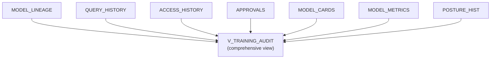

### Lab Exercise
```sql
CREATE OR REPLACE VIEW GOV.AUDIT.V_Q3_TRAINING AS
SELECT
  ml.model_name, ml.model_version, ml.trained_at, ml.trained_by,
  ml.training_dataset,
  mc.card:intended_use::STRING AS intended_use,
  a.approver, a.approved_at,
  ARRAY_AGG(DISTINCT mm.metric_name) AS metrics_captured,
  (SELECT ARRAY_AGG(DISTINCT ar.policies_referenced[0]::STRING)
   FROM SNOWFLAKE.ACCOUNT_USAGE.QUERY_HISTORY qh
   JOIN SNOWFLAKE.ACCOUNT_USAGE.ACCESS_HISTORY ar USING (query_id)
   WHERE qh.user_name = ml.trained_by
     AND qh.start_time BETWEEN DATEADD('day',-1,ml.trained_at) AND ml.trained_at
  ) AS policies_evaluated
FROM GOV.AI_RMF.MODEL_LINEAGE ml
LEFT JOIN GOV.AI_RMF.MODEL_CARDS mc
  ON ml.model_name=mc.model_name AND ml.model_version=mc.model_version
LEFT JOIN GOV.AI_RMF.DEPLOYMENT_APPROVALS a
  ON ml.model_name=a.model_name AND ml.model_version=a.version
LEFT JOIN GOV.AI_RMF.MODEL_METRICS mm
  ON ml.model_name=mm.model_name AND ml.model_version=mm.version
WHERE ml.trained_at BETWEEN '2026-07-01' AND '2026-09-30'
GROUP BY ALL;

-- Hand to the auditor:
SELECT * FROM GOV.AUDIT.V_Q3_TRAINING;
```

### Gotchas / Exam Traps
- ACCESS_HISTORY lookups 90+ days back are fine within 365d retention; longer requires custom archive.
- Non-SQL training (notebooks exporting to Snowpark) requires explicit `MODEL_LINEAGE` writes.

---

## Q21: What are the key differences between SNOWFLAKE.ACCOUNT_USAGE and READER_ACCOUNT_USAGE, and when does the latter matter for AI governance?

**Difficulty:** Advanced
**Exam relevance:** Reader accounts

### Answer
- **ACCOUNT_USAGE** — metadata for the current account.
- **READER_ACCOUNT_USAGE** — metadata for **reader accounts** that the current account provisioned.

A **reader account** is a sub-account that only consumes shares; the provisioning account owns it. For AI, reader accounts are used when sharing datasets or Native Apps with external parties who don't have their own Snowflake.

Governance:
- The provisioning account can audit the reader's activity via `READER_ACCOUNT_USAGE`.
- Shared data flows into the reader account; the provider sees what the consumer did.
- Policies on shared objects apply in the reader account.
- Reader accounts have their own ACCOUNT_USAGE too (per-reader perspective).

### First Principles
When sharing AI data products with non-Snowflake customers, the provider wants visibility into usage. Reader accounts give the provider that visibility while isolating the consumer. The provider's governance team can audit the full consumer activity — a feature unique to the share-via-reader pattern.

### Diagram
```mermaid
flowchart TD
    PROV["Provider account"]
    READ["Reader account"]
    USERS["Reader's users query shared data"]
    RAU["Reader's ACCOUNT_USAGE<br/>(visible to reader)"]
    PRAU["Provider's READER_ACCOUNT_USAGE<br/>(visible to provider)"]
    PROV -->|provisions| READ
    READ -->|receives share| USERS
    USERS --> RAU
    USERS --> PRAU
```

### Lab Exercise
```sql
-- Provisioning account
USE ROLE ACCOUNTADMIN;
CREATE MANAGED ACCOUNT reader_cust_1
  ADMIN_NAME='reader_admin', ADMIN_PASSWORD='…',
  TYPE=READER;

-- Audit reader activity from the provider side
SELECT reader_account_name, user_name, query_text, start_time
FROM SNOWFLAKE.READER_ACCOUNT_USAGE.QUERY_HISTORY
WHERE start_time >= DATEADD('day',-7,CURRENT_TIMESTAMP())
LIMIT 100;
```

### Gotchas / Exam Traps
- Reader accounts incur storage/credits that bill to the provider.
- Reader accounts cannot create their own shares outward.

---

## Q22: Explain the governance checklist for publishing a Snowflake Native App that uses AI.

**Difficulty:** Advanced
**Exam relevance:** Native App governance

### Answer
Checklist for AI Native App publication:

1. **Manifest** declares required privileges, data access, Cortex functions used.
2. **Access policies** inside the app: secure views, masking policies on consumer data.
3. **Cortex Guard** enabled for any LLM calls.
4. **Model governance** — model card for any shipped model.
5. **Consumer-side telemetry** — opt-in prompt/response logging.
6. **Documentation** — intended use, risks, out-of-scope.
7. **Testing in a provider test account** — including red-team prompts.
8. **Listing review** — Snowflake reviews before Marketplace listing.
9. **Version lifecycle** — new versions carry change log.
10. **Compliance disclosure** — which attestations the app supports.

### First Principles
Native Apps are shared software that run in the consumer's account. They inherit the consumer's compliance obligations even as the provider delivers code. The governance mindset: everything the app does must be auditable in the consumer's account's ACCESS_HISTORY.

### Diagram
```mermaid
flowchart TD
    subgraph PROV["Provider Side"]
        P1["Manifest declares needs"]
        P2["Secure code (secure UDFs)"]
        P3["Model cards shipped"]
        P4["Guardrails on LLM calls"]
        P5["Version lifecycle"]
        P6["Compliance claims"]
    end
    subgraph CONS["Consumer Side (install)"]
        C1["Review manifest"]
        C2["Grant required privs"]
        C3["Audit app's reads"]
        C4["Policies apply as usual"]
        C5["Upgrade/pin version"]
        C6["Verify in own context"]
    end
    P1 --> C1
    P2 --> C2
    P3 --> C3
    P4 --> C4
    P5 --> C5
    P6 --> C6
```

### Lab Exercise
```sql
-- Simplified application package manifest reference
CREATE APPLICATION PACKAGE AI_INSIGHT_APP;

ALTER APPLICATION PACKAGE AI_INSIGHT_APP ADD VERSION v1
  USING '@AI_INSIGHT_APP.CODE.v1'
  LABEL = 'v1.0';

-- Manifest declares:
-- - required_grants: USAGE ON WAREHOUSE, SELECT ON schemas,
--   USAGE ON FUNCTION SNOWFLAKE.CORTEX.COMPLETE
-- - permissions prompt consumer to approve
```

### Gotchas / Exam Traps
- Native Apps don't bypass consumer-side policies; data flows through policies on the consumer's tables.
- A Native App using Cortex incurs Cortex credits — consumer pays.

---

## Q23: What is the governance significance of Snowflake's "secure data clean room" app, and how does it formalize multi-party AI compliance?

**Difficulty:** Advanced
**Exam relevance:** Clean Rooms app governance

### Answer
Snowflake Clean Rooms is a Native App that formalizes multi-party collaboration with:
- **Pre-registered templates** — approved query shapes.
- **Approval workflows** — all parties sign off on new templates.
- **Audit trail** — every clean-room run logged for all parties.
- **Automatic enforcement** — aggregation thresholds, DP, consent filtering built-in.
- **Non-exposure guarantee** — raw rows never leave the clean room.

Compliance formalization:
- GDPR Art. 6 lawful basis — explicit per-use.
- CCPA minimum necessary — enforced by template.
- Audit evidence — ready for regulators.

### First Principles
Multi-party collaborations are notoriously hard to govern because each party's rules differ. A standardized clean-room app with uniform audit provides a trust fabric. The app is the "trusted intermediary" that both sides can verify.

### Diagram
```mermaid
flowchart TD
    A["Party A"]
    B["Party B"]
    TEMP["Template approval"]
    CR["Clean room instance"]
    CF["Consent filter"]
    AT["Aggregation threshold"]
    DP["Optional DP"]
    LOG["Immutable audit log"]
    OUT["Aggregated output"]
    RA["Party A receives"]
    RB["Party B receives"]
    A --> TEMP
    B --> TEMP
    TEMP --> CR
    CR --> CF
    CR --> AT
    CR --> DP
    CR --> LOG
    CR --> OUT
    OUT --> RA
    OUT --> RB
```

### Lab Exercise
```sql
-- Install Snowflake Clean Rooms from Marketplace, then:
-- Define a template (schematic — actual Clean Rooms API)
CALL SAMOOHA_BY_SNOWFLAKE_LOCAL_DB.CLEAN_ROOMS.NEW_CLEAN_ROOM(
  'overlap_v1','First-party overlap analysis','INTERNAL',FALSE);

-- Add approved analysis templates
CALL SAMOOHA_BY_SNOWFLAKE_LOCAL_DB.CLEAN_ROOMS.ADD_CUSTOM_SQL_TEMPLATE(
  'overlap_v1','overlap_count',
  'SELECT COUNT(DISTINCT a.customer_id) FROM table_a a JOIN table_b b ON a.hashed_email = b.hashed_email');

-- Enforce aggregation threshold
CALL SAMOOHA_BY_SNOWFLAKE_LOCAL_DB.CLEAN_ROOMS.SET_AGGREGATION_CONSTRAINT(
  'overlap_v1', 100);  -- min group size 100
```

### Gotchas / Exam Traps
- The app itself is Snowflake Native — governance applies as per Q22.
- DP integration adds significant complexity for implementers; often used with aggregation thresholds as a backstop.

---

## Gotchas Recap — Compliance Cheat Sheet

| Requirement | Snowflake capability | Gap to close |
|-------------|----------------------|--------------|
| Audit log retention | ACCOUNT_USAGE 365 days | Export to long-term store |
| Immutability | Append-only patterns | External Iceberg + Object Lock |
| Breach notification | ACCESS_HISTORY forensics | Alerting + SOC playbook |
| GDPR DSAR | Classification + lineage | Tag coverage + extraction proc |
| GDPR erasure | DELETE + retention | Shorten Time Travel on PII |
| HIPAA logs | ACCESS_HISTORY | BAA + Business Critical edition |
| PCI PAN protection | External tokenization | Keep raw PAN out |
| FedRAMP boundary | GovCloud region | External func allowlist |
| Legal hold | Zero-copy clone | Dedicated hold schema + role |
| Residency | CURRENT_REGION() | Replication group ACLs |
| Cross-env isolation | Separate accounts | No prod data in dev |
| Native App | Manifest grants | Review in consumer context |
