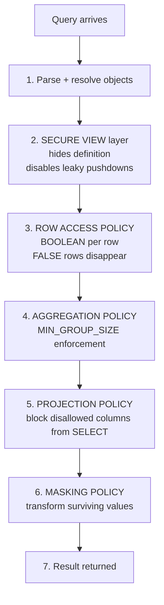
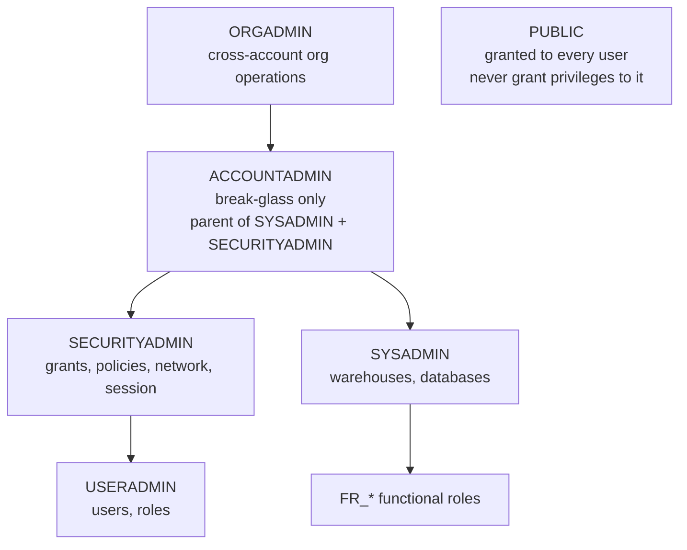
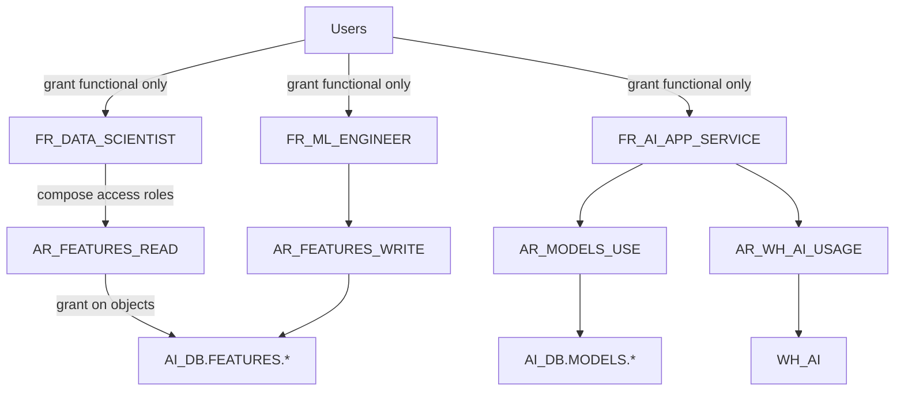
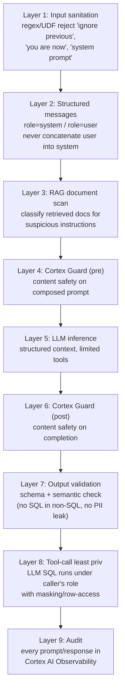

# GAS-C01 Cheatsheet

Dense single-document reference for the Snowflake Specialty: AI Governance & Security exam. Skim before each study session; keep open during mock exams.

---

## 1. NIST AI Risk Management Framework (AI RMF 1.0)

**Four functions:**

| Function | Role | Nature |
|----------|------|--------|
| **GOVERN** | Culture, policies, roles, accountability, risk tolerance, training | **Cross-cutting** (always on) |
| **MAP** | Establish context for a specific AI system (purpose, stakeholders, data, risks) | Per-system |
| **MEASURE** | Quantitatively assess (bias, drift, performance, safety) | Per-system |
| **MANAGE** | Prioritize, treat, monitor, incident-respond | Per-system |

Pattern: GOVERN wraps a continuous loop MAP → MEASURE → MANAGE → (back to MAP).

**Companion document:** NIST AI 600-1 — Generative AI Profile (July 2024). Catalogues 12 GenAI-amplified risks:
1. CBRN info uplift
2. Confabulation (NIST's term; not "hallucination")
3. Dangerous/violent/hateful content
4. Data privacy (training-data extraction, membership inference)
5. Environmental impacts
6. Harmful bias / homogenization
7. Human-AI configuration (over-reliance)
8. Information integrity (misinfo, deepfakes)
9. Information security (prompt injection, model theft, jailbreaks)
10. Intellectual property
11. Obscene/degrading/abusive content (incl. CSAM)
12. Value chain / component integration

**Legal force:** Voluntary (US). No certification. No regulator mandates it federally.

---

## 2. EU AI Act — Risk Tiers + GPAI Obligations

**Risk tiers:**

| Tier | Example | Obligations |
|------|---------|-------------|
| **Unacceptable** | Social scoring, real-time biometric ID in public, manipulative dark patterns | **Banned** |
| **High** | Healthcare, hiring, credit, education, law enforcement, critical infra | Art. 8–15 strict obligations: risk mgmt, data governance, documentation, logging, transparency, human oversight, accuracy, cybersecurity |
| **Limited** | Chatbots, deepfakes | Art. 50 **transparency** (disclose AI, label synthetic content) |
| **Minimal** | Spam filters, game AI | None |

**GPAI (General-Purpose AI) — parallel axis:**

| Classification | Trigger | Key obligations |
|----------------|---------|-----------------|
| **GPAI model** (Art. 3(63)) | Any model showing significant generality at scale | Art. 53: model card, training data summary, copyright policy |
| **GPAI with systemic risk** (Art. 51) | > 10^25 FLOPs training compute **or** Commission designation | Additional: adversarial evaluations, incident reporting, cybersecurity measures |

**Fines (max):**
- Prohibited practices: **€35M or 7%** of global turnover (whichever higher).
- High-risk non-compliance: **€15M or 3%**.
- Supplying incorrect info to authorities: **€7.5M or 1.5%**.

**Timeline (approximate):**
- Entry into force: Aug 2024.
- Prohibitions: Feb 2025 (6 months).
- GPAI obligations: Aug 2025 (12 months).
- High-risk + penalties: Aug 2026 (24 months).
- Full application: Aug 2027.

**Scope note:** Extraterritorial — a US company whose AI output affects persons in the EU is covered.

---

## 3. Policy Evaluation Order



**Mnemonic:** **R-A-P-M** (Row → Agg → Projection → Mask).

**Return types:**

| Policy | Return type |
|--------|-------------|
| Masking | Column's data type (STRING, NUMBER, etc.) |
| Row Access | BOOLEAN |
| Aggregation | `AGGREGATION_CONSTRAINT` or `NO_AGGREGATION_CONSTRAINT()` |
| Projection | `PROJECTION_CONSTRAINT(ALLOW => TRUE/FALSE)` |
| Privacy (DP) | `PRIVACY_CONSTRAINT(EPSILON=>…, DELTA=>…, PRIVACY_UNIT_COLUMN=>…)` |

**Single-binding limits per object:**
- 1 masking policy per column (direct OR via tag — not both).
- 1 row access policy per table.
- 1 aggregation policy per table.
- 1 projection policy per column.
- 1 privacy policy per table.

---

## 4. RBAC — System Roles + Functional/Access Role Pattern

**System roles (default hierarchy):**



**Separation of duties:**
- SECURITYADMIN → policy authorship + grants.
- USERADMIN → user lifecycle only.
- SYSADMIN → compute + object ownership.
- ACCOUNTADMIN → break-glass, alerting.
- ORGADMIN → cross-account, replication groups.

**Functional + Access roles pattern:**



Rules:
1. Users receive **only** functional roles.
2. Access roles hold privileges on objects (one per object/bundle).
3. Functional roles compose access roles.
4. Always `GRANT ROLE FR_X TO ROLE SYSADMIN` for SYSADMIN oversight.

**Primary vs. secondary roles:**

| Session concept | Scope |
|-----------------|-------|
| Primary (`USE ROLE X`) | Owns new objects. Returned by `CURRENT_ROLE()`. Shown in ACCESS_HISTORY. |
| Secondary (`USE SECONDARY ROLES ALL` or `role_a,role_b`) | Augments access evaluation (union of privileges). Does **not** own new objects. |

**Policy gotcha:** `CURRENT_ROLE()` returns only the primary. For policies that must detect any active role, use `IS_ROLE_IN_SESSION('role_name')`.

**Service account authentication:**

| Method | Best for |
|--------|----------|
| Key-pair auth | Scheduled jobs, server-to-server |
| OAuth (external IdP) | User-impersonating apps |
| Programmatic Access Token (PAT) | CI/CD, migration tools, short-lived access |
| Password | **Avoid for services** |

Supporting controls: Network Policy (CIDR allowlist), Authentication Policy (allowed methods, MFA), Session Policy (idle timeout).

---

## 5. ACCOUNT_USAGE View Catalog

| View | Primary question |
|------|------------------|
| **LOGIN_HISTORY** | Who logged in (success/fail), from where, with which client, which auth method |
| **QUERY_HISTORY** | What SQL ran, by whom, cost, outcome, role, bytes scanned |
| **ACCESS_HISTORY** | Which objects/columns read/written; which policies evaluated |
| **SESSIONS** | Session info, client, duration |
| **GRANTS_TO_USERS** | Which users have which roles |
| **GRANTS_TO_ROLES** | Which roles have which privileges on which objects |
| **POLICY_REFERENCES** | Which policies are bound to which objects (direct + tag-based) |
| **TAG_REFERENCES** | Direct tags on objects |
| **TAG_REFERENCES_WITH_LINEAGE** (INFORMATION_SCHEMA table function) | Includes inherited tags |
| **OBJECT_DEPENDENCIES** | DDL-time structural dependencies (view → table, etc.) |
| **DATA_CLASSIFICATION_LATEST** | Classification results per column |
| **DATA_TRANSFER_HISTORY** | Cross-region/share egress |
| **REPLICATION_USAGE_HISTORY** | Replication activity |
| **COPY_HISTORY** | COPY INTO ingest/export events |
| **WAREHOUSE_METERING_HISTORY** | Credit consumption |
| **DATA_QUALITY_MONITORING_RESULTS** | DMF outputs |
| **PRIVACY_BUDGET_USAGE** | DP ε consumption |

**Latency / retention:**

| View | Latency | Retention |
|------|---------|-----------|
| LOGIN_HISTORY | ~15 min | 365 days |
| QUERY_HISTORY | ~45 min | 365 days |
| ACCESS_HISTORY | ~45 min | 365 days |
| POLICY_REFERENCES | ~2 h | 365 days |
| TAG_REFERENCES | ~2 h | 365 days |
| OBJECT_DEPENDENCIES | ~45 min | 365 days |

**For longer retention:** build append-only landing table with scheduled task copying new rows. Replicate to isolated account for tamper-evidence. Mirror to Iceberg on S3 with Object Lock for cross-platform immutability.

**ACCESS_HISTORY key columns for AI auditing:**
- `DIRECT_OBJECTS_ACCESSED` — explicitly named in query (e.g., a view).
- `BASE_OBJECTS_ACCESSED` — underlying tables resolved transitively through views. **Critical** for AI: proves which raw data the query actually touched.
- `OBJECTS_MODIFIED` — write targets (CTAS target, INSERT target).
- `POLICIES_REFERENCED` — forensic record of which policies evaluated.

**ORGANIZATION_USAGE** (cross-account rollups, ~3h latency):
- CREDIT_USAGE, STORAGE_USAGE, WAREHOUSE_METERING, DATA_TRANSFER_HISTORY, REPLICATION_USAGE. Access/query/login live only at account scope.

---

## 6. Policy Syntax Reference

### Masking policy

```sql
CREATE OR REPLACE MASKING POLICY gov.pol.mask_email
AS (val STRING) RETURNS STRING ->
  CASE
    WHEN IS_ROLE_IN_SESSION('PII_READER') THEN val
    ELSE REGEXP_REPLACE(val, '(^[^@]{2}).*(@.*$)', '\\1***\\2')
  END;

-- Direct binding
ALTER TABLE customers MODIFY COLUMN email SET MASKING POLICY gov.pol.mask_email;

-- Tag-based binding (preferred for scale)
ALTER TAG gov.data.pii_level SET MASKING POLICY gov.pol.mask_email FOR (STRING);
```

### Row access policy

```sql
CREATE OR REPLACE ROW ACCESS POLICY gov.pol.region_rap
AS (region STRING) RETURNS BOOLEAN ->
  CASE
    WHEN IS_ROLE_IN_SESSION('FR_GLOBAL_ANALYST') THEN TRUE
    WHEN IS_ROLE_IN_SESSION('FR_EU_ANALYST') AND region = 'EU' THEN TRUE
    ELSE FALSE
  END;

ALTER TABLE customers ADD ROW ACCESS POLICY gov.pol.region_rap ON (region);
```

### Aggregation policy

```sql
CREATE OR REPLACE AGGREGATION POLICY gov.pol.agg_50
AS () RETURNS AGGREGATION_CONSTRAINT ->
  CASE
    WHEN IS_ROLE_IN_SESSION('FR_UNRESTRICTED') THEN NO_AGGREGATION_CONSTRAINT()
    ELSE AGGREGATION_CONSTRAINT(MIN_GROUP_SIZE => 50)
  END;

ALTER TABLE customer_metrics SET AGGREGATION POLICY gov.pol.agg_50;
```

Groups smaller than MIN_GROUP_SIZE are redacted (NULL sentinel), merging visually.

### Projection policy

```sql
CREATE OR REPLACE PROJECTION POLICY gov.pol.no_project_hash
AS () RETURNS PROJECTION_CONSTRAINT ->
  CASE
    WHEN IS_ROLE_IN_SESSION('FR_LINK_PRIVILEGED') THEN PROJECTION_CONSTRAINT(ALLOW => TRUE)
    ELSE PROJECTION_CONSTRAINT(ALLOW => FALSE)
  END;

ALTER TABLE patient_link MODIFY COLUMN patient_hash
  SET PROJECTION POLICY gov.pol.no_project_hash;
```

Allowed in: WHERE, JOIN, GROUP BY (predicate use). Blocked in: SELECT list (projection).

### Privacy (differential privacy) policy

```sql
CREATE OR REPLACE PRIVACY POLICY gov.pol.dp_small
AS () RETURNS PRIVACY_CONSTRAINT ->
  PRIVACY_CONSTRAINT(
    EPSILON => 1.0,
    DELTA => 1e-6,
    PRIVACY_UNIT_COLUMN => 'customer_id'
  );

ALTER TABLE customer_metrics SET PRIVACY POLICY gov.pol.dp_small;
```

**ε guidance:** low ε (0.1–1.0) = strong privacy, high noise. High ε (5+) = weak privacy, low noise. Monitor `PRIVACY_BUDGET_USAGE`.

### External tokenization pattern

```sql
CREATE OR REPLACE MASKING POLICY gov.pol.pci_token
AS (val STRING) RETURNS STRING ->
  CASE
    WHEN IS_ROLE_IN_SESSION('FR_PCI_READER') THEN VAULT.DETOKENIZE(val)
    ELSE val  -- show token, not raw PAN
  END;
```

---

## 7. Trust Center Scanner Packages

| Package | Scope |
|---------|-------|
| **CIS Benchmarks for Snowflake** | Industry security configuration |
| **Snowflake Security Reference Architecture (SRA)** | Snowflake-recommended security posture |
| **Threat Intelligence** | Known-bad patterns |
| **Custom scanners** | SQL stored procs returning finding rows (write your own for AI governance checks) |

**Access:**
- `SNOWFLAKE.TRUST_CENTER_VIEWER` — read findings.
- `SNOWFLAKE.TRUST_CENTER_ADMIN` — enable scanners, configure.

**Findings view:**
```sql
SELECT scanner_name, entity_name, severity, at_risk, remediation
FROM SNOWFLAKE.TRUST_CENTER.FINDINGS
WHERE at_risk = TRUE AND severity IN ('CRITICAL','HIGH');
```

**Example custom scanner (AI governance):**
- Models without `RISK_TIER` tag.
- PII columns without masking policies.
- Service accounts with ACCOUNTADMIN.
- Warehouses without resource monitors.
- Audit tables with DELETE grants.

---

## 8. Compliance → Snowflake Feature Mapping

### GDPR

| Article | Right | Snowflake implementation |
|---------|-------|--------------------------|
| Art. 5(1)(b) | Purpose limitation | Tags encode purpose; RAP/masking gate per declared purpose |
| Art. 15 | Right of access (DSAR) | Tag `CONTAINS_SUBJECT_ID='TRUE'` + discovery view + extract procedure (30-day SLA) |
| Art. 17 | Right to erasure | DELETE + shortened Time Travel; Fail-safe caveat (Support purge if required) |
| Art. 20 | Portability | Export procedure to standard format |
| Art. 22 | Automated decisions | Explanations table (SHAP, feature importance) + HITL gates |
| Art. 25 | Privacy by design | Tag-based policies on schema (default-safe for new objects) |
| Art. 32 | Security of processing | Encryption + RBAC + policies + audit |
| Art. 33 | Breach notification (72 h) | Trust Center alerts + custom scanners |
| Art. 35 | DPIA | Risk register table + lineage views |

**Max fine:** €20M or 4% of global turnover.

### HIPAA Technical Safeguards (§ 164.312)

| Section | Required/Addressable | Snowflake feature |
|---------|----------------------|-------------------|
| § 164.312(a)(1) Access control | Required | RBAC + Row Access + Managed Access schemas |
| § 164.312(a)(2)(i) Unique user ID | Required | USER objects; no shared logins |
| § 164.312(a)(2)(ii) Emergency access | Required | Break-glass ACCOUNTADMIN + alerts |
| § 164.312(a)(2)(iii) Automatic logoff | Addressable | Session Policy (SESSION_IDLE_TIMEOUT) |
| § 164.312(a)(2)(iv) Encryption | Addressable | Encryption at rest + TSS |
| § 164.312(b) Audit controls | Required | ACCESS_HISTORY + QUERY_HISTORY + LOGIN_HISTORY |
| § 164.312(c)(1) Integrity | Required | Append-only audit tables + Time Travel |
| § 164.312(d) Authentication | Required | MFA via Authentication Policy; SSO/SAML |
| § 164.312(e)(1) Transmission security | Required | TLS 1.2+ enforced |

**Edition requirement:** Business Critical + signed BAA. HIPAA data must stay inside the attested edition boundary.

### PCI DSS Highlights

| Req | Snowflake feature |
|-----|-------------------|
| Req 3 (protect stored CHD) | External Tokenization (vault holds PANs; Snowflake stores only tokens) |
| Req 4 (encrypt in transit) | TLS 1.2+ enforced |
| Req 7 (least privilege) | Functional + Access roles; Managed Access |
| Req 8 (unique IDs + MFA) | USER + Authentication Policy with MFA |
| Req 10 (log/audit) | ACCESS_HISTORY + QUERY_HISTORY + LOGIN_HISTORY |
| Req 12 (information security policy) | Governance program documentation |

**Edition requirement:** Business Critical or VPS.

### SOC 2 (Common Criteria highlights)

| CC | Area | Snowflake feature |
|----|------|-------------------|
| CC6 | Logical access | RBAC + Network Policy + Auth Policy + MFA |
| CC7 | System operations | Trust Center + Query/Access history |
| CC8 | Change management | OBJECT_DEPENDENCIES + task approval |
| CC9 | Risk mitigation | Replication, failover, backups |

### FedRAMP

- **Moderate / High** authorizations in **US GovCloud** only.
- Not available in commercial regions.
- Government AI workloads must deploy in GovCloud accounts.

### Edition / Attestation Matrix

| Attestation | Edition required |
|-------------|------------------|
| SOC 1 / SOC 2 Type II | All |
| ISO 27001 / 27017 / 27018 / 27701 | All (verify current scope) |
| PCI DSS Level 1 | Business Critical or VPS |
| HIPAA / HITRUST | Business Critical or VPS + BAA |
| FedRAMP Moderate / High | GovCloud account |
| IRAP / StateRAMP / C5 | Region-specific accounts |

---

## 9. Model Governance Checklist

### Pre-registration
- [ ] Training dataset catalogued and tagged (`AI_USE`, `SENSITIVITY`, `DATA_RESIDENCY`).
- [ ] Classification run on training data; PII columns tagged.
- [ ] Row access policy enforces subject opt-out at training time.
- [ ] Lineage captured: raw sources → features → training set.
- [ ] Training code committed; SHA recorded.
- [ ] Random seed, hyperparameters, framework versions logged.

### Registration (Model Registry)
- [ ] Model logged with `log_model()` including metrics.
- [ ] Governance tags set: `RISK_TIER`, `OWNER_TEAM`, `EU_AI_ACT_TIER`, `GPAI_CLASSIFICATION`.
- [ ] Model card populated as VARIANT in MODEL_CARDS table.
- [ ] Value-chain ledger entry: foundation model, provider, fine-tune dataset.

### Evaluation
- [ ] Bias / fairness metrics computed per protected group.
- [ ] Demographic parity, equal opportunity, equalized odds measured.
- [ ] 4/5ths rule check.
- [ ] Drift baseline distributions captured.
- [ ] For LLMs: faithfulness, relevance, groundedness evaluated.
- [ ] Cortex Guard config tested.

### Deployment gate
- [ ] `DEPLOY_MODEL()` procedure verifies recent (≤ 30 days) bias metrics.
- [ ] Approver recorded in DEPLOYMENT_APPROVALS.
- [ ] Alias pointed to the new version atomically.
- [ ] Access control: USAGE on model granted only to intended service roles.
- [ ] Row access policy on output table enforces HITL review where required.

### Post-deployment monitoring
- [ ] Daily PSI drift task running.
- [ ] Concept drift task (prediction-vs-actual lag).
- [ ] Cortex AI Observability event table ingesting.
- [ ] Alerts configured (drift > 0.25 PSI; guardrail trigger rate; cost spike).
- [ ] Kill-switch tag on output table enables emergency containment.

### Audit evidence (continuous)
- [ ] Append-only audit log replicated to isolated account.
- [ ] Model card linked from DEPLOYMENT_APPROVALS.
- [ ] Monthly compliance view queryable (MODEL × bias × drift × approvals).
- [ ] Access to models logged via ACCESS_HISTORY on `USAGE ON MODEL`.

---

## 10. Cortex Guard Categories + Prompt Injection Defense Layers

### Cortex Guard — 12 categories

```
1. Violent crimes
2. Non-violent crimes
3. Sex-related crimes
4. Child sexual exploitation (CSAM)
5. Defamation
6. Specialized advice (medical, legal, financial)
7. Privacy violations
8. Intellectual property violations
9. Indiscriminate weapons (CBRN)
10. Hate speech
11. Suicide and self-harm
12. Sexual content
```

**Invocation:**
```sql
SELECT SNOWFLAKE.CORTEX.COMPLETE(
  'claude-3-5-sonnet',
  [{'role':'user','content':prompt}],
  {'guardrails': TRUE}
);
```

**Behavior:** Snowflake Guard runs pre- and post-model. Unsafe inputs/outputs are blocked or flagged. Returns metadata on triggered categories.

### Prompt injection defense — layered



**Injection variants to recognize:**
- **Direct** — user types adversarial instructions in the prompt.
- **Indirect** — hostile instructions embedded in retrieved content (RAG). **Hardest to detect.**
- **Multi-turn jailbreak** — gradual escalation across session; limit context window to mitigate.

### Defense summary

| Attack vector | Primary defense |
|---------------|-----------------|
| Direct injection | Input validation + Cortex Guard (pre) |
| Indirect / RAG injection | Document classification + content scan + Cortex Guard |
| Multi-turn jailbreak | Context window limiting + Guard (post) + audit |
| Data exfiltration via LLM | Masking policies on data sources; LLM tool calls run as caller |
| PII leakage in output | Guard "Privacy violations" category + output PII scanner |
| Prompt leakage (system prompt extraction) | Never put secrets in system prompt; use SECRET objects |

---

## 11. Quick Reference — Snowflake AI Governance Vocabulary

| Term | What it means in Snowflake |
|------|----------------------------|
| **Horizon** | Umbrella product bundle: Catalog + Classification + Tags + Lineage + Access History + Policies + Trust Center + Marketplace + Copilot |
| **Classification** | `SYSTEM$CLASSIFY` — writes privacy_category + semantic_category system tags |
| **Tag** | User-defined key-value metadata on any object; enforced allowed values |
| **Lineage** | Data-flow DAG via `SNOWFLAKE.CORE.GET_LINEAGE` |
| **Access History** | Per-query record in ACCOUNT_USAGE |
| **Trust Center** | Posture scoring + findings dashboard |
| **Cortex Guard** | Inline content safety classifier for LLM I/O |
| **Model Registry** | Schema-level managed model objects with versions, aliases, tags |
| **Cortex AI Observability** | Prompt/completion event logging |
| **Clean Room** | Multi-party compute without raw data egress |
| **Document AI** | LLM-based extraction from PDFs/images in stages |
| **TSS (Tri-Secret Secure)** | Customer-held key component (requires Business Critical+) |
| **PrivateLink** | Private network connectivity (AWS/Azure/GCP) |
| **BAA** | Business Associate Agreement (required for HIPAA data) |
| **DSAR** | Data Subject Access Request (GDPR Art. 15) |

---

## 12. Last-Minute Facts to Memorize

1. **GOVERN is cross-cutting**, not sequential first.
2. **BASE_OBJECTS_ACCESSED** resolves views transitively (vs. DIRECT_OBJECTS_ACCESSED).
3. **TAG_REFERENCES_WITH_LINEAGE** (INFORMATION_SCHEMA table function) shows inherited tags; TAG_REFERENCES shows only direct.
4. **CURRENT_ROLE() = primary only.** Use `IS_ROLE_IN_SESSION()` in policies for secondary-role support.
5. **Policy evaluation order:** Row Access → Aggregation → Projection → Masking.
6. **ACCESS_HISTORY latency:** ~45 min. **Retention:** 365 days.
7. **One masking policy per column** (direct OR tag, not both). One RAP per table. One agg per table.
8. **Confabulation** (NIST), not hallucination.
9. **€35M / 7%** for EU AI Act prohibited practices.
10. **12 Cortex Guard categories.**
11. **PSI ≥ 0.25** = significant drift.
12. **HIPAA / PCI** require Business Critical edition.
13. **FedRAMP** = US GovCloud only.
14. **GDPR DSAR** = 30 days.
15. **GDPR breach notification** = 72 hours.
16. **Fail-safe** = 7 days, not user-accessible.
17. **Key-pair auth** for service accounts.
18. **Model versions are immutable** — use aliases for atomic promotion.
19. **Classification uses sampling** (10,000 rows default) — small/atypical data may misclassify.
20. **Aggregation policy** redacts (NULLs) undersized groups; it doesn't drop them.
21. **DP (ε, δ, PRIVACY_UNIT_COLUMN)** is formal privacy; aggregation policy is k-anonymity-flavored and vulnerable to composition.
22. **AUTO_CLASSIFY = TRUE** at schema level runs on new tables + every ~30 days.
23. **GPAI systemic risk:** 10^25 FLOPs.
24. **Secure views** disable leaky optimizer pushdowns + hide definition.
25. **Snowflake does not auto-propagate tags along lineage** — you build it with streams/tasks.

Good luck.
