# Snowflake Overview & Architecture — COF-C02 Study Guide

## Exam Weight & Scope
**~25% of the COF-C02 exam** (largest single domain). Covers the three-layer architecture, hybrid shared-disk/shared-nothing design, editions, cloud platforms/regions, connectivity tools (SnowSQL, Snowsight, drivers, APIs), and account identifiers.

## Core Concepts Map

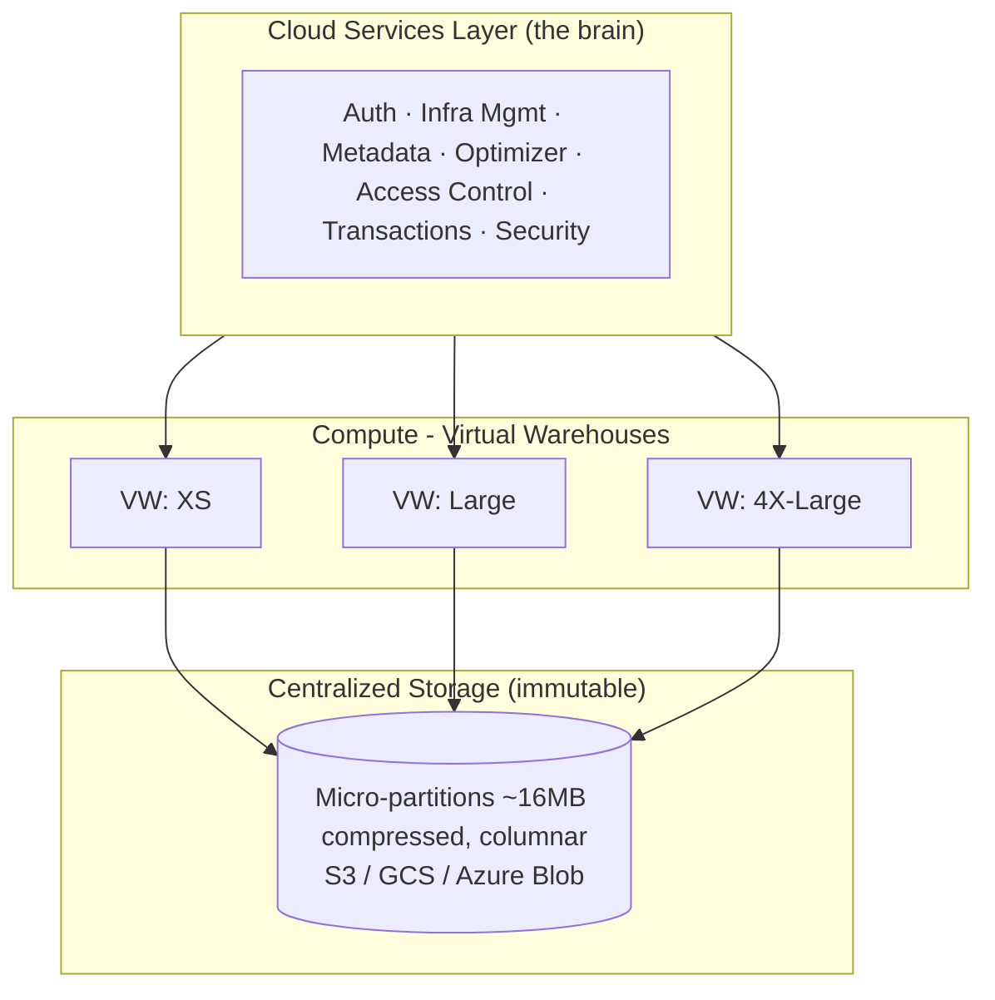

Hybrid: Shared-DISK (one copy of data) + Shared-NOTHING (MPP compute).

---

## Q1: Name the three architectural layers of Snowflake and the primary responsibility of each.
**Difficulty:** Foundation
**Exam relevance:** Snowflake Architecture (1.1)

### Answer
1. **Storage layer** — centralized, immutable, columnar micro-partitioned storage on the underlying cloud provider's object store (S3/GCS/Azure Blob).
2. **Compute layer (Query Processing)** — virtual warehouses: independent MPP clusters that read from storage.
3. **Cloud Services layer** — the "brain": authentication, infrastructure management, metadata, query parsing/optimization, access control, transactions.

### First Principles
Snowflake decouples **state** (storage) from **execution** (compute) from **control plane** (cloud services). Each scales independently. This is the single most important architectural idea in the exam — virtually every feature (zero-copy clone, Time Travel, multi-cluster warehouses, result cache) derives from this separation.

### Diagram
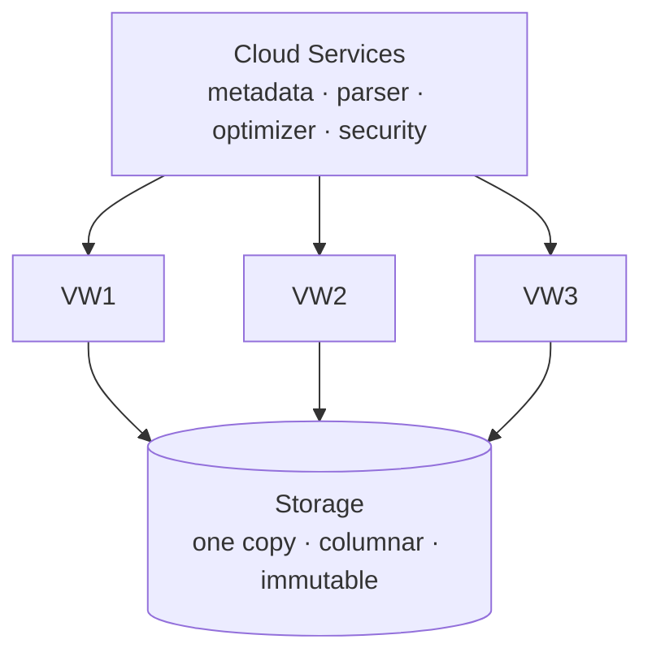

### Lab Exercise
```sql
-- Inspect which layer each piece of info comes from
SELECT CURRENT_WAREHOUSE();        -- compute layer identifier
SELECT CURRENT_ACCOUNT();          -- cloud services layer
SELECT CURRENT_REGION();           -- cloud services layer
SHOW WAREHOUSES;                   -- metadata (cloud services)
SELECT SYSTEM$WHITELIST();         -- cloud services connectivity
```

### Gotchas / Exam Traps
- Storage is **NOT** attached to any specific warehouse — it's shared.
- Metadata operations (DDL, SHOW, DESCRIBE) do **NOT** require a running warehouse.
- `SELECT 1` or `SELECT CURRENT_TIMESTAMP()` can run without a warehouse because they're served by cloud services.
- Cloud services is **free up to 10% of daily compute** usage; billed only beyond that.

---

## Q2: What type of architecture does Snowflake use — shared-disk, shared-nothing, or hybrid?
**Difficulty:** Foundation
**Exam relevance:** Snowflake Architecture (1.1)

### Answer
**Hybrid.** Snowflake uses a **shared-disk** approach for storage (one copy of data accessible to all warehouses) combined with a **shared-nothing** MPP approach for query processing (each compute node has its own local disk/cache for parallelism).

### First Principles
Pure shared-disk architectures struggle with contention and don't scale compute linearly. Pure shared-nothing architectures (Teradata, legacy MPP) require data redistribution and resharding. Snowflake's hybrid gets the best of both: one source of truth + linear compute scaling.

### Diagram
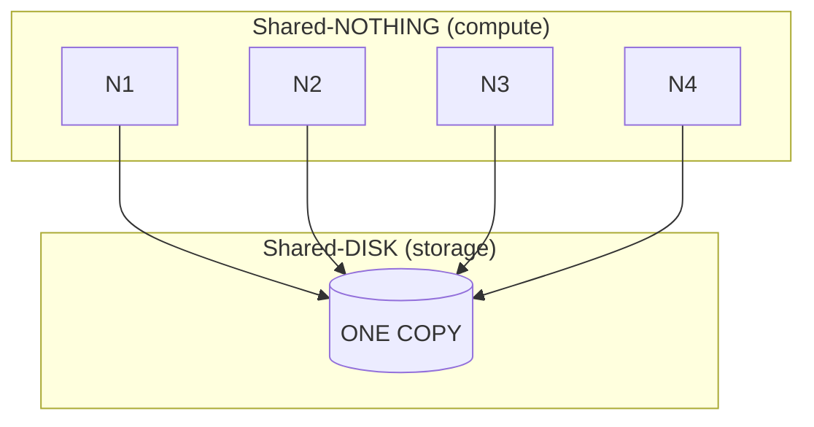
All warehouses read the same data; each node has its own local cache.

### Lab Exercise
```sql
-- Create two warehouses that share the same storage
CREATE WAREHOUSE wh_a WITH WAREHOUSE_SIZE = 'XSMALL';
CREATE WAREHOUSE wh_b WITH WAREHOUSE_SIZE = 'LARGE';

USE WAREHOUSE wh_a;
SELECT COUNT(*) FROM snowflake_sample_data.tpch_sf1.orders;

USE WAREHOUSE wh_b;
SELECT COUNT(*) FROM snowflake_sample_data.tpch_sf1.orders;  -- same table!
```

### Gotchas / Exam Traps
- The exam loves the word **"hybrid"** — pure shared-disk/shared-nothing are wrong answers.
- Don't confuse with "lakehouse" or "data mesh" — those are patterns, not architectures.

---

## Q3: Which THREE of the following are true about Snowflake's storage layer? (multi-select)
**Difficulty:** Intermediate
**Exam relevance:** Storage (1.2)

### Answer
Correct answers:
- **A.** Data is stored in columnar format in micro-partitions.
- **B.** Micro-partitions are immutable.
- **C.** Data is automatically compressed and encrypted at rest.

Incorrect:
- Storage is NOT managed by the user per-warehouse.
- Storage is NOT in row format.
- Micro-partitions are NOT user-sized (they're ~16MB compressed, 50–500MB uncompressed logical, system-managed).

### First Principles
Immutability is the hinge: because micro-partitions never change, Snowflake can keep old versions for Time Travel and Fail-safe, enable zero-copy clone (just copy pointers), and support SELECTs without locking. Every "magic" feature is a consequence of immutability.

### Diagram
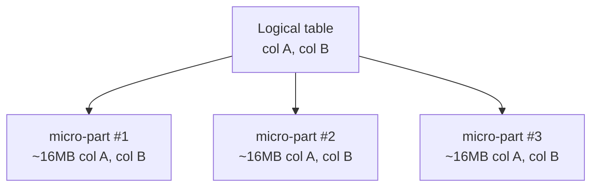
Each micro-partition is encrypted + compressed + columnar.

### Lab Exercise
```sql
-- View micro-partition metadata
SELECT SYSTEM$CLUSTERING_INFORMATION('snowflake_sample_data.tpch_sf1.orders');

-- Table partition count & avg size
SHOW TABLES LIKE 'orders' IN snowflake_sample_data.tpch_sf1;
```

### Gotchas / Exam Traps
- Micro-partitions are **~16MB compressed**, not 16MB uncompressed.
- They are **columnar** (not row-based) — critical for OLAP/analytics.
- Users do NOT define partition keys explicitly (unlike Hive/BigQuery) — clustering keys are a hint, not a partitioning scheme.

---

## Q4: List the Snowflake editions in increasing order of capability. Which edition introduces Multi-Cluster Warehouses?
**Difficulty:** Intermediate
**Exam relevance:** Editions (1.3)

### Answer
**Order:** Standard → Enterprise → Business Critical → Virtual Private Snowflake (VPS).

**Multi-Cluster Warehouses** require **Enterprise edition or higher**.

### First Principles
Editions are feature flags, not performance tiers. Each adds compliance/security/HA features. Memorize *which edition unlocks what* — exam loves this.

### Diagram
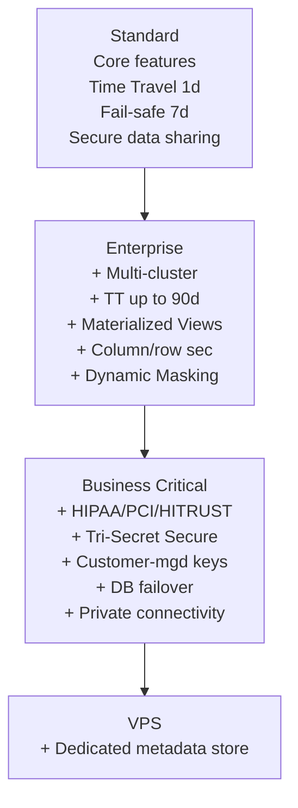

### Lab Exercise
```sql
-- Confirm your edition
SELECT CURRENT_ACCOUNT(), SYSTEM$GET_SNOWFLAKE_EDITION();
-- or
SHOW ORGANIZATION ACCOUNTS;
```

### Gotchas / Exam Traps
- **Time Travel up to 90 days** = Enterprise+ (Standard is capped at 1 day).
- **Materialized views** = Enterprise+.
- **Column-level & row-level security** = Enterprise+.
- **Database failover/replication for DR** = Business Critical+.
- **Tri-Secret Secure (CMK)** = Business Critical+.
- **HIPAA/PCI** = Business Critical+.
- **Dedicated metadata store** = VPS only.

---

## Q5: On which cloud platforms can Snowflake run?
**Difficulty:** Foundation
**Exam relevance:** Deployment (1.4)

### Answer
**AWS, Microsoft Azure, and Google Cloud Platform (GCP).**

### First Principles
Snowflake is cloud-agnostic at the deployment level — same product, same SQL. Choice of cloud is primarily for data gravity (where your other data/services live), region availability, and compliance.

### Diagram
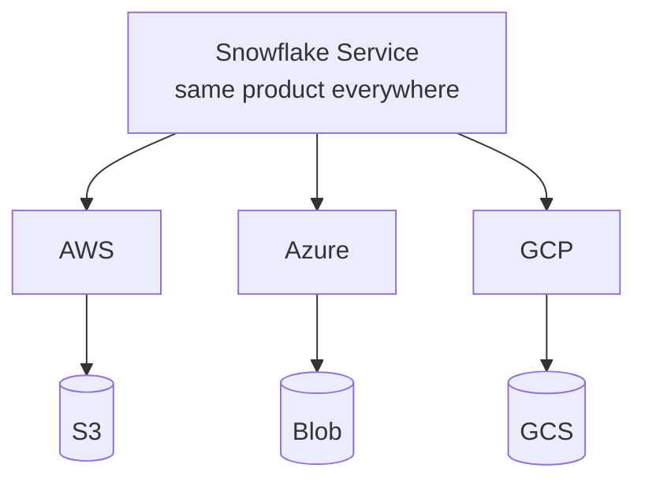
Storage backend differs; UX identical.

### Lab Exercise
```sql
-- Identify platform & region
SELECT CURRENT_REGION();  -- e.g., AWS_US_WEST_2 or AZURE_EASTUS2
```

### Gotchas / Exam Traps
- Data **cannot** cross cloud providers in a single account — you need **replication** or **cross-cloud auto-fulfillment** for shares.
- Snowflake is NOT available on Oracle Cloud, IBM Cloud, or Alibaba.
- Each cloud/region combo is a separate deployment; account identifiers include the region.

---

## Q6: What is the format of a Snowflake account identifier?
**Difficulty:** Intermediate
**Exam relevance:** Account Identifiers (1.4)

### Answer
Two valid forms:

1. **Preferred (Org + Account name):** `<orgname>-<account_name>`
   Example: `acme-prod_us_east`
2. **Legacy (Account locator + region + cloud):** `<account_locator>.<region>.<cloud>`
   Example: `xy12345.us-east-2.aws`

### First Principles
Account identifiers resolve to URLs: `https://<orgname>-<account>.snowflakecomputing.com`. The org-based form is portable across regions; the locator form embeds the deployment.

### Diagram
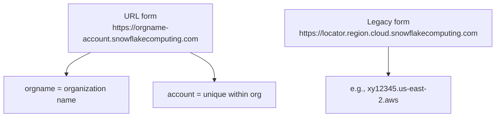

### Lab Exercise
```sql
SELECT CURRENT_ORGANIZATION_NAME();
SELECT CURRENT_ACCOUNT();
SELECT CURRENT_ACCOUNT_NAME();
-- Full URL
SELECT CONCAT('https://', CURRENT_ORGANIZATION_NAME(), '-', CURRENT_ACCOUNT_NAME(), '.snowflakecomputing.com');
```

### Gotchas / Exam Traps
- Account locators in AWS us-west-2 (Oregon) do NOT include the region in the URL (legacy quirk).
- URLs for China/GovCloud use different TLDs.
- The old form uses dots; the new form uses hyphens between org and account.

---

## Q7: Which TWO interfaces can be used to connect to Snowflake? (multi-select, pick two)
**Difficulty:** Foundation
**Exam relevance:** Connecting to Snowflake (1.5)

### Answer
Any two of the following are correct:
- **Snowsight** (modern web UI)
- **SnowSQL** (CLI)
- **Classic Console / Classic UI** (deprecated, phased out)
- **JDBC / ODBC drivers**
- **Python connector, Node.js, .NET, Go, PHP, Spark connector**
- **SQL REST API**
- **Snowflake CLI** (newer, replacing some SnowSQL use cases)

### First Principles
Everything talks to the Cloud Services layer over HTTPS; differences are convenience/language-binding only.

### Diagram
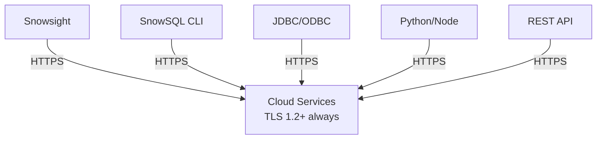

### Lab Exercise
```bash
# Install and connect via SnowSQL
snowsql -a <account> -u <user> -w <warehouse> -d <database>
# Inside SnowSQL:
!help
!set output_format=plain
```

### Gotchas / Exam Traps
- **SnowSQL** is the CLI tool; **Snowsight** is the web UI (NOT the same).
- The **Classic Console** is being retired — Snowsight is the current UI.
- All connections use **TLS 1.2+**; this is non-negotiable.
- The **Partner Connect** feature inside Snowsight is for third-party tool trials, not a connector itself.

---

## Q8: What is the role of the Cloud Services layer during query execution?
**Difficulty:** Intermediate
**Exam relevance:** Architecture / Query Processing (1.1)

### Answer
The Cloud Services layer:
1. Authenticates the user and session.
2. Parses and compiles the SQL.
3. Optimizes the query (cost-based optimizer using statistics from micro-partition metadata).
4. Performs access control checks.
5. Serves the query from the **result cache** if the same query was run in the last 24 hours and underlying data is unchanged.
6. Dispatches the compiled plan to a virtual warehouse for execution.
7. Manages transactions.

### First Principles
Separation of concerns: the warehouse should do nothing but crunch rows. Everything else is centralized so metadata and security are consistent across all compute.

### Diagram
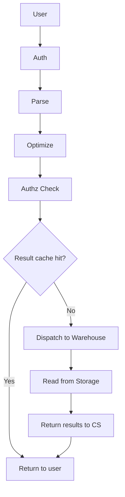

### Lab Exercise
```sql
-- Watch cloud services do its job
EXPLAIN SELECT COUNT(*) FROM snowflake_sample_data.tpch_sf1.orders;

-- See cloud services credit usage
SELECT * FROM snowflake.account_usage.warehouse_metering_history
WHERE start_time >= DATEADD(day, -1, CURRENT_TIMESTAMP())
ORDER BY start_time DESC;
-- Column CREDITS_USED_CLOUD_SERVICES
```

### Gotchas / Exam Traps
- Cloud services credits are billed only above the **10% daily adjustment** (free threshold).
- Metadata-only operations (COUNT(*) in some cases, SHOW/DESC) do NOT consume warehouse credits.
- Query compilation time is tracked separately from execution time in Query Profile.

---

## Q9: Which of the following queries will NOT require a running virtual warehouse? (multi-select)
**Difficulty:** Intermediate
**Exam relevance:** Compute vs. Cloud Services (1.1)

### Answer
Metadata-only operations do NOT require a warehouse:
- `SHOW TABLES`, `SHOW WAREHOUSES`, `SHOW USERS`
- `DESCRIBE TABLE t`
- `SELECT CURRENT_TIMESTAMP()`, `SELECT 1+1`
- `SELECT COUNT(*) FROM t` (if served from metadata — depends; often does require warehouse but can be optimized)
- `SELECT MIN/MAX of a clustering key column` (if served from metadata)
- Information schema queries that read metadata

### First Principles
Micro-partition metadata (min, max, null count, distinct values) is kept in the Cloud Services layer. If a query can be answered from metadata alone, no scan is needed, so no warehouse.

### Diagram
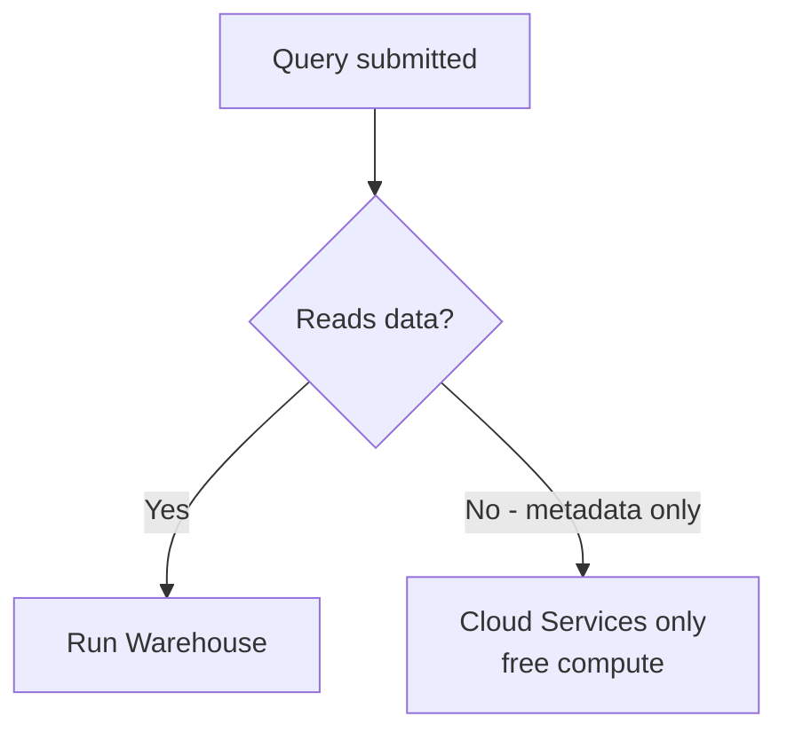

### Lab Exercise
```sql
-- Suspend warehouse, then try these
ALTER WAREHOUSE compute_wh SUSPEND;

SELECT CURRENT_TIMESTAMP();           -- works
SHOW TABLES;                          -- works
SELECT COUNT(*) FROM my_table;        -- usually requires warehouse
SELECT * FROM my_table LIMIT 10;      -- requires warehouse
```

### Gotchas / Exam Traps
- `SELECT COUNT(*)` **can** be served from metadata but Snowflake does not guarantee it — treat as "may require warehouse" on the exam.
- `SHOW` commands have a 10,000-row limit from metadata.
- `INFORMATION_SCHEMA` queries use cloud services, not a warehouse, but have limits per account.

---

## Q10: What are the three key benefits of separating storage and compute?
**Difficulty:** Foundation
**Exam relevance:** Architecture (1.1)

### Answer
1. **Independent scaling** — scale compute up/down without touching data; add more data without adding compute.
2. **Workload isolation** — multiple warehouses can hit the same data simultaneously without interference (ETL vs BI vs data science).
3. **Zero-copy operations enabled** — because storage is centralized and immutable, cloning/sharing is a pointer operation, not a data copy.

### First Principles
In traditional MPP databases, nodes own data slices. Scaling means re-sharding (slow, risky). In Snowflake, scaling is instantaneous because no data moves.

### Diagram
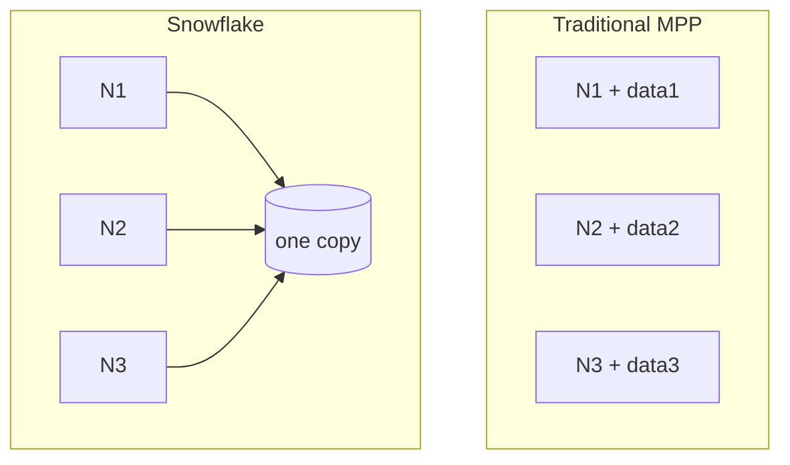
Traditional MPP: scale = reshard data. Snowflake: scale = add node, zero data movement.

### Lab Exercise
```sql
-- Run two workloads concurrently without interference
CREATE WAREHOUSE etl_wh SIZE='LARGE' AUTO_SUSPEND=60;
CREATE WAREHOUSE bi_wh  SIZE='MEDIUM' AUTO_SUSPEND=300;

-- ETL session
USE WAREHOUSE etl_wh;
-- heavy transformation

-- BI session (parallel, same data)
USE WAREHOUSE bi_wh;
-- analyst queries
```

### Gotchas / Exam Traps
- "Zero-copy clone" is a feature of the architecture, not a separate product.
- Snowflake charges separately for storage and compute — this is a direct consequence.

---

## Q11: What does Snowsight provide that the Classic UI did not?
**Difficulty:** Foundation
**Exam relevance:** Interfaces (1.5)

### Answer
Snowsight is the modern web interface and includes:
- Visualization/dashboarding (built-in charts).
- Worksheet autocomplete and SQL formatting.
- Query profile visualization.
- Native Marketplace browsing.
- Role & warehouse context switching built into the header.
- Streamlit integration for data apps.
- Admin console (billing, users, roles).

### First Principles
Snowsight consolidates the GUI, admin, developer, and visualization experience in one place. Classic UI is being deprecated.

### Lab Exercise
```sql
-- In Snowsight, open a worksheet and press Cmd/Ctrl+Shift+F to format SQL.
-- Charts tab appears after a SELECT returns results.
-- Databases > Marketplace to browse listings.
```

### Gotchas / Exam Traps
- Snowsight is NOT a separate product — it's bundled.
- Streamlit in Snowflake is a separate feature (SiS) but accessed through Snowsight.
- Classic UI retirement is ongoing; prefer Snowsight on exam questions.

---

## Q12: Which TWO of the following are responsibilities of a Virtual Warehouse? (multi-select)
**Difficulty:** Foundation
**Exam relevance:** Compute (1.1)

### Answer
Virtual Warehouses are responsible for:
- **Executing SQL (compute/scan/join/aggregate).**
- **Caching data locally on SSD (warehouse-local cache).**
- **DML operations (INSERT/UPDATE/DELETE/MERGE).**

NOT responsibilities:
- Storing persistent data (that's storage layer).
- Managing security/metadata (cloud services).
- Query optimization (cloud services).

### First Principles
The warehouse is a stateless, ephemeral compute cluster. When suspended, local cache is lost (unless preserved by auto-resume rules). When destroyed, nothing of consequence is lost because data lives elsewhere.

### Lab Exercise
```sql
CREATE WAREHOUSE lab_wh WITH
  WAREHOUSE_SIZE='XSMALL'
  AUTO_SUSPEND=60
  AUTO_RESUME=TRUE
  INITIALLY_SUSPENDED=TRUE;
```

### Gotchas / Exam Traps
- Warehouses do NOT store data permanently.
- Warehouses do NOT handle authentication.
- Each warehouse has its OWN local SSD cache (not shared).

---

## Q13: What is the Snowflake Marketplace and what does it provide access to?
**Difficulty:** Foundation
**Exam relevance:** Snowflake Ecosystem (1.6)

### Answer
The **Snowflake Marketplace** is a public catalog where providers list data products (datasets), applications (Native Apps), and services. Consumers can discover, access, and query data directly in their account — often with **no ETL**, via live Secure Data Sharing.

### First Principles
Because storage is centralized and shares use metadata pointers (zero-copy), a provider can expose a live, up-to-date dataset to any Snowflake consumer with no data movement.

### Diagram
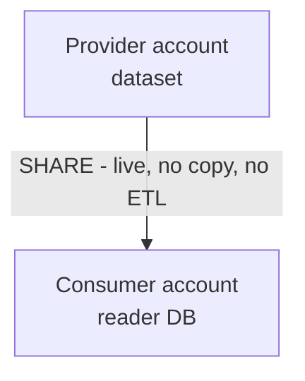

### Lab Exercise
```sql
-- Browse the Marketplace in Snowsight: Data Products > Marketplace
-- Request a free dataset (e.g., Knoema or Weather Source)
-- After acceptance, it appears as a database:
SHOW DATABASES;
SELECT * FROM <acquired_db>.<schema>.<table> LIMIT 10;
```

### Gotchas / Exam Traps
- Marketplace requires providers to be in the **same cloud/region**, OR consumers use **auto-fulfillment** (which replicates behind the scenes).
- Marketplace listings can be **free**, **paid**, or **personalized**.
- Private sharing (one-to-one) uses Data Exchange or direct shares, not Marketplace.

---

## Q14: True or False — A single Snowflake account can span multiple cloud providers.
**Difficulty:** Intermediate
**Exam relevance:** Regions & Cloud Deployment (1.4)

### Answer
**False.** A single account exists in **exactly one cloud provider and one region**. To span clouds/regions, use **database replication** across accounts, or **organizations** with multiple accounts.

### First Principles
Each account is a tenant on a specific regional deployment of Snowflake. Cross-region/cross-cloud scenarios are solved by replication + failover groups, not by a multi-region account.

### Diagram
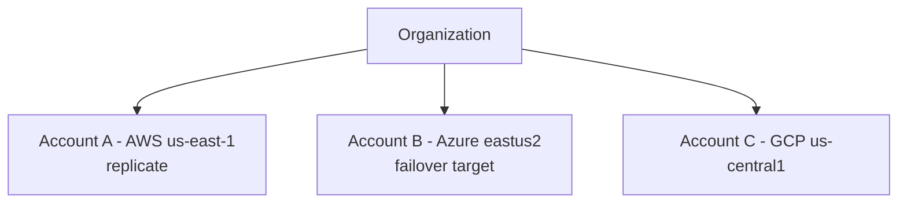

### Lab Exercise
```sql
-- Replicate a database from account A to account B
ALTER DATABASE sales ENABLE REPLICATION TO ACCOUNTS myorg.account_b;
-- On account B:
CREATE DATABASE sales_replica
  AS REPLICA OF myorg.account_a.sales;
ALTER DATABASE sales_replica REFRESH;
```

### Gotchas / Exam Traps
- Replication is **account-to-account**, not within one account.
- Failover groups require **Business Critical+**.
- Simple replication (DBs, shares) is available on **Standard+**.

---

## Q15: Which of the following statements about Snowflake caching is correct? (single select — classic exam Q)
**Difficulty:** Intermediate
**Exam relevance:** Architecture / Caching (1.1)

### Answer
**Correct:** The **result cache** is maintained by the Cloud Services layer and is available across sessions and users (same role/perms) for **24 hours**, and does NOT consume warehouse credits.

### First Principles
Because results are small and cheap to store, caching them in CS avoids re-running the entire query. The 24-hour TTL rolls forward: each hit extends the lifetime up to **31 days maximum**.

### Diagram
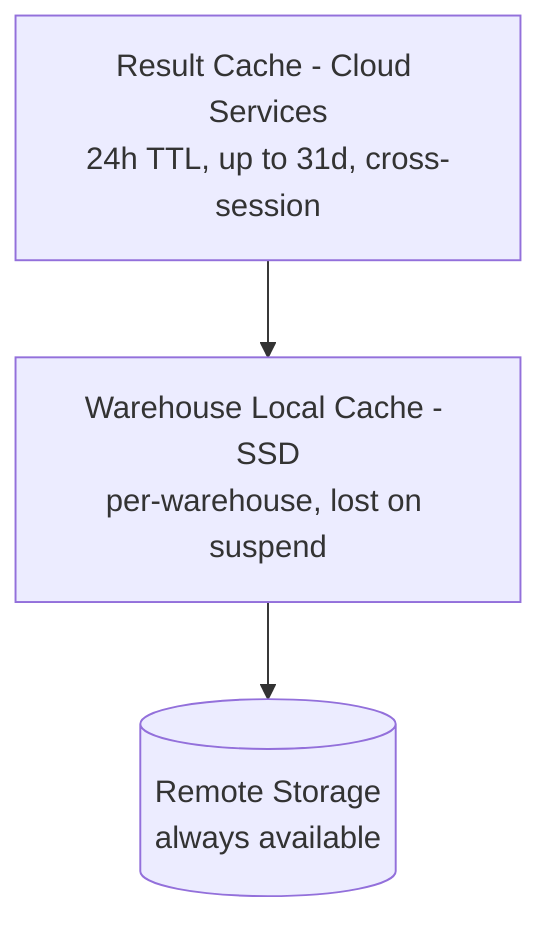

### Lab Exercise
```sql
-- Run twice, note instant return second time
SELECT COUNT(*) FROM snowflake_sample_data.tpch_sf1.orders;
SELECT COUNT(*) FROM snowflake_sample_data.tpch_sf1.orders;
-- Check cache usage
SELECT query_id, warehouse_name, execution_status,
       bytes_scanned, percentage_scanned_from_cache
FROM table(information_schema.query_history())
ORDER BY start_time DESC LIMIT 5;
```

### Gotchas / Exam Traps
- Result cache invalidates when underlying data changes.
- Non-deterministic functions (`CURRENT_TIMESTAMP`, `RANDOM`) bypass result cache.
- Result cache does NOT require the original warehouse to be running.
- Local disk cache is lost when warehouse is suspended (unless resumed quickly).

---

## Q16: Which statement about Snowflake's regions is correct?
**Difficulty:** Intermediate
**Exam relevance:** Regions (1.4)

### Answer
**Correct:** Snowflake regions correspond to a specific cloud provider + geographic region (e.g., AWS us-east-1, Azure East US 2, GCP us-central1), and account URLs embed the region information. Not all features are available in all regions (e.g., certain compliance regions limit features).

### First Principles
Snowflake deploys services into the underlying cloud's regional infrastructure. The region determines data residency, latency, available features, and pricing.

### Lab Exercise
```sql
SELECT CURRENT_REGION();  -- e.g., 'AWS_US_WEST_2'
SELECT SYSTEM$ALLOWLIST();  -- IP ranges for the region
```

### Gotchas / Exam Traps
- **GovCloud regions** and **VPS deployments** have feature restrictions.
- Data **does not leave** a region without explicit replication.
- Marketplace cross-region sharing uses auto-fulfillment (replication behind the scenes).

---

## Q17: What is a Snowflake "stage" and which types exist? (foundation question — but overlaps multiple domains)
**Difficulty:** Foundation
**Exam relevance:** Overview (1.6) & Data Movement (bridges Domain 4)

### Answer
A **stage** is a storage location that holds data files for loading/unloading. Types:
1. **User stage** (`@~`) — one per user, implicit, cannot be altered.
2. **Table stage** (`@%mytable`) — one per table, implicit, used only for that table.
3. **Named internal stage** (`@mystage`) — explicitly created, shareable across users, can have file format.
4. **Named external stage** — points to S3/Azure Blob/GCS; needs a storage integration + URL + credentials.

### First Principles
Loading data into Snowflake tables goes through a stage. Stages abstract where the raw files sit — your COPY INTO statements don't need to know if it's local, internal, or on an external cloud bucket.

### Diagram
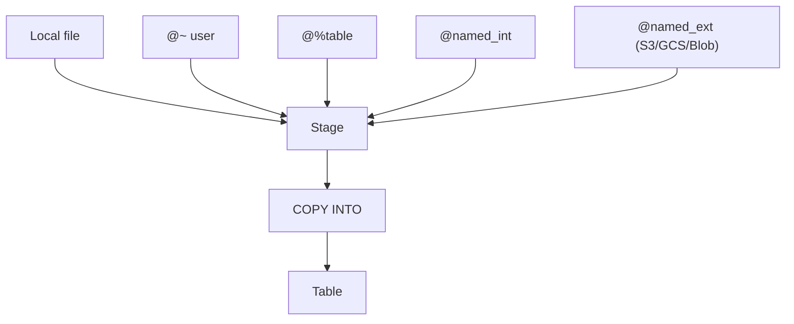

### Lab Exercise
```sql
-- Named internal stage
CREATE STAGE my_int_stage FILE_FORMAT = (TYPE=CSV);
LIST @my_int_stage;

-- External stage with storage integration
CREATE STORAGE INTEGRATION s3_int
  TYPE=EXTERNAL_STAGE STORAGE_PROVIDER='S3'
  ENABLED=TRUE STORAGE_AWS_ROLE_ARN='arn:aws:iam::...'
  STORAGE_ALLOWED_LOCATIONS=('s3://mybucket/data/');

CREATE STAGE my_ext_stage
  URL='s3://mybucket/data/'
  STORAGE_INTEGRATION = s3_int;
```

### Gotchas / Exam Traps
- User stage and table stage are **implicit** — they always exist; don't CREATE them.
- External stages don't need credentials if a storage integration is used (preferred).
- `LIST @stage` is a quick way to see what's there.

---

## Q18: Which TWO statements are TRUE about Snowflake storage billing? (multi-select)
**Difficulty:** Intermediate
**Exam relevance:** Billing basics (1.6)

### Answer
True statements:
- **Storage is billed on compressed size per month**, averaged daily.
- **Time Travel and Fail-safe storage are also billed** as part of total storage used.
- **Different pricing models** exist: on-demand vs. capacity (prepaid credits).

False:
- Storage is NOT billed on logical/uncompressed size.
- Storage billing is NOT tied to warehouse size.

### First Principles
You pay for what's physically stored on the cloud provider (compressed) plus retention copies. Snowflake marks up the raw cloud storage cost modestly.

### Lab Exercise
```sql
SELECT * FROM snowflake.account_usage.storage_usage
ORDER BY usage_date DESC LIMIT 7;
-- STORAGE_BYTES, STAGE_BYTES, FAILSAFE_BYTES
```

### Gotchas / Exam Traps
- **Fail-safe cannot be disabled** on permanent tables — you pay for 7 days.
- **Transient and temporary tables** have NO Fail-safe (saves cost).
- **Stages** also count toward storage billing.

---

## Q19: What is an "organization" in Snowflake?
**Difficulty:** Foundation
**Exam relevance:** Account management (1.4)

### Answer
An **organization** is a top-level logical grouping of one or more Snowflake accounts under a single customer. It enables centralized billing, cross-account replication, and single-sign-on for ORGADMIN tasks.

### Diagram
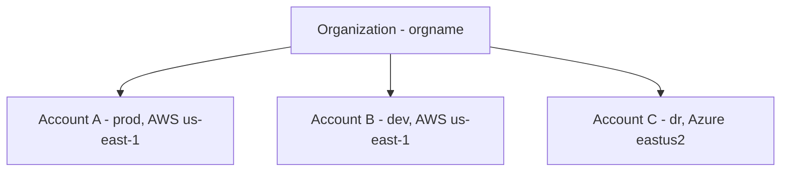

### Lab Exercise
```sql
USE ROLE ORGADMIN;
SHOW ORGANIZATION ACCOUNTS;
SHOW REGIONS;
-- Create new account under org
CREATE ACCOUNT dev_account
  ADMIN_NAME='admin' ADMIN_PASSWORD='...'
  EMAIL='admin@example.com' EDITION=ENTERPRISE
  REGION=AWS_US_EAST_1;
```

### Gotchas / Exam Traps
- Only **ORGADMIN** can manage org-level operations.
- ORGADMIN cannot access the data in child accounts — only administer them.
- Account URL format `<org>-<account>` depends on being in an organization.

---

## Q20: Which of the following is NOT a feature available in Standard edition?
**Difficulty:** Intermediate
**Exam relevance:** Editions (1.3)

### Answer
**Not in Standard** (requires Enterprise+):
- Multi-cluster warehouses
- Time Travel beyond 1 day
- Materialized views
- Column-level and row-level security (Dynamic Data Masking, Row Access Policies)
- Search Optimization Service
- Query Acceleration Service

**In Standard:**
- All core SQL, data loading/unloading
- Secure Data Sharing (basic)
- 1-day Time Travel
- 7-day Fail-safe (always)
- Standard encryption

### Lab Exercise
```sql
-- Attempting MV on Standard will fail
CREATE MATERIALIZED VIEW mv AS SELECT ... ;  -- ERROR on Standard
```

### Gotchas / Exam Traps
- The exam LOVES mapping features to editions. Memorize this table.
- Enterprise does NOT include failover/replication-for-DR; that's Business Critical+.

---

## Q21: TWO benefits of Snowflake being a true SaaS? (multi-select)
**Difficulty:** Foundation
**Exam relevance:** Snowflake value prop (1.6)

### Answer
Any two:
- **No infrastructure to manage** (no servers, no indexing, no vacuuming).
- **No manual tuning** of partitions, indexes, or distribution keys.
- **Automatic patching, upgrades, HA** handled by Snowflake.
- **Elastic scaling** on demand.
- **Pay-per-use** compute.

### First Principles
Operational burden shifts to the vendor. Users focus on SQL and data; Snowflake handles everything underneath.

### Gotchas / Exam Traps
- You still manage **warehouses, roles, resource monitors, retention policies** — not infrastructure, but configuration.
- "No tuning" is a slight overstatement — clustering keys, warehouse sizing, and materialized views still require thought.

---

## Q22: What is the SnowSQL command to execute a SQL script file?
**Difficulty:** Foundation
**Exam relevance:** SnowSQL (1.5)

### Answer
Two ways:
```bash
snowsql -a <account> -u <user> -f myscript.sql
```
or inside an interactive SnowSQL session:
```
!source myscript.sql
```

### Lab Exercise
```bash
snowsql -a myorg-myaccount -u analyst -w compute_wh -d analytics -s public -f etl.sql
```

### Gotchas / Exam Traps
- `!help` lists SnowSQL meta-commands.
- Variables with `-D` or `&varname` substitution are commonly tested.
- Config file: `~/.snowsql/config` holds connection presets.

---

## Q23: Which of the following is a key architectural property that enables Zero-Copy Cloning?
**Difficulty:** Intermediate
**Exam relevance:** Architecture (1.1)

### Answer
**Micro-partition immutability.** Because micro-partitions never change, a clone is just a metadata operation that references the same partitions. Only when the clone (or original) is modified does Snowflake write new partitions ("copy-on-write").

### Diagram
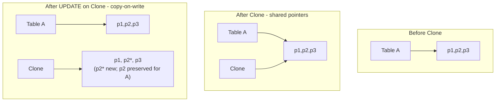

### Lab Exercise
```sql
CREATE TABLE orders_clone CLONE sales.public.orders;
-- Instant, no data copied
SELECT COUNT(*) FROM orders_clone;
```

### Gotchas / Exam Traps
- Clones are **writable** — not read-only snapshots.
- Clones can be made of tables, schemas, or databases.
- Clones **inherit** Time Travel data from the source as of the clone time.

---

## Q24: Which THREE storage backends does Snowflake use based on cloud platform? (multi-select)
**Difficulty:** Foundation
**Exam relevance:** Storage & cloud (1.4)

### Answer
- **AWS → Amazon S3**
- **Azure → Azure Blob Storage**
- **GCP → Google Cloud Storage (GCS)**

### First Principles
Snowflake uses the native blob store of each cloud. Users never interact with these directly for storage (only for external stages that point to their own buckets).

### Gotchas / Exam Traps
- Snowflake-managed storage is NOT exposed to the customer directly — only through SQL.
- External stages let you keep raw files in your own S3/Blob/GCS bucket.
- Cross-cloud data movement always costs egress (replication fees).

---

## Q25: Which of the following statements about Snowflake's SQL REST API is TRUE?
**Difficulty:** Intermediate
**Exam relevance:** APIs (1.5)

### Answer
**True:** The SQL REST API allows applications to submit SQL statements and retrieve results via HTTPS using JSON, using key-pair authentication or OAuth. It's suitable for lightweight integrations and does not require a driver.

### Lab Exercise
```bash
# Example: submit a statement
curl -X POST "https://myorg-myaccount.snowflakecomputing.com/api/v2/statements" \
  -H "Authorization: Bearer <jwt_or_oauth_token>" \
  -H "Content-Type: application/json" \
  -d '{"statement":"SELECT 1","warehouse":"COMPUTE_WH"}'
```

### Gotchas / Exam Traps
- REST API typically uses **key-pair auth** (private key JWT), not password.
- Max statement size and result size have limits — not for huge payloads.
- Prefer drivers for heavy throughput.

---
