# Virtual Warehouses — COF-C02 Study Guide

## Exam Weight & Scope
**~20% of the COF-C02 exam.** Covers warehouse sizes & credit consumption, vertical vs horizontal scaling, multi-cluster warehouses (scaling policies), auto-suspend/resume, concurrency and query queueing, warehouse states, resource monitors, and billing fundamentals.

## Core Concepts Map

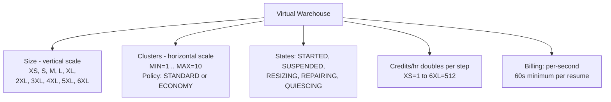

State transitions: STARTED → (idle AUTO_SUSPEND) → SUSPENDED → (query / AUTO_RESUME) → STARTED.

---

## Q1: List all Snowflake warehouse sizes and their credit-per-hour consumption.
**Difficulty:** Foundation
**Exam relevance:** Sizing & Billing (2.1)

### Answer
| Size | Credits/hour | Nodes (approx) |
|------|--------------|----------------|
| X-Small (XS) | 1 | 1 |
| Small (S) | 2 | 2 |
| Medium (M) | 4 | 4 |
| Large (L) | 8 | 8 |
| X-Large (XL) | 16 | 16 |
| 2X-Large (2XL) | 32 | 32 |
| 3X-Large (3XL) | 64 | 64 |
| 4X-Large (4XL) | 128 | 128 |
| 5X-Large (5XL) | 256 | 256 |
| 6X-Large (6XL) | 512 | 512 |

### First Principles
Each size doubles the node count and doubles the credits/hour. Doubling the warehouse often (but not always) halves the time for a scan-heavy workload — so cost may be approximately constant while wall-clock is cut in half. This is the "pay for speed" tradeoff.

### Diagram
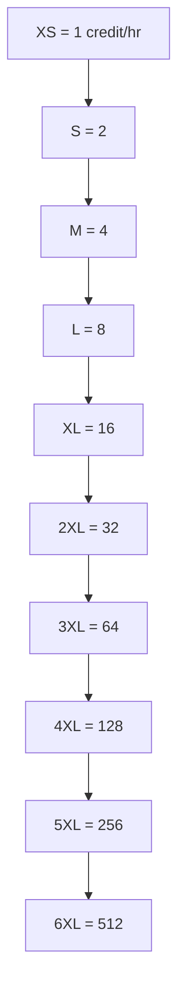
Each step up doubles credits.

### Lab Exercise
```sql
CREATE WAREHOUSE wh_test
  WITH WAREHOUSE_SIZE='XSMALL'
  AUTO_SUSPEND=60 AUTO_RESUME=TRUE;

-- Resize up (vertical scale)
ALTER WAREHOUSE wh_test SET WAREHOUSE_SIZE='LARGE';

-- See credit usage
SELECT * FROM snowflake.account_usage.warehouse_metering_history
WHERE warehouse_name='WH_TEST'
ORDER BY start_time DESC;
```

### Gotchas / Exam Traps
- 5XL and 6XL are **not available in all regions** and are often **generally available** only by request.
- Standard edition limits scaling policy options.
- A warehouse size does NOT determine storage.

---

## Q2: Explain the difference between vertical and horizontal scaling of a warehouse.
**Difficulty:** Foundation
**Exam relevance:** Scaling (2.2)

### Answer
- **Vertical scaling (scaling up/down)** — change the warehouse **size** (XS → L). More compute power per query. Improves performance of single large/complex queries.
- **Horizontal scaling (scaling out/in)** — add more **clusters** to a multi-cluster warehouse. Each cluster has the same size. Improves **concurrency** (more queries in parallel).

### First Principles
- Big single query → size up.
- Many concurrent small queries → multi-cluster.

### Diagram
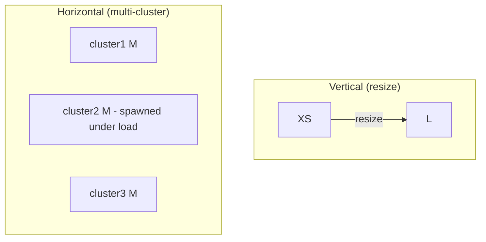
Vertical = faster per-query, same concurrency. Horizontal = each cluster has its own queue; more throughput at concurrency peaks.

### Lab Exercise
```sql
-- Vertical
ALTER WAREHOUSE wh_bi SET WAREHOUSE_SIZE='LARGE';

-- Horizontal (requires Enterprise+)
ALTER WAREHOUSE wh_bi SET
  MIN_CLUSTER_COUNT=1
  MAX_CLUSTER_COUNT=5
  SCALING_POLICY='STANDARD';
```

### Gotchas / Exam Traps
- Multi-cluster warehouses require **Enterprise edition or higher**.
- Resize does NOT drop the warehouse — in-flight queries complete on old size.
- When resizing **larger**, new size takes effect **immediately** for queued queries; running queries continue on old resources.
- When resizing **smaller**, Snowflake waits for running queries to finish on old resources before releasing.

---

## Q3: What is the maximum number of clusters a multi-cluster warehouse can have?
**Difficulty:** Foundation
**Exam relevance:** Multi-cluster (2.2)

### Answer
**10 clusters maximum** (MIN_CLUSTER_COUNT=1 up to MAX_CLUSTER_COUNT=10).

### First Principles
Beyond 10 clusters, horizontal scaling returns diminishing concurrency and admin complexity. For very high concurrency, use larger clusters or separate warehouses.

### Lab Exercise
```sql
CREATE WAREHOUSE wh_bi WITH
  WAREHOUSE_SIZE='MEDIUM'
  MIN_CLUSTER_COUNT=1
  MAX_CLUSTER_COUNT=10
  SCALING_POLICY='STANDARD';
```

### Gotchas / Exam Traps
- MAX = **10**. Easy trivia question.
- MIN can be 1 (default) or more if you want warm standby.
- MIN=MAX makes a **"maximized" warehouse** — all clusters always running.

---

## Q4: Compare the STANDARD vs ECONOMY scaling policies.
**Difficulty:** Intermediate
**Exam relevance:** Scaling policies (2.2)

### Answer
- **STANDARD (default)** — favors **performance**. Starts a new cluster as soon as a query is queued (or after a short wait). Shuts down clusters conservatively.
- **ECONOMY** — favors **saving credits**. Starts new clusters only when the system estimates ~6 minutes of queued work would benefit. Shuts them down aggressively.

### First Principles
Standard = BI user-facing; latency matters.
Economy = batch/ETL; queueing is OK to save money.

### Diagram
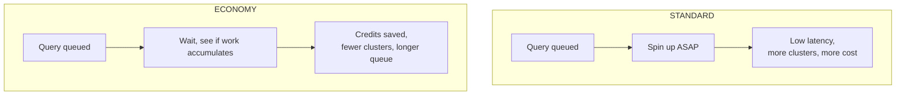

### Lab Exercise
```sql
ALTER WAREHOUSE wh_bi SET SCALING_POLICY='ECONOMY';
```

### Gotchas / Exam Traps
- **STANDARD** is default.
- ECONOMY can cause user-visible latency — don't use for interactive BI.
- Scaling policy only affects multi-cluster warehouses (MIN < MAX).

---

## Q5: What is AUTO_SUSPEND and what is the minimum value?
**Difficulty:** Foundation
**Exam relevance:** Warehouse states (2.3)

### Answer
**AUTO_SUSPEND** sets the number of **seconds of inactivity** after which a warehouse automatically suspends. Minimum value is **60 seconds** (via SQL — some tools allow lower via UI historically, but the exam answer is 60s).

Default is **600 seconds (10 min)** when creating via Snowsight, but **CREATE WAREHOUSE** without specifying has defaults per method.

### First Principles
Idle warehouses still cost money if running. Auto-suspend ensures you only pay for in-use time. But too-aggressive auto-suspend wipes local cache and causes resume latency.

### Lab Exercise
```sql
CREATE WAREHOUSE wh WITH
  WAREHOUSE_SIZE='XSMALL'
  AUTO_SUSPEND=120  -- 2 minutes
  AUTO_RESUME=TRUE;

ALTER WAREHOUSE wh SET AUTO_SUSPEND=60;  -- most aggressive
```

### Gotchas / Exam Traps
- Minimum = **60 seconds** (exam answer).
- `AUTO_SUSPEND = NULL` or `0` means **never auto-suspend** (burns credits — rarely desired).
- Setting too low kills warehouse cache utility between queries.
- Each **resume** has a brief delay (~1–5 seconds typical).

---

## Q6: Which TWO statements about Snowflake credit billing are TRUE? (multi-select)
**Difficulty:** Intermediate
**Exam relevance:** Billing (2.4)

### Answer
True:
- **Credits are billed per-second** of warehouse runtime, with a **minimum of 60 seconds** per resume.
- **Credits consumed scale linearly** with warehouse size and cluster count.

False:
- Credits are NOT billed hourly in whole-hour increments.
- Storage is NOT billed in credits — storage is billed separately in dollars/TB-month.

### First Principles
Snowflake rewards short bursts and auto-suspension but has a 60s floor to prevent abuse of rapid stop/start cycles.

### Diagram
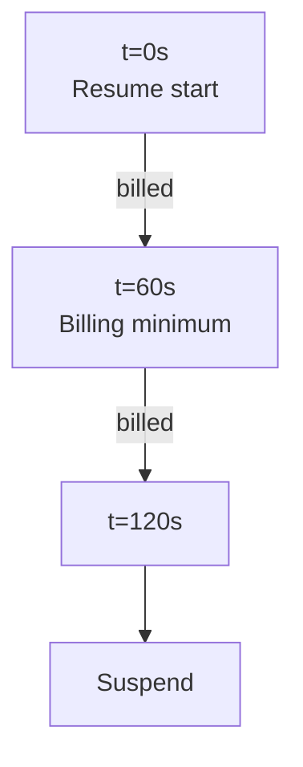
Even if the query lasted 10s, you pay 60s on this resume.

### Lab Exercise
```sql
SELECT warehouse_name, start_time, end_time, credits_used, credits_used_compute,
       credits_used_cloud_services
FROM snowflake.account_usage.warehouse_metering_history
WHERE start_time >= DATEADD(day, -7, CURRENT_TIMESTAMP())
ORDER BY start_time DESC;
```

### Gotchas / Exam Traps
- **60-second minimum applies per resume**, not per query.
- Resizing larger starts a new billing cycle on the new size (but the old cluster still gets its 60s min if freshly resumed).
- Cloud services credits are mostly free (10% daily threshold).

---

## Q7: What happens when a query is submitted to a suspended warehouse?
**Difficulty:** Foundation
**Exam relevance:** Warehouse states (2.3)

### Answer
If **AUTO_RESUME=TRUE** (default), the warehouse auto-starts and runs the query (brief delay for provisioning).
If **AUTO_RESUME=FALSE**, the query **fails** or hangs until the warehouse is manually resumed.

### First Principles
Auto-resume gives dynamic cost control: idle = suspended = no cost, but first query re-wakes it.

### Diagram
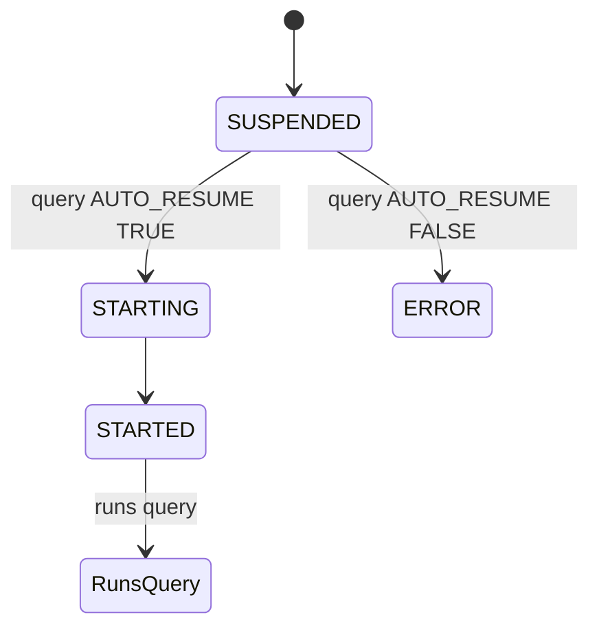

### Lab Exercise
```sql
ALTER WAREHOUSE wh SUSPEND;
ALTER WAREHOUSE wh SET AUTO_RESUME=FALSE;
-- Now submit a query → error
USE WAREHOUSE wh;
SELECT 1;   -- fails
```

### Gotchas / Exam Traps
- Default **AUTO_RESUME=TRUE**.
- Resume latency is typically 1–5 seconds for cold start.
- A **suspending** warehouse completes in-flight queries before fully suspending.

---

## Q8: What is query queueing and when does it occur?
**Difficulty:** Intermediate
**Exam relevance:** Concurrency (2.3)

### Answer
A **queue** forms when a running warehouse has reached its **concurrency limit** (number of concurrent queries it can handle given current memory/CPU) and additional queries must wait.

Snowflake has two queueing types:
- **Queued (overloaded)** — waiting for warehouse resources.
- **Queued (provisioning)** — warehouse is starting up or new cluster is spinning.

Multi-cluster warehouses with STANDARD policy spin up another cluster to drain the queue.

### First Principles
Each warehouse has a soft concurrency limit (default MAX_CONCURRENCY_LEVEL=8). Beyond that, new queries queue. Horizontal scaling solves this; vertical scaling does not.

### Diagram
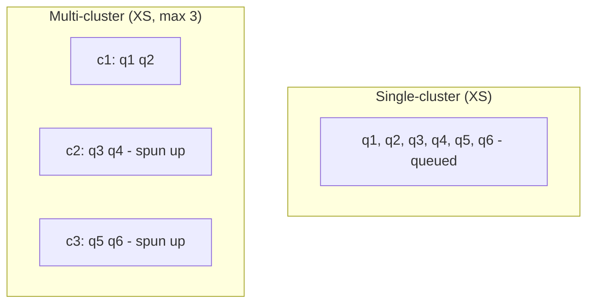

### Lab Exercise
```sql
-- See queued queries in flight
SELECT query_id, warehouse_name, execution_status, queued_overload_time
FROM table(information_schema.query_history())
WHERE execution_status LIKE 'QUEUED%' OR queued_overload_time>0
ORDER BY start_time DESC;

-- Adjust concurrency limit per warehouse
ALTER WAREHOUSE wh SET MAX_CONCURRENCY_LEVEL=12;
```

### Gotchas / Exam Traps
- Default MAX_CONCURRENCY_LEVEL = **8**.
- Lowering it forces smaller queries into queue (useful to isolate memory-heavy ones).
- Statement timeout (`STATEMENT_TIMEOUT_IN_SECONDS`) and `STATEMENT_QUEUED_TIMEOUT_IN_SECONDS` govern how long queries wait.

---

## Q9: What is a "maximized" multi-cluster warehouse?
**Difficulty:** Intermediate
**Exam relevance:** Multi-cluster modes (2.2)

### Answer
A **maximized** multi-cluster warehouse has **MIN_CLUSTER_COUNT = MAX_CLUSTER_COUNT** (and > 1). All clusters are always running — no auto-scale behavior. Useful for predictable, high-concurrency workloads where you don't want start/stop lag.

An **auto-scale** multi-cluster warehouse has **MIN < MAX**.

### Diagram
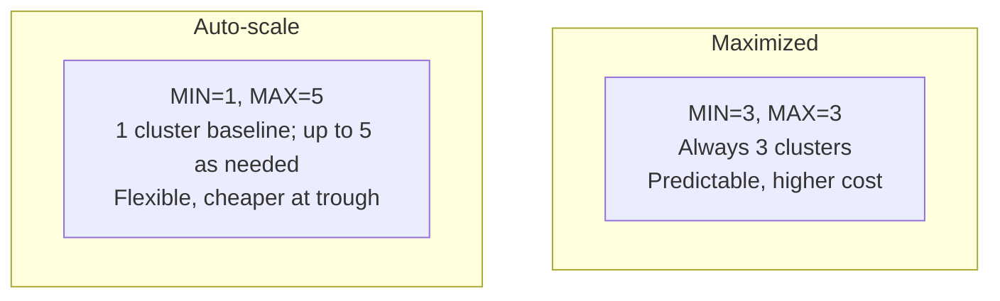

### Lab Exercise
```sql
CREATE WAREHOUSE wh_maximized WITH
  WAREHOUSE_SIZE='MEDIUM'
  MIN_CLUSTER_COUNT=3
  MAX_CLUSTER_COUNT=3;   -- maximized

CREATE WAREHOUSE wh_autoscale WITH
  WAREHOUSE_SIZE='MEDIUM'
  MIN_CLUSTER_COUNT=1
  MAX_CLUSTER_COUNT=5;   -- auto-scale
```

### Gotchas / Exam Traps
- Maximized = `MIN==MAX>1`.
- Still requires Enterprise+.
- Cost = size credits × cluster count, continuously.

---

## Q10: You need to run 500 concurrent small queries from a BI tool. Would you scale up (bigger size) or scale out (more clusters)?
**Difficulty:** Intermediate
**Exam relevance:** Scaling decisions (2.2)

### Answer
**Scale out** (horizontal / multi-cluster). Concurrency problems are solved by more clusters, not a bigger single warehouse. Each cluster accepts its own queries up to the concurrency limit.

### First Principles
A single warehouse processes queries in parallel but limited by MAX_CONCURRENCY_LEVEL (default 8). To host 500 concurrent queries, you need many clusters (and/or raise concurrency per cluster, though that risks memory contention).

### Gotchas / Exam Traps
- Common exam distractor: "scale up to 4XL" — wrong, this helps a *big* query, not many small ones.
- Scale-out with STANDARD policy is the right pattern for BI.

---

## Q11: Which of the following statements about resizing a running warehouse are TRUE? (multi-select, pick TWO)
**Difficulty:** Intermediate
**Exam relevance:** Scaling behavior (2.2)

### Answer
True:
- **Scaling up (to a larger size)** is additive — new resources start, and queued queries can use them immediately. In-flight queries continue on old resources.
- **Scaling down** waits for in-flight queries to complete before releasing nodes.

False:
- Resizing does NOT cancel running queries.
- Resizing does NOT reset the local SSD cache (it's preserved).

### First Principles
Snowflake avoids disrupting in-flight work. Resizing is additive first, then subtractive.

### Lab Exercise
```sql
-- Start a long query, then resize in another session
ALTER WAREHOUSE wh SET WAREHOUSE_SIZE='LARGE';
```

### Gotchas / Exam Traps
- Local cache is NOT lost on resize — important if asked.
- Each cluster in a multi-cluster warehouse resizes together.

---

## Q12: What is the purpose of a Resource Monitor?
**Difficulty:** Foundation
**Exam relevance:** Resource Monitors (2.4)

### Answer
A **Resource Monitor** tracks **credit consumption** against a quota and triggers actions (notify, suspend, suspend immediately) at threshold percentages (e.g., 75%, 100%). Can be applied at account level or per warehouse.

### First Principles
Credits are easy to overspend. Resource monitors are the primary cost-governance mechanism — set them before anyone runs anything in prod.

### Diagram
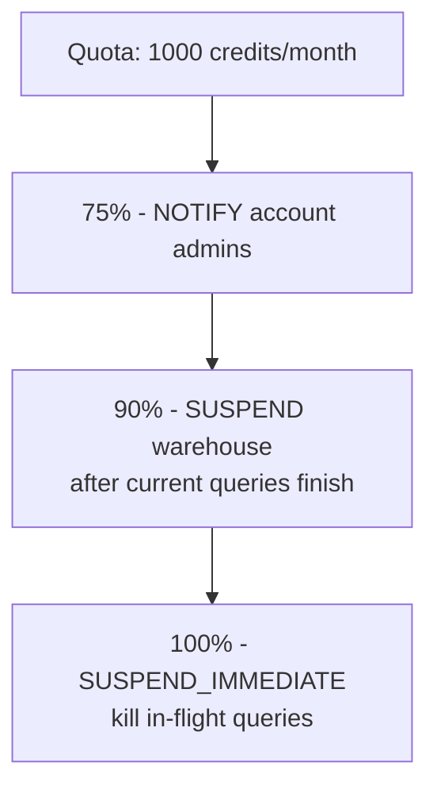

### Lab Exercise
```sql
CREATE RESOURCE MONITOR rm_prod WITH
  CREDIT_QUOTA=1000
  FREQUENCY=MONTHLY
  START_TIMESTAMP=IMMEDIATELY
  TRIGGERS
    ON 75  PERCENT DO NOTIFY
    ON 90  PERCENT DO SUSPEND
    ON 100 PERCENT DO SUSPEND_IMMEDIATE;

ALTER WAREHOUSE wh SET RESOURCE_MONITOR = rm_prod;
```

### Gotchas / Exam Traps
- Only **ACCOUNTADMIN** can create resource monitors.
- `SUSPEND` lets queries finish; `SUSPEND_IMMEDIATE` kills them.
- A warehouse can have **one** resource monitor; the account can have one; both apply.
- Frequency options: **DAILY, WEEKLY, MONTHLY, YEARLY, NEVER**.

---

## Q13: Which role is required to create or modify a Resource Monitor?
**Difficulty:** Intermediate
**Exam relevance:** Resource Monitors (2.4)

### Answer
**ACCOUNTADMIN.** Resource monitors cannot be created by lower-privilege roles. However, usage can be monitored by other roles granted MONITOR USAGE.

### Gotchas / Exam Traps
- Only ACCOUNTADMIN creates/modifies. Monitoring usage can be delegated.
- The resource monitor can be **assigned** to specific warehouses via `ALTER WAREHOUSE ... SET RESOURCE_MONITOR = <rm>`.

---

## Q14: Explain the warehouse local disk (SSD) cache.
**Difficulty:** Intermediate
**Exam relevance:** Caching tied to warehouse (2.1)

### Answer
Each warehouse node has **local SSD** that caches data read from remote storage. Subsequent queries hitting the same micro-partitions read from local SSD rather than remote cloud storage — much faster.

### First Principles
Cloud blob storage is relatively slow. Caching hot data locally gives OLTP-like latency on OLAP workloads.

### Diagram
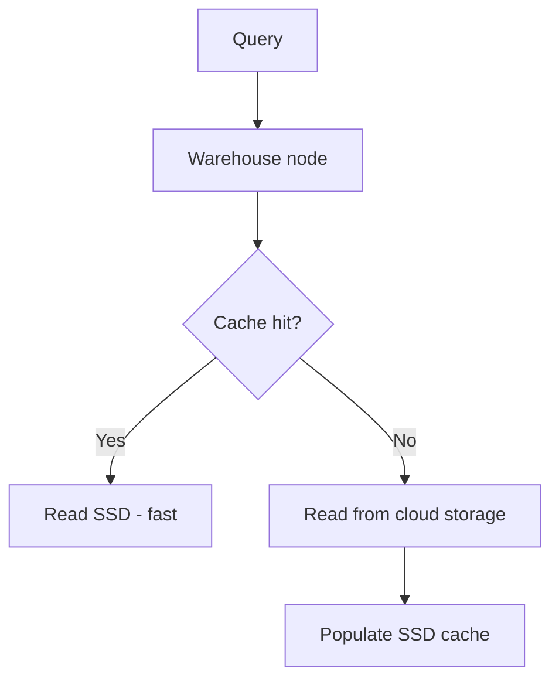

### Lab Exercise
```sql
-- Run same query twice; check scan from cache
SELECT * FROM snowflake_sample_data.tpch_sf1.lineitem LIMIT 10000;
SELECT * FROM snowflake_sample_data.tpch_sf1.lineitem LIMIT 10000;

SELECT query_id, percentage_scanned_from_cache
FROM table(information_schema.query_history())
ORDER BY start_time DESC LIMIT 5;
```

### Gotchas / Exam Traps
- **Lost when warehouse suspends** (though some data may persist short-term).
- Not shared between warehouses.
- Not shared across clusters in a multi-cluster warehouse.
- Resizing preserves cache for the running nodes but new nodes start cold.

---

## Q15: Which TWO are advantages of auto-suspend? (multi-select)
**Difficulty:** Foundation
**Exam relevance:** Warehouse management (2.3)

### Answer
Advantages:
- **Credit savings** — no payment during idle time.
- **Automatic management** — no manual intervention needed.

Downsides (not advantages):
- Loses local SSD cache if suspended too long.
- Brief resume latency.

### Gotchas / Exam Traps
- Setting AUTO_SUSPEND too aggressively (e.g., 60s on a BI warehouse used every 2 min) can hurt UX via repeated cold starts.
- A good rule: auto-suspend close to the natural idle gap in your workload.

---

## Q16: What is the default initial state of a newly created warehouse?
**Difficulty:** Foundation
**Exam relevance:** Warehouse states (2.3)

### Answer
By default, **a warehouse is started immediately upon creation** (unless `INITIALLY_SUSPENDED=TRUE` is specified).

### Lab Exercise
```sql
CREATE WAREHOUSE wh_cold WITH
  WAREHOUSE_SIZE='XSMALL'
  INITIALLY_SUSPENDED=TRUE;  -- won't start until first query

SHOW WAREHOUSES LIKE 'WH_COLD';
```

### Gotchas / Exam Traps
- Omitting `INITIALLY_SUSPENDED` = warehouse starts and begins consuming credits immediately.
- Common mistake: creating a bunch of warehouses in a script and racking up unexpected cost.

---

## Q17: What is the difference between STATEMENT_TIMEOUT_IN_SECONDS and STATEMENT_QUEUED_TIMEOUT_IN_SECONDS?
**Difficulty:** Intermediate
**Exam relevance:** Warehouse parameters (2.3)

### Answer
- **STATEMENT_TIMEOUT_IN_SECONDS** — max time a statement is allowed to **execute** before cancelled. Default: **172800 (48h)**.
- **STATEMENT_QUEUED_TIMEOUT_IN_SECONDS** — max time a statement is allowed to **sit in the queue** before cancelled. Default: **0 (no limit)**.

### Lab Exercise
```sql
ALTER WAREHOUSE wh SET STATEMENT_TIMEOUT_IN_SECONDS=3600;
ALTER WAREHOUSE wh SET STATEMENT_QUEUED_TIMEOUT_IN_SECONDS=300;
```

### Gotchas / Exam Traps
- Both can be set at account, user, warehouse, or session level — session takes precedence.
- The 48h default execution timeout is unlikely to help; set much lower in practice.

---

## Q18: A query shows up as "QUEUED_PROVISIONING" in query history. What does this mean?
**Difficulty:** Intermediate
**Exam relevance:** Concurrency / states (2.3)

### Answer
The query is waiting because the warehouse is **starting up** (cold start) or a new cluster in a multi-cluster warehouse is **provisioning**.

Other queue states:
- `QUEUED_OVERLOADED` — concurrency limit hit; waiting for a slot.
- `QUEUED_REPAIR` — warehouse repairing.
- `QUEUED` — generic queued.

### Lab Exercise
```sql
SELECT query_id, execution_status,
       queued_provisioning_time, queued_overload_time, queued_repair_time
FROM table(information_schema.query_history())
ORDER BY start_time DESC LIMIT 20;
```

### Gotchas / Exam Traps
- Provisioning is usually seconds; overload can be minutes without multi-cluster.
- Query Profile shows these as separate time buckets.

---

## Q19: You have a warehouse with MIN=1, MAX=5, STANDARD scaling, size=M. Suddenly 50 queries hit. What happens?
**Difficulty:** Advanced
**Exam relevance:** Multi-cluster behavior (2.2)

### Answer
1. First queries fill cluster 1 up to its concurrency limit (default 8).
2. Queries 9+ queue briefly.
3. STANDARD policy quickly spins up cluster 2.
4. Cluster 2 absorbs more queries; if still queueing, cluster 3 spins up, and so on, up to 5 clusters.
5. Each cluster is size M (4 credits/hr); if all 5 active, consumption is 5 × 4 = 20 credits/hr.
6. As load drops, STANDARD policy shuts clusters down (one at a time, with cooldown).

### Diagram
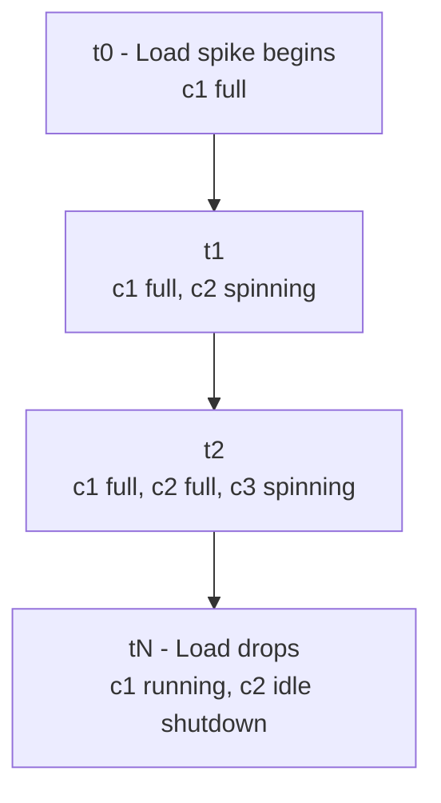

### Gotchas / Exam Traps
- Shutdowns are gradual — don't expect instant cost drop.
- With ECONOMY policy, cluster 2 would wait longer, more queueing but less cost.

---

## Q20: Which of the following is NOT a valid warehouse size on COF-C02 as of current syllabus?
**Difficulty:** Foundation
**Exam relevance:** Sizing trivia (2.1)

### Answer
Invalid (trick answers): "Tiny", "XX-Small", "Mega", "Jumbo".
Valid: XS, S, M, L, XL, 2XL, 3XL, 4XL, 5XL, 6XL (and the historical "X-Small" wording).

### Gotchas / Exam Traps
- The exam often slips in "XXS" or similar — reject those.
- SQL accepts both `'X-SMALL'` and `'XSMALL'`.

---

## Q21: Which TWO are TRUE about Snowpark and warehouses? (multi-select)
**Difficulty:** Intermediate
**Exam relevance:** Compute use (2.1)

### Answer
True:
- Snowpark DataFrame operations execute on a **standard virtual warehouse** (compute billed as credits).
- Snowpark Python UDFs/sprocs run **inside Snowflake-managed sandboxes** on the warehouse.

Note: **Snowpark-optimized warehouses** exist (larger memory per node) specifically for ML/Python workloads needing more RAM.

### Lab Exercise
```sql
-- Snowpark-optimized warehouse
CREATE WAREHOUSE wh_snowpark
  WAREHOUSE_SIZE='MEDIUM'
  WAREHOUSE_TYPE='SNOWPARK-OPTIMIZED';
```

### Gotchas / Exam Traps
- Snowpark-optimized credit rate is **~1.5x** that of standard (per size).
- Minimum size for Snowpark-optimized is **Medium**.

---

## Q22: Which TWO statements about the warehouse local cache are TRUE? (multi-select)
**Difficulty:** Intermediate
**Exam relevance:** Caching (2.1)

### Answer
True:
- Local cache is **per-warehouse** (not shared across warehouses).
- Local cache **may be lost** when the warehouse is suspended.

False:
- Local cache is NOT managed by cloud services.
- Local cache does NOT persist across suspensions reliably.
- Local cache does NOT serve queries from other warehouses.

### Gotchas / Exam Traps
- Even when suspended, the cache may be retained briefly if resumed quickly (not guaranteed).
- Resizing or scaling clusters alters cache distribution.

---

## Q23: You want a warehouse to be always available for a critical dashboard with low tolerance for latency. Which configuration?
**Difficulty:** Intermediate
**Exam relevance:** Design patterns (2.2)

### Answer
Suggested configuration:
- Size appropriate for query complexity (likely L or XL for dashboarding).
- `AUTO_SUSPEND = NULL` or a long value (to keep warehouse hot for cache).
- Multi-cluster `MIN >= 1`, `MAX = 2–3`, `SCALING_POLICY='STANDARD'`.
- Reasonable `MAX_CONCURRENCY_LEVEL`.
- Dedicated warehouse (not shared with ETL).

### Lab Exercise
```sql
CREATE WAREHOUSE wh_dashboard WITH
  WAREHOUSE_SIZE='LARGE'
  AUTO_SUSPEND=NULL
  AUTO_RESUME=TRUE
  MIN_CLUSTER_COUNT=1
  MAX_CLUSTER_COUNT=3
  SCALING_POLICY='STANDARD'
  COMMENT='Low-latency BI dashboard';
```

### Gotchas / Exam Traps
- `AUTO_SUSPEND=NULL` burns credits continuously — justify with business value.
- Dedicate warehouses by workload to avoid cache evictions and queueing surprises.

---

## Q24: What is the Query Acceleration Service (QAS) and when is it beneficial? (bonus for exam alignment with newer blueprint)
**Difficulty:** Advanced
**Exam relevance:** Performance (bridges Domain 6)

### Answer
**QAS** offloads parts of eligible queries (large table scans, filters) to serverless compute resources, speeding up outlier queries without permanently increasing warehouse size. It benefits workloads with **unpredictable spikes** on large scans.

### Lab Exercise
```sql
-- Enterprise+
ALTER WAREHOUSE wh SET
  ENABLE_QUERY_ACCELERATION=TRUE
  QUERY_ACCELERATION_MAX_SCALE_FACTOR=8;
```

### Gotchas / Exam Traps
- Requires **Enterprise edition**.
- Billed in credits based on scale factor.
- Only helps certain query shapes — not a universal speedup.

---

## Q25: Order of operations: what happens when ALTER WAREHOUSE wh SUSPEND is issued while queries are running?
**Difficulty:** Intermediate
**Exam relevance:** Warehouse states (2.3)

### Answer
The warehouse enters a **QUIESCING / SUSPENDING** state:
1. No new queries accepted (new queries queue or fail depending on config).
2. In-flight queries complete.
3. Once all finish, the warehouse transitions to **SUSPENDED**.

To force immediate suspension: no built-in force; you'd `ALTER WAREHOUSE ... ABORT ALL QUERIES` first.

### Lab Exercise
```sql
ALTER WAREHOUSE wh ABORT ALL QUERIES;
ALTER WAREHOUSE wh SUSPEND;
```

### Gotchas / Exam Traps
- Suspend is graceful by default.
- `SUSPEND_IMMEDIATE` from a resource monitor DOES kill in-flight queries.
- `ABORT ALL QUERIES` cancels at the warehouse level.

---
