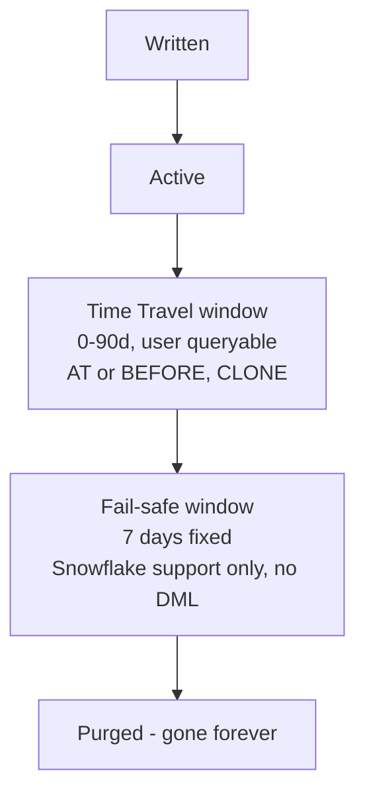
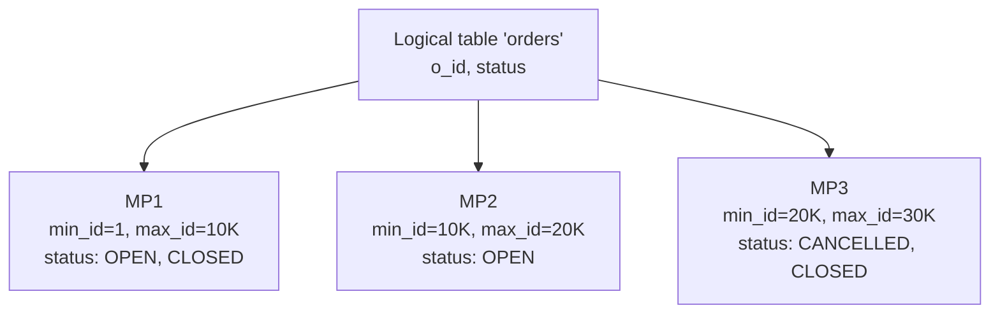
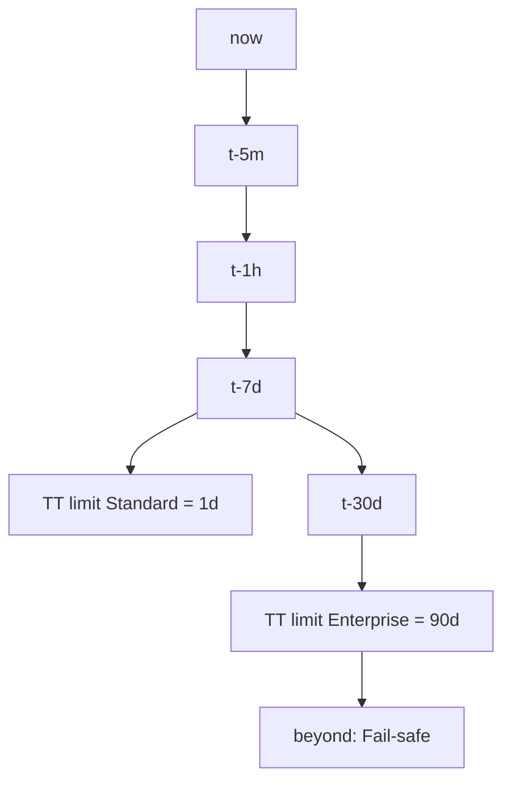
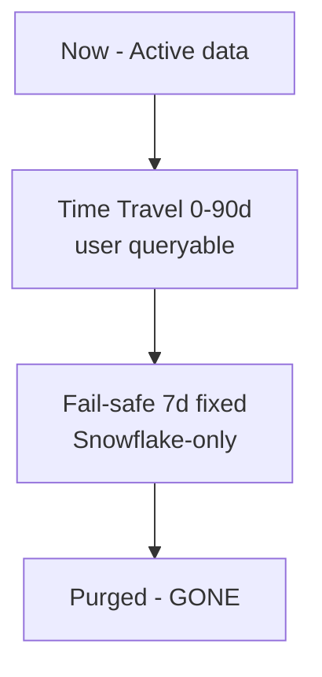
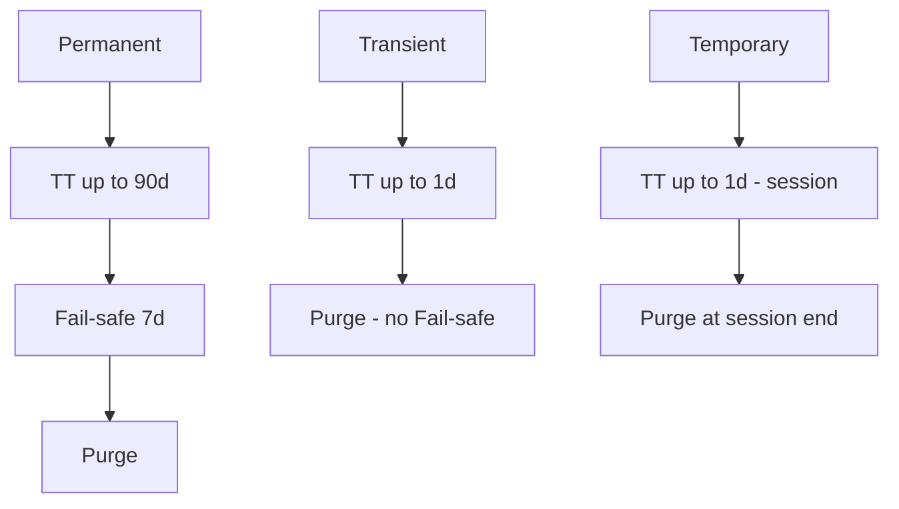
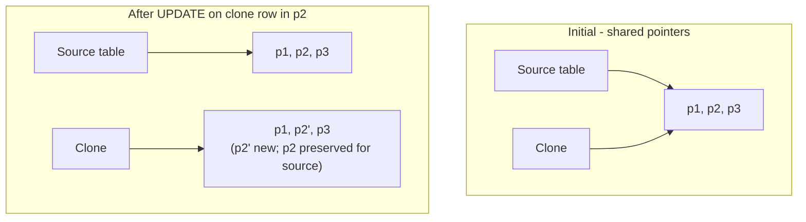
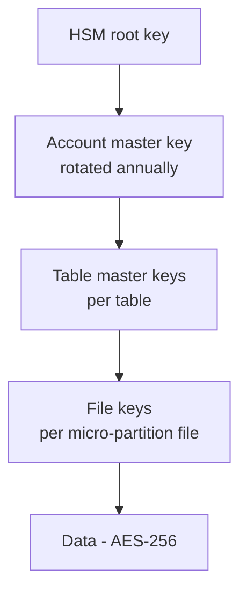
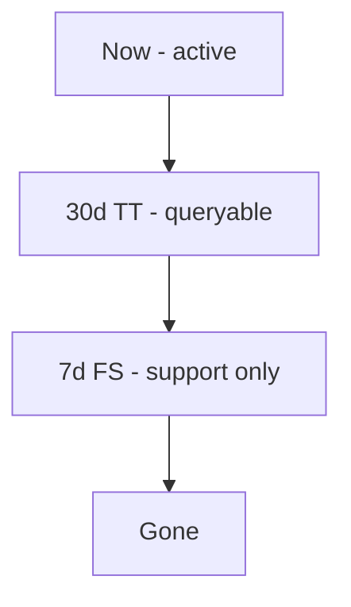

# Storage & Data Protection — COF-C02 Study Guide

## Exam Weight & Scope
**~10–15% of the COF-C02 exam.** Covers micro-partitions, columnar storage, Time Travel (1 day Standard / up to 90 days Enterprise+), Fail-safe (fixed 7 days), zero-copy cloning, database replication basics, data retention per table type (permanent/transient/temporary), and continuous data protection lifecycle.

## Core Concepts Map



Table types & retention:
- **PERMANENT**: Time Travel 0-90d (edition dependent) + Fail-safe 7d.
- **TRANSIENT**: Time Travel 0-1d + NO Fail-safe.
- **TEMPORARY**: Time Travel 0-1d (session) + NO Fail-safe.

---

## Q1: What is a micro-partition in Snowflake?
**Difficulty:** Foundation
**Exam relevance:** Storage internals (3.1)

### Answer
A **micro-partition** is Snowflake's unit of physical storage:
- **~16 MB compressed** (50–500 MB uncompressed logical).
- **Columnar** format.
- **Immutable** — never modified after creation.
- Automatically created and managed by Snowflake.
- Each has metadata: min/max per column, null counts, distinct value counts, etc.

### First Principles
Columnar + immutable + small-ish size = fast scan + ability to prune (skip entire partitions when WHERE clauses rule them out via metadata) + enables Time Travel / clone (keep old partitions around cheaply).

### Diagram


### Lab Exercise
```sql
-- Inspect partition metadata summary for a table
SELECT SYSTEM$CLUSTERING_INFORMATION('snowflake_sample_data.tpch_sf1.lineitem', '(l_orderkey)');

-- Partition pruning in a query (check Query Profile)
SELECT * FROM snowflake_sample_data.tpch_sf1.orders
WHERE o_orderkey BETWEEN 100000 AND 100100;
```

### Gotchas / Exam Traps
- Users do NOT manage partition size or boundaries — Snowflake does.
- Size: **16MB compressed** (easy trivia).
- Micro-partitions are **immutable**: UPDATE/DELETE write new partitions, old ones live in TT/FS.

---

## Q2: Define Time Travel. What is the maximum retention for Standard vs Enterprise?
**Difficulty:** Foundation
**Exam relevance:** Time Travel (3.2)

### Answer
**Time Travel** lets you query, clone, or restore data **as it was** at a prior point within the retention window.

- **Standard edition**: 0–1 day (default 1).
- **Enterprise edition and above**: 0–90 days.

Retention is set with `DATA_RETENTION_TIME_IN_DAYS` at **account, database, schema, or table** level.

### First Principles
Because micro-partitions are immutable, old versions still physically exist. Time Travel is pure metadata: "give me pointers as they were at timestamp X".

### Diagram


### Lab Exercise
```sql
-- Set retention
ALTER TABLE orders SET DATA_RETENTION_TIME_IN_DAYS = 30;  -- Enterprise

-- Query as of 1 hour ago
SELECT * FROM orders AT(OFFSET => -3600);

-- Query before a specific statement
SELECT * FROM orders BEFORE(STATEMENT => '019a...');

-- Query at a timestamp
SELECT * FROM orders AT(TIMESTAMP => '2026-10-29 10:00:00'::TIMESTAMP);
```

### Gotchas / Exam Traps
- Standard max = **1**. Enterprise+ max = **90**.
- Setting `DATA_RETENTION_TIME_IN_DAYS = 0` **disables** Time Travel for that object.
- Default is **1 day** for permanent objects.
- Transient & temporary are capped at **1 day** regardless of edition.

---

## Q3: Define Fail-safe. How is it different from Time Travel?
**Difficulty:** Foundation
**Exam relevance:** Fail-safe (3.2)

### Answer
**Fail-safe** is a **7-day, non-configurable** disaster recovery window that **follows Time Travel**. Only **Snowflake Support** can recover data from Fail-safe — users cannot query, clone, or restore from it directly.

### First Principles
Time Travel = user-queryable; Fail-safe = disaster recovery via support ticket. Fail-safe exists specifically so Snowflake can meet its data durability SLAs even if customer disables Time Travel.

### Diagram


### Lab Exercise
```sql
-- Request from support (conceptual, cannot be done via SQL)
-- But you can see Fail-safe storage usage:
SELECT * FROM snowflake.account_usage.table_storage_metrics
WHERE table_catalog='MYDB' ORDER BY failsafe_bytes DESC;
```

### Gotchas / Exam Traps
- Fail-safe is **exactly 7 days** for permanent tables — **not configurable**.
- Fail-safe is **NOT available** on transient or temporary tables.
- Fail-safe is **billed** as part of storage.
- Users cannot query Fail-safe — exam loves this fact.

---

## Q4: Compare permanent, transient, and temporary tables in terms of data protection.
**Difficulty:** Intermediate
**Exam relevance:** Table types (3.3)

### Answer
| Table Type | Max TT | Fail-safe | Lifetime |
|------------|--------|-----------|----------|
| **Permanent** | 0–90d (Enterprise+) | 7 days | Until explicitly dropped |
| **Transient** | 0–1 day | **None** | Until explicitly dropped |
| **Temporary** | 0–1 day | **None** | **Session scope** — dropped at session end |

### First Principles
Protection costs money (duplicated storage). Transient = cheaper storage for data you can regenerate (staging/ETL). Temporary = scratch space for one session.

### Diagram


### Lab Exercise
```sql
CREATE TABLE perm_t (id INT);         -- permanent
CREATE TRANSIENT TABLE trans_t (id INT);
CREATE TEMPORARY TABLE temp_t (id INT);  -- disappears at session end

SHOW TABLES;
-- IS_TRANSIENT and KIND columns differentiate
```

### Gotchas / Exam Traps
- **Temporary ≠ transient.** Temporary is session-scoped; transient persists until dropped.
- Temporary tables can **shadow** permanent tables with the same name in a session.
- You can create transient databases/schemas; all tables inside inherit transience.

---

## Q5: Which TWO are TRUE about zero-copy cloning? (multi-select)
**Difficulty:** Foundation
**Exam relevance:** Cloning (3.4)

### Answer
True:
- **Cloning is metadata-only** (instant, no data copy).
- **Clones can be modified independently** of the source (copy-on-write).

False:
- Cloning does NOT duplicate storage usage immediately.
- Cloning does NOT create a read-only snapshot.

### First Principles
Immutable micro-partitions mean a clone can share pointers. Only when source or clone is modified does Snowflake write new partitions and the two diverge.

### Diagram


### Lab Exercise
```sql
CREATE TABLE t1 AS SELECT * FROM snowflake_sample_data.tpch_sf1.customer LIMIT 1000;
CREATE TABLE t1_clone CLONE t1;   -- instant

UPDATE t1_clone SET c_name='CLONE_EDIT' WHERE c_custkey=1;
-- t1 unaffected
```

### Gotchas / Exam Traps
- You can clone **tables, schemas, or databases**.
- Clones inherit **Time Travel** data from the source as of clone time.
- Clones do NOT inherit **permissions** by default (except for schemas/databases cloned, which may need regrants).
- Pipes, streams, and tasks are **NOT cloned** (as of exam syllabus — verify as rules evolve).

---

## Q6: Can you clone an object at a historical point in time?
**Difficulty:** Intermediate
**Exam relevance:** Cloning + Time Travel (3.4)

### Answer
**Yes.** You can clone AT or BEFORE a timestamp/offset/statement within the Time Travel window.

### Lab Exercise
```sql
-- Clone the state of orders as of 1 hour ago
CREATE TABLE orders_1h_ago CLONE orders AT(OFFSET => -3600);

-- Clone as of a specific statement
CREATE TABLE orders_pre_bad_update CLONE orders BEFORE(STATEMENT => '019a...');

-- Clone entire database as of a timestamp
CREATE DATABASE db_restored CLONE prod_db AT(TIMESTAMP => '2026-10-29 10:00:00'::TIMESTAMP);
```

### Gotchas / Exam Traps
- Historical clone is the primary tool for **"recover from bad DML"** scenarios.
- Cannot clone from a time before an object was created (obviously).
- UNDROP is often simpler for dropped objects within TT window.

---

## Q7: What does UNDROP do and what's the time limit?
**Difficulty:** Foundation
**Exam relevance:** Time Travel (3.2)

### Answer
`UNDROP` restores a dropped **table, schema, or database** within its **Time Travel retention window**. For permanent objects with default retention: **1 day** (Standard) or up to 90 days (Enterprise+).

### Lab Exercise
```sql
DROP TABLE orders;
UNDROP TABLE orders;

-- Also valid
UNDROP SCHEMA sales;
UNDROP DATABASE prod;
```

### Gotchas / Exam Traps
- **UNDROP is only possible within the TT retention window.** After that, you'd need Snowflake Support (Fail-safe) if available.
- If a new object with the same name has been created since the drop, UNDROP fails until that one is dropped/renamed.
- Transient/temporary tables may still support UNDROP within their short TT window.

---

## Q8: What is the Fail-safe retention period for a permanent table and can it be changed?
**Difficulty:** Foundation
**Exam relevance:** Fail-safe (3.2)

### Answer
**7 days.** It is **NOT configurable** — not even by ACCOUNTADMIN. It applies automatically to all permanent tables after Time Travel expires.

### Gotchas / Exam Traps
- 7 days = fixed. Can't disable, can't shorten, can't extend.
- To avoid Fail-safe storage costs, use **transient tables** for data you can regenerate.
- Fail-safe does NOT apply to transient or temporary tables.

---

## Q9: You set DATA_RETENTION_TIME_IN_DAYS=0 on a table. What are the implications?
**Difficulty:** Intermediate
**Exam relevance:** Retention policy (3.2)

### Answer
Setting it to 0 **disables Time Travel** for that table:
- Cannot use `AT|BEFORE` queries.
- Cannot `UNDROP` after a drop.
- Cannot `CLONE` historical states.
- **Fail-safe (if permanent) still exists for 7 days** — storage cost remains.

### Gotchas / Exam Traps
- Setting 0 does NOT remove Fail-safe on permanent tables.
- Use transient tables to avoid both TT and Fail-safe storage.
- Account-level DATA_RETENTION_TIME_IN_DAYS can override defaults for new objects.

---

## Q10: Explain how storage is billed in Snowflake. (concept check)
**Difficulty:** Intermediate
**Exam relevance:** Storage billing (3.5)

### Answer
Storage billing components:
- **Active storage** — compressed size of current data.
- **Time Travel storage** — compressed size of data within TT window (changed partitions kept).
- **Fail-safe storage** — compressed size of data within 7-day Fail-safe (permanent only).
- **Stage storage** — files in internal/named stages.

All billed per TB-month, averaged daily; on-demand or capacity pricing.

### Lab Exercise
```sql
SELECT table_name, active_bytes/1e9 AS gb_active,
       time_travel_bytes/1e9 AS gb_tt,
       failsafe_bytes/1e9 AS gb_fs,
       retained_for_clone_bytes/1e9 AS gb_clone
FROM snowflake.account_usage.table_storage_metrics
WHERE deleted = FALSE
ORDER BY (active_bytes+time_travel_bytes+failsafe_bytes) DESC
LIMIT 20;
```

### Gotchas / Exam Traps
- **Retained for clone bytes** — storage kept because a clone references them even if source was dropped.
- Long TT windows on frequently updated tables **blow up storage cost**.
- Transient tables **save** TT (max 1 day) and all Fail-safe cost.

---

## Q11: Which TWO scenarios cannot be solved by Time Travel alone? (multi-select)
**Difficulty:** Advanced
**Exam relevance:** TT limits (3.2)

### Answer
Scenarios Time Travel cannot solve:
- **Recovering data outside the TT retention window** (requires Fail-safe via support, or external backup).
- **Protecting from accidental DROP ACCOUNT** or similar org-level actions.
- **Point-in-time recovery across regions/accounts** (needs replication).
- **Compliance-grade long-term archival** (TT max is 90 days).

### Gotchas / Exam Traps
- Time Travel is NOT a backup system — it's a short-window undo.
- For >90 days, replicate to another DB/account or export to a stage.

---

## Q12: What is database replication, and what edition is required?
**Difficulty:** Intermediate
**Exam relevance:** Replication basics (3.6)

### Answer
**Database replication** copies a database from a primary account to one or more secondary accounts for DR, migration, or geo-distribution.

- Basic replication: **Standard edition** (via `ALTER DATABASE ... ENABLE REPLICATION`).
- **Failover/failback (DR with promote)**: **Business Critical+**.

### Lab Exercise
```sql
-- On primary account
ALTER DATABASE sales
  ENABLE REPLICATION TO ACCOUNTS myorg.secondary_acct;

-- On secondary account
CREATE DATABASE sales_replica AS REPLICA OF myorg.primary_acct.sales;
ALTER DATABASE sales_replica REFRESH;
```

### Gotchas / Exam Traps
- Basic replication is **DBs and shares**.
- Full account replication (users, roles, policies, pipes) requires **failover groups** (Business Critical+).
- Replication is **asynchronous**; secondary is read-only.
- Must enable **replication at the account level** first.

---

## Q13: Which TWO data elements are NOT automatically replicated by basic database replication? (multi-select)
**Difficulty:** Advanced
**Exam relevance:** Replication specifics (3.6)

### Answer
NOT replicated by basic DB replication (require **replication/failover groups** on Business Critical+):
- **Users, roles, grants** (account-level objects).
- **Pipes (Snowpipe), tasks, streams** (historically limited — now improving but still check).
- **Network policies, security integrations.**
- **Resource monitors.**

Replicated: **tables, views, materialized views, UDFs, stored procedures, file formats, stages (external only).**

### Gotchas / Exam Traps
- For full DR, use **failover groups** (Business Critical+).
- External stages replicate as references; the underlying bucket must be accessible from the secondary region.

---

## Q14: You accidentally ran `DELETE FROM orders` without a WHERE clause 10 minutes ago. How do you recover? (steps)
**Difficulty:** Intermediate
**Exam relevance:** Recovery via TT (3.2)

### Answer
Within TT retention window:
1. Verify data is recoverable:
   ```sql
   SELECT COUNT(*) FROM orders AT(OFFSET => -1200);  -- 20 minutes ago
   ```
2. Create a backup/clone:
   ```sql
   CREATE TABLE orders_recovery CLONE orders AT(OFFSET => -1200);
   ```
3. Replace current table:
   ```sql
   -- Option A: swap
   ALTER TABLE orders SWAP WITH orders_recovery;
   -- Option B: insert back
   INSERT INTO orders SELECT * FROM orders_recovery;
   ```

### Lab Exercise
```sql
CREATE TABLE t AS SELECT 1 AS id;
DELETE FROM t;
-- Oh no
SELECT * FROM t BEFORE(STATEMENT => LAST_QUERY_ID());
CREATE OR REPLACE TABLE t AS
  SELECT * FROM t BEFORE(STATEMENT => LAST_QUERY_ID(-1));
```

### Gotchas / Exam Traps
- `AT` is inclusive of the moment; `BEFORE` is just-before.
- Statement-level TT uses the query ID of the bad statement.
- SWAP preserves grants; CREATE OR REPLACE drops & recreates (losing permissions).

---

## Q15: What happens to Time Travel data when a parent object (database/schema) is dropped?
**Difficulty:** Intermediate
**Exam relevance:** CDP lifecycle (3.2)

### Answer
When a database or schema is dropped, its contained objects become inaccessible but their TT/Fail-safe storage **continues to count against retention windows**. You can `UNDROP` the parent to restore everything within the retention window.

### Gotchas / Exam Traps
- UNDROP cascades: UNDROP DATABASE restores child schemas and tables (within TT).
- Fail-safe for dropped tables still accumulates for 7 days of storage billing even if parent is dropped.

---

## Q16: How does Snowflake handle encryption at rest?
**Difficulty:** Intermediate
**Exam relevance:** Encryption (3.7) [bridges to Domain 5]

### Answer
- **AES-256 encryption at rest**, applied automatically.
- **Hierarchical key model**: root key (HSM) → account master key → table master key → file key.
- **Automatic key rotation** (yearly for account master keys).
- **Rekeying** of older data (requires Enterprise+ to configure period).
- **Tri-Secret Secure** (BYOK/CMK): adds customer-managed key — **Business Critical+**.

### Diagram


### Gotchas / Exam Traps
- All data is encrypted at rest — not optional.
- **TLS 1.2+** for data in transit.
- **Rekeying old data** is available on Enterprise+ (`PERIODIC_DATA_REKEYING=TRUE`).
- Tri-Secret Secure = Business Critical+.

---

## Q17: Which THREE statements about transient tables are TRUE? (multi-select)
**Difficulty:** Intermediate
**Exam relevance:** Table types (3.3)

### Answer
True:
- Transient tables **persist across sessions**.
- Transient tables have **no Fail-safe**.
- Transient tables support **Time Travel up to 1 day**.

False:
- Transient tables are NOT dropped at session end (that's temporary).
- Transient tables do NOT have unlimited TT.

### Lab Exercise
```sql
CREATE TRANSIENT TABLE staging.events (
  event_time TIMESTAMP,
  payload VARIANT
) DATA_RETENTION_TIME_IN_DAYS=1;

SHOW TABLES LIKE 'EVENTS' IN SCHEMA staging;
-- KIND = TRANSIENT, IS_TRANSIENT = Y
```

### Gotchas / Exam Traps
- Use transient tables for **staging / intermediate ETL** where regeneration is trivial.
- Save ~15% storage vs permanent (no Fail-safe).

---

## Q18: What is cloning used for in a dev/test workflow?
**Difficulty:** Foundation
**Exam relevance:** Cloning (3.4)

### Answer
Clone an entire **database or schema** to create an instant, writable dev/test environment that references production data with zero copy cost. Divergence (DMLs on clone) adds incremental storage; untouched partitions remain shared.

### Lab Exercise
```sql
CREATE DATABASE dev_db CLONE prod_db;
USE DATABASE dev_db;
-- Make test changes without affecting prod
```

### Gotchas / Exam Traps
- Pipes, tasks, streams in clones require careful review (not reliably cloned).
- Grants need to be reapplied in most cases.
- Clone timing: `AT|BEFORE` can give a "snapshot" dev env from last-known-good state.

---

## Q19: Which TWO scenarios would consume additional Time Travel storage? (multi-select)
**Difficulty:** Advanced
**Exam relevance:** Storage billing / TT (3.5)

### Answer
Scenarios adding TT storage:
- **UPDATE/DELETE** on a table (old partitions preserved).
- **TRUNCATE** on a table (TT keeps the data for retention period).
- **MERGE / INSERT with overwrite patterns**.

Not adding TT storage:
- Pure **INSERT** of brand-new rows (no old versions, but future deletes/updates would).
- SELECT queries.

### Gotchas / Exam Traps
- **TRUNCATE preserves TT** — common exam trap. `TRUNCATE` is reversible via `AT|BEFORE`.
- **DROP TABLE** moves the whole table into TT (then Fail-safe).

---

## Q20: Explain the difference between TRUNCATE and DROP for Time Travel purposes.
**Difficulty:** Intermediate
**Exam relevance:** DML & TT (3.2)

### Answer
- **TRUNCATE TABLE t** — removes all rows but keeps the table object. TT remembers old rows; data is restorable via `AT|BEFORE`.
- **DROP TABLE t** — removes the entire table object. The whole table is restorable via `UNDROP` within TT window.

Both preserve data for the TT retention window; both incur Fail-safe for 7 days after TT expires (if permanent).

### Lab Exercise
```sql
TRUNCATE TABLE orders;
SELECT * FROM orders AT(OFFSET => -60);  -- rows still there via TT

DROP TABLE orders;
UNDROP TABLE orders;  -- resurrect
```

### Gotchas / Exam Traps
- TRUNCATE is **transactional**; DROP is **DDL**.
- After TRUNCATE, inserting new rows doesn't erase TT history.
- After DROP, the name is reusable; UNDROP needs the name to be free again.

---

## Q21: Can you set a different Time Travel retention on a schema than on its tables?
**Difficulty:** Intermediate
**Exam relevance:** Retention hierarchy (3.2)

### Answer
Yes. Retention has a hierarchy: **account → database → schema → table**. Each level can override the parent. Child objects created later **inherit** the current parent setting unless explicitly set.

### Lab Exercise
```sql
ALTER DATABASE prod_db SET DATA_RETENTION_TIME_IN_DAYS=30;
ALTER SCHEMA prod_db.staging SET DATA_RETENTION_TIME_IN_DAYS=0;  -- no TT for staging schema
ALTER TABLE prod_db.sales.orders SET DATA_RETENTION_TIME_IN_DAYS=90;
```

### Gotchas / Exam Traps
- Changing retention on a parent does NOT alter existing child settings — only defaults for new children.
- Setting 0 at a higher level still allows child objects to use longer retention if explicitly set.

---

## Q22: Which THREE statements about automatic data compression are TRUE? (multi-select)
**Difficulty:** Intermediate
**Exam relevance:** Storage (3.1)

### Answer
True:
- Compression is **automatic** and chosen per column.
- Compression ratios are typically **3–5x**.
- Compression is **transparent to users** (no SQL changes).

False:
- Users cannot choose compression algorithm.
- Compression is NOT disabled for VARIANT columns (they're compressed too).

### Gotchas / Exam Traps
- Storage billing is on **compressed** size.
- Snowflake auto-selects between algorithms (Zstandard, dictionary, etc.) per column type.

---

## Q23: Which object cannot be cloned in Snowflake? (single select)
**Difficulty:** Advanced
**Exam relevance:** Cloning limits (3.4)

### Answer
**External tables and some pipes/streams** historically could not be cloned (external tables are references, so cloning doesn't make sense). Internal **stages** cannot be cloned via `CREATE STAGE CLONE` (though schemas containing them can be cloned with varying behavior).

Can be cloned: tables, schemas, databases, streams (in newer versions), tasks (with care), file formats, sequences.

### Gotchas / Exam Traps
- Exam may ask: "which of these CANNOT be cloned?" — external tables / internal stage files are common correct answers.
- Rules evolve; verify current docs if exam insists on a specific object.

---

## Q24: What is the account-level parameter MIN_DATA_RETENTION_TIME_IN_DAYS?
**Difficulty:** Advanced
**Exam relevance:** Governance over TT (3.2)

### Answer
**MIN_DATA_RETENTION_TIME_IN_DAYS** (set by ACCOUNTADMIN) enforces a **minimum** Time Travel retention across the account. Even if an individual object sets a shorter value, the actual retention is `MAX(MIN_DATA_RETENTION_TIME_IN_DAYS, object_setting)`.

### Lab Exercise
```sql
USE ROLE ACCOUNTADMIN;
ALTER ACCOUNT SET MIN_DATA_RETENTION_TIME_IN_DAYS = 7;
-- Now even a table with retention=1 will effectively keep 7 days.
```

### Gotchas / Exam Traps
- Does NOT reduce retention — only enforces a floor.
- Useful for compliance ("we must keep TT history 7 days minimum").

---

## Q25: Order of CDP phases from newest to oldest for a permanent table with 30-day Time Travel.
**Difficulty:** Foundation
**Exam relevance:** CDP lifecycle (3.2)

### Answer
1. **Active** (current data, latest versions).
2. **Time Travel** (0–30 days old, user queryable).
3. **Fail-safe** (31–37 days old, Snowflake-only recovery).
4. **Purged** (beyond 37 days, gone forever).

### Diagram


### Gotchas / Exam Traps
- 30 days TT + 7 days FS = **37 days total protection** before purge.
- Transient = TT only (up to 1d), no FS.
- Fail-safe timer **starts after TT ends**, not from the DML timestamp.

---
