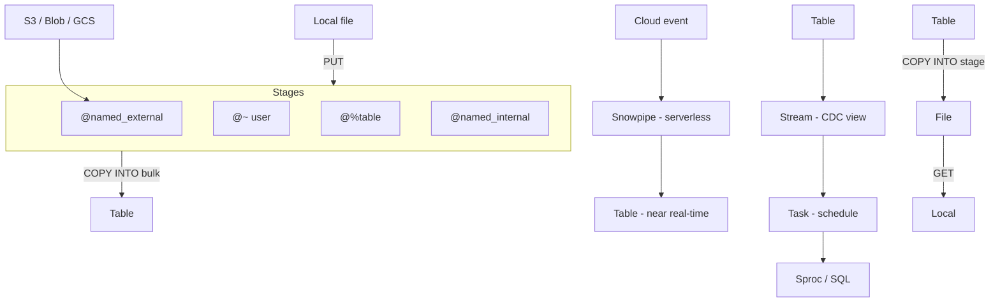
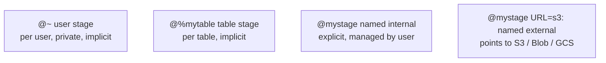
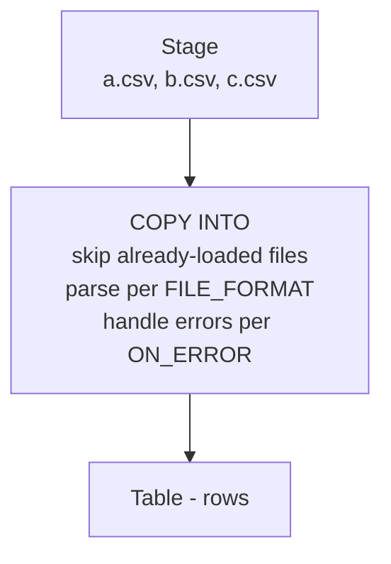
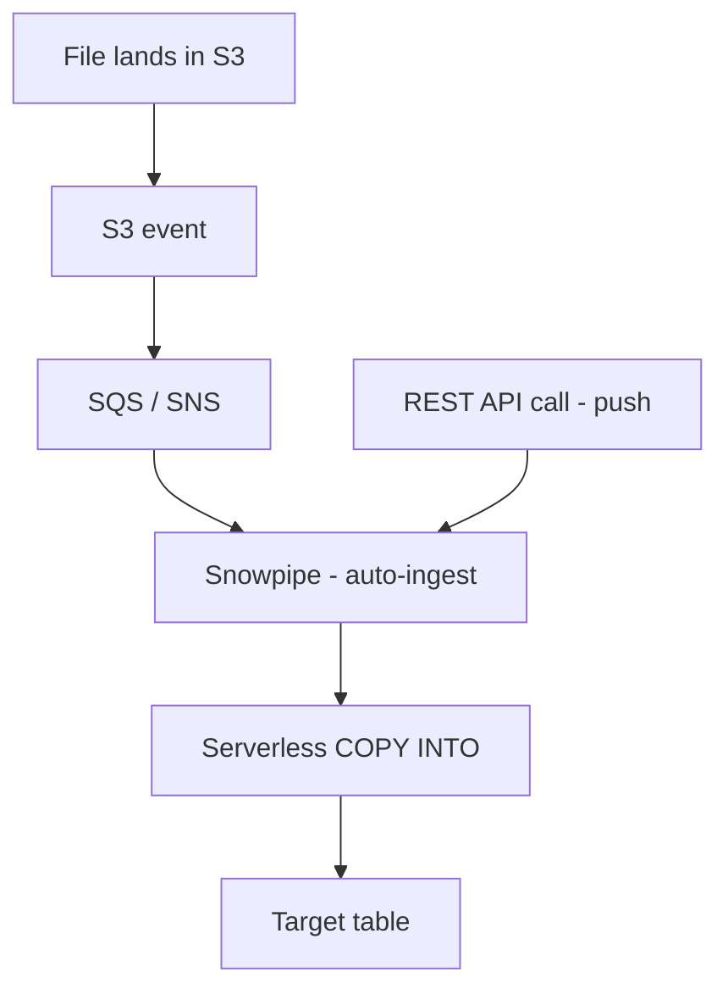
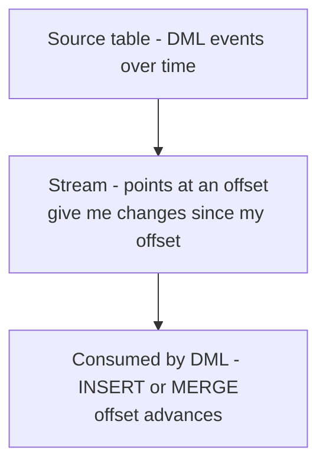
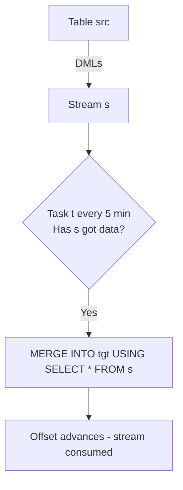
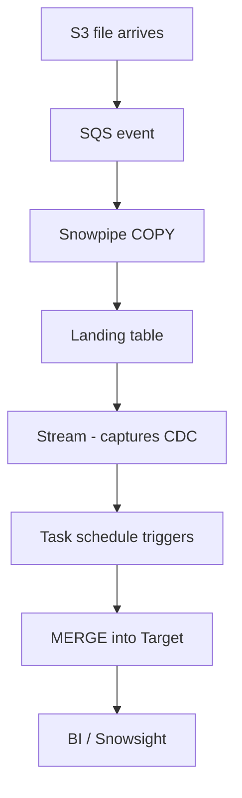

# Data Movement — COF-C02 Study Guide

## Exam Weight & Scope
**~20% of the COF-C02 exam.** Covers stages (user/table/named internal/external), file formats, COPY INTO (bulk load/unload), Snowpipe (continuous load), Streams (CDC), Tasks (orchestration), external tables basics, and PUT/GET commands.

## Core Concepts Map



---

## Q1: Name the four types of stages in Snowflake.
**Difficulty:** Foundation
**Exam relevance:** Stages (4.1)

### Answer
1. **User stage** `@~` — implicit, one per user, cannot be altered or dropped. Not shareable.
2. **Table stage** `@%<table_name>` — implicit, one per table, used only for that table. Cannot be altered.
3. **Named internal stage** `@<stage_name>` — explicitly created, Snowflake-managed storage, supports file formats and copy options, shareable via grants.
4. **Named external stage** `@<stage_name>` — explicitly created, points to an external cloud bucket (S3/Blob/GCS), typically via a storage integration.

### First Principles
Stages decouple raw files from tables. All loads go through a stage. User/table stages are built-in conveniences; named stages are the production tool.

### Diagram


### Lab Exercise
```sql
LIST @~;                       -- user stage contents
LIST @%mytable;                -- table stage
CREATE STAGE int_stage FILE_FORMAT=(TYPE=CSV);
LIST @int_stage;

CREATE STAGE ext_stage
  URL='s3://my-bucket/data/'
  STORAGE_INTEGRATION = my_s3_int
  FILE_FORMAT=(TYPE=PARQUET);
LIST @ext_stage;
```

### Gotchas / Exam Traps
- **User & table stages are implicit** — don't CREATE them; they always exist.
- Table stage name uses `@%` prefix (percent).
- Named internal stages count toward **storage billing**.
- External stages don't store data in Snowflake (billing is just metadata).

---

## Q2: What is PUT and what does it do?
**Difficulty:** Foundation
**Exam relevance:** PUT/GET (4.1)

### Answer
`PUT` uploads a **local file** from the client machine to an **internal stage** (user, table, or named internal). It's a **SnowSQL / driver** command — NOT runnable in Snowsight worksheets (because the server has no access to your laptop's filesystem).

### Lab Exercise
```sql
-- From SnowSQL only
PUT file:///Users/me/data/orders.csv.gz @mystage AUTO_COMPRESS=TRUE;
LIST @mystage;
GET @mystage/orders.csv.gz file:///Users/me/downloads/;
```

### Gotchas / Exam Traps
- **PUT is NOT supported in Snowsight / web UI.** Use SnowSQL, Python connector, etc.
- `AUTO_COMPRESS=TRUE` (default) gzips files during upload.
- `OVERWRITE=TRUE` replaces existing files with the same name.
- `PARALLEL=<n>` controls concurrency of large uploads.
- Upload only works to **internal stages**, not external.

---

## Q3: Describe the COPY INTO command for loading data.
**Difficulty:** Foundation
**Exam relevance:** Bulk load (4.2)

### Answer
`COPY INTO <table> FROM <stage>` is the bulk-load statement. Reads files from a stage, parses with a file format, writes to a table.

Syntax (simplified):
```sql
COPY INTO target_table
  FROM @mystage/path/
  FILE_FORMAT = (TYPE=CSV FIELD_DELIMITER=',' SKIP_HEADER=1)
  PATTERN = '.*2026-10-.*\\.csv'
  ON_ERROR = 'CONTINUE'
  PURGE = FALSE;
```

### First Principles
COPY INTO is **transactional** per command (all-or-nothing per file by default; `ON_ERROR` tweaks this). Snowflake tracks loaded files in **load history** to avoid duplicates on re-run (within 64 days).

### Diagram


### Lab Exercise
```sql
CREATE TABLE orders_landing (
  id INT, customer_id INT, order_date DATE, amount NUMERIC(10,2)
);

CREATE FILE FORMAT ff_csv TYPE=CSV FIELD_DELIMITER=',' SKIP_HEADER=1 FIELD_OPTIONALLY_ENCLOSED_BY='"';

PUT file:///data/orders_2026.csv @%orders_landing;

COPY INTO orders_landing
  FROM @%orders_landing
  FILE_FORMAT = (FORMAT_NAME=ff_csv)
  ON_ERROR='CONTINUE';

SELECT * FROM orders_landing LIMIT 10;
```

### Gotchas / Exam Traps
- Load history tracks loaded files for **64 days** — re-running COPY on same files is a no-op within that window.
- `FORCE=TRUE` bypasses the load history (useful but dangerous).
- `ON_ERROR` options: `CONTINUE`, `SKIP_FILE`, `SKIP_FILE_num`, `SKIP_FILE_%num%`, `ABORT_STATEMENT` (default).
- `PURGE=TRUE` deletes source files after successful load.

---

## Q4: What is Snowpipe and how does it differ from COPY INTO?
**Difficulty:** Foundation
**Exam relevance:** Snowpipe (4.3)

### Answer
**Snowpipe** is Snowflake's **continuous, serverless data ingestion** service. It:
- Listens for new files landing in a stage (via cloud notification or REST API).
- Loads them automatically into a target table using a predefined COPY INTO template.
- Uses **serverless compute** (not your warehouse) — billed per compute-second with slight overhead.

Vs COPY INTO (bulk):
- COPY INTO uses **your warehouse**; synchronous; good for large batches.
- Snowpipe is **serverless**; near real-time (minutes); good for streaming/micro-batch.

### Diagram


### Lab Exercise
```sql
CREATE PIPE orders_pipe AUTO_INGEST=TRUE AS
  COPY INTO orders_landing
    FROM @ext_stage/orders/
    FILE_FORMAT = (FORMAT_NAME=ff_csv);

SHOW PIPES;
DESCRIBE PIPE orders_pipe;
-- Returns NOTIFICATION_CHANNEL = SQS ARN to configure in S3
```

### Gotchas / Exam Traps
- Snowpipe is **serverless** — billing is on **Snowpipe credits**, NOT your warehouse.
- Latency: typically **~1 minute**, can be longer under load.
- Snowpipe loads **once per file**; keep file sizes 100–250MB compressed for optimal throughput.
- Auto-ingest requires cloud notification config.
- REST ingest uses `insertFiles` endpoint.

---

## Q5: Which TWO file formats are natively supported by Snowflake? (multi-select)
**Difficulty:** Foundation
**Exam relevance:** File formats (4.4)

### Answer
Supported natively:
- **CSV / TSV / delimited**
- **JSON**
- **Avro**
- **ORC**
- **Parquet**
- **XML** (loaded as VARIANT)

Pick any two of these on a multi-select.

### Lab Exercise
```sql
CREATE FILE FORMAT ff_json TYPE=JSON STRIP_OUTER_ARRAY=TRUE;
CREATE FILE FORMAT ff_parquet TYPE=PARQUET;
CREATE FILE FORMAT ff_avro TYPE=AVRO;

SHOW FILE FORMATS;
```

### Gotchas / Exam Traps
- Snowflake stores semi-structured (JSON/Avro/ORC/Parquet/XML) in **VARIANT** columns.
- `STRIP_OUTER_ARRAY=TRUE` for JSON files that are a top-level array.
- Parquet/ORC/Avro are columnar/compressed — most efficient to load.

---

## Q6: What is the difference between COPY INTO <table> and COPY INTO <location>?
**Difficulty:** Intermediate
**Exam relevance:** Load vs Unload (4.2)

### Answer
- `COPY INTO <table> FROM @stage` — **load** data from stage into table.
- `COPY INTO @stage FROM <table>` — **unload** data from table (or query) to stage files.

Both use file formats and copy options; direction differs.

### Lab Exercise
```sql
-- Unload
COPY INTO @my_int_stage/exports/orders_
  FROM orders
  FILE_FORMAT=(TYPE=PARQUET)
  HEADER=TRUE
  OVERWRITE=TRUE;

LIST @my_int_stage/exports/;
```

### Gotchas / Exam Traps
- Unload writes multiple files; use `MAX_FILE_SIZE` to control chunking.
- `SINGLE=TRUE` forces single file output (not scalable).
- `HEADER=TRUE` writes column names (not default).

---

## Q7: What is a Stream and what does it track?
**Difficulty:** Intermediate
**Exam relevance:** Streams / CDC (4.5)

### Answer
A **Stream** is a **change data capture (CDC)** object. It tracks DML changes (INSERT/UPDATE/DELETE) on a source table (or view) since the last offset was consumed. When you query a stream, you get the row-level changes with metadata columns:
- `METADATA$ACTION` — INSERT/DELETE
- `METADATA$ISUPDATE` — TRUE if part of an UPDATE
- `METADATA$ROW_ID` — row identity

### First Principles
Streams don't store the changed data themselves; they're metadata pointers to source TT. That's why TT retention must cover the stream's "unconsumed" window.

### Diagram


### Lab Exercise
```sql
CREATE TABLE orders_src (id INT, status STRING);
CREATE STREAM orders_stream ON TABLE orders_src;

INSERT INTO orders_src VALUES (1,'OPEN'), (2,'OPEN');
UPDATE orders_src SET status='CLOSED' WHERE id=1;

SELECT * FROM orders_stream;
-- shows the change set with METADATA columns
```

### Gotchas / Exam Traps
- Stream offset only advances when stream is **consumed by a DML** (INSERT/MERGE/UPDATE/DELETE).
- Pure `SELECT * FROM stream` does NOT consume; just reads current changes.
- Stream types: **standard**, **append-only** (only inserts), **insert-only** (external tables).
- Stream data stays available for the source table's **TT retention** window.

---

## Q8: What is a Task and how does it combine with Streams?
**Difficulty:** Intermediate
**Exam relevance:** Tasks (4.6)

### Answer
A **Task** is a scheduled SQL execution unit — runs a SQL statement or a stored procedure on a schedule (CRON or interval). Tasks can be chained into DAGs via **AFTER** dependencies.

Combined with Streams: a classic pattern is `TASK + STREAM`:
- Stream captures changes.
- Task runs periodically; checks `SYSTEM$STREAM_HAS_DATA('stream_name')`.
- If data, task merges changes into target.

### Diagram


### Lab Exercise
```sql
CREATE TASK merge_orders
  WAREHOUSE=compute_wh
  SCHEDULE='5 MINUTE'
  WHEN SYSTEM$STREAM_HAS_DATA('orders_stream')
AS
  MERGE INTO orders_tgt t
  USING (SELECT * FROM orders_stream) s
    ON t.id = s.id
  WHEN MATCHED AND s.METADATA$ACTION='DELETE' THEN DELETE
  WHEN MATCHED THEN UPDATE SET status=s.status
  WHEN NOT MATCHED THEN INSERT (id,status) VALUES (s.id,s.status);

ALTER TASK merge_orders RESUME;
```

### Gotchas / Exam Traps
- Tasks **start suspended**; must `ALTER TASK ... RESUME` to run.
- `SCHEDULE` can be `n MINUTE` or CRON (`USING CRON 0 */1 * * * America/Los_Angeles`).
- Tasks can run **serverless** (newer) or on a specified warehouse.
- Only `TASKADMIN` role (or higher) can create tasks by default; `EXECUTE TASK` privilege controls who may run.

---

## Q9: Which TWO of the following are TRUE about Snowpipe billing? (multi-select)
**Difficulty:** Intermediate
**Exam relevance:** Snowpipe (4.3)

### Answer
True:
- Snowpipe uses **serverless compute**, billed per compute-second.
- There is a **per-file overhead charge** on top of compute (small, fixed-per-file).

False:
- Snowpipe does NOT use your warehouse credits for load.
- Snowpipe is NOT free.

### Gotchas / Exam Traps
- Many small files **inflate Snowpipe cost** due to per-file overhead → aim for 100–250 MB per file compressed.
- Snowpipe credits appear separately on your bill.

---

## Q10: Can an external table be loaded via COPY INTO?
**Difficulty:** Advanced
**Exam relevance:** External tables (4.7)

### Answer
**No.** External tables are **read-only metadata views** over cloud files; you don't load them. You query them directly or materialize into a regular table via INSERT ... SELECT.

### Lab Exercise
```sql
CREATE EXTERNAL TABLE events_ext (
  event_time TIMESTAMP AS (value:event_time::TIMESTAMP),
  user_id STRING AS (value:user_id::STRING)
)
LOCATION=@ext_stage/events/
FILE_FORMAT=(TYPE=PARQUET)
AUTO_REFRESH=TRUE;

SELECT * FROM events_ext LIMIT 10;
```

### Gotchas / Exam Traps
- External tables use `VALUE` column (VARIANT) for raw file row; virtual columns extract fields.
- `AUTO_REFRESH=TRUE` requires cloud notifications similar to Snowpipe.
- External tables use **minimal metadata caching** → queries scan files; slower than native tables.
- **Materialized views over external tables** (Enterprise+) can speed queries dramatically.

---

## Q11: What is a Storage Integration and when do you use it?
**Difficulty:** Intermediate
**Exam relevance:** External stages / security (4.1)

### Answer
A **Storage Integration** is a Snowflake object that abstracts away cloud credentials for accessing an external bucket. Instead of embedding keys in the stage, you create an integration that assumes a role (AWS IAM), uses a service principal (Azure), or GCP service account. The stage references the integration.

### Lab Exercise
```sql
CREATE STORAGE INTEGRATION s3_int
  TYPE=EXTERNAL_STAGE
  STORAGE_PROVIDER='S3'
  ENABLED=TRUE
  STORAGE_AWS_ROLE_ARN='arn:aws:iam::123456789012:role/snowflake-role'
  STORAGE_ALLOWED_LOCATIONS=('s3://mybucket/data/');

DESC INTEGRATION s3_int;  -- shows IAM Role to grant trust to

CREATE STAGE ext_stage
  URL='s3://mybucket/data/'
  STORAGE_INTEGRATION = s3_int
  FILE_FORMAT=(TYPE=CSV);
```

### Gotchas / Exam Traps
- Storage integrations are **account-level**; preferred over inline credentials.
- Required for most production external stages.
- `DESC INTEGRATION` returns the IAM user/role Snowflake uses — grant it bucket access.

---

## Q12: What privileges are required to execute COPY INTO on a table?
**Difficulty:** Intermediate
**Exam relevance:** RBAC for data load (4.2)

### Answer
- **INSERT** on the target table.
- **USAGE** on the schema and database.
- **USAGE** on the stage (if named) and the file format (if named).
- **USAGE** on the warehouse running the COPY.

### Gotchas / Exam Traps
- No `COPY` privilege per se — INSERT suffices on the table.
- For external stages, you may also need USAGE on the storage integration.
- Snowpipe runs with its **OWNER's privileges** (not the invoker).

---

## Q13: What is a Dynamic Table and how does it differ from a Stream+Task pattern?
**Difficulty:** Advanced
**Exam relevance:** Streams/Tasks evolution (4.5–4.6)

### Answer
A **Dynamic Table** is a declarative, materialized result of a query that Snowflake automatically refreshes to meet a **TARGET_LAG** (freshness SLA). It replaces much of the manual stream+task plumbing — you say "I want this query's result refreshed every 5 min" and Snowflake handles CDC-style incremental refresh.

### Lab Exercise
```sql
CREATE DYNAMIC TABLE daily_sales
  TARGET_LAG='5 MINUTE'
  WAREHOUSE=compute_wh
AS
  SELECT DATE(order_date) AS d, SUM(amount) AS total
  FROM orders
  GROUP BY DATE(order_date);
```

### Gotchas / Exam Traps
- Target lag is a **SLA**, not a schedule — Snowflake optimizes refresh frequency.
- Dynamic tables depend on **time travel of source** for CDC — set source retention appropriately.
- Replaces many ETL patterns with declarative SQL.

---

## Q14: Which TWO are TRUE about Internal stages and encryption? (multi-select)
**Difficulty:** Intermediate
**Exam relevance:** Stages / security (4.1)

### Answer
True:
- Internal stages encrypt files **at rest with AES-256**, automatically.
- Internal stage uploads use **TLS** encryption in transit.

False:
- Users do NOT need to manually encrypt files before PUT (optional, but handled automatically).
- Internal stage files are NOT publicly accessible.

### Gotchas / Exam Traps
- You CAN client-side encrypt before PUT and configure the stage with `ENCRYPTION=(TYPE='CLIENT_SIDE'...)` for Bring-Your-Own-Key workflows.
- Default is `SNOWFLAKE_FULL` encryption (server-side, Snowflake-managed keys).

---

## Q15: What is a file format in Snowflake?
**Difficulty:** Foundation
**Exam relevance:** File formats (4.4)

### Answer
A **FILE FORMAT** object encapsulates parsing options (delimiter, header, compression, timestamp format, etc.) for load/unload operations. Can be referenced by name in COPY commands and stages to avoid repeating options.

### Lab Exercise
```sql
CREATE FILE FORMAT ff_csv_prod
  TYPE=CSV
  FIELD_DELIMITER=','
  SKIP_HEADER=1
  FIELD_OPTIONALLY_ENCLOSED_BY='"'
  NULL_IF=('', 'NULL')
  COMPRESSION=AUTO;

CREATE STAGE prod_stage
  URL='s3://my-bucket/prod/'
  STORAGE_INTEGRATION=s3_int
  FILE_FORMAT=(FORMAT_NAME=ff_csv_prod);

COPY INTO prod_tbl FROM @prod_stage
  FILE_FORMAT=(FORMAT_NAME=ff_csv_prod);
```

### Gotchas / Exam Traps
- File format can be defined **on the stage** or **in COPY** — if both, COPY wins.
- Reusable file formats make config DRY and auditable.
- `COMPRESSION=AUTO` autodetects gz/bz2/brotli/zstd/deflate/raw_deflate.

---

## Q16: Which THREE of the following are valid ON_ERROR options for COPY INTO? (multi-select)
**Difficulty:** Intermediate
**Exam relevance:** Load error handling (4.2)

### Answer
Valid:
- **CONTINUE** — load everything that parses; skip bad rows.
- **SKIP_FILE** — skip entire file on any error.
- **SKIP_FILE_<num>** — skip file after N errors (e.g., `SKIP_FILE_10`).
- **SKIP_FILE_<num>%** — skip file after N% errors.
- **ABORT_STATEMENT** (default) — abort entire COPY on any error.

### Gotchas / Exam Traps
- Default is **ABORT_STATEMENT** — exam loves asking this.
- `CONTINUE` can produce partial loads; verify with `VALIDATION_MODE`.
- `VALIDATION_MODE='RETURN_ERRORS'` returns errors without loading.

---

## Q17: What's the difference between a stream in APPEND_ONLY mode vs standard?
**Difficulty:** Advanced
**Exam relevance:** Stream types (4.5)

### Answer
- **Standard stream** — tracks all DML (INSERT, UPDATE, DELETE). Supports updates (shown as DELETE+INSERT pair with `METADATA$ISUPDATE=TRUE`).
- **Append-only stream** — tracks only inserts. More efficient; doesn't require source to have UPDATE/DELETE history.

```sql
CREATE STREAM s_std ON TABLE t;
CREATE STREAM s_app ON TABLE t APPEND_ONLY=TRUE;
```

### Gotchas / Exam Traps
- Append-only is cheaper and simpler for immutable/log-style tables.
- **Insert-only streams** apply to external tables (only inserts of files).
- Updates on an append-only stream source do NOT appear in the stream.

---

## Q18: What are the privileges needed to create and manage Snowpipe?
**Difficulty:** Advanced
**Exam relevance:** RBAC for pipes (4.3)

### Answer
- `CREATE PIPE` on the schema.
- Underlying COPY requires: INSERT on target table, USAGE on stage, USAGE on file format.
- To **auto-ingest**, Snowflake must have cloud bucket access via storage integration.
- To **monitor**: `MONITOR` on the pipe, or ownership.

### Gotchas / Exam Traps
- Pipe uses OWNER's privileges to run the COPY (not invoker).
- Changing pipe ownership requires `OWNERSHIP` transfer.
- To **pause/resume** pipe: `ALTER PIPE p SET PIPE_EXECUTION_PAUSED=TRUE/FALSE`.

---

## Q19: You need to load JSON data into a Snowflake table. What's the recommended approach?
**Difficulty:** Intermediate
**Exam relevance:** Semi-structured load (4.4)

### Answer
1. Create a **VARIANT** column target.
2. Define a JSON file format.
3. COPY INTO loads each JSON record as a VARIANT.
4. Use `::` casts or `FLATTEN` for querying.

```sql
CREATE TABLE events_raw (payload VARIANT);
CREATE FILE FORMAT ff_json TYPE=JSON STRIP_OUTER_ARRAY=TRUE;

COPY INTO events_raw FROM @stage FILE_FORMAT=(FORMAT_NAME=ff_json);

SELECT payload:user_id::STRING AS user_id,
       payload:ts::TIMESTAMP AS event_time
FROM events_raw LIMIT 10;
```

### Gotchas / Exam Traps
- VARIANT max size: **16 MB per value** compressed internally.
- `STRIP_OUTER_ARRAY=TRUE` for JSON files that are an array of records (one row per element).
- Parquet/Avro load into **structured columns** or as VARIANT depending on `MATCH_BY_COLUMN_NAME`.

---

## Q20: Which TWO statements about external tables are TRUE? (multi-select)
**Difficulty:** Intermediate
**Exam relevance:** External tables (4.7)

### Answer
True:
- External tables point to files in cloud storage and are **read-only**.
- Partitioning on external tables (via **PARTITION BY** on virtual columns derived from file path/metadata) can dramatically improve pruning.

False:
- External tables do NOT store data in Snowflake.
- External tables cannot be used with COPY INTO (they're read via SELECT).

### Lab Exercise
```sql
CREATE EXTERNAL TABLE events_ext (
  dt DATE AS (SPLIT_PART(METADATA$FILENAME,'/',2)::DATE),
  value VARIANT
)
PARTITION BY (dt)
LOCATION=@ext_stage/events/
FILE_FORMAT=(TYPE=PARQUET)
AUTO_REFRESH=TRUE;
```

### Gotchas / Exam Traps
- `METADATA$FILENAME`, `METADATA$FILE_ROW_NUMBER` are implicit metadata columns.
- `AUTO_REFRESH=TRUE` uses cloud events to refresh partition metadata.
- Materialized views over external tables accelerate repeat queries (Enterprise+).

---

## Q21: Order the steps for a typical end-to-end data pipeline using Snowpipe + Streams + Tasks.
**Difficulty:** Advanced
**Exam relevance:** Pipeline design (4.3–4.6)

### Answer
1. Cloud event (file lands in S3).
2. S3 notifies SQS; Snowpipe receives event.
3. Snowpipe runs COPY INTO landing table (serverless).
4. **Stream** on landing table captures the new rows.
5. **Task** fires periodically (e.g., every 1 min); checks stream data.
6. Task transforms + MERGEs into cleansed table; consuming stream advances offset.
7. Downstream BI reads from cleansed table.

### Diagram


### Gotchas / Exam Traps
- Dynamic Tables are replacing much of this plumbing — simpler declarative version.
- Keep TT retention on landing table >= stream catch-up window.

---

## Q22: What does PURGE=TRUE do in COPY INTO?
**Difficulty:** Foundation
**Exam relevance:** COPY options (4.2)

### Answer
`PURGE=TRUE` deletes the source files from the stage after a successful load. Useful for cleanup, but destructive — hard to recover if downstream processing fails.

### Gotchas / Exam Traps
- Default is `PURGE=FALSE`.
- If any file fails, PURGE still removes successful files only.
- For external stages, PURGE deletes from your own bucket — check permissions.

---

## Q23: Snowflake load history dedupes files for how long?
**Difficulty:** Intermediate
**Exam relevance:** COPY idempotency (4.2)

### Answer
**64 days.** Within that window, re-running COPY INTO on the same files (identified by path + modification time) is a no-op. After 64 days, files could be reloaded if still in the stage.

### Gotchas / Exam Traps
- Use `FORCE=TRUE` to bypass load history (reload anyway).
- Partial failure files are retried on next COPY run.
- `LOAD_HISTORY` view exposes this metadata (Information Schema and Account Usage).

---

## Q24: Which of these commands can run inside Snowsight web UI? (single select)
**Difficulty:** Intermediate
**Exam relevance:** Tooling (4.1)

### Answer
Snowsight **can** run: COPY INTO, CREATE PIPE, CREATE STREAM, CREATE TASK, SELECT, DDL.
Snowsight **cannot** run: `PUT` (client-side file upload) and `GET` (client-side download) — those require SnowSQL or a driver. Snowsight does offer a limited "load data" wizard that uploads small files through the browser (<=50MB).

### Gotchas / Exam Traps
- PUT / GET are exam favorites for "which cannot run in web UI".
- Snowsight's upload wizard is a UI feature, not the PUT command.

---

## Q25: Which of the following are serverless features in Snowflake? (multi-select, pick THREE)
**Difficulty:** Advanced
**Exam relevance:** Serverless billing (4.3+)

### Answer
Serverless (no warehouse needed; billed separately in credits):
- **Snowpipe**
- **Snowpipe Streaming** (newer)
- **Automatic Clustering**
- **Materialized View maintenance**
- **Search Optimization Service**
- **Replication**
- **Serverless Tasks** (if configured without a warehouse)

### Gotchas / Exam Traps
- These show up in `snowflake.account_usage.serverless_task_history`, `pipe_usage_history`, `automatic_clustering_history`, etc.
- Billing is **separate line items** on invoices.

---
