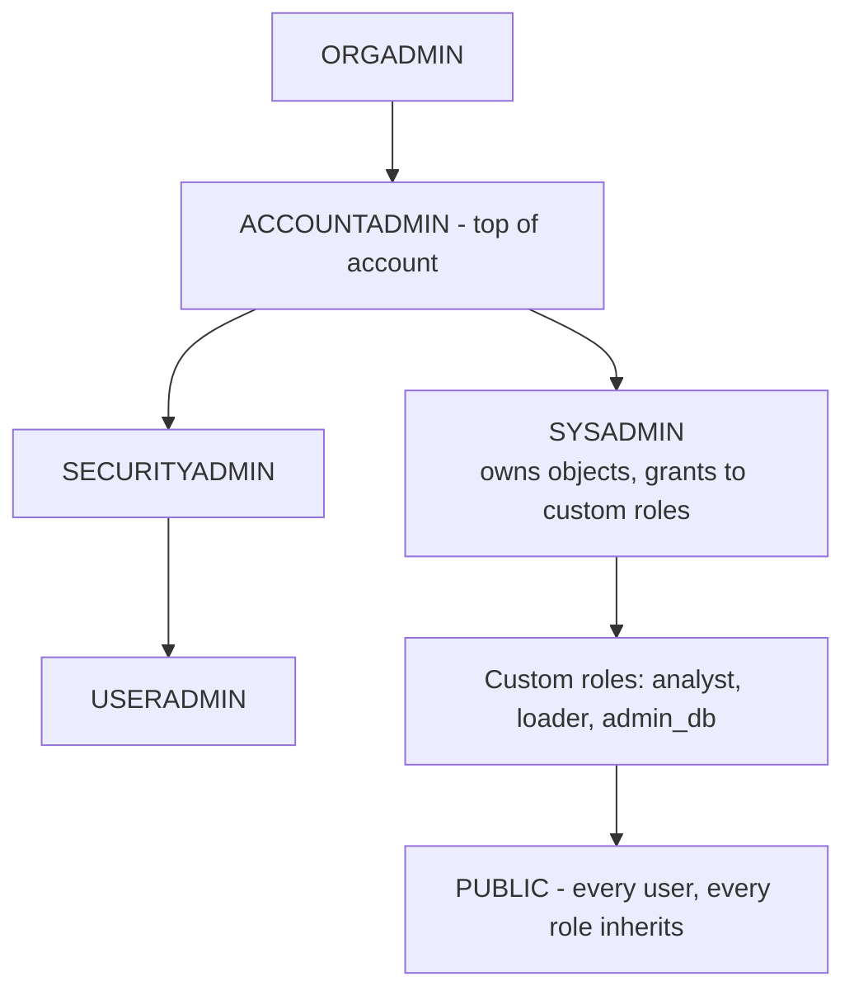
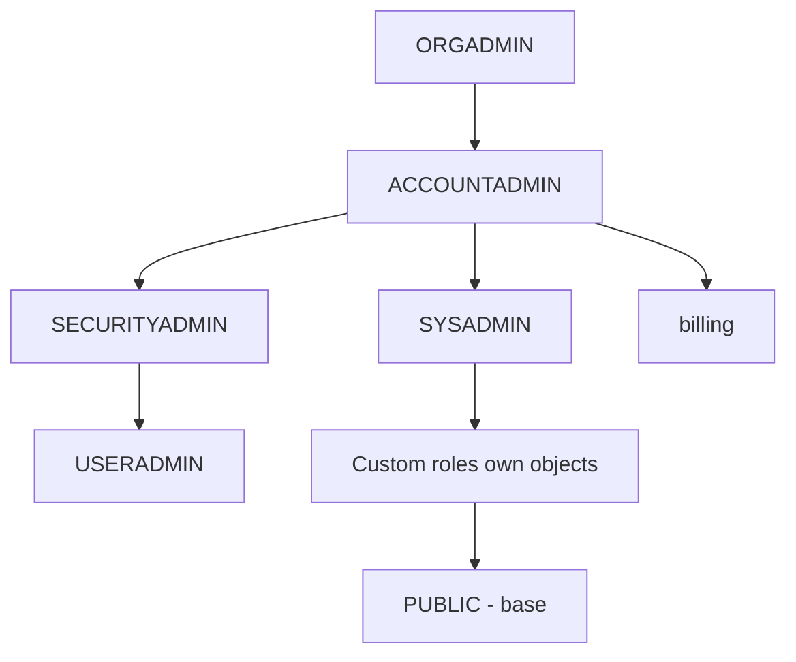
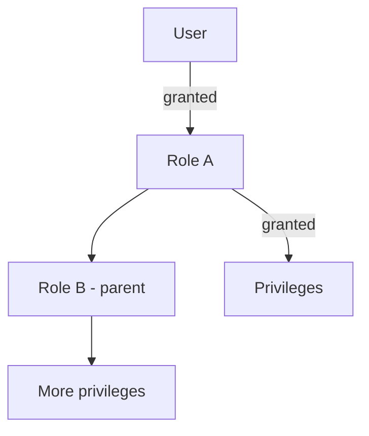
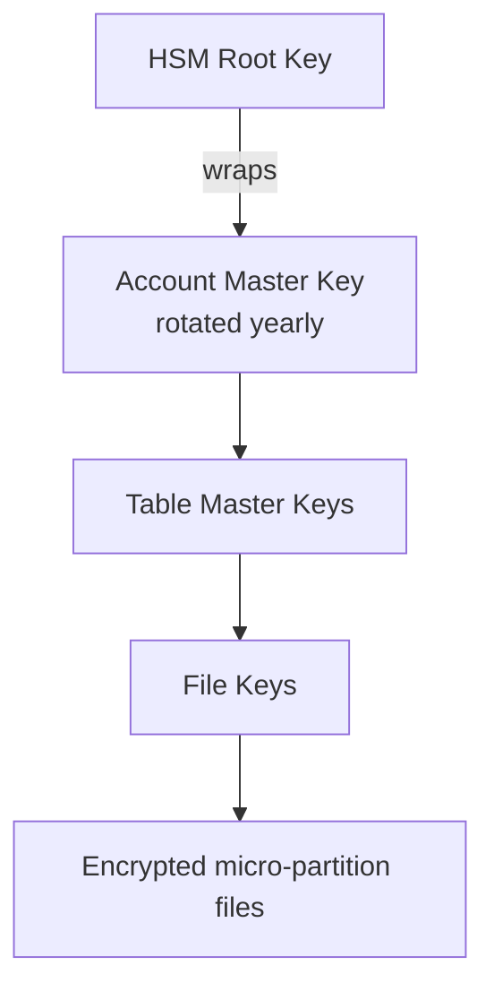

# Account Access & Security — COF-C02 Study Guide

## Exam Weight & Scope
**~15% of the COF-C02 exam.** Covers RBAC (default roles, role hierarchy, custom roles), MFA, SSO/federated auth, network policies, encryption (at rest and in transit), key rotation / Tri-Secret Secure, column-level and row-level security basics (Dynamic Data Masking, Row Access Policies), and secure views basics.

## Core Concepts Map



**Authentication layers:** Password + MFA · SSO (SAML/OIDC) · Key-pair JWT · OAuth.

**Network controls:** Network Policies (allow/block IPs) + Private Link (AWS/Azure/GCP).

---

## Q1: Name the system-defined (default) roles in Snowflake, from highest privilege to lowest.
**Difficulty:** Foundation
**Exam relevance:** RBAC roles (5.1)

### Answer
1. **ORGADMIN** — organization-level administration (create accounts, enable features).
2. **ACCOUNTADMIN** — account-level superuser; owns top-level objects, billing, resource monitors.
3. **SECURITYADMIN** — manages users, roles, grants, network policies (but not billing).
4. **USERADMIN** — manages users and roles only (subset of SECURITYADMIN).
5. **SYSADMIN** — owns and manages warehouses, databases, schemas (data engineering).
6. **PUBLIC** — role every user has implicitly; grants here are "everyone".

### First Principles
Separation of duties: ACCOUNTADMIN concentrates power; SECURITYADMIN/USERADMIN handle identity; SYSADMIN handles data. ORGADMIN is cross-account.

### Diagram


### Lab Exercise
```sql
SHOW ROLES;

-- Switch role
USE ROLE SYSADMIN;
USE ROLE ACCOUNTADMIN;
```

### Gotchas / Exam Traps
- **ORGADMIN** does NOT have ACCOUNTADMIN privileges by default — different scope (org vs account).
- **SECURITYADMIN** inherits USERADMIN, so can do everything USERADMIN can plus manage grants globally.
- **ACCOUNTADMIN** can do everything but should be used sparingly.
- SYSADMIN does NOT include SECURITYADMIN by default.

---

## Q2: What is RBAC and how does Snowflake implement it?
**Difficulty:** Foundation
**Exam relevance:** RBAC (5.1)

### Answer
**Role-Based Access Control** — privileges are granted to **roles**, and roles are granted to **users** (or other roles). Users assume roles to perform actions.

Key properties:
- Privileges are granted to **roles**, not users.
- Roles can inherit from other roles (role hierarchy).
- A user can have **multiple roles** granted; sets a **CURRENT_ROLE** per session.
- Default role per user applies at login.

### Diagram

User inherits privileges through chained role grants.

### Lab Exercise
```sql
CREATE ROLE analyst;
GRANT USAGE ON WAREHOUSE compute_wh TO ROLE analyst;
GRANT USAGE ON DATABASE sales TO ROLE analyst;
GRANT USAGE ON SCHEMA sales.public TO ROLE analyst;
GRANT SELECT ON ALL TABLES IN SCHEMA sales.public TO ROLE analyst;
GRANT ROLE analyst TO USER jsmith;

-- Future grants (auto-apply to new tables)
GRANT SELECT ON FUTURE TABLES IN SCHEMA sales.public TO ROLE analyst;
```

### Gotchas / Exam Traps
- **FUTURE GRANTS** apply to objects created after the grant — easy to miss.
- Users with multiple roles must `USE ROLE <role>` to switch; sessions have a single current role.
- Secondary roles (newer feature) allow combined privileges in a session.

---

## Q3: What is the difference between SECURITYADMIN and USERADMIN?
**Difficulty:** Intermediate
**Exam relevance:** Role separation (5.1)

### Answer
- **USERADMIN** — creates and manages **users and roles**.
- **SECURITYADMIN** — includes USERADMIN **plus** can manage grants on any object (globally), create network policies, manage security integrations.

### First Principles
Separation of duty: USERADMIN handles identity provisioning; SECURITYADMIN handles permissioning. In many orgs, USERADMIN is delegated to HR/IT while SECURITYADMIN remains closer to security team.

### Lab Exercise
```sql
USE ROLE USERADMIN;
CREATE USER jdoe PASSWORD='Temp123!' DEFAULT_ROLE=analyst;
CREATE ROLE finance;
GRANT ROLE finance TO USER jdoe;

USE ROLE SECURITYADMIN;
GRANT SELECT ON TABLE finance.data.transactions TO ROLE finance;
```

### Gotchas / Exam Traps
- SECURITYADMIN has `MANAGE GRANTS` privilege — key separator.
- SECURITYADMIN cannot create warehouses/databases (that's SYSADMIN or ACCOUNTADMIN).
- The exam often tests "which role can do X" — know the matrix.

---

## Q4: Which TWO authentication methods does Snowflake support? (multi-select — pick 2)
**Difficulty:** Foundation
**Exam relevance:** Authentication (5.2)

### Answer
Supported:
- **Username + password** (with optional MFA).
- **Key-pair authentication (JWT)** — public/private key.
- **SSO via SAML 2.0** (Okta, Azure AD, Ping, OneLogin, custom IdP).
- **SSO via OAuth** (external OAuth, Snowflake OAuth for apps).
- **Scoped credentials for service accounts.**

### Lab Exercise
```sql
-- Create user with key-pair auth
ALTER USER svc_etl SET
  RSA_PUBLIC_KEY='MIIBIjANBgkqhkiG9w0BAQEFAAOCAQ8AMIIBCgKCAQEA...';

-- Enforce MFA
ALTER USER jdoe SET MFA_ENROLLMENT_REQUIRED=TRUE;

-- SAML integration
CREATE SECURITY INTEGRATION saml_okta
  TYPE=SAML2
  ENABLED=TRUE
  SAML2_ISSUER='http://www.okta.com/exk...'
  SAML2_SSO_URL='https://acme.okta.com/app/...'
  SAML2_PROVIDER='OKTA'
  SAML2_X509_CERT='<cert>';
```

### Gotchas / Exam Traps
- **MFA via Duo** is Snowflake-native (free), activated per user.
- Service accounts should use **key-pair auth**, not passwords.
- OAuth requires creating a **security integration**.
- **Password policies** (length, complexity, rotation) are set at account level.

---

## Q5: What is MFA in Snowflake and how is it configured?
**Difficulty:** Foundation
**Exam relevance:** MFA (5.2)

### Answer
**Multi-Factor Authentication** uses Duo Mobile (free, native) as a second factor after password. Enrollment is per-user; can be enforced via `MFA_ENROLLMENT_REQUIRED=TRUE` or by account policy.

### Lab Exercise
```sql
-- Enforce MFA for an existing user
ALTER USER jdoe SET MFA_ENROLLMENT_REQUIRED=TRUE;

-- Query users without MFA (ACCOUNTADMIN)
SELECT name, has_password, ext_authn_duo
FROM snowflake.account_usage.users
WHERE deleted_on IS NULL AND ext_authn_duo=FALSE;
```

### Gotchas / Exam Traps
- MFA uses **Duo Security** by default; free with Snowflake.
- MFA applies only to **password-based** login — SSO users rely on IdP's MFA.
- Users without a password (SSO-only, key-pair) don't need Snowflake MFA.

---

## Q6: Explain network policies.
**Difficulty:** Foundation
**Exam relevance:** Network security (5.3)

### Answer
A **Network Policy** restricts which **IP addresses or CIDR ranges** can access Snowflake. Can be applied at **account level** (default) or **per-user**.

```sql
CREATE NETWORK POLICY corp_only
  ALLOWED_IP_LIST=('203.0.113.0/24','198.51.100.5')
  BLOCKED_IP_LIST=('203.0.113.99');

ALTER ACCOUNT SET NETWORK_POLICY=corp_only;
-- Or per-user
ALTER USER jdoe SET NETWORK_POLICY=corp_only;
```

### Gotchas / Exam Traps
- Only **IPv4** supported in network policies (as of exam syllabus).
- **BLOCKED_IP_LIST** takes precedence over ALLOWED_IP_LIST.
- Blocking your own IP locks you out — have an escape plan.
- A **user-level policy overrides** the account-level policy for that user.

---

## Q7: What is Private Link / PrivateLink in Snowflake?
**Difficulty:** Intermediate
**Exam relevance:** Network security (5.3)

### Answer
**AWS PrivateLink / Azure Private Link / GCP Private Service Connect** provide **private network connectivity** between your VPC/VNet and Snowflake, bypassing the public internet. Traffic stays on the cloud provider's backbone.

- **AWS PrivateLink** — Business Critical+.
- **Azure Private Link** — Business Critical+.
- **GCP PSC** — Business Critical+.

### Gotchas / Exam Traps
- Requires **Business Critical+**.
- Must be requested/enabled via Snowflake Support typically.
- Does NOT replace network policies — layer them.
- Clients connect via a private endpoint URL distinct from the public one.

---

## Q8: Describe Snowflake's encryption at rest model.
**Difficulty:** Intermediate
**Exam relevance:** Encryption (5.4)

### Answer
Snowflake uses **AES-256 encryption** with a **hierarchical key model**:
1. **Root key** (in cloud HSM).
2. **Account master key** (per account; rotated ~annually).
3. **Table master keys** (per table).
4. **File keys** (per micro-partition file).

Encryption is **automatic and non-optional** — all data is encrypted at rest.

### Diagram


### Lab Exercise
```sql
-- Enable periodic rekey of older data (Enterprise+)
ALTER ACCOUNT SET PERIODIC_DATA_REKEYING=TRUE;
```

### Gotchas / Exam Traps
- **Rekeying old data** = Enterprise+.
- **Tri-Secret Secure** (BYOK) = Business Critical+.
- All layers use **AES-256**.
- **Keys never leave the HSM** at root level.

---

## Q9: What is Tri-Secret Secure?
**Difficulty:** Advanced
**Exam relevance:** Advanced encryption (5.4)

### Answer
**Tri-Secret Secure** combines:
1. Snowflake-maintained key.
2. **Customer-managed key** (CMK) in cloud KMS (AWS KMS / Azure Key Vault / GCP KMS).
3. The composite key encrypts data.

Benefit: customer can **revoke their key** to render Snowflake-stored data undecryptable — provides compliance/control.

Requires **Business Critical+ edition**.

### Gotchas / Exam Traps
- BC+ only.
- Revoking the CMK renders data inaccessible — this is a feature for GDPR/data destruction.
- Operates transparently; no app change needed.

---

## Q10: What is Dynamic Data Masking?
**Difficulty:** Intermediate
**Exam relevance:** Column-level security (5.5)

### Answer
**Dynamic Data Masking (DDM)** applies a **masking policy** to a column. When queried, Snowflake evaluates the policy at runtime based on the invoking role/user and returns either the real value or a masked/transformed value. Enterprise+ edition.

```sql
CREATE MASKING POLICY mask_email AS (val STRING) RETURNS STRING ->
  CASE
    WHEN CURRENT_ROLE() IN ('ANALYST_FULL','ACCOUNTADMIN') THEN val
    ELSE REGEXP_REPLACE(val,'^.*@','***@')
  END;

ALTER TABLE customers MODIFY COLUMN email
  SET MASKING POLICY mask_email;
```

### First Principles
Masking happens at **query time**, dynamically — no need to duplicate tables or physically mask. Role-driven policies make this reusable.

### Gotchas / Exam Traps
- Enterprise+ required.
- Masking policies are **centrally managed** — one policy, many columns.
- Policy evaluates per-row at query time; cost is minimal.
- Policy owner must have `APPLY MASKING POLICY` global privilege.

---

## Q11: What is a Row Access Policy?
**Difficulty:** Intermediate
**Exam relevance:** Row-level security (5.5)

### Answer
A **Row Access Policy** returns a boolean filter per row based on the invoking context (role, user, mapping table). Applied to tables and views. Enterprise+ edition.

```sql
CREATE ROW ACCESS POLICY region_filter AS (region STRING)
  RETURNS BOOLEAN ->
    CURRENT_ROLE() = 'ADMIN'
    OR EXISTS (
      SELECT 1 FROM role_region_map
      WHERE role_name = CURRENT_ROLE() AND allowed_region = region
    );

ALTER TABLE sales ADD ROW ACCESS POLICY region_filter ON (region);
```

### Gotchas / Exam Traps
- Enterprise+ only.
- Policy expression can reference **mapping tables** for data-driven authorization.
- One policy can be applied to many tables; policy per column list.

---

## Q12: Which TWO are TRUE about Secure Views? (multi-select)
**Difficulty:** Intermediate
**Exam relevance:** Secure views (5.6)

### Answer
True:
- Secure views hide the **view definition** from users without ownership.
- The query optimizer treats secure views differently to prevent **data leakage** via predicate pushdown or query plans.

False:
- Secure views are NOT faster than regular views.
- Secure views do NOT require Enterprise edition (available in Standard).

### Lab Exercise
```sql
CREATE SECURE VIEW customers_masked AS
  SELECT id, SUBSTR(ssn,-4,4) AS ssn_last4, name FROM customers;
```

### Gotchas / Exam Traps
- Secure views are **slower** than regular views because they disable certain optimizations that could leak data via side channels.
- Use for shared data or sensitive layers.
- Also exists: **Secure Materialized Views** and **Secure UDFs**.

---

## Q13: What is a Secure Share, and how does it relate to Secure Data Sharing?
**Difficulty:** Intermediate
**Exam relevance:** Data sharing (5.7)

### Answer
**Secure Data Sharing** lets a provider expose data to a consumer account via a **SHARE** object — no data is copied; the consumer reads via a mounted database.

```sql
-- Provider
CREATE SHARE sales_share;
GRANT USAGE ON DATABASE sales TO SHARE sales_share;
GRANT USAGE ON SCHEMA sales.public TO SHARE sales_share;
GRANT SELECT ON TABLE sales.public.orders TO SHARE sales_share;
ALTER SHARE sales_share ADD ACCOUNTS=myorg.consumer_acct;

-- Consumer
CREATE DATABASE sales_mounted FROM SHARE provider.sales_share;
SELECT * FROM sales_mounted.public.orders;
```

### Gotchas / Exam Traps
- **No data copying** — zero-copy share via metadata.
- Consumer uses their **own warehouse** (compute).
- Updates on provider are **immediately visible** to consumers.
- Non-provider sharing (reader accounts) exist for consumers without Snowflake.

---

## Q14: Which role is required to grant privileges on an object?
**Difficulty:** Foundation
**Exam relevance:** RBAC (5.1)

### Answer
The **object owner** (role that owns the object) or a role with **MANAGE GRANTS** privilege (ACCOUNTADMIN and SECURITYADMIN have this).

### Lab Exercise
```sql
USE ROLE SYSADMIN;  -- owner of sales DB
GRANT SELECT ON TABLE sales.public.orders TO ROLE analyst;

-- Or:
USE ROLE SECURITYADMIN;
GRANT SELECT ON TABLE sales.public.orders TO ROLE analyst;
```

### Gotchas / Exam Traps
- Ownership transfer: `GRANT OWNERSHIP ON OBJECT TO ROLE new_owner;`
- Only one role at a time can OWN an object.
- Ownership includes implicit MANAGE GRANTS on that object.

---

## Q15: What is OAuth integration used for in Snowflake?
**Difficulty:** Advanced
**Exam relevance:** Authentication (5.2)

### Answer
OAuth integrations enable applications (BI tools, custom apps) to obtain **OAuth tokens** that act on behalf of users or services, without storing passwords.

Two types:
- **Snowflake OAuth** — Snowflake acts as the authorization server (good for custom apps/partners).
- **External OAuth** — external IdP (Okta, Azure AD) issues tokens Snowflake accepts.

```sql
CREATE SECURITY INTEGRATION oauth_custom
  TYPE=OAUTH
  ENABLED=TRUE
  OAUTH_CLIENT=CUSTOM
  OAUTH_CLIENT_TYPE='CONFIDENTIAL'
  OAUTH_REDIRECT_URI='https://myapp.example.com/callback';
```

### Gotchas / Exam Traps
- OAuth tokens have **short lifetimes**; refresh tokens for persistence.
- Supported BI tools: Tableau, Power BI, Looker, DBeaver, etc.
- Session policies can govern token duration.

---

## Q16: What are three ways to encrypt data in transit to/from Snowflake?
**Difficulty:** Intermediate
**Exam relevance:** Encryption in transit (5.4)

### Answer
Data in transit is always encrypted using:
1. **TLS 1.2+** for client connections (JDBC/ODBC/HTTPS).
2. **TLS** for internal cloud services communication.
3. **TLS/HTTPS** for file uploads to internal stages (PUT) and from external stages.

### Gotchas / Exam Traps
- TLS 1.2+ is **mandatory** — older TLS versions are rejected.
- No option to disable encryption in transit.

---

## Q17: Which THREE are TRUE about the PUBLIC role? (multi-select)
**Difficulty:** Intermediate
**Exam relevance:** RBAC default roles (5.1)

### Answer
True:
- Every user has PUBLIC by default.
- Every custom role inherits PUBLIC (implicitly).
- Granting to PUBLIC = granting to everyone in the account.

False:
- PUBLIC is NOT ACCOUNTADMIN.
- PUBLIC does NOT get all privileges by default.

### Gotchas / Exam Traps
- Avoid granting privileges to PUBLIC except trivial ones (USAGE on default warehouse maybe).
- Objects created have default owner = creating role, not PUBLIC.

---

## Q18: You need to prevent all users from logging in from outside the corporate VPN. How?
**Difficulty:** Foundation
**Exam relevance:** Network policies (5.3)

### Answer
Create a **network policy** with `ALLOWED_IP_LIST` set to the VPN's egress IPs, and apply it at the **account level**.

```sql
CREATE NETWORK POLICY vpn_only
  ALLOWED_IP_LIST=('198.51.100.0/24');
ALTER ACCOUNT SET NETWORK_POLICY=vpn_only;
```

### Gotchas / Exam Traps
- Make sure to include your own IP before applying!
- Specific users can override (per-user policy) if needed (e.g., contractors).
- Service accounts may need a wider range.

---

## Q19: Describe scoped privileges vs account-level privileges.
**Difficulty:** Advanced
**Exam relevance:** Privilege model (5.1)

### Answer
Privileges have **scope**:
- **Global/account-level** — e.g., `CREATE WAREHOUSE`, `MANAGE GRANTS`, `MONITOR USAGE`, applied to the account.
- **Object-level** — on specific databases, schemas, tables, views, etc.

Account-level privileges are granted via `GRANT <priv> ON ACCOUNT TO ROLE <r>`.

```sql
GRANT CREATE WAREHOUSE ON ACCOUNT TO ROLE wh_creator;
GRANT MONITOR USAGE ON ACCOUNT TO ROLE auditor;
```

### Gotchas / Exam Traps
- Account-level privileges often reserved for ACCOUNTADMIN or SECURITYADMIN.
- `MANAGE GRANTS` is the "I can grant anything to anyone" power.

---

## Q20: What is a Session Policy?
**Difficulty:** Advanced
**Exam relevance:** Session management (5.2)

### Answer
A **Session Policy** controls session timeout and idle timeout settings. Can be applied at account or user level.

```sql
CREATE SESSION POLICY tight_sess
  SESSION_IDLE_TIMEOUT_MINS=15
  SESSION_UI_IDLE_TIMEOUT_MINS=10;

ALTER ACCOUNT SET SESSION_POLICY=tight_sess;
```

### Gotchas / Exam Traps
- Enterprise+ edition.
- Separate limits for UI (Snowsight) vs non-UI sessions.
- Short sessions force frequent re-auth, improving security.

---

## Q21: Order the steps for creating a federated SSO (SAML) login experience.
**Difficulty:** Advanced
**Exam relevance:** SSO (5.2)

### Answer
1. Configure Snowflake as a **Service Provider** in your IdP (Okta/Azure AD/etc).
2. Obtain IdP metadata (issuer, SSO URL, x509 cert).
3. Create a **SAML security integration** in Snowflake:
   ```sql
   CREATE SECURITY INTEGRATION saml_prod
     TYPE=SAML2 ENABLED=TRUE
     SAML2_ISSUER='<issuer_url>'
     SAML2_SSO_URL='<sso_url>'
     SAML2_PROVIDER='OKTA'
     SAML2_X509_CERT='<base64>';
   ```
4. Configure user mapping (Snowflake user name must match IdP's NameID).
5. Users log in via IdP; redirected to Snowflake authenticated.

### Gotchas / Exam Traps
- Multiple SAML integrations allowed in Enterprise+.
- Users can retain password auth or be SSO-only.
- Account URL + "/console/login" presents SSO button.

---

## Q22: What is the difference between a secure UDF and a regular UDF?
**Difficulty:** Advanced
**Exam relevance:** Secure objects (5.6)

### Answer
A **Secure UDF** hides its definition from users without ownership (same principle as secure views) and the optimizer suppresses certain plan-leakage behaviors. Useful when the UDF encodes sensitive logic or references sensitive data.

```sql
CREATE SECURE FUNCTION f_sensitive(x INT) RETURNS INT AS
  'SELECT CASE WHEN x > 100 THEN 0 ELSE x END';
```

### Gotchas / Exam Traps
- Secure UDFs can be **slower** than regular UDFs.
- Combine with secure views for defense in depth in shared data.

---

## Q23: Which THREE of these actions require ACCOUNTADMIN role? (multi-select)
**Difficulty:** Intermediate
**Exam relevance:** RBAC specifics (5.1)

### Answer
Require ACCOUNTADMIN:
- **Create resource monitors.**
- **View account-level usage** (SNOWFLAKE.ACCOUNT_USAGE schema access by default).
- **Manage account parameters** (e.g., MIN_DATA_RETENTION_TIME_IN_DAYS).
- **Alter account** (region, edition changes, etc.).
- **Approve replication to another account** (initiating side).

Do NOT require ACCOUNTADMIN:
- Create users (USERADMIN).
- Grant privileges (SECURITYADMIN or object owner).
- Create warehouses (SYSADMIN with proper privilege).

### Gotchas / Exam Traps
- ACCOUNTADMIN access to ACCOUNT_USAGE can be delegated via `GRANT IMPORTED PRIVILEGES ON DATABASE SNOWFLAKE TO ROLE ...`.
- Billing visibility is ACCOUNTADMIN unless explicitly shared.

---

## Q24: What is the SYSADMIN role responsible for?
**Difficulty:** Foundation
**Exam relevance:** RBAC (5.1)

### Answer
**SYSADMIN** is the recommended **top-level role for data engineering** — creating and owning warehouses, databases, schemas, and granting data access to custom roles. ACCOUNTADMIN is above but should be reserved for break-glass operations.

Snowflake docs recommend custom roles **inherit** from SYSADMIN so that SYSADMIN has visibility into all data assets.

### Lab Exercise
```sql
USE ROLE SYSADMIN;
CREATE DATABASE analytics;
CREATE WAREHOUSE etl_wh WITH WAREHOUSE_SIZE='MEDIUM';

CREATE ROLE etl_dev;
GRANT USAGE ON DATABASE analytics TO ROLE etl_dev;
GRANT ROLE etl_dev TO ROLE SYSADMIN;  -- inherit upward
```

### Gotchas / Exam Traps
- Custom role hierarchy should **roll up to SYSADMIN** so admins can audit easily.
- SYSADMIN cannot manage users/roles directly without additional grants.

---

## Q25: Which TWO are TRUE about secondary roles? (multi-select)
**Difficulty:** Advanced
**Exam relevance:** Session roles (5.1)

### Answer
True:
- A session can have one **primary role** (CURRENT_ROLE) and multiple **secondary roles** active simultaneously.
- Secondary roles let you combine privileges without picking one role.

False:
- Only one role active at a time (false — secondary roles enabled this).
- Secondary roles bypass RBAC (false — they're still role-based).

```sql
USE SECONDARY ROLES ALL;  -- activate all granted roles
-- Or specific ones
USE SECONDARY ROLES role_a, role_b;
```

### Gotchas / Exam Traps
- Secondary roles added in Snowflake 2022; expect exam coverage.
- `USE SECONDARY ROLES NONE` disables them.
- Useful for users with many narrow roles who need combined access.

---
