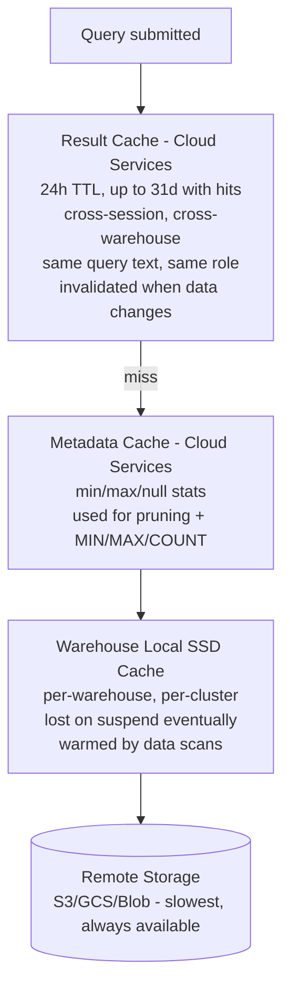
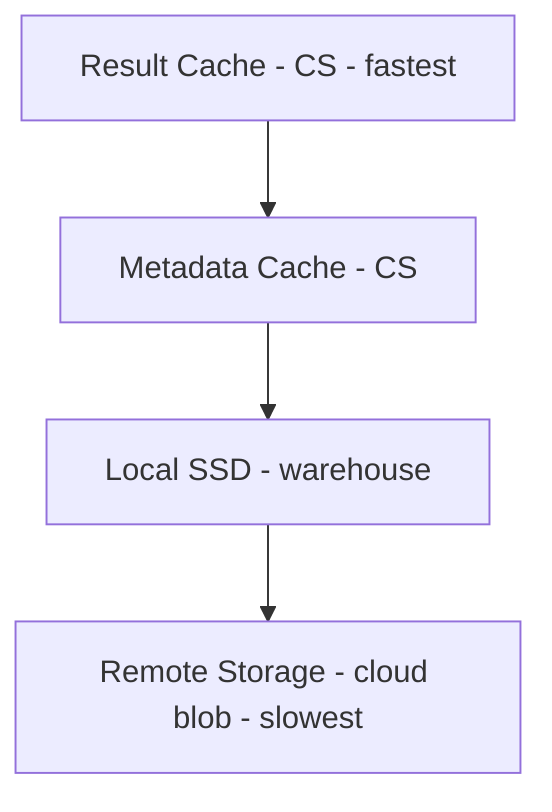
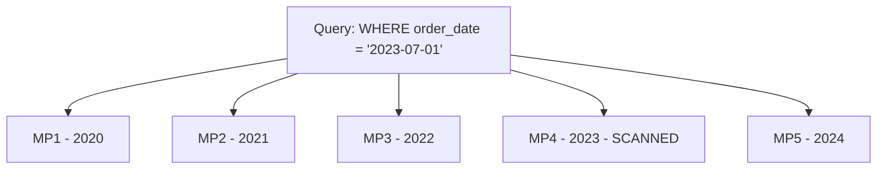
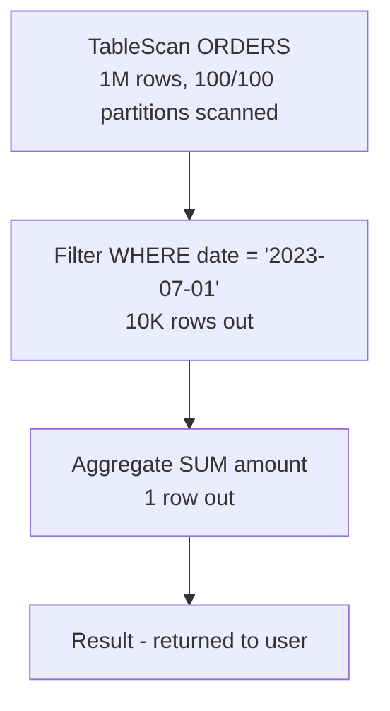

# Performance Concepts — COF-C02 Study Guide

## Exam Weight & Scope
**~15% of the COF-C02 exam.** Covers caching hierarchy (result cache / metadata cache / warehouse local SSD / remote storage), reading Query Profile, clustering keys (depth, automatic clustering), micro-partition pruning, materialized views basics, search optimization service, and query acceleration service.

## Core Concepts Map



---

## Q1: Name the four caching layers in Snowflake, from fastest to slowest.
**Difficulty:** Foundation
**Exam relevance:** Caching (6.1)

### Answer
1. **Result cache** (Cloud Services) — returns final result; sub-second.
2. **Metadata cache** (Cloud Services) — min/max/count stats; sub-second for metadata-only queries.
3. **Warehouse local SSD cache** — data read previously; per-warehouse.
4. **Remote storage** — cloud blob (S3/GCS/Azure Blob); slowest.

### First Principles
Snowflake pushes work to the earliest cache that can answer. Avoid full scans whenever possible — Snowflake uses metadata to prune first, then local cache, then remote.

### Diagram


### Lab Exercise
```sql
-- Run twice, check cache percentages
SELECT COUNT(*) FROM snowflake_sample_data.tpch_sf1.lineitem;
SELECT COUNT(*) FROM snowflake_sample_data.tpch_sf1.lineitem;

SELECT query_id, warehouse_name, bytes_scanned,
       percentage_scanned_from_cache, execution_status
FROM table(information_schema.query_history())
ORDER BY start_time DESC LIMIT 5;
```

### Gotchas / Exam Traps
- Result cache is **cloud-services-level**, NOT per-warehouse.
- Local SSD cache is **per-warehouse** — different warehouses don't share.
- Metadata cache serves `COUNT(*)`, `MIN/MAX of a column` for whole-table in constant time if underlying data unchanged.

---

## Q2: How long does the Result Cache persist?
**Difficulty:** Foundation
**Exam relevance:** Result cache (6.1)

### Answer
**24 hours after the last access**; can be extended up to a **maximum of 31 days** with repeated hits (each hit refreshes the TTL).

### First Principles
Keeping results effectively forever is cheap in storage but risky in staleness. Snowflake balances freshness vs. reuse with a bounded extension.

### Lab Exercise
```sql
-- Observe result cache in query_history
SELECT query_id, execution_status, bytes_scanned, result_scan_bytes
FROM table(information_schema.query_history())
ORDER BY start_time DESC LIMIT 10;
```

### Gotchas / Exam Traps
- **24h base, 31d cap** — common trivia.
- Result cache invalidates when **any micro-partition in the queried tables changes**.
- Non-deterministic functions (`CURRENT_TIMESTAMP`, `RANDOM`, `UUID_STRING`) bypass result cache.
- `USE SECONDARY ROLES` or role switching between queries can invalidate (different authorization context).

---

## Q3: Which TWO conditions must be met for a query to use the Result Cache? (multi-select)
**Difficulty:** Intermediate
**Exam relevance:** Result cache (6.1)

### Answer
Required:
- **Same query text** (byte-for-byte, including whitespace in some cases).
- **Underlying data has not changed** since cached result was created.
- **User has privileges to see all underlying data** (role-sensitive).
- **No non-deterministic functions** in the query.

### Gotchas / Exam Traps
- Comments or extra whitespace may still hit — but changing a filter value won't.
- A query that uses a UDF marked `IMMUTABLE` is cacheable; `VOLATILE` is not.
- Result cache does NOT require the original warehouse to be running.

---

## Q4: Describe the Metadata Cache and give examples of queries served by it.
**Difficulty:** Intermediate
**Exam relevance:** Metadata optimization (6.1)

### Answer
The **metadata cache** (part of Cloud Services) stores per-micro-partition statistics (min, max, null count, distinct count, size). It serves certain queries entirely without scanning data:
- `SELECT COUNT(*) FROM t` (if the table hasn't changed and metadata has exact count).
- `SELECT MIN(col) / MAX(col) FROM t` (when col has min/max metadata).
- Partition pruning decisions for WHERE clauses.

### First Principles
Metadata lets Snowflake short-circuit scans entirely for aggregate queries over simple predicates — this is a major speedup for dashboards and sanity-check queries.

### Lab Exercise
```sql
-- These may run without touching data
SELECT COUNT(*) FROM snowflake_sample_data.tpch_sf1.lineitem;
SELECT MIN(l_orderkey), MAX(l_orderkey) FROM snowflake_sample_data.tpch_sf1.lineitem;
-- Check Query Profile: "Metadata-based result"
```

### Gotchas / Exam Traps
- Metadata-only queries still appear in query history but with **near-zero bytes scanned**.
- Requires a running warehouse technically (depends on query), but execution time is sub-second.
- Pruning uses metadata too — large tables with good clustering can skip 99%+ partitions.

---

## Q5: What is partition pruning and when does it occur?
**Difficulty:** Intermediate
**Exam relevance:** Query optimization (6.2)

### Answer
**Partition pruning** is Snowflake's elimination of micro-partitions from a scan based on WHERE clause predicates and partition metadata (min/max). Partitions whose metadata guarantees no matching rows are **not read**.

### First Principles
Columnar storage + per-partition stats = cheap "do I need this chunk?" decisions. Well-clustered data = better pruning. Random/unclustered = pruning fails and full scans occur.

### Diagram

Only MP4 scanned; MP1-3 and MP5 pruned.

### Lab Exercise
```sql
-- Compare pruning on clustered vs unclustered columns
SELECT * FROM snowflake_sample_data.tpch_sf1.orders
WHERE o_orderdate='1998-07-01';

-- Check query profile: partitions_scanned / partitions_total
```

### Gotchas / Exam Traps
- Pruning only works if the WHERE clause column has useful min/max separation.
- Functions on columns (e.g., `WHERE DATE(ts)=...`) can defeat pruning — rewrite as range.
- Non-equi joins or LIKE '%X%' usually prevent pruning.

---

## Q6: What is a clustering key and when do you need one?
**Difficulty:** Intermediate
**Exam relevance:** Clustering (6.3)

### Answer
A **clustering key** is one or more columns (or expressions) Snowflake uses to **co-locate data** physically for better pruning. It's a hint to the Automatic Clustering service to maintain partition organization.

You need one when:
- Table is **large** (TB+).
- Queries filter on specific columns that natural insert order doesn't align with.
- `SYSTEM$CLUSTERING_INFORMATION()` shows **high clustering depth** on your query columns.

### Lab Exercise
```sql
CREATE TABLE events (
  event_time TIMESTAMP, user_id INT, payload VARIANT
) CLUSTER BY (event_time, user_id);

-- Add later
ALTER TABLE events CLUSTER BY (event_time, user_id);

-- Inspect
SELECT SYSTEM$CLUSTERING_INFORMATION('events', '(event_time)');
```

### Gotchas / Exam Traps
- Clustering is **NOT free** — Automatic Clustering runs in background using credits.
- Enable auto-clustering only when manual analysis shows it will help.
- **Small tables rarely benefit.**
- Clustering is NOT the same as physical partitioning in Hive/BigQuery — it's a hint, not a strict partition scheme.

---

## Q7: What is Automatic Clustering and how is it billed?
**Difficulty:** Intermediate
**Exam relevance:** Clustering (6.3)

### Answer
**Automatic Clustering** is a serverless background service that maintains the clustering of a table against its clustering key as DML occurs. Snowflake decides when to run (based on heuristics).

Billing:
- **Serverless credits** (not warehouse credits).
- Visible in `snowflake.account_usage.automatic_clustering_history`.

### Lab Exercise
```sql
-- Check clustering history
SELECT * FROM snowflake.account_usage.automatic_clustering_history
WHERE table_name='EVENTS' ORDER BY start_time DESC;

-- Pause automatic clustering
ALTER TABLE events SUSPEND RECLUSTER;
```

### Gotchas / Exam Traps
- **Automatic** — users don't trigger it; Snowflake decides.
- Suspendable via `SUSPEND RECLUSTER`.
- Monitor cost — a bad clustering key on a hot table can rack up credits.

---

## Q8: Describe what the Query Profile shows.
**Difficulty:** Foundation
**Exam relevance:** Query profile (6.2)

### Answer
The **Query Profile** in Snowsight shows:
- The **execution DAG** (operators: TableScan, Join, Aggregate, Sort, etc.).
- **Timing** per operator (bars).
- **Rows produced** per step.
- **Bytes scanned**, cache hits.
- **Partitions scanned vs. total** (pruning efficacy).
- **Spilling to disk/remote** indicators.
- **Query compilation time**.

### Diagram


### Lab Exercise
```sql
-- Run a query, then click "Query Profile" in Snowsight
-- Or programmatically:
SELECT * FROM table(GET_QUERY_OPERATOR_STATS('<query_id>'));
```

### Gotchas / Exam Traps
- **Local disk spilling** = query doesn't fit in RAM, uses SSD; moderate penalty.
- **Remote spilling** = overflowed SSD, hitting remote storage; major penalty.
- **Exploding joins** show when output rows > product of inputs.
- "Most expensive node" often highlights the culprit.

---

## Q9: What is a Materialized View (MV)?
**Difficulty:** Intermediate
**Exam relevance:** Materialized views (6.4)

### Answer
A **Materialized View** stores the pre-computed result of a query. Snowflake automatically keeps it refreshed when the base table changes (serverless background service). Query optimizer transparently rewrites queries to use MV when beneficial.

Requires **Enterprise edition or higher**.

### Lab Exercise
```sql
CREATE MATERIALIZED VIEW daily_sales AS
  SELECT DATE_TRUNC('day',order_time) AS d,
         SUM(amount) AS total
  FROM orders
  GROUP BY DATE_TRUNC('day',order_time);
```

### Gotchas / Exam Traps
- Enterprise+ only.
- MV refresh uses **serverless credits**.
- **Restrictions on MV syntax**: no joins, no window functions, no HAVING, no non-deterministic funcs, no self-ref.
- Snowflake rewrites queries over base to hit MV automatically.
- MVs **can** be built on external tables (nice performance boost).

---

## Q10: Compare materialized views, cached tables, and dynamic tables.
**Difficulty:** Advanced
**Exam relevance:** Materialization options (6.4)

### Answer

**Materialized View:**
- Syntax: Limited (no joins)
- Refresh: Automatic, serverless
- Billing: Serverless
- Edition: Enterprise+
- Use case: Single-table aggs

**Dynamic Table:**
- Syntax: Full SQL
- Refresh: Target lag SLA
- Billing: Warehouse
- Edition: All
- Use case: Multi-table ETL

**Table with Scheduled Refresh:**
- Syntax: Full SQL
- Refresh: Scheduled task
- Billing: Warehouse
- Edition: All
- Use case: Custom pipelines

### Gotchas / Exam Traps
- MVs are **cheaper for simple aggregations**; DTs are more flexible.
- DTs can **chain** (DT depends on DT); supports DAGs declaratively.

---

## Q11: What is the Search Optimization Service (SOS)?
**Difficulty:** Advanced
**Exam relevance:** Advanced perf (6.5)

### Answer
**Search Optimization Service** speeds up **selective point lookups** (equality predicates, substring/regex searches, IN lists) on large tables by maintaining an **inverted search index** per column. Enabled per column.

Enterprise+ edition.

### Lab Exercise
```sql
-- Enable on all columns of a table
ALTER TABLE events ADD SEARCH OPTIMIZATION;

-- Enable on specific columns
ALTER TABLE events ADD SEARCH OPTIMIZATION ON EQUALITY(user_id, session_id);
ALTER TABLE events ADD SEARCH OPTIMIZATION ON SUBSTRING(payload);
```

### Gotchas / Exam Traps
- Enterprise+ only.
- **Serverless background service** to maintain the index — costs credits.
- Best for **needle-in-haystack** queries on huge tables.
- Doesn't help range scans or large aggregations.

---

## Q12: What is the Query Acceleration Service (QAS)?
**Difficulty:** Advanced
**Exam relevance:** Advanced perf (6.6)

### Answer
**QAS** offloads parts of eligible queries (large scans, filters) to **serverless compute** to accelerate outlier queries without permanently increasing warehouse size. Configured per warehouse.

Enterprise+ edition.

### Lab Exercise
```sql
ALTER WAREHOUSE wh SET
  ENABLE_QUERY_ACCELERATION=TRUE
  QUERY_ACCELERATION_MAX_SCALE_FACTOR=8;

-- Monitor
SELECT * FROM snowflake.account_usage.query_acceleration_history
ORDER BY start_time DESC;
```

### Gotchas / Exam Traps
- Enterprise+ only.
- `MAX_SCALE_FACTOR` caps extra credits spent per query (multiplier of warehouse size).
- Only accelerates queries matching specific patterns (large scans / filters).
- Billed in **serverless credits**.

---

## Q13: You see "Remote Disk Spilling" in Query Profile. What does it indicate and how do you fix it?
**Difficulty:** Advanced
**Exam relevance:** Query profile (6.2)

### Answer
Remote disk spilling means the query exceeded both local SSD cache and local temporary disk, and is now writing intermediate results to **remote storage** — a serious performance red flag.

Fixes:
1. **Resize warehouse larger** (more RAM/SSD per node).
2. **Reduce data processed** (better pruning, filters, smaller selects).
3. **Rewrite query** to avoid huge sorts/aggregations.
4. **Clustering key** to improve pruning.

### Gotchas / Exam Traps
- **Local spilling** is tolerable; **remote spilling** is severe.
- Common cause: `ORDER BY` on huge dataset, or giant joins without good filtering.
- Scaling up often fastest fix; redesign is correct long-term.

---

## Q14: Which TWO scenarios defeat partition pruning? (multi-select)
**Difficulty:** Intermediate
**Exam relevance:** Query optimization (6.2)

### Answer
Defeat pruning:
- **Function applied to the column in WHERE** (e.g., `WHERE UPPER(name)='X'` or `WHERE DATE(ts)='...'`).
- **Column data that's unclustered relative to filter** — partitions have overlapping min/max.
- **LIKE '%foo%'** (leading wildcard).
- **Casts hiding predicate semantics**.

### Gotchas / Exam Traps
- Fix by rewriting predicates: `WHERE ts >= '2026-10-01' AND ts < '2026-10-02'` instead of `WHERE DATE(ts)='2026-10-01'`.
- Use **expression columns** (virtual) or **clustering keys** aligned with query shape.

---

## Q15: What is SYSTEM$CLUSTERING_INFORMATION used for?
**Difficulty:** Intermediate
**Exam relevance:** Clustering diagnostics (6.3)

### Answer
Returns a JSON summary of clustering health for a table/columns:
- `cluster_by_keys`
- `total_partition_count`
- `total_constant_partition_count`
- `average_overlaps` (lower is better)
- `average_depth` (lower is better — 1 is ideal)
- `partition_depth_histogram`

### Lab Exercise
```sql
SELECT SYSTEM$CLUSTERING_INFORMATION(
  'snowflake_sample_data.tpch_sf1.lineitem',
  '(l_orderkey)'
);
```

### Gotchas / Exam Traps
- `average_depth` close to 1 means well-clustered on those columns.
- Numbers much higher than 1 (dozens+) indicate poor clustering.
- Use before adding a cluster key — don't blindly cluster.

---

## Q16: Which caches survive a warehouse suspension? (single select)
**Difficulty:** Intermediate
**Exam relevance:** Caching (6.1)

### Answer
**Result cache** (Cloud Services) and **metadata cache** (Cloud Services) survive. **Warehouse local SSD cache** is lost (may persist briefly if resumed quickly, but not guaranteed).

### Gotchas / Exam Traps
- Aggressive auto-suspend thrashes local cache.
- Dedicated warehouses retain cache better for repeat workloads.
- Result cache is independent of warehouse state entirely.

---

## Q17: Which TWO are TRUE about Materialized Views? (multi-select)
**Difficulty:** Intermediate
**Exam relevance:** MV (6.4)

### Answer
True:
- MVs are maintained **automatically** by Snowflake using **serverless** compute.
- Queries over base tables can be **transparently rewritten** to use MVs.

False:
- MVs do NOT support arbitrary SQL (no joins, no window funcs, limited aggregates).
- MVs are NOT free — maintenance credits apply.
- MVs do NOT replace tables for OLTP (they're read-optimized).

### Gotchas / Exam Traps
- MV restrictions: must be on a single base table, no joins, no HAVING, no non-deterministic.
- Snowflake chooses MV vs. base automatically; use `EXPLAIN` to see.

---

## Q18: What's the typical approach to optimizing a slow query? (ordered checklist)
**Difficulty:** Advanced
**Exam relevance:** Optimization workflow (6.2)

### Answer
1. **Open Query Profile.** Identify slowest operator.
2. Look for **spilling** (local or remote).
3. Check **partition pruning** ratio (scanned / total).
4. Check for **exploding joins** (output rows >> inputs).
5. Verify **data types / predicates** don't disable pruning.
6. Consider **warehouse size** (if memory-bound).
7. Consider **clustering key** (if pruning poor and data large).
8. Consider **materialized view** (if same aggregation repeated).
9. Consider **search optimization** (if point lookups).
10. Consider **query acceleration** (if occasional outliers).

### Gotchas / Exam Traps
- Order matters — don't jump to clustering before checking SQL.
- Scaling up masks poor queries but costs money.

---

## Q19: What is a "secure view" in the context of performance?
**Difficulty:** Advanced
**Exam relevance:** Views (6.4) [bridges Domain 5 & 7]

### Answer
A **secure view** disables certain optimizer rewrites (e.g., predicate pushdown into the view) to prevent **data leakage via query plans**. Result: secure views may be **slower** than regular views for queries that could otherwise push filters down.

### Gotchas / Exam Traps
- Use secure views for shared/sensitive data, not raw performance.
- Secure materialized views exist too.

---

## Q20: Which THREE actions can improve the hit rate of the local SSD cache? (multi-select)
**Difficulty:** Advanced
**Exam relevance:** Caching tactics (6.1)

### Answer
Improve cache hit rate:
- **Dedicate warehouses** to specific workloads (e.g., BI gets its own) so cache isn't evicted by ETL.
- **Longer AUTO_SUSPEND** (keep warehouse warm for repeat queries).
- **Sized appropriately** — too small = thrashing; too large = wasted cache.
- **Multi-cluster MAXIMIZED** avoids spin-up/down.

Not helpful:
- Random query ordering (hurts).
- Rotating warehouses frequently (cold caches).

### Gotchas / Exam Traps
- Local cache is per-cluster — a multi-cluster warehouse has multiple separate caches.
- Scaling a warehouse up can distribute cache across more nodes (fresh for new nodes).

---

## Q21: If two different warehouses run the same query at the same time, do they share any cache?
**Difficulty:** Intermediate
**Exam relevance:** Caching (6.1)

### Answer
They share:
- **Result cache** (Cloud Services; cross-warehouse).
- **Metadata cache** (Cloud Services).

They do NOT share:
- Local SSD cache (per-warehouse, per-cluster).

So the second warehouse's query may return instantly from result cache, OR it may run a full scan if result cache conditions aren't met (and its own local cache is cold).

### Gotchas / Exam Traps
- Result cache sharing is a hidden efficiency — "why did it run so fast?" often = result cache.

---

## Q22: How does caching affect your bill?
**Difficulty:** Intermediate
**Exam relevance:** Caching + billing (6.1)

### Answer
- **Result cache hits**: no warehouse time → **zero compute credits** for that query. (Cloud services possibly, but tiny.)
- **Local cache hits**: faster scan → **less warehouse time** → fewer credits.
- **Metadata-only queries**: often served without warehouse → cloud services only (free up to 10%).

### Gotchas / Exam Traps
- Cold warehouse + big query = full cost.
- "Why is this cheaper today?" is often a cache question on the exam.
- You can't disable the result cache globally except via session parameter `USE_CACHED_RESULT=FALSE`.

---

## Q23: Which session parameter disables the result cache?
**Difficulty:** Intermediate
**Exam relevance:** Caching params (6.1)

### Answer
```sql
ALTER SESSION SET USE_CACHED_RESULT = FALSE;
```
Setting to FALSE forces Snowflake to re-execute the query, bypassing the result cache. Useful for benchmarking.

### Gotchas / Exam Traps
- Default is TRUE.
- Can be set at account, user, or session level.
- Does NOT affect metadata cache or local SSD.

---

## Q24: Describe how to interpret partitions_scanned vs partitions_total in Query Profile.
**Difficulty:** Advanced
**Exam relevance:** Query profile (6.2)

### Answer
- `partitions_total` = total micro-partitions in the scanned tables.
- `partitions_scanned` = those not pruned (actually read).

Pruning ratio = 1 - (scanned/total). Higher = better.

If scanned ≈ total, pruning is failing — check your clustering key and predicates.

### Lab Exercise
```sql
-- From the UI, numbers are shown. Programmatic:
SELECT query_id, partitions_scanned, partitions_total,
       (1 - partitions_scanned::FLOAT/NULLIF(partitions_total,0)) AS pruning_ratio
FROM table(information_schema.query_history())
ORDER BY start_time DESC LIMIT 10;
```

### Gotchas / Exam Traps
- Small table (few partitions) + "no pruning" is fine — not worth optimizing.
- Huge table + poor pruning + repeated query = clustering key candidate.

---

## Q25: What is the recommended approach to warehouse sizing for consistent performance?
**Difficulty:** Advanced
**Exam relevance:** Sizing strategy (bridges Domain 2 & 6)

### Answer
1. **Start small** (XS or S).
2. **Run representative workload**.
3. **Measure** execution time and spilling.
4. **If spilling or long execution** → scale up to next size.
5. **If concurrency queueing** → add multi-cluster.
6. **If still spilling at large sizes** → optimize SQL first.
7. **Separate warehouses per workload** (ETL vs BI vs ad-hoc) for cache locality.

### Gotchas / Exam Traps
- Don't start at XL — waste.
- Doubling warehouse size roughly halves scan time but doubles cost per hour.
- The 60-second billing minimum means tiny-warehouse spam isn't always cheap.

---
