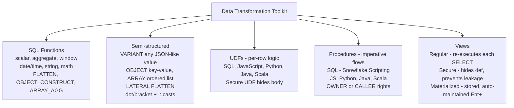
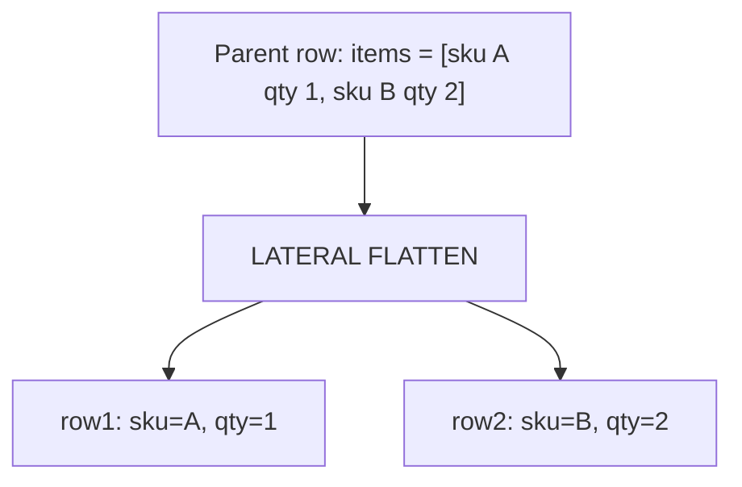
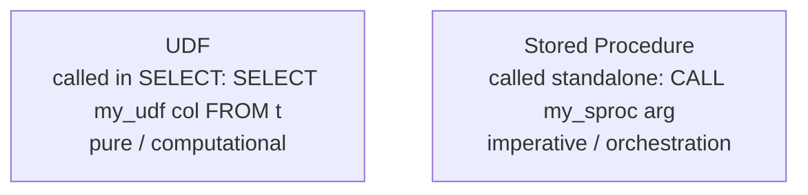

# Data Transformations — COF-C02 Study Guide

## Exam Weight & Scope
**~15% of the COF-C02 exam.** Covers SQL functions, semi-structured data handling (VARIANT, OBJECT, ARRAY, LATERAL FLATTEN), User-Defined Functions (SQL, JavaScript, Python), stored procedures basics, views (standard / secure / materialized), and sequences.

## Core Concepts Map



---

## Q1: What is a VARIANT column and when do you use it?
**Difficulty:** Foundation
**Exam relevance:** Semi-structured (7.1)

### Answer
**VARIANT** stores any semi-structured value: JSON, Avro, ORC, Parquet row (as a logical doc), XML, arrays, objects, or scalars. Internally columnar-compressed; max value size **16 MB** compressed.

### First Principles
Semi-structured data has schema that varies or evolves — forcing it into rigid columns is painful. VARIANT keeps full fidelity + lets Snowflake extract fields on query. The optimizer can even push down projections into VARIANT storage.

### Lab Exercise
```sql
CREATE TABLE events (id INT, payload VARIANT);

INSERT INTO events SELECT 1, PARSE_JSON('{"user":"a","event":"login","ts":"2026-10-30"}');

-- Access via colon syntax + casts
SELECT payload:user::STRING, payload:event::STRING, payload:ts::TIMESTAMP
FROM events;
```

### Gotchas / Exam Traps
- Max 16 MB per VARIANT value.
- `::` cast is critical — without it you get VARIANT output, which can confuse joins.
- Access: `payload:field`, `payload['field']`, `payload.field` all work.

---

## Q2: What are OBJECT and ARRAY data types?
**Difficulty:** Foundation
**Exam relevance:** Semi-structured (7.1)

### Answer
- **OBJECT** — key-value map (like JSON object). Keys are strings, values are VARIANT.
- **ARRAY** — ordered list of VARIANT values.

Both are subtypes of VARIANT with stricter guarantees.

### Lab Exercise
```sql
SELECT OBJECT_CONSTRUCT('name','Alice','age',30);
-- {"name":"Alice","age":30}

SELECT ARRAY_CONSTRUCT(1,2,3,'four');
-- [1,2,3,"four"]

SELECT ARRAY_SIZE(ARRAY_CONSTRUCT(1,2,3));  -- 3
SELECT OBJECT_KEYS(OBJECT_CONSTRUCT('a',1,'b',2));  -- ["a","b"]
```

### Gotchas / Exam Traps
- Elements of ARRAY are VARIANT — need `::` casts when reading.
- `OBJECT_INSERT`, `OBJECT_DELETE`, `OBJECT_PICK` for manipulation.
- `ARRAY_APPEND`, `ARRAY_PREPEND`, `ARRAY_CAT`, `ARRAY_CONTAINS`.

---

## Q3: What is LATERAL FLATTEN and how is it used?
**Difficulty:** Intermediate
**Exam relevance:** Semi-structured (7.1)

### Answer
`FLATTEN` is a **table function** that explodes a VARIANT/ARRAY/OBJECT into rows. Combined with LATERAL join, each parent row produces N child rows (one per element).

### Diagram

Each child row inherits parent fields + element.

### Lab Exercise
```sql
CREATE TABLE orders (id INT, items VARIANT);
INSERT INTO orders SELECT 1, PARSE_JSON('{"items":[{"sku":"A","qty":1},{"sku":"B","qty":2}]}');

SELECT o.id,
       f.value:sku::STRING AS sku,
       f.value:qty::INT    AS qty
FROM orders o,
     LATERAL FLATTEN(input => o.items:items) f;
```

### Gotchas / Exam Traps
- `LATERAL` is implicit when using `FLATTEN()` in FROM; explicit `LATERAL` is clearer.
- `FLATTEN(input => arr, outer => TRUE)` keeps rows even if array is empty/null (like LEFT JOIN).
- `path`, `index`, `value`, `this`, `key` are the output columns.
- Use `RECURSIVE => TRUE` to flatten nested structures fully.

---

## Q4: Which TWO are TRUE about SQL UDFs? (multi-select)
**Difficulty:** Intermediate
**Exam relevance:** UDFs (7.2)

### Answer
True:
- SQL UDFs are **inlined** by the optimizer (fast).
- SQL UDFs can be scalar or **tabular** (returning rowset).

False:
- SQL UDFs do NOT support imperative control flow (that's stored procedures).
- SQL UDFs cannot execute DML.

### Lab Exercise
```sql
-- Scalar SQL UDF
CREATE FUNCTION gross_margin(revenue FLOAT, cogs FLOAT) RETURNS FLOAT AS
  'CASE WHEN revenue = 0 THEN NULL ELSE (revenue - cogs) / revenue END';

SELECT gross_margin(100, 60);  -- 0.4

-- Tabular UDF
CREATE FUNCTION top_products(n INT) RETURNS TABLE (sku STRING, revenue FLOAT) AS
  'SELECT sku, SUM(amount) FROM sales GROUP BY sku ORDER BY 2 DESC LIMIT n';

SELECT * FROM TABLE(top_products(5));
```

### Gotchas / Exam Traps
- SQL UDF body is a SQL expression (scalar) or query (tabular).
- `IMMUTABLE | STABLE | VOLATILE` affects caching.
- Can be marked `SECURE` to hide definition.

---

## Q5: Compare JavaScript, Python, Java, and Scala UDFs.
**Difficulty:** Intermediate
**Exam relevance:** UDFs (7.2)

### Answer
| Language | Use case | Notes |
|----------|----------|-------|
| **JavaScript** | Simple procedural logic | Legacy; limited performance |
| **Python** | ML, data manipulation | Snowpark; vectorized UDFs available |
| **Java** | Portable JVM libs | Serverless; good perf |
| **Scala** | JVM + Snowpark DataFrames | Common in Spark migration |

All run **inside Snowflake** (sandboxed; no outbound network by default unless via **external access integration**).

### Lab Exercise
```sql
-- Python UDF
CREATE FUNCTION safe_divide(a FLOAT, b FLOAT)
  RETURNS FLOAT
  LANGUAGE PYTHON
  RUNTIME_VERSION='3.11'
  HANDLER='run'
AS $$
def run(a, b):
    return None if b == 0 else a / b
$$;

SELECT safe_divide(10, 0);  -- NULL
```

### Gotchas / Exam Traps
- Python UDFs can import packages from the **Snowflake Anaconda channel** (pre-approved).
- External access requires **external access integration** (newer feature).
- Vectorized Python UDFs process batches with pandas DataFrames.

---

## Q6: What's the difference between a UDF and a stored procedure?
**Difficulty:** Foundation
**Exam relevance:** UDFs vs sprocs (7.3)

### Answer
- **UDF**: scalar/tabular function; called in SELECT; **no DML/DDL**; deterministic preferred.
- **Stored Procedure**: imperative script (SQL/JS/Python/Java/Scala); called with CALL; **can execute DML/DDL**, loops, transactions.

### Diagram


### Lab Exercise
```sql
-- SQL stored procedure (Snowflake Scripting)
CREATE PROCEDURE refresh_sales()
RETURNS STRING LANGUAGE SQL AS
$$
BEGIN
  TRUNCATE TABLE sales_cleansed;
  INSERT INTO sales_cleansed SELECT * FROM sales_raw WHERE amount > 0;
  RETURN 'OK';
END;
$$;

CALL refresh_sales();
```

### Gotchas / Exam Traps
- Sprocs run as **OWNER's rights** by default (CALLER's rights optional).
- Sprocs can return a scalar or a cursor/result set.
- UDFs cannot call sprocs; sprocs can call UDFs.

---

## Q7: Which TWO view types exist in Snowflake? (multi-select — pick two)
**Difficulty:** Foundation
**Exam relevance:** Views (7.4)

### Answer
Any two:
- **Standard (regular) view** — logical; re-executed on each SELECT.
- **Secure view** — hides definition, prevents data leakage via optimizer.
- **Materialized view** — stores result; auto-refreshed; Enterprise+.
- **Recursive view** — supports WITH RECURSIVE patterns (standard view with recursion).

### Lab Exercise
```sql
CREATE VIEW v_active_customers AS
  SELECT * FROM customers WHERE status='ACTIVE';

CREATE SECURE VIEW v_customer_masked AS
  SELECT id, name, '***-**-' || RIGHT(ssn, 4) AS ssn FROM customers;

CREATE MATERIALIZED VIEW mv_daily_sales AS
  SELECT DATE_TRUNC('day', ts) AS d, SUM(amt) FROM orders GROUP BY DATE_TRUNC('day', ts);
```

### Gotchas / Exam Traps
- MVs require Enterprise+.
- Secure views can be regular or materialized.
- Views are **not updatable** in Snowflake (no `UPDATE v SET ...`).

---

## Q8: What is PARSE_JSON vs TO_JSON? (concept check)
**Difficulty:** Foundation
**Exam relevance:** Semi-structured (7.1)

### Answer
- `PARSE_JSON('{"a":1}')` — converts a **STRING** to a **VARIANT**.
- `TO_JSON(<variant>)` — serializes a VARIANT back to a **STRING** (JSON format).

### Lab Exercise
```sql
SELECT PARSE_JSON('{"a":1,"b":[2,3]}'):b[0]::INT;  -- 2
SELECT TO_JSON(OBJECT_CONSTRUCT('a',1,'b',2));     -- '{"a":1,"b":2}'
```

### Gotchas / Exam Traps
- `PARSE_JSON` returns NULL on invalid JSON (not an error — be careful).
- `TRY_PARSE_JSON` is more explicit about errors.
- Confusingly, `TO_VARIANT` casts to VARIANT type but doesn't parse strings.

---

## Q9: Which THREE common date/time functions does Snowflake support? (multi-select)
**Difficulty:** Foundation
**Exam relevance:** SQL functions (7.5)

### Answer
Snowflake supports:
- `CURRENT_DATE`, `CURRENT_TIMESTAMP`, `SYSDATE`, `LOCALTIMESTAMP`
- `DATEADD(part, n, date)`, `DATEDIFF(part, start, end)`, `DATE_TRUNC(part, date)`
- `EXTRACT(part FROM date)`
- `TO_DATE`, `TO_TIMESTAMP`, `TO_TIME`
- `TRY_TO_DATE`, `TRY_TO_TIMESTAMP` (safe casting)
- `CONVERT_TIMEZONE(tz_from, tz_to, ts)`

### Lab Exercise
```sql
SELECT DATEADD(day, 7, CURRENT_DATE);
SELECT DATEDIFF('month', '2024-01-01', '2026-10-30');
SELECT DATE_TRUNC('month', CURRENT_DATE);
SELECT CONVERT_TIMEZONE('UTC','America/Los_Angeles', CURRENT_TIMESTAMP);
```

### Gotchas / Exam Traps
- Timezone handling: TIMESTAMP_LTZ (local tz) vs TIMESTAMP_NTZ (no tz) vs TIMESTAMP_TZ (with tz).
- Default is often TIMESTAMP_NTZ in table columns.
- Session parameter `TIMEZONE` affects LTZ display.

---

## Q10: What's a window function and how is it used?
**Difficulty:** Intermediate
**Exam relevance:** SQL functions (7.5)

### Answer
A **window function** performs calculations across a set of rows related to the current row, without collapsing to a group (unlike aggregates with GROUP BY). Common functions: `ROW_NUMBER()`, `RANK()`, `DENSE_RANK()`, `LAG`, `LEAD`, `SUM() OVER()`, `AVG() OVER()`.

### Lab Exercise
```sql
SELECT customer_id, order_date, amount,
       SUM(amount) OVER (PARTITION BY customer_id ORDER BY order_date) AS running_total,
       RANK() OVER (PARTITION BY customer_id ORDER BY amount DESC) AS amount_rank,
       LAG(order_date) OVER (PARTITION BY customer_id ORDER BY order_date) AS prev_date
FROM orders;
```

### Gotchas / Exam Traps
- `OVER()` with no partition = whole table as one window.
- `QUALIFY` filters after window functions (like HAVING for groups).
- Window frame clauses: `ROWS BETWEEN` vs `RANGE BETWEEN`.

---

## Q11: What is QUALIFY and when do you use it?
**Difficulty:** Intermediate
**Exam relevance:** SQL (7.5)

### Answer
`QUALIFY` filters the output of **window functions**. Analogous to HAVING for aggregates.

```sql
SELECT customer_id, order_id, amount
FROM orders
QUALIFY ROW_NUMBER() OVER (PARTITION BY customer_id ORDER BY order_date DESC) = 1;
-- latest order per customer, in one query
```

### First Principles
Without QUALIFY, you'd need a subquery/CTE. QUALIFY is a Snowflake convenience and SQL-standard-ish.

### Gotchas / Exam Traps
- QUALIFY applies **after** window computation.
- Can combine with WHERE/HAVING: WHERE → GROUP BY → HAVING → QUALIFY.

---

## Q12: What is a sequence in Snowflake?
**Difficulty:** Intermediate
**Exam relevance:** Objects (7.6)

### Answer
A **sequence** generates monotonically increasing integers. Used for synthetic keys when `AUTOINCREMENT` on a column isn't enough or for cross-table unique IDs.

### Lab Exercise
```sql
CREATE SEQUENCE user_id_seq START=1 INCREMENT=1;
SELECT user_id_seq.NEXTVAL;        -- 1
SELECT user_id_seq.NEXTVAL;        -- 2

CREATE TABLE users (
  id INT DEFAULT user_id_seq.NEXTVAL,
  name STRING
);
```

### Gotchas / Exam Traps
- Sequences are **NOT guaranteed gapless** — concurrent sessions may skip numbers.
- `AUTOINCREMENT` and `IDENTITY` on table columns are shortcuts for sequence-backed defaults.
- Sequences are per-schema objects.

---

## Q13: What's the difference between CALLER's rights and OWNER's rights for stored procedures?
**Difficulty:** Advanced
**Exam relevance:** Sprocs (7.3)

### Answer
- **OWNER's rights (default)** — sproc executes with privileges of the procedure's **owner role**. Caller doesn't need direct access to underlying tables.
- **CALLER's rights** — sproc executes with privileges of the **invoking user's current role**. Caller must have access.

```sql
CREATE PROCEDURE refresh_sensitive()
  RETURNS STRING LANGUAGE SQL
  EXECUTE AS CALLER   -- or OWNER
AS
$$ ... $$;
```

### Gotchas / Exam Traps
- OWNER's rights is like `SECURITY DEFINER` in PostgreSQL.
- Use CALLER's rights when sproc should respect user's masking/row policies.
- Cannot have `CALL ... RESULT_SET` with CALLER's rights historically — check docs.

---

## Q14: Write a query that extracts a nested JSON field.
**Difficulty:** Foundation
**Exam relevance:** Semi-structured (7.1)

### Answer
```sql
-- Table: events(payload VARIANT)
-- Example payload: {"user":{"id":42,"profile":{"age":30}}}
SELECT
  payload:user.id::INT AS user_id,
  payload:user.profile.age::INT AS age
FROM events;

-- Equivalent using bracket notation
SELECT
  payload['user']['id']::INT AS user_id,
  payload['user']['profile']['age']::INT AS age
FROM events;
```

### Gotchas / Exam Traps
- Dot or bracket; both work.
- Always cast to desired type with `::`.
- Case-sensitive: `payload:User` differs from `payload:user`.

---

## Q15: Describe the GET_PATH function.
**Difficulty:** Advanced
**Exam relevance:** Semi-structured (7.1)

### Answer
`GET_PATH(variant, path_string)` retrieves a nested VARIANT value using a path like `"user.profile.age"`. Useful when the path is dynamic (not known at compile time).

```sql
SELECT GET_PATH(payload, 'user.profile.age')::INT FROM events;
-- Dynamic path from a column
SELECT GET_PATH(payload, path_col) FROM events;
```

### Gotchas / Exam Traps
- GET_PATH respects case sensitivity.
- `GET(variant, 'key')` for single-level; GET_PATH for nested.

---

## Q16: Which TWO Snowflake functions are commonly used to work with ARRAY data? (multi-select)
**Difficulty:** Intermediate
**Exam relevance:** Semi-structured (7.1)

### Answer
Common:
- `ARRAY_CONSTRUCT(a,b,c)` — build array.
- `ARRAY_SIZE(arr)` — length.
- `ARRAY_CONTAINS(val, arr)` — membership.
- `ARRAY_APPEND / ARRAY_PREPEND / ARRAY_CAT` — mutations (returns new array).
- `ARRAY_AGG(col)` — aggregate values into array.
- `ARRAY_SLICE(arr, start, end)`.

### Lab Exercise
```sql
SELECT ARRAY_AGG(DISTINCT product_sku) FROM orders;
SELECT ARRAY_SIZE(items), ARRAY_CONTAINS('A'::VARIANT, skus) FROM carts;
```

### Gotchas / Exam Traps
- `ARRAY_AGG(DISTINCT ...)` collapses duplicates.
- `ARRAY_UNION_AGG` for cross-row union of arrays.

---

## Q17: What is Snowflake Scripting?
**Difficulty:** Advanced
**Exam relevance:** Sprocs (7.3)

### Answer
**Snowflake Scripting** is Snowflake's SQL procedural extension (PL/SQL-like) available since 2021. Used inside `BEGIN ... END` blocks of SQL stored procedures. Supports:
- Variables (`DECLARE`)
- Control flow (`IF`, `CASE`, `FOR`, `WHILE`, `LOOP`)
- Cursors
- Exception handling (`EXCEPTION WHEN`)
- Dynamic SQL

### Lab Exercise
```sql
CREATE PROCEDURE calculate_totals(dt DATE)
  RETURNS INT LANGUAGE SQL
AS
$$
DECLARE
  total INT := 0;
  cur CURSOR FOR SELECT amount FROM sales WHERE sale_date = :dt;
BEGIN
  FOR row IN cur DO
    total := total + row.amount;
  END FOR;
  RETURN total;
END;
$$;
```

### Gotchas / Exam Traps
- Snowflake Scripting lives inside SQL sprocs — not stand-alone.
- `:name` syntax for binding variables into SQL within the sproc.
- Prefer set-based SQL over cursors for performance.

---

## Q18: Which TWO types of SQL UDF are supported? (multi-select)
**Difficulty:** Intermediate
**Exam relevance:** UDFs (7.2)

### Answer
- **Scalar SQL UDF** — returns a single value per invocation.
- **Table SQL UDF (UDTF)** — returns a table (rowset).

Both inlined into queries.

### Lab Exercise
```sql
-- Scalar
CREATE FUNCTION tax_rate(state STRING) RETURNS FLOAT AS
  'SELECT CASE WHEN state=''CA'' THEN 0.0725 WHEN state=''NY'' THEN 0.08 ELSE 0 END';

-- Tabular (UDTF)
CREATE FUNCTION recent_orders(cust_id INT, days INT)
  RETURNS TABLE (order_id INT, order_date DATE, amount NUMBER)
AS
  'SELECT order_id, order_date, amount
   FROM orders
   WHERE customer_id = cust_id
     AND order_date >= DATEADD(day, -days, CURRENT_DATE)';

SELECT * FROM TABLE(recent_orders(42, 30));
```

### Gotchas / Exam Traps
- UDTFs are called with `TABLE()` in FROM.
- Scalar UDFs behave like built-in functions in SELECT.
- JavaScript/Python/Java UDTFs supported too.

---

## Q19: What's the difference between a stored procedure and a task?
**Difficulty:** Intermediate
**Exam relevance:** Transformation vs orchestration (7.3)

### Answer
- **Stored Procedure** — the **code** that runs (SQL/Python/etc.). Called with `CALL`.
- **Task** — the **schedule** to run SQL or a stored procedure. Fires on cron or interval.

A common pattern: Task calls a procedure on a schedule.

```sql
CREATE TASK daily_refresh
  WAREHOUSE=etl_wh
  SCHEDULE='USING CRON 0 2 * * * America/Los_Angeles'
AS
  CALL refresh_sales();
```

### Gotchas / Exam Traps
- Tasks must be `RESUME`d; they start suspended.
- Tasks can chain via `AFTER <parent_task>` for DAGs.

---

## Q20: Which of these aggregate functions do NOT exist in Snowflake? (single select)
**Difficulty:** Advanced
**Exam relevance:** SQL functions (7.5)

### Answer
Snowflake supports:
- `SUM, AVG, MIN, MAX, COUNT`
- `MEDIAN, PERCENTILE_CONT, PERCENTILE_DISC`
- `STDDEV, VARIANCE, STDDEV_POP, VAR_POP`
- `APPROX_COUNT_DISTINCT, HLL, APPROX_PERCENTILE`
- `LISTAGG`, `ARRAY_AGG`, `OBJECT_AGG`
- `MODE`

Common distractors that don't exist: `COLLECT_SET` (that's Spark), `GROUP_CONCAT` (that's MySQL — use LISTAGG), `STDDEV_WITH_LAST` (not real).

### Gotchas / Exam Traps
- `LISTAGG(col, ',') WITHIN GROUP (ORDER BY col)` for comma-joined strings.
- `APPROX_COUNT_DISTINCT` is much faster than `COUNT(DISTINCT ...)` on huge data.

---

## Q21: Which THREE statements about Secure UDFs are TRUE? (multi-select)
**Difficulty:** Advanced
**Exam relevance:** UDFs + security (7.2)

### Answer
True:
- Secure UDFs **hide their body** from users without ownership.
- Secure UDFs can prevent **data leakage** via side-channel optimizations.
- Secure UDFs may be **slower** than regular UDFs.

False:
- Secure UDFs are NOT required to be deterministic.
- Secure UDFs are NOT auto-cached differently.

### Gotchas / Exam Traps
- Use secure UDFs in shared data products where internal logic shouldn't leak.
- Combine with secure views for layered defense.

---

## Q22: You have a VARIANT column with keys sometimes present, sometimes missing. How do you safely extract a field with a default value?
**Difficulty:** Intermediate
**Exam relevance:** Semi-structured (7.1)

### Answer
Use `COALESCE` with the extraction:
```sql
SELECT COALESCE(payload:user_id::STRING, 'unknown') AS user_id
FROM events;
```

Or `IFNULL`:
```sql
SELECT IFNULL(payload:user_id::STRING, 'unknown') FROM events;
```

For deeper paths, consider `TRY_` prefixed casts:
```sql
SELECT COALESCE(TRY_CAST(payload:age AS INT), 0) FROM events;
```

### Gotchas / Exam Traps
- `payload:nonexistent` returns NULL, not error.
- `payload:nonexistent::INT` can return NULL or error depending on content — use TRY_CAST for safety.

---

## Q23: What is a RECURSIVE CTE and does Snowflake support it?
**Difficulty:** Advanced
**Exam relevance:** SQL (7.5)

### Answer
Yes. Snowflake supports `WITH RECURSIVE` CTEs for hierarchical/graph traversal.

```sql
WITH RECURSIVE org_chart AS (
  SELECT emp_id, mgr_id, name, 1 AS level
  FROM employees WHERE mgr_id IS NULL
  UNION ALL
  SELECT e.emp_id, e.mgr_id, e.name, oc.level + 1
  FROM employees e
  JOIN org_chart oc ON e.mgr_id = oc.emp_id
)
SELECT * FROM org_chart;
```

### Gotchas / Exam Traps
- Recursive CTEs can be expensive — add filters inside.
- Default recursion depth may need tuning via session parameter in extreme cases.

---

## Q24: What is the FLATTEN "outer" parameter used for?
**Difficulty:** Advanced
**Exam relevance:** Semi-structured (7.1)

### Answer
`FLATTEN(input => arr, OUTER => TRUE)` emits a row **even if the input array is NULL or empty** (filling child columns with NULL). Default (`OUTER => FALSE`) drops those parent rows — behaves like INNER JOIN.

### Lab Exercise
```sql
SELECT o.id, f.value
FROM orders o,
     LATERAL FLATTEN(input => o.items, OUTER => TRUE) f;
-- Orders with no items still appear with f.value = NULL
```

### Gotchas / Exam Traps
- OUTER=TRUE ↔ LEFT JOIN semantics.
- OUTER=FALSE (default) ↔ INNER JOIN; silently drops rows.

---

## Q25: Which statement about materialized views is TRUE? (single select)
**Difficulty:** Intermediate
**Exam relevance:** MVs (7.4)

### Answer
**TRUE:** MVs are **automatically maintained** by Snowflake's serverless background service when base table data changes, and the query optimizer can **transparently rewrite** queries over the base table to use the MV when beneficial.

### Gotchas / Exam Traps
- Not all SQL allowed in MVs — single base table, no joins, no window funcs, no HAVING, no non-deterministic.
- Enterprise+ edition required.
- MV refresh = serverless credits.
- MVs can be `SECURE`.

---
