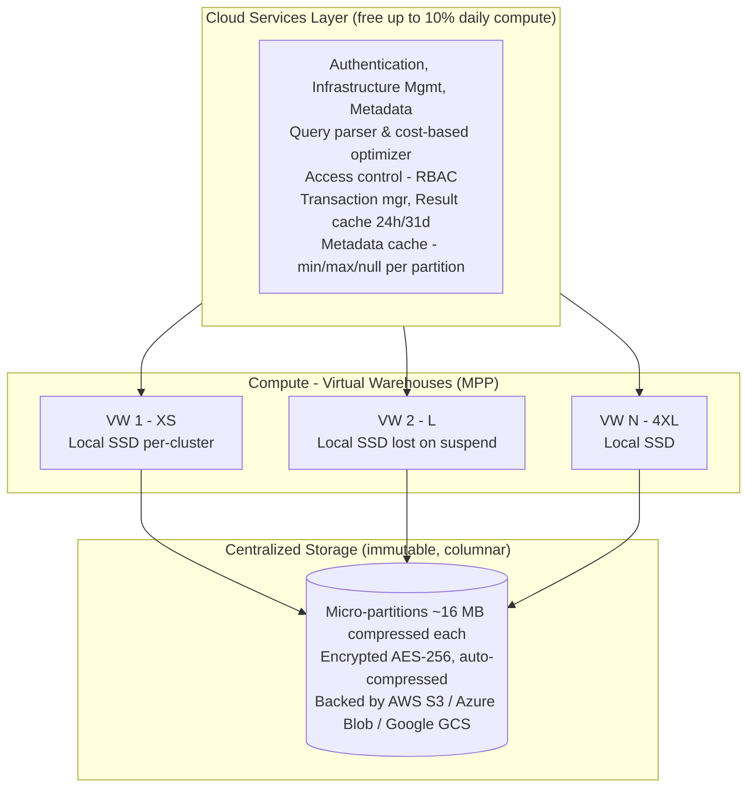
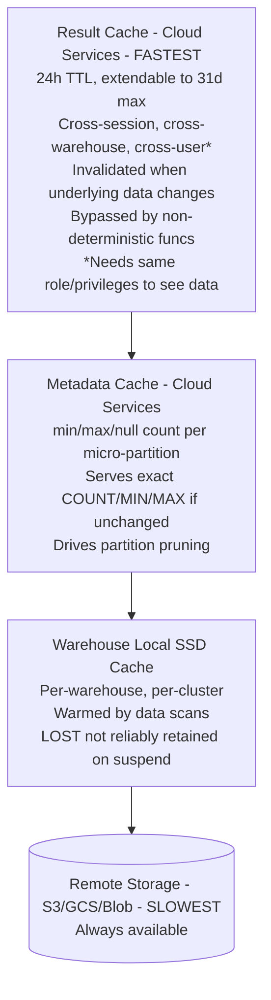
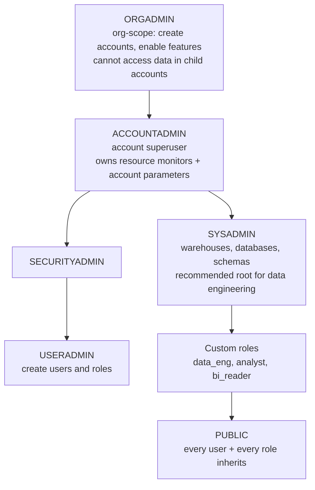
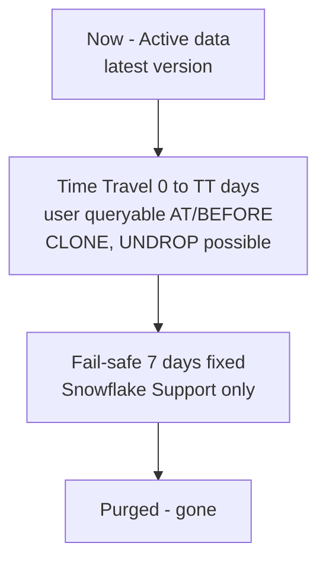

# SnowPro Core (COF-C02) — Dense Reference Cheatsheet

A single-document final-week reference. Scan this the morning of the exam.

---

## 1. Three-Layer Architecture



Architecture style: **HYBRID** — Shared-DISK (one copy of data, all VWs can read) + Shared-NOTHING (MPP compute per warehouse).

Key properties:
- Storage decoupled from compute; both scale independently.
- Storage immutability enables zero-copy clone + Time Travel.
- Metadata-only operations (SHOW/DESC, some aggregates) do NOT need a running warehouse.

---

## 2. Warehouse Size & Credit Consumption

| Size | Credits/hr | Nodes (approx) | Credit doubling |
|------|-----------:|---------------:|-----------------|
| X-Small (XS) | **1** | 1 | base |
| Small (S) | **2** | 2 | 2x XS |
| Medium (M) | **4** | 4 | 2x S |
| Large (L) | **8** | 8 | 2x M |
| X-Large (XL) | **16** | 16 | 2x L |
| 2X-Large (2XL) | **32** | 32 | 2x XL |
| 3X-Large (3XL) | **64** | 64 | 2x 2XL |
| 4X-Large (4XL) | **128** | 128 | 2x 3XL |
| 5X-Large (5XL) | **256** | 256 | 2x 4XL |
| 6X-Large (6XL) | **512** | 512 | 2x 5XL |

Rules:
- **Per-second billing**, **60-second minimum** per resume.
- **Snowpark-optimized** warehouses: ~1.5x credits; minimum size = **Medium**.
- Doubling size roughly halves scan time → cost per query is roughly flat; wall-clock is halved.
- Resize is **additive** going up (immediate); **subtractive** going down (waits for in-flight queries).

Multi-cluster:
- `MIN_CLUSTER_COUNT=1 .. MAX_CLUSTER_COUNT=10` (max 10).
- Requires **Enterprise edition**.
- Maximized when `MIN==MAX>1`; auto-scale when `MIN<MAX`.

---

## 3. Scaling Policy Behavior

| | STANDARD (default) | ECONOMY |
|---|---|---|
| Primary bias | Performance (low queue latency) | Cost savings |
| New cluster spin-up trigger | Queueing starts; spins ASAP | Waits until ~6 min of queued work would benefit |
| Cluster shutdown | Conservative | Aggressive |
| Best for | Interactive BI, user-facing | Batch ETL, non-latency-sensitive |
| Billable impact | More clusters online more often | Fewer clusters; longer queues |

Policy only matters when `MIN_CLUSTER_COUNT < MAX_CLUSTER_COUNT`.

Default parameters worth memorizing:
- **AUTO_SUSPEND**: minimum **60 seconds** (via SQL); default varies by creation method.
- **AUTO_RESUME**: default **TRUE**.
- **MAX_CONCURRENCY_LEVEL**: default **8** queries per cluster.
- **STATEMENT_TIMEOUT_IN_SECONDS**: **172800** (48 hours).
- **STATEMENT_QUEUED_TIMEOUT_IN_SECONDS**: **0** (no limit).

---

## 4. Cache Hierarchy



Session parameter to disable Result Cache: `USE_CACHED_RESULT = FALSE` (default TRUE).

---

## 5. Edition Feature Matrix

**Available on all editions (Std, Ent, BC, VPS):**
- Core SQL, DML, loading/unloading
- Secure Data Sharing (basic)
- Time Travel (1 day)
- Fail-safe (7 days, fixed)
- AES-256 at rest, TLS 1.2+ in transit
- Basic database replication

**Added at Enterprise+ (Ent, BC, VPS):**
- Multi-cluster warehouses
- Time Travel up to 90 days
- Materialized Views
- Dynamic Data Masking (DDM)
- Row Access Policies
- Search Optimization Service (SOS)
- Query Acceleration Service (QAS)
- Periodic Data Rekeying
- Multiple SAML integrations
- Session Policies

**Added at Business Critical+ (BC, VPS):**
- Tri-Secret Secure (CMK/BYOK)
- AWS/Azure/GCP PrivateLink
- HIPAA / PCI / HITRUST / FedRAMP
- Database failover/failback (DR)
- Failover groups (full account replication)

**VPS only:**
- Dedicated metadata store (isolation)

Default Time Travel retention for permanent tables: **1 day** regardless of edition.

---

## 6. Default Role Hierarchy



Role responsibilities:
- **ORGADMIN** — org-level; create accounts; enable org-wide features.
- **ACCOUNTADMIN** — top of account; billing; resource monitors; account params; break-glass.
- **SECURITYADMIN** — inherits USERADMIN; `MANAGE GRANTS` globally; network policies, security integrations.
- **USERADMIN** — manages users and roles only (no data grants).
- **SYSADMIN** — owns and creates warehouses/databases/schemas; data engineering root.
- **PUBLIC** — base role; grants here apply to everyone.

Key: SYSADMIN does **NOT** inherit SECURITYADMIN. ACCOUNTADMIN inherits both branches.

Secondary roles:
```sql
USE SECONDARY ROLES ALL;      -- activate all granted
USE SECONDARY ROLES r_a, r_b; -- specific
USE SECONDARY ROLES NONE;     -- disable
```

---

## 7. Stage Types

**User stage** `@~`
- Scope: Per user, private
- Alterable: No (implicit)
- Billing: Internal storage
- Use: Personal uploads, ad-hoc

**Table stage** `@<table>` (with %)
- Scope: Tied to one table
- Alterable: No (implicit)
- Billing: Internal storage
- Use: Simple single-table loads

**Named internal stage** `@<stage>`
- Scope: Explicit; shareable via grants
- Alterable: Yes
- Billing: Internal storage
- Use: Production internal loads

**Named external stage** `@<stage>` (with URL)
- Scope: Points to S3/Blob/GCS bucket
- Alterable: Yes
- Billing: Only metadata (your bucket pays)
- Use: Production external loads; data lakes

PUT/GET work on **internal** stages only, via SnowSQL or drivers (NOT Snowsight).

External stages typically use a **Storage Integration** (abstracts cloud credentials via IAM Role / service principal / service account).

---

## 8. Time Travel + Fail-Safe Timeline



**Permanent table:**
- TT: 0 to 1 day (Standard) OR 0 to 90 days (Enterprise+)
- FS: 7 days (fixed, not configurable)
- Total protection: TT_days + 7

**Transient table:**
- TT: 0 to 1 day
- FS: NONE
- Total protection: up to 1 day

**Temporary table:**
- TT: 0 to 1 day (within session)
- FS: NONE
- Lifetime: session only (dropped on session end)

Set retention: `ALTER TABLE t SET DATA_RETENTION_TIME_IN_DAYS = 30;`
Account floor: `ALTER ACCOUNT SET MIN_DATA_RETENTION_TIME_IN_DAYS = 7;` (actual = MAX(floor, obj setting))

Time Travel syntax:
```sql
SELECT * FROM t AT(TIMESTAMP => '2026-10-29 10:00:00'::TIMESTAMP);
SELECT * FROM t AT(OFFSET => -3600);  -- 1 hour ago
SELECT * FROM t BEFORE(STATEMENT => '019a...');
CREATE TABLE recovery CLONE t AT(OFFSET => -1200);
UNDROP TABLE t;  -- within TT retention window
```

AT = inclusive; BEFORE = just before.

---

## 9. VARIANT / OBJECT / ARRAY Access Syntax

Three equivalent access syntaxes:

```sql
-- 1. Colon syntax (most common)
payload:user_id::INT

-- 2. Dot syntax (same semantics)
payload.user_id::INT

-- 3. Bracket syntax (useful for case-sensitive or dynamic keys)
payload['user_id']::INT

-- Nested
payload:user.profile.age::INT
payload['user']['profile']['age']::INT

-- Dynamic path (compile-time unknown)
GET_PATH(payload, 'user.profile.age')::INT
GET_PATH(payload, path_col)             -- path from a column
```

Casts (`::`) are critical — without them you get VARIANT output, confusing joins and comparisons.

Key rules:
- Case-sensitive: `payload:user` ≠ `payload:User`.
- Missing key returns NULL (not error).
- Use `TRY_CAST` or `TRY_TO_<type>` for safe conversion of untrusted content.
- Max 16 MB per VARIANT value compressed.

Semi-structured functions:
```sql
PARSE_JSON('{"a":1}')              -- STRING -> VARIANT
TO_JSON(variant_val)               -- VARIANT -> STRING
OBJECT_CONSTRUCT('a',1,'b',2)      -- build OBJECT
ARRAY_CONSTRUCT(1,2,3)             -- build ARRAY
ARRAY_SIZE(arr)                    -- length
ARRAY_CONTAINS('X'::VARIANT, arr)
OBJECT_KEYS(obj)
OBJECT_INSERT(obj, 'k', v)
LATERAL FLATTEN(input => arr)      -- explode to rows
LATERAL FLATTEN(input => arr, OUTER => TRUE)  -- LEFT JOIN semantics
```

FLATTEN output columns: SEQ, KEY, PATH, INDEX, VALUE, THIS.

---

## 10. QUALIFY + Window Functions

Clause ordering (logical execution):

```
FROM -> WHERE -> GROUP BY -> HAVING -> SELECT -> QUALIFY -> ORDER BY
```

`QUALIFY` is the "HAVING for window functions". It filters based on window output.

```sql
-- Latest order per customer, in a single query
SELECT customer_id, order_id, amount
FROM orders
QUALIFY ROW_NUMBER() OVER (PARTITION BY customer_id ORDER BY order_date DESC) = 1;
```

Common window functions:
- Ranking: `ROW_NUMBER()`, `RANK()`, `DENSE_RANK()`, `NTILE(n)`
- Offset: `LAG(col, n, default)`, `LEAD(col, n, default)`
- Aggregates with OVER: `SUM() OVER (PARTITION BY ... ORDER BY ... ROWS BETWEEN ...)`
- Analytics: `FIRST_VALUE`, `LAST_VALUE`, `NTH_VALUE`
- Statistical: `CUME_DIST`, `PERCENT_RANK`, `PERCENTILE_CONT`, `PERCENTILE_DISC`

Window frame types:
- `ROWS BETWEEN` — physical row offsets.
- `RANGE BETWEEN` — logical value offsets.

---

## 11. Table Types & Retention Defaults

**Permanent:**
- Scope: Account-wide
- Dropped on session end: No
- Time Travel max: 1 day (Std) / 90 days (Ent+)
- Default DATA_RETENTION_TIME_IN_DAYS: 1
- Fail-safe: **7 days (fixed)**
- Supports clone: Yes
- Supports MVs on it: Yes
- Storage cost: TT + Fail-safe adds overhead
- Use case: Production data

**Transient:**
- Scope: Account-wide
- Dropped on session end: No
- Time Travel max: 1 day
- Default DATA_RETENTION_TIME_IN_DAYS: 1
- Fail-safe: **None**
- Supports clone: Yes
- Supports MVs on it: Yes
- Storage cost: Minimal (TT only)
- Use case: Staging / regenerable

**Temporary:**
- Scope: Session only
- Dropped on session end: **Yes**
- Time Travel max: 1 day
- Default DATA_RETENTION_TIME_IN_DAYS: 1
- Fail-safe: **None**
- Supports clone: Limited
- Supports MVs on it: No
- Storage cost: Minimal
- Use case: Scratch within session

Create:
```sql
CREATE TABLE t_perm (id INT);
CREATE TRANSIENT TABLE t_trans (id INT);
CREATE TEMPORARY TABLE t_temp (id INT);        -- disappears at session end
CREATE TRANSIENT DATABASE d;                   -- all tables inside inherit transience
```

TRUNCATE preserves TT history (reversible via AT/BEFORE). DROP preserves whole table in TT (UNDROP within window).

---

## 12. Common SYSTEM$ Functions

| Function | Purpose |
|---|---|
| `SYSTEM$GET_SNOWFLAKE_EDITION()` | Current edition name |
| `SYSTEM$CLUSTERING_INFORMATION('db.schema.table', '(col1,col2)')` | Clustering health JSON (depth, overlaps, histogram) |
| `SYSTEM$CLUSTERING_DEPTH('db.schema.table', '(col)')` | Scalar depth number |
| `SYSTEM$STREAM_HAS_DATA('stream_name')` | Boolean — does this stream have unconsumed rows? |
| `SYSTEM$PIPE_STATUS('pipe_name')` | Snowpipe pipe status JSON |
| `SYSTEM$WAIT(seconds)` | Pause execution N seconds |
| `SYSTEM$ALLOWLIST()` / `SYSTEM$WHITELIST()` | Account-permitted IP ranges |
| `SYSTEM$TASK_DEPENDENTS_ENABLE('task_name')` | Enable task graph |
| `SYSTEM$CURRENT_USER_TASK_NAME()` | Current task name (inside task) |
| `SYSTEM$ESTIMATE_SEARCH_OPTIMIZATION_COSTS('table')` | SOS cost estimate |
| `SYSTEM$ESTIMATE_AUTOMATIC_CLUSTERING_COSTS('table','(col)')` | Clustering cost estimate |
| `SYSTEM$LAST_CHANGE_COMMIT_TIME('db.schema.table')` | Last DML commit time (useful for freshness checks) |

Session functions worth remembering:
- `CURRENT_USER()`, `CURRENT_ROLE()`, `CURRENT_SESSION()`, `CURRENT_WAREHOUSE()`
- `CURRENT_ACCOUNT()`, `CURRENT_ORGANIZATION_NAME()`, `CURRENT_REGION()`
- `LAST_QUERY_ID([offset])` — recent query IDs for Time Travel

---

## 13. Credit Consumption by Feature

**Virtual Warehouse** — Compute credits. Per-second, 60s min per resume; size doubles → credits double.

**Cloud Services** — Compute credits (cloud services). First 10% of daily compute is free, billed above.

**Snowpipe** — Serverless credits. Per compute-second + per-file overhead charge.

**Snowpipe Streaming** — Serverless credits. Separate line item.

**Automatic Clustering** — Serverless credits. Background reclustering.

**Materialized View maintenance** — Serverless credits. Background refresh.

**Search Optimization Service** — Serverless credits. Index build + maintenance.

**Query Acceleration Service** — Serverless credits. Burst compute for eligible queries.

**Replication** — Serverless credits. Cross-account/region sync.

**Serverless Tasks** — Serverless credits. Alternative to warehouse-backed tasks.

**Storage** — Dollars/TB-month. Compressed size; averaged daily; includes TT + Fail-safe + stages.

**Data transfer (egress)** — Dollars/GB. Cross-region or cross-cloud transfer.

Billing visibility:
- `SNOWFLAKE.ACCOUNT_USAGE.WAREHOUSE_METERING_HISTORY` — warehouse compute + cloud services.
- `SNOWFLAKE.ACCOUNT_USAGE.PIPE_USAGE_HISTORY` — Snowpipe credits.
- `SNOWFLAKE.ACCOUNT_USAGE.AUTOMATIC_CLUSTERING_HISTORY` — clustering credits.
- `SNOWFLAKE.ACCOUNT_USAGE.MATERIALIZED_VIEW_REFRESH_HISTORY` — MV refresh.
- `SNOWFLAKE.ACCOUNT_USAGE.SEARCH_OPTIMIZATION_HISTORY` — SOS.
- `SNOWFLAKE.ACCOUNT_USAGE.QUERY_ACCELERATION_HISTORY` — QAS.
- `SNOWFLAKE.ACCOUNT_USAGE.REPLICATION_USAGE_HISTORY` — replication.
- `SNOWFLAKE.ACCOUNT_USAGE.STORAGE_USAGE` — total storage per day.
- `SNOWFLAKE.ACCOUNT_USAGE.TABLE_STORAGE_METRICS` — per-table (active / TT / FS / clone-retained bytes).

ACCOUNT_USAGE retention: **365 days**, lag up to **~3 hours**. INFORMATION_SCHEMA is near real-time but with shorter retention per view.

---

## 14. COPY INTO Options Reference

```sql
COPY INTO <target_table>
  FROM @<stage>/<path>
  FILE_FORMAT = (FORMAT_NAME=ff_csv)
  PATTERN = '.*\.csv'
  ON_ERROR = 'CONTINUE'            -- default: ABORT_STATEMENT
  PURGE = FALSE                     -- delete source files on success?
  FORCE = FALSE                     -- bypass load history dedupe?
  VALIDATION_MODE = 'RETURN_ERRORS' -- preview without loading
  SIZE_LIMIT = 100000000;           -- max bytes to load
```

| ON_ERROR option | Meaning |
|---|---|
| `ABORT_STATEMENT` (default) | Fail entire COPY on any error |
| `CONTINUE` | Load valid rows, skip bad rows |
| `SKIP_FILE` | Skip entire file on any error |
| `SKIP_FILE_<n>` | Skip file after N errors |
| `SKIP_FILE_<n>%` | Skip file after N% errors |

Load history dedupe window: **64 days**. `FORCE=TRUE` bypasses.

Unload (COPY INTO stage):
```sql
COPY INTO @stage/export/
  FROM my_table
  FILE_FORMAT=(TYPE=PARQUET)
  HEADER = TRUE                  -- include column names (not default)
  OVERWRITE = TRUE
  MAX_FILE_SIZE = 128000000      -- chunk files
  SINGLE = FALSE;                -- TRUE forces single-file output
```

---

## 15. Snowpipe Quick Reference

Create pipe (auto-ingest):
```sql
CREATE PIPE my_pipe AUTO_INGEST=TRUE AS
  COPY INTO landing_table
    FROM @ext_stage/data/
    FILE_FORMAT=(FORMAT_NAME=ff_json);

DESC PIPE my_pipe;   -- returns NOTIFICATION_CHANNEL (SQS ARN for AWS)
```

Properties:
- Serverless; billed in Snowpipe credits + per-file overhead.
- Latency: typically ~1 minute.
- Target file size: **100–250 MB compressed**.
- Runs with pipe **OWNER's privileges** (not invoker).
- Pause/resume: `ALTER PIPE my_pipe SET PIPE_EXECUTION_PAUSED=TRUE/FALSE;`
- Not auto-cloned by basic replication (needs failover groups).

Monitoring:
```sql
SELECT SYSTEM$PIPE_STATUS('my_pipe');
SELECT * FROM TABLE(SNOWFLAKE.INFORMATION_SCHEMA.PIPE_USAGE_HISTORY(
  DATE_RANGE_START => DATEADD('hour', -24, CURRENT_TIMESTAMP()),
  PIPE_NAME => 'MY_PIPE'));
```

---

## 16. Streams and Tasks Quick Reference

Stream:
```sql
CREATE STREAM my_stream ON TABLE src_table;                  -- standard
CREATE STREAM my_stream ON TABLE src_table APPEND_ONLY=TRUE; -- append-only
-- Metadata columns on SELECT: METADATA$ACTION, METADATA$ISUPDATE, METADATA$ROW_ID

-- Offset advances only when consumed by DML
MERGE INTO target t USING my_stream s ON ... ;
```

Task:
```sql
CREATE TASK my_task
  WAREHOUSE = etl_wh                 -- or omit for serverless task
  SCHEDULE = '5 MINUTE'              -- or 'USING CRON ...'
  WHEN SYSTEM$STREAM_HAS_DATA('my_stream')
AS
  MERGE INTO target USING my_stream ... ;

ALTER TASK my_task RESUME;           -- tasks start suspended
ALTER TASK my_task SUSPEND;
```

Task DAG:
```sql
CREATE TASK child_task
  WAREHOUSE = etl_wh
  AFTER my_task       -- runs after my_task completes
AS ...
```

Dynamic Table (replaces much Stream+Task plumbing):
```sql
CREATE DYNAMIC TABLE dt_sales
  TARGET_LAG = '5 MINUTE'
  WAREHOUSE = etl_wh
AS
  SELECT DATE_TRUNC('day', ts) AS d, SUM(amount) AS tot
  FROM orders
  GROUP BY DATE_TRUNC('day', ts);
```

---

## 17. Authentication & Network Security Reference

Methods:
- **Password + MFA** (Duo native, free).
- **Key-pair JWT** (preferred for service accounts).
- **SAML 2.0 SSO** (Okta, Azure AD, Ping, OneLogin, custom IdP).
- **External OAuth** (Okta, Azure AD, etc. — issue tokens Snowflake accepts).
- **Snowflake OAuth** (Snowflake as authorization server for custom apps).

Enforcement:
```sql
ALTER USER jdoe SET MFA_ENROLLMENT_REQUIRED = TRUE;
ALTER USER svc_etl SET RSA_PUBLIC_KEY = '<base64>';
```

Network Policy:
```sql
CREATE NETWORK POLICY corp_only
  ALLOWED_IP_LIST = ('203.0.113.0/24', '198.51.100.5')
  BLOCKED_IP_LIST = ('203.0.113.99');

ALTER ACCOUNT SET NETWORK_POLICY = corp_only;      -- account-wide
ALTER USER jdoe SET NETWORK_POLICY = corp_only;    -- per-user override
```

Rules:
- **IPv4 only** (per exam syllabus).
- `BLOCKED_IP_LIST` **wins** over `ALLOWED_IP_LIST`.
- Per-user policy overrides account policy for that user.

PrivateLink (AWS/Azure/GCP) — **Business Critical+** edition required.

Session Policy (Enterprise+):
```sql
CREATE SESSION POLICY tight_sess
  SESSION_IDLE_TIMEOUT_MINS = 15
  SESSION_UI_IDLE_TIMEOUT_MINS = 10;
```

---

## 18. Data Masking & Row Access Policies

Dynamic Data Masking (Enterprise+):
```sql
CREATE MASKING POLICY mask_email AS (val STRING) RETURNS STRING ->
  CASE
    WHEN CURRENT_ROLE() IN ('ANALYST_FULL','ACCOUNTADMIN') THEN val
    ELSE REGEXP_REPLACE(val, '^.*@', '***@')
  END;

ALTER TABLE customers MODIFY COLUMN email
  SET MASKING POLICY mask_email;
```

Row Access Policy (Enterprise+):
```sql
CREATE ROW ACCESS POLICY region_filter AS (region STRING)
  RETURNS BOOLEAN ->
    CURRENT_ROLE() = 'ADMIN'
    OR EXISTS (
      SELECT 1 FROM role_region_map
      WHERE role_name = CURRENT_ROLE() AND allowed_region = region
    );

ALTER TABLE sales ADD ROW ACCESS POLICY region_filter ON (region);
```

Both evaluate at query time per row; policies are centrally managed and reusable across columns/tables.

---

## 19. Resource Monitors

Only **ACCOUNTADMIN** can create.

```sql
CREATE RESOURCE MONITOR rm_prod WITH
  CREDIT_QUOTA = 1000
  FREQUENCY = MONTHLY               -- DAILY|WEEKLY|MONTHLY|YEARLY|NEVER
  START_TIMESTAMP = IMMEDIATELY
  TRIGGERS
    ON 75  PERCENT DO NOTIFY
    ON 90  PERCENT DO SUSPEND
    ON 100 PERCENT DO SUSPEND_IMMEDIATE;

ALTER WAREHOUSE wh SET RESOURCE_MONITOR = rm_prod;        -- per-warehouse
ALTER ACCOUNT SET RESOURCE_MONITOR = rm_global;            -- account-wide
```

Trigger actions:
- **NOTIFY** — email account admins.
- **SUSPEND** — graceful: lets running queries finish.
- **SUSPEND_IMMEDIATE** — kills in-flight queries.

A warehouse can have one monitor + the account monitor; both apply.

---

## 20. Performance Levers (ordered by typical fix sequence)

1. **Query Profile** — identify slowest operator.
2. **Spilling** — local disk tolerable; **remote disk is severe**.
3. **Partition pruning ratio** — `partitions_scanned / partitions_total`; higher is worse.
4. **Exploding joins** — output rows >> product of inputs.
5. **Column functions in WHERE** defeat pruning (`UPPER(name)='X'`, `DATE(ts)='...'`, `LIKE '%x%'`).
6. **Warehouse size** — resize up for memory-bound queries.
7. **Clustering key** — large tables with filter-skewed queries; `SYSTEM$CLUSTERING_INFORMATION` to diagnose.
8. **Materialized View** — repeated single-table aggregations (Enterprise+).
9. **Search Optimization Service** — selective point lookups on huge tables (Enterprise+).
10. **Query Acceleration Service** — occasional outlier queries that scan a lot (Enterprise+).

Clustering diagnostic (`average_depth` close to 1 = well-clustered):
```sql
SELECT SYSTEM$CLUSTERING_INFORMATION('db.schema.table', '(col1,col2)');
```

---

## 21. Rapid-Fire Trivia List

- **Micro-partition size**: ~16 MB compressed.
- **Max multi-cluster count**: 10.
- **AUTO_SUSPEND minimum**: 60 seconds.
- **Billing minimum per resume**: 60 seconds.
- **Default MAX_CONCURRENCY_LEVEL**: 8.
- **STATEMENT_TIMEOUT_IN_SECONDS default**: 172800 (48h).
- **STATEMENT_QUEUED_TIMEOUT_IN_SECONDS default**: 0 (unlimited).
- **Result cache TTL**: 24h base, 31d max.
- **Fail-safe**: 7 days, fixed, non-configurable.
- **Time Travel max**: 1 day (Standard) / 90 days (Enterprise+).
- **Time Travel default**: 1 day (permanent).
- **Transient / temporary TT**: max 1 day; no Fail-safe.
- **COPY INTO load history**: 64 days.
- **VARIANT max size**: 16 MB per value compressed.
- **Cloud services free tier**: 10% of daily compute spend.
- **Snowpipe target file size**: 100–250 MB compressed.
- **Snowpark-optimized credit multiplier**: ~1.5x; minimum size Medium.
- **ACCOUNT_USAGE retention**: 365 days.
- **ACCOUNT_USAGE latency**: up to ~3 hours.
- **Snowflake Marketplace listings**: free / paid / personalized.
- **ORGADMIN** cannot access data in child accounts.
- **Only ACCOUNTADMIN** creates Resource Monitors.
- **Snowpipe** runs with OWNER's privileges.
- **Tasks** start suspended.
- **PUT/GET** not supported in Snowsight.
- **External tables** are read-only.
- **AT** = inclusive; **BEFORE** = just before.
- **BLOCKED_IP_LIST** wins over ALLOWED_IP_LIST.
- **IPv4 only** for network policies.
- **AES-256** at rest, **TLS 1.2+** in transit.
- **Tri-Secret Secure** requires Business Critical+.
- **PrivateLink** requires Business Critical+.
- **Failover groups** require Business Critical+.
- **Multi-cluster warehouses** require Enterprise+.
- **Materialized Views** require Enterprise+.
- **DDM / RLS / SOS / QAS** require Enterprise+.
- **100 questions, 115 minutes, 750/1000 to pass.**

---

Exam-day habits:
- Read every multi-select stem for the exact count ("TWO" / "THREE").
- When unsure, favor Snowflake-specific terminology over generic DB vocabulary.
- Trap words: "always", "never", "requires Standard edition" (usually wrong), "not configurable" (often wrong except Fail-safe).
- 115 min / 100 Qs = ~70 seconds average; flag and move on anything past 2 minutes.
- Review flagged questions in the final 10–15 minutes.

Good hunting.
