# ML Workflow Design — MLE-C01 Study Guide

## Exam Weight & Scope

**Approximate weight:** 18-22% of exam
**Scope:** End-to-end ML lifecycle on Snowflake — from data ingestion to retirement. Covers Snowpark ML as the unified SDK, when to pick batch vs real-time scoring, training-vs-inference separation of concerns, and the architectural patterns that keep training/serving aligned. This is the "big picture" domain — later domains drill into feature store, registry, serving, monitoring, governance.

**You must be able to:**
- Map a business problem to a Snowflake ML lifecycle (data → features → train → register → deploy → monitor → retrain)
- Choose Snowpark ML Modeling API vs Container Services vs Cortex LLM functions
- Distinguish batch inference (Dynamic Tables, scheduled tasks) from real-time (Model Serving endpoints, warehouse UDFs)
- Explain why Snowflake's "data stays in place" principle shapes every design decision
- Recognize when to split a workflow across warehouse (CPU, serverless) vs Snowpark Container Services (GPU, custom runtime)

---

## Core Concepts Map

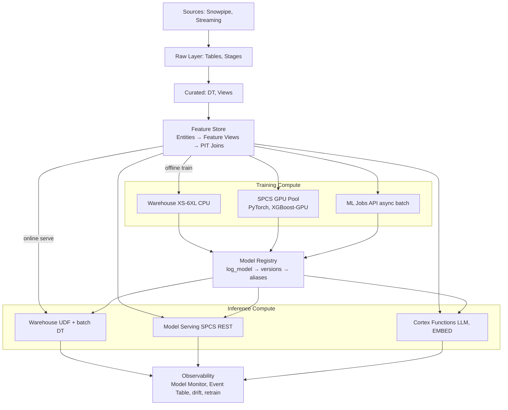

---

## Q1: What is Snowpark ML and how does it differ from "classic" Snowpark?

**Difficulty:** Foundation
**Exam relevance:** Snowpark ML overview

### Answer
Snowpark ML (`snowflake-ml-python`) is a Python library layered on top of Snowpark that provides ML-specific abstractions: a Modeling API (sklearn-style estimators that run as stored procedures), a Feature Store, a Model Registry, Model Monitoring, and Dataset APIs. "Classic" Snowpark (`snowflake-snowpark-python`) is the general-purpose DataFrame + stored proc + UDF SDK — it has no ML primitives. Snowpark ML is a dependency *on top of* Snowpark; every Snowpark ML operation ultimately pushes down to Snowpark DataFrames, SQL, UDFs, or stored procedures.

### First Principles
**Why a separate ML SDK?** Snowpark alone gives you compute pushdown but makes you hand-roll everything ML: you'd write your own fit/predict wrappers, your own feature registry, your own version tracking, your own point-in-time joins. Snowpark ML codifies ML best practices (train/serve consistency, offset-safe joins, model versioning, metadata lineage) so teams don't reinvent them. It also papers over the stored-proc-vs-UDF-vs-SPCS complexity by picking the right runtime per operation.

**Why pushdown matters:** The ML dataset lives in Snowflake. Pulling 200M rows to a Python driver to run `sklearn` would be catastrophic. Snowpark ML's Modeling API ships the training *to* the data via a stored procedure, so the full table never leaves the warehouse.

### Diagram
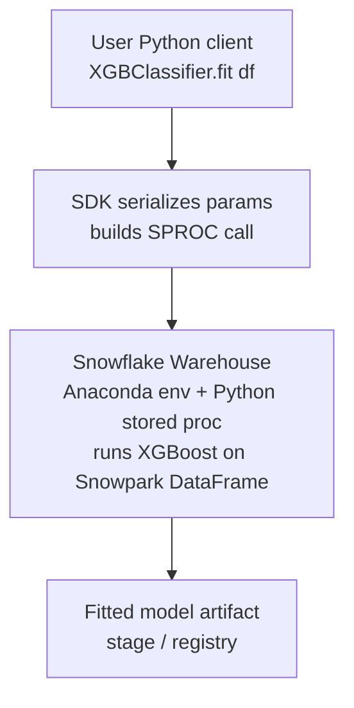

### Lab Exercise
```python
# Compare: Snowpark vs Snowpark ML on the same task
from snowflake.snowpark import Session
from snowflake.ml.modeling.xgboost import XGBClassifier
from snowflake.ml.modeling.preprocessing import StandardScaler

session = Session.builder.configs({...}).create()

# --- Classic Snowpark: you build the ML scaffolding yourself ---
df = session.table("CUSTOMERS")
# You'd write a custom SPROC to call xgboost.train(...), serialize model,
# upload to stage, write metadata to a tracking table, etc.

# --- Snowpark ML: ML primitives ready to use ---
scaler = StandardScaler(
    input_cols=["AGE", "INCOME"],
    output_cols=["AGE_SCALED", "INCOME_SCALED"]
)
scaler.fit(df)
df_scaled = scaler.transform(df)

model = XGBClassifier(
    input_cols=["AGE_SCALED", "INCOME_SCALED", "TENURE_MONTHS"],
    label_cols=["CHURNED"],
    output_cols=["PREDICTED_CHURN"]
)
model.fit(df_scaled)
# `.fit()` creates an ephemeral stored procedure that runs on the warehouse.
# The returned `model` object references the fitted artifact.
```

### Gotchas / Exam Traps
- Snowpark ML's `.fit()` returns a *Snowpark ML* model object — not an `xgboost.Booster`. Use `.to_sklearn()` / `.to_xgboost()` to get the native object.
- `snowflake-ml-python` has a different release cadence than Snowflake server. Pin versions in Anaconda channel.
- Modeling API uses warehouse compute by default — not SPCS. For GPU you must explicitly use SPCS/ML Jobs.

---

## Q2: Walk through the end-to-end ML lifecycle on Snowflake. What are the canonical phases and which Snowflake service handles each?

**Difficulty:** Foundation
**Exam relevance:** End-to-end ML lifecycle

### Answer
Seven canonical phases:
1. **Data ingestion** — Snowpipe / Streaming / COPY INTO
2. **Data curation** — Dynamic Tables, Streams/Tasks, Views
3. **Feature engineering** — Snowpark DataFrames + Feature Store feature views
4. **Training** — Snowpark ML Modeling API (warehouse) or Container Services / ML Jobs (GPU)
5. **Model registration** — `snowflake.ml.registry.Registry.log_model()`
6. **Deployment / Inference** — Warehouse UDF, Model Serving (SPCS), Dynamic Tables for batch
7. **Monitoring & retraining** — Model Monitor, Alerts, Tasks

### First Principles
**Why these phases map to Snowflake-native services:** Each phase has a different compute shape and SLA. Ingestion is bursty + continuous → serverless (Snowpipe). Curation is complex SQL on large tables → warehouse. Feature engineering needs reusable, versioned transforms → Feature Store on top of warehouse. Training is batch, high memory, sometimes GPU → warehouse or SPCS. Inference splits by latency SLA — batch is warehouse-friendly, real-time < 100ms needs always-on SPCS. Monitoring is cheap SQL over prediction logs → serverless tasks + Event Table.

**Why keep all 7 in one platform:** The dominant failure mode in ML is "data drift between training lab and production." If training reads from Snowflake and inference reads from a cached CSV copied to S3, you'll have skew. One platform = one source of truth = fewer skew bugs.

### Diagram
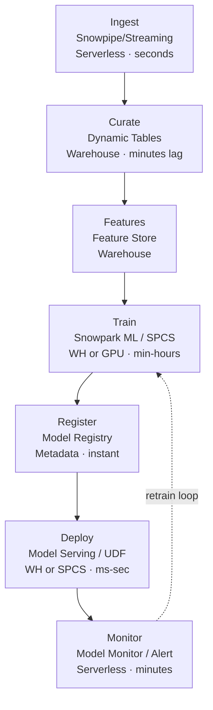

### Lab Exercise
```python
# Skeleton of a full lifecycle in one file
from snowflake.ml.feature_store import FeatureStore, Entity, FeatureView
from snowflake.ml.modeling.xgboost import XGBClassifier
from snowflake.ml.registry import Registry

# 1. Curation (Dynamic Table defined in SQL earlier)
df = session.table("ANALYTICS.CURATED.CUSTOMER_EVENTS_DT")

# 2. Features
fs = FeatureStore(session, database="ML_DB", name="FS",
                  default_warehouse="ML_WH")
entity = Entity(name="CUSTOMER", join_keys=["CUSTOMER_ID"])
fs.register_entity(entity)

fv = FeatureView(
    name="CUSTOMER_30D_AGG",
    entities=[entity],
    feature_df=df.group_by("CUSTOMER_ID").agg({"REVENUE": "sum"}),
    refresh_freq="1 hour"
)
fs.register_feature_view(fv, version="V1")

# 3. Training set
spine = session.table("TRAIN_LABELS")
training_df = fs.generate_dataset(
    name="CHURN_TRAIN_V1",
    spine_df=spine,
    features=[fv],
    spine_timestamp_col="EVENT_TS",
    spine_label_cols=["CHURNED"]
).read.to_snowpark_dataframe()

# 4. Train
model = XGBClassifier(input_cols=[...], label_cols=["CHURNED"])
model.fit(training_df)

# 5. Register
reg = Registry(session, database_name="ML_DB", schema_name="REGISTRY")
mv = reg.log_model(model, model_name="CHURN", version_name="V1",
                   conda_dependencies=["xgboost==1.7.*"])

# 6. Deploy (batch via Dynamic Table using the registered model UDF)
# CREATE DYNAMIC TABLE PREDICTIONS AS SELECT CUSTOMER_ID, ML_DB.REGISTRY.CHURN!PREDICT(...) FROM SCORING_FEATURES;

# 7. Monitor
mv.create_monitor(
    monitor_name="CHURN_MONITOR",
    source_table="PREDICTIONS",
    prediction_col="PREDICTION",
    actual_col="CHURNED_ACTUAL",
    timestamp_col="SCORED_AT",
    refresh_frequency="1 day"
)
```

### Gotchas / Exam Traps
- The lifecycle is a **loop**, not a line — monitor feeds retraining. Exam may ask what triggers phase 4 to restart.
- Phase 5 (registration) is *metadata-only* — the artifact lives in an internal stage. No compute cost.
- Feature Store is optional; you can train without it, but you'll be asked to justify when to use it.

---

## Q3: When should you use Snowpark ML Modeling API vs Container Services for training?

**Difficulty:** Intermediate
**Exam relevance:** Training compute selection

### Answer
Use **Snowpark ML Modeling API (warehouse)** when:
- Model fits in warehouse memory (sklearn, XGBoost, LightGBM CPU)
- You want managed, serverless compute with autoscaling via WAREHOUSE_SIZE
- Training time measured in minutes to a few hours
- No custom native libraries beyond Anaconda channel

Use **Snowpark Container Services (SPCS)** or **ML Jobs on SPCS** when:
- Need GPU (PyTorch, TensorFlow, XGBoost-GPU, LLM fine-tuning)
- Custom OS-level dependencies or CUDA versions
- Multi-node distributed training
- Long-running jobs (hours to days)
- Need persistent runtime environment (e.g., Ray cluster)

### First Principles
**Why warehouse works for tabular:** Snowflake warehouses are MPP columnar engines optimized for I/O and set-based compute. For gradient-boosted trees on tabular data, the training step is a sequence of large table scans + histogram aggregations — exactly what a warehouse excels at. XGBoost on a Snowpark DataFrame can pass batches through without moving the data.

**Why SPCS unlocks deep learning:** PyTorch and TensorFlow require CUDA, matrix multiplications on tensor cores, and persistent GPU state across epochs. A warehouse is ephemeral per-query compute with no GPU. SPCS gives you an OCI-container runtime with GPU attached — you can run anything you'd run on EKS/GKE. ML Jobs is the Snowflake-managed job runner on top of SPCS compute pools (less orchestration overhead than raw services).

**Why not always SPCS?** Cost and simplicity. GPU pools are expensive; warehouse training is cheaper for tabular. SPCS requires image builds, compute pool setup, networking — overkill for a scikit-learn model.

### Diagram
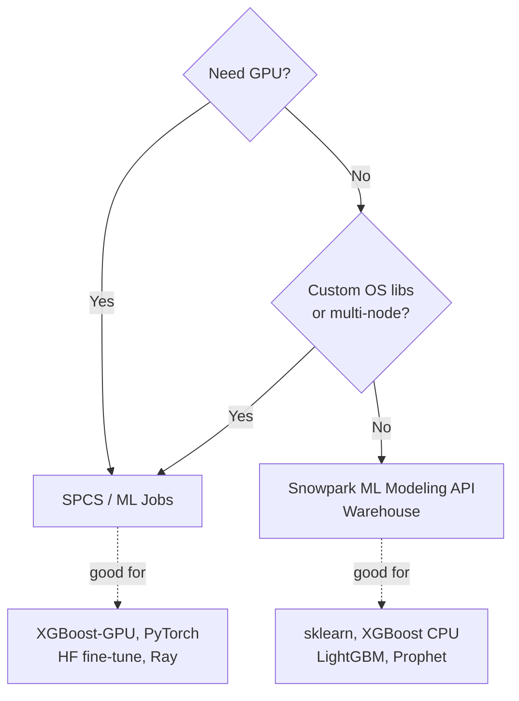

### Lab Exercise
```python
# A: Warehouse training (Modeling API)
from snowflake.ml.modeling.xgboost import XGBRegressor
model = XGBRegressor(input_cols=[...], label_cols=["TARGET"], n_estimators=500)
session.use_warehouse("ML_WH_LARGE")  # scale up for training
model.fit(df_train)                   # runs as SPROC on L warehouse

# B: SPCS training via ML Jobs API
from snowflake.ml.jobs import remote

@remote(
    compute_pool="GPU_NV_S_POOL",
    stage_name="JOB_STAGE",
    pip_requirements=["torch==2.3.0", "transformers==4.42.0"]
)
def train_llm(dataset_name: str, epochs: int):
    import torch
    from transformers import AutoModelForCausalLM, Trainer
    # ... load dataset from Snowflake stage, train on GPU ...
    model.save_pretrained("/tmp/model")
    return "/tmp/model"

job = train_llm("INSTRUCT_DATA", epochs=3)
job.wait()
```

### Gotchas / Exam Traps
- "Which warehouse size for ML?" → Memory, not compute, usually dominates. L/XL is a reasonable default; Snowpark-optimized warehouses give larger memory per node.
- SPCS compute pools are **persistent** by default — forget to AUTO_SUSPEND and you'll bleed money.
- ML Jobs API is the newer, higher-level abstraction over raw SPCS Services for ad-hoc training; prefer it unless you need a long-running service.

---

## Q4: Define batch inference vs real-time inference. Which Snowflake patterns fit each?

**Difficulty:** Foundation
**Exam relevance:** Deployment patterns

### Answer
**Batch inference** scores many rows at once on a schedule or trigger (e.g., nightly churn scoring of 100M customers). On Snowflake:
- Model UDF called from SQL (`SELECT model!PREDICT(...)`)
- Dynamic Tables that pre-compute predictions
- Streams + Tasks for incremental scoring
- Scheduled stored procedures

**Real-time inference** scores one or few rows with low latency (< 100ms typically) in response to an API call. On Snowflake:
- Model Serving on SPCS — HTTP endpoint with always-on container
- Snowflake REST API for Cortex LLM/embedding
- Streamlit-in-Snowflake calling the model
- External Access + Snowflake Model Serving from client apps

### First Principles
**Why batch is cheaper:** Amortized compute. One warehouse spin-up scores millions of rows with one columnar scan. Vectorized UDFs process rows in batches of ~1000+, reusing model state. Per-prediction cost is tiny.

**Why real-time needs always-on:** Warehouse cold start is seconds. If a user is waiting on an API call, warehouse resume + UDF init is too slow. SPCS Model Serving keeps a container warm with the model loaded in RAM, serving < 100ms responses. The tradeoff: you pay for idle time.

**Why the decision is driven by SLA, not model type:** The same XGBoost model can be deployed both ways. If downstream is a nightly report, batch. If it's a mobile app checkout, real-time. Many systems use **both**: batch for pre-computed base scores, real-time for on-demand overrides.

### Diagram
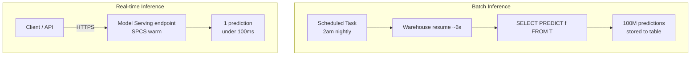

### Lab Exercise
```python
# BATCH: Dynamic Table approach
session.sql("""
CREATE OR REPLACE DYNAMIC TABLE ML_DB.PRED.CUSTOMER_CHURN
  TARGET_LAG = '1 hour'
  WAREHOUSE = ML_WH
AS
SELECT
  CUSTOMER_ID,
  ML_DB.REGISTRY.CHURN_MODEL!PREDICT(
    OBJECT_CONSTRUCT('AGE', AGE, 'INCOME', INCOME, 'TENURE', TENURE)
  ):PREDICTION::FLOAT AS CHURN_PROB,
  CURRENT_TIMESTAMP() AS SCORED_AT
FROM FEATURES.CUSTOMER_SCORING_FEATURES;
""").collect()

# REAL-TIME: Model Serving on SPCS
from snowflake.ml.registry import Registry
reg = Registry(session, database_name="ML_DB", schema_name="REGISTRY")
mv = reg.get_model("CHURN_MODEL").version("V1")

# Deploy to compute pool (SPCS) — gets REST endpoint
mv.create_service(
    service_name="CHURN_SVC",
    service_compute_pool="SERVING_POOL",
    image_repo="ML_DB.REGISTRY.IMAGES",
    ingress_enabled=True,       # external HTTPS
    gpu_requests=None,          # CPU inference is fine
    min_instances=2,
    max_instances=10
)
# -> https://<account>.snowflakecomputing.app/CHURN_SVC/predict
```

### Gotchas / Exam Traps
- Dynamic Tables for batch inference: `TARGET_LAG` is the staleness tolerance, not a scheduler. Choose carefully.
- Model Serving ingress is HTTPS by default; still subject to network policies.
- "Micro-batch" (streams + 1-min tasks) sits between batch and real-time — exam loves this gray area.

---

## Q5: What is training-serving skew and how does Snowflake's architecture prevent it?

**Difficulty:** Advanced
**Exam relevance:** First-principles design

### Answer
Training-serving skew is when the feature values seen at training time differ from those seen at inference time for logically-the-same feature. Causes include:
- Different code paths (training uses pandas, serving uses Java)
- Different data snapshots (training on last-month data, serving on live-but-mutating data)
- Different handling of nulls / defaults / timestamps / timezones
- Feature leakage (training feature uses future data not available at serve time)

Snowflake mitigates via:
1. **One compute, one language** — training and inference both run in Snowflake Python/SQL, using the same transforms
2. **Feature Store feature views** — the same SQL that generates features for training is the same SQL that materializes online features
3. **Point-in-time joins** — spine timestamp enforced on training to prevent leakage
4. **Model Registry packaging** — preprocessing is bundled *inside* the model artifact
5. **Dynamic Tables** — curated features are computed once and reused by both pipelines

### First Principles
**Why skew is the #1 ML production bug:** A model is only valid under the distribution it was trained on. If serving-time features drift ever so slightly (say, `AGE` is in years at train time but months at serve), predictions silently degrade. Debugging is hard because there's no stack trace — just lower accuracy.

**Why "data stays in place" helps:** When your training data and your inference data are the same tables in the same warehouse, the only way to introduce skew is deliberate re-implementation. Compare that to a world where training reads a CSV from S3 and serving reads from DynamoDB — a thousand opportunities for drift.

**Why bundling preprocessing in the model artifact is critical:** The Model Registry packages the fitted scaler/encoder *inside* the saved model. At serve time, raw input goes through the exact same preprocessing. If training used `fit_transform(X)` on 2024 data, serving uses the saved `transform(X)` with the exact mean/std/vocabulary.

### Diagram
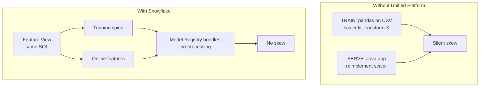

### Lab Exercise
```python
# Correct pattern: fit preprocessing INSIDE the pipeline, log the pipeline
from snowflake.ml.modeling.pipeline import Pipeline
from snowflake.ml.modeling.preprocessing import StandardScaler, OneHotEncoder
from snowflake.ml.modeling.xgboost import XGBClassifier

pipeline = Pipeline(steps=[
    ("scale", StandardScaler(input_cols=["AGE", "INCOME"],
                             output_cols=["AGE_S", "INCOME_S"])),
    ("encode", OneHotEncoder(input_cols=["COUNTRY"],
                             output_cols=["COUNTRY_OHE"])),
    ("clf", XGBClassifier(
        input_cols=["AGE_S", "INCOME_S", "COUNTRY_OHE"],
        label_cols=["CHURNED"],
        output_cols=["PRED"]))
])

pipeline.fit(df_train)

# Register the WHOLE pipeline — scaler stats + model together
mv = reg.log_model(pipeline, model_name="CHURN", version_name="V2",
                   sample_input_data=df_train.limit(10))

# At inference, raw features in — predictions out, preprocessing baked in
scored = session.sql(
    "SELECT ML_DB.REGISTRY.CHURN!PREDICT(OBJECT_CONSTRUCT(*)) FROM RAW_SCORING"
).collect()
```

### Gotchas / Exam Traps
- Forgetting to include preprocessing in the pipeline is the classic skew bug. If you `.fit_transform()` separately then only log the final estimator, serving breaks.
- Timezone handling: if a feature uses `CURRENT_TIMESTAMP()` at train time but a client-supplied timestamp at serve, you'll have skew.
- Feature Store solves offline/online skew by using the same feature view for both — expect a question on this.

---

## Q6: Explain the role of Dynamic Tables in an ML workflow. Where do they fit?

**Difficulty:** Intermediate
**Exam relevance:** Pipeline design

### Answer
Dynamic Tables (DTs) are declarative, incrementally-refreshed materializations. In ML workflows they fit in three places:

1. **Feature pipelines** — DTs materialize feature engineering SQL with `TARGET_LAG` controlling freshness, no manual Streams+Tasks orchestration.
2. **Batch inference** — a DT whose SELECT invokes `MODEL!PREDICT(...)` produces continuously-refreshed predictions.
3. **Monitoring aggregates** — DTs aggregate prediction logs or feature distributions over rolling windows for drift computation.

They're an alternative to Streams+Tasks for CDC-style pipelines; the engine figures out incremental refresh automatically.

### First Principles
**Why DTs are a game-changer for ML:** ML pipelines are DAGs of transformations with freshness requirements. Hand-coding a DAG using Streams and Tasks forces you to think about ordering, state, idempotency, and backfills. DTs declare the result (SQL) and let the planner figure out the refresh — same mental model as a materialized view, but incremental.

**Why DT for inference, not just features:** `MODEL!PREDICT()` is a UDF; UDFs are allowed in DTs. So you can write `SELECT PREDICT(f) FROM features` as a DT and get continuously-refreshed scores. The DT engine runs the model on just the changed rows (if detectable), amortizing cost.

**Why TARGET_LAG matters:** DT refresh frequency is driven by `TARGET_LAG` (upper bound on staleness). Trade-off: tighter lag = more frequent compute = more cost; looser lag = cheaper but staler. ML pipelines often use 1h-24h lag for batch scoring.

### Diagram
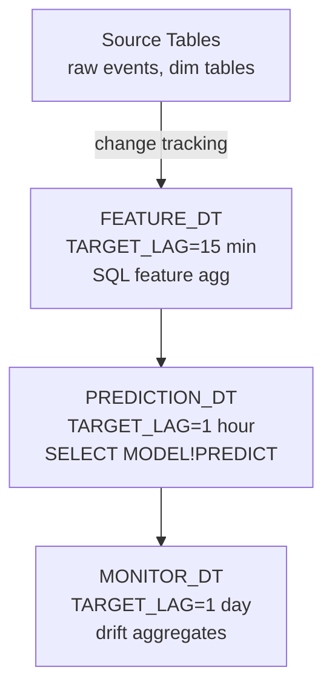

### Lab Exercise
```sql
-- Layer 1: feature engineering
CREATE OR REPLACE DYNAMIC TABLE FEATURES.CUSTOMER_30D
  TARGET_LAG = '15 minutes'
  WAREHOUSE = FEATURE_WH
AS
SELECT
  CUSTOMER_ID,
  SUM(CASE WHEN EVENT_TS >= DATEADD('day',-30,CURRENT_TIMESTAMP()) THEN AMOUNT END) AS SPEND_30D,
  COUNT(DISTINCT CASE WHEN EVENT_TS >= DATEADD('day',-30,CURRENT_TIMESTAMP()) THEN SESSION_ID END) AS SESSIONS_30D
FROM RAW.EVENTS
GROUP BY CUSTOMER_ID;

-- Layer 2: batch inference
CREATE OR REPLACE DYNAMIC TABLE PRED.CHURN_PROB
  TARGET_LAG = '1 hour'
  WAREHOUSE = INFERENCE_WH
AS
SELECT
  CUSTOMER_ID,
  ML_DB.REGISTRY.CHURN_MODEL!PREDICT(
    OBJECT_CONSTRUCT('SPEND_30D', SPEND_30D, 'SESSIONS_30D', SESSIONS_30D)
  ):PREDICTION::FLOAT AS CHURN_PROB,
  CURRENT_TIMESTAMP() AS SCORED_AT
FROM FEATURES.CUSTOMER_30D;

-- Layer 3: monitoring
CREATE OR REPLACE DYNAMIC TABLE MONITOR.DRIFT_METRICS
  TARGET_LAG = '1 day'
  WAREHOUSE = MONITOR_WH
AS
SELECT
  DATE_TRUNC('day', SCORED_AT) AS DAY,
  AVG(CHURN_PROB) AS AVG_PROB,
  STDDEV(CHURN_PROB) AS STD_PROB,
  COUNT(*) AS N
FROM PRED.CHURN_PROB
GROUP BY DAY;
```

### Gotchas / Exam Traps
- DTs cannot use **mutable** UDFs or external access UDFs — pure Model Registry UDFs are fine.
- `TARGET_LAG = 'DOWNSTREAM'` cascades refresh from the final DT backward. Useful for chained ML DAGs.
- A DT built on another DT shares warehouse unless specified; cost tracking requires separate warehouses.

---

## Q7: What is the difference between a Snowpark ML Modeling API model and a custom model logged via Model Registry?

**Difficulty:** Intermediate
**Exam relevance:** Model registration flexibility

### Answer
**Snowpark ML Modeling API models** are built using the SDK's own estimator classes (`snowflake.ml.modeling.xgboost.XGBClassifier`, etc.). They have Snowflake-native fit/predict methods, input/output column mapping, and automatic SPROC pushdown.

**Custom models** are any Python object (sklearn, PyTorch, HuggingFace, a custom class) wrapped by `CustomModel` or logged directly if the type is natively supported. The Registry supports many types out of the box: scikit-learn, XGBoost, LightGBM, CatBoost, PyTorch, TensorFlow, HuggingFace Transformers, MLflow models, Snowpark ML pipelines.

Both end up as model versions in the Registry with identical deployment paths (warehouse UDF, SPCS service).

### First Principles
**Why support both?** Portability. Teams have existing sklearn/PyTorch assets. Forcing them to rewrite in Snowpark ML Modeling API is a non-starter. The Registry's model-type abstraction lets you log what you have.

**Why Modeling API is still preferred for new work:** It handles input/output column mapping, nulls, and type coercion idiomatically. Custom models require you to write a `predict` function that handles input DataFrames correctly.

**Why `CustomModel` exists:** For truly custom logic — e.g., a model that calls an external API, or an ensemble of three different models, or a RAG chain. `CustomModel` is a user-written class with `@custom_model.inference_api`-decorated methods.

### Diagram
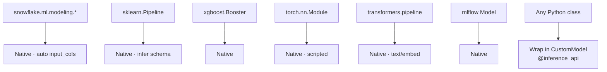

### Lab Exercise
```python
# A: Snowpark ML Modeling API model
from snowflake.ml.modeling.lightgbm import LGBMClassifier
m = LGBMClassifier(input_cols=["A","B"], label_cols=["Y"]).fit(df)
reg.log_model(m, model_name="LGBM_NATIVE", version_name="V1")

# B: Pre-trained sklearn
from sklearn.ensemble import RandomForestClassifier
import pandas as pd
sk = RandomForestClassifier().fit(X_pandas, y_pandas)
reg.log_model(sk, model_name="SK_RF", version_name="V1",
              sample_input_data=X_pandas.head())

# C: Custom model (ensemble with business logic)
from snowflake.ml.model import custom_model

class WeightedEnsemble(custom_model.CustomModel):
    def __init__(self, context):
        super().__init__(context)
        self.model_a = context.model_ref("MODEL_A")
        self.model_b = context.model_ref("MODEL_B")

    @custom_model.inference_api
    def predict(self, input_df):
        pa = self.model_a.predict(input_df)["output"]
        pb = self.model_b.predict(input_df)["output"]
        return pd.DataFrame({"ENSEMBLE": 0.7*pa + 0.3*pb})

ensemble = WeightedEnsemble(custom_model.ModelContext(
    models={"MODEL_A": model_a_version, "MODEL_B": model_b_version}
))
reg.log_model(ensemble, model_name="CHURN_ENS", version_name="V1",
              sample_input_data=sample)
```

### Gotchas / Exam Traps
- When logging a non-Modeling-API model, `sample_input_data` is **required** so Snowflake can infer schema.
- CustomModel is the escape hatch for anything that doesn't fit a native type — expect a scenario question.
- Snowpark ML Modeling API models can be `.to_sklearn()` or `.to_xgboost()` to extract the native object for interop.

---

## Q8: What are Snowflake Datasets and how do they fit into ML workflows?

**Difficulty:** Intermediate
**Exam relevance:** Dataset API

### Answer
`snowflake.ml.dataset.Dataset` is an immutable, versioned, snapshot of a Snowpark DataFrame stored as a materialized artifact. Key traits:
- Materialized to internal stage as columnar files (fast random access, shardable)
- Versioned with named versions
- Supports multi-shard distributed training (each shard = partition)
- Integrates with PyTorch/TensorFlow DataLoaders via `to_torch_dataset()` and `to_tf_dataset()`
- Pins training data for reproducibility

### First Principles
**Why not just use the Snowpark DataFrame directly?** For training with iterative deep learning frameworks, you need to shuffle/batch/stream the same rows across many epochs. A SQL query re-executes each time, incurring warehouse cost per epoch. A Dataset materializes once, then PyTorch reads directly from stage files via a prefetching DataLoader.

**Why versioned:** Reproducibility. If you retrain next month, you want the exact same training rows (minus leakage adjustments). Versioned Datasets snapshot the data.

**Why shardable:** For multi-GPU or multi-worker training, each worker reads a disjoint shard in parallel. Snowflake materializes in multiple files for exactly this.

### Diagram
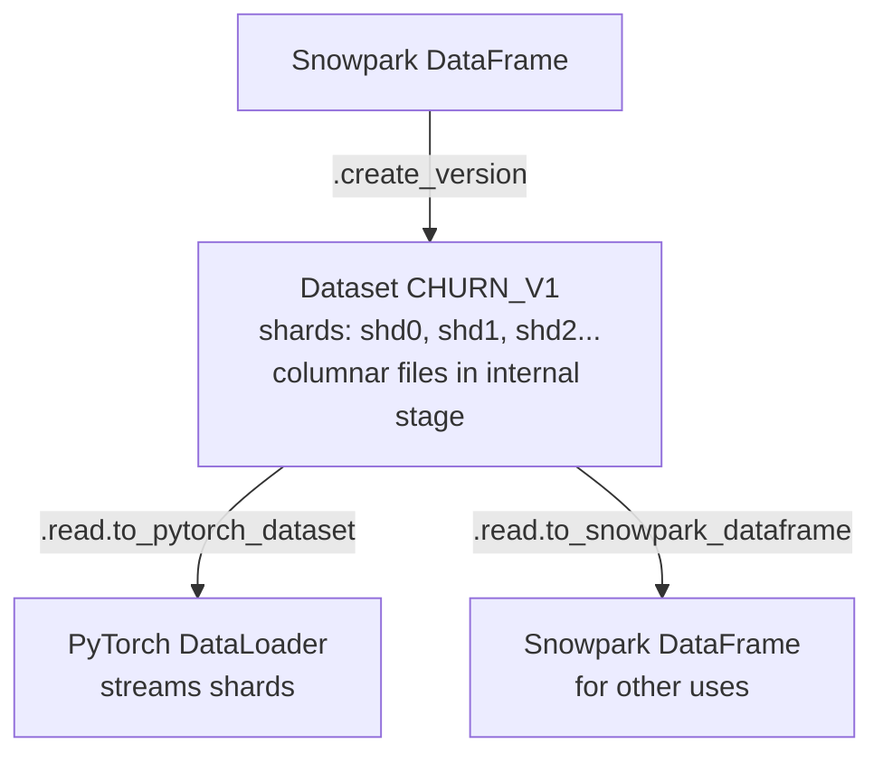

### Lab Exercise
```python
from snowflake.ml.dataset import DatasetFactory

# Materialize a reproducible training snapshot
df = session.sql("SELECT * FROM FEATURES.CUSTOMER_30D WHERE AS_OF_DATE='2024-10-01'")
ds = DatasetFactory.create_from_dataframe(
    session=session,
    dataset_name="CHURN_SNAPSHOT",
    version="V1_2024_10_01",
    input_dataframe=df,
    shuffle=True
)

# Read as PyTorch DataLoader for GPU training on SPCS
import torch
torch_ds = ds.read.to_torch_datapipe(batch_size=1024, shuffle=True, drop_last_batch=True)
for batch in torch_ds:
    # batch is a dict of column -> tensor
    features = torch.stack([batch[c] for c in FEATURE_COLS], dim=1)
    labels = batch["CHURNED"]
    # train step...
```

### Gotchas / Exam Traps
- Datasets live in internal stages; dropping the schema drops the Datasets.
- Dataset read via Torch DataPipe streams row groups — don't `.collect()` first.
- Snowflake Feature Store `generate_dataset()` returns a Dataset — natural upstream.

---

## Q9: Explain how Streamlit-in-Snowflake fits as a deployment target for ML models.

**Difficulty:** Foundation
**Exam relevance:** Deployment UX

### Answer
Streamlit-in-Snowflake (SiS) is a hosted Streamlit runtime inside Snowflake, accessible via Snowsight. For ML, it provides:
- Interactive UI for ad-hoc inference (slider inputs → model predictions)
- A dashboard for monitoring metrics computed by Model Monitor
- A reviewer UI for model approval workflows
- A business-user front end that doesn't require external hosting

SiS calls the Model Registry model as a UDF just like any SQL — no network egress, no auth hop, all inside Snowflake.

### First Principles
**Why host UI inside Snowflake:** The usual MLOps stack has a model in Snowflake and a Streamlit app on a separate VM/container. That means (a) extra infra to secure, (b) credentials to manage, (c) network path risks. SiS collapses this: the UI runs with the user's Snowflake session, calling models via SQL. Governance is unified.

**Why not for every use case:** SiS has resource limits (compute pool size, concurrency). High-traffic consumer apps still belong on external hosting with Model Serving endpoints.

### Diagram
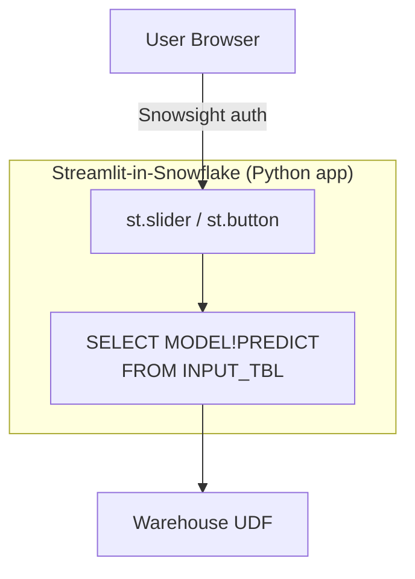

### Lab Exercise
```python
# streamlit_app.py (deployed to SiS)
import streamlit as st
from snowflake.snowpark.context import get_active_session

session = get_active_session()

st.title("Churn Prediction")

age = st.slider("Age", 18, 90, 35)
income = st.number_input("Income", 0, 500000, 50000)
tenure = st.slider("Tenure (months)", 0, 240, 24)

if st.button("Score"):
    df = session.create_dataframe(
        [[age, income, tenure]],
        schema=["AGE","INCOME","TENURE"]
    )
    result = session.sql(f"""
      SELECT ML_DB.REGISTRY.CHURN_MODEL!PREDICT(
        OBJECT_CONSTRUCT('AGE', {age}, 'INCOME', {income}, 'TENURE', {tenure})
      ):PREDICTION::FLOAT AS CHURN_PROB
    """).collect()
    st.metric("Churn Probability", f"{result[0]['CHURN_PROB']:.1%}")
```

### Gotchas / Exam Traps
- SiS has a package allowlist via Anaconda; not every pip package works.
- SiS doesn't give you a public internet endpoint — users need Snowflake login.
- For GPU inference from SiS, call a Model Serving SPCS endpoint via external access.

---

## Q10: When should you use Cortex LLM functions vs loading your own LLM into the Model Registry?

**Difficulty:** Intermediate
**Exam relevance:** LLM-ops overlap

### Answer
Use **Cortex LLM functions** (`SNOWFLAKE.CORTEX.COMPLETE`, `EMBED_TEXT_768`, `SUMMARIZE`, `TRANSLATE`, `SENTIMENT`, `EXTRACT_ANSWER`, etc.) when:
- You need a general-purpose LLM (Mistral, Llama, Claude, Snowflake Arctic) with no fine-tuning
- You want serverless, pay-per-token
- The task is standard: completion, embedding, classification, summarization
- You don't need custom weights or adapter

Use **Model Registry** for LLMs when:
- Fine-tuned/custom-trained model (your own LoRA, your own weights)
- Specialized open-source model not in Cortex (e.g., a specific HuggingFace checkpoint)
- Need to version/approve the model via your own governance
- Need deterministic inference environment (specific transformers version)

### First Principles
**Why Cortex functions are usually first choice:** No ops. No GPU pool to size, no image to build, no cold start. The LLM is already loaded on Snowflake's managed infrastructure. Billing is per-token, not per-hour of GPU. For 80% of LLM use cases (classification, extraction, RAG completion), Cortex is cheaper and faster to ship.

**Why Registry wins for custom models:** Cortex only offers a curated catalog of foundation models. If you've fine-tuned Llama with your proprietary data, you must bring it yourself. Registry + SPCS Model Serving with GPU is the path.

**Why they can coexist:** Many pipelines use `EMBED_TEXT_768` (Cortex) for retrieval and a custom fine-tuned model (Registry) for the final generation step.

### Diagram
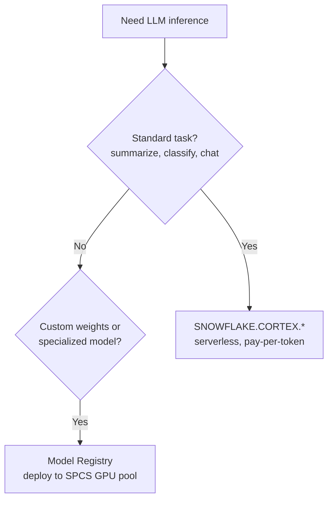

### Lab Exercise
```python
# A: Cortex native functions
session.sql("""
  SELECT
    REVIEW_ID,
    SNOWFLAKE.CORTEX.COMPLETE('mistral-large',
      'Classify sentiment of: ' || REVIEW_TEXT) AS SENTIMENT_LLM,
    SNOWFLAKE.CORTEX.SENTIMENT(REVIEW_TEXT) AS SENTIMENT_FN,
    SNOWFLAKE.CORTEX.EMBED_TEXT_768('e5-base-v2', REVIEW_TEXT) AS EMBEDDING
  FROM REVIEWS
""").collect()

# B: Custom HuggingFace model via Registry + SPCS
from transformers import pipeline
hf_pipe = pipeline("text-classification", model="my-org/custom-finetuned-bert")

reg.log_model(
    hf_pipe,
    model_name="CUSTOM_SENTIMENT",
    version_name="V1",
    sample_input_data=["Great product!", "Terrible service"],
    conda_dependencies=["transformers==4.42.0","torch==2.3.0"]
).create_service(
    service_name="SENTIMENT_SVC",
    service_compute_pool="GPU_NV_S",
    gpu_requests="1",
    min_instances=1, max_instances=3
)
```

### Gotchas / Exam Traps
- Cortex functions are not available in all regions — check region availability.
- Cortex token-pricing is often significantly cheaper than running your own GPU 24/7 unless utilization is high.
- Cortex Fine-Tuning exists — you can fine-tune without leaving Snowflake and still consume via Cortex.

---

## Q11: What is a Snowpark-optimized warehouse and when do you use it for ML?

**Difficulty:** Intermediate
**Exam relevance:** Compute selection

### Answer
A Snowpark-optimized warehouse (SOWH) is a warehouse type with ~16x more memory per node than a standard warehouse. For an M-size SOWH you get hundreds of GB of RAM per node. Used for:
- Training large tabular models that exceed standard-WH memory
- Memory-intensive Snowpark Python stored procedures (large pandas pulls)
- Running large sklearn/XGBoost pipelines that materialize in-memory

### First Principles
**Why memory, not CPU, is the bottleneck for ML on WH:** Snowpark ML training runs as a Python SPROC — the fit() happens in one node's Python process. If your training frame is 60 GB and you're on an L warehouse with 48 GB RAM per node, you OOM. SOWH gives you headroom.

**Why not always use SOWH:** Higher credit cost per hour. For small models (< 10GB), standard WH is cheaper. SOWH is specifically for memory-bound workloads.

**Why SOWH isn't GPU:** It's still CPU — just more RAM. For GPU go to SPCS.

### Diagram
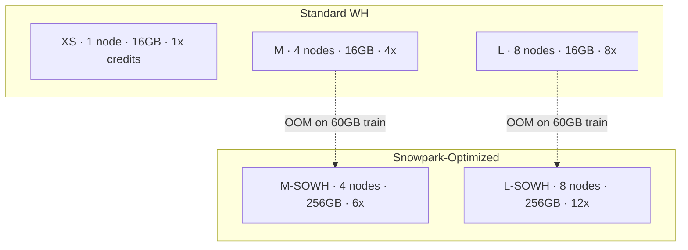

### Lab Exercise
```sql
CREATE OR REPLACE WAREHOUSE ML_TRAIN_WH
  WAREHOUSE_SIZE = 'MEDIUM'
  WAREHOUSE_TYPE = 'SNOWPARK-OPTIMIZED'
  AUTO_SUSPEND = 60
  AUTO_RESUME = TRUE;

-- Then use it for training
USE WAREHOUSE ML_TRAIN_WH;
```

```python
session.use_warehouse("ML_TRAIN_WH")
model = XGBRegressor(input_cols=[...], label_cols=["TARGET"], n_estimators=2000)
model.fit(large_training_df)  # won't OOM
```

### Gotchas / Exam Traps
- SOWH has limits on concurrency per node — not meant for high-concurrency serving.
- You cannot change WAREHOUSE_TYPE on an active query; recreate or ALTER with SUSPEND.
- Memory per node is still fixed per size; scaling up (M→L) doubles node count, not RAM per node — scaling *size*, not *type*.

---

## Q12: What's the difference between Snowflake Model Serving via warehouse UDF vs via SPCS service?

**Difficulty:** Intermediate
**Exam relevance:** Deployment paths

### Answer
Both are "deployed models" but very different runtimes:

**Warehouse UDF** — `MODEL!PREDICT()` becomes a vectorized Python UDF running inside a warehouse. Benefits: serverless, pay per use, autoscales with warehouse, batch-friendly. Limits: no GPU, cold start on warehouse resume, 10-min per query timeout for free tier, slower for one-off low-latency calls.

**SPCS Model Serving (`create_service`)** — model is baked into a container and deployed to a compute pool with always-on instances. Benefits: GPU support, sub-100ms response, HTTP ingress, autoscale by request rate. Limits: compute pool runs 24/7 (cost), image build step, more ops.

### First Principles
**Why warehouse UDF for batch:** For 10M predictions once a day, you pay only for ~minutes of warehouse. Container pool running all day would be far more expensive.

**Why SPCS for real-time:** < 100ms latency requires in-memory model, no warehouse resume. Container stays hot.

**Why SPCS for GPU:** GPUs don't exist on warehouses.

**Why same registry supports both:** The registry stores the model; the deploy step chooses the runtime. Same model can be exposed both ways simultaneously.

### Diagram
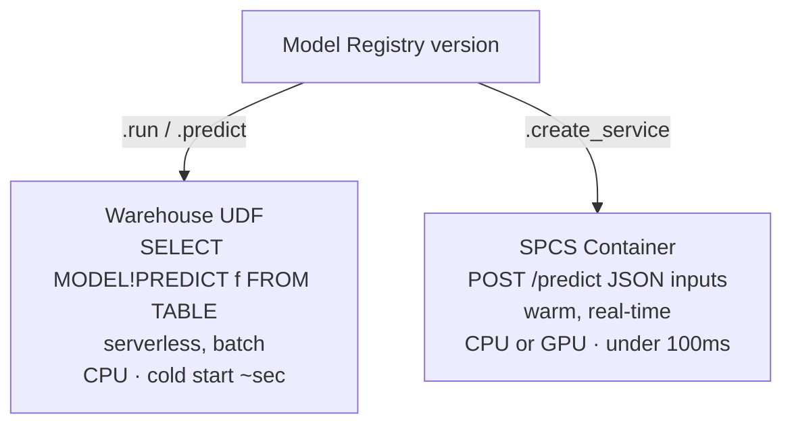

### Lab Exercise
```python
mv = reg.get_model("CHURN").version("V1")

# Path A: deploy for warehouse UDF (automatic on log_model)
# SQL: SELECT ML_DB.REGISTRY.CHURN!PREDICT(features) FROM INPUT_TABLE;

# Path B: deploy as SPCS service
mv.create_service(
    service_name="CHURN_RT",
    service_compute_pool="SERVING_POOL_CPU",
    image_repo="ML_DB.REGISTRY.IMG",
    ingress_enabled=True,
    min_instances=2,
    max_instances=10,
    cpu_requests="1",
    memory_requests="4Gi"
)

# Call via HTTPS
import requests
r = requests.post(
    "https://<account>.snowflakecomputing.app/CHURN_RT/predict",
    headers={"Authorization": f"Bearer {token}"},
    json={"data": [[1, {"AGE":35, "INCOME":50000, "TENURE":24}]]}
)
```

### Gotchas / Exam Traps
- Warehouse UDF path works out-of-the-box after `log_model`; no extra deployment command needed.
- SPCS service requires an `image_repo` in the Registry schema — set up first.
- `ingress_enabled=False` means in-Snowflake-only (no public URL) — useful for secure services.

---

## Q13: Describe the role of the Snowflake ML Jobs API vs raw SPCS Services.

**Difficulty:** Advanced
**Exam relevance:** Advanced training patterns

### Answer
**ML Jobs API** (`snowflake.ml.jobs`) is a higher-level abstraction over SPCS for *ad-hoc, batch* workloads (training jobs, hyperparameter sweeps, data preprocessing). It gives you:
- Decorator-based job definition (`@remote(compute_pool=...)`)
- Automatic image build and spec generation
- Job lifecycle API (`.wait()`, `.get_logs()`, `.cancel()`)
- Lightweight — no need to craft a `CREATE SERVICE` spec yaml

**Raw SPCS Services** are the lower-level primitive: a long-running service definition in YAML with endpoints, resource specs, replicas. Used for persistent services (model serving, custom APIs, Ray clusters).

### First Principles
**Why both:** Training is batch (run, finish, exit). Serving is persistent (always on). Different lifecycles need different abstractions.

**Why ML Jobs for training:** Writing a service spec YAML for a one-off training job is overkill. ML Jobs lets you write Python code and submit — Snowflake handles containerization.

**Why raw SPCS for serving:** A production endpoint needs ingress config, SSL, scaling policy, resource limits — all expressed well in service specs.

### Diagram
```mermaid
flowchart TD
    subgraph "ML Jobs API"
        J1[Batch, finite]
        J2[@remote decorator]
        J3[Auto image build]
        J4[job.wait / get_logs]
        J5[Training, HP sweeps, data prep]
    end
    subgraph "SPCS Service"
        S1[Persistent, infinite]
        S2[YAML spec file]
        S3[BYO image]
        S4[SHOW SERVICES / CALL]
        S5[Model serving, Ray cluster, APIs]
    end
```

### Lab Exercise
```python
# ML Jobs (batch training)
from snowflake.ml.jobs import remote

@remote(
    compute_pool="GPU_POOL",
    stage_name="JOB_STAGE",
    pip_requirements=["torch","lightning"],
    external_access_integrations=["PYPI_ACCESS"]
)
def train_and_register(dataset_name, epochs):
    from snowflake.snowpark import Session
    sess = Session.builder.create()  # inside job, session is auto-provided
    # ... train on GPU ...
    reg = Registry(sess, "ML_DB", "REG")
    reg.log_model(model, model_name="MODEL_X", version_name="V1")

job = train_and_register("CHURN_SNAPSHOT", epochs=10)
job.wait()
print(job.get_logs())
```

```sql
-- Raw SPCS service for serving
CREATE SERVICE PROD.ML.CHURN_SVC
  IN COMPUTE POOL SERVING_POOL
  FROM SPECIFICATION $$
spec:
  containers:
  - name: model
    image: /ml_db/registry/img/churn:v1
    resources:
      requests: {cpu: "1", memory: "4Gi"}
  endpoints:
  - name: predict
    port: 8080
    public: true
$$;
```

### Gotchas / Exam Traps
- ML Jobs are the newer, more idiomatic path for training — exam may contrast with the older "wrap SPROC in SPCS" pattern.
- Both share a compute pool concept.
- Jobs can also submit to CPU pools, not just GPU.

---

## Q14: How do you handle class imbalance in a Snowpark ML Modeling API workflow?

**Difficulty:** Intermediate
**Exam relevance:** Modeling practices on Snowflake

### Answer
Several techniques, all expressible via Snowpark ML + Snowpark DataFrames:
1. **Class weights** — pass `scale_pos_weight` (XGBoost) or `class_weight='balanced'` (sklearn-style) to the estimator
2. **Oversampling / undersampling** — use Snowpark DataFrame `.sample(frac=...)` with `where(label=1)` and union
3. **SMOTE** — compute k-NN in Snowpark or use a stored procedure wrapping `imbalanced-learn` (CPU in warehouse)
4. **Stratified train/test split** — Snowpark ML has `train_test_split` with `stratify_cols`

### First Principles
**Why class imbalance breaks naïve training:** Loss gradients are dominated by the majority class. The model learns to predict "majority" and gets 99% accuracy but 0% recall on the rare class. Metrics like F1 or AUC-PR surface this; accuracy doesn't.

**Why do rebalancing in Snowflake:** Rebalancing before `fit()` means the balanced training frame lives as a DataFrame. If you did SMOTE outside and copied back, you'd introduce yet another skew vector. Keep it in-platform.

### Diagram
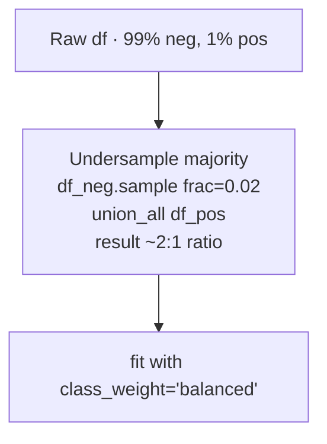

### Lab Exercise
```python
from snowflake.ml.modeling.model_selection import train_test_split
from snowflake.ml.modeling.xgboost import XGBClassifier

# Stratified split
train, test = train_test_split(
    df, test_size=0.2, stratify_cols=["CHURNED"], random_state=42
)

# Class weight approach
pos = train.filter("CHURNED = 1").count()
neg = train.filter("CHURNED = 0").count()
spw = neg / pos  # scale_pos_weight

model = XGBClassifier(
    input_cols=["AGE","INCOME","TENURE"],
    label_cols=["CHURNED"],
    output_cols=["PRED"],
    scale_pos_weight=spw,
    eval_metric="aucpr"
)
model.fit(train)
```

### Gotchas / Exam Traps
- `train_test_split` from Snowpark ML pushes the split down to SQL — don't `.to_pandas()` first.
- SMOTE needs imbalanced-learn and runs in Python SPROC — ensure it's in the Anaconda channel.
- Over-correcting imbalance can hurt calibration; evaluate both PR-AUC and calibration curves.

---

## Q15: What's the ML workflow story for continuous retraining? What triggers it?

**Difficulty:** Advanced
**Exam relevance:** MLOps lifecycle

### Answer
Continuous retraining is triggered by one or more conditions, orchestrated via Snowflake Tasks + Alerts:

**Triggers:**
- **Scheduled** — nightly/weekly task kicks off retraining regardless of state
- **Drift-based** — Model Monitor detects feature or prediction drift beyond threshold → Alert fires → procedure retrains
- **Performance degradation** — ground truth joined back; monitor sees AUC drop → Alert
- **Data volume** — enough new labeled rows accumulated
- **Business rule** — e.g., new product launched

**Orchestration:**
- Snowflake Task calls a stored procedure that: (a) refreshes features, (b) retrains model, (c) registers new version, (d) runs offline eval, (e) if better, promotes alias.

### First Principles
**Why "always retrain weekly" is wasteful:** Compute cost scales with retraining frequency. If drift is minimal, you're burning credits with no benefit. Trigger-based retraining is cheaper and often better (models are stable until something changes).

**Why trigger must be automatic:** The point of MLOps is removing humans from the loop for routine retrains. Monitor-driven alerts allow self-healing.

**Why promote only after offline eval:** Blindly deploying a retrained model risks regression. Compare new model vs current on a holdout before promoting the alias.

### Diagram
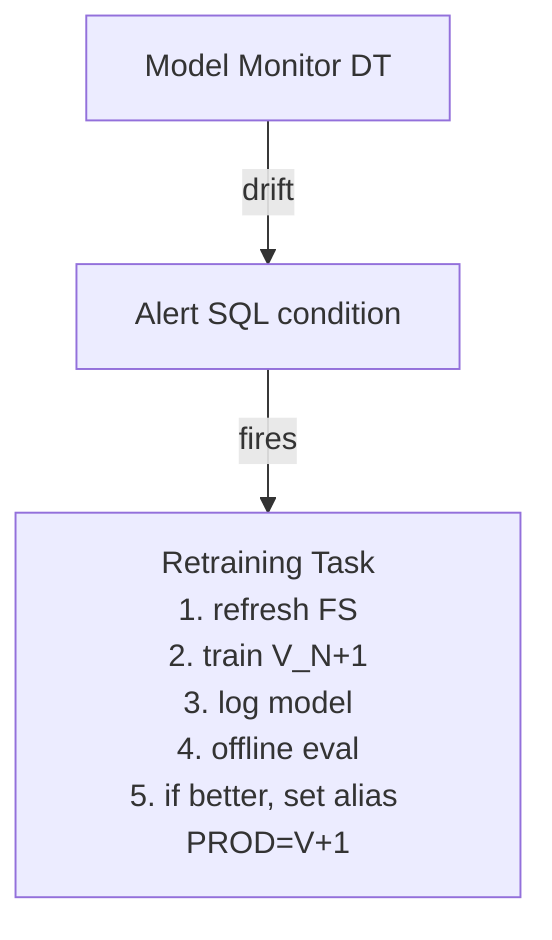

### Lab Exercise
```sql
-- Alert: drift threshold breached
CREATE OR REPLACE ALERT MONITOR.CHURN_DRIFT_ALERT
  WAREHOUSE = MONITOR_WH
  SCHEDULE = '1 HOUR'
  IF (EXISTS (
    SELECT 1 FROM MONITOR.MODEL_METRICS
    WHERE MODEL = 'CHURN'
      AND METRIC = 'PSI'
      AND VALUE > 0.2
      AND COMPUTED_AT > DATEADD('hour',-2,CURRENT_TIMESTAMP())
  ))
  THEN CALL ML.RETRAIN_CHURN();

-- Procedure: retrain and conditionally promote
CREATE OR REPLACE PROCEDURE ML.RETRAIN_CHURN()
RETURNS STRING
LANGUAGE PYTHON RUNTIME_VERSION='3.10'
PACKAGES=('snowflake-snowpark-python','snowflake-ml-python')
HANDLER = 'retrain'
AS $$
def retrain(session):
    from snowflake.ml.registry import Registry
    from snowflake.ml.modeling.xgboost import XGBClassifier
    reg = Registry(session, "ML_DB", "REGISTRY")

    df = session.table("FEATURES.CHURN_TRAINING")
    train, test = ...
    model = XGBClassifier(...).fit(train)
    new_version = reg.log_model(model, "CHURN", version_name=None)

    curr = reg.get_model("CHURN").version_by_alias("PROD")
    curr_auc = curr.show_metrics().get("holdout_auc", 0)
    new_auc = ...  # compute on test
    if new_auc > curr_auc + 0.005:
        reg.get_model("CHURN").version(new_version.version_name).set_alias("PROD")
        return f"Promoted {new_version.version_name} (AUC {new_auc:.3f})"
    return f"Trained but not promoted (AUC {new_auc:.3f} vs {curr_auc:.3f})"
$$;

ALTER ALERT MONITOR.CHURN_DRIFT_ALERT RESUME;
```

### Gotchas / Exam Traps
- Alerts don't fire during warehouse suspend — ensure monitor WH has AUTO_RESUME = TRUE.
- Promoting via alias means serving traffic switches atomically — no need to redeploy endpoints.
- Shadow deploy pattern: route a small % of traffic to new version via alias/A-B split in SQL.

---

## Q16: Explain the role of Git integration in a Snowflake ML workflow.

**Difficulty:** Intermediate
**Exam relevance:** CI/CD basics (deep dive in domain 6)

### Answer
Snowflake Git integration lets you attach a Git repo to a Snowflake account via `CREATE GIT REPOSITORY`. For ML:
- Store feature SQL, model training notebooks, Streamlit apps, service specs in Git
- Reference files directly in SQL: `EXECUTE IMMEDIATE FROM @my_repo/branches/main/train.sql`
- `snow git fetch` syncs the repo to Snowflake stages
- CI/CD can push to Git, which triggers Snowflake to pull and apply

### First Principles
**Why Git integration matters for ML:** Everything in ML should be versioned — features (SQL), models (Registry), code (training scripts), configs (service specs). Git is the source of truth for *code*; Registry for *artifacts*. Integration means production state is Git-reproducible.

**Why not just git clone to a VM:** You'd need an orchestration layer outside Snowflake. Native integration keeps the ops boundary clean — Snowflake pulls what it needs when it needs it.

### Diagram
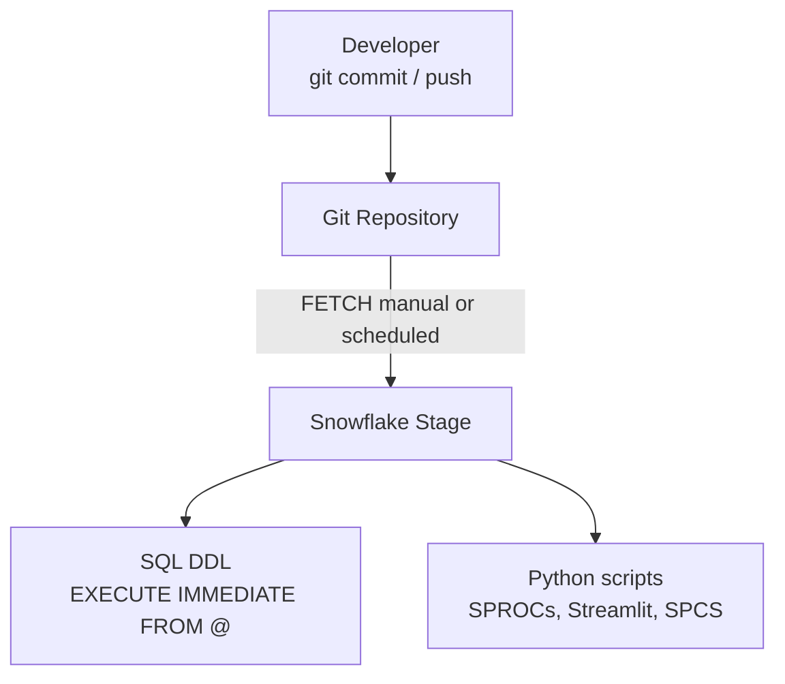

### Lab Exercise
```sql
-- One-time setup
CREATE API INTEGRATION GITHUB_API_INT
  API_PROVIDER = GIT_HTTPS_API
  API_ALLOWED_PREFIXES = ('https://github.com/my-org')
  ALLOWED_AUTHENTICATION_SECRETS = (SECRETS.GH_SECRET)
  ENABLED = TRUE;

CREATE GIT REPOSITORY ML_REPO
  API_INTEGRATION = GITHUB_API_INT
  ORIGIN = 'https://github.com/my-org/ml-pipelines.git'
  GIT_CREDENTIALS = SECRETS.GH_SECRET;

ALTER GIT REPOSITORY ML_REPO FETCH;

-- Execute training SQL from Git
EXECUTE IMMEDIATE FROM @ML_REPO/branches/main/train/train_churn.sql;
```

### Gotchas / Exam Traps
- Fetching is not automatic — schedule a Task or trigger from CI.
- You can `EXECUTE IMMEDIATE FROM` a Jinja-templated SQL file for parameterization.
- Branches, tags, and commits are all addressable: `@repo/branches/main/`, `@repo/tags/v1.2/`, `@repo/commits/abc123/`.

---

## Q17: Describe the role of Notebooks (Snowflake Notebooks) in the ML workflow.

**Difficulty:** Foundation
**Exam relevance:** Development surface

### Answer
Snowflake Notebooks are a managed Jupyter-like environment inside Snowsight. For ML:
- Interactive Snowpark + Snowpark ML development
- Prototyping with warehouse OR container runtime (SPCS-backed, with GPU option)
- Mixed SQL + Python cells, with results flowing between
- Shareable, version-controlled via Git integration
- Can be scheduled as a notebook-task for recurring work

### First Principles
**Why Notebooks inside Snowflake:** The alternative (Jupyter on a laptop or EC2) means data egress, local secrets, and inconsistent environments. In-platform notebooks keep development, data, and compute in one place.

**Why two runtimes:** Warehouse runtime for lightweight SQL + Python; container runtime (SPCS-backed) for ML workloads needing specific Python packages or GPU.

### Diagram
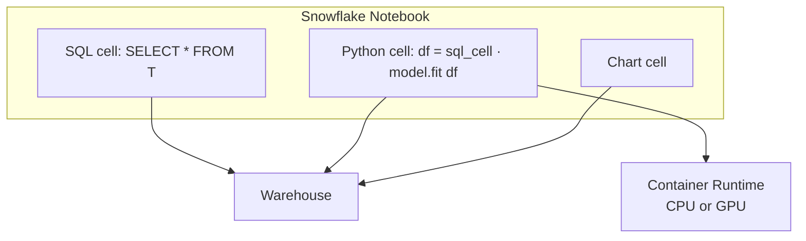

### Lab Exercise
```sql
-- Create a container-runtime notebook with GPU
CREATE NOTEBOOK ML.DEV.CHURN_EXPLORE
  FROM '@ML_REPO/branches/main/notebooks/'
  MAIN_FILE = 'churn_explore.ipynb'
  QUERY_WAREHOUSE = DEV_WH
  COMPUTE_POOL = GPU_NV_S_POOL
  RUNTIME_NAME = SYSTEM$BASIC_RUNTIME;
```

### Gotchas / Exam Traps
- Notebooks CAN be scheduled as tasks — turns prototyping work into orchestrated jobs quickly.
- The container runtime has pre-installed common ML libs; use that for GPU work.
- A notebook's state resets on session close — put important code in Git.

---

## Q18: What's the recommended approach to hyperparameter tuning in Snowflake?

**Difficulty:** Advanced
**Exam relevance:** Modeling practices

### Answer
Three main approaches:
1. **Snowpark ML `GridSearchCV` / `RandomizedSearchCV`** — sklearn-style, runs multiple folds in parallel inside a warehouse (parallelism bounded by warehouse size).
2. **ML Jobs API** — write a tuning loop (Optuna, Ray Tune) that submits parallel training jobs to a compute pool.
3. **Hand-rolled** — Snowpark Task + stored procedure parameterized by hyperparams, orchestrating sweep manually.

### First Principles
**Why GridSearchCV first:** For small-to-medium search spaces, it's one line and parallelizes within the warehouse. The SDK handles fold creation and metric aggregation.

**Why ML Jobs for large sweeps:** With Optuna + Ray Tune running on a compute pool, you can run hundreds of trials in parallel, each on its own container. More scalable than a single warehouse.

**Why not Jupyter + sklearn locally:** You'd pull all data to the driver. For tabular data at Snowflake scale, that's infeasible.

### Diagram
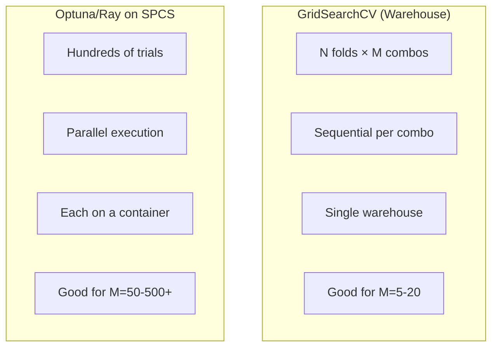

### Lab Exercise
```python
from snowflake.ml.modeling.model_selection import GridSearchCV
from snowflake.ml.modeling.xgboost import XGBClassifier

grid = GridSearchCV(
    estimator=XGBClassifier(
        input_cols=feats, label_cols=["CHURNED"], output_cols=["PRED"]
    ),
    param_grid={
        "max_depth": [3, 5, 7],
        "n_estimators": [100, 300, 500],
        "learning_rate": [0.05, 0.1]
    },
    n_jobs=-1,
    scoring="roc_auc",
    cv=5,
    input_cols=feats, label_cols=["CHURNED"], output_cols=["PRED"]
)
grid.fit(train_df)

best = grid.to_sklearn().best_estimator_
```

### Gotchas / Exam Traps
- `GridSearchCV` from Snowpark ML runs on the warehouse — scale warehouse size to parallelize folds.
- Optuna integrates well with ML Jobs; the trial objective function becomes a `@remote` function.
- Random search often matches grid at a fraction of trials — exam favors "efficient" patterns.

---

## Q19: When would you choose a Dynamic Table over a Stream + Task for feature engineering?

**Difficulty:** Intermediate
**Exam relevance:** Pipeline primitives

### Answer
Prefer **Dynamic Tables** when:
- Transformation is expressible as a single SELECT
- Freshness controlled by `TARGET_LAG` is acceptable
- No complex procedural logic needed
- You want declarative, auto-managed refresh

Prefer **Streams + Tasks** when:
- Need procedural logic (loops, branches, calls to other procedures)
- Need to call external APIs or non-UDF logic
- Need exactly-once semantics on event-driven triggers
- Need to coordinate multiple actions beyond a single SELECT

### First Principles
**Why DT is strictly simpler when it fits:** Fewer moving parts (no stream drain logic, no task scheduling tunables). The engine decides when and how much to recompute incrementally.

**Why Streams+Tasks still exist:** DTs can't do everything — anything requiring MERGE logic conditional on multiple tables, external API calls, or stored procedure chains needs the imperative primitives.

### Diagram
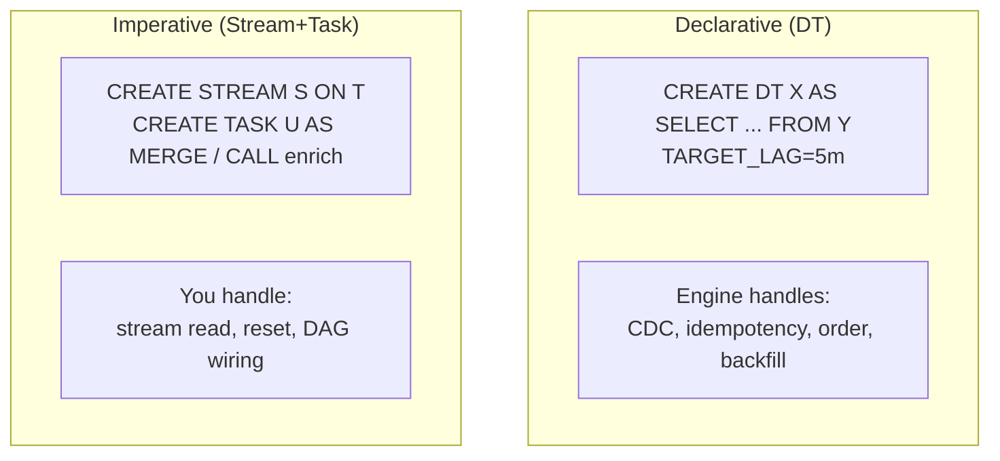

### Lab Exercise
```sql
-- DT (preferred when SELECT suffices)
CREATE OR REPLACE DYNAMIC TABLE FEATURES.CUSTOMER_FTR
  TARGET_LAG = '15 minutes'
  WAREHOUSE = FS_WH
AS
SELECT CUSTOMER_ID,
       COUNT(*) AS EVENT_COUNT,
       MAX(EVENT_TS) AS LAST_SEEN
FROM RAW.EVENTS
GROUP BY CUSTOMER_ID;

-- Stream+Task (when logic exceeds SELECT)
CREATE OR REPLACE STREAM RAW.EVENTS_STREAM ON TABLE RAW.EVENTS;

CREATE OR REPLACE TASK FEATURES.ENRICH_TASK
  WAREHOUSE = FS_WH
  SCHEDULE = '5 MINUTES'
AS
  CALL FEATURES.ENRICH_WITH_EXTERNAL_API();
```

### Gotchas / Exam Traps
- DTs cannot call UDFs with external access integrations — stream+task gives you more freedom.
- DTs have simpler cost model (TARGET_LAG tunable); Tasks need manual scheduling tune.
- Hybrid: DT for the pure SQL part, Stream+Task for the API-enriched layer.

---

## Q20: What are the key cost drivers in a Snowflake ML workflow, and how do you optimize them?

**Difficulty:** Advanced
**Exam relevance:** Cost framework

### Answer
Four major cost buckets:

1. **Compute (warehouse credits)** — training, batch inference, feature pipelines
   - Optimize: right-size warehouses, auto-suspend, use result cache, defer non-urgent retrains
2. **SPCS (compute pool credits)** — GPU training, serving, long-running services
   - Optimize: auto-suspend pools, right-size nodes, scale-to-zero on serving where possible, prefer ML Jobs over Services for batch
3. **Cortex LLM functions** — per-token pricing
   - Optimize: cache results in DTs, prefer smaller models when accuracy allows, use `EMBED_TEXT_768` once + store in VECTOR column
4. **Storage** — raw data, feature store materializations, Datasets, model artifacts
   - Optimize: cluster/partition large tables, drop unused model versions, use time-travel/fail-safe pricing

### First Principles
**Why right-sizing matters:** Doubling warehouse size nearly halves query time *only* if the workload is parallelizable. For a Python SPROC training a single-threaded sklearn, bigger warehouse costs more with no speedup. Match size to parallelism.

**Why 24/7 SPCS is dangerous:** A single S-sized GPU pool running continuously costs ~orders of magnitude more than a nightly 1-hour warehouse. Only run SPCS when you need its unique capabilities (GPU, custom runtime, low-latency serving).

**Why cache LLM results:** `COMPLETE('mistral-large', text)` costs tokens-in + tokens-out per call. If you're classifying the same reviews repeatedly, store the output in a DT.

### Diagram
```mermaid
flowchart TD
    COST[Cost Optimization]
    C1[Compute - biggest]
    C2[SPCS]
    C3[Cortex LLM]
    C4[Storage]
    C1 --> C1a[Caching: DTs for predictions, LLM outputs]
    C1 --> C1b[Right-sizing]
    C2 --> C2a[Auto-suspend aggressively]
    C2 --> C2b[Scale-to-zero where latency allows]
    C3 --> C3a[Smaller model when accuracy OK]
    C3 --> C3b[Batch-embed once, reuse]
    C4 --> C4a[Drop old versions quarterly]
    C4 --> C4b[Trim time-travel on ML schemas]
    COST --> C1
    COST --> C2
    COST --> C3
    COST --> C4
```

### Lab Exercise
```sql
-- Audit warehouse costs by ML workload
SELECT
  WAREHOUSE_NAME,
  QUERY_TAG,
  SUM(CREDITS_USED) AS CREDITS,
  COUNT(*) AS QUERIES
FROM SNOWFLAKE.ACCOUNT_USAGE.QUERY_HISTORY
WHERE QUERY_TAG LIKE 'ml-%'
  AND START_TIME >= DATEADD('day',-30,CURRENT_TIMESTAMP())
GROUP BY 1,2
ORDER BY CREDITS DESC;

-- SPCS compute pool cost
SELECT
  COMPUTE_POOL_NAME,
  SUM(CREDITS_USED) AS CREDITS
FROM SNOWFLAKE.ACCOUNT_USAGE.COMPUTE_POOL_METERING_HISTORY
WHERE START_TIME >= DATEADD('day',-30,CURRENT_TIMESTAMP())
GROUP BY 1;

-- Cortex token usage
SELECT
  MODEL_NAME,
  SUM(TOKENS) AS TOTAL_TOKENS,
  SUM(TOKEN_CREDITS) AS CREDITS
FROM SNOWFLAKE.ACCOUNT_USAGE.CORTEX_FUNCTIONS_USAGE_HISTORY
WHERE START_TIME >= DATEADD('day',-30,CURRENT_TIMESTAMP())
GROUP BY 1;
```

### Gotchas / Exam Traps
- Always tag queries with `ALTER SESSION SET QUERY_TAG = 'ml-train-churn-v1'` for cost tracking.
- Set compute pool AUTO_SUSPEND_SECS low — default is often too long.
- A warehouse "scale-up" doubles credits/hr but may halve clock time → same total cost, better latency. "Scale-out" (max_cluster_count) helps concurrency not single-query time.

---

## Q21: Walk through the Snowflake-native equivalent of each MLflow concept.

**Difficulty:** Advanced
**Exam relevance:** Mapping prior knowledge

### Answer
| MLflow concept        | Snowflake equivalent                                             |
|-----------------------|------------------------------------------------------------------|
| Experiment tracking   | Model Registry + model-version metrics / tags                    |
| Run                   | A `log_model` call producing a version; metrics attached via API |
| Model artifact        | Model version in Registry (internal stage-backed)                |
| Model Registry        | `snowflake.ml.registry.Registry`                                 |
| Project (MLproject)   | Git-integrated SQL/Python + Task orchestration                   |
| Serving (`mlflow serve`) | SPCS Model Serving service                                    |
| Model Signature       | Inferred from `sample_input_data` or Snowpark DataFrame schema   |

### First Principles
**Why Snowflake doesn't replicate every MLflow concept:** Some, like "experiment," are organizational, not technical. The Registry can carry tags/aliases to represent experiments. Others, like "run," are implicit in the fact that every `log_model` is a versioned event with metadata.

**Why Snowflake can also host MLflow models directly:** The Registry supports MLflow `pyfunc` model type — you can ship an MLflow-tracked model to Snowflake Registry for serving, keeping MLflow for experiment tracking if your team prefers.

### Diagram
```mermaid
flowchart TD
    M1[mlflow.start_run] --> S1[log_model comment='run42']
    M2[mlflow.log_metric] --> S2[mv.set_metric]
    M3[mlflow.log_param] --> S3[tags / comment field]
    M4[mlflow.register_model] --> S4[reg.log_model name, version]
    M5[mlflow serve] --> S5[mv.create_service]
    M6["@stage"] --> S6[Snowflake internal stage]
```

### Lab Exercise
```python
# Snowflake-native "experiment"
reg = Registry(session, "ML_DB", "REGISTRY")

for max_depth in [3, 5, 7]:
    model = XGBClassifier(..., max_depth=max_depth).fit(train)
    auc = compute_auc(model, test)
    mv = reg.log_model(
        model,
        model_name="CHURN",
        version_name=f"EXP_D{max_depth}",
        comment=f"experiment max_depth={max_depth}",
        metrics={"roc_auc": auc, "max_depth": max_depth}
    )

# Pick best
best = max(
    reg.get_model("CHURN").show_versions().to_pandas().itertuples(),
    key=lambda v: v.metrics_dict["roc_auc"]
)
reg.get_model("CHURN").version(best.name).set_alias("PROD")

# Or import an MLflow model
import mlflow.pyfunc
mlflow_model = mlflow.pyfunc.load_model("runs:/<run-id>/model")
reg.log_model(mlflow_model, model_name="FROM_MLFLOW", version_name="V1")
```

### Gotchas / Exam Traps
- Tags on model versions are the "params" equivalent; use the metrics dict for numeric values.
- You can run MLflow server externally and still deploy via Snowflake — not either/or.
- Prior MLflow users: `set_alias('PROD')` is the Snowflake way of staging/production transitions.

---

## Q22: How would you design the top-level architecture for a mixed tabular + LLM pipeline?

**Difficulty:** Advanced
**Exam relevance:** LLM-ops integration

### Answer
A canonical pattern:
1. **Tabular model (XGBoost)** scores structured features
2. **LLM step** processes unstructured text (reviews, support tickets) via `SNOWFLAKE.CORTEX.COMPLETE` or a Registry-hosted LLM
3. Both outputs feed a **meta-model** or rules engine to produce the final decision

All stages composed via Dynamic Tables for orchestration.

### First Principles
**Why combine:** Most business decisions depend on both structured and unstructured data (demographics + support-ticket sentiment, transaction features + merchant description text). Separate pipelines are brittle; combined pipeline captures interactions.

**Why Cortex-first for the text leg:** Faster to iterate; no custom model to train. Only reach for a fine-tuned Registry LLM when generic doesn't suffice.

**Why DTs unite them:** Both the XGBoost UDF and the Cortex function are callable in SQL. A single DT can express the whole fan-in.

### Diagram
```mermaid
flowchart TD
    subgraph "Structured"
        SF[DT: FEATURES.CUSTOMER]
        MP[MODEL!PREDICT<br/>XGBoost churn]
    end
    subgraph "Unstructured"
        ST[TABLE: SUPPORT_TICKETS]
        CX[CORTEX.COMPLETE mistral<br/>sentiment summary]
    end
    MERGE[MERGE DT: FINAL_SIGNAL<br/>0.6 × structured_prob + 0.4 × text_sentiment]
    DOWN[Downstream use]
    SF --> MP --> MERGE
    ST --> CX --> MERGE
    MERGE --> DOWN
```

### Lab Exercise
```sql
CREATE OR REPLACE DYNAMIC TABLE PRED.CUSTOMER_HEALTH
  TARGET_LAG = '1 hour'
  WAREHOUSE = ML_WH
AS
WITH tabular AS (
  SELECT CUSTOMER_ID,
    ML_DB.REG.CHURN_MODEL!PREDICT(
      OBJECT_CONSTRUCT('SPEND', SPEND_30D, 'TENURE', TENURE_MONTHS)
    ):PREDICTION::FLOAT AS CHURN_P
  FROM FEATURES.CUSTOMER_30D
),
text AS (
  SELECT CUSTOMER_ID,
    AVG(SNOWFLAKE.CORTEX.SENTIMENT(TICKET_TEXT)) AS SENT_AVG
  FROM SUPPORT_TICKETS
  WHERE CREATED_AT >= DATEADD('day',-30,CURRENT_TIMESTAMP())
  GROUP BY CUSTOMER_ID
)
SELECT
  t.CUSTOMER_ID,
  t.CHURN_P,
  x.SENT_AVG,
  0.6 * t.CHURN_P + 0.4 * (1 - x.SENT_AVG) AS HEALTH_RISK,
  CURRENT_TIMESTAMP() AS SCORED_AT
FROM tabular t LEFT JOIN text x USING (CUSTOMER_ID);
```

### Gotchas / Exam Traps
- Cortex `SENTIMENT` returns in [-1, 1]; adjust blending.
- Running Cortex on every row of a huge table can be expensive — pre-filter or cache embeddings.
- Keep structured and LLM paths monitored separately; they can drift independently.

---

## Q23: What's the recommended way to version a complete ML pipeline (not just the model)?

**Difficulty:** Advanced
**Exam relevance:** Reproducibility

### Answer
Version the pipeline across four axes:
1. **Code** — in Git (feature SQL, training scripts, service specs)
2. **Data** — Snowflake Datasets with named versions; Time Travel for ad-hoc rollback
3. **Features** — Feature View versions in the Feature Store
4. **Model** — Model Registry versions

Pin them together in the model metadata (e.g., model tags include `dataset_version=V1_2024_10_01`, `feature_views=["CUSTOMER_30D:V1"]`, `code_commit=abc123`).

### First Principles
**Why four axes:** A model's behavior depends on code + data + features + weights. Changing any one may change outputs. Pinning only the model artifact is insufficient for reproducibility — three months later you need to know which data snapshot and which code produced the trained model.

**Why tag inside the Registry:** The Registry is the one place every production system touches. Carrying metadata there means auditors can trace any serving-model back to its complete lineage.

### Diagram
```mermaid
flowchart TD
    MV[Model Version V17]
    MV --> M1[code_commit: abc123]
    MV --> M2[dataset: CHURN_SNAP V2024_10_01]
    MV --> M3[feature_views: CUSTOMER_30D V1, PRODUCT_FTR V3]
    MV --> M4[train_warehouse: ML_WH_L 2024-10-02]
    MV --> M5[metrics: roc_auc 0.87, pr_auc 0.42]
    MV --> M6[approver: alice@org via tag]
```

### Lab Exercise
```python
mv = reg.log_model(
    model,
    model_name="CHURN",
    version_name=None,  # auto-generate
    comment="retrained on new 30d window",
    conda_dependencies=["xgboost==1.7.5","scikit-learn==1.3.0"],
    metrics={"roc_auc": 0.871, "pr_auc": 0.42}
)
mv.set_tag("code_commit", "abc123def456")
mv.set_tag("dataset_version", "CHURN_SNAPSHOT:V2024_10_01")
mv.set_tag("feature_views", "CUSTOMER_30D:V1,PRODUCT_FTR:V3")
mv.set_tag("trained_by", "mlops-pipeline-task")
```

### Gotchas / Exam Traps
- Snowflake supports **object tags** (schema-level) — leverage those for cross-cutting metadata like `data_classification`.
- Dataset versions are immutable; model artifact in Registry is immutable per version. Combined → full reproducibility.
- Time Travel on raw tables isn't a substitute for Dataset snapshots; TT retention is bounded (default 1 day on standard).

---

## Q24: What is the "shadow deployment" pattern on Snowflake and when do you use it?

**Difficulty:** Advanced
**Exam relevance:** Safe deployment

### Answer
Shadow deployment runs a new model version in parallel with the current production model, logging predictions from both without acting on the new model's output. After collecting data, you compare predictions and decide whether to promote.

On Snowflake:
- Alias `PROD` points to the live-serving version
- A SQL expression computes both: `SELECT PROD_PREDICT(...), SHADOW_PREDICT(...)` and logs both to a comparison table
- A Dynamic Table or scheduled task compares distributions
- On OK, update alias

### First Principles
**Why shadow before switching:** A new model may have better offline metrics but produce weird outputs on live traffic (unusual input distributions, edge cases). Shadow lets you confirm production parity before cutover.

**Why alias-based:** Promotion is atomic (SET ALIAS). No service redeploy. Rollback is one SQL statement.

### Diagram
```mermaid
flowchart TD
    LT[Live Traffic]
    SDT[Scoring DT - both predictions<br/>MODEL@PROD!PREDICT served<br/>MODEL@SHADOW!PREDICT logged only]
    CMP[Comparison table<br/>both outputs + actuals]
    REV[Analyst review]
    PROM[SET ALIAS 'PROD' = SHADOW_VERSION]
    LT --> SDT --> CMP --> REV --> PROM
```

### Lab Exercise
```sql
-- Shadow DT logs both predictions
CREATE OR REPLACE DYNAMIC TABLE PRED.CHURN_SHADOW
  TARGET_LAG = '1 hour'
  WAREHOUSE = ML_WH
AS
SELECT
  CUSTOMER_ID,
  ML_DB.REG.CHURN!PREDICT(features, VERSION => 'PROD')
    :PREDICTION::FLOAT AS PROD_P,
  ML_DB.REG.CHURN!PREDICT(features, VERSION => 'SHADOW')
    :PREDICTION::FLOAT AS SHADOW_P,
  SCORED_AT
FROM FEATURES.CUSTOMER_30D;

-- Compare distributions over a week; decide
SELECT
  AVG(ABS(PROD_P - SHADOW_P)) AS mean_abs_diff,
  CORR(PROD_P, SHADOW_P)      AS correlation
FROM PRED.CHURN_SHADOW
WHERE SCORED_AT >= DATEADD('day',-7,CURRENT_TIMESTAMP());

-- On confidence, promote
-- (Python)
reg.get_model("CHURN").version("V17").set_alias("PROD")
```

### Gotchas / Exam Traps
- Serving two models doubles inference cost; shadow isn't free.
- `A/B split` is a variant — route by hash of customer_id to one of two versions.
- Alias change is instant globally — ensure monitoring is in place to catch regressions quickly.

---

## Q25: Summarize the mental model you'd carry into the MLE-C01 exam for workflow-design questions.

**Difficulty:** Foundation
**Exam relevance:** Meta

### Answer
Carry four mental anchors:

1. **"Data stays in place."** Any design that moves bulk data out of Snowflake raises red flags. Prefer in-platform compute.
2. **"Match compute to shape."** Tabular + CPU → warehouse. GPU / custom runtime → SPCS. One-off batch → ML Jobs. Always-on real-time → SPCS Service.
3. **"Lifecycle is a loop."** Monitor feeds retrain feeds re-register feeds re-deploy. Any design lacking monitoring is incomplete.
4. **"Lineage lives in the Registry."** Tag code, data, features, metrics on the model version. Governance and reproducibility flow from there.

### First Principles
**Why these four:** They map to the four most-tested themes: pushdown, compute selection, continuous MLOps, governance. If you reason from these, you'll pick the right Snowflake service without memorizing a feature list.

### Diagram
```mermaid
flowchart TD
    A[Data stays in place<br/>Pushdown beats egress]
    B[Match compute to shape<br/>WH / SPCS / ML Jobs / Cortex]
    C[Lifecycle loops<br/>Monitor → retrain]
    D[Lineage in Registry<br/>Tags, versions, aliases, metrics]
    A --> B --> C --> D
```

### Gotchas / Exam Traps
- Beware "sounds correct but moves data" distractors (e.g., "pull to S3, train on EC2, push back").
- Beware single-service answers for problems needing multiple (e.g., LLM-only answer for a tabular + text problem).
- Default to Model Registry whenever a prompt mentions versioning, A/B, lineage, or promotion.

---

## Study Checklist

- [ ] Can draw the 7-phase lifecycle and name the service per phase
- [ ] Can decide warehouse vs SOWH vs SPCS vs ML Jobs for any training request
- [ ] Can decide warehouse UDF vs SPCS service for any inference request
- [ ] Can explain training-serving skew and three ways Snowflake prevents it
- [ ] Can orchestrate a batch inference pipeline with Dynamic Tables
- [ ] Can set up a shadow deployment and promote via alias
- [ ] Can enumerate the four axes of ML pipeline versioning
