# Feature Engineering & Feature Store — MLE-C01 Study Guide

## Exam Weight & Scope

**Approximate weight:** 18-22% of exam
**Scope:** Snowflake Feature Store (`snowflake.ml.feature_store`) — entities, feature views, versions, lifecycle, offline/online serving. Point-in-time (PIT) joins to prevent leakage. Feature discoverability, freshness tiers, and the SQL that underlies all of it. Expect scenario questions where you must choose static vs refreshable feature views, pick timestamp handling, or diagnose training-serving skew.

**You must be able to:**
- Define entity, feature view, feature view version
- Write a PIT join via `generate_dataset()` with spine timestamps and labels
- Decide static vs managed (refreshable) feature views
- Serve features both offline (training) and online (real-time scoring)
- Diagnose/avoid feature leakage and timestamp bugs

---

## Core Concepts Map

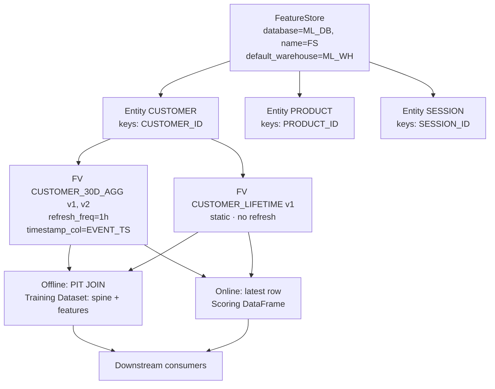

---

## Q1: What is the Snowflake Feature Store and what problem does it solve?

**Difficulty:** Foundation
**Exam relevance:** Feature Store overview

### Answer
The Snowflake Feature Store (`snowflake.ml.feature_store`) is a schema-scoped library that organizes, versions, materializes, and serves features for ML. It solves three recurring MLOps problems:
1. **Discoverability** — a central registry of named features that teams can search, reuse, and compose
2. **Training/serving skew** — the same feature definition serves both offline (training) and online (scoring), eliminating divergent implementations
3. **Point-in-time correctness** — automatic PIT joins prevent future data from leaking into training labels

Under the hood, feature views are Dynamic Tables (or materialized DataFrames for static) with metadata registered in the Feature Store catalog.

### First Principles
**Why features need a special store:** Features are reused across models and teams. Without a store, every team re-implements the same feature in slightly different SQL — leading to definition drift, duplicate compute, and nobody knowing which version "customer_30d_spend" is authoritative. The store makes features first-class assets.

**Why Snowflake's store is tightly coupled to Dynamic Tables:** DTs provide the materialization + incremental refresh + lineage for free. The Feature Store adds the semantic layer: "this DT, joined on these keys, with this timestamp, serves these features."

**Why training-serving skew is the biggest win:** Historically, offline features live in a data warehouse and online features in Redis/DynamoDB. Keeping them in sync is a persistent bug source. Snowflake's store serves both from the same table — zero divergence.

### Diagram
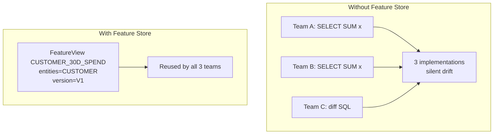

### Lab Exercise
```python
from snowflake.ml.feature_store import FeatureStore, CreationMode

fs = FeatureStore(
    session=session,
    database="ML_DB",
    name="FS",                       # the schema name
    default_warehouse="FS_WH",
    creation_mode=CreationMode.CREATE_IF_NOT_EXIST
)

# List what's already registered
print(fs.list_entities().collect())
print(fs.list_feature_views().collect())
```

### Gotchas / Exam Traps
- `name=` in `FeatureStore(...)` is the **schema name** inside the given database — not an arbitrary label.
- Setting a default warehouse is required; feature view refreshes use it unless overridden.
- Dropping the schema drops all feature view metadata and backing DTs — version-control your Python definitions.

---

## Q2: Define Entity, FeatureView, and Dataset in the Feature Store context.

**Difficulty:** Foundation
**Exam relevance:** Core abstractions

### Answer
**Entity** — a logical object type with join keys (e.g., `CUSTOMER` with key `CUSTOMER_ID`). It's the "noun" features belong to.

**FeatureView** — a named, versioned collection of features bound to one or more entities. Defined by a Snowpark DataFrame expression (which gets backed by a Dynamic Table if `refresh_freq` is set). Optional `timestamp_col` enables PIT joins.

**Dataset** — a materialized, immutable, versioned training set produced by joining a spine (keys + timestamp + labels) with one or more feature views. Backed by `snowflake.ml.dataset.Dataset` under the hood.

### First Principles
**Why three layers:** Separation of concerns.
- Entity defines *what* (join grammar).
- FeatureView defines *values* (computed features).
- Dataset defines *a training snapshot* (frozen point-in-time join result).

**Why not just a single feature table:** Different features have different refresh needs, different owners, different entities. One monolithic table couldn't express those. Feature views compose; one dataset can draw from many feature views.

### Diagram
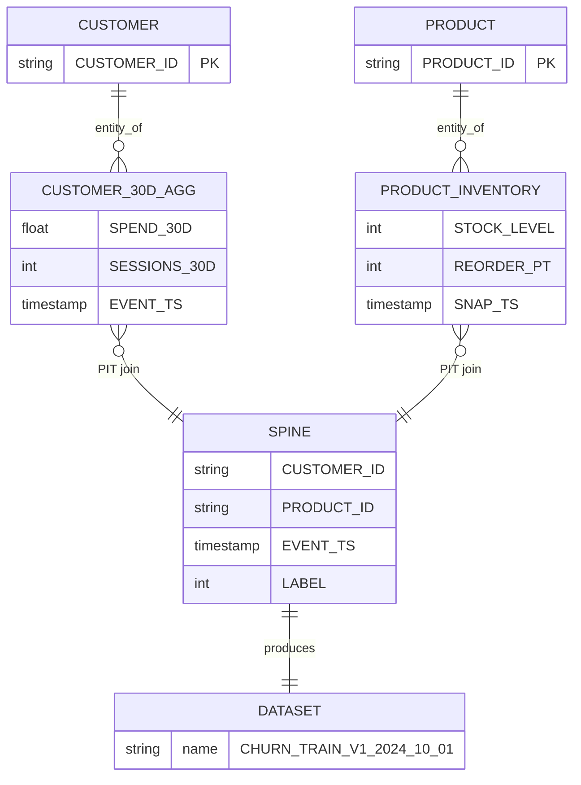

### Lab Exercise
```python
from snowflake.ml.feature_store import Entity, FeatureView

# 1. Entity
customer = Entity(name="CUSTOMER", join_keys=["CUSTOMER_ID"],
                  desc="End-customer identity")
fs.register_entity(customer)

# 2. Feature View
feat_df = session.table("RAW.EVENTS") \
    .group_by("CUSTOMER_ID") \
    .agg({"AMOUNT":"sum", "SESSION_ID":"count_distinct"}) \
    .with_column("WINDOW_END", F.current_timestamp())

fv = FeatureView(
    name="CUSTOMER_30D_AGG",
    entities=[customer],
    feature_df=feat_df,
    timestamp_col="WINDOW_END",
    refresh_freq="1 hour",
    desc="30-day sliding aggregates per customer"
)
fv = fs.register_feature_view(feature_view=fv, version="V1", block=True)
```

### Gotchas / Exam Traps
- Entity names and join key names must match **exactly** between entity and feature view DataFrames.
- A feature view can span multiple entities (composite join).
- Changing a feature view requires registering a *new version*; existing version is immutable.

---

## Q3: What's the difference between a managed (refreshable) and a static feature view?

**Difficulty:** Intermediate
**Exam relevance:** FV lifecycle

### Answer
**Managed (refreshable)** — defined with `refresh_freq` and backed by a Dynamic Table. Snowflake auto-refreshes on schedule, enables incremental refresh when possible. Use when features derive from live source tables that keep changing.

**Static** — no `refresh_freq`. Materialized once from the DataFrame; after that, it doesn't update. Use for:
- One-off features (historical lookups)
- Features computed via complex procedural logic the user triggers manually
- Features backed by external tables that only change via re-registration

### First Principles
**Why both exist:** Not every feature needs continuous refresh. Static features save warehouse credits and reduce complexity for frozen historical features (e.g., "customer first-purchase date" never changes once set).

**Why refreshable is default for live features:** Streaming/CDC source tables plus a Dynamic Table backing means features auto-stay-fresh with no orchestration code.

### Diagram
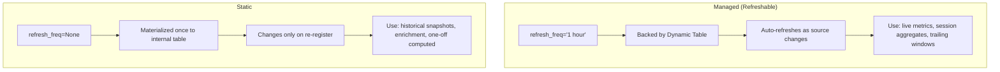

### Lab Exercise
```python
# Managed
fv_managed = FeatureView(
    name="CUSTOMER_30D_AGG",
    entities=[customer],
    feature_df=aggregated_df,
    refresh_freq="30 minutes",       # <<-- makes it managed
    timestamp_col="WINDOW_END"
)

# Static
fv_static = FeatureView(
    name="CUSTOMER_LIFETIME_VALUE_SNAPSHOT",
    entities=[customer],
    feature_df=lifetime_df            # no refresh_freq
    # becomes an immutable snapshot
)
```

### Gotchas / Exam Traps
- You can convert a static feature view to managed by registering a new version with `refresh_freq`.
- `refresh_freq='1 hour'` is TARGET_LAG, not a cron — the DT engine refreshes when upstream changes.
- Static feature views don't incur warehouse cost between registrations.

---

## Q4: What is a point-in-time join and why is it essential for ML?

**Difficulty:** Advanced
**Exam relevance:** PIT correctness

### Answer
A point-in-time (PIT) join joins a feature table into a label/spine table using the condition: for each spine row at time `T`, pick the latest feature value with timestamp `≤ T`. This mimics production — at inference time, you only see features from the past.

In Snowflake Feature Store, `fs.generate_dataset(spine_df=..., spine_timestamp_col=..., features=[...])` handles PIT automatically.

### First Principles
**Why ordinary joins break ML:** A naïve `JOIN ON CUSTOMER_ID` picks whichever feature row the engine chooses — likely the latest. If the latest feature value already encodes label leakage (e.g., "customer churned" updating a feature after the fact), your model sees future information. Training accuracy soars; production accuracy craters.

**Why PIT fixes it:** By pinning each spine row to features-as-of-that-moment, training data is a faithful replay of what production would have seen when the prediction was made.

**Why Snowflake automates it:** PIT joins are hand-coded as `ASOF JOIN` or window-function tricks in SQL — easy to get wrong. The Feature Store encapsulates the pattern.

### Diagram
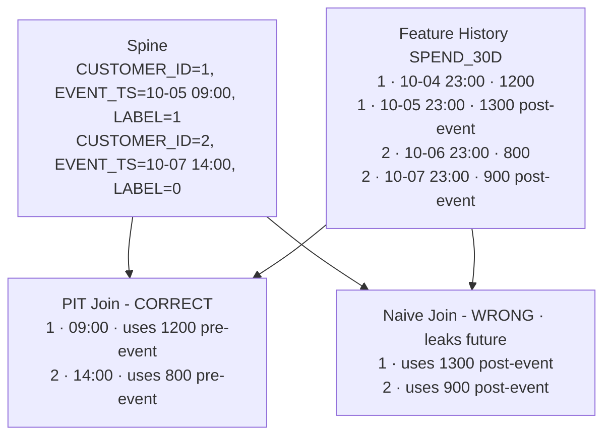

### Lab Exercise
```python
from snowflake.snowpark import functions as F

# Spine: labeled events
spine = session.table("TRAIN.LABELED_EVENTS").select(
    "CUSTOMER_ID", "EVENT_TS", "CHURNED"
)

# PIT join: generate_dataset handles the ASOF semantics
dataset = fs.generate_dataset(
    name="CHURN_TRAIN_V1",
    version="V2024_10_01",
    spine_df=spine,
    features=[fv_30d, fv_lifetime],         # one or more FVs
    spine_timestamp_col="EVENT_TS",         # <-- the PIT anchor
    spine_label_cols=["CHURNED"],
    exclude_columns=[],                     # keep all FV cols
    include_feature_view_timestamp_col=False
)

train_df = dataset.read.to_snowpark_dataframe()
```

### Gotchas / Exam Traps
- `spine_timestamp_col` type must be TIMESTAMP; integer/epoch-second causes PIT bugs.
- Feature views without `timestamp_col` are treated as "always current" — their value is joined without PIT (fine for lookups, dangerous if stale).
- Spine must have the entity join keys matching the feature views' entities.

---

## Q5: How do you serve features online (real-time, single-row) for inference?

**Difficulty:** Intermediate
**Exam relevance:** Online serving

### Answer
Online serving in Snowflake pulls the **latest** feature row(s) for a given key via `fs.retrieve_feature_values()` or a direct SQL lookup on the backing DT. For sub-100ms SLAs:
- Use a small warehouse kept warm, or
- Deploy a Streamlit/SPCS service that caches features in a Dict/Redis after fetching

For higher latency tolerance (~1s), direct lookup on the feature view is sufficient.

### First Principles
**Why not a separate online store (Redis, etc.):** The feature value lives in a Dynamic Table that's refreshed near-continuously. A direct SQL lookup is a few ms with a warm warehouse. For most "real-time" use cases (recommendations, pricing), this is fast enough and eliminates the separate online store.

**Why cache at the serving layer:** For sub-10ms SLAs or very high throughput, warehouse round-trip may exceed budget. A thin cache in your serving container absorbs read load; refresh cache from the DT on a short interval.

### Diagram
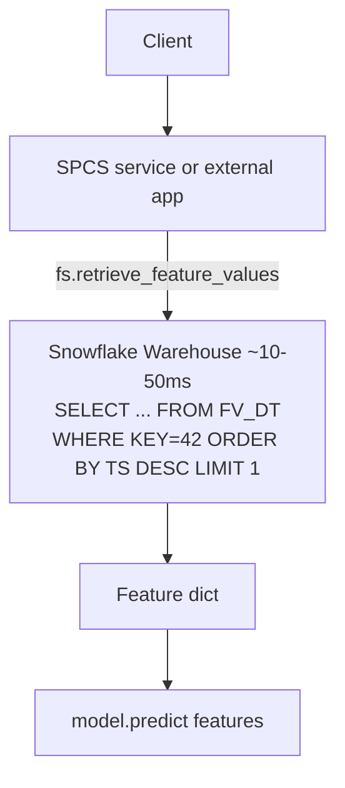

### Lab Exercise
```python
# Retrieve latest features for one or more entity keys
keys_df = session.create_dataframe(
    [[42]], schema=["CUSTOMER_ID"]
)

enriched = fs.retrieve_feature_values(
    spine_df=keys_df,
    features=[fv_30d, fv_lifetime],
    include_feature_view_timestamp_col=True,
    exclude_columns=[]
)
# enriched is a Snowpark DataFrame with the latest features joined

# Pass to model
reg = Registry(session, "ML_DB", "REGISTRY")
mv = reg.get_model("CHURN").version("V1")
prediction = mv.run(enriched, function_name="predict")
```

### Gotchas / Exam Traps
- `retrieve_feature_values()` with no spine timestamp uses "latest" — this is correct for serving but **wrong** for backfilling historical training data.
- For true sub-10ms SLAs you'll need a cache; the Feature Store doesn't manage one.
- Online lookup still goes through the warehouse — ensure it's warmed/active.

---

## Q6: Explain feature view versioning. When do you create a new version vs modify in place?

**Difficulty:** Intermediate
**Exam relevance:** Versioning

### Answer
Feature view versions are **immutable snapshots** of the feature definition. You create a new version whenever you change:
- The feature DataFrame logic (SQL)
- The schema (columns added/removed/renamed)
- The entities bound
- The timestamp column
- The `refresh_freq`

You never modify a version in place. Running models in production depend on specific versions; mutating would silently change behavior.

Deprecate old versions via `fv.suspend()` or tag-based lifecycle policies.

### First Principles
**Why immutability:** Model artifacts in the Registry declare their feature view version dependencies. If `CUSTOMER_30D:V1` could silently change, models trained against V1 would produce different predictions over time — the exact bug Feature Stores exist to prevent.

**Why multiple versions coexist:** A new model in dev may use V2 while production still uses V1. Both versions must be queryable until the migration completes.

### Diagram
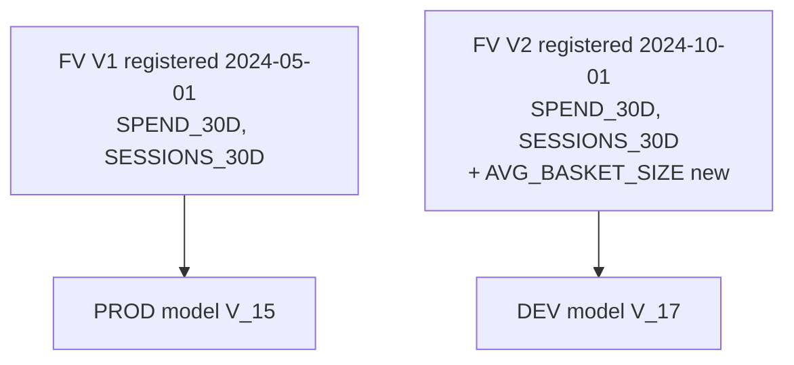

### Lab Exercise
```python
# Create V2 with an added feature
feat_df_v2 = session.table("RAW.EVENTS") \
    .group_by("CUSTOMER_ID") \
    .agg(
        F.sum("AMOUNT").alias("SPEND_30D"),
        F.count_distinct("SESSION_ID").alias("SESSIONS_30D"),
        F.avg("AMOUNT").alias("AVG_BASKET_SIZE")        # new feature
    ) \
    .with_column("WINDOW_END", F.current_timestamp())

fv_v2 = FeatureView(
    name="CUSTOMER_30D_AGG",
    entities=[customer],
    feature_df=feat_df_v2,
    timestamp_col="WINDOW_END",
    refresh_freq="1 hour"
)
fs.register_feature_view(fv_v2, version="V2")

# Deprecate V1 later
fs.get_feature_view("CUSTOMER_30D_AGG", version="V1").suspend()
```

### Gotchas / Exam Traps
- You cannot delete a version while a Dataset depends on it.
- `suspend()` stops refresh and returns credits; `.resume()` reactivates.
- Version naming is user-controlled strings — adopt a convention (V1, V2 or semver).

---

## Q7: How does the Feature Store integrate with Dynamic Tables under the hood?

**Difficulty:** Advanced
**Exam relevance:** Internals

### Answer
When you register a managed feature view with a `refresh_freq`, the Feature Store issues a `CREATE DYNAMIC TABLE` under its managed schema with the DataFrame SQL as the SELECT. The DT's `TARGET_LAG` equals `refresh_freq`, and its warehouse is the FS default warehouse (or override). The feature view metadata record points to this DT.

Static feature views back to a plain internal table materialized once.

### First Principles
**Why DTs:** The Feature Store team didn't want to build a parallel incremental-refresh engine. DTs already do: incremental refresh planning, dependency DAGs, backfill-on-demand, Time Travel. Standing on DT means FS inherits all of this.

**Why schema-scoped:** The FS "name" is a schema. All its DTs live together; backups, cloning, and RBAC apply at the schema level. Dropping the schema cleanly removes everything.

### Diagram
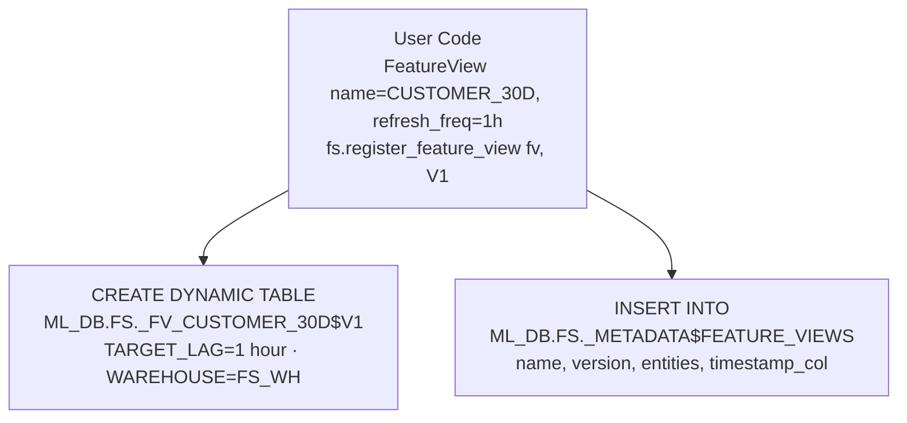

### Lab Exercise
```sql
-- Peek at what the Feature Store registered
SHOW DYNAMIC TABLES IN SCHEMA ML_DB.FS;

-- The metadata it tracks
SELECT * FROM ML_DB.FS._METADATA$FEATURE_VIEWS LIMIT 10;

-- You can query the DT directly (not recommended; use the FS API)
SELECT * FROM ML_DB.FS."_FV_CUSTOMER_30D_AGG$V1" LIMIT 100;
```

### Gotchas / Exam Traps
- Don't manually drop the backing DT — orphans the metadata. Use `fs.delete_feature_view()`.
- The DT's refresh history is visible in `INFORMATION_SCHEMA.DYNAMIC_TABLE_REFRESH_HISTORY` — great for debugging stale features.
- Feature views inherit DT limitations (allowed SQL constructs, UDFs, external access).

---

## Q8: Walk through the full training set generation using `generate_dataset()`.

**Difficulty:** Advanced
**Exam relevance:** Dataset generation

### Answer
`fs.generate_dataset()` combines:
1. A **spine** DataFrame (entity keys + optional timestamp + optional labels)
2. One or more **feature views**
3. Join rules (automatic from entity-key matching + PIT when timestamp present)

It writes an immutable, versioned Dataset object (backed by `snowflake.ml.dataset.Dataset`) into the Feature Store schema. The returned object can be converted to a Snowpark DataFrame, pandas, or PyTorch DataPipe.

### First Principles
**Why materialize instead of just query:** Reproducibility. If training reruns next month, you want the exact same rows. Materialization snapshots the result; the Dataset version is pinned.

**Why Dataset vs just a table:** Datasets have multi-shard storage optimized for DataLoader streaming; they integrate with PyTorch/TF. A plain table does neither well.

### Diagram
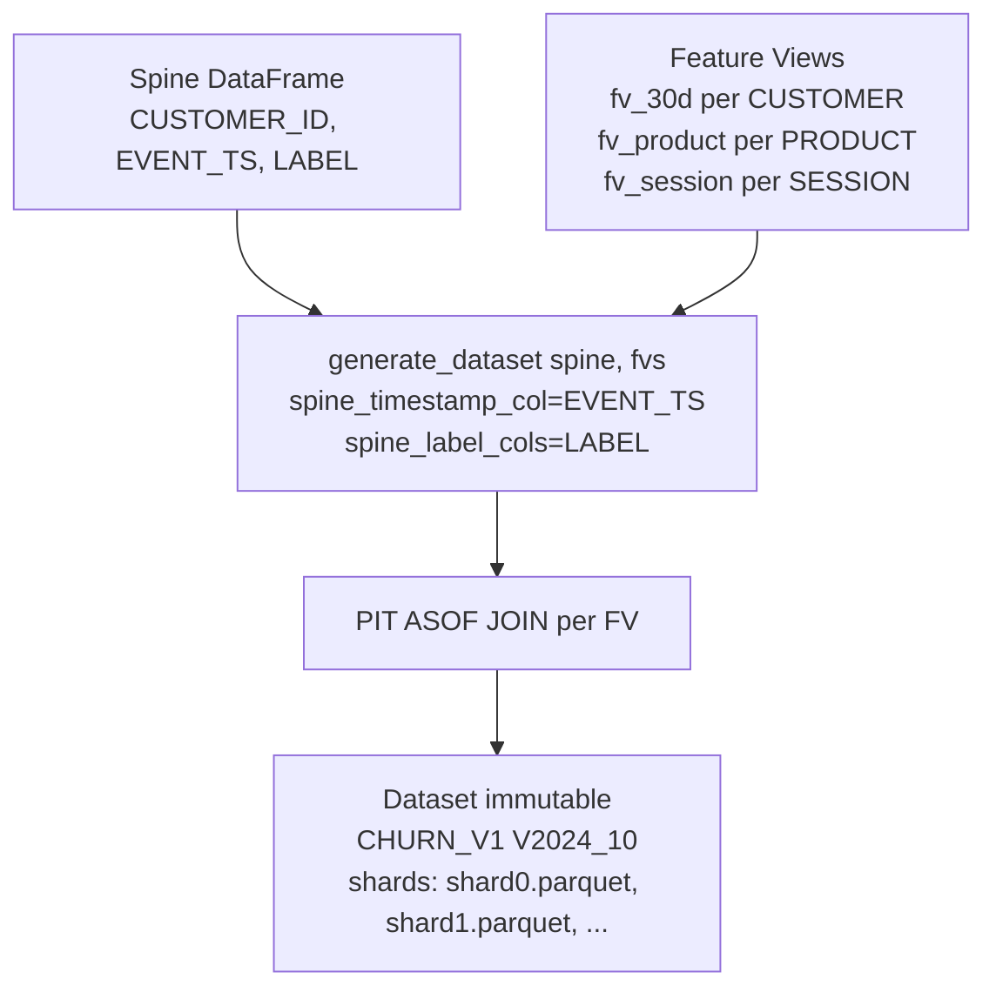

### Lab Exercise
```python
# Prepare the spine (labels)
spine = session.sql("""
  SELECT
    CUSTOMER_ID,
    PRODUCT_ID,
    OBSERVATION_TS AS EVENT_TS,
    CHURNED_WITHIN_30D AS LABEL
  FROM TRAIN.LABELED_WINDOW
  WHERE OBSERVATION_TS BETWEEN '2023-01-01' AND '2024-06-30'
""")

# Generate the dataset
ds = fs.generate_dataset(
    name="CHURN_TRAIN",
    version="V2024_10_01",
    spine_df=spine,
    features=[
        fs.get_feature_view("CUSTOMER_30D_AGG", "V2"),
        fs.get_feature_view("PRODUCT_INVENTORY", "V1"),
    ],
    spine_timestamp_col="EVENT_TS",
    spine_label_cols=["LABEL"],
    desc="Churn training set with 30d customer + product features",
    exclude_columns=["WINDOW_END"]  # drop FV timestamp cols from training
)

# Load for training
train_df = ds.read.to_snowpark_dataframe()
# or for GPU training:
torch_pipe = ds.read.to_torch_datapipe(batch_size=512, shuffle=True)
```

### Gotchas / Exam Traps
- `exclude_columns` is critical to drop system columns (FV timestamp, duplicate join keys) from the training frame.
- Dataset version strings must be unique per dataset name — append date/hash.
- `generate_dataset` is a materialization — it runs the join and writes shards. Costs real credits; don't call in a tight loop.

---

## Q9: What happens when you refresh a feature view? Is it full or incremental?

**Difficulty:** Advanced
**Exam relevance:** Refresh semantics

### Answer
Refresh is driven by the underlying Dynamic Table engine, which decides full vs incremental refresh per query. Incremental is preferred when the SQL pattern allows (aggregations with GROUP BY on stable keys, simple joins). Full refresh is used when the engine can't guarantee correctness incrementally (e.g., window functions over the full table, certain non-deterministic UDFs).

You can inspect in `DYNAMIC_TABLE_REFRESH_HISTORY`:
- `REFRESH_ACTION = 'INCREMENTAL'` vs `'FULL'`
- `ROWS_INSERTED`, `ROWS_UPDATED`, `ROWS_DELETED`

### First Principles
**Why incremental is cheaper:** Only the changed rows get reprocessed. For a feature view over a 10TB events table where only yesterday's rows changed, incremental is 100x cheaper than full.

**Why some queries can't be incremental:** Window functions over the entire history (e.g., LTV = SUM over all time) require seeing all rows. The engine falls back to full refresh.

**Why this matters for FS design:** If your feature view consistently falls back to full refresh, costs explode. Monitor `DYNAMIC_TABLE_REFRESH_HISTORY`; redesign SQL to be incremental-friendly.

### Diagram
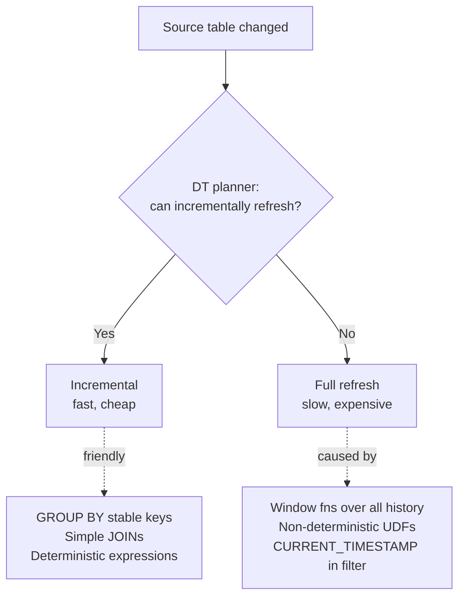

### Lab Exercise
```sql
-- Inspect refresh history
SELECT
  NAME,
  REFRESH_ACTION,
  REFRESH_START_TIME,
  REFRESH_END_TIME,
  DATEDIFF('second', REFRESH_START_TIME, REFRESH_END_TIME) AS SEC,
  ROWS_INSERTED, ROWS_UPDATED, ROWS_DELETED
FROM TABLE(INFORMATION_SCHEMA.DYNAMIC_TABLE_REFRESH_HISTORY(
    NAME_PREFIX => 'ML_DB.FS._FV_CUSTOMER_30D_AGG$V1'
))
ORDER BY REFRESH_START_TIME DESC
LIMIT 20;

-- If a FV is doing FULL refreshes too often, redesign the SQL
```

### Gotchas / Exam Traps
- `CURRENT_TIMESTAMP()` in a feature view filter forces full refresh (the predicate changes every query).
- Pin windows to source timestamps, not `CURRENT_TIMESTAMP()`, where possible.
- Composite feature views that reference other feature views: upstream refresh triggers downstream.

---

## Q10: Describe the recommended entity design for a multi-entity ML problem.

**Difficulty:** Intermediate
**Exam relevance:** Entity modeling

### Answer
Model entities to match natural business objects, not to shortcut joins. Rules:
- One entity per logical object type (CUSTOMER, PRODUCT, SESSION, ORDER)
- Composite keys when the natural key is composite (e.g., ORDER = ORDER_ID, LINE_ITEM_ID)
- Avoid "super entity" (CUSTOMER_PRODUCT); use multi-entity feature views instead
- Document entity semantics (what counts as a CUSTOMER — purchaser, account, household?)

A feature view can reference multiple entities, enabling features like "customer-product co-interaction count" bound to both CUSTOMER and PRODUCT.

### First Principles
**Why business-object entities:** Reusability. If CUSTOMER is a clean entity, every customer-level feature (demographics, LTV, 30d spend) can bind to it. A merged CUSTOMER_PRODUCT entity creates duplication (features repeated per customer-product pair).

**Why composite keys:** Some business objects don't have single IDs. ORDER_LINE needs (ORDER_ID, LINE_NO). Composite is natural.

### Diagram
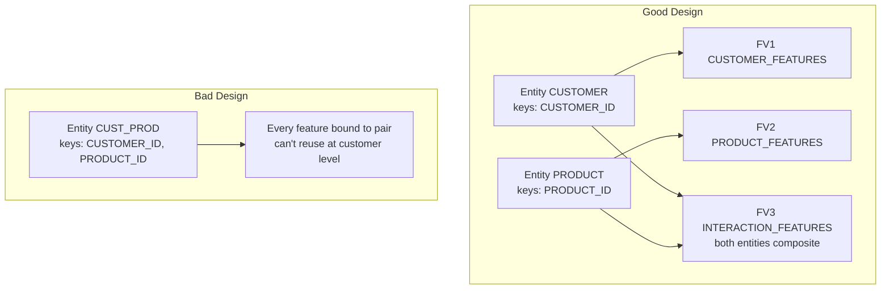

### Lab Exercise
```python
customer = Entity(name="CUSTOMER", join_keys=["CUSTOMER_ID"])
product  = Entity(name="PRODUCT",  join_keys=["PRODUCT_ID"])
order_line = Entity(name="ORDER_LINE", join_keys=["ORDER_ID","LINE_NO"])

fs.register_entity(customer)
fs.register_entity(product)
fs.register_entity(order_line)

# Multi-entity feature view
interaction_df = session.sql("""
  SELECT CUSTOMER_ID, PRODUCT_ID,
    COUNT(*) AS INTERACTIONS_90D,
    SUM(QUANTITY) AS UNITS_90D,
    MAX(EVENT_TS) AS LAST_INTERACTION
  FROM EVENTS
  WHERE EVENT_TS >= DATEADD('day',-90,CURRENT_TIMESTAMP())
  GROUP BY CUSTOMER_ID, PRODUCT_ID
""")

fv_interaction = FeatureView(
    name="CUST_PROD_INTERACTIONS",
    entities=[customer, product],       # bound to BOTH
    feature_df=interaction_df,
    timestamp_col="LAST_INTERACTION",
    refresh_freq="4 hours"
)
fs.register_feature_view(fv_interaction, version="V1")
```

### Gotchas / Exam Traps
- Spine for a multi-entity FV must have both entities' join keys.
- Describing entities properly (`desc=`) helps discoverability for other teams.
- Don't rename entity join keys — downstream feature views reference them.

---

## Q11: How do you prevent target leakage when designing feature views?

**Difficulty:** Advanced
**Exam relevance:** Leakage prevention

### Answer
Four safeguards:
1. **Set a `timestamp_col`** on every refreshable FV that uses time-sensitive data. This enables PIT joins.
2. **Compute features only from data available before the event timestamp** — within the feature SQL, filter `WHERE event_ts <= $window_end`.
3. **Separate label computation from feature computation** — labels in a separate SQL/view, never leaking into FV DataFrames.
4. **Validate**: for a sample row in the training set, verify features reflect only pre-event data.

### First Principles
**Why FV authors can't just rely on PIT:** PIT join handles "pick the right historical row." But if the feature itself is computed with future information (e.g., a 30-day forward spend sum), PIT can't save you — the stored value is already poisoned.

**Why validation is non-negotiable:** Leakage is silent. Model AUC = 0.99 on holdout; AUC = 0.60 in production. Random spot-checks catch leakage before launch.

### Diagram
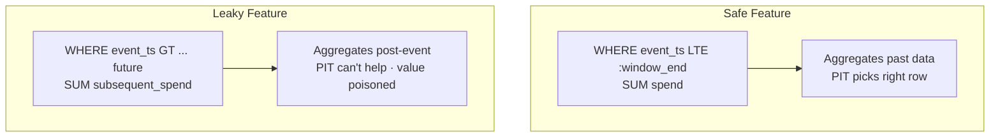

### Lab Exercise
```python
# SAFE: feature SQL only looks backward
safe_df = session.sql("""
  SELECT
    CUSTOMER_ID,
    WINDOW_END,
    SUM(CASE WHEN EVENT_TS BETWEEN DATEADD('day',-30,WINDOW_END) AND WINDOW_END
             THEN AMOUNT END) AS SPEND_30D
  FROM EVENTS e
  JOIN WINDOWS w USING (CUSTOMER_ID)
  WHERE EVENT_TS <= WINDOW_END                 -- STRICTLY backward
  GROUP BY CUSTOMER_ID, WINDOW_END
""")

# Validate: sample row check
check = train_df.filter("CUSTOMER_ID = 42").select(
    "EVENT_TS", "SPEND_30D"
).to_pandas()
raw_events = session.table("EVENTS").filter("CUSTOMER_ID = 42") \
    .filter(F.col("EVENT_TS") > check["EVENT_TS"].iloc[0]).count()
assert raw_events >= 0  # ensure we're not using them
```

### Gotchas / Exam Traps
- "Last 30 days" is ambiguous — relative to what timestamp? Always anchor to a window-end column, not `CURRENT_TIMESTAMP()`.
- Join keys that happen to encode the label (e.g., a flag that only exists post-event) are subtle leakage.
- "Negative time" filters in SQL (`WHERE event_ts <= :ts`) are the simplest defense.

---

## Q12: What are feature view tags, descriptions, and how do they aid discoverability?

**Difficulty:** Foundation
**Exam relevance:** Metadata

### Answer
Each feature view carries:
- `desc` — human-readable description
- Tags via Snowflake's object tag system (schema-level, policy-aware)
- Metrics / stats you can attach via API
- Lineage (via `fs.list_feature_views()` + `SHOW DYNAMIC TABLES`)

These support search ("find all FVs owned by churn-team"), governance ("flag PII features"), and cost tracking (tag by cost center).

### First Principles
**Why discoverability is an MLOps problem:** Large orgs produce hundreds of feature views. Without searchable metadata, teams reinvent features — defeating the purpose of a central store.

**Why Snowflake object tags:** They integrate with masking policies, access policies, and tag-based routing. A feature tagged `PII=true` can be auto-restricted without changing the FV code.

### Diagram
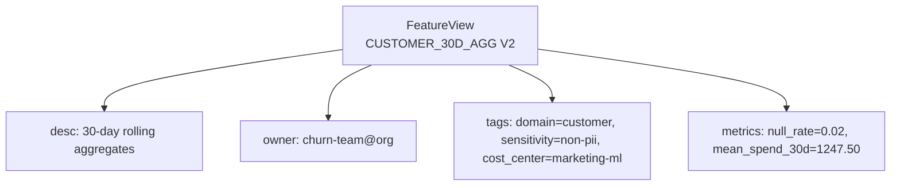

### Lab Exercise
```python
# Describe at creation
fv = FeatureView(
    name="CUSTOMER_30D_AGG",
    entities=[customer],
    feature_df=df,
    desc="Rolling 30d spend and engagement; refreshed hourly",
    refresh_freq="1 hour",
    timestamp_col="WINDOW_END"
)

# Add object tags (SQL)
session.sql("""
  CREATE TAG IF NOT EXISTS ML_DB.FS.DOMAIN;
  CREATE TAG IF NOT EXISTS ML_DB.FS.SENSITIVITY;
""").collect()

session.sql("""
  ALTER DYNAMIC TABLE ML_DB.FS._FV_CUSTOMER_30D_AGG$V2
    SET TAG DOMAIN = 'customer', SENSITIVITY = 'non-pii';
""").collect()

# List with filters
all_fvs = fs.list_feature_views().to_pandas()
print(all_fvs[all_fvs["name"].str.contains("CUSTOMER")])
```

### Gotchas / Exam Traps
- Snowflake tags are schema-scoped; create them in a shared schema if used cross-domain.
- Descriptions are indexed in SHOW/DESCRIBE output but not full-text searchable natively — use INFORMATION_SCHEMA.
- Tagging the DT (not the FV metadata record) is the governance mechanism — FV metadata is for logical info.

---

## Q13: Can you share feature views across accounts? What about across databases?

**Difficulty:** Advanced
**Exam relevance:** Multi-account sharing

### Answer
**Across databases (same account):** Yes, with proper grants. The Feature Store schema is just a Snowflake schema; grants on the DT + FV metadata table enable read access.

**Across accounts:** Yes, via Secure Data Sharing + Private Listings. You share the schema containing the FS metadata and DTs. Consumer accounts attach the share and can `.read` features — but can't `.register_feature_view()` into a shared schema (read-only).

For producing shared features, publish via a Private Listing with sample code showing consumers how to call `fs.get_feature_view()` on their side.

### First Principles
**Why share feature views:** Central feature teams produce reusable features (e.g., "entity resolution scores") that many business units consume. Sharing avoids N implementations.

**Why read-only for shares:** You can't modify shared objects by design. Consumers import features, use for training/serving locally.

### Diagram
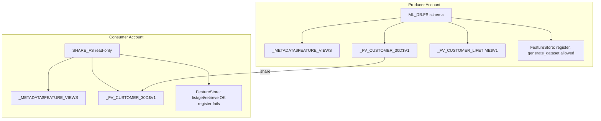

### Lab Exercise
```sql
-- Producer: share
CREATE SHARE FS_SHARE;
GRANT USAGE ON DATABASE ML_DB TO SHARE FS_SHARE;
GRANT USAGE ON SCHEMA ML_DB.FS TO SHARE FS_SHARE;
GRANT SELECT ON ALL DYNAMIC TABLES IN SCHEMA ML_DB.FS TO SHARE FS_SHARE;
GRANT SELECT ON ALL TABLES IN SCHEMA ML_DB.FS TO SHARE FS_SHARE;
ALTER SHARE FS_SHARE ADD ACCOUNTS = (ACCT_CONSUMER);

-- Consumer: attach
CREATE DATABASE SHARED_FS FROM SHARE PROD_ACCT.FS_SHARE;
```

```python
# Consumer uses read-only
from snowflake.ml.feature_store import FeatureStore, CreationMode
fs = FeatureStore(session, database="SHARED_FS", name="FS",
                  default_warehouse="LOCAL_WH",
                  creation_mode=CreationMode.FAIL_IF_NOT_EXIST)

for fv in fs.list_feature_views().collect():
    print(fv["name"], fv["version"])

# Use in local dataset generation
ds = fs.generate_dataset(
    name="LOCAL_TRAIN", version="V1", spine_df=local_spine,
    features=[fs.get_feature_view("CUSTOMER_30D_AGG", "V2")],
    spine_timestamp_col="EVENT_TS", spine_label_cols=["Y"]
)
```

### Gotchas / Exam Traps
- Dataset materialization happens in the consumer account; share only enables feature lookup.
- Shared DTs continue to refresh in the producer; consumer sees the latest.
- Private Listings add listing-level governance (approvals, usage tracking).

---

## Q14: How do you handle feature backfills when adding a new feature view?

**Difficulty:** Advanced
**Exam relevance:** Backfill patterns

### Answer
Backfill = computing historical feature values for a time range in the past, so training sets with early timestamps can access the feature.

Snowflake approach:
1. **For managed FVs (DT-backed)**: the DT engine auto-computes the latest value. For historical PIT values, the backing table's underlying source needs the full history, and the feature SQL must emit a *time series* of feature values, not just the current snapshot.
2. **Design pattern**: parameterize the feature view over a `WINDOW_END` column that iterates over historical windows (CROSS JOIN with calendar), producing one feature row per entity per window-end.
3. For static or complex backfills, materialize to a plain table and register it as a static FV.

### First Principles
**Why "latest only" FVs break historical training:** PIT joins need `(entity_key, timestamp, value)` triples spanning the training period. A FV that only materializes `latest-per-entity` has zero historical rows → PIT returns null for everything.

**Why time-series FVs are the pattern:** By computing feature values at every window-end (hourly, daily), you populate the FV with the time series needed for PIT joins. Yes, it's more rows — but it's the only way to support historical training.

### Diagram
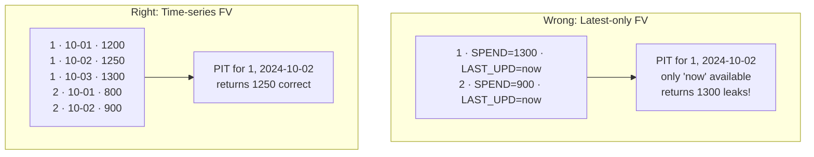

### Lab Exercise
```python
# Pattern: time-series feature view with hourly windows
feat_df = session.sql("""
WITH windows AS (
  SELECT DATEADD('hour', seq4(), DATE_TRUNC('day','2023-01-01')) AS WINDOW_END
  FROM TABLE(GENERATOR(ROWCOUNT => 24*365*2))   -- 2 years hourly
)
SELECT
  e.CUSTOMER_ID,
  w.WINDOW_END,
  SUM(CASE WHEN e.EVENT_TS BETWEEN DATEADD('day',-30,w.WINDOW_END) AND w.WINDOW_END
           THEN e.AMOUNT END) AS SPEND_30D,
  COUNT(DISTINCT CASE WHEN e.EVENT_TS BETWEEN DATEADD('day',-30,w.WINDOW_END) AND w.WINDOW_END
                      THEN e.SESSION_ID END) AS SESSIONS_30D
FROM RAW.EVENTS e
CROSS JOIN windows w
WHERE e.EVENT_TS <= w.WINDOW_END
GROUP BY e.CUSTOMER_ID, w.WINDOW_END
""")

fv = FeatureView(
    name="CUSTOMER_30D_TS",
    entities=[customer],
    feature_df=feat_df,
    timestamp_col="WINDOW_END",
    refresh_freq="1 hour",
    desc="Hourly 30d customer aggregates; supports PIT training"
)
fs.register_feature_view(fv, version="V1")
```

### Gotchas / Exam Traps
- Backfill cost is substantial; parameterize window granularity by use case (hourly for recent, daily for distant past).
- Prefer sparse backfill (only populate windows where there's actually a prediction opportunity) if the spine is known.
- A static FV holding a precomputed backfill is sometimes the simplest path.

---

## Q15: How do you compute aggregations across different time windows efficiently?

**Difficulty:** Advanced
**Exam relevance:** Feature engineering patterns

### Answer
Three patterns:
1. **Single pass with CASE expressions** — compute multiple windows in one GROUP BY using `SUM(CASE WHEN ts > ... THEN x END)`. Fastest for a small number of windows.
2. **Window functions over sorted events** — use `SUM() OVER (PARTITION BY entity ORDER BY ts RANGE BETWEEN ...)`. Powerful for arbitrary sliding windows but can prevent incremental DT refresh.
3. **Multiple feature views** — separate FV per time window, each simpler. Costs more compute but each is independently refreshable.

### First Principles
**Why single-pass CASE wins at scale:** Snowflake reads the fact table once and computes all aggregates in parallel per group. Multiple separate SELECTs would re-read the table N times.

**Why window functions complicate DT refresh:** `OVER (PARTITION BY entity ORDER BY ts RANGE ...)` requires seeing the full history to compute a given row — DT falls back to full refresh.

### Diagram
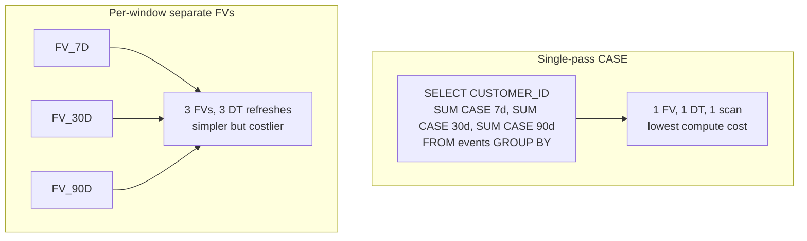

### Lab Exercise
```sql
-- Single-pass multi-window
WITH windowed AS (
  SELECT
    CUSTOMER_ID,
    CURRENT_TIMESTAMP() AS WINDOW_END,
    SUM(CASE WHEN EVENT_TS >= DATEADD('day',-7,CURRENT_TIMESTAMP())  THEN AMOUNT END) AS SPEND_7D,
    SUM(CASE WHEN EVENT_TS >= DATEADD('day',-30,CURRENT_TIMESTAMP()) THEN AMOUNT END) AS SPEND_30D,
    SUM(CASE WHEN EVENT_TS >= DATEADD('day',-90,CURRENT_TIMESTAMP()) THEN AMOUNT END) AS SPEND_90D,
    COUNT(DISTINCT CASE WHEN EVENT_TS >= DATEADD('day',-7,CURRENT_TIMESTAMP())
                        THEN SESSION_ID END) AS SESS_7D,
    COUNT(DISTINCT CASE WHEN EVENT_TS >= DATEADD('day',-30,CURRENT_TIMESTAMP())
                        THEN SESSION_ID END) AS SESS_30D
  FROM RAW.EVENTS
  GROUP BY CUSTOMER_ID
)
SELECT * FROM windowed;
```

### Gotchas / Exam Traps
- `CURRENT_TIMESTAMP()` in CASE expressions breaks incremental refresh — anchor to a column.
- For PIT training, you need a time-series FV, not just a snapshot — see Q14.
- Window functions in FV SQL often force full refresh — verify in refresh history.

---

## Q16: What's the right way to handle categorical features and encodings in Snowpark ML?

**Difficulty:** Intermediate
**Exam relevance:** Feature engineering

### Answer
Three choices depending on cardinality and semantics:

1. **OneHotEncoder** — low cardinality nominal (country, color). Use `snowflake.ml.modeling.preprocessing.OneHotEncoder` inside a Pipeline.
2. **OrdinalEncoder** — low cardinality ordinal (education level) OR high cardinality with tree-based models that tolerate ordinal.
3. **Target/Impact Encoding** — high cardinality (zip code, product id); encode as learned statistic. Compute in a feature view with care around leakage (encode on train only, apply on val/test).

Always wrap encoders in a Pipeline so they're logged with the model — ensures serving uses identical encoding.

### First Principles
**Why encoding belongs in the pipeline, not the FV:** The encoder has state (vocabulary, mean per category). If stored in the FV, refreshes change the vocabulary silently. If stored in the model, it's frozen with the model version.

**Why target encoding is leakage-prone:** Naïvely encoding on the whole dataset uses the label to produce the feature. Must be fit on train split only, applied to val/test.

### Diagram
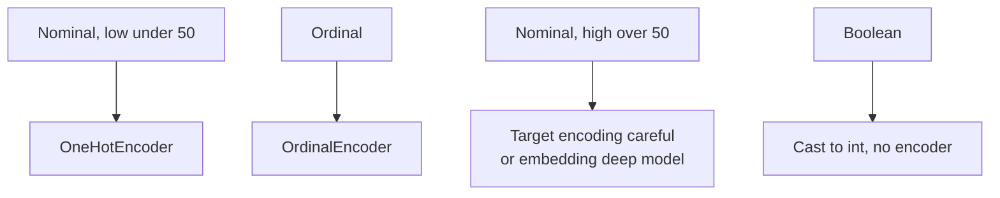

### Lab Exercise
```python
from snowflake.ml.modeling.pipeline import Pipeline
from snowflake.ml.modeling.preprocessing import OneHotEncoder, OrdinalEncoder, StandardScaler
from snowflake.ml.modeling.xgboost import XGBClassifier

pipeline = Pipeline(steps=[
    ("ohe", OneHotEncoder(
        input_cols=["COUNTRY","CHANNEL"],
        output_cols=["COUNTRY_OHE","CHANNEL_OHE"],
        handle_unknown="ignore"
    )),
    ("ord", OrdinalEncoder(
        input_cols=["EDU_LEVEL"],
        output_cols=["EDU_ORD"],
        categories=[["HS","BACHELOR","MASTER","PHD"]]
    )),
    ("scale", StandardScaler(
        input_cols=["AGE","INCOME","SPEND_30D"],
        output_cols=["AGE_S","INCOME_S","SPEND_30D_S"]
    )),
    ("clf", XGBClassifier(
        input_cols=["COUNTRY_OHE","CHANNEL_OHE","EDU_ORD",
                    "AGE_S","INCOME_S","SPEND_30D_S"],
        label_cols=["CHURNED"], output_cols=["PRED"]
    ))
])
pipeline.fit(train_df)
```

### Gotchas / Exam Traps
- `handle_unknown="ignore"` for OneHotEncoder is critical — new categories at serve time wouldn't crash.
- OrdinalEncoder requires explicit category order for ordinal semantics.
- Target encoding must respect train/val/test split boundaries — don't fit on test rows.

---

## Q17: How do you detect and handle null values in features at the FV layer?

**Difficulty:** Intermediate
**Exam relevance:** Data quality

### Answer
Four strategies, often combined:
1. **Explicit NULL handling in FV SQL** — use `COALESCE(x, default)` or `IFF(x IS NULL, default, x)` in the feature view DataFrame.
2. **Null indicators** — add a boolean feature `X_IS_NULL` so the model can learn null's meaning.
3. **Imputer in Pipeline** — `snowflake.ml.modeling.impute.SimpleImputer` for mean/median/mode.
4. **Validation layer** — add a DT that checks null rates and alerts.

### First Principles
**Why FV-level null handling first:** The feature view is the source of truth. If a raw-column null means "no transaction yet, treat as 0," encode that in the FV SQL — one place, consistent across all consumers.

**Why also at the pipeline:** Different models tolerate nulls differently (XGBoost can; linear can't). The imputer handles model-specific requirements.

### Diagram
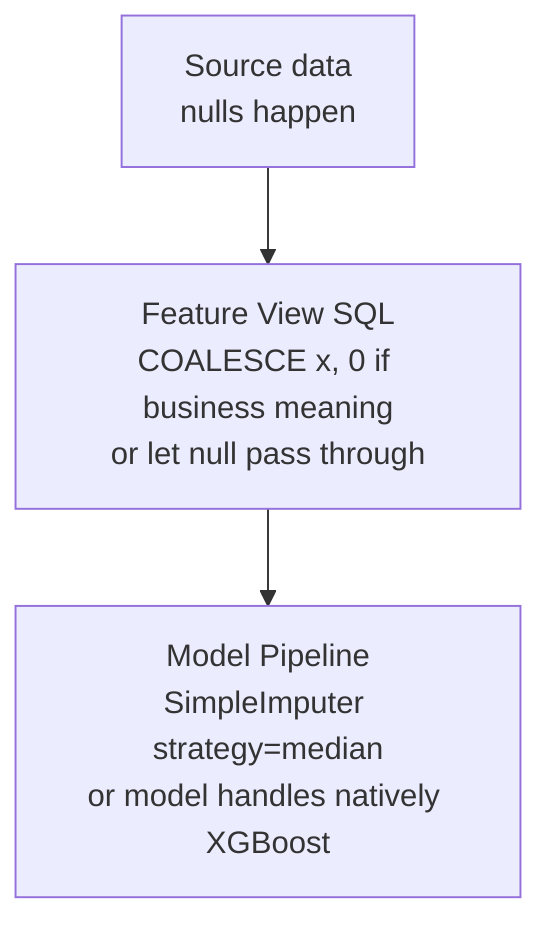

### Lab Exercise
```python
# FV-level: encode business semantics
feat_df = session.sql("""
  SELECT CUSTOMER_ID,
    COALESCE(SPEND_30D, 0.0) AS SPEND_30D,
    COALESCE(LAST_LOGIN, '1900-01-01'::TIMESTAMP) AS LAST_LOGIN,
    (SPEND_30D IS NULL)::INT AS SPEND_IS_NULL,     -- null indicator
    (LAST_LOGIN IS NULL)::INT AS NEVER_LOGGED_IN
  FROM RAW_FEATURES
""")

# Pipeline-level: imputer for safety
from snowflake.ml.modeling.impute import SimpleImputer
imputer = SimpleImputer(
    input_cols=["AGE","INCOME"],
    output_cols=["AGE_IMP","INCOME_IMP"],
    strategy="median"
)
```

### Gotchas / Exam Traps
- Imputing with `mean` on skewed features propagates skew; prefer median or domain-specific defaults.
- Null indicators often improve tree models — don't drop them even if you impute the primary column.
- A DT monitoring null rates is cheap insurance against upstream data breakage.

---

## Q18: Walk through online feature retrieval optimizations for high-throughput scoring.

**Difficulty:** Advanced
**Exam relevance:** Serving performance

### Answer
For high-throughput online scoring (thousands of QPS):
1. **Warm warehouse** — keep a small WH on, MIN_CLUSTER_COUNT=1, AUTO_SUSPEND = NEVER during peak.
2. **Clustered DT by join key** — add a clustering key on the FV's backing DT for sub-second point lookups.
3. **Serving-side cache** — in your SPCS service, cache (key → features) with TTL matching your refresh freq.
4. **Batch retrieval** — call `retrieve_feature_values()` with multiple keys at once; one WH query is better than many.
5. **Pre-materialize snapshots** — if latency is paramount, snapshot the FV to a flat table at refresh time; serve from the flat table.

### First Principles
**Why warehouse round-trip is the bottleneck:** Each `SELECT ... FROM FV WHERE key=?` is a few ms with a hot WH. For millisecond-SLA apps, 5ms is a lot.

**Why clustering helps:** A clustered table has pruning, so a point lookup hits a single micro-partition — fast.

**Why cache in the serving tier:** Once features are "latest within 1 hour," you can safely cache the retrieval for ~minutes without staleness. Avoid repeated WH calls for the same key.

### Diagram
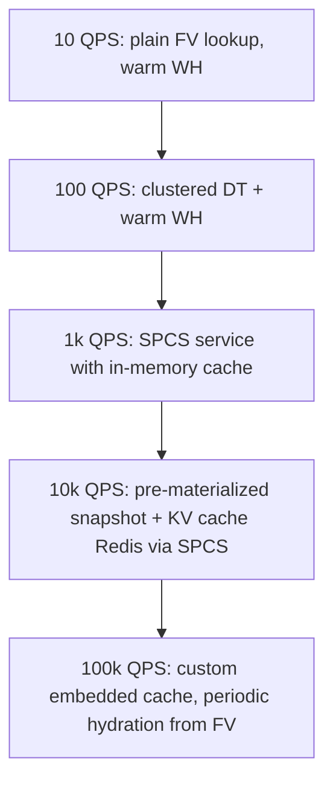

### Lab Exercise
```python
# Batch retrieval (good)
keys = session.create_dataframe(
    [[k] for k in customer_ids_batch],
    schema=["CUSTOMER_ID"]
)
feats = fs.retrieve_feature_values(
    spine_df=keys,
    features=[fv_30d, fv_lifetime]
)
# ONE query for N keys

# Cluster the backing DT for faster lookups
session.sql("""
  ALTER DYNAMIC TABLE ML_DB.FS._FV_CUSTOMER_30D_AGG$V2
    CLUSTER BY (CUSTOMER_ID)
""").collect()
```

```python
# SPCS cache pattern (sketch)
from cachetools import TTLCache
cache = TTLCache(maxsize=1_000_000, ttl=600)

def get_features(customer_id):
    if customer_id in cache:
        return cache[customer_id]
    row = fs.retrieve_feature_values(...)  # single-key
    cache[customer_id] = row
    return row
```

### Gotchas / Exam Traps
- Clustering keys on DTs behave like regular tables; a bad choice (low cardinality) hurts.
- SPCS cache + stale WH = silent skew; monitor cache hit rate.
- Pre-materialized snapshot = write amplification but minimum latency.

---

## Q19: How do you combine Snowflake Feature Store with Cortex LLM embeddings?

**Difficulty:** Advanced
**Exam relevance:** LLM-ops integration

### Answer
Treat the LLM embedding as a feature. Pattern:
1. Create a feature view whose DataFrame calls `SNOWFLAKE.CORTEX.EMBED_TEXT_768(model, text)` and stores the result in a VECTOR column.
2. Register this FV like any other.
3. Downstream models can consume the vector in training; semantic search (cosine similarity) uses `VECTOR_COSINE_SIMILARITY`.

Benefits: the FV refresh cycle handles re-embedding when source text changes. The vector lives in the same store as other features — one PIT join brings tabular + embedding features together.

### First Principles
**Why embed-as-feature:** Text alone is useless to a tabular model. The embedding converts it to a numeric vector that a GBM or neural model can use. Treating this as a FV means re-use (multiple models consume the same embeddings) and refresh (new text → new embedding automatically).

**Why Cortex embeddings:** Serverless, pay-per-token, in-platform. No model to host.

### Diagram
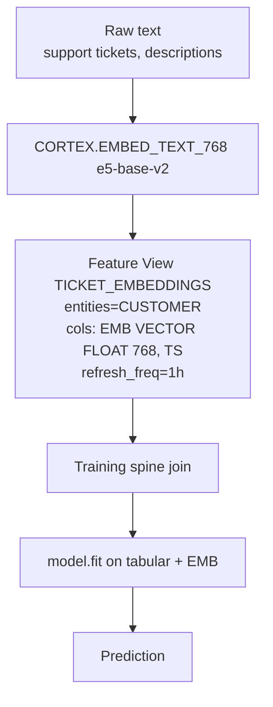

### Lab Exercise
```python
# Define FV with embedding column
feat_df = session.sql("""
  SELECT
    CUSTOMER_ID,
    MAX(CREATED_AT) AS WINDOW_END,
    SNOWFLAKE.CORTEX.EMBED_TEXT_768(
      'snowflake-arctic-embed-m',
      LISTAGG(TICKET_TEXT, ' | ') WITHIN GROUP (ORDER BY CREATED_AT)
    ) AS SUPPORT_TEXT_EMB
  FROM SUPPORT_TICKETS
  WHERE CREATED_AT >= DATEADD('day',-30,CURRENT_TIMESTAMP())
  GROUP BY CUSTOMER_ID
""")

fv_emb = FeatureView(
    name="CUSTOMER_SUPPORT_EMB",
    entities=[customer],
    feature_df=feat_df,
    timestamp_col="WINDOW_END",
    refresh_freq="4 hours",
    desc="Rolling 30d support ticket text, embedded"
)
fs.register_feature_view(fv_emb, version="V1")

# Downstream training: use embedding as model input (cast to array/floats)
# For many libs you'll flatten the vector into N scalar features
```

### Gotchas / Exam Traps
- VECTOR columns can be used in `VECTOR_COSINE_SIMILARITY`, `VECTOR_INNER_PRODUCT` SQL functions.
- Not every model supports vector inputs natively — may need to flatten to float columns.
- Cortex token costs scale with text volume; batch and dedup.

---

## Q20: How do you migrate from a legacy feature store (Feast, Tecton) to Snowflake FS?

**Difficulty:** Advanced
**Exam relevance:** Migration

### Answer
Phased approach:
1. **Audit** — enumerate existing feature definitions (SQL/Python), their entities, refresh cadence, consumers.
2. **Reproduce** — translate each feature's compute SQL into a Snowflake DataFrame, register as a feature view (same name convention if possible for traceability).
3. **Dual-write** — temporarily keep legacy pipeline running; validate values match (sample compare).
4. **Cut over consumers** — point training pipelines at Snowflake FS; later point serving.
5. **Decommission** — stop legacy pipelines.

For embedded ML frameworks like Feast, you can emit Snowpark DataFrames from the registered feature definitions programmatically.

### First Principles
**Why phased:** Big-bang migrations break production. Dual-write lets you validate equivalence; if Snowflake FS features drift from legacy, you catch it before cutover.

**Why "same name" migration helps:** Downstream consumer code can switch backends by changing imports, not identifiers.

### Diagram
```mermaid
flowchart TD
    P1[Phase 1: Audit<br/>feast list features]
    P2[Phase 2: Reproduce<br/>FeatureView name=...<br/>fs.register]
    P3[Phase 3: Dual-write<br/>both pipelines run, values compared]
    P4[Phase 4: Cut over<br/>training + serving use FS]
    P5[Phase 5: Decommission<br/>turn off legacy, keep SQL in Git]
    P1 --> P2 --> P3 --> P4 --> P5
```

### Lab Exercise
```python
# Example: translate a Feast feature definition
# Feast (external):
#   customer_30d = FeatureView(
#     name="customer_30d",
#     entities=[customer],
#     features=[Field(name="spend_30d", dtype=Float32), ...],
#     ttl=timedelta(days=30),
#     source=SnowflakeSource(query="SELECT ... FROM ...")
#   )

# Snowflake FS equivalent:
feat_df = session.sql("<the same SELECT>")
fv = FeatureView(
    name="CUSTOMER_30D",         # same name as feast
    entities=[customer],
    feature_df=feat_df,
    timestamp_col="EVENT_TIMESTAMP",
    refresh_freq="30 minutes",
    desc="Migrated from Feast; validate parity before cutover"
)
fs.register_feature_view(fv, version="V1_MIGRATED")

# Validation: compare samples
legacy_sample = get_from_feast(customer_ids=[1,2,3])   # external
new_sample = fs.retrieve_feature_values(
    session.create_dataframe([[1],[2],[3]], schema=["CUSTOMER_ID"]),
    [fv]
).to_pandas()
# assert approximate equality
```

### Gotchas / Exam Traps
- Even when SQL is identical, timezone/rounding differences can cause skew — align explicitly.
- Rebuilding history (backfill) is often the bulk of the migration work.
- Keep the legacy pipeline for Nx weeks after cutover for rollback.

---

## Q21: Describe time-travel and reproducibility guarantees for feature views.

**Difficulty:** Advanced
**Exam relevance:** Reproducibility

### Answer
Reproducibility layers:
- The backing DT has Snowflake **Time Travel** (default up to 1 day on standard, up to 90 days on Enterprise+ via `DATA_RETENTION_TIME_IN_DAYS`).
- Feature view **versions** are immutable code snapshots.
- **Datasets** generated via `generate_dataset()` are immutable materializations.

To fully reproduce training a month from now, you need (a) the dataset version (preferred — frozen rows) OR (b) time-travel on the DT (bounded, costly to retain).

Best practice: generate_dataset at training time → store with model metadata.

### First Principles
**Why not rely only on time-travel:** Retention is bounded. If you need to reproduce a 6-month-old training, Time Travel is likely expired. Dataset materialization is the durable artifact.

**Why versioned FV + versioned Dataset:** FV version = feature logic frozen; Dataset version = feature values + spine frozen. Together they're sufficient for reproduction.

### Diagram
```mermaid
flowchart TD
    ST[Short-term hours-days<br/>Time Travel on DT]
    MT[Medium-term weeks-months<br/>Dataset version immutable]
    LT[Long-term years<br/>Dataset archived + FV code in Git]
    ST --> MT --> LT
```

### Lab Exercise
```sql
-- Time-travel query the FV DT
SELECT * FROM ML_DB.FS._FV_CUSTOMER_30D_AGG$V2
  AT (TIMESTAMP => '2024-10-01 00:00:00'::TIMESTAMP)
WHERE CUSTOMER_ID = 42;

-- Extend retention for a critical FV
ALTER DYNAMIC TABLE ML_DB.FS._FV_CUSTOMER_30D_AGG$V2
  SET DATA_RETENTION_TIME_IN_DAYS = 30;
```

```python
# Preferred: pin the dataset version in model metadata
mv = reg.log_model(
    model, model_name="CHURN", version_name="V17",
    metrics={"auc": 0.87}
)
mv.set_tag("dataset_version", "CHURN_TRAIN:V2024_10_01")
mv.set_tag("feature_view_versions", "CUSTOMER_30D:V2;LIFETIME:V1")
```

### Gotchas / Exam Traps
- Longer retention = storage cost; pick retention per criticality.
- Fail-safe (7 days after retention) is Snowflake-managed; you can't restore from it directly.
- Dataset shards live in internal stages; they count toward storage.

---

## Q22: How do you compute and surface feature statistics for monitoring?

**Difficulty:** Intermediate
**Exam relevance:** Observability bridge

### Answer
Approach: build a monitoring DT that computes rolling statistics per feature per time window:
- Mean, stddev, p01/p25/p50/p75/p99
- Null rate
- Cardinality (for categorical)
- Count of extreme values

Store the stats; alert on deltas vs a training-time baseline. Snowflake Model Monitor automates much of this for registered features.

### First Principles
**Why monitor at the FV level, not just the model:** Feature drift precedes model performance drift. Catching feature-distribution shifts gives you an earlier warning than waiting for prediction accuracy to degrade.

**Why rolling vs point-in-time stats:** A single snapshot is noise; a rolling average smoothed over hours tells you about structural shifts.

### Diagram
```mermaid
flowchart TD
    FV[FV CUSTOMER_30D_AGG]
    MDT[Monitoring DT daily aggregates per feature<br/>SPEND: mean=1247, p50=900, null=0.02<br/>SESS: mean=4.3, p50=3, null=0.01]
    AL[ALERT if |today_mean − baseline_mean| &gt; 2σ]
    FV --> MDT --> AL
```

### Lab Exercise
```sql
CREATE OR REPLACE DYNAMIC TABLE MONITOR.FV_CUSTOMER_30D_STATS
  TARGET_LAG = '1 hour'
  WAREHOUSE = MONITOR_WH
AS
SELECT
  DATE_TRUNC('day', WINDOW_END) AS DAY,
  AVG(SPEND_30D) AS SPEND_MEAN,
  STDDEV(SPEND_30D) AS SPEND_STD,
  APPROX_PERCENTILE(SPEND_30D, 0.5) AS SPEND_P50,
  APPROX_PERCENTILE(SPEND_30D, 0.99) AS SPEND_P99,
  SUM(IFF(SPEND_30D IS NULL, 1, 0)) / COUNT(*) AS SPEND_NULL_RATE,
  AVG(SESSIONS_30D) AS SESS_MEAN,
  COUNT(*) AS N_ROWS
FROM ML_DB.FS._FV_CUSTOMER_30D_AGG$V2
GROUP BY DAY;

-- Alert when today's mean deviates > 20% from last week's mean
CREATE OR REPLACE ALERT MONITOR.SPEND_DRIFT
  WAREHOUSE = MONITOR_WH
  SCHEDULE = '1 hour'
  IF ( EXISTS (
    WITH recent AS (
      SELECT AVG(SPEND_MEAN) AS TODAY_MEAN
      FROM MONITOR.FV_CUSTOMER_30D_STATS
      WHERE DAY = CURRENT_DATE()
    ), baseline AS (
      SELECT AVG(SPEND_MEAN) AS BASELINE_MEAN
      FROM MONITOR.FV_CUSTOMER_30D_STATS
      WHERE DAY BETWEEN DATEADD('day',-14,CURRENT_DATE()) AND DATEADD('day',-1,CURRENT_DATE())
    )
    SELECT 1 FROM recent, baseline
    WHERE ABS(TODAY_MEAN - BASELINE_MEAN) / BASELINE_MEAN > 0.2
  ))
  THEN CALL MONITOR.NOTIFY_DRIFT('SPEND_30D');
```

### Gotchas / Exam Traps
- `APPROX_PERCENTILE` is cheap and accurate enough for monitoring.
- Null rate often tells you more than mean when upstream pipelines break.
- Use PSI (population stability index) for distribution comparison — covered in domain 5.

---

## Q23: What are the limitations and known gotchas of Snowflake Feature Store?

**Difficulty:** Advanced
**Exam relevance:** Edge cases

### Answer
Known limitations:
- No native online key-value store — sub-10ms SLAs require your own cache layer
- FV SQL must satisfy DT constraints (no external access UDFs, no certain SQL constructs)
- Backfill requires time-series materialization — expensive
- No native support for streaming (real-time push) features; cadence is DT refresh
- Feature view versions don't automatically propagate to Datasets — must regenerate
- Limited integration with non-Snowflake training frameworks beyond Snowpark

### First Principles
**Why these gaps:** The FS is a relatively new (2023+) product; parity with mature OSS feature stores is ongoing. Snowflake prioritizes the common case (batch + online lookup) over edge cases.

### Diagram
```mermaid
flowchart TD
    FS[Snowflake Feature Store]
    FS --> A1[Offline training: strong]
    FS --> A2[Online lookup 100ms+: strong]
    FS --> A3[Online lookup under 10ms: weak · custom cache]
    FS --> A4[Streaming push features: weak · stream+task bolt-on]
    FS --> A5[Non-Snowpark training: adequate · via Datasets]
    FS --> A6[Cross-account sharing: adequate · read-only]
```

### Lab Exercise
```python
# Workaround: push features via a stream for low-latency updates
# Keep the FV for offline; separately maintain a lookup table

# fast path: Stream + Task updating lookup table
session.sql("""
  CREATE OR REPLACE STREAM FAST_FEATURE_STREAM ON TABLE RAW.EVENTS;

  CREATE OR REPLACE TASK UPDATE_FAST_LOOKUP
    WAREHOUSE = HOT_WH
    SCHEDULE = '1 MINUTE'
  AS
    MERGE INTO FEATURES.CUSTOMER_LATEST t
    USING (
      SELECT CUSTOMER_ID, LAST_VALUE(AMOUNT) OVER (
        PARTITION BY CUSTOMER_ID ORDER BY EVENT_TS
      ) AS LATEST_AMOUNT
      FROM FAST_FEATURE_STREAM
    ) s
    ON t.CUSTOMER_ID = s.CUSTOMER_ID
    WHEN MATCHED THEN UPDATE SET LATEST_AMOUNT = s.LATEST_AMOUNT
    WHEN NOT MATCHED THEN INSERT ...;
""").collect()

# Serving reads FEATURES.CUSTOMER_LATEST directly (fast)
# Offline training still goes through FS feature views (consistent)
```

### Gotchas / Exam Traps
- Feature Store API is evolving; pin `snowflake-ml-python` version.
- Dropping an entity cascades to feature views bound to it (consider the blast radius).
- The FS schema is counted toward object limits per database.

---

## Q24: How do you govern access to feature views (RBAC, masking, row access)?

**Difficulty:** Advanced
**Exam relevance:** Governance

### Answer
Feature views inherit Snowflake RBAC on their backing DTs:
- `GRANT SELECT ON DYNAMIC TABLE ...` controls read
- Masking policies on columns protect PII features (e.g., mask email in training features)
- Row access policies restrict which rows a role sees
- Tags on DTs enable tag-based policy routing

For FS APIs: user needs USAGE on database/schema and SELECT on the backing DT (and metadata tables).

### First Principles
**Why RBAC at the DT, not FV abstraction:** Snowflake's security model is table-level. Pushing policies to the physical object keeps the model consistent — you can't bypass by querying the DT directly.

**Why masking policies for features:** Even non-PII features may contain sensitive derived info (e.g., inferred income). Masking lets you serve features to models while restricting raw access to humans.

### Diagram
```mermaid
flowchart TD
    R1[Role: DATA_SCIENTIST]
    R2[Role: ML_SERVICE_ACCT]
    R3[Role: AUDITOR]
    DT[DT _FV_CUSTOMER_30D$V2<br/>columns: SPEND, EMAIL, RISK_SCORE<br/>Masking: EMAIL masked unless role=PRIVACY<br/>Row Access: WHERE REGION IN role_region]
    R1 -->|SELECT masked EMAIL| DT
    R2 -->|SELECT masked EMAIL| DT
    R3 -->|SELECT + unmask via policy exception| DT
```

### Lab Exercise
```sql
-- Masking policy
CREATE OR REPLACE MASKING POLICY MASK_EMAIL AS (val STRING) RETURNS STRING ->
  CASE
    WHEN CURRENT_ROLE() = 'PRIVACY_ADMIN' THEN val
    ELSE REGEXP_REPLACE(val, '.+@', '***@')
  END;

ALTER DYNAMIC TABLE ML_DB.FS._FV_CUSTOMER_30D_AGG$V2
  MODIFY COLUMN EMAIL SET MASKING POLICY MASK_EMAIL;

-- Grants
GRANT USAGE ON DATABASE ML_DB TO ROLE DATA_SCIENTIST;
GRANT USAGE ON SCHEMA ML_DB.FS TO ROLE DATA_SCIENTIST;
GRANT SELECT ON ALL DYNAMIC TABLES IN SCHEMA ML_DB.FS TO ROLE DATA_SCIENTIST;
GRANT SELECT ON ALL TABLES IN SCHEMA ML_DB.FS TO ROLE DATA_SCIENTIST;
```

### Gotchas / Exam Traps
- A model trained with unmasked features and then run under a role that sees masked values will behave differently — align training vs serving role contexts.
- Row access policies on FV DTs affect feature retrieval; a user whose role sees fewer rows gets fewer feature rows.
- Masking policies apply column-wise; different sensitivity per column is natural.

---

## Q25: Give the end-to-end workflow from raw table to deployed model that uses Feature Store best practices.

**Difficulty:** Advanced
**Exam relevance:** Capstone

### Answer
Seven-step canonical:
1. Define entities with business-object join keys.
2. Define managed, timestamp-aware feature views with incremental-friendly SQL.
3. Backfill if needed via time-series FV pattern.
4. Build labeled spine with observation timestamps.
5. Generate immutable Dataset via PIT join.
6. Train a pipeline including preprocessing; log to Registry with Dataset version + FV versions tagged.
7. Deploy; serve by calling `retrieve_feature_values()` + model's `predict`.

### First Principles
**Why end-to-end matters:** The ML pipeline is only as reproducible as its weakest link. If any step is ad-hoc, future retrains will diverge.

### Diagram
```mermaid
flowchart TD
    E[1. Entities]
    FV[2. Feature Views]
    BF[3. Backfill if needed]
    SP[4. Spine · labeled events keys, timestamps, labels]
    DS[5. Dataset · fs.generate_dataset]
    PF[6. Pipeline Fit · preprocessing + model, log to Registry]
    DP[7. Deploy · retrieve_feature_values + model.predict]
    MO[Monitor]
    RT[Retrain]
    E --> FV --> BF --> SP --> DS --> PF --> DP --> MO --> RT --> FV
```

### Lab Exercise
```python
# 1-2. Entities & FVs (see earlier Qs)
fs.register_entity(Entity("CUSTOMER", ["CUSTOMER_ID"]))
fs.register_feature_view(fv_30d, version="V2")

# 3. Backfill handled in time-series FV SQL

# 4. Spine
spine = session.sql("""
  SELECT CUSTOMER_ID, OBSERVATION_TS AS EVENT_TS, CHURNED AS Y
  FROM TRAIN.LABELS
  WHERE OBSERVATION_TS <= '2024-09-30'
""")

# 5. Dataset
ds = fs.generate_dataset(
    name="CHURN_TRAIN", version="V2024_10_01",
    spine_df=spine, features=[fv_30d, fv_lifetime],
    spine_timestamp_col="EVENT_TS", spine_label_cols=["Y"]
)

# 6. Train pipeline + register
train_df = ds.read.to_snowpark_dataframe()
pipeline = Pipeline(steps=[
    ("scale", StandardScaler(...)),
    ("clf", XGBClassifier(..., label_cols=["Y"]))
])
pipeline.fit(train_df)
mv = reg.log_model(pipeline, model_name="CHURN", version_name="V17",
                   sample_input_data=train_df.limit(10))
mv.set_tag("dataset_version", "CHURN_TRAIN:V2024_10_01")
mv.set_tag("feature_views", "CUSTOMER_30D:V2;LIFETIME:V1")

# 7. Serving
scoring_keys = session.create_dataframe(
    [[k] for k in active_customers], schema=["CUSTOMER_ID"]
)
features = fs.retrieve_feature_values(scoring_keys, [fv_30d, fv_lifetime])
scored = mv.run(features, function_name="predict")
```

### Gotchas / Exam Traps
- Forgetting to tag the FV versions on the model artifact → non-reproducible model.
- Spine timestamps must be strictly ≤ FV timestamps for PIT correctness.
- The Dataset is the atomic training artifact — pin it in your model metadata.

---

## Study Checklist

- [ ] Can define Entity / FeatureView / Dataset and their relationships
- [ ] Can explain PIT joins and prove why ordinary joins leak
- [ ] Can design managed vs static FVs appropriately
- [ ] Can write a time-series FV for historical backfill
- [ ] Can handle nulls, categoricals, embeddings at the FV layer
- [ ] Can serve features online for real-time scoring
- [ ] Can tag/mask/govern feature views for compliance
- [ ] Can walk a complete pipeline from raw tables to deployed model
