# Model Training & Registry — MLE-C01 Study Guide

## Exam Weight & Scope

**Approximate weight:** 20-24% of exam
**Scope:** Snowpark ML Modeling API (sklearn-compatible estimators that execute on Snowflake compute), distributed training patterns (multi-node via SPCS/ML Jobs), the Model Registry (`snowflake.ml.registry.Registry`) covering versioning, metadata, dependencies, aliases, metrics, functions, and signatures. Covers both tabular models and LLMs — the Registry is the one place both live.

**You must be able to:**
- Use the Modeling API end-to-end (preprocessing, pipelines, estimators, hyperparameter search)
- Decide between warehouse training vs SPCS GPU training
- Log, version, alias, tag, promote, and roll back models in the Registry
- Package custom models via `CustomModel` with inference APIs
- Reason about dependencies (conda / pip) and signatures (input/output schema)

---

## Core Concepts Map

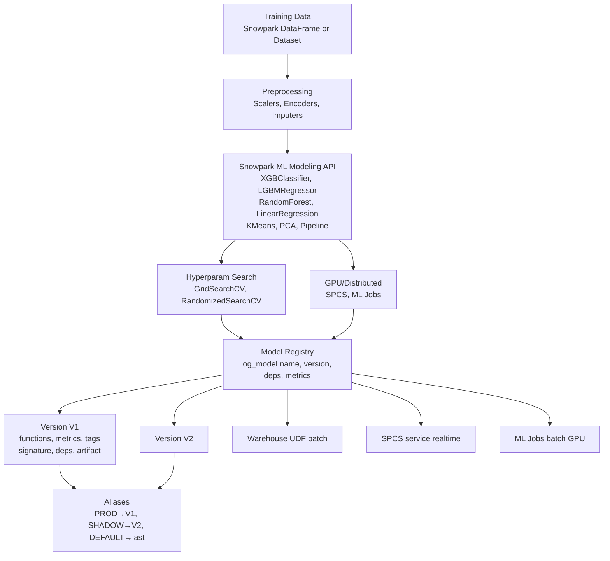

---

## Q1: Walk through the Snowpark ML Modeling API's design. How does it differ from sklearn?

**Difficulty:** Foundation
**Exam relevance:** Modeling API basics

### Answer
`snowflake.ml.modeling.*` provides sklearn-compatible estimator classes (XGBClassifier, RandomForestClassifier, StandardScaler, Pipeline, etc.) with Snowflake-aware fit/transform/predict methods. Key differences from vanilla sklearn:
- Accept **Snowpark DataFrames**, not pandas
- Require `input_cols`, `label_cols`, `output_cols` to map DataFrame columns to features/targets/predictions
- Execute `.fit()` as an ephemeral stored procedure on the warehouse (data stays in Snowflake)
- `.predict()` emits a UDF for batch scoring
- `.to_sklearn()`, `.to_xgboost()`, `.to_lightgbm()` convert back to the native fitted object

### First Principles
**Why column mapping is explicit:** A Snowpark DataFrame may have 100+ columns, some features, some labels, some bookkeeping. Explicit `input_cols` prevents accidental leakage ("I trained on CUSTOMER_ID — oops"). Explicit `output_cols` names the prediction column deterministically for downstream joins.

**Why fit runs as SPROC:** Pulling millions of training rows to a client is wasteful. Snowpark ML wraps your estimator in a Python stored procedure, ships it to the warehouse, and runs training there. The returned object is a client-side handle to the fitted artifact.

**Why sklearn-compat matters:** Snowflake didn't want to invent a new API — teams already know sklearn. The adapter layer is a thin wrapper.

### Diagram
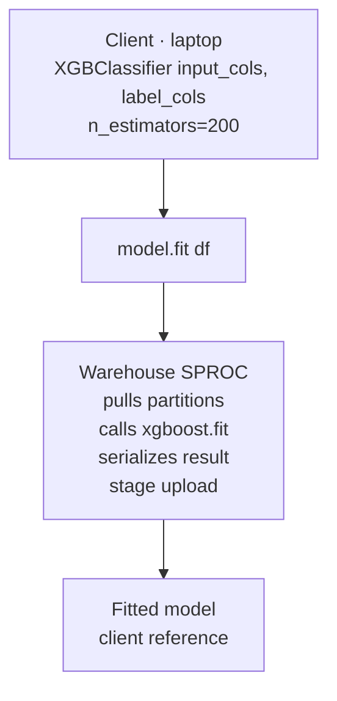

### Lab Exercise
```python
from snowflake.ml.modeling.xgboost import XGBClassifier
from snowflake.ml.modeling.preprocessing import StandardScaler

# Preprocessing
scaler = StandardScaler(
    input_cols=["AGE", "INCOME", "TENURE"],
    output_cols=["AGE_S", "INCOME_S", "TENURE_S"]
)
scaler.fit(train_df)
train_scaled = scaler.transform(train_df)

# Model
model = XGBClassifier(
    input_cols=["AGE_S", "INCOME_S", "TENURE_S"],
    label_cols=["CHURNED"],
    output_cols=["PRED"],
    n_estimators=300,
    max_depth=5,
    learning_rate=0.1,
    eval_metric="auc"
)
model.fit(train_scaled)
predictions = model.predict(test_df_scaled)   # returns Snowpark DF

# Interop
native_booster = model.to_xgboost()          # get xgboost.Booster
```

### Gotchas / Exam Traps
- `label_cols` must be a list even for a single target.
- The warehouse running fit should have enough memory for the training frame (consider Snowpark-optimized WH).
- `.predict()` on a DataFrame doesn't materialize — it adds a predicted column lazily.

---

## Q2: What's the difference between `fit()`, `transform()`, `predict()`, `predict_proba()` in Snowpark ML?

**Difficulty:** Foundation
**Exam relevance:** Modeling API semantics

### Answer
- `fit(df)` — trains the estimator; runs as SPROC on warehouse; returns the estimator (mutated with fitted state).
- `transform(df)` — for transformers (scalers, encoders); returns a Snowpark DataFrame with new columns per `output_cols`.
- `predict(df)` — for predictors; returns Snowpark DataFrame with predicted class/value in `output_cols`.
- `predict_proba(df)` — for classifiers; returns Snowpark DataFrame with probability per class.
- `fit_transform(df)` — convenience: fit then transform in one call.
- `fit_predict(df)` — convenience: fit then predict (uncommon for supervised).

### First Principles
**Why lazy evaluation:** Snowpark DataFrames are query plans, not materialized data. `predict` appends to the plan; nothing happens until you `.collect()`, `.to_pandas()`, or write to a table. Good for cost (do work once at the end) and composability (chain operations).

**Why return a DataFrame instead of raw predictions:** You usually want predictions alongside the identifier (customer_id). Returning a DataFrame lets you drop/keep columns naturally.

### Diagram
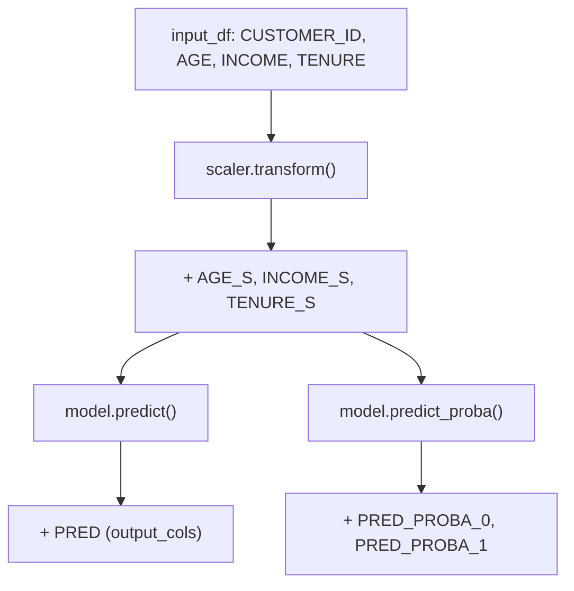

### Lab Exercise
```python
scored = model.predict(test_df)              # single class column
proba  = model.predict_proba(test_df)        # one col per class

# predict + probability together via Snowpark join:
scored_with_proba = scored.join(
    proba.select("CUSTOMER_ID", "PRED_PROBA_1"),
    on="CUSTOMER_ID"
)

scored_with_proba.write.save_as_table("PRED.TEST_PREDICTIONS", mode="overwrite")
```

### Gotchas / Exam Traps
- `predict_proba` requires `output_cols` set at construction (or auto-inferred); for binary it emits `_0` and `_1` suffixes.
- The output column of a `transform()` encoder (OneHot) can be an array column — handle in downstream estimators via `pass_through` logic.
- `fit_predict` on supervised models returns predictions on training data (useful for evaluation but not valid for test-set metrics).

---

## Q3: How do Snowpark ML Pipelines work and why are they essential for production ML?

**Difficulty:** Intermediate
**Exam relevance:** Pipeline packaging

### Answer
`snowflake.ml.modeling.pipeline.Pipeline` chains preprocessing + model steps into a single fittable, predictable object. Each step is a `(name, estimator)` tuple. `fit` fits each step in sequence; `predict` runs the full chain.

**Why essential:**
- Packaging — the whole pipeline is logged to the Registry as one artifact, so serving runs identical preprocessing.
- Reproducibility — one `fit()` call ensures sklearn-style data flow (fit transformers on train, re-use on test).
- Serving correctness — eliminates training-serving skew in the preprocessing step.

### First Principles
**Why not just a chain of code:** If you manually `scaler.fit(train)` then `model.fit(scaled)` and log only the model, serving code must re-implement the scaler. One bug and you have skew. The Pipeline bundles both.

**Why column mapping across steps:** Each step produces output columns consumed by the next step's `input_cols`. The Pipeline enforces this contract automatically.

### Diagram
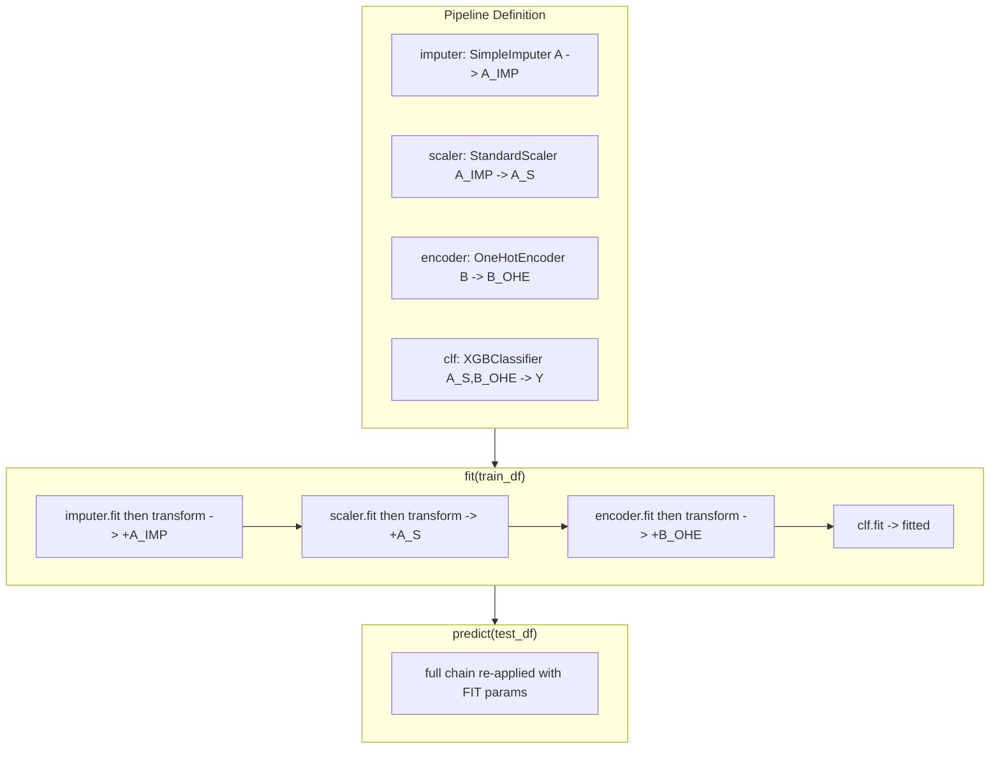

### Lab Exercise
```python
from snowflake.ml.modeling.pipeline import Pipeline
from snowflake.ml.modeling.preprocessing import StandardScaler, OneHotEncoder
from snowflake.ml.modeling.impute import SimpleImputer
from snowflake.ml.modeling.xgboost import XGBClassifier

pipe = Pipeline(steps=[
    ("imputer", SimpleImputer(
        input_cols=["AGE","INCOME"],
        output_cols=["AGE_IMP","INCOME_IMP"],
        strategy="median"
    )),
    ("scaler", StandardScaler(
        input_cols=["AGE_IMP","INCOME_IMP","TENURE"],
        output_cols=["AGE_S","INCOME_S","TENURE_S"]
    )),
    ("ohe", OneHotEncoder(
        input_cols=["COUNTRY"],
        output_cols=["COUNTRY_OHE"],
        handle_unknown="ignore"
    )),
    ("clf", XGBClassifier(
        input_cols=["AGE_S","INCOME_S","TENURE_S","COUNTRY_OHE"],
        label_cols=["CHURNED"],
        output_cols=["PRED"]
    ))
])
pipe.fit(train_df)
preds = pipe.predict(test_df)

# Log entire pipeline — single artifact for serving
mv = reg.log_model(pipe, model_name="CHURN", version_name="V1",
                   sample_input_data=train_df.limit(10))
```

### Gotchas / Exam Traps
- `ColumnTransformer` exists in Snowpark ML for parallel transforms; use when steps don't depend on each other.
- Mixing a Snowpark ML Pipeline with a sklearn Pipeline won't work — stay in one SDK.
- The last step typically must be an estimator (predictor); otherwise `.predict()` fails.

---

## Q4: Describe hyperparameter search options in Snowpark ML.

**Difficulty:** Intermediate
**Exam relevance:** HP tuning

### Answer
Three options:
1. **`GridSearchCV`** (`snowflake.ml.modeling.model_selection`) — exhaustive grid search with CV folds. Runs in warehouse SPROC; `n_jobs` controls parallelism (bounded by cluster size).
2. **`RandomizedSearchCV`** — random sampling over a param distribution; often matches grid at a fraction of trials.
3. **External orchestration** — use ML Jobs API with Optuna/Ray Tune submitting many `@remote` training functions in parallel across a compute pool.

### First Principles
**Why GridSearchCV in warehouse works:** For moderate grids (< 100 combos), one SPROC call with internal parallelism is simple and cheap. The CV folds run in parallel; the grid is a loop.

**Why go external for large sweeps:** Optuna on SPCS gives you Bayesian sampling (far more sample-efficient than grid), parallelism up to compute pool size, and persistence of trial history.

### Diagram
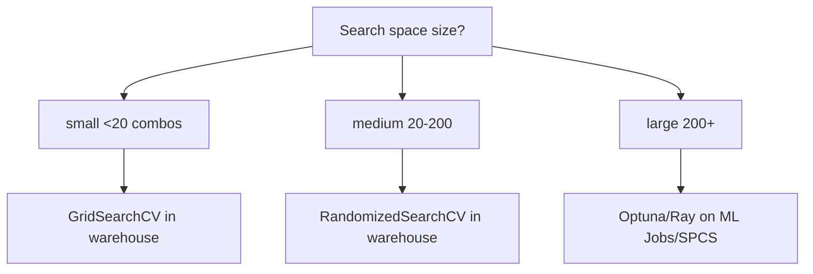

### Lab Exercise
```python
from snowflake.ml.modeling.model_selection import GridSearchCV, RandomizedSearchCV
from snowflake.ml.modeling.xgboost import XGBClassifier

# Grid
grid = GridSearchCV(
    estimator=XGBClassifier(
        input_cols=feats, label_cols=["CHURNED"], output_cols=["PRED"]
    ),
    param_grid={
        "max_depth": [3,5,7],
        "n_estimators": [100,300],
        "learning_rate": [0.05, 0.1]
    },
    scoring="roc_auc",
    cv=5,
    n_jobs=-1,
    input_cols=feats, label_cols=["CHURNED"], output_cols=["PRED"]
)
grid.fit(train_df)
print(grid.to_sklearn().best_params_)

# Random
rand = RandomizedSearchCV(
    estimator=XGBClassifier(input_cols=feats, label_cols=["CHURNED"], output_cols=["PRED"]),
    param_distributions={
        "max_depth": [3,4,5,6,7,8,10],
        "n_estimators": [100,200,300,500,800],
        "learning_rate": [0.01, 0.03, 0.05, 0.1, 0.2],
        "subsample": [0.6, 0.8, 1.0]
    },
    n_iter=40,
    scoring="roc_auc", cv=5, n_jobs=-1,
    input_cols=feats, label_cols=["CHURNED"], output_cols=["PRED"]
)
rand.fit(train_df)
```

### Gotchas / Exam Traps
- CV splits are done in-warehouse — ensure stratification via `cv` parameter object if needed.
- `scoring="roc_auc"` requires `predict_proba` support.
- Log only the `best_estimator_` to Registry (via `.to_sklearn().best_estimator_` or by refitting with best params).

---

## Q5: What is the Model Registry? What objects live in it?

**Difficulty:** Foundation
**Exam relevance:** Registry basics

### Answer
`snowflake.ml.registry.Registry` is a schema-scoped catalog of models. Objects:
- **Registry** — the catalog itself, bound to `(database, schema)`
- **Model** — a named model entity (e.g., "CHURN"), container for versions
- **ModelVersion** — a specific version of a model, with artifact, signature, metrics, tags, functions, dependencies
- **Alias** — a human-readable pointer to a specific version (e.g., `PROD`, `SHADOW`, `DEFAULT`)
- **Function** — a callable method on a version (`predict`, `predict_proba`, `transform`, custom)
- **Service** (optional) — SPCS deployment wrapping the model

### First Principles
**Why schema-scoped:** Models are governed objects — ownership, RBAC, backup. Treating the Registry as a schema fits Snowflake's security model.

**Why Aliases:** Promotion. You don't want serving code hardcoded to `V17`. Clients call `model@PROD`; promotion is `set_alias('PROD', 'V18')`. Atomic switchover.

**Why Functions:** A model may support multiple inference methods (predict for class, predict_proba for prob, custom for business logic). Each becomes a callable.

### Diagram
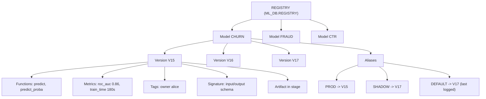

### Lab Exercise
```python
from snowflake.ml.registry import Registry

reg = Registry(session, database_name="ML_DB", schema_name="REGISTRY")

# List models
print(reg.show_models())

# Get a model
m = reg.get_model("CHURN")
print(m.show_versions())
print(m.show_tags())
print(m.default)   # the version aliased 'DEFAULT'
```

### Gotchas / Exam Traps
- `DEFAULT` alias auto-points to the latest version logged (unless overridden).
- `PROD` is a conventional alias — not reserved; you can use any name.
- You can create a Registry in multiple schemas for logical separation (dev/stage/prod).

---

## Q6: Walk through `log_model` end-to-end: what gets packaged, what gets inferred?

**Difficulty:** Advanced
**Exam relevance:** Model packaging

### Answer
`reg.log_model(model, model_name, version_name, ...)` does several things:
1. **Serializes the model** to a stage directory (varies by model type — pickled, Torch state dict, HuggingFace save_pretrained, etc.)
2. **Infers signature** (input/output schema) from `sample_input_data` or Snowpark ML's known schemas
3. **Captures dependencies** from `conda_dependencies` and/or `pip_requirements`
4. **Registers metadata** — version name, metrics dict, comment, tags
5. **Deploys as a native UDF** in the registry schema for immediate warehouse-level invocation
6. **Prepares for SPCS deployment** by generating an image spec (image built on first `create_service`)

### First Principles
**Why automatic UDF registration:** The dominant use case is batch SQL scoring. By making the model callable as `MODEL!PREDICT(features)`, Snowflake removes a deploy step.

**Why signature inference:** Correctness. Without a known schema, serving must accept arbitrary input and risk schema drift. Explicit schema (either inferred from sample data or Snowpark DataFrame) catches mismatches at deploy time.

**Why dependency capture:** The serving runtime must match training. If training used xgboost 1.7.5 and serving loads 2.0 by default, pickled model files may not unpickle. Pinning avoids this.

### Diagram
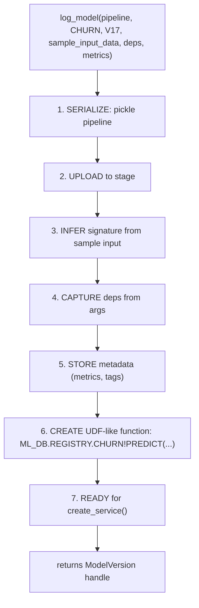

### Lab Exercise
```python
mv = reg.log_model(
    model=pipeline,
    model_name="CHURN",
    version_name="V17",
    sample_input_data=train_df.limit(10),
    conda_dependencies=["xgboost==1.7.5", "scikit-learn==1.3.0"],
    pip_requirements=None,                       # don't mix with conda unless needed
    comment="Retrained with Oct 2024 data; added TENURE feature",
    metrics={"roc_auc": 0.871, "pr_auc": 0.42, "train_sec": 180},
    options={"relax_version": True}              # allow minor version drift
)

print(mv.fully_qualified_model_name, mv.version_name)
print(mv.show_functions())
print(mv.show_metrics())
print(mv.get_signature(function_name="predict"))
```

### Gotchas / Exam Traps
- `sample_input_data` can be a pandas DataFrame, Snowpark DataFrame, or dict — pandas rarely matches production.
- `relax_version=True` is useful but risks runtime bugs — use with pinned major versions.
- The function name defaults are model-type-specific; use `show_functions()` to see them.

---

## Q7: What are model signatures and why do they matter?

**Difficulty:** Intermediate
**Exam relevance:** Signatures / schema

### Answer
A signature describes the expected input and output of each inference function on a model version. It includes column names, data types, and nullable flags. Signatures:
- Are inferred from `sample_input_data` during `log_model`
- Can be manually specified via `signatures=` parameter
- Are checked at UDF creation and at serving time
- Are visible via `mv.get_signature(function_name)`

Example: a model trained on `[AGE INT, INCOME FLOAT]` has an input signature `(AGE INT, INCOME FLOAT)` → output `(PRED INT, PRED_PROBA_0 FLOAT, PRED_PROBA_1 FLOAT)`.

### First Principles
**Why signatures:** Catch bugs early. Without one, a serving call with wrong columns produces a cryptic Python error. With one, you get a clean schema mismatch error before any training/inference happens.

**Why multi-function:** `predict` and `predict_proba` have different output shapes. Each needs its own signature. Custom models with multiple business methods (score + explain + feature-importance) each has one.

### Diagram
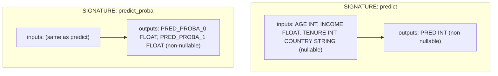

### Lab Exercise
```python
# Explicit signatures (useful for custom models)
from snowflake.ml.model.model_signature import ModelSignature, FeatureSpec, DataType

sig = ModelSignature(
    inputs=[
        FeatureSpec(name="AGE", dtype=DataType.INT64),
        FeatureSpec(name="INCOME", dtype=DataType.DOUBLE),
        FeatureSpec(name="TENURE", dtype=DataType.INT64),
    ],
    outputs=[
        FeatureSpec(name="SCORE", dtype=DataType.DOUBLE)
    ]
)

mv = reg.log_model(
    custom_model,
    model_name="SCORER",
    version_name="V1",
    signatures={"predict": sig},
    conda_dependencies=["pandas", "numpy"]
)
```

### Gotchas / Exam Traps
- Signature mismatch at UDF call = Snowflake error, not Python exception — clearer for operators.
- Nullable columns in signature must match nullable training inputs; silent coercion can bite.
- You can log *multiple* functions with different signatures on one version.

---

## Q8: How do you log a non-Snowpark-ML model (sklearn, PyTorch, HuggingFace) in the Registry?

**Difficulty:** Intermediate
**Exam relevance:** Model type coverage

### Answer
Registry supports many native model types out of the box; just pass the native object:

```python
# sklearn
from sklearn.ensemble import RandomForestClassifier
sk = RandomForestClassifier().fit(X_pd, y_pd)
reg.log_model(sk, model_name="SK_RF", version_name="V1",
              sample_input_data=X_pd.head())

# PyTorch
import torch
m = MyNet()
m.load_state_dict(torch.load("ckpt.pt"))
reg.log_model(m, model_name="VISION", version_name="V1",
              sample_input_data=torch.randn(1, 3, 224, 224))

# HuggingFace
from transformers import pipeline
hf = pipeline("sentiment-analysis")
reg.log_model(hf, model_name="SENTIMENT", version_name="V1",
              sample_input_data=["This is great"])
```

For truly custom code, wrap in `CustomModel`.

### First Principles
**Why native type support:** The Registry has serializers per framework. For PyTorch it uses TorchScript or state_dict; for HF it uses `save_pretrained`. You don't want to write adapters yourself.

**Why `sample_input_data` matters even more here:** Non-Modeling-API models don't have `input_cols`, so sample input is the only way to infer signature.

### Diagram

**Serializers by model type:**

| Type | Serializer |
|------|------------|
| Snowpark ML model | SDK internal |
| sklearn | cloudpickle |
| xgboost | Booster.save_model |
| lightgbm | Booster.save_model |
| catboost | CatBoost.save_model |
| torch nn.Module | TorchScript or state_dict |
| HuggingFace pipeline | save_pretrained |
| TF/Keras | SavedModel |
| MLflow pyfunc | native MLflow |
| anything else | wrap in CustomModel |

**Sample input types:**

| Type | Sample Input Type |
|------|-------------------|
| Snowpark ML model | DataFrame (automatic) |
| sklearn | pandas DF |
| xgboost | pandas DF / np.array |
| lightgbm | pandas DF / np.array |
| catboost | pandas DF / np.array |
| torch nn.Module | torch.Tensor |
| HuggingFace pipeline | list[str] or dict |
| TF/Keras | np.array |
| MLflow pyfunc | pandas DF |
| anything else | user-defined |

### Lab Exercise
```python
import pandas as pd
from xgboost import XGBClassifier

# Non-Snowpark-ML xgboost
booster = XGBClassifier(n_estimators=200).fit(X_pd, y_pd)
mv = reg.log_model(
    booster,
    model_name="XGB_NATIVE",
    version_name="V1",
    sample_input_data=X_pd.head(5),
    conda_dependencies=["xgboost==2.0.0"],
    options={"method": "to_sklearn"}  # some types take hints
)

# HuggingFace with pinned transformers version
from transformers import AutoModelForSequenceClassification, AutoTokenizer, pipeline
tok = AutoTokenizer.from_pretrained("distilbert-base-uncased-finetuned-sst-2-english")
mdl = AutoModelForSequenceClassification.from_pretrained("distilbert-base-uncased-finetuned-sst-2-english")
pipe = pipeline("sentiment-analysis", model=mdl, tokenizer=tok)
mv_hf = reg.log_model(
    pipe,
    model_name="DISTILBERT_SST2",
    version_name="V1",
    sample_input_data=["I love this.", "Terrible service."],
    conda_dependencies=["transformers==4.42.0", "torch==2.3.0"]
)
```

### Gotchas / Exam Traps
- Loading PyTorch models in a warehouse UDF uses CPU — for GPU inference deploy via SPCS (`create_service` with gpu_requests).
- HuggingFace models are often large; stage upload may take time.
- Some sklearn transformers aren't picklable across versions — pin.

---

## Q9: Explain the `CustomModel` abstraction. When and how do you use it?

**Difficulty:** Advanced
**Exam relevance:** Custom logic in registry

### Answer
`snowflake.ml.model.custom_model.CustomModel` is a user-authored class subclassing `CustomModel`, with inference methods decorated with `@custom_model.inference_api`. You use it when:
- Combining multiple models (ensemble)
- Adding business logic (thresholding, feature engineering at serve time)
- Composing LLM calls with tabular predictions
- Wrapping a model with pre/post-processing not expressible as a Pipeline step

The context (`ModelContext`) provides references to child models, config, and artifacts.

### First Principles
**Why not just a Pipeline:** Pipelines are linear chains of sklearn-shaped steps. CustomModel is a free-form class — any Python logic, any number of methods, any model references.

**Why `inference_api` decorator:** Marks which methods become callable UDF functions. Not all methods are inference methods (helpers, init, etc. are not).

### Diagram
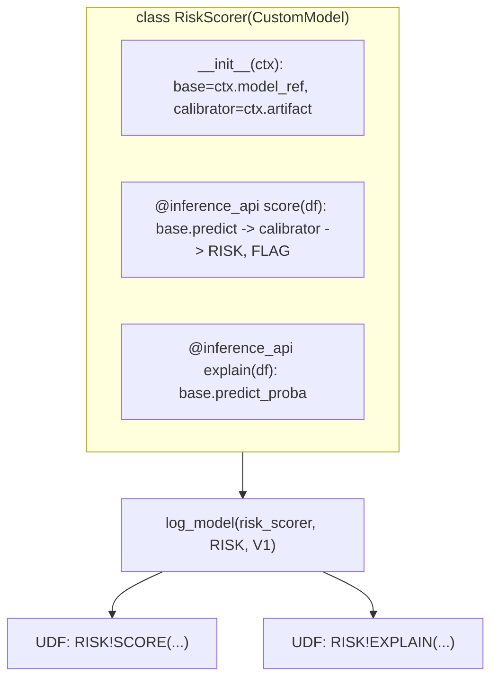

### Lab Exercise
```python
from snowflake.ml.model import custom_model
import pandas as pd

class ChurnEnsemble(custom_model.CustomModel):
    def __init__(self, context):
        super().__init__(context)
        self.xgb_mv = context.model_ref("XGB")
        self.lgb_mv = context.model_ref("LGB")

    @custom_model.inference_api
    def predict(self, input_df: pd.DataFrame) -> pd.DataFrame:
        p_xgb = self.xgb_mv.predict(input_df)["PRED_PROBA_1"]
        p_lgb = self.lgb_mv.predict(input_df)["PRED_PROBA_1"]
        p = 0.6 * p_xgb + 0.4 * p_lgb
        return pd.DataFrame({
            "ENSEMBLE_PROB": p,
            "ENSEMBLE_LABEL": (p > 0.5).astype(int)
        })

# Build and log
xgb_mv = reg.get_model("XGB_CHURN").version("V3")
lgb_mv = reg.get_model("LGB_CHURN").version("V2")

ctx = custom_model.ModelContext(models={"XGB": xgb_mv, "LGB": lgb_mv})
ensemble = ChurnEnsemble(ctx)

sample = train_df.limit(10).to_pandas()[FEATURE_COLS]
reg.log_model(
    ensemble,
    model_name="CHURN_ENSEMBLE",
    version_name="V1",
    sample_input_data=sample,
    conda_dependencies=["pandas","numpy","xgboost","lightgbm"]
)
```

### Gotchas / Exam Traps
- `ModelContext.models` references MUST be already-registered versions.
- Inference methods take and return pandas DataFrames in warehouse UDF mode (Snowpark converts).
- Keep inference_api methods short and side-effect-free — they run in UDF context with limits.

---

## Q10: How does model versioning work? Can you overwrite a version?

**Difficulty:** Foundation
**Exam relevance:** Versioning

### Answer
Model versions are immutable once logged. You cannot overwrite a version; you can only:
- Log a new version with a different name
- Delete a version (`mv.delete_version()`) and relog with the same name (not recommended)
- Rename a version (`mv.rename_version()`)
- Modify metadata (tags, comments, metrics) on an existing version — but not the artifact

Version names are user-chosen strings. If omitted, Snowflake auto-generates one (e.g., `V_20241029_1234`).

### First Principles
**Why immutable:** Production models must be auditable. If version V17 could be overwritten in place, you lose the ability to roll back or trace what was running on a given day.

**Why mutable metadata but immutable artifact:** You often want to add metrics or tags post-hoc (e.g., after offline evaluation on new data). Immutable artifact + mutable metadata captures the common case.

### Diagram
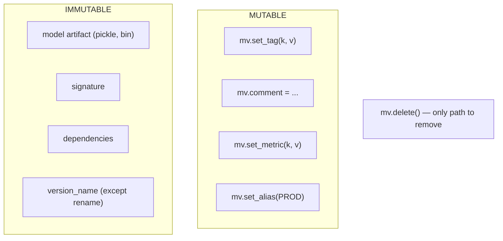

### Lab Exercise
```python
# Log V1
mv1 = reg.log_model(model_a, "CHURN", version_name="V1", ...)

# Later: metadata update is fine
mv1.set_metric("new_offline_eval_auc", 0.882)
mv1.set_tag("validated_by", "qa@org")

# Cannot overwrite V1's artifact; must log a new version
mv2 = reg.log_model(model_b, "CHURN", version_name="V2", ...)

# Rename
mv2.rename_version("V2_HOTFIX")

# Delete (rarely)
reg.get_model("CHURN").version("V_OLD").delete()
```

### Gotchas / Exam Traps
- Deleting a version while it's aliased or referenced by a service fails.
- Metrics are mutable; you can rewrite incorrect values. Tags same.
- Auto-generated version names include a timestamp — predictable.

---

## Q11: How do aliases work and when do you use them?

**Difficulty:** Intermediate
**Exam relevance:** Promotion patterns

### Answer
Aliases are mutable string pointers to specific versions. `DEFAULT` is auto-assigned to the latest version. Common user aliases: `PROD`, `SHADOW`, `CANARY`, `STAGING`. Promotion/demotion is a single `set_alias()` call.

Serving code references the alias (`MODEL@PROD!PREDICT(...)`) rather than a hardcoded version — making alias flips the atomic deployment unit.

### First Principles
**Why aliases over version names:** Serving code shouldn't know the current production version. Decoupling via alias means promotion is a metadata change, not a code deploy.

**Why atomic:** `set_alias` writes a single record. All future lookups resolve to the new target. No in-flight traffic sees inconsistent routing.

### Diagram
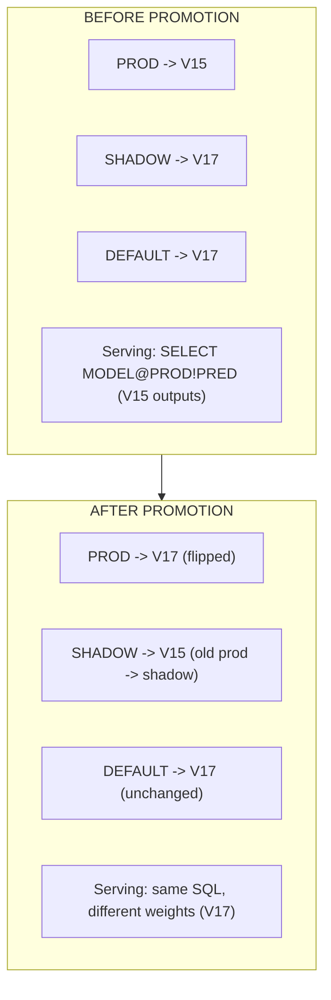

### Lab Exercise
```python
m = reg.get_model("CHURN")

# List current aliases
print(m.show_aliases())

# Set production alias
m.version("V17").set_alias("PROD")

# Move old prod to shadow (optional)
m.version("V15").set_alias("SHADOW")

# Serving: reference alias in SQL
session.sql("""
  SELECT CUSTOMER_ID,
    ML_DB.REGISTRY.CHURN!PREDICT(features) AS PROD_PRED,
    ML_DB.REGISTRY.CHURN!PREDICT(features, VERSION => 'SHADOW') AS SHADOW_PRED
  FROM SCORING_FEATURES
""").collect()

# Rollback is one line
m.version("V15").set_alias("PROD")
```

### Gotchas / Exam Traps
- `DEFAULT` alias is auto-set on `log_model`; you may want to manually re-point it.
- Aliases are scoped to one model; same alias name can exist on different models.
- `unset_alias` removes the pointer; serving code referencing unaliased alias fails.

---

## Q12: What are model tags and metrics, and how do they differ?

**Difficulty:** Foundation
**Exam relevance:** Metadata

### Answer
**Tags** — key-value string labels on a model or version. Used for organizational / governance info: `owner`, `cost_center`, `data_classification`, `approver`. Integrate with Snowflake object tags for schema-wide policies.

**Metrics** — numeric values attached to a version. Used for evaluation and tracking: `roc_auc`, `train_time_sec`, `test_accuracy`, `n_training_rows`. Can store scalars, dicts, or JSON.

Both are mutable. Tags are strings; metrics are numeric-centric.

### First Principles
**Why separate:** Different consumers. Tags power RBAC/policies (role-based tag filtering); metrics power dashboards and automated promotion decisions.

**Why both at version level:** A model has many versions, each with its own metrics (per experiment) and sometimes tags (per state of review).

### Diagram
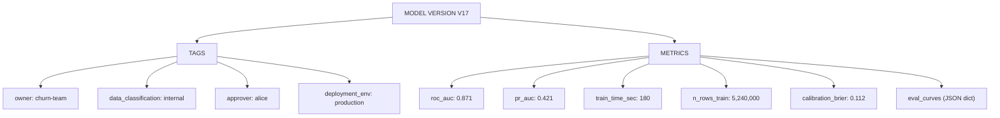

### Lab Exercise
```python
mv = reg.get_model("CHURN").version("V17")

# Set tags
mv.set_tag("owner", "churn-team@org")
mv.set_tag("approver", "alice@org")
mv.set_tag("data_classification", "internal")

# Set metrics
mv.set_metric("roc_auc", 0.871)
mv.set_metric("pr_auc", 0.421)
mv.set_metric("train_time_sec", 180)
mv.set_metric("calibration", {"brier": 0.112, "ece": 0.015})

# Read back
print(mv.show_tags())
print(mv.show_metrics())
```

### Gotchas / Exam Traps
- Snowflake object tags (via SQL `CREATE TAG`) are separate from the Registry's tag API — don't confuse.
- Metrics stored as dict are JSON internally; keep them small.
- Tag names/values follow Snowflake identifier rules.

---

## Q13: Walk through registering and serving a model whose dependencies include a non-Anaconda package.

**Difficulty:** Advanced
**Exam relevance:** Dependency management

### Answer
Three paths:
1. **Pure Anaconda** — `conda_dependencies=["pkg==X"]` where pkg is in Snowflake's Anaconda channel (pre-approved). Simplest, works in warehouse UDFs.
2. **Pip (SPCS-only)** — `pip_requirements=["pkg==X"]` falls back to SPCS deployment since warehouse UDFs restrict pip to vetted packages. You must `create_service()` to deploy.
3. **Custom image** — for truly niche deps, build your own container, specify in service spec.

### First Principles
**Why Anaconda channel curation:** Warehouse UDFs run in a shared Python runtime; arbitrary pip install would risk security and stability. Snowflake curates a safe channel.

**Why SPCS lifts the restriction:** Containers are isolated. You can install anything inside yours.

### Diagram
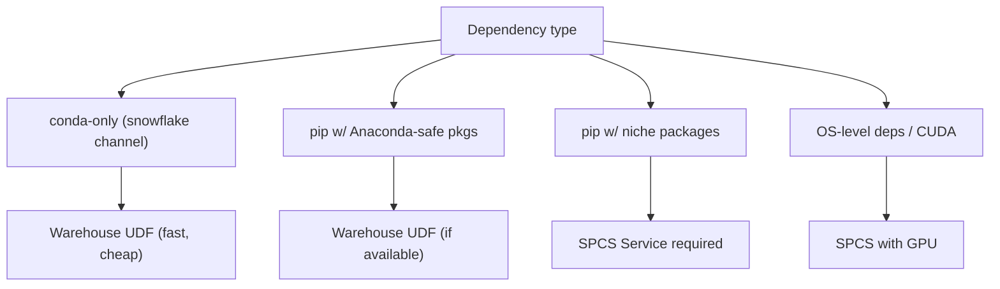

### Lab Exercise
```python
# Case A: all in Anaconda — works in warehouse
mv = reg.log_model(
    model, model_name="M", version_name="V1",
    conda_dependencies=["xgboost==1.7.5", "scikit-learn==1.3.0"],
    sample_input_data=sample
)
# SELECT ML_DB.REGISTRY.M!PREDICT(x) FROM ... <- works

# Case B: pip-only dep → deploy to SPCS
mv_pip = reg.log_model(
    custom_model_obj, model_name="N", version_name="V1",
    pip_requirements=["some-niche-pkg==0.1.2", "another==2.0"],
    sample_input_data=sample
)
mv_pip.create_service(
    service_name="N_SVC",
    service_compute_pool="SERVING_POOL",
    image_repo="ML_DB.REGISTRY.IMAGES",
    ingress_enabled=True
)
# Call via HTTPS
```

### Gotchas / Exam Traps
- Mixing conda + pip is possible but discouraged; conflicts can be painful.
- `relax_version=True` option lets Snowflake pick a compatible available version — useful if the pinned isn't on channel.
- Image build on first `create_service` can take minutes; subsequent updates are faster.

---

## Q14: How do you train on GPU in Snowflake? Walk through SPCS and ML Jobs options.

**Difficulty:** Advanced
**Exam relevance:** GPU training

### Answer
Two paths:

**ML Jobs API** (preferred for ad-hoc batch training):
```python
from snowflake.ml.jobs import remote

@remote(compute_pool="GPU_NV_S_POOL",
        stage_name="JOB_STAGE",
        pip_requirements=["torch==2.3.0","transformers==4.42"])
def train():
    # runs on GPU container; use torch.cuda
    ...
```

**Raw SPCS Service** (for persistent GPU workloads):
- Build a custom image, define a service with `GPU_NV_S` compute pool, submit training as a request to the service.

GPU pool sizing: `GPU_NV_S` (1x A10/A100 depending on region), `GPU_NV_M`, `GPU_NV_L`.

### First Principles
**Why ML Jobs for batch training:** Jobs are finite (run → done → compute returned). Services are long-running (persistent cost). GPU training is batch, so Jobs is the right lifecycle.

**Why GPU pools are per-region:** Hardware availability differs by cloud region. Not every region has every pool type.

### Diagram
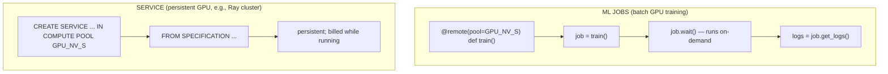

### Lab Exercise
```python
from snowflake.ml.jobs import remote
from snowflake.ml.registry import Registry

@remote(
    compute_pool="GPU_NV_S_POOL",
    stage_name="JOB_STAGE",
    pip_requirements=[
        "torch==2.3.0",
        "transformers==4.42.0",
        "accelerate==0.30.0",
        "datasets==2.19.0"
    ],
    external_access_integrations=["HF_ACCESS"]
)
def finetune_llm(base_model: str, dataset_name: str):
    import torch
    from transformers import (
        AutoTokenizer, AutoModelForCausalLM, TrainingArguments, Trainer
    )
    from snowflake.snowpark.context import get_active_session

    sess = get_active_session()
    data = sess.table(dataset_name).to_pandas()

    tok = AutoTokenizer.from_pretrained(base_model)
    mdl = AutoModelForCausalLM.from_pretrained(
        base_model, torch_dtype=torch.bfloat16, device_map="auto"
    )
    # ... build HF Dataset, train with Trainer ...
    mdl.save_pretrained("/tmp/finetuned")

    # Register
    from transformers import pipeline
    p = pipeline("text-generation", model="/tmp/finetuned", tokenizer=tok,
                 device=0)
    reg = Registry(sess, "ML_DB", "REGISTRY")
    reg.log_model(p, model_name="LLM_FT", version_name="V1",
                  sample_input_data=["Hello"],
                  conda_dependencies=["transformers==4.42.0","torch==2.3.0"])

job = finetune_llm("meta-llama/Llama-3-8B-Instruct", "TRAIN.INSTRUCT_DATA")
job.wait()
print(job.get_logs())
```

### Gotchas / Exam Traps
- GPU pools must be created first (`CREATE COMPUTE POOL ... INSTANCE_FAMILY=GPU_NV_S`).
- `external_access_integrations` is required for pulling models from HuggingFace Hub.
- GPU jobs can be interrupted; checkpoint during training.

---

## Q15: Describe distributed training patterns on Snowflake.

**Difficulty:** Advanced
**Exam relevance:** Distributed training

### Answer
Three patterns:
1. **Data-parallel in-warehouse** — some Snowpark ML estimators parallelize automatically (XGBoost tree histogram building across workers in the WH).
2. **Multi-worker on SPCS** — `DistributedXGBoost` and `DistributedLightGBM` in `snowflake.ml.modeling.distributors` wrap XGBoost dask/ray-style distribution across SPCS pool instances.
3. **Ray or PyTorch Distributed** — bring your own: `ML Jobs` or Service running Ray cluster, DDP, FSDP for deep learning.

### First Principles
**Why distribute:** When a single node can't hold the training frame or when training time is prohibitive. Data-parallel splits the data; model-parallel splits the model (for LLMs).

**Why Snowflake's distributor classes:** Hide the boilerplate of launching workers, coordinating gradients, aggregating trees. You write an sklearn-like fit, SDK orchestrates.

### Diagram
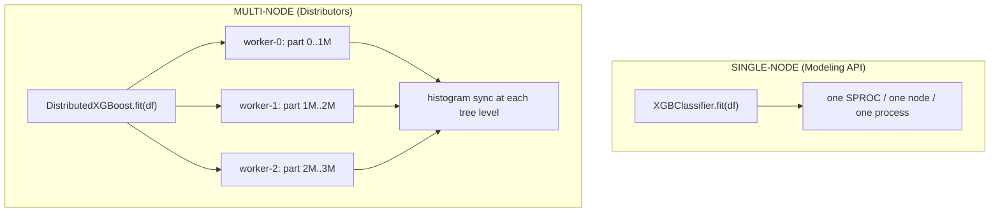

### Lab Exercise
```python
# DistributedXGBoost on SPCS
from snowflake.ml.modeling.distributors.xgboost import XGBEstimator
from snowflake.ml.modeling.distributors.xgboost.xgboost_estimator import (
    XGBScalingConfig
)

est = XGBEstimator(
    n_estimators=1000,
    params={"objective":"binary:logistic","max_depth":6,
            "tree_method":"hist","learning_rate":0.05},
    scaling_config=XGBScalingConfig(
        num_workers=4,
        num_cpu_per_worker=4
    )
)
est.fit(
    dataset=snowpark_dataset,                 # Snowflake Dataset
    input_cols=FEATURE_COLS,
    label_col="CHURNED"
)
model = est.get_model()
```

### Gotchas / Exam Traps
- Distributors run inside a Container Runtime notebook or ML Jobs — not warehouse.
- Num workers must fit within compute pool max nodes.
- Latency/overhead per iteration grows with workers — don't over-parallelize small jobs.

---

## Q16: How do you handle model artifacts that exceed warehouse UDF size limits?

**Difficulty:** Advanced
**Exam relevance:** Large model deployment

### Answer
Warehouse UDFs have practical limits on serialized model size (~several hundred MB to a few GB depending). For larger artifacts:
1. **Deploy via SPCS Model Serving** — containers can hold multi-GB models in memory indefinitely.
2. **Shard the model** — some frameworks (DeepSpeed, FSDP) support sharded checkpoints across containers.
3. **Load from stage on first call** — custom model fetches weights from stage into container cache.

Large LLMs almost always go via SPCS with GPU.

### First Principles
**Why warehouse limits:** UDFs run in a sandboxed Python runtime shared across queries. Loading a 10GB model per query is impractical. SPCS containers avoid this: the model loads once on container start, serves many requests.

**Why not just always SPCS:** SPCS runs 24/7 (cost). For small models, warehouse UDF scales to zero between queries.

### Diagram
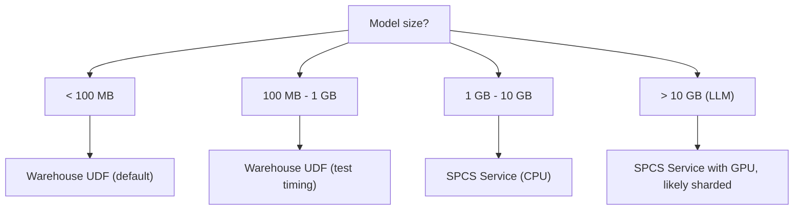

### Lab Exercise
```python
# Deploy a 7B-parameter LLM via SPCS
from transformers import AutoModelForCausalLM, AutoTokenizer

mdl = AutoModelForCausalLM.from_pretrained("mistralai/Mistral-7B-v0.1",
                                            torch_dtype="bfloat16")
tok = AutoTokenizer.from_pretrained("mistralai/Mistral-7B-v0.1")

from transformers import pipeline
pipe = pipeline("text-generation", model=mdl, tokenizer=tok)

mv = reg.log_model(
    pipe, model_name="MISTRAL_7B", version_name="V1",
    sample_input_data=["Hello"],
    conda_dependencies=["transformers==4.42","torch==2.3","accelerate"]
)

# Deploy to GPU pool
mv.create_service(
    service_name="MISTRAL_SVC",
    service_compute_pool="GPU_NV_M_POOL",
    image_repo="ML_DB.REGISTRY.IMG",
    ingress_enabled=True,
    gpu_requests="1",
    cpu_requests="4",
    memory_requests="24Gi",
    min_instances=1, max_instances=4
)
```

### Gotchas / Exam Traps
- Image build time on first deploy can be 10-30+ minutes for GPU LLMs.
- Set `max_batch_rows` on the service for throughput tuning.
- Suspend the service when not needed to control cost.

---

## Q17: What are the model dependencies caveats across Snowflake runtimes?

**Difficulty:** Advanced
**Exam relevance:** Runtime compatibility

### Answer
Three runtimes with different dep models:
- **Warehouse UDF** — Anaconda channel only; approved packages
- **SPCS Service / ML Jobs** — anything pip-installable; custom images allowed
- **Streamlit-in-Snowflake** — Anaconda channel subset (slightly different allowlist)

Logged dependencies are reconciled against the target runtime at deploy time. If you log pip-only deps, warehouse UDF deploy will fail or omit; `create_service` works.

### First Principles
**Why these differ:** Risk/complexity trade-off. Warehouse UDFs are shared, so Snowflake restricts to vetted packages. SPCS is container-isolated, so anything goes.

**Why pin versions:** Even on Anaconda, minor version differences can break serialization. Pin exact for production.

### Diagram
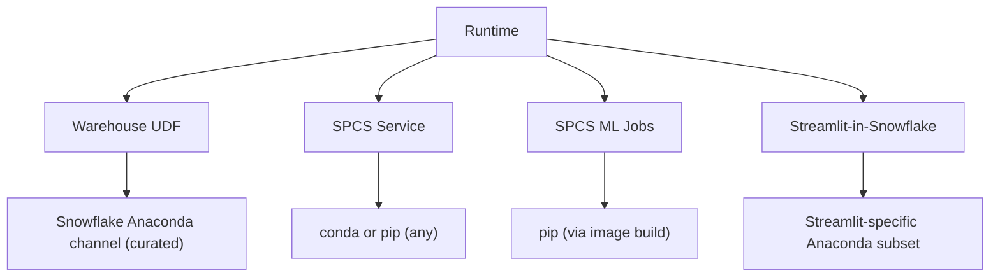

### Lab Exercise
```python
# Try to deploy a pip-only model to warehouse — will fail or warn
reg.log_model(
    model, model_name="X", version_name="V1",
    pip_requirements=["my-niche-pkg==0.1"]
)
# At serving:
# session.sql("SELECT X!PREDICT(...)") <- likely error

# Correct path: create_service for pip-only
mv.create_service(
    service_name="X_SVC",
    service_compute_pool="CPU_POOL",
    image_repo="ML_DB.REGISTRY.IMG",
    ingress_enabled=False
)
```

### Gotchas / Exam Traps
- Use `conda_dependencies` first; fall back to `pip_requirements` only when needed.
- `options={"relax_version": True}` lets Snowflake pick a compatible version.
- Check Anaconda channel availability for your deps before training.

---

## Q18: How do you add explainability / SHAP-style outputs to a registered model?

**Difficulty:** Advanced
**Exam relevance:** Explainability

### Answer
Options:
1. **Native explain function** (newer SDK) — some model types support `MODEL!EXPLAIN(...)` returning per-feature SHAP values when `enable_explainability=True` at log_model.
2. **CustomModel with explain method** — wrap the base model and expose SHAP via `@inference_api`.
3. **Downstream computation** — compute SHAP values in a separate step, store alongside predictions.

### First Principles
**Why explainability matters in regulated ML:** Compliance (GDPR, model risk management) requires justifying individual predictions. SHAP is the industry standard.

**Why Snowflake-native explain:** Avoids reimplementing SHAP. The Registry can wire up the explainer at log time.

### Diagram
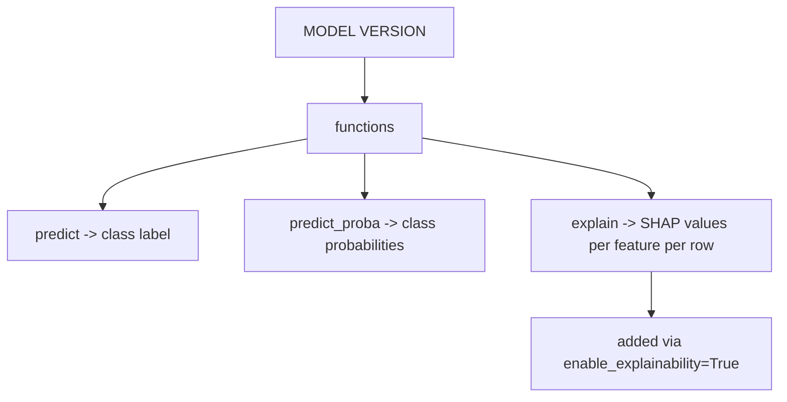

### Lab Exercise
```python
mv = reg.log_model(
    model, model_name="CHURN", version_name="V17",
    sample_input_data=train_df.limit(10),
    options={
        "enable_explainability": True   # auto-add explain function
    }
)

# SQL
session.sql("""
  SELECT CUSTOMER_ID,
    ML_DB.REGISTRY.CHURN!PREDICT(features) AS PRED,
    ML_DB.REGISTRY.CHURN!EXPLAIN(features) AS SHAP_VALUES
  FROM SCORING_FEATURES
  WHERE CUSTOMER_ID = 42
""").collect()
```

### Gotchas / Exam Traps
- Explainability function is more expensive than predict — budget accordingly.
- Not all model types support auto-explain; XGBoost/LightGBM yes, deep nets no.
- SHAP returns one value per feature per row; result column is an array/struct.

---

## Q19: What are the governance capabilities of the Model Registry?

**Difficulty:** Advanced
**Exam relevance:** Governance

### Answer
Governance surfaces:
- **RBAC** — grant USAGE/MODIFY on models/versions to roles
- **Object tags** on model objects (sensitive=true, approver=alice) — integrate with tag-based policies
- **Audit** via Account Usage views: `MODELS`, `MODEL_VERSIONS`, `MODEL_MONITOR_RUNS`
- **Comments and metrics** — serve as human-readable governance notes
- **Access history** — queries against model UDFs are logged in `QUERY_HISTORY` with full lineage

### First Principles
**Why models are first-class governed objects:** Models are regulated artifacts; "who deployed what when" is auditable just like a table. Snowflake treats them that way.

**Why access history matters:** For every prediction served, you can trace which role called the UDF with which data. Supports compliance reports.

### Diagram
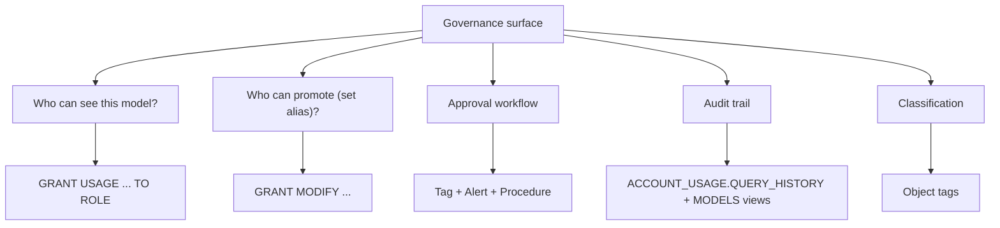

### Lab Exercise
```sql
-- Grant inference-only to a service role
GRANT USAGE ON MODEL ML_DB.REGISTRY.CHURN TO ROLE ML_SERVICE;
-- Allow promotion to a release manager
GRANT MODIFY ON MODEL ML_DB.REGISTRY.CHURN TO ROLE RELEASE_MANAGER;

-- Audit who ran the model
SELECT
  USER_NAME, ROLE_NAME, START_TIME, QUERY_TEXT
FROM SNOWFLAKE.ACCOUNT_USAGE.QUERY_HISTORY
WHERE QUERY_TEXT ILIKE '%ML_DB.REGISTRY.CHURN!PREDICT%'
  AND START_TIME >= DATEADD('day',-7,CURRENT_TIMESTAMP())
ORDER BY START_TIME DESC;

-- Classify a model
CREATE TAG IF NOT EXISTS ML_DB.REGISTRY.DATA_CLASSIFICATION;
ALTER MODEL ML_DB.REGISTRY.CHURN
  SET TAG DATA_CLASSIFICATION = 'confidential';
```

### Gotchas / Exam Traps
- Models and versions each have their own grants; test both.
- `ACCOUNT_USAGE.MODELS` has lineage info; `MODEL_MONITOR_RUNS` tracks monitor executions.
- Policies on data flow through: a model that reads masked data returns results consistent with the caller's role.

---

## Q20: Walk through retraining and version promotion with a proper evaluation gate.

**Difficulty:** Advanced
**Exam relevance:** Promotion workflow

### Answer
Pattern:
1. **Retrain** on fresh data → new candidate version `V_N+1`
2. **Offline evaluate** candidate on a holdout
3. **Compare** vs current `PROD` (same holdout) via champion/challenger metrics
4. **Shadow-deploy** candidate on live traffic for M days (prediction logging only)
5. **Statistical check** — are shadow predictions reasonable? Any schema drift?
6. **Promote** if candidate wins by margin > threshold: `set_alias("PROD", V_N+1)`
7. **Monitor** post-promotion; rollback by alias flip if regression detected

### First Principles
**Why gate:** A new model may have better offline AUC but worse calibration, worse rare-slice performance, or weird edge-case behavior. The gate catches these.

**Why shadow before promote:** Offline eval uses historical data; shadow uses live data. The two can disagree.

### Diagram
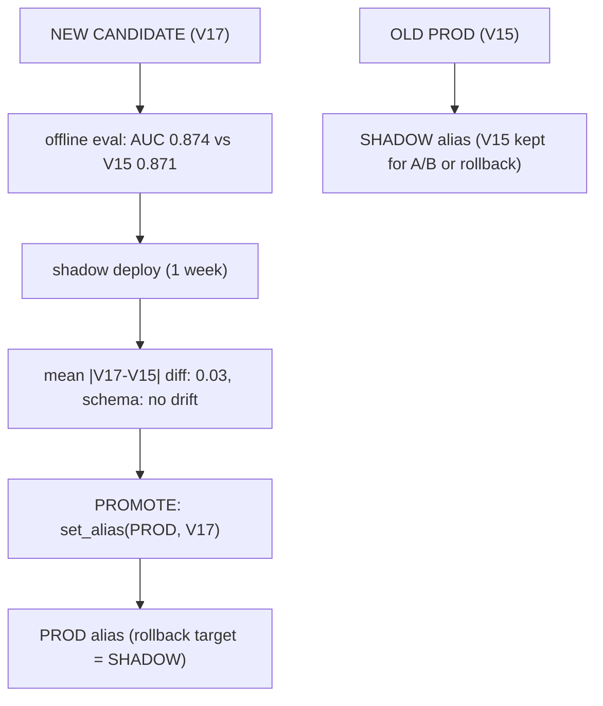

### Lab Exercise
```python
# Retrain
new_model = pipe.fit(fresh_train_df)
new_mv = reg.log_model(
    new_model, model_name="CHURN", version_name=None,
    metrics={"roc_auc_offline": offline_auc}
)

# Compare vs PROD
prod_mv = reg.get_model("CHURN").version_by_alias("PROD")
holdout = session.table("EVAL.HOLDOUT_Q4_2024")
new_pred = new_mv.run(holdout, function_name="predict_proba")
prod_pred = prod_mv.run(holdout, function_name="predict_proba")

# Offline deltas (compute in SQL)
from snowflake.ml.modeling.metrics import roc_auc_score
new_auc = roc_auc_score(df=new_pred, y_true_col_names=["CHURNED"],
                        y_score_col_names=["PRED_PROBA_1"])
prod_auc = roc_auc_score(df=prod_pred, ...)

print(f"Prod AUC: {prod_auc:.4f}, New AUC: {new_auc:.4f}")

if new_auc > prod_auc + 0.003:
    # Shadow deploy
    new_mv.set_alias("SHADOW")
    print("Deployed as SHADOW; monitor for 7 days")
    # (orchestrate automated promotion after 7 days if stable)
else:
    print("Candidate not better; archive")
    new_mv.set_tag("decision", "rejected")
```

### Gotchas / Exam Traps
- Significance tests on model comparisons help avoid promoting noise.
- Rollback plan should be written down before promotion.
- Automated promotion needs a kill-switch (e.g., human approver tag required).

---

## Q21: What are model Service endpoints and how are they discovered/invoked?

**Difficulty:** Intermediate
**Exam relevance:** SPCS serving

### Answer
`mv.create_service()` deploys the model to a SPCS compute pool as a long-running service with an HTTPS endpoint. The service URL is of the form `https://<account>-<org>.snowflakecomputing.app/<service_name>/<endpoint>`. Auth via OAuth bearer token.

For in-Snowflake invocation (another SPROC or Streamlit), you can also call the service UDF-style via `SELECT MODEL!PREDICT(...)` (the service exposes the function as a UDF too).

### First Principles
**Why both HTTPS and UDF:** HTTPS enables external apps; UDF enables in-DB composition (joins, DTs). Same service, two interfaces.

**Why `ingress_enabled` toggle:** Public HTTPS has security implications. If the service is for internal pipelines only, disable public ingress — only in-Snowflake callers can reach it.

### Diagram
```mermaid
flowchart TD
    subgraph SVC["SPCS SERVICE: mistral_svc (replicas 2-10, GPU)"]
        EP["Endpoints"]
        EP --> E1["/predict port 8080 (public)"]
        EP --> E2["/health port 8080 (internal)"]
        UDF["Also callable as SELECT MODEL!PREDICT(x) FROM ... (in-Snowflake)"]
    end
    EXT["external client"] -->|HTTPS| E1
    INDB["in-DB callers"] -->|SQL UDF| UDF
```

### Lab Exercise
```python
mv.create_service(
    service_name="CHURN_RT",
    service_compute_pool="SERVING_CPU",
    image_repo="ML_DB.REGISTRY.IMG",
    ingress_enabled=True,
    min_instances=2, max_instances=8,
    cpu_requests="1", memory_requests="4Gi"
)

# Get endpoint
svc = session.sql("SHOW ENDPOINTS IN SERVICE ML_DB.REGISTRY.CHURN_RT").collect()
print(svc)

# External client
import requests
token = get_oauth_token()
r = requests.post(
    "https://<account>.snowflakecomputing.app/CHURN_RT/predict",
    headers={"Authorization": f"Bearer {token}",
             "Content-Type": "application/json"},
    json={"data": [[1, {"AGE":35,"INCOME":50000}]]}
)
print(r.json())
```

### Gotchas / Exam Traps
- Service costs run while service is active — `ALTER SERVICE ... SUSPEND` when not needed.
- Autoscaling policies are per-service; tune min/max instances for traffic shape.
- Logs from the container live in `EVENT_TABLE` (if configured) or `SHOW SERVICE EVENTS`.

---

## Q22: How do you ensure reproducibility of a trained model six months later?

**Difficulty:** Advanced
**Exam relevance:** Reproducibility

### Answer
Pin four things:
1. **Dataset version** — materialized via `fs.generate_dataset(..., version=...)`
2. **Feature view versions** — tagged on model: `set_tag("fv_versions", "CUSTOMER_30D:V2;LTV:V1")`
3. **Code commit** — Git integration; `set_tag("code_commit", "abc123")`
4. **Dependency versions** — pinned in `conda_dependencies` / `pip_requirements`

Combined, these let you rerun training and get the identical artifact.

### First Principles
**Why pin all four:** Any single variation produces a different model. Pinning the Dataset isn't enough if the preprocessing code changed. Pinning deps isn't enough if the data changed.

**Why Snowflake-native pins help:** Dataset is immutable; FV version is immutable; the Registry pins deps. The only external pin is Git commit, which is handled via Git integration.

### Diagram
```mermaid
flowchart TD
    subgraph Bundle["REPRO BUNDLE: Model Version V17"]
        T["Tags"]
        T --> T1["dataset: CHURN_TRAIN:V2024_10_01"]
        T --> T2["fv_versions: CUSTOMER_30D:V2;LTV:V1"]
        T --> T3["code_commit: abc123def456"]
        T --> T4["python: 3.10"]
        D["Deps (immutable)"]
        D --> D1["xgboost==1.7.5"]
        D --> D2["scikit-learn==1.3.0"]
        D --> D3["snowflake-ml-python==1.5.0"]
    end
    Bundle --> R["To reproduce: git checkout abc123 && python train.py --dataset CHURN:V2024..."]
```

### Lab Exercise
```python
# At training time, record everything
import subprocess, platform
commit = subprocess.check_output(["git","rev-parse","HEAD"]).decode().strip()

mv = reg.log_model(
    pipe, model_name="CHURN", version_name="V17",
    sample_input_data=sample,
    conda_dependencies=["xgboost==1.7.5","scikit-learn==1.3.0"],
    metrics={"roc_auc": 0.871}
)
mv.set_tag("dataset_version", "CHURN_TRAIN:V2024_10_01")
mv.set_tag("fv_versions", "CUSTOMER_30D:V2;LTV:V1")
mv.set_tag("code_commit", commit)
mv.set_tag("python_version", platform.python_version())
mv.set_tag("sklearn_version", "1.3.0")
mv.set_tag("warehouse", session.get_current_warehouse())
```

### Gotchas / Exam Traps
- Dataset storage grows if you keep every version — define retention policy.
- Git commits are only reproducible if the repo exists; archive critical commits.
- Non-deterministic training (random seeds unseeded) can still yield slightly different artifacts — set `random_state`.

---

## Q23: How does the Registry handle multi-tenant or multi-team scenarios?

**Difficulty:** Advanced
**Exam relevance:** Enterprise patterns

### Answer
Patterns:
1. **One Registry per team** — different schemas, isolated grants. Simplest; limits cross-team sharing.
2. **Shared Registry, tagged by owner** — one schema, tags for governance, roles for RBAC.
3. **Dev / Stage / Prod Registries** — separate schemas; CI/CD promotes versions between them.

RBAC: grant `USAGE` on Registry/schema; grant `MODIFY` on specific models to specific roles; use tag-based access policies for fine-grained controls.

### First Principles
**Why multiple Registries:** Blast radius. A buggy team shouldn't be able to break production. Separate schemas with different RBAC isolates risk.

**Why dev/stage/prod separation:** Promotion gates. Writing to PROD requires elevated role. Models get promoted via CI from DEV → STAGE → PROD after validation.

### Diagram
```mermaid
flowchart TD
    DEV["DEV REGISTRY (ML_DEV.REGISTRY): CHURN, FRAUD (freely editable)"]
    STG["STAGE REGISTRY (ML_STAGE.REGISTRY): CHURN:V17 (after offline eval)"]
    PRD["PROD REGISTRY (ML_PROD.REGISTRY): CHURN:V17 (after shadow deploy)"]
    DEV --> STG --> PRD
    subgraph RBAC["RBAC"]
        R1["DATA_SCIENTIST: MODIFY on ML_DEV"]
        R2["MLOPS_RELEASE: MODIFY on ML_STAGE, ML_PROD"]
        R3["ML_SERVICE_RT: USAGE on ML_PROD only"]
    end
```

### Lab Exercise
```sql
-- Create three Registries
CREATE SCHEMA ML_DEV.REGISTRY;
CREATE SCHEMA ML_STAGE.REGISTRY;
CREATE SCHEMA ML_PROD.REGISTRY;

GRANT USAGE ON SCHEMA ML_DEV.REGISTRY TO ROLE DATA_SCIENTIST;
GRANT CREATE MODEL ON SCHEMA ML_DEV.REGISTRY TO ROLE DATA_SCIENTIST;
GRANT USAGE ON SCHEMA ML_PROD.REGISTRY TO ROLE ML_SERVICE_RT;
```

```python
# Promotion script (CI/CD)
dev_reg = Registry(sess, "ML_DEV", "REGISTRY")
prod_reg = Registry(sess, "ML_PROD", "REGISTRY")

model = dev_reg.get_model("CHURN").version("V17")
# Copy artifact + metadata to prod registry
# (API: reg.log_model with existing version download, or SQL CLONE)
```

### Gotchas / Exam Traps
- Snowflake has `CLONE` for schemas including models — fast promotion path.
- Prod Registry access should exclude developers to avoid accidental overwrites.
- Alias names repeat per Registry; align conventions.

---

## Q24: What are the newer Snowflake Model Registry features (as of recent releases)?

**Difficulty:** Advanced
**Exam relevance:** Current capabilities

### Answer
Recent additions (2024-2026 timeframe):
- **`enable_explainability=True`** — auto-generates explain function for supported model types
- **Container Services deployment of models with GPUs** — serve LLMs
- **Model Monitor** — built-in drift detection coupled with Registry versions
- **ML Jobs API** — async batch jobs for training
- **Model Serving with ingress** — HTTPS endpoints for real-time
- **Partitioned models** — one model per segment (per region, per customer tier)
- **Fine-tuning integration** — fine-tune Cortex models or your own, register as versions

### First Principles
**Why these matter for the exam:** The MLE-C01 blueprint tracks Snowflake's current capabilities. Expect questions on features released in the last 12 months.

### Diagram
```mermaid
flowchart TD
    C["Core (older): log_model, versions, aliases, UDF deploy"]
    C --> S["Serving: create_service (SPCS, GPU, ingress)"]
    S --> O["Observability: Model Monitor integration"]
    O --> L["LLM-ops: HuggingFace native type, large-model deployment"]
    L --> E["Explainability: enable_explainability option"]
    E --> P["Partitioned: per-segment models (one artifact serves many)"]
```

### Lab Exercise
```python
# Partitioned model: one model per region
from snowflake.ml.model import custom_model

class PartitionedModel(custom_model.CustomModel):
    """Routes to per-region sub-models."""
    def __init__(self, context):
        super().__init__(context)
        self.us = context.model_ref("US_MODEL")
        self.eu = context.model_ref("EU_MODEL")

    @custom_model.inference_api
    def predict(self, df: pd.DataFrame) -> pd.DataFrame:
        out = df.copy()
        us_mask = df["REGION"] == "US"
        eu_mask = df["REGION"] == "EU"
        out.loc[us_mask, "PRED"] = self.us.predict(df[us_mask])["PRED"].values
        out.loc[eu_mask, "PRED"] = self.eu.predict(df[eu_mask])["PRED"].values
        return out[["PRED"]]

ctx = custom_model.ModelContext(models={
    "US_MODEL": reg.get_model("CHURN_US").version("V5"),
    "EU_MODEL": reg.get_model("CHURN_EU").version("V5")
})
```

### Gotchas / Exam Traps
- Feature availability is region-dependent (SPCS GPU especially).
- Not all model types support `enable_explainability` — check docs.
- Partitioned/custom models cost per sub-model lookup; batch per partition.

---

## Q25: Give a cost + latency decision framework for training compute selection.

**Difficulty:** Advanced
**Exam relevance:** Compute selection

### Answer
Framework by model type / data size / SLA:

| Scenario                        | Compute                     | Why                                     |
|---------------------------------|-----------------------------|-----------------------------------------|
| Small tabular (< 1M rows)       | Warehouse XS/S              | Serverless, cheap                       |
| Medium tabular (1-50M rows)     | Warehouse M/L (standard)    | Fits in RAM, parallel scan              |
| Large tabular (50M-500M)        | Snowpark-opt M/L            | Memory headroom                         |
| Huge tabular (> 500M)           | Dist-XGBoost on SPCS        | Multi-worker                            |
| Deep learning (vision, NLP)     | SPCS GPU (ML Jobs)          | GPU acceleration                        |
| LLM fine-tuning                 | SPCS GPU_NV_M+              | Multi-GPU, memory                       |
| HP sweep (< 50 trials)          | Warehouse GridSearchCV      | Simple, cheap                           |
| HP sweep (> 50 trials)          | ML Jobs with Optuna/Ray     | Parallel across pool                    |

### First Principles
**Why memory, then GPU, then node-count:** The common bottleneck for ML is memory (training frame fit). Only after memory is OK does CPU/GPU matter. Only after single-node OK do you distribute.

**Why "SPCS always" is wrong:** 24/7 GPU pool costs orders of magnitude more than a 1-hour warehouse training job for an sklearn task.

### Diagram
```mermaid
flowchart TD
    Q1["Data fits in one node?"]
    Q1 -->|yes| Q2["Memory bound?"]
    Q1 -->|no| DIST["Distributed training (Dist-XGB on SPCS, Ray on SPCS)"]
    Q2 -->|yes| SOWH["Snowpark-opt warehouse"]
    Q2 -->|no| STDWH["Standard WH"]
    SOWH --> Q3["Then need GPU?"]
    STDWH --> Q3
    Q3 -->|yes| GPU["SPCS GPU (ML Jobs)"]
    Q3 -->|no| WH["Warehouse (Modeling API)"]
```

### Gotchas / Exam Traps
- Always benchmark; "it should fit" is unreliable. Try M, measure.
- Scale-up (bigger WH) and scale-out (SPCS workers) are different levers.
- Snowpark-optimized WH is not a GPU — doesn't help deep learning.

---

## Study Checklist

- [ ] Can walk through Modeling API end-to-end: fit, transform, predict, pipeline
- [ ] Can use GridSearchCV/RandomizedSearchCV correctly
- [ ] Can call `log_model` with signatures, dependencies, metrics, tags
- [ ] Can set/manage aliases for promotion and rollback
- [ ] Can write a CustomModel with multiple inference_api methods
- [ ] Can decide warehouse / SOWH / SPCS / ML Jobs for a given scenario
- [ ] Can set up a dev/stage/prod Registry topology
- [ ] Can enumerate reproducibility pins (dataset, FV, code, deps)
- [ ] Can use `create_service` to deploy a GPU model
