# Model Deployment & Inference — MLE-C01 Study Guide

## Exam Weight & Scope

**Approximate weight:** 18-22% of exam
**Scope:** Deploying registered models for consumption. Covers Warehouse (vectorized Python UDFs), Snowpark Container Services (SPCS) Model Serving, batch inference via Dynamic Tables, real-time inference, Streamlit-in-Snowflake as a UI layer, External Functions / External Access, inference optimization (batching, caching, warm pools), and cost/latency decision frameworks.

**You must be able to:**
- Decide warehouse UDF vs SPCS Service for a given latency/throughput/cost profile
- Design batch inference pipelines using Dynamic Tables and scheduled Tasks
- Deploy real-time endpoints via `create_service()` with scaling policies
- Integrate external callers (REST clients, external functions) with Snowflake-hosted models
- Optimize inference: vectorized UDFs, batch sizing, prediction caching, materialized scoring tables

---

## Core Concepts Map

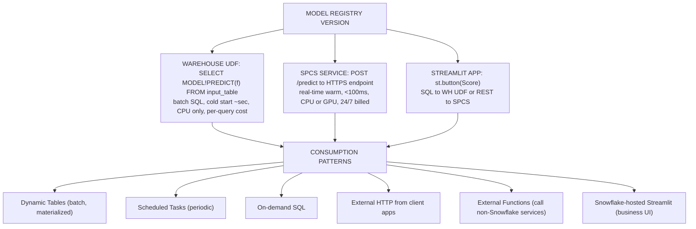

---

## Q1: Compare the two primary serving paths on Snowflake: Warehouse UDF vs SPCS Service.

**Difficulty:** Foundation
**Exam relevance:** Deployment path selection

### Answer
**Warehouse UDF** (default from `log_model`):
- Model becomes a callable function invoked from SQL: `SELECT MY_MODEL!PREDICT(features) FROM T`
- Executes inside a warehouse (CPU, Anaconda env), with vectorized Python UDF under the hood
- Serverless: scales with warehouse size and auto-suspends; cold start when WH is suspended
- Best for batch scoring, incremental scoring in Dynamic Tables, on-demand ad-hoc

**SPCS Model Serving** (via `mv.create_service()`):
- Model baked into a container, deployed to a compute pool with always-on instances
- HTTPS endpoint (optional public ingress) + in-DB UDF
- CPU or GPU; custom libraries OK
- Best for real-time (sub-100ms), high QPS, GPU inference, or models too large for WH UDF

### First Principles
**Why two paths, not one:** Different workloads have different physics.
- A nightly batch job wants cheap, serverless, scale-to-zero → warehouse UDF
- An interactive app wants warm, low-latency, GPU-capable → SPCS Service
- One abstraction can't be both.

**Why both resolve to UDF-callable:** Snowflake unifies the invocation interface: both paths register a function in the Registry schema. SQL callers don't care which runtime; they call `MY_MODEL!PREDICT(...)`.

### Diagram

**Warehouse UDF characteristics:**

| Dimension | Value |
|-----------|-------|
| Latency (p50) | 100ms - 1s |
| Cold start | 1-10s (WH resume) |
| Throughput | high (batched) |
| GPU | no |
| Model size | < ~1 GB |
| Scale to zero | yes |
| Cost at idle | ~0 |
| SQL callable | yes (native) |
| External HTTPS | no |
| Custom OS/lib | no |

**SPCS Service characteristics:**

| Dimension | Value |
|-----------|-------|
| Latency (p50) | 10 - 100ms |
| Cold start | none (warm) |
| Throughput | high (parallel) |
| GPU | yes |
| Model size | up to multi-GB |
| Scale to zero | partial (suspend) |
| Cost at idle | per-container-hr |
| SQL callable | yes (via UDF) |
| External HTTPS | yes (optional) |
| Custom OS/lib | yes |

### Lab Exercise
```python
mv = reg.get_model("CHURN").version("V17")

# Path A: Warehouse UDF (automatic from log_model, no further action)
session.sql("""
  SELECT CUSTOMER_ID,
    ML_DB.REGISTRY.CHURN!PREDICT(
      OBJECT_CONSTRUCT('AGE', AGE, 'INCOME', INCOME)
    ):PREDICTION::FLOAT AS CHURN_PROB
  FROM FEATURES.CUSTOMER_SCORING
""").collect()

# Path B: SPCS Service for real-time
mv.create_service(
    service_name="CHURN_RT",
    service_compute_pool="SERVING_POOL",
    image_repo="ML_DB.REGISTRY.IMG",
    ingress_enabled=True,          # external HTTPS endpoint
    min_instances=2, max_instances=10,
    cpu_requests="1", memory_requests="4Gi"
)
```

### Gotchas / Exam Traps
- The warehouse UDF path requires no deployment step after `log_model` — it's automatic.
- `ingress_enabled=False` keeps the service in-Snowflake-only (callable via SQL UDF but no public URL).
- Both paths share the same Registry version; same model, two runtimes.

---

## Q2: Walk through calling a model UDF from SQL. What does the invocation look like?

**Difficulty:** Foundation
**Exam relevance:** UDF syntax

### Answer
The Registry registers a model's inference functions as callable UDFs scoped by model name:

```sql
SELECT
  CUSTOMER_ID,
  <db>.<schema>.<MODEL_NAME>!<FUNCTION_NAME>(<input_object>) AS <alias>
FROM <input_table>
```

Where:
- `<MODEL_NAME>!<FUNCTION_NAME>` — the model and its exposed function (`PREDICT`, `PREDICT_PROBA`, `EXPLAIN`, custom)
- `<input_object>` — typically an OBJECT_CONSTRUCT mapping column names to values matching the signature
- Returns a struct/variant containing output columns from the signature

The alias `DEFAULT` is used if no version is specified; override via syntax `MY_MODEL!PREDICT(input, VERSION => 'V15')`.

### First Principles
**Why `!` syntax:** Snowflake uses `!` for model function invocation to distinguish from regular UDF calls. Readable: "call this model's predict method."

**Why OBJECT inputs:** Many models have multi-column inputs. Rather than fixing positional arguments, the UDF accepts a semi-structured OBJECT. The underlying signature validates keys.

### Diagram
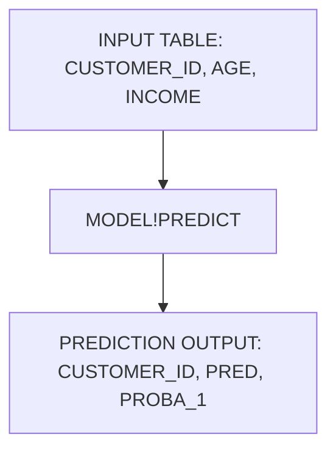

### Lab Exercise
```sql
-- Basic predict
SELECT
  CUSTOMER_ID,
  ML_DB.REGISTRY.CHURN!PREDICT(
    OBJECT_CONSTRUCT(
      'AGE', AGE,
      'INCOME', INCOME,
      'TENURE', TENURE,
      'COUNTRY', COUNTRY
    )
  ) AS PRED_OBJ,
  PRED_OBJ:PREDICTION::INT AS PRED_LABEL
FROM FEATURES.CUSTOMER_SCORING;

-- Predict with probability
SELECT
  CUSTOMER_ID,
  ML_DB.REGISTRY.CHURN!PREDICT_PROBA(
    OBJECT_CONSTRUCT_KEEP_NULL(*)
  ) AS PROBA_OBJ,
  PROBA_OBJ:PROBA_1::FLOAT AS CHURN_PROB
FROM FEATURES.CUSTOMER_SCORING;

-- Specific version
SELECT
  ML_DB.REGISTRY.CHURN!PREDICT(features, VERSION => 'V15')
FROM FEATURES.CUSTOMER_SCORING;

-- Alias
SELECT
  ML_DB.REGISTRY.CHURN!PREDICT(features, VERSION => 'SHADOW')
FROM FEATURES.CUSTOMER_SCORING;
```

### Gotchas / Exam Traps
- `OBJECT_CONSTRUCT(*)` includes every column — may send more than needed; prefer explicit keys when signature is strict.
- Mismatched keys/types return SQL errors — signature enforcement.
- Prediction output is a VARIANT; cast to the correct scalar type with `::INT`, `::FLOAT`, etc.

---

## Q3: Describe batch inference via Dynamic Tables. How does it compose with features?

**Difficulty:** Intermediate
**Exam relevance:** Batch inference

### Answer
A Dynamic Table whose SELECT invokes `MODEL!PREDICT()` continuously materializes predictions as a materialized table. The DT engine refreshes incrementally when the upstream feature table changes, re-scoring only new/changed rows (when detectable).

Compose with a feature-engineering DT: FEATURES DT → PREDICTIONS DT, both with `TARGET_LAG` controlling freshness.

### First Principles
**Why DTs for batch inference:** Declarative. You write "predictions = model(features)"; the engine handles when to run, incremental vs full, backfill. No cron code.

**Why incremental refresh is huge:** Scoring 500M customers daily is expensive. Scoring only the 50M who had activity today is 10x cheaper. DT does this when possible.

### Diagram
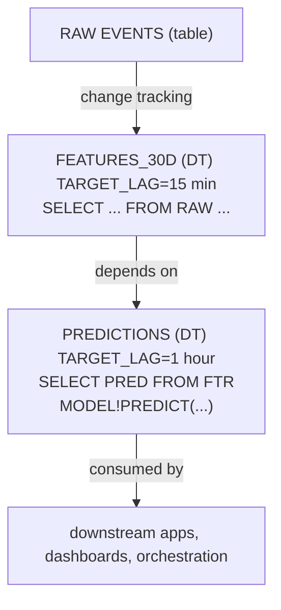

### Lab Exercise
```sql
-- Feature DT
CREATE OR REPLACE DYNAMIC TABLE FEATURES.CUSTOMER_30D
  TARGET_LAG = '15 minutes'
  WAREHOUSE = FEATURE_WH
AS
SELECT
  CUSTOMER_ID,
  SUM(CASE WHEN EVENT_TS >= DATEADD('day',-30,CURRENT_TIMESTAMP())
           THEN AMOUNT END) AS SPEND_30D,
  COUNT(DISTINCT SESSION_ID) AS SESSIONS_30D,
  COALESCE(COUNTRY, 'UNKNOWN') AS COUNTRY,
  AGE, TENURE_MONTHS
FROM RAW.EVENTS e
JOIN DIM.CUSTOMER c USING (CUSTOMER_ID)
GROUP BY CUSTOMER_ID, COUNTRY, AGE, TENURE_MONTHS;

-- Prediction DT
CREATE OR REPLACE DYNAMIC TABLE PRED.CUSTOMER_CHURN_PROB
  TARGET_LAG = '1 hour'
  WAREHOUSE = INFERENCE_WH
AS
SELECT
  CUSTOMER_ID,
  ML_DB.REGISTRY.CHURN!PREDICT(
    OBJECT_CONSTRUCT(
      'AGE', AGE, 'TENURE', TENURE_MONTHS,
      'SPEND_30D', SPEND_30D, 'SESSIONS_30D', SESSIONS_30D,
      'COUNTRY', COUNTRY
    )
  ):PROBA_1::FLOAT AS CHURN_PROB,
  CURRENT_TIMESTAMP() AS SCORED_AT
FROM FEATURES.CUSTOMER_30D;
```

### Gotchas / Exam Traps
- `TARGET_LAG = 'DOWNSTREAM'` on an upstream DT causes it to refresh only when a downstream DT needs it. Useful for cascading ML DAGs.
- Model UDFs are allowed in DTs; external access UDFs are not.
- Changing the model alias doesn't automatically trigger DT refresh — upstream data change does. For immediate update after alias flip, consider `ALTER DYNAMIC TABLE ... REFRESH`.

---

## Q4: What is a vectorized Python UDF and why does it matter for model inference?

**Difficulty:** Advanced
**Exam relevance:** Inference optimization

### Answer
A vectorized Python UDF processes multiple rows per invocation as a pandas DataFrame (or Arrow batch), rather than one row at a time. In Snowflake, model UDFs are automatically vectorized; the Python handler receives a batch of rows and returns a batch of predictions.

Vs row-by-row UDF: vectorized is 10-100x faster for ML workloads because:
- Python call overhead amortized across batch
- NumPy/pandas vectorized operations under the hood
- Model's own batched inference methods used (`model.predict(X_batch)` vs loop)

### First Principles
**Why row-by-row is slow:** Each Python call has fixed overhead (~0.1-1 ms). At 1M rows, that's hours of pure overhead. Batching to 10,000 rows per call cuts it to seconds.

**Why ML models love batching:** `sklearn.predict(X)` or `model.predict(df)` are inherently vectorized — internal matrix operations on NumPy. Row-at-a-time inference destroys this.

**Why Snowflake makes it automatic:** The Registry's UDF deployment wraps the model's predict in a vectorized handler by default. You don't have to decorate anything.

### Diagram
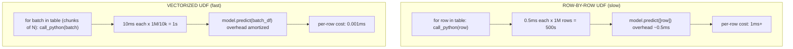

### Lab Exercise
```python
# Explicit vectorized Python UDF (if writing your own)
from snowflake.snowpark.types import PandasDataFrame, PandasSeries
from snowflake.snowpark.functions import pandas_udf
import pandas as pd

@pandas_udf(name="MY_MODEL_PREDICT", session=session, replace=True,
            input_types=[PandasDataFrame[int, float, int]],
            return_type=PandasSeries[float],
            packages=["xgboost==1.7.5","scikit-learn==1.3.0"])
def predict(df: pd.DataFrame) -> pd.Series:
    # df has one row per input row of SQL query; batched automatically
    return model.predict_proba(df)[:,1]

# Registry models do this under the hood — no decoration needed
```

### Gotchas / Exam Traps
- Batch size is configurable via `max_batch_rows` on service deployment or UDF param.
- Vectorized UDFs can OOM if batches are huge AND model is large; test with realistic data.
- Snowflake dynamically picks batch size; it's a per-partition hint, not fixed.

---

## Q5: How do you deploy a model to SPCS with GPU? Walk through compute pools and service specs.

**Difficulty:** Advanced
**Exam relevance:** GPU serving

### Answer
Steps:
1. **Create a GPU compute pool** — `CREATE COMPUTE POOL ... INSTANCE_FAMILY = GPU_NV_S` (or M/L depending on need)
2. **Set up an image repository** — `CREATE IMAGE REPOSITORY` in Registry schema
3. **Call `mv.create_service(...)`** with `gpu_requests="1"` and the compute pool
4. **Snowflake builds the image** (if not already) from the model's deps, deploys replicas
5. **Service exposes an endpoint** (internal UDF + optional public HTTPS)

### First Principles
**Why compute pools:** They decouple cluster management from service creation. One pool can host many services, pools can autoscale, and lifecycle is managed.

**Why image repositories:** Images are built once per model version + deps and cached. Updates re-use the cache when deps don't change.

**Why GPU for LLMs/vision:** Matrix ops are 10-100x faster on GPU vs CPU. For a 7B-param LLM, GPU is required for workable latency.

### Diagram
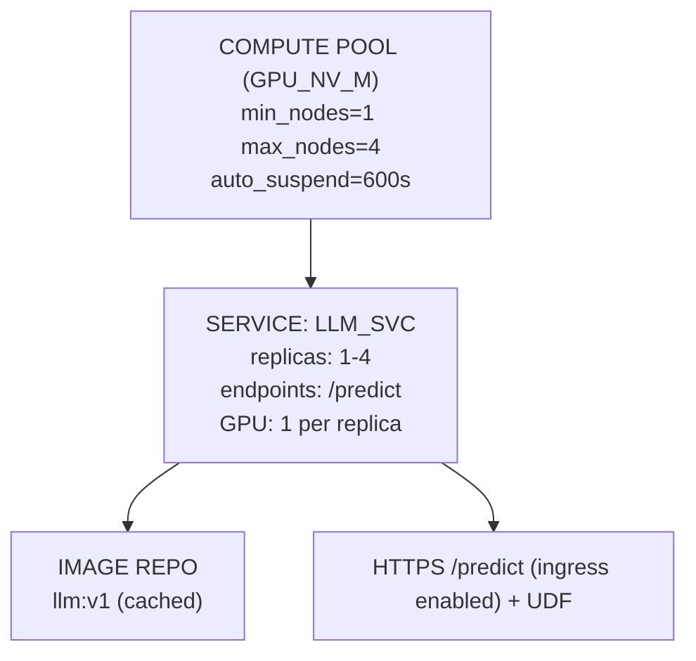

### Lab Exercise
```sql
-- 1. Compute pool (GPU)
CREATE COMPUTE POOL IF NOT EXISTS GPU_NV_M_POOL
  INSTANCE_FAMILY = GPU_NV_M
  MIN_NODES = 1 MAX_NODES = 4
  AUTO_SUSPEND_SECS = 600
  AUTO_RESUME = TRUE
  COMMENT = 'GPU pool for LLM serving';

-- 2. Image repository
CREATE IMAGE REPOSITORY IF NOT EXISTS ML_DB.REGISTRY.IMG;
```

```python
# 3. Deploy LLM model to GPU pool
mv = reg.log_model(
    hf_pipeline,                 # transformers pipeline
    model_name="LLAMA_7B_FT",
    version_name="V1",
    sample_input_data=["Hello"],
    conda_dependencies=["transformers==4.42","torch==2.3","accelerate"]
)
mv.create_service(
    service_name="LLAMA_SVC",
    service_compute_pool="GPU_NV_M_POOL",
    image_repo="ML_DB.REGISTRY.IMG",
    ingress_enabled=True,
    gpu_requests="1",            # per container
    cpu_requests="4",
    memory_requests="32Gi",
    min_instances=1, max_instances=4,
    max_batch_rows=16            # tune per throughput
)
```

### Gotchas / Exam Traps
- GPU instance families are region-dependent — verify availability.
- Image build on first deploy can take 10-30+ minutes for GPU workloads.
- `max_batch_rows` dramatically affects throughput — too small = underutilized GPU; too big = OOM.
- `SHOW SERVICES` / `DESCRIBE SERVICE` reveal status, URL, replicas.

---

## Q6: How do you invoke a Model Serving endpoint from outside Snowflake (e.g., a mobile app)?

**Difficulty:** Intermediate
**Exam relevance:** External invocation

### Answer
Steps:
1. Service created with `ingress_enabled=True` has a public HTTPS endpoint of the form `https://<account>-<org>.snowflakecomputing.app/<service_name>/<endpoint>`
2. Obtain an **OAuth2 bearer token** via Snowflake's token API (programmatic access tokens or OIDC)
3. HTTP POST JSON body matching the service's input schema
4. Parse JSON response

Alternatively, call via a Snowflake stored procedure that invokes the UDF (if the client already has Snowflake access).

### First Principles
**Why HTTPS + OAuth:** Standard web auth; works from any client. The service inherits Snowflake's RBAC — the token's underlying role determines access.

**Why not just a public endpoint:** Models often contain IP (fine-tuned weights, business logic). Auth prevents unauthorized use.

### Diagram
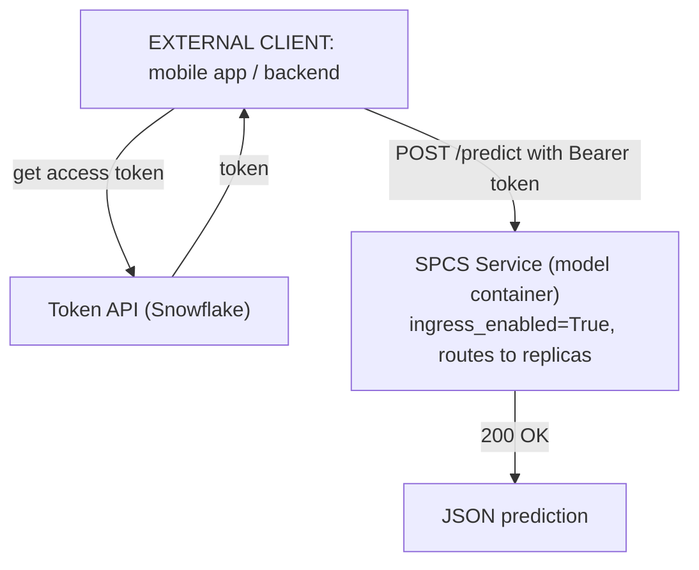

### Lab Exercise
```python
import requests
import json

# One-time: get an OAuth token (depends on auth method)
def get_snowflake_token():
    # Use external OIDC provider or Snowflake programmatic access token
    # Example: PAT (Programmatic Access Token) via Snowflake UI
    return "<redacted-token>"

token = get_snowflake_token()
url = "https://myorg-myaccount.snowflakecomputing.app/CHURN_RT/predict"

payload = {
    "data": [
        [0, {"AGE": 35, "INCOME": 50000, "TENURE": 24, "COUNTRY": "US"}],
        [1, {"AGE": 55, "INCOME": 90000, "TENURE": 120, "COUNTRY": "US"}]
    ]
}
r = requests.post(url,
    headers={"Authorization": f"Bearer {token}",
             "Content-Type": "application/json"},
    data=json.dumps(payload)
)
print(r.status_code, r.json())
# { "data": [[0, {"PRED": 0, "PROBA_1": 0.21}], [1, {"PRED": 1, "PROBA_1": 0.76}]] }
```

### Gotchas / Exam Traps
- The `data` payload format uses `[row_index, row_dict]` tuples — matches SQL input signature.
- Latency includes network RTT; co-locate client with Snowflake region when possible.
- Rate limits apply per service's replicas × QPS capacity.

---

## Q7: What is External Access Integration and when do you need it for inference?

**Difficulty:** Advanced
**Exam relevance:** Egress / integration

### Answer
External Access Integration (EAI) is Snowflake's security object controlling what external network endpoints Snowflake code (UDFs, SPROCs, SPCS Services) may call. For inference:
- **Not needed** for pure Snowflake-native inference (model UDF, SPCS service)
- **Needed** when:
  - A custom UDF calls an external REST API (e.g., third-party ML service)
  - SPCS service pulls packages or models from external sources (HuggingFace, PyPI) during build/startup
  - A model wraps calls to external LLM providers (OpenAI, Anthropic)

Configured via `CREATE NETWORK RULE` + `CREATE EXTERNAL ACCESS INTEGRATION`, bound to the function/service with `EXTERNAL_ACCESS_INTEGRATIONS = (...)`.

### First Principles
**Why egress is restricted by default:** Data exfiltration risk. If any UDF could POST customer data to any URL, security would be impossible.

**Why EAIs are explicit:** Each integration lists exactly which hosts are allowed. Audit-friendly.

### Diagram
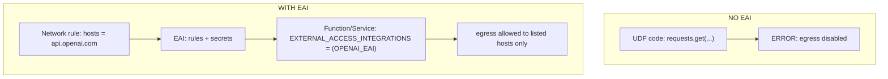

### Lab Exercise
```sql
-- Network rule for allowed hosts
CREATE OR REPLACE NETWORK RULE OPENAI_RULE
  MODE = EGRESS
  TYPE = HOST_PORT
  VALUE_LIST = ('api.openai.com:443');

-- Secret for API key
CREATE SECRET OPENAI_KEY
  TYPE = GENERIC_STRING
  SECRET_STRING = 'sk-<redacted>';

-- Integration
CREATE EXTERNAL ACCESS INTEGRATION OPENAI_EAI
  ALLOWED_NETWORK_RULES = (OPENAI_RULE)
  ALLOWED_AUTHENTICATION_SECRETS = (OPENAI_KEY)
  ENABLED = TRUE;

-- Bind to a Python UDF that calls OpenAI
CREATE OR REPLACE FUNCTION CALL_GPT(prompt STRING)
RETURNS STRING
LANGUAGE PYTHON RUNTIME_VERSION = '3.10'
PACKAGES = ('requests')
EXTERNAL_ACCESS_INTEGRATIONS = (OPENAI_EAI)
SECRETS = ('key' = OPENAI_KEY)
HANDLER = 'handler'
AS $$
import _snowflake, requests, json
def handler(prompt):
    key = _snowflake.get_generic_secret_string('key')
    r = requests.post(
        'https://api.openai.com/v1/chat/completions',
        headers={'Authorization': f'Bearer {key}'},
        json={'model':'gpt-4', 'messages':[{'role':'user','content':prompt}]}
    )
    return r.json()['choices'][0]['message']['content']
$$;
```

### Gotchas / Exam Traps
- EAI + SECRET grant: callers need USAGE on both.
- SPCS services declare EAI in the service spec, not at log_model.
- Avoid EAI when you can use Cortex functions (keeps data in-platform).

---

## Q8: Describe External Functions and when they're the right tool for inference.

**Difficulty:** Advanced
**Exam relevance:** External integration

### Answer
External Functions are UDFs that invoke external HTTPS endpoints (via API Integration) and return results to SQL. Used when:
- The ML model lives outside Snowflake (SageMaker, Vertex AI, OpenAI)
- You need to call a specific external service as part of a SQL pipeline
- Migration path: slowly move from external hosting to in-Snowflake

Not confused with Model Serving: External Functions call **out**; Model Serving brings models **in**.

### First Principles
**Why external functions still exist:** Not everything can be moved into Snowflake overnight. Legacy inference endpoints, specialized hardware, or third-party-only models still need to be callable.

**Why they're a bridge, not a destination:** Each row calls an external HTTP endpoint — latency, cost, and reliability all suffer vs native UDFs. Use for migration or integration-only, not strategic ML inference.

### Diagram
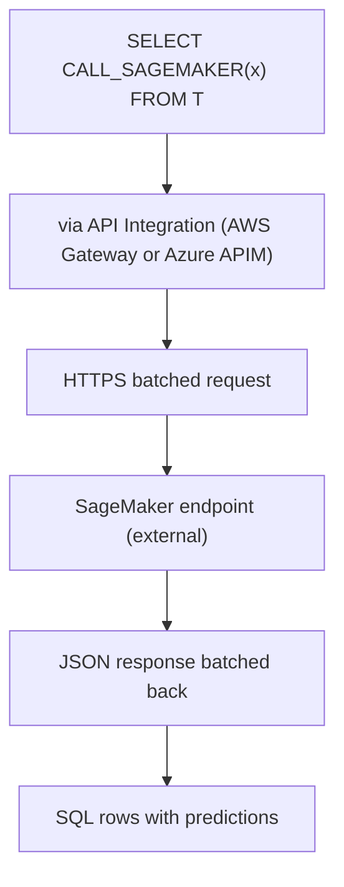

### Lab Exercise
```sql
-- API Integration for AWS API Gateway
CREATE OR REPLACE API INTEGRATION AWS_SAGEMAKER_INT
  API_PROVIDER = aws_api_gateway
  API_AWS_ROLE_ARN = 'arn:aws:iam::<acct>:role/snowflake-invoke-sagemaker'
  ENABLED = TRUE
  API_ALLOWED_PREFIXES = ('https://<id>.execute-api.us-east-1.amazonaws.com/prod/');

-- External function
CREATE OR REPLACE EXTERNAL FUNCTION SAGEMAKER_PREDICT(features VARIANT)
  RETURNS VARIANT
  API_INTEGRATION = AWS_SAGEMAKER_INT
  AS 'https://<id>.execute-api.us-east-1.amazonaws.com/prod/predict';

-- Use in SQL
SELECT CUSTOMER_ID, SAGEMAKER_PREDICT(OBJECT_CONSTRUCT(*)):prediction::FLOAT
FROM FEATURES.SCORING;
```

### Gotchas / Exam Traps
- External functions batch rows internally; one HTTP call per batch, not per row.
- Latency = network RTT + external compute → much slower than native UDF.
- Prefer native deployment (bring model to Snowflake) when possible.

---

## Q9: What is a scheduled Task-driven inference pipeline, and when to use it over a Dynamic Table?

**Difficulty:** Intermediate
**Exam relevance:** Batch patterns

### Answer
A scheduled Task runs a stored procedure at a cron-like interval. For inference:
- Task → calls SPROC → runs `INSERT INTO predictions SELECT PREDICT(...) FROM features`
- Full control over SQL (merge logic, deletes, logging)
- Can orchestrate multi-step pipelines (predict → write → notify → monitor)

Vs Dynamic Table:
- Task is **imperative** (I run this SQL every N minutes)
- DT is **declarative** (keep this result fresh with TARGET_LAG)
- Task fits when you need procedural control, DT when you need maintainable freshness

### First Principles
**Why both exist:** DTs can't call stored procedures or do multi-statement logic. Tasks can orchestrate anything, but you own the "when and how" decisions.

**Why task-chains:** For complex pipelines (ingest → feature → score → publish → monitor), a chain of tasks with dependencies gives you observability per step.

### Diagram
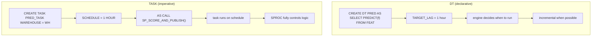

### Lab Exercise
```sql
CREATE OR REPLACE PROCEDURE ML.SP_SCORE_CUSTOMERS()
RETURNS STRING
LANGUAGE SQL
AS
BEGIN
  -- Step 1: refresh features (if needed)
  ALTER DYNAMIC TABLE FEATURES.CUSTOMER_30D REFRESH;

  -- Step 2: score + merge
  MERGE INTO PRED.CUSTOMER_CHURN tgt
  USING (
    SELECT CUSTOMER_ID,
      ML_DB.REGISTRY.CHURN!PREDICT(features):PROBA_1::FLOAT AS CHURN_PROB,
      CURRENT_TIMESTAMP() AS SCORED_AT
    FROM FEATURES.CUSTOMER_30D
    WHERE LAST_UPDATED > (SELECT MAX(SCORED_AT) FROM PRED.CUSTOMER_CHURN)
  ) src
  ON tgt.CUSTOMER_ID = src.CUSTOMER_ID
  WHEN MATCHED THEN UPDATE SET CHURN_PROB = src.CHURN_PROB, SCORED_AT = src.SCORED_AT
  WHEN NOT MATCHED THEN INSERT (CUSTOMER_ID, CHURN_PROB, SCORED_AT)
                        VALUES (src.CUSTOMER_ID, src.CHURN_PROB, src.SCORED_AT);

  -- Step 3: notify
  CALL ML.SP_NOTIFY_HIGH_RISK();
  RETURN 'OK';
END;

CREATE OR REPLACE TASK ML.T_SCORE_HOURLY
  WAREHOUSE = INFERENCE_WH
  SCHEDULE = '1 HOUR'
AS CALL ML.SP_SCORE_CUSTOMERS();

ALTER TASK ML.T_SCORE_HOURLY RESUME;
```

### Gotchas / Exam Traps
- Tasks must be explicitly RESUMED after creation.
- Task graphs (DAGs via `AFTER`) chain multiple tasks with dependencies.
- Use `TASK_HISTORY` for debugging failures.

---

## Q10: How does Snowflake auto-scale a model serving endpoint under load?

**Difficulty:** Advanced
**Exam relevance:** Scaling

### Answer
SPCS services autoscale replicas between `min_instances` and `max_instances` based on CPU/memory/queue depth. Autoscaling behavior:
- **Scale up** when load exceeds threshold (configurable via service spec)
- **Scale down** when load is low
- **Scale to zero**: possible if `min_instances=0`, but incurs cold start on next request

For warehouse UDF inference, scaling means:
- Vertical: larger warehouse size → more memory/CPU per node
- Horizontal: `MAX_CLUSTER_COUNT > 1` → more warehouse clusters for concurrent queries

### First Principles
**Why min=0 is tempting but risky:** Zero running replicas = $0 cost, but first user waits for cold start (container boot, model load). Not acceptable for consumer SLAs.

**Why warehouse scaling differs:** Warehouses scale per-query (bigger warehouse size for one big query) or per-concurrency (more clusters for many queries). SPCS scales per-replica for throughput.

### Diagram
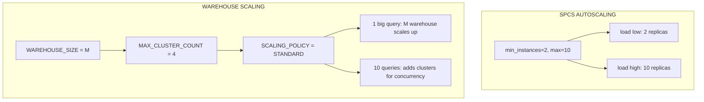

### Lab Exercise
```python
# SPCS service with autoscaling
mv.create_service(
    service_name="CHURN_RT",
    service_compute_pool="SERVING_POOL",
    image_repo="ML_DB.REGISTRY.IMG",
    ingress_enabled=True,
    min_instances=2,         # always-on
    max_instances=20,        # scale cap
    cpu_requests="1", memory_requests="2Gi"
)
```

```sql
-- Warehouse scaling for concurrent batch scoring
ALTER WAREHOUSE INFERENCE_WH SET
  WAREHOUSE_SIZE = 'MEDIUM'
  MAX_CLUSTER_COUNT = 8
  MIN_CLUSTER_COUNT = 1
  SCALING_POLICY = STANDARD
  AUTO_SUSPEND = 60;
```

### Gotchas / Exam Traps
- SPCS compute pool must have enough nodes to host max_instances replicas.
- Autoscaling has lag — not instantaneous; plan min_instances for peak baseline.
- Warehouse MAX_CLUSTER_COUNT adds clusters for *concurrency*, not single-query speed.

---

## Q11: Describe prediction caching strategies on Snowflake.

**Difficulty:** Advanced
**Exam relevance:** Inference optimization

### Answer
Three cache layers:
1. **Result cache** — Snowflake's native query result cache (24-hour). If the same SQL ran with same data, returns cached result.
2. **Materialized predictions** — Dynamic Table / scheduled table of pre-computed predictions. Serves as a fast lookup for repeat queries.
3. **Application cache** — in SPCS service or external app, cache `(input_hash → prediction)` with TTL.

### First Principles
**Why cache predictions:** Models are deterministic; the same input yields the same output. Scoring the same customer twice in 10 minutes is wasted work.

**Why Snowflake's result cache helps:** For an unchanged query, Snowflake returns cached result in milliseconds, bypassing compute. But if source data changed (even slightly), cache invalidates.

**Why materialized is often best:** A DT of predictions keeps the latest for every entity, served by key lookup. Not reliant on query-text matching.

### Diagram
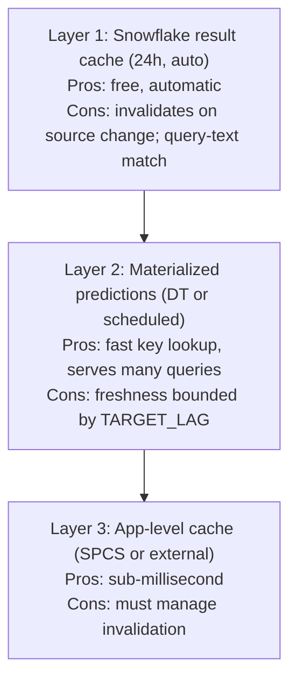

### Lab Exercise
```sql
-- Layer 2: materialized predictions (DT)
CREATE OR REPLACE DYNAMIC TABLE PRED.CUSTOMER_SCORES
  TARGET_LAG = '1 hour'
  WAREHOUSE = INFERENCE_WH
AS
SELECT
  CUSTOMER_ID,
  ML_DB.REGISTRY.CHURN!PREDICT(features):PROBA_1::FLOAT AS SCORE,
  CURRENT_TIMESTAMP() AS SCORED_AT
FROM FEATURES.CUSTOMER_30D;

-- Downstream queries hit the DT (fast key lookup)
SELECT SCORE FROM PRED.CUSTOMER_SCORES WHERE CUSTOMER_ID = 42;
```

```python
# Layer 3: in-service cache (SPCS)
from cachetools import TTLCache
import hashlib, json

cache = TTLCache(maxsize=1_000_000, ttl=600)  # 10-min TTL

def predict_cached(features: dict):
    key = hashlib.sha256(json.dumps(features, sort_keys=True).encode()).hexdigest()
    if key in cache:
        return cache[key]
    pred = model.predict(features)
    cache[key] = pred
    return pred
```

### Gotchas / Exam Traps
- Result cache invalidates even on micro-partition changes to underlying tables — don't rely on it for ML.
- DT staleness is bounded by TARGET_LAG; align with SLA.
- Cache hit rate is monitorable; low hit rate = too-aggressive key space, raise TTL or coarsen keys.

---

## Q12: What role does Streamlit-in-Snowflake play as a serving layer?

**Difficulty:** Intermediate
**Exam relevance:** UI serving

### Answer
Streamlit-in-Snowflake (SiS) is a hosted Streamlit app runtime inside Snowflake. For inference, SiS:
- Hosts an interactive UI that calls model UDFs via SQL
- Provides a dashboard for monitoring metrics
- Serves as a reviewer tool for ML approval workflows
- Hosts an internal "ML copilot" where business users query models

All computation happens via Snowflake session; no external hosting.

### First Principles
**Why SiS for inference:** Many ML consumers aren't ML teams — they're analysts, product managers, support reps. They don't want a REST API; they want a point-and-click interface. SiS gives you that without managing a separate web server.

**Why not for external-facing apps:** SiS requires Snowflake login. For external consumer apps, go SPCS Service + mobile/web frontend.

### Diagram
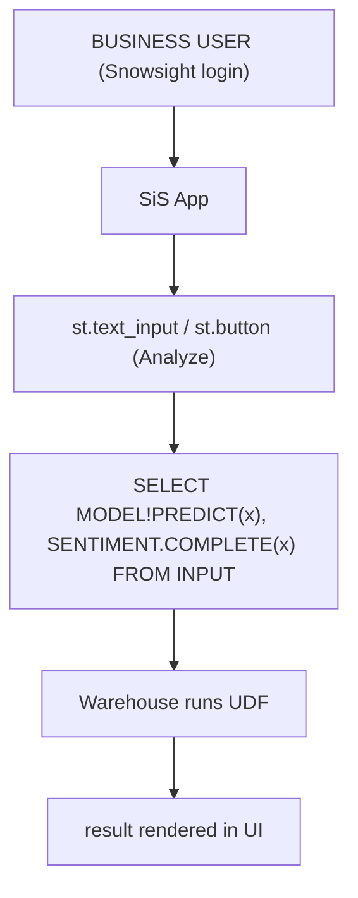

### Lab Exercise
```python
# streamlit_app.py (SiS)
import streamlit as st
from snowflake.snowpark.context import get_active_session

session = get_active_session()
st.title("Customer Risk Scorer")

customer_id = st.number_input("Customer ID", min_value=1)
if st.button("Score"):
    rows = session.sql(f"""
        SELECT ML_DB.REGISTRY.CHURN!PREDICT(
          OBJECT_CONSTRUCT_KEEP_NULL(*)
        ):PROBA_1::FLOAT AS CHURN_PROB
        FROM FEATURES.CUSTOMER_30D
        WHERE CUSTOMER_ID = {int(customer_id)}
    """).collect()
    if rows:
        st.metric("Churn probability", f"{rows[0]['CHURN_PROB']:.1%}")
    else:
        st.warning("Customer not found")

# Optional: show historical scores
hist = session.sql(f"""
    SELECT SCORED_AT, SCORE FROM PRED.CUSTOMER_SCORES
    WHERE CUSTOMER_ID = {int(customer_id)}
    ORDER BY SCORED_AT DESC LIMIT 50
""").to_pandas()
st.line_chart(hist.set_index("SCORED_AT"))
```

### Gotchas / Exam Traps
- SiS compute runs on an attached warehouse (per-user session) — cost shows up there.
- Only Anaconda-channel packages available in SiS runtime.
- SiS apps can be versioned via Git integration (deploy via `CREATE STREAMLIT`).

---

## Q13: What's the strategy for inference on partitioned data (per-region, per-segment models)?

**Difficulty:** Advanced
**Exam relevance:** Partitioned inference

### Answer
Three patterns:
1. **One model per partition** registered separately; routing in SQL (`CASE WHEN region='US' THEN US_MODEL!PREDICT(...) ELSE EU_MODEL!PREDICT(...)`)
2. **Partitioned CustomModel** — a `CustomModel` holds references to per-partition sub-models and routes internally
3. **Model-per-row via UDF trick** — a UDF parameterized by partition key reads which sub-model to call

Pattern 2 is preferred: cleanly versioned as one model artifact, routing logic co-located with model.

### First Principles
**Why partition:** Different populations have different data distributions. One model doesn't fit all. Per-partition models often outperform a global model.

**Why one Registry artifact (CustomModel):** Simpler ops. One model name, one alias, one monitoring surface. Internal routing is implementation detail.

### Diagram
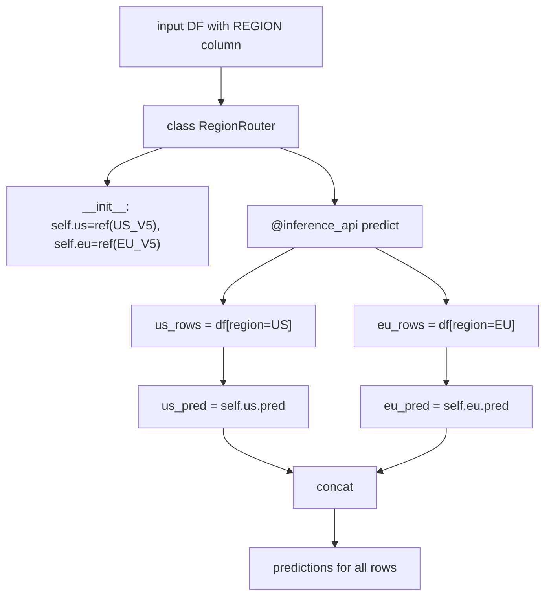

### Lab Exercise
```python
from snowflake.ml.model import custom_model
import pandas as pd

class RegionRouter(custom_model.CustomModel):
    def __init__(self, context):
        super().__init__(context)
        self.us_model = context.model_ref("US_MODEL")
        self.eu_model = context.model_ref("EU_MODEL")
        self.ap_model = context.model_ref("AP_MODEL")

    @custom_model.inference_api
    def predict(self, df: pd.DataFrame) -> pd.DataFrame:
        out = df[["REGION"]].copy()
        out["PRED"] = 0.0
        for region, mdl in [("US", self.us_model),
                            ("EU", self.eu_model),
                            ("AP", self.ap_model)]:
            mask = df["REGION"] == region
            if mask.any():
                sub = df[mask].drop(columns=["REGION"])
                out.loc[mask, "PRED"] = mdl.predict(sub)["PREDICTION"].values
        return out[["PRED"]]

ctx = custom_model.ModelContext(models={
    "US_MODEL": reg.get_model("CHURN_US").version("V5"),
    "EU_MODEL": reg.get_model("CHURN_EU").version("V5"),
    "AP_MODEL": reg.get_model("CHURN_AP").version("V5")
})
router = RegionRouter(ctx)
reg.log_model(router, model_name="CHURN_GLOBAL", version_name="V1",
              sample_input_data=sample_with_region)
```

### Gotchas / Exam Traps
- Children versions must exist before logging the router.
- Keep per-partition metrics for monitoring; a global drop may hide a per-partition regression.
- CustomModel adds some overhead per batch — benchmark if latency-critical.

---

## Q14: How do you deploy a model as a Snowflake Function (not a Service)?

**Difficulty:** Intermediate
**Exam relevance:** Function deployment

### Answer
`log_model` auto-creates callable functions in the Registry schema. The MLE can also wrap arbitrary models as regular UDFs with Snowpark:
- `@sproc` / `@udf` decorators for standalone functions
- `pandas_udf` for vectorized batch

But the Registry UDF path is strongly preferred — it handles signatures, dependencies, versioning in one place.

### First Principles
**Why Registry UDF over hand-rolled:** Governance. Hand-rolled UDFs lack version aliases, metrics, lineage tagging. Registry gives you all for free.

**Why hand-rolled still useful:** For small, one-off predict functions that don't warrant model versioning (e.g., a tiny deterministic rule-based classifier).

### Diagram
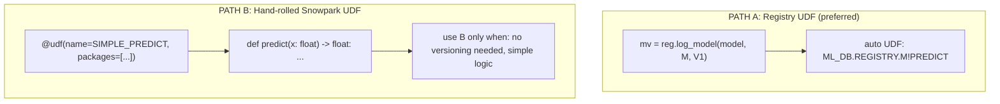

### Lab Exercise
```python
# Hand-rolled UDF (not using Registry)
from snowflake.snowpark.functions import udf, pandas_udf
from snowflake.snowpark.types import FloatType, PandasDataFrame, PandasSeries

@pandas_udf(name="SIMPLE_SCORE", session=session, replace=True,
            input_types=[PandasDataFrame[float, float]],
            return_type=PandasSeries[float],
            packages=["scikit-learn==1.3.0"])
def score(df):
    # loads a tiny pickled model from a stage once per worker
    import pickle, snowflake.snowpark.files
    with open("/tmp/model.pkl","rb") as f:
        m = pickle.load(f)
    return m.predict(df)

session.sql("SELECT SIMPLE_SCORE(x, y) FROM T").collect()
```

### Gotchas / Exam Traps
- Hand-rolled UDFs stage models manually; Registry does it for you.
- `pandas_udf` is the vectorized variant — much faster.
- For production, prefer Registry UDFs unless the UDF has no ML artifact.

---

## Q15: Explain batch size optimization for vectorized UDFs and SPCS services.

**Difficulty:** Advanced
**Exam relevance:** Performance tuning

### Answer
Batch size trades off latency vs throughput:
- **Small batch (10-100)** — low latency per request, high per-row overhead
- **Large batch (1000-10000)** — high throughput, higher memory, higher per-request latency

For warehouse UDFs: Snowflake chooses batch size dynamically; you influence via query shape and partitioning.
For SPCS services: `max_batch_rows` on `create_service` sets the inner batch size.

Benchmark with representative data to find the sweet spot.

### First Principles
**Why batch size matters for GPU:** GPU utilization is sublinear in small batches. A batch of 1 uses ~5% of GPU; batch of 32 uses ~80%. You need enough batch to saturate the matrix units.

**Why batch size matters for CPU:** Mostly for pandas/NumPy vectorization. Diminishing returns past ~1000 rows for tabular models.

### Diagram
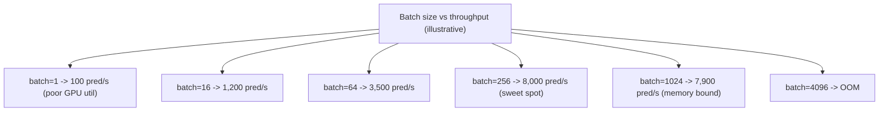

### Lab Exercise
```python
# Service with tuned batch size
mv.create_service(
    service_name="LLM_SVC",
    service_compute_pool="GPU_NV_M_POOL",
    image_repo="ML_DB.REGISTRY.IMG",
    ingress_enabled=True,
    gpu_requests="1",
    max_batch_rows=64,          # tune per model
    min_instances=1, max_instances=4
)

# Benchmark different batch sizes externally
import requests, time
for bs in [1, 8, 32, 128, 512]:
    payload = {"data": [[i, {"text":"..."}] for i in range(bs)]}
    t0 = time.time()
    r = requests.post(url, headers=..., json=payload)
    dt = time.time() - t0
    print(f"batch {bs}: {bs/dt:.0f} rows/sec")
```

### Gotchas / Exam Traps
- Too-large batches cause OOM — fail fast and tune down.
- Model's own `predict` may have an optimal internal batch; align `max_batch_rows` to that.
- Mixed-length inputs (text) complicate batching — pad or group by length.

---

## Q16: How do you perform A/B testing between two model versions in production?

**Difficulty:** Advanced
**Exam relevance:** Experimentation

### Answer
Patterns:
1. **Hash-based routing** — route traffic by `hash(customer_id) % 10 < 5 → A, else B`
2. **Alias-based** — two aliases (`PROD_A`, `PROD_B`) each pointing to a version; serving layer picks
3. **Shadow deploy (double-scored)** — score with both, use A for decisions, log B's output for comparison

Analysis: compare downstream outcome metrics (conversion, revenue, retention) between A and B populations.

### First Principles
**Why hash-based:** Deterministic per-user assignment. The same user always sees the same model → consistent experience; outcomes are attributable.

**Why alias-based beats hard-coded version strings:** Alias flip is atomic; experiment start/end are cheap.

### Diagram
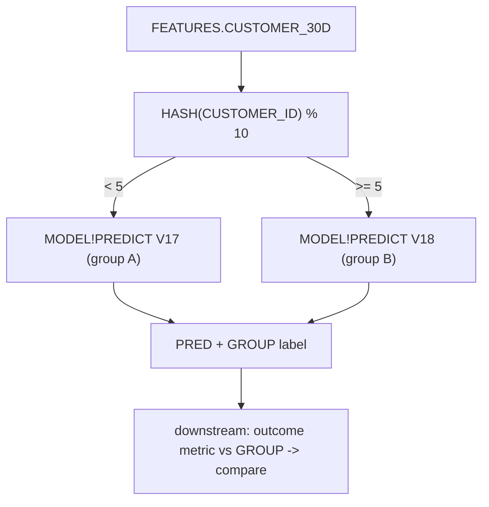

### Lab Exercise
```sql
CREATE OR REPLACE DYNAMIC TABLE PRED.AB_PREDICTIONS
  TARGET_LAG = '1 hour'
  WAREHOUSE = INFERENCE_WH
AS
SELECT
  CUSTOMER_ID,
  CASE WHEN ABS(HASH(CUSTOMER_ID)) % 100 < 50 THEN 'A' ELSE 'B' END AS AB_GROUP,
  CASE
    WHEN ABS(HASH(CUSTOMER_ID)) % 100 < 50
      THEN ML_DB.REGISTRY.CHURN!PREDICT(features, VERSION => 'V17'):PROBA_1::FLOAT
    ELSE ML_DB.REGISTRY.CHURN!PREDICT(features, VERSION => 'V18'):PROBA_1::FLOAT
  END AS PRED,
  CURRENT_TIMESTAMP() AS SCORED_AT
FROM FEATURES.CUSTOMER_30D;

-- Analysis after enough traffic
SELECT
  AB_GROUP,
  AVG(ACTUAL_CHURN)   AS actual,
  AVG(PRED)            AS pred_mean,
  COUNT(*)             AS n
FROM PRED.AB_PREDICTIONS p
JOIN OUTCOMES o USING (CUSTOMER_ID)
GROUP BY AB_GROUP;
```

### Gotchas / Exam Traps
- Random % 100 isn't stable per user over time if you re-hash — use consistent hash of a stable key.
- Statistical significance requires adequate sample size — compute minimum detectable effect.
- A/B tests change user experience; coordinate with product/privacy.

---

## Q17: Walk through a cost comparison: warehouse UDF vs SPCS Service for 10M predictions/day.

**Difficulty:** Advanced
**Exam relevance:** Cost framework

### Answer
Simplified example:
- **Warehouse UDF (M warehouse)**: 10M predictions scored in ~10 min of warehouse time. 1x M-warehouse = 4 credits/hr. 10 min = ~0.67 credits/day → ~$1-2/day.
- **SPCS CPU Service (always-on, min=2 S instances)**: 2 S containers at 24h × $$ per container-hr → ~$30-60/day.

If daily volume → warehouse wins by 10-30x for batch-friendly loads. If latency-sensitive real-time → SPCS wins because warehouse has cold-start, concurrency limits.

### First Principles
**Why warehouse is cheaper for batch:** You pay only for the compute time used; auto-suspends in seconds. 10 minutes/day is negligible cost.

**Why SPCS is more expensive at idle:** Containers run 24h regardless of load; you pay for availability, not use.

### Diagram
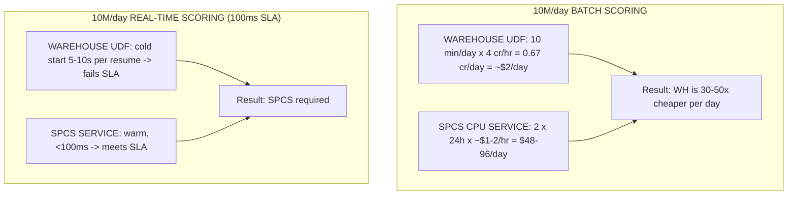

### Lab Exercise
```sql
-- Audit SPCS costs
SELECT
  COMPUTE_POOL_NAME,
  SUM(CREDITS_USED) AS CREDITS
FROM SNOWFLAKE.ACCOUNT_USAGE.COMPUTE_POOL_METERING_HISTORY
WHERE START_TIME >= DATEADD('day',-30,CURRENT_TIMESTAMP())
GROUP BY 1 ORDER BY CREDITS DESC;

-- Audit WH costs for ML workloads via tag
SELECT WAREHOUSE_NAME, SUM(CREDITS_USED) AS CREDITS
FROM SNOWFLAKE.ACCOUNT_USAGE.QUERY_HISTORY
WHERE QUERY_TAG LIKE 'ml-inference-%'
  AND START_TIME >= DATEADD('day',-30,CURRENT_TIMESTAMP())
GROUP BY 1 ORDER BY CREDITS DESC;
```

### Gotchas / Exam Traps
- Compute pool credits are different line items from warehouse credits — check both.
- SPCS has image storage + egress costs — small but real.
- Serving-side cache cuts cost (fewer compute invocations).

---

## Q18: Describe failure modes and resilience patterns for Snowflake inference pipelines.

**Difficulty:** Advanced
**Exam relevance:** Reliability

### Answer
Common failures and mitigations:
1. **Warehouse suspend during critical window** — pin to a dedicated inference WH that auto-resumes, or use SPCS always-on service for critical paths.
2. **Model artifact loading failure** — missing deps, version drift. Pin exact deps; test deploy in staging first.
3. **Schema mismatch on input** — upstream schema change breaks UDF signature. Add validation DT, alert on nulls/types.
4. **SPCS replica OOM / crash** — set resource requests properly, use `min_instances > 1` for HA.
5. **External API timeout** — if using External Access, use timeouts and retries at the UDF level.
6. **Compute pool exhaustion** — max_instances reached under spike. Monitor and alert.

### First Principles
**Why resilience matters more than throughput:** A 99.9% pipeline that fails during the quarter-close is worse than a 95% pipeline that's always responsive. Define your SLO and design for failure modes.

**Why Snowflake-managed infrastructure helps:** Many failure modes (hardware, zone outage, OS patch) are abstracted. You focus on logical failures.

### Diagram
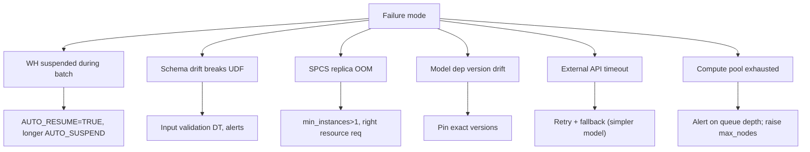

### Lab Exercise
```sql
-- Input validation DT: alert on schema issues
CREATE OR REPLACE DYNAMIC TABLE MONITOR.FEATURE_HEALTH
  TARGET_LAG = '15 minutes'
  WAREHOUSE = MONITOR_WH
AS
SELECT
  CURRENT_TIMESTAMP() AS CHECKED_AT,
  COUNT(*) AS N_ROWS,
  SUM(IFF(AGE IS NULL, 1, 0)) / COUNT(*) AS AGE_NULL_RATE,
  SUM(IFF(INCOME < 0, 1, 0)) / COUNT(*) AS INCOME_NEGATIVE_RATE,
  SUM(IFF(COUNTRY NOT IN ('US','EU','AP'), 1, 0)) / COUNT(*) AS COUNTRY_UNKNOWN_RATE
FROM FEATURES.CUSTOMER_30D;

CREATE OR REPLACE ALERT MONITOR.ALERT_FEATURE_HEALTH
  WAREHOUSE = MONITOR_WH
  SCHEDULE = '15 MINUTES'
  IF (EXISTS (
    SELECT 1 FROM MONITOR.FEATURE_HEALTH
    WHERE AGE_NULL_RATE > 0.1 OR INCOME_NEGATIVE_RATE > 0.01
      AND CHECKED_AT > DATEADD('hour',-1,CURRENT_TIMESTAMP())
  )) THEN CALL ML.NOTIFY_ONCALL('Feature health degraded');
```

### Gotchas / Exam Traps
- Alerts require a running warehouse to fire.
- SPCS replicas don't restart on config change until you ALTER SERVICE.
- Testing failure modes in staging catches most issues before prod.

---

## Q19: What's the pattern for inference on streaming data?

**Difficulty:** Advanced
**Exam relevance:** Streaming inference

### Answer
Snowflake isn't a hard-real-time streaming engine (events-per-ms), but near-real-time (seconds-to-minutes) is well-supported via:
- **Snowpipe Streaming / Kafka connector** — ingest events with low latency
- **Streams on raw tables** capture CDC
- **Dynamic Tables with low TARGET_LAG (1-5 min)** materialize feature + prediction updates
- **Snowflake Model Serving (SPCS)** for sub-second request-driven scoring
- **Tasks on 1-min schedule** to batch-score the CDC delta

Combined, you can achieve 1-5 minute end-to-end latency from event to scored prediction.

### First Principles
**Why "near-streaming":** True streaming (<100ms end-to-end) requires specialized engines (Flink, Spark Streaming). Snowflake's model is micro-batch — minimizing lag down to seconds.

**Why Snowpipe Streaming over regular Snowpipe:** Streaming has rowset-level API with ms-level latency; classic Snowpipe is file-based with seconds-level latency.

### Diagram
```mermaid
flowchart TD
    subgraph MicroBatch["Near-streaming (micro-batch)"]
        K["KAFKA/EVENTS"] -->|Snowpipe Streaming| RAW["RAW TABLE"]
        RAW -->|Stream (CDC)| F["FEATURES DT (TARGET_LAG=1min)"]
        F --> P["PREDICTIONS DT (TARGET_LAG=1min)"]
        P --> D["downstream app reads latest"]
    end
    subgraph RT["Request-driven (<100ms)"]
        APP["APP"] --> SVC["SPCS Service"]
        SVC --> FR["fs.retrieve_feature_values + model.predict"]
        FR --> RESP["responds in <100ms"]
    end
```

### Lab Exercise
```sql
-- Streaming ingestion -> near-real-time scoring
-- (assumes Kafka connector or Snowpipe Streaming to RAW.EVENTS)

CREATE OR REPLACE DYNAMIC TABLE FEATURES.LATEST
  TARGET_LAG = '1 minute'
  WAREHOUSE = HOT_WH
AS
SELECT CUSTOMER_ID,
  MAX(EVENT_TS) AS LAST_SEEN,
  COUNT(*) FILTER (WHERE EVENT_TS > DATEADD('minute',-10,CURRENT_TIMESTAMP())) AS EVENTS_10M
FROM RAW.EVENTS
GROUP BY CUSTOMER_ID;

CREATE OR REPLACE DYNAMIC TABLE PRED.LATEST
  TARGET_LAG = '1 minute'
  WAREHOUSE = HOT_WH
AS
SELECT CUSTOMER_ID,
  ML_DB.REGISTRY.CHURN!PREDICT(features):PROBA_1::FLOAT AS PROB,
  CURRENT_TIMESTAMP() AS SCORED_AT
FROM FEATURES.LATEST;
```

### Gotchas / Exam Traps
- TARGET_LAG of 1 min costs warehouse credits even when no new data; monitor.
- SPCS service for request-driven real-time is appropriate for sub-second SLA.
- Snowpipe Streaming has per-channel limits; design for parallel channels.

---

## Q20: How do you observe/monitor inference latency and throughput?

**Difficulty:** Intermediate
**Exam relevance:** Observability

### Answer
Multiple sources:
- **`QUERY_HISTORY`** — per-query execution time for warehouse UDF calls
- **`SERVICES` + `SHOW SERVICE EVENTS`** — SPCS service start/stop/scale events
- **Event Table** — logs/metrics emitted by services (via Snowflake Event Table integration)
- **Model Monitor** — captures per-prediction latency metadata (varies by version)
- **Custom DTs** — compute aggregate stats from prediction logs

### First Principles
**Why multiple sources:** Snowflake exposes different telemetry at different layers. UDF timing is in query history; container metrics in service events; application logs in event tables.

**Why observability precedes optimization:** You can't improve what you can't measure. Set up dashboards for p50/p95/p99 latency and QPS before scaling decisions.

### Diagram
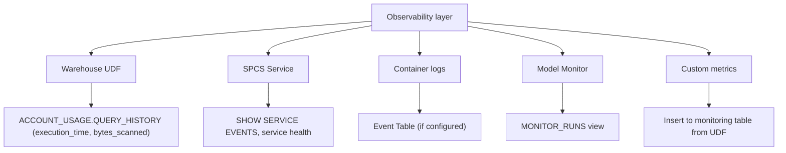

### Lab Exercise
```sql
-- Warehouse UDF timings
SELECT
  DATE_TRUNC('hour', START_TIME) AS HOUR,
  AVG(TOTAL_ELAPSED_TIME) AS AVG_MS,
  APPROX_PERCENTILE(TOTAL_ELAPSED_TIME, 0.95) AS P95_MS,
  COUNT(*) AS N_QUERIES
FROM SNOWFLAKE.ACCOUNT_USAGE.QUERY_HISTORY
WHERE QUERY_TEXT ILIKE '%CHURN!PREDICT%'
  AND START_TIME >= DATEADD('day',-1,CURRENT_TIMESTAMP())
GROUP BY HOUR ORDER BY HOUR DESC;

-- SPCS events
SHOW SERVICE EVENTS FOR SERVICE ML_DB.REGISTRY.CHURN_RT;

-- Event table queries (if attached to the SPCS service)
SELECT TIMESTAMP, RESOURCE_ATTRIBUTES, VALUE
FROM ACCOUNT.PUBLIC.ML_EVENTS
WHERE RESOURCE_ATTRIBUTES:SERVICE_NAME = 'CHURN_RT'
  AND RECORD_TYPE = 'METRIC'
ORDER BY TIMESTAMP DESC LIMIT 100;
```

### Gotchas / Exam Traps
- Event Table ingestion is Snowflake-serverless; configure via `CREATE EVENT TABLE` and bind to service.
- `TOTAL_ELAPSED_TIME` in query history includes queuing + execution.
- Model Monitor adds its own cost; monitor it too.

---

## Q21: Describe inference deployment via the Snowflake CLI (`snow`) in a CI/CD context.

**Difficulty:** Intermediate
**Exam relevance:** CI/CD basics (deep dive in domain 6)

### Answer
`snow` CLI supports model registration, service management, and SQL execution scripted:
- `snow ml ...` commands for Model Registry operations (register, create service)
- `snow sql ...` to run DDL
- `snow stage ...` for artifact uploads
- Integrated with Git (via `snow git ...`) to pull pipeline code from a repo

In CI/CD, the pipeline:
1. Trains model (potentially in Snowflake via Jobs)
2. Logs to Registry (dev schema)
3. Runs offline eval
4. On pass: promotes to stage/prod registry
5. Deploys SPCS service / sets alias

### First Principles
**Why CLI over SQL:** Scripting ergonomics. CLI commands are idempotent, return structured output, and integrate with secrets managers.

**Why not just Python:** Both work; CLI is thinner for CI/CD pipelines; Python is better for data-rich steps.

### Diagram
```mermaid
flowchart TD
    subgraph GH["GITHUB ACTIONS"]
        A1["on: push to main"] --> A2["checkout"]
        A2 --> A3["setup snow CLI"]
        A3 --> A4["snow git fetch REPO"]
        A4 --> A5["snow sql -f train.sql"]
        A5 --> A6["snow ml ... (register)"]
        A6 --> A7["test offline AUC (Python step)"]
        A7 --> A8["snow ml ... (promote alias)"]
        A8 --> A9["snow ml ... (create_service)"]
    end
    subgraph SF["SNOWFLAKE"]
        S1["snowflake-cli"]
        S2["fetches to stage"]
        S3["runs DDL"]
        S4["Registry update"]
        S5["alias flip"]
        S6["SPCS deploy"]
    end
    A3 --> S1
    A4 --> S2
    A5 --> S3
    A6 --> S4
    A8 --> S5
    A9 --> S6
```

### Lab Exercise
```bash
# Example GitHub Actions step
- name: Deploy model
  env:
    SNOWFLAKE_ACCOUNT: ${{ secrets.SF_ACCOUNT }}
    SNOWFLAKE_USER: ${{ secrets.SF_USER }}
    SNOWFLAKE_PRIVATE_KEY: ${{ secrets.SF_PRIVATE_KEY }}
  run: |
    pip install snowflake-cli
    snow git fetch ML_REPO
    snow sql -f pipelines/create_feature_dts.sql
    python pipelines/train_and_register.py --version V_${{ github.sha }}
    # Only promote if tests pass:
    python pipelines/offline_eval.py --min-auc 0.85
    snow sql -q "CALL ML_DB.REGISTRY.PROMOTE_MODEL('CHURN', 'V_${{ github.sha }}')"
```

### Gotchas / Exam Traps
- Store SF credentials in CI secret manager, use key-pair auth not password.
- `snow` CLI config file (`~/.snow/config.toml`) can hold multiple connections per env.
- Service deployment in CI needs idempotent service names (versioned or re-ALTER).

---

## Q22: How do you integrate inference with real-time apps (chatbot, personalization)?

**Difficulty:** Advanced
**Exam relevance:** App integration

### Answer
Pattern:
1. **Backend service** (your app) authenticates to Snowflake via key-pair or OIDC
2. **Feature retrieval** from Feature Store via `retrieve_feature_values()` (<100ms with warm WH or clustered DT)
3. **Model inference** via SPCS endpoint (HTTPS) or UDF call
4. **Post-process** (business rules, caching) in backend
5. **Response to user** in budget (e.g., 200ms total)

Alternative: deploy an SPCS service that encapsulates feature retrieval + model + business logic → single HTTP call from app.

### First Principles
**Why consolidate in SPCS:** Fewer network hops. One service that retrieves features + predicts + applies rules = one network call, one latency budget.

**Why not call UDF from app:** Each UDF call opens a Snowflake session — overhead too high for interactive apps. SPCS Service keeps the model/features warm.

### Diagram
```mermaid
flowchart TD
    U["USER (mobile/web)"] -->|~50ms budget| APP["APP BACKEND (Snowflake session cached, ~50ms)"]
    APP --> SVC["SPCS Service"]
    SVC --> ST1["1. retrieve_feature_values (cached in service)"]
    ST1 --> ST2["2. model.predict (<~30ms)"]
    ST2 --> ST3["3. business rules"]
    ST3 --> R["response ~100ms total"]
```

### Lab Exercise
```python
# Inside SPCS service (persistent process)
from snowflake.ml.feature_store import FeatureStore
from snowflake.ml.registry import Registry
from fastapi import FastAPI

app = FastAPI()
fs = FeatureStore(session, database="ML_DB", name="FS", default_warehouse="HOT_WH")
mv = Registry(session, "ML_DB", "REGISTRY").get_model("CHURN").version_by_alias("PROD")
fv_30d = fs.get_feature_view("CUSTOMER_30D_AGG", "V2")

@app.post("/predict")
async def predict(req: dict):
    cust_id = req["customer_id"]
    keys = session.create_dataframe([[cust_id]], schema=["CUSTOMER_ID"])
    feats = fs.retrieve_feature_values(keys, [fv_30d]).to_pandas()
    pred = mv.run(feats, function_name="predict_proba").to_pandas()
    return {"churn_prob": float(pred["PRED_PROBA_1"].iloc[0])}
```

### Gotchas / Exam Traps
- Cache features/predictions in the service for repeated-call patterns.
- Keep the WH warm (AUTO_SUSPEND=NEVER or long) so FS retrieval is fast.
- Session reuse: don't create a new Session per request.

---

## Q23: What are the deployment considerations for very large models (10GB+ LLMs)?

**Difficulty:** Advanced
**Exam relevance:** LLM deployment

### Answer
Large-model deployment considerations:
- **Must use SPCS** — warehouse UDFs can't load multi-GB artifacts fast enough
- **GPU required** for workable latency on 7B+ models
- **Memory sizing** — container memory_requests must exceed model size + overhead
- **Model loading time** — can be minutes; use `startup_grace_period` or health checks
- **Batching** — critical for GPU utilization; set `max_batch_rows` carefully
- **Quantization** — int8/4-bit versions dramatically reduce memory and improve latency
- **Image build time** — large images take long; prebuild and reuse
- **Cold start** — min_instances=1 to always have a warm replica for first user

### First Principles
**Why GPU is non-optional:** CPU inference of a 7B-param model is ~10-100 seconds per token. GPU brings it to <100ms per token. User-perceivable gap.

**Why quantization matters:** A 7B model in fp16 is 14GB; int4 is ~4GB. 4x smaller, often faster, minimal accuracy loss.

### Diagram
```mermaid
flowchart TD
    M["Model: 7B params (14GB fp16, 4GB int4)"]
    M --> CP["Compute pool: GPU_NV_M (A100 or equivalent)"]
    M --> C["Container: GPU 1, CPU 4, memory 24GB"]
    M --> IB["Image build: ~20 min first time (cached after)"]
    M --> ML["Model load (cold): ~1-3 min"]
    M --> IN["Inference (per req): ~50-200ms depending on tokens"]
    M --> MBR["max_batch_rows: 8-32 (test)"]
    M --> MI["min_instances: 1 (always-warm)"]
```

### Lab Exercise
```python
# Deploy quantized 7B LLM
from transformers import AutoModelForCausalLM, AutoTokenizer, pipeline
import torch

tok = AutoTokenizer.from_pretrained("meta-llama/Llama-3-7B-Instruct")
mdl = AutoModelForCausalLM.from_pretrained(
    "meta-llama/Llama-3-7B-Instruct",
    torch_dtype=torch.bfloat16,
    device_map="auto",
    load_in_4bit=True            # quantize for memory
)
pipe = pipeline("text-generation", model=mdl, tokenizer=tok)

mv = reg.log_model(
    pipe, model_name="LLAMA7B_INST", version_name="V1",
    sample_input_data=["Hello"],
    conda_dependencies=["transformers==4.42","torch==2.3",
                        "bitsandbytes==0.43","accelerate==0.30"]
)
mv.create_service(
    service_name="LLAMA7B_SVC",
    service_compute_pool="GPU_NV_M_POOL",
    image_repo="ML_DB.REGISTRY.IMG",
    ingress_enabled=True,
    gpu_requests="1",
    cpu_requests="4", memory_requests="24Gi",
    min_instances=1, max_instances=4,
    max_batch_rows=8
)
```

### Gotchas / Exam Traps
- GPU memory ≠ RAM; distinct quotas.
- Loading model into GPU VRAM is slow — don't scale down too aggressively.
- Prefer Cortex-hosted models when the LLM is a standard foundation model — avoids all this.

---

## Q24: How do you decommission a model safely?

**Difficulty:** Intermediate
**Exam relevance:** Lifecycle management

### Answer
Procedure:
1. **Dependency scan** — find callers (`QUERY_HISTORY` for UDF, `SHOW SERVICES` for SPCS)
2. **Announce deprecation** — tag the model as `deprecated`, notify owners
3. **Redirect** — update consumers to point to new model/alias
4. **Monitor** — ensure no calls to old version for N days
5. **Drop** — suspend SPCS service, remove version, archive artifact for audit

### First Principles
**Why slow retirement:** Silent breakage. A query running once a quarter against an old model will fail if you yank it. Grace periods prevent surprises.

**Why audit archive:** Regulatory requirements often mandate keeping decommissioned models for N years.

### Diagram
```mermaid
stateDiagram-v2
    [*] --> deployed
    deployed --> deprecated: tag=deprecated
    deprecated --> rerouted
    rerouted --> monitoring: monitor zero calls
    monitoring --> suspended: ALTER SERVICE SUSPEND
    suspended --> archived: export artifact to archive
    archived --> deleted: delete version (optional)
    deleted --> [*]
```

### Lab Exercise
```python
# Mark deprecated
mv_old = reg.get_model("CHURN").version("V5")
mv_old.set_tag("lifecycle", "deprecated")
mv_old.set_tag("deprecation_date", "2024-11-01")
mv_old.set_tag("sunset_date", "2024-12-31")
```

```sql
-- Find callers
SELECT USER_NAME, ROLE_NAME, QUERY_TEXT, START_TIME
FROM SNOWFLAKE.ACCOUNT_USAGE.QUERY_HISTORY
WHERE QUERY_TEXT ILIKE '%CHURN%VERSION => ''V5''%'
  AND START_TIME >= DATEADD('day',-30,CURRENT_TIMESTAMP());

-- Suspend any SPCS service
ALTER SERVICE ML_DB.REGISTRY.CHURN_V5_SVC SUSPEND;

-- After grace period, delete
-- (via Python)
```

### Gotchas / Exam Traps
- Aliased versions can't be deleted while aliased — unset first.
- Service suspension stops cost but keeps the service object; use `DROP SERVICE` to remove.
- Keep tag history for audit (don't rely on comments).

---

## Q25: Give the end-to-end deployment architecture for a production ML app with batch + real-time + UI.

**Difficulty:** Advanced
**Exam relevance:** Capstone

### Answer
Three serving paths, one Registry:
- **Batch**: Features DT → Predictions DT, scheduled fresh every hour; results consumed by dashboards & downstream apps
- **Real-time**: SPCS Service with warm GPU/CPU, called by a mobile app via HTTPS; features retrieved via FS inside the service
- **UI**: Streamlit-in-Snowflake dashboard for business users; calls model UDF for ad-hoc, reads predictions table for history

All three reference the same Registry version via `@PROD` alias — alias flip is atomic promotion/rollback.

### First Principles
**Why one model, three paths:** Business consumers have different needs. Batch for reports, real-time for apps, UI for analysts. Keeping one Registry source means consistency.

**Why alias centralizes promotion:** Alias flip triggers all three paths simultaneously (DT refresh picks up new UDF behavior, SPCS reloads on next request-batch, SiS reads via UDF). No multi-step deploy.

### Diagram
```mermaid
flowchart TD
    REG["REGISTRY: CHURN<br/>V15, V16, V17 (@PROD)"]
    REG --> B["BATCH"]
    REG --> RT["REAL-TIME"]
    REG --> UI["UI"]
    B --> BD["DT: PRED.CHURN<br/>TARGET_LAG=1h"]
    RT --> RD["SPCS Service /predict<br/>min=2 max=10"]
    UI --> UD["SiS Streamlit app<br/>reads PRED.CHURN or calls UDF"]
    BD --> BC["dashboards, notebooks"]
    RD --> RC["mobile app (via HTTPS)"]
    UD --> UC["analysts (Snowsight)"]
```

### Lab Exercise
```python
# One model, three paths

# 1. Log + alias
mv = reg.log_model(model, "CHURN", version_name="V17", ...)
mv.set_alias("PROD")

# 2. Batch via DT (SQL)
session.sql("""
  CREATE OR REPLACE DYNAMIC TABLE PRED.CHURN
    TARGET_LAG = '1 hour' WAREHOUSE = INFERENCE_WH AS
  SELECT CUSTOMER_ID,
    ML_DB.REGISTRY.CHURN!PREDICT(features):PROBA_1::FLOAT AS SCORE,
    CURRENT_TIMESTAMP() AS SCORED_AT
  FROM FEATURES.CUSTOMER_30D
""").collect()

# 3. Real-time via SPCS
mv.create_service(
    service_name="CHURN_RT",
    service_compute_pool="SERVING_POOL",
    image_repo="ML_DB.REGISTRY.IMG",
    ingress_enabled=True,
    min_instances=2, max_instances=10,
    cpu_requests="1", memory_requests="4Gi"
)

# 4. UI via SiS (streamlit_app.py; CREATE STREAMLIT)
# (see Q12 for app code; CREATE STREAMLIT CMD below)
session.sql("""
  CREATE OR REPLACE STREAMLIT ML_DB.APPS.CHURN_UI
    ROOT_LOCATION = '@ML_REPO/branches/main/streamlit/'
    MAIN_FILE = 'churn_app.py'
    QUERY_WAREHOUSE = UI_WH
""").collect()

# Rollback is one line:
# reg.get_model("CHURN").version("V15").set_alias("PROD")
# All three paths flip simultaneously.
```

### Gotchas / Exam Traps
- Three paths = three cost lines; monitor each.
- DT refresh after alias flip may lag until next TARGET_LAG window — manual REFRESH for immediate.
- SPCS keeps the previous model in cache; may serve old predictions until next batch — restart service after promotion if atomicity is critical.

---

## Study Checklist

- [ ] Can call model UDFs from SQL with correct syntax (version, alias, function)
- [ ] Can design batch inference via Dynamic Tables
- [ ] Can decide warehouse UDF vs SPCS Service based on SLA + cost
- [ ] Can deploy a GPU LLM via SPCS with proper resource sizing
- [ ] Can configure External Access Integration for external calls
- [ ] Can set up A/B testing with hash-based routing
- [ ] Can observe latency/throughput via QUERY_HISTORY and SPCS events
- [ ] Can enumerate cost tradeoffs between warehouse and SPCS for various volumes
- [ ] Can decommission a model safely with dependency scan
