# Monitoring & Observability — MLE-C01 Study Guide

## Exam Weight & Scope

**Approximate weight:** 15-18% of exam
**Scope:** Snowflake Model Monitor (built-in drift and performance monitoring), feature/data drift detection methods (PSI, KS, JS divergence), prediction logging patterns, outcome capture, Cortex AI Observability (LLM evaluation + tracing), Event Tables for application telemetry, Alerts for retraining triggers.

**You must be able to:**
- Create and configure a Model Monitor over a predictions table with actuals
- Interpret drift metrics (PSI, KS statistic, chi-squared) and set thresholds
- Design prediction logging schemas that capture features, outputs, and later actuals
- Set up Cortex AI Observability for LLM evaluation (groundedness, faithfulness, etc.)
- Wire up Alerts that call retraining stored procedures when drift breaches thresholds

---

## Core Concepts Map

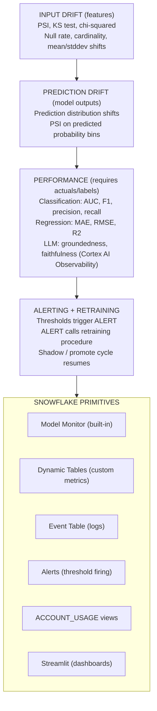

---

## Q1: What is Snowflake Model Monitor and what does it track out of the box?

**Difficulty:** Foundation
**Exam relevance:** Model Monitor basics

### Answer
`mv.create_monitor()` (or SQL `CREATE MODEL MONITOR`) sets up a managed monitoring object attached to a model version and a source table of predictions. Out of the box it tracks:
- **Prediction distribution** metrics vs a baseline
- **Feature distribution** drift metrics (PSI, KS) for each feature column
- **Performance metrics** when `actual_col` is supplied (AUC, F1, accuracy, RMSE depending on model task)
- **Null/missing rates** per feature
- **Automated backfill** of metrics across the source table's time range
- **Scheduled refresh** per `refresh_frequency`

Metrics materialize into monitor tables you can query, dashboard, or alert on.

### First Principles
**Why "built-in" matters:** Monitoring is tedious to roll by hand — drift stats, baseline comparisons, metric aggregation, backfill. The managed Monitor does this uniformly for every model, so teams don't invent inconsistent monitoring.

**Why coupling to a Registry version:** The monitor needs to know the model's input schema, prediction type (binary/regression/multi), and historical baselines. Attaching to a version provides this metadata.

### Diagram
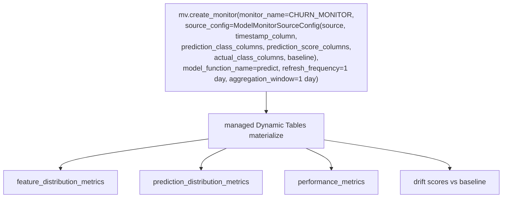

### Lab Exercise
```python
from snowflake.ml.monitoring.model_monitor_config import ModelMonitorSourceConfig
from snowflake.ml.registry import Registry

reg = Registry(session, database_name="ML_DB", schema_name="REGISTRY")
mv = reg.get_model("CHURN").version("V17")

mv.create_monitor(
    monitor_name="CHURN_MONITOR",
    source_config=ModelMonitorSourceConfig(
        source=session.table("PRED.CHURN_PREDICTIONS"),
        timestamp_column="SCORED_AT",
        prediction_class_columns=["PRED"],
        prediction_score_columns=["PRED_PROBA_1"],
        actual_class_columns=["CHURNED_ACTUAL"],
        baseline=session.table("TRAIN.BASELINE_FEATURES")
    ),
    model_function_name="predict",
    refresh_frequency="1 day",
    aggregation_window="1 day"
)

# Query the resulting metrics
session.sql("""
  SELECT TIMESTAMP, METRIC_NAME, VALUE
  FROM ML_DB.REGISTRY.CHURN_MONITOR_METRICS
  WHERE METRIC_NAME IN ('ROC_AUC','PSI_PRED_PROBA_1')
  ORDER BY TIMESTAMP DESC
""").collect()
```

### Gotchas / Exam Traps
- `baseline` is the reference distribution — usually the training set.
- Monitor refresh costs warehouse credits; align with usage.
- Monitor is tied to a Registry version; create a new monitor for a new version (or re-point).

---

## Q2: Define PSI (Population Stability Index). How is it computed and interpreted?

**Difficulty:** Advanced
**Exam relevance:** Drift metrics

### Answer
PSI measures distribution shift between two populations (baseline vs current). Formula:

```
PSI = Σ (p_cur - p_base) * ln(p_cur / p_base)   over each bin
```

Where `p_cur` and `p_base` are the proportion of samples in each bin for current and baseline.

**Interpretation:**
- PSI < 0.1 — no significant shift
- 0.1 ≤ PSI < 0.25 — minor shift, monitor
- PSI ≥ 0.25 — major shift, investigate / retrain

Binning: typically 10 equal-frequency or equal-width bins; for categorical, each category is a bin.

### First Principles
**Why PSI:** It's symmetric-ish, bounded in interpretation, and well-understood by business stakeholders. Easy to communicate: "feature X has PSI 0.3, it's drifting."

**Why log ratio × difference:** The log ratio captures proportional shift; multiplying by the raw difference weights by magnitude. Together, they're sensitive to shifts in any bin.

**Why thresholds 0.1 / 0.25:** Empirical standards from credit scoring where PSI originated. Fine-tune per domain.

### Diagram

**PSI calculation example:**

| Bin | Baseline % | Current % | Contribution |
|-----|------------|-----------|--------------|
| [0, 10) | 25% | 20% | (0.20-0.25) * ln(0.20/0.25) = 0.011 |
| [10, 20) | 30% | 25% | (0.25-0.30) * ln(0.25/0.30) = 0.009 |
| [20, 30) | 25% | 30% | (0.30-0.25) * ln(0.30/0.25) = 0.009 |
| [30, 40) | 15% | 20% | (0.20-0.15) * ln(0.20/0.15) = 0.014 |
| [40, inf) | 5% | 5% | 0 |
| **Total PSI** | | | **0.043 (stable)** |

### Lab Exercise
```sql
-- Compute PSI for a numeric feature over a 1-day current window vs baseline
WITH baseline_bins AS (
  SELECT WIDTH_BUCKET(SPEND_30D, 0, 10000, 10) AS BIN,
         COUNT(*)::FLOAT / (SELECT COUNT(*) FROM TRAIN.BASELINE_FEATURES) AS P_BASE
  FROM TRAIN.BASELINE_FEATURES
  GROUP BY BIN
),
current_bins AS (
  SELECT WIDTH_BUCKET(SPEND_30D, 0, 10000, 10) AS BIN,
         COUNT(*)::FLOAT /
           (SELECT COUNT(*) FROM FEATURES.CUSTOMER_30D
            WHERE WINDOW_END >= DATEADD('day',-1,CURRENT_TIMESTAMP())) AS P_CUR
  FROM FEATURES.CUSTOMER_30D
  WHERE WINDOW_END >= DATEADD('day',-1,CURRENT_TIMESTAMP())
  GROUP BY BIN
),
combined AS (
  SELECT COALESCE(b.BIN, c.BIN) AS BIN,
         COALESCE(b.P_BASE, 0.0001) AS P_BASE,
         COALESCE(c.P_CUR,  0.0001) AS P_CUR
  FROM baseline_bins b
  FULL OUTER JOIN current_bins c USING (BIN)
)
SELECT SUM((P_CUR - P_BASE) * LN(P_CUR / P_BASE)) AS PSI
FROM combined;
```

### Gotchas / Exam Traps
- Zero bins cause log(0) = -∞ → add epsilon smoothing (as above `0.0001`).
- Bin boundaries must be fixed from the baseline; applying new boundaries to current data makes PSI meaningless.
- PSI doesn't tell you direction of shift (just magnitude); pair with mean/stddev deltas for signal.

---

## Q3: What are KS test and chi-squared test, and when are they better than PSI?

**Difficulty:** Advanced
**Exam relevance:** Alternative drift metrics

### Answer
**Kolmogorov-Smirnov (KS) test** — compares two empirical CDFs; returns KS statistic (max distance between CDFs) and p-value. For continuous features.
- Pros: no binning needed; sensitive to any shape change
- Cons: for very large samples, p-values are tiny for trivial differences

**Chi-squared test** — compares binned frequencies; for categorical features (or binned numerical).
- Pros: works for categorical
- Cons: requires minimum cell counts (usually 5)

**When to prefer over PSI:**
- KS when features are continuous and binning is awkward
- Chi-squared when features are categorical with many levels
- PSI when interpretation + bounded thresholds matter (business stakeholders)

### First Principles
**Why multiple tests exist:** Each has blind spots. KS misses tail-only shifts; chi-squared misses continuous distribution shape; PSI needs good binning. Use together for robustness.

**Why p-values are tricky at scale:** With millions of rows, even trivially small differences yield p < 0.001. Report effect sizes (KS stat, PSI) alongside.

### Diagram

**Drift metric comparison:**

| Metric | Input | Output | Binning? |
|--------|-------|--------|----------|
| PSI | numeric/cat | single number | yes |
| KS statistic | numeric | stat + p-value | no |
| Chi-squared | categorical | stat + p-value | implicit |
| JS divergence | numeric/cat | bounded 0-1 symmetric | yes |
| Wasserstein | numeric | earth-mover distance | no |

### Lab Exercise
```sql
-- Simplified KS statistic approximation in SQL
WITH all_vals AS (
  SELECT SPEND_30D, 'BASE' AS SRC FROM TRAIN.BASELINE_FEATURES
  UNION ALL
  SELECT SPEND_30D, 'CUR' AS SRC FROM FEATURES.CUSTOMER_30D
    WHERE WINDOW_END >= DATEADD('day',-1,CURRENT_TIMESTAMP())
),
ranked AS (
  SELECT SRC, SPEND_30D,
    PERCENT_RANK() OVER (PARTITION BY SRC ORDER BY SPEND_30D) AS CDF
  FROM all_vals
),
joined AS (
  SELECT b.SPEND_30D, b.CDF AS CDF_BASE, c.CDF AS CDF_CUR
  FROM ranked b
  JOIN ranked c ON b.SPEND_30D = c.SPEND_30D
  WHERE b.SRC = 'BASE' AND c.SRC = 'CUR'
)
SELECT MAX(ABS(CDF_CUR - CDF_BASE)) AS KS_STAT FROM joined;
```

### Gotchas / Exam Traps
- For strict statistical tests in SQL, use `KS_STAT` as proxy; full test with p-value is easier in a Python UDF.
- Chi-squared requires expected counts > 5 per cell — collapse rare categories first.
- Model Monitor often computes these for you — don't hand-roll unless custom.

---

## Q4: How do you log predictions for monitoring? Design the prediction log table.

**Difficulty:** Intermediate
**Exam relevance:** Prediction logging

### Answer
Prediction log schema:
```sql
CREATE TABLE PRED.CHURN_LOG (
    PRED_ID              STRING,         -- unique id for each prediction
    CUSTOMER_ID          INT,            -- entity key
    MODEL_NAME           STRING,         -- which model
    MODEL_VERSION        STRING,         -- which version
    MODEL_ALIAS          STRING,         -- PROD, SHADOW etc.
    FEATURES             VARIANT,        -- input features used
    PRED                 INT,            -- label
    PRED_PROBA           FLOAT,          -- probability
    SCORED_AT            TIMESTAMP_LTZ,  -- when scored
    ACTUAL_LABEL         INT,            -- backfilled later from outcomes
    ACTUAL_OBSERVED_AT   TIMESTAMP_LTZ   -- when outcome known
);
```

Insert at prediction time; MERGE actuals when outcome is observed (e.g., 30 days later for churn).

### First Principles
**Why log every prediction:** You can't compute drift or performance without historical predictions + actuals. Logging is the foundation of monitoring.

**Why include features:** For debugging ("why did V17 predict 0.9 for this customer?") and for drift computation on actual-input vs training-input.

**Why MERGE actuals async:** Churn labels take 30 days to materialize. Store the prediction immediately, update when truth arrives.

### Diagram
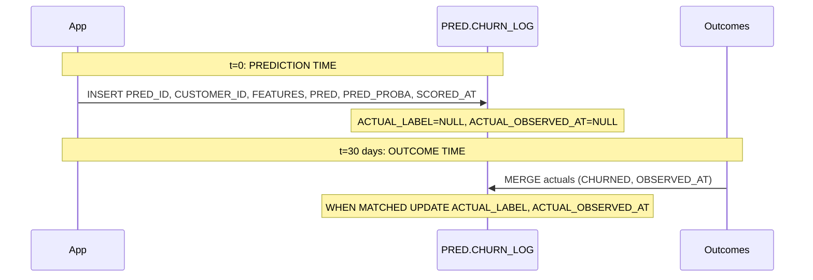

### Lab Exercise
```sql
CREATE OR REPLACE TABLE PRED.CHURN_LOG (
    PRED_ID STRING DEFAULT UUID_STRING(),
    CUSTOMER_ID INT NOT NULL,
    MODEL_NAME STRING,
    MODEL_VERSION STRING,
    MODEL_ALIAS STRING,
    FEATURES VARIANT,
    PRED INT,
    PRED_PROBA FLOAT,
    SCORED_AT TIMESTAMP_LTZ DEFAULT CURRENT_TIMESTAMP(),
    ACTUAL_LABEL INT,
    ACTUAL_OBSERVED_AT TIMESTAMP_LTZ
) CLUSTER BY (SCORED_AT);

-- Insert at prediction time (as part of DT or SPROC)
INSERT INTO PRED.CHURN_LOG (CUSTOMER_ID, MODEL_NAME, MODEL_VERSION, MODEL_ALIAS,
                            FEATURES, PRED, PRED_PROBA)
SELECT
  CUSTOMER_ID,
  'CHURN',
  'V17',
  'PROD',
  OBJECT_CONSTRUCT('AGE', AGE, 'INCOME', INCOME, 'TENURE', TENURE),
  ML_DB.REGISTRY.CHURN!PREDICT(features):PRED::INT,
  ML_DB.REGISTRY.CHURN!PREDICT_PROBA(features):PRED_PROBA_1::FLOAT
FROM FEATURES.CUSTOMER_30D;

-- MERGE actuals when they're known
MERGE INTO PRED.CHURN_LOG tgt
USING (
  SELECT CUSTOMER_ID, CHURNED, OBSERVED_AT
  FROM OUTCOMES.CHURN_EVENTS
  WHERE OBSERVED_AT >= DATEADD('day',-1,CURRENT_TIMESTAMP())
) src
ON tgt.CUSTOMER_ID = src.CUSTOMER_ID
   AND tgt.SCORED_AT BETWEEN DATEADD('day',-35,src.OBSERVED_AT) AND DATEADD('day',-25,src.OBSERVED_AT)
WHEN MATCHED AND tgt.ACTUAL_LABEL IS NULL THEN UPDATE SET
  ACTUAL_LABEL = src.CHURNED,
  ACTUAL_OBSERVED_AT = src.OBSERVED_AT;
```

### Gotchas / Exam Traps
- Clustering on SCORED_AT speeds time-range queries used by monitoring.
- MERGE time windows must match the business cycle (30 days for churn, 7 days for other outcomes).
- Don't delete old prediction logs too early; monitoring needs history.

---

## Q5: How does Model Monitor compute performance metrics requiring ground truth?

**Difficulty:** Intermediate
**Exam relevance:** Performance tracking

### Answer
When you supply `actual_class_columns` (or `actual_score_columns`) in the monitor config, Model Monitor computes:
- **Classification**: accuracy, precision, recall, F1, AUC, confusion matrix
- **Regression**: MAE, RMSE, R², MAPE

Metrics are computed on windowed slices (per `aggregation_window`), aligning predictions with their actuals. Monitor backfills metrics for historical windows where actuals exist.

### First Principles
**Why windowed:** A single AUC number for "all time" is useless once you have months of data. Rolling AUC shows degradation trends.

**Why align by prediction timestamp:** Model V15's AUC in May vs V17's AUC in October — you want to see the model's performance during its deployment window, not mixed.

### Diagram
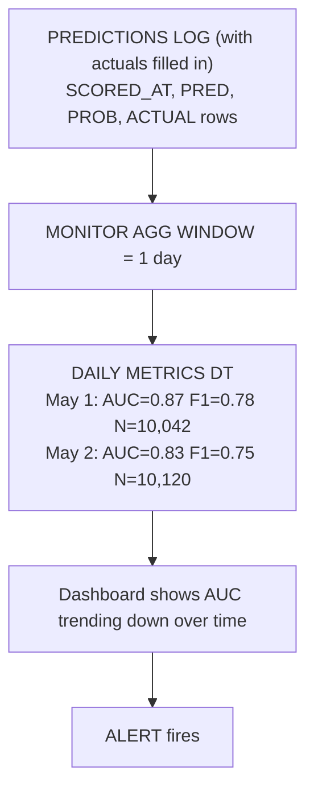

### Lab Exercise
```python
# Query monitor-computed performance metrics
metrics_df = session.sql(f"""
  SELECT
    DATE_TRUNC('day', AGGREGATION_WINDOW_START) AS DAY,
    METRIC_NAME, VALUE
  FROM ML_DB.REGISTRY.CHURN_MONITOR_METRICS
  WHERE METRIC_NAME IN ('ROC_AUC','F1','PRECISION','RECALL')
    AND AGGREGATION_WINDOW_START >= DATEADD('day',-30,CURRENT_TIMESTAMP())
  ORDER BY DAY DESC, METRIC_NAME
""").to_pandas()

# Plot in Streamlit or notebook
import streamlit as st
st.line_chart(metrics_df.pivot(index="DAY", columns="METRIC_NAME", values="VALUE"))
```

### Gotchas / Exam Traps
- Performance metrics are only populated after actuals arrive — expect lag.
- Monitor uses the prediction's timestamp, not the actual's — carefully align.
- For multi-class, Monitor computes per-class metrics; look for `METRIC_NAME` prefix per class.

---

## Q6: What is Cortex AI Observability and when do you use it?

**Difficulty:** Advanced
**Exam relevance:** LLM observability

### Answer
Cortex AI Observability is Snowflake's suite for monitoring LLM applications (RAG, chat, extraction). It covers:
- **Evaluation metrics** — groundedness, faithfulness, relevance, answer correctness (automatic LLM-as-judge)
- **Tracing** — request/response pairs with input/output content and metadata
- **Experiments** — compare multiple LLM configurations (prompt A vs B, model A vs B)

Used for LLM apps where traditional accuracy metrics don't apply.

### First Principles
**Why LLMs need special observability:** Classical ML has unambiguous labels (churn/no-churn). LLMs generate free text where "correct" is subjective. You need LLM-as-judge or human eval to score quality.

**Why in-platform:** The RAG pipeline, LLM calls, and evaluation all happen inside Snowflake. Keeping observability inside closes the loop.

### Diagram
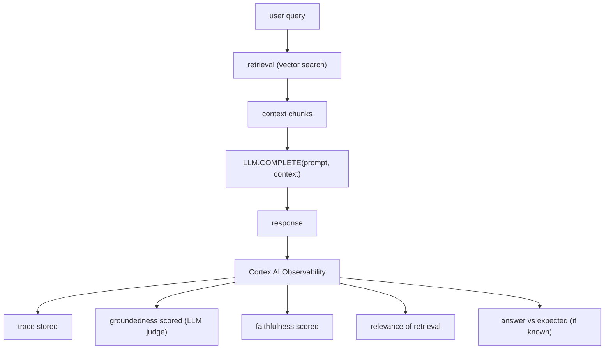

### Lab Exercise
```python
# Example: use AI_COMPLETE with observability trace
# (actual API varies; conceptual)

from snowflake.ml.cortex import observability

with observability.trace("rag_query_1") as trace:
    retrieval = session.sql("""
        SELECT CHUNK_TEXT
        FROM KB.DOCUMENTS
        ORDER BY VECTOR_COSINE_SIMILARITY(
          EMBEDDING,
          SNOWFLAKE.CORTEX.EMBED_TEXT_768('e5-base-v2', ?)
        ) DESC
        LIMIT 5
    """, params=[user_query]).to_pandas()
    trace.log("retrieval", retrieval["CHUNK_TEXT"].tolist())

    context = "\n\n".join(retrieval["CHUNK_TEXT"])
    answer = session.sql(f"""
        SELECT SNOWFLAKE.CORTEX.COMPLETE('mistral-large',
          'Context: {context}\n\nQuestion: {user_query}\nAnswer:')
    """).collect()[0][0]
    trace.log("answer", answer)

    # Evaluate
    scores = observability.evaluate(
        query=user_query,
        answer=answer,
        context=context,
        metrics=["groundedness","faithfulness","relevance"]
    )
    trace.log("scores", scores)
```

### Gotchas / Exam Traps
- LLM-as-judge evaluation itself costs tokens — budget accordingly.
- Groundedness ≠ factual correctness — it measures "is the answer supported by context."
- Observability APIs are evolving; verify current syntax at exam time.

---

## Q7: What is model drift vs data drift vs concept drift?

**Difficulty:** Intermediate
**Exam relevance:** Drift taxonomy

### Answer
- **Data drift** (feature drift / covariate shift) — the distribution of input features P(X) changes while P(Y|X) stays the same. Example: new user demographics onboarded.
- **Concept drift** — P(Y|X) changes while P(X) may be stable. Example: customer behavior shifts post-pandemic; features look same but response differs.
- **Prediction drift** — the distribution of model outputs P(ŷ) changes. Can indicate either data drift or model degradation.
- **Model drift** — informal umbrella; often means performance has dropped.

Detection methods:
- Data drift: PSI/KS/chi² on features
- Concept drift: performance drop with stable feature distributions
- Prediction drift: PSI on predicted probabilities
- Model drift: ground-truth performance metrics (AUC, F1)

### First Principles
**Why distinguish:** Response varies.
- Data drift → may be benign (same model works) or warning (retrain)
- Concept drift → model is fundamentally wrong now, retrain required
- Prediction drift → investigate which upstream cause

**Why order of operations:** Data drift is easiest/cheapest to detect; concept drift requires actuals which may lag.

### Diagram

**Drift types:**

| Type | P(X) stable? | P(Y\|X) stable? | Perf stable? |
|------|--------------|-----------------|--------------|
| No drift | yes | yes | yes |
| Data drift | NO | yes | maybe |
| Concept drift | yes | NO | NO |
| Both | NO | NO | NO |

**Detection ladder (cheapest -> most expensive):**

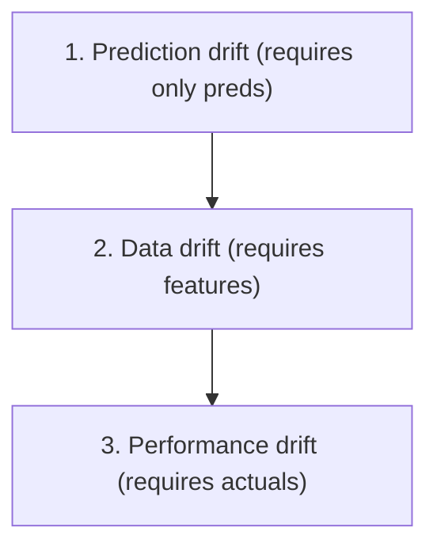

### Lab Exercise
```sql
-- Daily drift decomposition
CREATE OR REPLACE DYNAMIC TABLE MONITOR.DAILY_DRIFT_METRICS
  TARGET_LAG = '1 day'
  WAREHOUSE = MONITOR_WH
AS
WITH feat_stats AS (
  SELECT DATE_TRUNC('day',SCORED_AT) AS DAY,
    AVG((FEATURES:AGE)::INT) AS AVG_AGE,
    AVG((FEATURES:INCOME)::FLOAT) AS AVG_INCOME,
    AVG((FEATURES:TENURE)::INT) AS AVG_TENURE
  FROM PRED.CHURN_LOG
  GROUP BY DAY
),
pred_stats AS (
  SELECT DATE_TRUNC('day',SCORED_AT) AS DAY,
    AVG(PRED_PROBA) AS AVG_PROBA, STDDEV(PRED_PROBA) AS STD_PROBA
  FROM PRED.CHURN_LOG
  GROUP BY DAY
),
perf AS (
  SELECT DATE_TRUNC('day',SCORED_AT) AS DAY,
    SUM(IFF(PRED = ACTUAL_LABEL, 1, 0)) / COUNT(*) AS ACCURACY,
    COUNT_IF(ACTUAL_LABEL IS NOT NULL) AS N_WITH_ACTUAL
  FROM PRED.CHURN_LOG
  GROUP BY DAY
)
SELECT f.DAY, f.AVG_AGE, f.AVG_INCOME, f.AVG_TENURE,
       p.AVG_PROBA, p.STD_PROBA,
       pr.ACCURACY, pr.N_WITH_ACTUAL
FROM feat_stats f
JOIN pred_stats p USING (DAY)
LEFT JOIN perf pr USING (DAY);
```

### Gotchas / Exam Traps
- Concept drift is hardest to catch early (needs actuals); use proxies when possible.
- "No drift" is uncommon in real-world data; focus on actionable thresholds.
- Downstream user behavior (clicks, conversion) is often the earliest signal.

---

## Q8: How do you build a custom drift monitoring Dynamic Table outside of Model Monitor?

**Difficulty:** Advanced
**Exam relevance:** Custom monitoring

### Answer
When Model Monitor doesn't fit (e.g., special metric, non-registered external model), build custom DTs:
1. **Reference baseline table** — fixed snapshot of training distribution (bins, means, etc.)
2. **Current window DT** — aggregates recent predictions/features
3. **Metric DT** — joins baseline with current window, computes PSI/KS/etc.
4. **Alert** on metric DT thresholds

### First Principles
**Why custom:** Model Monitor is managed convenience; custom gives flexibility to compute business-specific metrics (e.g., per-segment drift, correlated feature drift).

**Why DT-based:** Automatic refresh, incremental compute, declarative — same benefits as feature DTs.

### Diagram
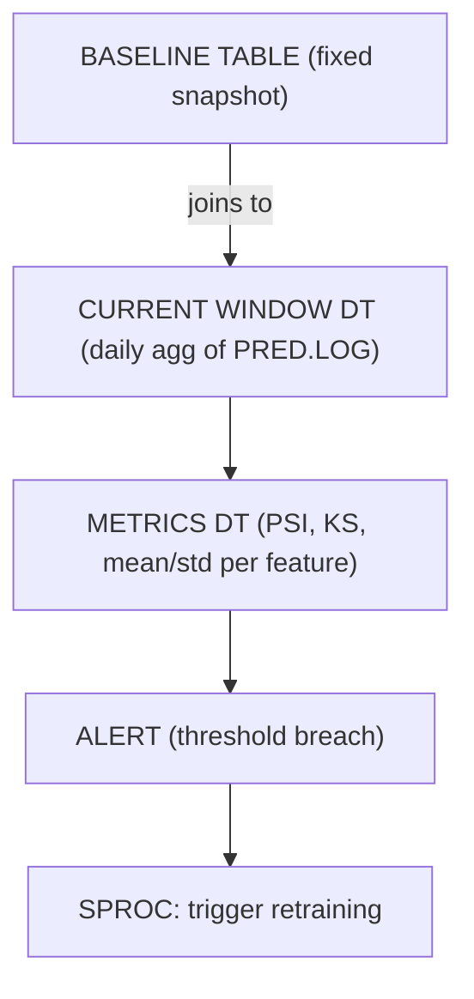

### Lab Exercise
```sql
-- 1. Baseline (one-time)
CREATE OR REPLACE TABLE MONITOR.BASELINE_BINS AS
SELECT 'SPEND_30D' AS FEATURE,
       WIDTH_BUCKET(SPEND_30D, 0, 10000, 10) AS BIN,
       COUNT(*)::FLOAT / (SELECT COUNT(*) FROM TRAIN.BASELINE_FEATURES) AS P_BASE
FROM TRAIN.BASELINE_FEATURES
GROUP BY BIN;

-- 2. Current window (DT)
CREATE OR REPLACE DYNAMIC TABLE MONITOR.CURRENT_BINS
  TARGET_LAG = '1 hour' WAREHOUSE = MONITOR_WH AS
SELECT 'SPEND_30D' AS FEATURE,
  WIDTH_BUCKET((FEATURES:SPEND_30D)::FLOAT, 0, 10000, 10) AS BIN,
  COUNT(*)::FLOAT /
    (SELECT COUNT(*) FROM PRED.CHURN_LOG
     WHERE SCORED_AT >= DATEADD('hour',-24,CURRENT_TIMESTAMP())) AS P_CUR
FROM PRED.CHURN_LOG
WHERE SCORED_AT >= DATEADD('hour',-24,CURRENT_TIMESTAMP())
GROUP BY BIN;

-- 3. PSI metric DT
CREATE OR REPLACE DYNAMIC TABLE MONITOR.PSI_METRICS
  TARGET_LAG = '1 hour' WAREHOUSE = MONITOR_WH AS
SELECT b.FEATURE,
  SUM((COALESCE(c.P_CUR, 0.0001) - COALESCE(b.P_BASE, 0.0001)) *
      LN(COALESCE(c.P_CUR, 0.0001) / COALESCE(b.P_BASE, 0.0001))) AS PSI,
  CURRENT_TIMESTAMP() AS COMPUTED_AT
FROM MONITOR.BASELINE_BINS b
LEFT JOIN MONITOR.CURRENT_BINS c
  ON b.FEATURE = c.FEATURE AND b.BIN = c.BIN
GROUP BY b.FEATURE;

-- 4. Alert
CREATE OR REPLACE ALERT MONITOR.PSI_ALERT
  WAREHOUSE = MONITOR_WH SCHEDULE = '1 HOUR'
  IF (EXISTS (SELECT 1 FROM MONITOR.PSI_METRICS WHERE PSI > 0.25))
  THEN CALL ML.NOTIFY_DRIFT('PSI breach');
ALTER ALERT MONITOR.PSI_ALERT RESUME;
```

### Gotchas / Exam Traps
- Baseline bin boundaries must be fixed — recomputing bins each day defeats the point.
- Add epsilon smoothing to avoid division/log by zero.
- One DT per metric; chain is fine.

---

## Q9: How do you detect schema drift (new columns, type changes, missing columns)?

**Difficulty:** Intermediate
**Exam relevance:** Data quality

### Answer
Schema drift is detectable by querying `INFORMATION_SCHEMA` + comparing to a known baseline schema:
```sql
SELECT COLUMN_NAME, DATA_TYPE, IS_NULLABLE
FROM INFORMATION_SCHEMA.COLUMNS
WHERE TABLE_SCHEMA = 'FEATURES' AND TABLE_NAME = 'CUSTOMER_30D'
```

Alternatively:
- Compare schema hash (hash of `OBJECT_CONSTRUCT(column_name, data_type)` set) between versions
- Alert on `CREATE OR REPLACE` of source tables (Account Usage query history)
- Use Snowflake tagging to flag schema-critical tables

### First Principles
**Why schema drift breaks ML:** Pipelines assume certain columns exist with certain types. New columns are usually harmless, missing columns crash queries, type changes silently produce bad data.

**Why not catch via UDF signature:** The signature error is a late failure (at serving time). Catching schema drift at the source table is earlier.

### Diagram
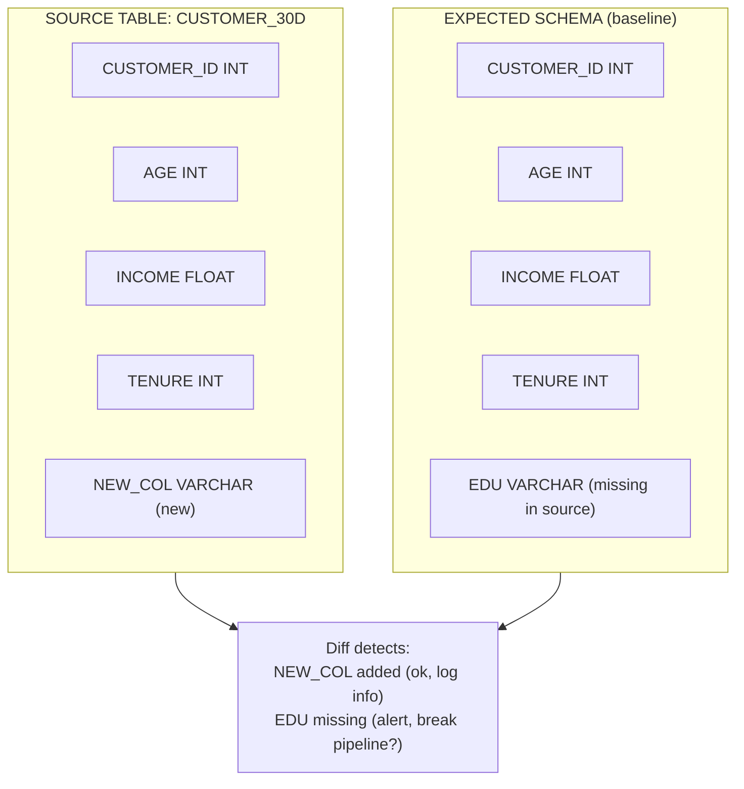

### Lab Exercise
```sql
-- Baseline snapshot (one-time)
CREATE OR REPLACE TABLE MONITOR.FEATURE_SCHEMA_BASELINE AS
SELECT TABLE_CATALOG, TABLE_SCHEMA, TABLE_NAME,
       COLUMN_NAME, DATA_TYPE, IS_NULLABLE
FROM INFORMATION_SCHEMA.COLUMNS
WHERE TABLE_SCHEMA = 'FEATURES' AND TABLE_NAME = 'CUSTOMER_30D';

-- Monitor DT for schema diff
CREATE OR REPLACE DYNAMIC TABLE MONITOR.SCHEMA_DIFF
  TARGET_LAG = '1 hour' WAREHOUSE = MONITOR_WH AS
WITH current_schema AS (
  SELECT COLUMN_NAME, DATA_TYPE, IS_NULLABLE
  FROM INFORMATION_SCHEMA.COLUMNS
  WHERE TABLE_SCHEMA = 'FEATURES' AND TABLE_NAME = 'CUSTOMER_30D'
)
SELECT
  COALESCE(b.COLUMN_NAME, c.COLUMN_NAME) AS COLUMN_NAME,
  b.DATA_TYPE AS BASELINE_TYPE,
  c.DATA_TYPE AS CURRENT_TYPE,
  CASE
    WHEN b.COLUMN_NAME IS NULL THEN 'ADDED'
    WHEN c.COLUMN_NAME IS NULL THEN 'REMOVED'
    WHEN b.DATA_TYPE <> c.DATA_TYPE THEN 'TYPE_CHANGED'
    ELSE 'OK'
  END AS CHANGE_TYPE
FROM MONITOR.FEATURE_SCHEMA_BASELINE b
FULL OUTER JOIN current_schema c ON b.COLUMN_NAME = c.COLUMN_NAME;

CREATE OR REPLACE ALERT MONITOR.SCHEMA_DRIFT_ALERT
  WAREHOUSE = MONITOR_WH SCHEDULE = '1 HOUR'
  IF (EXISTS (SELECT 1 FROM MONITOR.SCHEMA_DIFF WHERE CHANGE_TYPE IN ('REMOVED','TYPE_CHANGED')))
  THEN CALL ML.NOTIFY_SCHEMA_DRIFT();
```

### Gotchas / Exam Traps
- Column renames look like `REMOVED + ADDED` — handle in alert logic.
- Type-widening (INT → BIGINT) is usually fine; narrowing can break models.
- INFORMATION_SCHEMA sometimes lags; try ACCOUNT_USAGE for near-real-time.

---

## Q10: Describe Alert objects: how do they fire and what can they call?

**Difficulty:** Intermediate
**Exam relevance:** Alerting

### Answer
`CREATE ALERT` is a Snowflake-native object that runs on a schedule, evaluates a condition expression, and if true, executes an action. Key attributes:
- `WAREHOUSE` — compute for condition eval
- `SCHEDULE` — cron or interval
- `IF ( EXISTS (...) )` — the condition; typically a SQL EXISTS on a monitoring DT or table
- `THEN <action>` — a SQL statement, usually `CALL <stored_procedure>` or an INSERT

Alerts must be `RESUMED` to activate.

### First Principles
**Why alerts over external schedulers:** No external cron infra needed; audit, logs, lineage all stay in Snowflake.

**Why procedure actions:** Procedures can do anything (retrain, email, write to notification queue, etc.). Keeps alert logic SQL-flat.

### Diagram
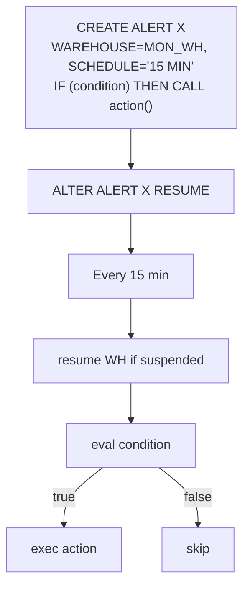

### Lab Exercise
```sql
-- Alert on PSI breach
CREATE OR REPLACE ALERT MONITOR.PSI_ALERT
  WAREHOUSE = MONITOR_WH
  SCHEDULE = '1 HOUR'
  IF ( EXISTS (
    SELECT 1 FROM MONITOR.PSI_METRICS
    WHERE PSI > 0.25
      AND COMPUTED_AT > DATEADD('hour',-2,CURRENT_TIMESTAMP())
  ))
  THEN CALL ML.NOTIFY_AND_RETRAIN('CHURN', 'PSI_BREACH');

ALTER ALERT MONITOR.PSI_ALERT RESUME;

-- View history
SELECT NAME, STATE, SCHEDULED_TIME, COMPLETED_TIME, CONDITION_TEXT, ACTION_TEXT
FROM TABLE(INFORMATION_SCHEMA.ALERT_HISTORY(
    SCHEDULED_TIME_RANGE_START => DATEADD('day',-7,CURRENT_TIMESTAMP())
))
ORDER BY SCHEDULED_TIME DESC;
```

### Gotchas / Exam Traps
- Alerts don't fire if warehouse is suspended indefinitely; set AUTO_RESUME=TRUE.
- A single alert can only have one action — use procedures to chain actions.
- Deduplicate: condition should be idempotent (avoid double-firing on same drift).

---

## Q11: How do you build a drift-triggered retraining pipeline end-to-end?

**Difficulty:** Advanced
**Exam relevance:** Automated retraining

### Answer
Components:
1. **Monitoring DT** — computes drift metrics (PSI, perf drop)
2. **Alert** — fires when threshold breached, calls retraining SPROC
3. **Retraining SPROC** — refreshes features, retrains, logs new version, offline evaluates
4. **Promotion decision** — if new model beats current, set alias; else notify humans
5. **Rollback hook** — monitor post-promotion metrics; if regression, revert alias

### First Principles
**Why automate retraining:** Human-in-the-loop retraining has a delay; drift costs business. Automation closes the loop at machine speed.

**Why guard with offline evaluation:** Automated promotion of a bad retrain is worse than drift. Must have gates.

### Diagram
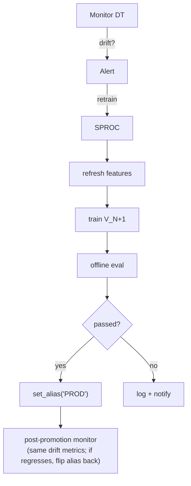

### Lab Exercise
```sql
CREATE OR REPLACE PROCEDURE ML.RETRAIN_AND_PROMOTE(MODEL_NAME STRING, TRIGGER_REASON STRING)
RETURNS STRING LANGUAGE PYTHON RUNTIME_VERSION = '3.10'
PACKAGES = ('snowflake-snowpark-python','snowflake-ml-python')
HANDLER = 'run' AS $$
def run(session, model_name, trigger_reason):
    from snowflake.ml.registry import Registry
    from snowflake.ml.modeling.xgboost import XGBClassifier
    from snowflake.ml.modeling.model_selection import train_test_split

    reg = Registry(session, "ML_DB", "REGISTRY")

    # 1. Refresh features
    session.sql("ALTER DYNAMIC TABLE FEATURES.CUSTOMER_30D REFRESH").collect()

    # 2. Train
    df = session.table("TRAIN.LATEST_TRAINING_SET")
    train, test = train_test_split(df, test_size=0.2, random_state=42)
    model = XGBClassifier(input_cols=FEAT_COLS, label_cols=["Y"], output_cols=["PRED"],
                          n_estimators=300, max_depth=5).fit(train)

    # 3. Offline eval
    scored = model.predict(test)
    from snowflake.ml.modeling.metrics import roc_auc_score
    new_auc = roc_auc_score(df=model.predict_proba(test),
                            y_true_col_names=["Y"], y_score_col_names=["PRED_PROBA_1"])

    # 4. Log + metadata
    mv = reg.log_model(model, model_name=model_name,
                       version_name=None,
                       metrics={"roc_auc": new_auc, "trigger": trigger_reason})
    mv.set_tag("retrain_trigger", trigger_reason)

    # 5. Promotion decision
    current_prod = reg.get_model(model_name).version_by_alias("PROD")
    current_auc = current_prod.show_metrics().get("roc_auc", 0)

    if new_auc > current_auc + 0.003:
        mv.set_alias("PROD")
        current_prod.set_alias("PREVIOUS_PROD")   # for rollback
        return f"Promoted new version (AUC {new_auc:.3f} vs {current_auc:.3f})"
    else:
        mv.set_tag("decision", "rejected")
        return f"Trained but not promoted (AUC {new_auc:.3f} not better than {current_auc:.3f})"
$$;

-- Alert triggers retraining
CREATE OR REPLACE ALERT MONITOR.DRIFT_RETRAIN
  WAREHOUSE = MONITOR_WH SCHEDULE = '1 HOUR'
  IF (EXISTS (
    SELECT 1 FROM MONITOR.PSI_METRICS WHERE PSI > 0.25
      AND COMPUTED_AT > DATEADD('hour',-2,CURRENT_TIMESTAMP())
  ))
  THEN CALL ML.RETRAIN_AND_PROMOTE('CHURN', 'PSI_BREACH');
ALTER ALERT MONITOR.DRIFT_RETRAIN RESUME;
```

### Gotchas / Exam Traps
- Alerts must have cooldown — don't retrain every hour if drift persists; add a "last_retrain_at" check.
- Automated promotion needs guardrails: minimum improvement, no regressions on key segments.
- Rollback automation: another alert monitoring post-promotion metrics.

---

## Q12: What is Event Table and how does it help ML observability?

**Difficulty:** Intermediate
**Exam relevance:** Logs infrastructure

### Answer
Event Table is a Snowflake-managed table type for ingesting application logs, metrics, and traces from Python stored procedures, UDFs, and SPCS services. Attached to a schema via `CREATE EVENT TABLE` + `ALTER ACCOUNT SET EVENT_TABLE`.

For ML:
- Capture Python logging / print output from stored procedures
- SPCS container `stdout`/`stderr` → event table
- Custom metrics emission from inference code
- Trace spans for distributed tracing

Then query it like any table for debugging and monitoring.

### First Principles
**Why centralize logs:** Debugging distributed ML pipelines across SPROCs, SPCS services, warehouses is painful without unified logs. Event Tables are Snowflake's answer.

**Why first-class table:** Standard SQL analytics on logs (filter, group, join with QUERY_HISTORY) — no separate observability tool required for most needs.

### Diagram
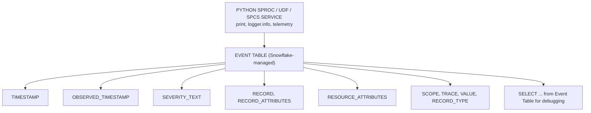

### Lab Exercise
```sql
-- Setup
CREATE EVENT TABLE ML_DB.OBS.ML_EVENTS;
ALTER ACCOUNT SET EVENT_TABLE = ML_DB.OBS.ML_EVENTS;

-- SPROC that emits logs/metrics
CREATE OR REPLACE PROCEDURE ML.LOG_PRED_METRICS(day_date DATE)
RETURNS STRING LANGUAGE PYTHON RUNTIME_VERSION = '3.10'
PACKAGES = ('snowflake-snowpark-python','snowflake-telemetry-python')
HANDLER = 'run' AS $$
def run(session, day_date):
    import logging
    from snowflake.telemetry import telemetry
    logger = logging.getLogger("ml.pred_metrics")

    count = session.sql(f"SELECT COUNT(*) FROM PRED.CHURN_LOG WHERE SCORED_AT::DATE='{day_date}'").collect()[0][0]
    logger.info(f"Processed {count} predictions on {day_date}")

    # Emit a metric
    telemetry.set_span_attribute("predictions.count", count)
    return f"ok {count}"
$$;

-- Query logs
SELECT TIMESTAMP, RECORD:body::STRING AS MSG, RECORD:severity_text::STRING AS LVL
FROM ML_DB.OBS.ML_EVENTS
WHERE RESOURCE_ATTRIBUTES:"snow.executable.name" ILIKE '%LOG_PRED_METRICS%'
  AND TIMESTAMP >= DATEADD('day',-1,CURRENT_TIMESTAMP())
ORDER BY TIMESTAMP DESC;
```

### Gotchas / Exam Traps
- Only one event table per account can be active at a time (set via ALTER ACCOUNT).
- Event Tables have their own storage billing.
- Logs from SPCS containers appear with resource attributes identifying service/replica.

---

## Q13: How do you catch "silent failures" (model returning garbage but not erroring)?

**Difficulty:** Advanced
**Exam relevance:** Robust monitoring

### Answer
Silent failures (NaN outputs, extreme values, repeated identical predictions) require content checks beyond "did the UDF return?":
1. **Output sanity checks** — monitor `MIN`, `MAX`, `AVG`, `STDDEV`, `COUNT(DISTINCT)` of predictions
2. **Constant-output detection** — alert if `STDDEV(pred_proba) < threshold` in a window
3. **NaN/null in output** — monitor `SUM(IFF(PRED IS NULL, 1, 0))`
4. **Extreme-value spikes** — monitor `PERCENTILE(pred, 0.001)` and `PERCENTILE(pred, 0.999)`
5. **Correlation to actuals** — if actuals are nearby in time, compare live correlation

### First Principles
**Why silent failures matter:** They're the worst class of bug — pipeline looks healthy, but model is useless. Classic case: a scaler gets refit with bad data, model output pins to 0.5 for everyone.

**Why cheap checks catch most:** Simple distributional checks (did output distribution degenerate?) catch 90% of silent failures.

### Diagram
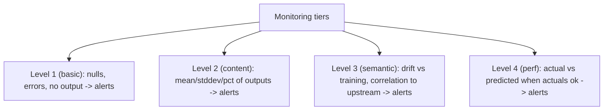

### Lab Exercise
```sql
CREATE OR REPLACE DYNAMIC TABLE MONITOR.PRED_HEALTH
  TARGET_LAG = '15 minutes' WAREHOUSE = MONITOR_WH AS
SELECT
  DATE_TRUNC('hour', SCORED_AT) AS HOUR,
  COUNT(*) AS N_PRED,
  SUM(IFF(PRED_PROBA IS NULL, 1, 0)) AS N_NULL,
  AVG(PRED_PROBA) AS AVG_PROBA,
  STDDEV(PRED_PROBA) AS STD_PROBA,
  MIN(PRED_PROBA) AS MIN_PROBA,
  MAX(PRED_PROBA) AS MAX_PROBA,
  COUNT(DISTINCT ROUND(PRED_PROBA, 3)) AS DISTINCT_VALS
FROM PRED.CHURN_LOG
WHERE SCORED_AT >= DATEADD('hour',-24,CURRENT_TIMESTAMP())
GROUP BY HOUR;

CREATE OR REPLACE ALERT MONITOR.SILENT_FAILURE_ALERT
  WAREHOUSE = MONITOR_WH SCHEDULE = '15 MIN'
  IF (EXISTS (
    SELECT 1 FROM MONITOR.PRED_HEALTH
    WHERE HOUR >= DATEADD('hour',-1,CURRENT_TIMESTAMP())
      AND (N_NULL > N_PRED * 0.05        -- > 5% nulls
           OR STD_PROBA < 0.01            -- constant output
           OR DISTINCT_VALS < 10)         -- degenerate output
  ))
  THEN CALL ML.NOTIFY_SILENT_FAILURE();
ALTER ALERT MONITOR.SILENT_FAILURE_ALERT RESUME;
```

### Gotchas / Exam Traps
- "Low stddev" may be genuine for a very confident model — tune per model.
- Distinct value check works when outputs should be continuous.
- Alert on multiple signals combined to reduce false positives.

---

## Q14: How do you monitor LLM applications (RAG, chat)? What metrics?

**Difficulty:** Advanced
**Exam relevance:** LLM observability

### Answer
LLM metrics span three categories:
1. **Retrieval quality** — recall@k, context relevance score (LLM-as-judge)
2. **Generation quality** — groundedness (is response supported by context), faithfulness (is response consistent with context), coherence, toxicity
3. **System metrics** — latency, token count, cost per request

Cortex AI Observability provides built-in evaluators for 1 and 2. For 3, use QUERY_HISTORY + CORTEX_FUNCTIONS_USAGE_HISTORY.

### First Principles
**Why "accuracy" doesn't apply:** LLMs produce free text. Standard supervised metrics (AUC, F1) have no analog. Quality is multi-dimensional (correct AND coherent AND safe AND concise).

**Why LLM-as-judge is standard:** Automated scoring at scale. Human eval is accurate but slow/expensive. LLM-as-judge is 80% as good, 100% scalable.

### Diagram
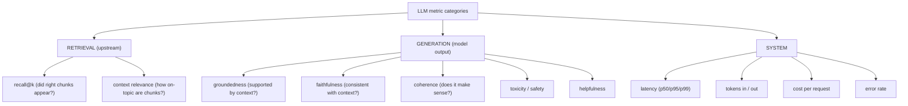

### Lab Exercise
```sql
-- Simple RAG log table
CREATE TABLE OBS.RAG_LOG (
  REQ_ID STRING,
  USER_QUERY STRING,
  RETRIEVED_CHUNKS ARRAY,
  LLM_RESPONSE STRING,
  LATENCY_MS INT,
  TOKENS_IN INT, TOKENS_OUT INT,
  SCORED_AT TIMESTAMP_LTZ DEFAULT CURRENT_TIMESTAMP()
);

-- Groundedness scoring via Cortex (LLM-as-judge)
CREATE OR REPLACE DYNAMIC TABLE OBS.RAG_QUALITY
  TARGET_LAG = '1 hour' WAREHOUSE = MONITOR_WH AS
SELECT
  REQ_ID, USER_QUERY, LLM_RESPONSE,
  SNOWFLAKE.CORTEX.COMPLETE('mistral-large',
    'Rate how well this answer is grounded in the context, 0-1.\n' ||
    'Context: ' || ARRAY_TO_STRING(RETRIEVED_CHUNKS, ' ||| ') || '\n' ||
    'Answer: ' || LLM_RESPONSE || '\n' ||
    'Return only a number 0-1.'
  )::FLOAT AS GROUNDEDNESS_SCORE,
  LATENCY_MS, TOKENS_IN, TOKENS_OUT, SCORED_AT
FROM OBS.RAG_LOG
WHERE SCORED_AT >= DATEADD('day',-1,CURRENT_TIMESTAMP());

-- Alert on low groundedness
CREATE OR REPLACE ALERT OBS.RAG_GROUNDEDNESS_ALERT
  WAREHOUSE = MONITOR_WH SCHEDULE = '1 HOUR'
  IF (EXISTS (
    SELECT 1 FROM OBS.RAG_QUALITY
    WHERE GROUNDEDNESS_SCORE < 0.7
    GROUP BY DATE_TRUNC('hour', SCORED_AT)
    HAVING COUNT(*) > 10
  ))
  THEN CALL ML.NOTIFY_RAG_QUALITY();
```

### Gotchas / Exam Traps
- LLM-as-judge adds token cost — budget monitor usage.
- Groundedness ≠ correctness (grounded in wrong context = still wrong).
- Human eval on a sample complements automated eval.

---

## Q15: What is the relationship between monitoring and the Model Registry?

**Difficulty:** Intermediate
**Exam relevance:** Integration

### Answer
A Model Monitor is attached to a specific Model Registry version. Benefits:
- Automatic knowledge of input/output schema from the Registry signature
- Metrics stored under the version for lineage
- Alerts can reference the version for retraining triggers
- Dashboards can filter by version to compare V15 vs V16

When a new version is promoted, you typically:
- Create a new monitor for the new version
- Keep the old monitor active for lookback until the window of validity passes
- Compare metrics across versions in dashboards

### First Principles
**Why monitors are version-scoped:** Metrics about V15 are meaningless for V16; distributions, actuals, performance all shift.

**Why not auto-create monitors on log:** You may not want monitoring on every experimental version — only prod/stage. Explicit creation.

### Diagram
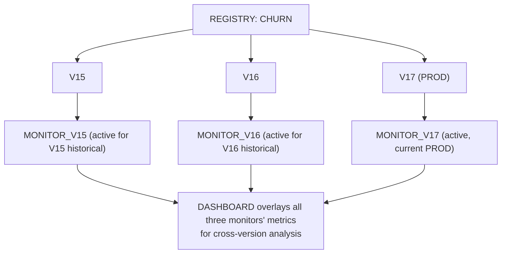

### Lab Exercise
```python
mv_new = reg.get_model("CHURN").version("V17")
mv_new.create_monitor(
    monitor_name="CHURN_MONITOR_V17",
    source_config=ModelMonitorSourceConfig(
        source=session.table("PRED.CHURN_LOG").filter("MODEL_VERSION = 'V17'"),
        timestamp_column="SCORED_AT",
        prediction_class_columns=["PRED"],
        prediction_score_columns=["PRED_PROBA"],
        actual_class_columns=["ACTUAL_LABEL"],
        baseline=session.table("TRAIN.BASELINE_FEATURES")
    ),
    model_function_name="predict",
    refresh_frequency="1 day",
    aggregation_window="1 day"
)
```

### Gotchas / Exam Traps
- Old monitors continue to cost warehouse credits — drop when no longer useful.
- Monitor name collisions across versions — use version suffix.
- Dropping a model version with an active monitor is blocked.

---

## Q16: How do you dashboard monitoring metrics for business consumers?

**Difficulty:** Foundation
**Exam relevance:** Visualization

### Answer
Three paths:
1. **Snowflake Dashboards** — simple SQL-backed charts in Snowsight
2. **Streamlit-in-Snowflake** — richer interactive dashboards with Python logic
3. **External BI** (Tableau, Power BI) — connect to Snowflake, query metric tables

For MLOps, SiS is common because:
- Hosted in Snowflake (no separate infra)
- Can combine SQL + Python for custom plots
- Shared easily within the org

### First Principles
**Why dashboards matter:** Metrics in a table nobody looks at = no monitoring. Dashboards surface trends to humans who make decisions.

**Why pick based on audience:** Technical users → Snowsight queries. Business users → Streamlit app with clean UI. Executives → BI tool with scheduled export.

### Diagram

**Dashboard stack options:**

| Dimension | Snowsight Dashboards | Streamlit-in-Snowflake |
|-----------|----------------------|------------------------|
| Content | SQL queries, charts | Python widgets, custom logic |
| Setup | quick setup | richer UX |
| Sharing | shared via URL | app-like experience |
| Interactivity | limited | programmable |

### Lab Exercise
```python
# streamlit_app.py (SiS)
import streamlit as st
from snowflake.snowpark.context import get_active_session
import pandas as pd

session = get_active_session()

st.title("Churn Model — Live Monitoring")

col1, col2, col3 = st.columns(3)
latest_auc = session.sql("""
  SELECT VALUE FROM ML_DB.REGISTRY.CHURN_MONITOR_METRICS
  WHERE METRIC_NAME = 'ROC_AUC'
  ORDER BY AGGREGATION_WINDOW_START DESC LIMIT 1
""").collect()[0][0]
col1.metric("Latest AUC", f"{latest_auc:.3f}")

n_pred_today = session.sql("""
  SELECT COUNT(*) FROM PRED.CHURN_LOG
  WHERE SCORED_AT::DATE = CURRENT_DATE()
""").collect()[0][0]
col2.metric("Predictions today", f"{n_pred_today:,}")

max_psi = session.sql("""
  SELECT MAX(PSI) FROM MONITOR.PSI_METRICS
  WHERE COMPUTED_AT >= DATEADD('day',-1,CURRENT_TIMESTAMP())
""").collect()[0][0]
col3.metric("Max PSI (1d)", f"{max_psi:.3f}", delta_color="inverse")

# AUC trend
auc_trend = session.sql("""
  SELECT AGGREGATION_WINDOW_START AS DAY, VALUE AS AUC
  FROM ML_DB.REGISTRY.CHURN_MONITOR_METRICS
  WHERE METRIC_NAME = 'ROC_AUC'
    AND AGGREGATION_WINDOW_START >= DATEADD('day',-30,CURRENT_TIMESTAMP())
  ORDER BY DAY
""").to_pandas()
st.line_chart(auc_trend.set_index("DAY"))

# PSI heatmap by feature
psi_table = session.sql("""
  SELECT FEATURE, DATE_TRUNC('day', COMPUTED_AT) AS DAY, AVG(PSI) AS PSI
  FROM MONITOR.PSI_METRICS
  WHERE COMPUTED_AT >= DATEADD('day',-14,CURRENT_TIMESTAMP())
  GROUP BY FEATURE, DAY
""").to_pandas()
pivot = psi_table.pivot(index="FEATURE", columns="DAY", values="PSI")
st.dataframe(pivot.style.background_gradient(cmap="RdYlGn_r"))
```

### Gotchas / Exam Traps
- SiS compute uses the attached warehouse; busy dashboards drive WH cost.
- Caching SQL results in Streamlit (`@st.cache_data`) reduces repeated queries.
- Export to Tableau when business team already uses it.

---

## Q17: How do you handle delayed ground truth in monitoring?

**Difficulty:** Advanced
**Exam relevance:** Realistic monitoring

### Answer
Many ML outcomes materialize days or weeks after prediction (churn: 30 days, fraud: 60 days, loan default: 6 months). Monitoring must handle this gracefully:
1. **Proxy metrics** — use early indicators (first-30-day engagement) while waiting for true label
2. **Rolling joins** — monitor automatically re-computes performance when actuals arrive
3. **Lagging dashboards** — explicitly label "AUC for predictions made 30+ days ago"
4. **Prediction drift as early signal** — if P(prediction) shifts, that's actionable before actuals arrive

### First Principles
**Why proxy metrics:** You can't wait a month to know if a model broke. Early proxies (prediction drift, feature drift) catch issues sooner.

**Why rolling joins over snapshots:** Yesterday's AUC "number" updates as more actuals arrive. Must support asynchronous updates.

### Diagram
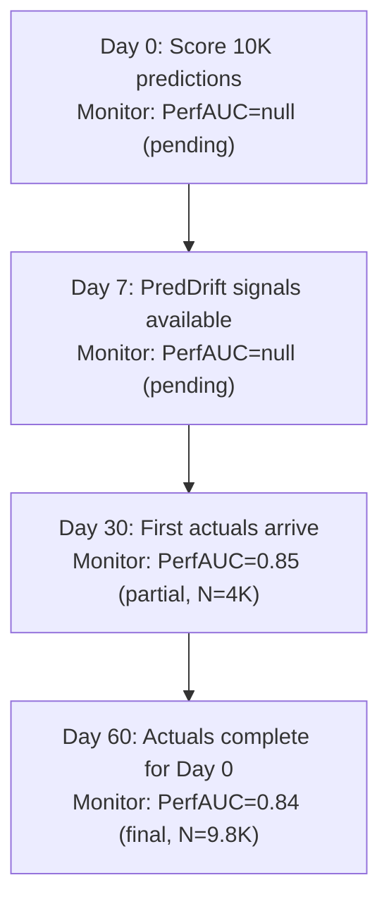

### Lab Exercise
```sql
-- Rolling monitor DT that updates as actuals arrive
CREATE OR REPLACE DYNAMIC TABLE MONITOR.CHURN_PERF_ROLLING
  TARGET_LAG = '1 day' WAREHOUSE = MONITOR_WH AS
SELECT
  DATE_TRUNC('day', SCORED_AT) AS PRED_DAY,
  COUNT(*) AS N_PRED,
  COUNT_IF(ACTUAL_LABEL IS NOT NULL) AS N_WITH_ACTUAL,
  CASE WHEN COUNT_IF(ACTUAL_LABEL IS NOT NULL) >= 100
       THEN AVG(IFF(PRED = ACTUAL_LABEL, 1, 0))
       ELSE NULL
  END AS ACCURACY,
  CASE WHEN COUNT_IF(ACTUAL_LABEL IS NOT NULL) >= 100
       THEN CORR(PRED_PROBA, ACTUAL_LABEL)
       ELSE NULL
  END AS CORRELATION,
  MAX(ACTUAL_OBSERVED_AT) AS LAST_ACTUAL_SEEN
FROM PRED.CHURN_LOG
WHERE SCORED_AT >= DATEADD('day',-120,CURRENT_TIMESTAMP())
GROUP BY PRED_DAY;
```

### Gotchas / Exam Traps
- "Enough actuals" threshold prevents noisy early metrics.
- Monitor-tracked metrics should mark pending vs final status.
- Beware survivorship bias — only looking at customers with observed outcomes.

---

## Q18: What is label leakage in monitoring and how do you prevent it?

**Difficulty:** Advanced
**Exam relevance:** Monitoring correctness

### Answer
In monitoring context, label leakage means your "actuals" table contains information the model couldn't have known at prediction time. Example: for churn prediction, if `ACTUAL_LABEL` is backfilled from a table that itself used features from after the prediction, your "accuracy" is inflated.

Prevention:
- Store `ACTUAL_OBSERVED_AT` and only join actuals where `ACTUAL_OBSERVED_AT > SCORED_AT + grace_period`
- Validate actuals come from a system of record uncoupled from the model's input features
- Audit: pick random predictions, trace the actual back to its source timestamp

### First Principles
**Why monitoring can leak like training:** Same mechanism — using future information. In monitoring, it inflates reported performance and masks degradation.

**Why time-based validation:** The simplest check — did `ACTUAL_OBSERVED_AT > SCORED_AT`? If yes, no temporal leakage.

### Diagram
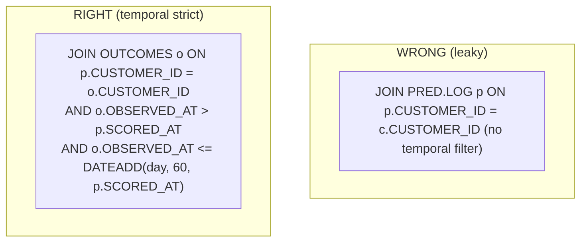

### Lab Exercise
```sql
-- Validate temporal strictness
SELECT COUNT(*) AS N_LEAKY_ROWS
FROM PRED.CHURN_LOG
WHERE ACTUAL_LABEL IS NOT NULL
  AND ACTUAL_OBSERVED_AT < SCORED_AT;      -- should be 0!

-- Correct MERGE pattern
MERGE INTO PRED.CHURN_LOG tgt
USING (
  SELECT CUSTOMER_ID, CHURNED, OBSERVED_AT
  FROM OUTCOMES.CHURN_EVENTS
) src
ON tgt.CUSTOMER_ID = src.CUSTOMER_ID
   AND src.OBSERVED_AT > tgt.SCORED_AT              -- strictly after
   AND src.OBSERVED_AT <= DATEADD('day',60,tgt.SCORED_AT)
WHEN MATCHED AND tgt.ACTUAL_LABEL IS NULL THEN UPDATE SET
  ACTUAL_LABEL = src.CHURNED,
  ACTUAL_OBSERVED_AT = src.OBSERVED_AT;
```

### Gotchas / Exam Traps
- The 60-day cap avoids matching an outcome 2 years later to a stale prediction.
- Always validate your MERGE joins don't pull future-reflected data into prior predictions.
- A model's predict function cannot use features that depend on `ACTUAL` tables.

---

## Q19: Describe how to monitor cost per inference for a model.

**Difficulty:** Advanced
**Exam relevance:** Cost observability

### Answer
Cost per inference requires joining:
- Warehouse credit usage (from `WAREHOUSE_METERING_HISTORY`) attributable to this model
- Prediction count (from the prediction log)
- SPCS pool credits (from `COMPUTE_POOL_METERING_HISTORY`) if deployed via service
- Cortex token usage (from `CORTEX_FUNCTIONS_USAGE_HISTORY`) if using LLM

Tag queries with model-specific `QUERY_TAG` and attribute credits by tag.

### First Principles
**Why cost per inference:** FinOps. "This model costs $0.0001 per prediction" is actionable; "the ML schema costs $X" isn't.

**Why tagging:** Without a tag, you can't attribute WH credits to a specific model.

### Diagram
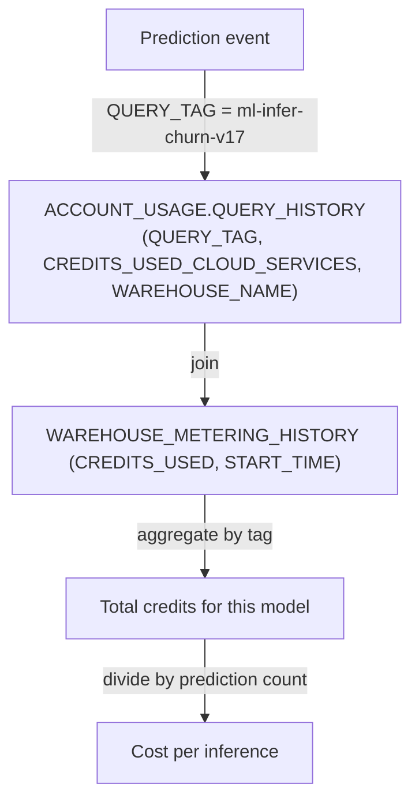

### Lab Exercise
```sql
-- Tag queries from the model
ALTER SESSION SET QUERY_TAG = 'ml-infer-churn-v17';

-- Cost attribution DT
CREATE OR REPLACE DYNAMIC TABLE MONITOR.MODEL_COST
  TARGET_LAG = '1 day' WAREHOUSE = MONITOR_WH AS
WITH q AS (
  SELECT
    DATE_TRUNC('day', START_TIME) AS DAY,
    SPLIT_PART(QUERY_TAG,'-',3) AS MODEL,
    SUM(CREDITS_USED_CLOUD_SERVICES + CREDITS_USED_COMPUTE) AS CREDITS
  FROM SNOWFLAKE.ACCOUNT_USAGE.QUERY_HISTORY
  WHERE QUERY_TAG LIKE 'ml-infer-%'
    AND START_TIME >= DATEADD('day',-30,CURRENT_TIMESTAMP())
  GROUP BY DAY, MODEL
),
p AS (
  SELECT DATE_TRUNC('day', SCORED_AT) AS DAY, MODEL_NAME AS MODEL,
         COUNT(*) AS N_PRED
  FROM PRED.CHURN_LOG
  GROUP BY DAY, MODEL
)
SELECT q.DAY, q.MODEL, q.CREDITS, p.N_PRED,
       q.CREDITS / NULLIF(p.N_PRED, 0) AS CREDITS_PER_PRED
FROM q LEFT JOIN p USING (DAY, MODEL);
```

### Gotchas / Exam Traps
- QUERY_TAG must be set consistently; wrap in a procedure or framework.
- SPCS service costs need separate join on `COMPUTE_POOL_METERING_HISTORY`.
- Cortex LLM costs show in `CORTEX_FUNCTIONS_USAGE_HISTORY`.

---

## Q20: How do you set up a monitoring runbook / on-call?

**Difficulty:** Intermediate
**Exam relevance:** Operational monitoring

### Answer
Runbook structure:
1. **Alert tier definition**: INFO / WARN / CRITICAL
2. **Routing**: who gets paged for each tier (Slack, PagerDuty)
3. **Procedures per alert**: what to check, what to do first
4. **Rollback / mitigation**: alias flip, service suspend, feature pipeline pause
5. **Postmortem template**: capture root cause for future

Implementation on Snowflake:
- Alerts call procedures that write to a `NOTIFICATIONS` table
- A notification integration (email, webhook) pulls from the table
- Snowsight dashboards show alert state

### First Principles
**Why procedure-wrapped notifications:** Decouple alert condition from delivery. One procedure can send to multiple sinks and update audit tables.

**Why severity tiers:** 3am pages for a 1% drift are a morale killer. CRITICAL for real impact; WARN for logs.

### Diagram
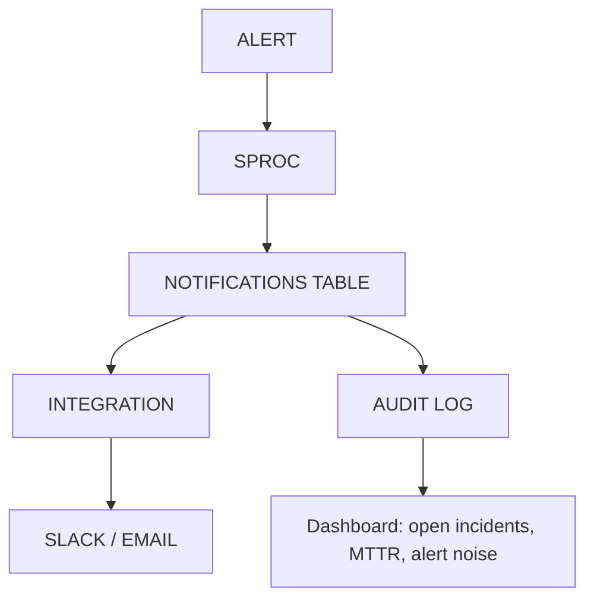

### Lab Exercise
```sql
CREATE TABLE OBS.NOTIFICATIONS (
  ID STRING DEFAULT UUID_STRING(),
  SEVERITY STRING,
  MODEL STRING,
  METRIC STRING,
  VALUE FLOAT,
  THRESHOLD FLOAT,
  MESSAGE STRING,
  RAISED_AT TIMESTAMP_LTZ DEFAULT CURRENT_TIMESTAMP(),
  ACKED_BY STRING,
  ACKED_AT TIMESTAMP_LTZ,
  RESOLVED_AT TIMESTAMP_LTZ,
  ROOT_CAUSE STRING
);

CREATE OR REPLACE PROCEDURE OBS.NOTIFY(SEV STRING, MODEL STRING, METRIC STRING,
                                        VAL FLOAT, THRESHOLD FLOAT, MSG STRING)
RETURNS STRING LANGUAGE SQL AS
BEGIN
  INSERT INTO OBS.NOTIFICATIONS (SEVERITY, MODEL, METRIC, VALUE, THRESHOLD, MESSAGE)
  VALUES (:SEV, :MODEL, :METRIC, :VAL, :THRESHOLD, :MSG);

  -- Optional: send via notification integration
  CALL SYSTEM$SEND_SNOWFLAKE_NOTIFICATION(
    SNOWFLAKE.NOTIFICATION.TEXT_PLAIN('[' || :SEV || '] ' || :MSG),
    SNOWFLAKE.NOTIFICATION.INTEGRATION('SLACK_INT')
  );
  RETURN 'sent';
END;

-- Example alert tied to procedure
CREATE OR REPLACE ALERT MONITOR.CHURN_AUC_DROP
  WAREHOUSE = MONITOR_WH SCHEDULE = '1 HOUR'
  IF (EXISTS (
    SELECT 1 FROM MONITOR.CHURN_PERF_ROLLING
    WHERE PRED_DAY >= DATEADD('day',-3,CURRENT_DATE())
      AND ACCURACY < 0.75 AND N_WITH_ACTUAL >= 500
  ))
  THEN CALL OBS.NOTIFY('CRITICAL','CHURN','accuracy',0.74,0.75,'3-day accuracy below 0.75');
ALTER ALERT MONITOR.CHURN_AUC_DROP RESUME;
```

### Gotchas / Exam Traps
- SYSTEM$SEND_SNOWFLAKE_NOTIFICATION requires NOTIFICATION INTEGRATION setup.
- Deduplicate alerts (don't notify every hour for the same open incident).
- Track MTTR as its own monitored metric.

---

## Q21: How do you handle false positives in drift alerting?

**Difficulty:** Advanced
**Exam relevance:** Alerting discipline

### Answer
False positives waste on-call time and erode trust. Mitigations:
1. **Multi-signal confirmation** — require drift + prediction drift + performance drop before paging
2. **Window-size tuning** — single-point drift is noisy; require persistent drift over N windows
3. **Business-aware thresholds** — different features have different tolerances
4. **Segment awareness** — drift on 0.1% of data isn't the same as drift on 50%
5. **Suppression windows** — known events (Black Friday, product launch) have known effects; suppress alerts

### First Principles
**Why single-signal alerts are noisy:** Any one metric fluctuates. PSI = 0.26 once vs sustained PSI > 0.25 for 3 days are different situations.

**Why multi-signal:** Correlation reduces noise. All three signals pointing to drift = high confidence; one signal alone = investigate manually.

### Diagram
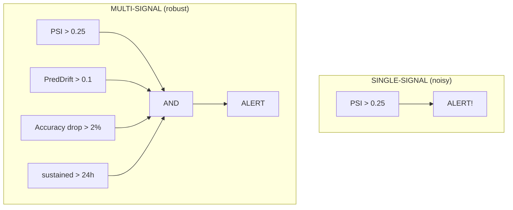

### Lab Exercise
```sql
CREATE OR REPLACE ALERT MONITOR.MULTI_SIGNAL_DRIFT
  WAREHOUSE = MONITOR_WH SCHEDULE = '1 HOUR'
  IF (EXISTS (
    WITH recent AS (
      SELECT COUNT(*) FILTER (WHERE PSI > 0.25) AS N_DRIFT_FEATURES
      FROM MONITOR.PSI_METRICS
      WHERE COMPUTED_AT >= DATEADD('hour',-24,CURRENT_TIMESTAMP())
    ),
    pred_drift AS (
      SELECT MAX(STDDEV_RATIO) AS MAX_STD_RATIO
      FROM (
        SELECT STDDEV(PRED_PROBA) /
               (SELECT STDDEV(PRED_PROBA) FROM PRED.CHURN_LOG WHERE SCORED_AT < '2024-10-01')
          AS STDDEV_RATIO
        FROM PRED.CHURN_LOG
        WHERE SCORED_AT >= DATEADD('hour',-24,CURRENT_TIMESTAMP())
      )
    ),
    perf AS (
      SELECT ACCURACY FROM MONITOR.CHURN_PERF_ROLLING
      ORDER BY PRED_DAY DESC LIMIT 1
    )
    SELECT 1 FROM recent, pred_drift, perf
    WHERE N_DRIFT_FEATURES >= 2
      AND MAX_STD_RATIO > 1.3
      AND ACCURACY < 0.78
  ))
  THEN CALL OBS.NOTIFY('CRITICAL','CHURN','multi_drift',0,0,'Multi-signal drift detected');
ALTER ALERT MONITOR.MULTI_SIGNAL_DRIFT RESUME;
```

### Gotchas / Exam Traps
- Suppression windows (holidays, big marketing campaigns) are often business-maintained.
- Audit alert history to identify "noisiest" alerts and tune them.
- Err toward paging too little rather than too much, early.

---

## Q22: What is the role of lineage in observability?

**Difficulty:** Advanced
**Exam relevance:** Governance

### Answer
Lineage tracks the chain of transformations and dependencies from source data to prediction. In observability, lineage helps:
- **Root-cause** drift ("prediction drift caused by feature A which drifted because upstream events table changed")
- **Impact analysis** ("if feature view V breaks, which models fail?")
- **Governance** (regulated ML must document how prediction was derived)

Snowflake tracks lineage automatically via:
- `ACCESS_HISTORY` view — which objects read/wrote what
- Object dependencies in INFORMATION_SCHEMA
- Account Usage views for QUERY_HISTORY join to objects

### First Principles
**Why automatic lineage:** Manual tracking (Confluence pages, data catalogs) rots. Automatic from query execution is accurate.

**Why read + write:** Downstream impact needs both (what reads this, what writes it).

### Diagram
```mermaid
flowchart TD
    RAW["RAW.EVENTS"]
    RAW -->|written by Snowpipe (ACCESS_HISTORY)| F["FEATURES.CUSTOMER_30D (DT)"]
    F -->|read by DT + notebooks| P["PRED.CHURN (DT)"]
    P -->|read by Streamlit dashboard, downstream ETL| C["consumer"]
    IMPACT["Impact analysis: schema change in RAW.EVENTS cascades downstream failures"]
```

### Lab Exercise
```sql
-- Find all objects reading from a feature table
SELECT DISTINCT QUERY_START_TIME,
                OBJECTS_MODIFIED,
                OBJECTS_ACCESSED
FROM SNOWFLAKE.ACCOUNT_USAGE.ACCESS_HISTORY
WHERE ARRAY_CONTAINS('FEATURES.CUSTOMER_30D'::VARIANT,
                     SPLIT(OBJECTS_ACCESSED::STRING, ','))
  AND QUERY_START_TIME >= DATEADD('day',-30,CURRENT_TIMESTAMP())
LIMIT 20;

-- Dependencies
SELECT REFERENCING_OBJECT_NAME, REFERENCING_OBJECT_SCHEMA
FROM SNOWFLAKE.ACCOUNT_USAGE.OBJECT_DEPENDENCIES
WHERE REFERENCED_OBJECT_NAME = 'CUSTOMER_30D'
  AND REFERENCED_OBJECT_SCHEMA = 'FEATURES';
```

### Gotchas / Exam Traps
- `ACCESS_HISTORY` latency can be 1-3 hours — not real-time.
- Lineage covers tables/views; for Registry models, inspect `MODELS` views in Account Usage.
- External lineage (what downstream app reads from Snowflake) requires app-side instrumentation.

---

## Q23: What are the common anti-patterns in ML monitoring on Snowflake?

**Difficulty:** Intermediate
**Exam relevance:** Mistakes to avoid

### Answer
Common anti-patterns:
1. **Monitoring predictions but not features** — misses upstream data quality issues
2. **Hard-coding thresholds** — a 0.25 PSI threshold may be too tight for one feature, too loose for another
3. **Rolling monitors over all-time** — "AUC since launch" hides recent degradation; use windowed
4. **Ignoring segments** — overall AUC great, but a critical segment is broken
5. **No actual latency** — scheduling monitor every minute but query times out
6. **Alerting without runbook** — pages with no action instructions = ignored pages
7. **Monitoring the wrong model** — forgot to point monitor at the new PROD version

### First Principles
**Why anti-patterns persist:** Monitoring is "work on top of work" — easy to defer. Patterns calcify from quick first setup.

### Diagram

**Anti-patterns and mitigations:**

| Anti-pattern | Mitigation |
|--------------|------------|
| Predictions-only monitoring | Also monitor features + schema |
| Hard-coded thresholds | Per-feature tuned thresholds |
| All-time rolling metrics | Windowed (24h, 7d, 30d) |
| No segmentation | Monitor per segment |
| High-frequency ineffective | Match freq to actionability |
| Alert fatigue | Multi-signal, tiered sev |
| Pointing at wrong model | Automate monitor create on alias flip |

### Lab Exercise
```sql
-- Good: per-segment monitoring
CREATE OR REPLACE DYNAMIC TABLE MONITOR.CHURN_PERF_BY_SEGMENT
  TARGET_LAG = '1 day' WAREHOUSE = MONITOR_WH AS
SELECT
  (FEATURES:REGION)::STRING AS REGION,
  (FEATURES:SEGMENT)::STRING AS SEGMENT,
  DATE_TRUNC('day',SCORED_AT) AS DAY,
  COUNT(*) AS N,
  AVG(IFF(PRED = ACTUAL_LABEL, 1, 0)) AS ACCURACY
FROM PRED.CHURN_LOG
WHERE ACTUAL_LABEL IS NOT NULL
  AND SCORED_AT >= DATEADD('day',-30,CURRENT_TIMESTAMP())
GROUP BY REGION, SEGMENT, DAY;
```

### Gotchas / Exam Traps
- Over-monitoring leads to noise; focus on signals that will trigger action.
- Monitor the monitors — track alert noise and resolution rate.
- Document what to do for every alert.

---

## Q24: How does Model Monitor compare with building custom monitoring from scratch?

**Difficulty:** Intermediate
**Exam relevance:** Build vs buy

### Answer
**Model Monitor advantages:**
- Managed, versioned, aligned with Registry
- Automatic drift metrics (PSI, KS)
- Automatic performance metrics when actuals supplied
- Backfill handled

**Custom monitoring advantages:**
- Full control over metrics (business-specific KPIs)
- Can integrate non-Registry models
- Lighter weight for simple cases

**Hybrid is common:** Use Model Monitor for the standard metrics; add custom DTs for business-specific KPIs.

### First Principles
**Why not just always use Model Monitor:** Not every ML pipeline uses the Registry; external models need custom monitoring. And business-specific metrics (revenue impact, specific segment, calibration-at-threshold) may not be in Monitor's menu.

**Why hybrid:** Model Monitor covers the 80% baseline; custom covers the 20% business edge.

### Diagram
```mermaid
flowchart TD
    subgraph MM["Managed monitor (built-in)"]
        MM1["AUC, F1, PSI, KS, nulls, counts"]
        MM2["stored in model's monitor tables"]
    end
    subgraph CM["Custom monitoring (your DTs)"]
        CM1["revenue impact per prediction"]
        CM2["per-segment calibration"]
        CM3["threshold-based business metrics"]
        CM4["stored in your tables"]
    end
    MM --> D["Combined dashboard reads both"]
    CM --> D
```

### Lab Exercise
```sql
-- Business-specific custom metric: revenue-at-risk by predicted churn
CREATE OR REPLACE DYNAMIC TABLE MONITOR.REVENUE_AT_RISK
  TARGET_LAG = '1 day' WAREHOUSE = MONITOR_WH AS
SELECT
  DATE_TRUNC('day', p.SCORED_AT) AS DAY,
  SUM(CASE WHEN p.PRED_PROBA > 0.7 THEN c.ANNUAL_REVENUE END) AS HIGH_RISK_REVENUE,
  SUM(CASE WHEN p.PRED_PROBA > 0.9 THEN c.ANNUAL_REVENUE END) AS CRITICAL_REVENUE,
  COUNT(DISTINCT p.CUSTOMER_ID) AS N_CUSTOMERS
FROM PRED.CHURN_LOG p
JOIN DIM.CUSTOMER c USING (CUSTOMER_ID)
WHERE p.SCORED_AT >= DATEADD('day',-30,CURRENT_TIMESTAMP())
GROUP BY DAY;
```

### Gotchas / Exam Traps
- Model Monitor's metric names are standardized — easier to compare across models.
- Business metrics may be more actionable but less portable.
- Keep both in a single dashboard for context.

---

## Q25: Walk through a complete observability setup for a production model.

**Difficulty:** Advanced
**Exam relevance:** Capstone

### Answer
Comprehensive setup:
1. **Prediction log table** (`PRED.CHURN_LOG`) — all predictions with features
2. **Actuals MERGE pipeline** — update outcomes with temporal strictness
3. **Model Monitor** attached to the Registry version — drift + performance
4. **Custom monitoring DTs** — business KPIs, per-segment metrics, cost per inference
5. **Alerts** multi-signal, tiered severity, routing to notifications table
6. **Streamlit dashboard** for ongoing visibility
7. **Retraining procedure** triggered by alerts, with offline eval gate
8. **Runbook** doc tied to each alert type

### First Principles
**Why integrate all:** Monitoring is a system, not a feature. Isolated pieces miss the whole picture.

### Diagram
```mermaid
flowchart TD
    PM["PROD.CHURN model V17 (@PROD)"]
    PM -->|every prediction logged| LOG["PRED.CHURN_LOG"]
    OE["OUTCOMES.CHURN_EVENTS"] -->|MERGE actuals, temporal-strict| LOG
    LOG --> MM["Model Monitor (built-in)<br/>drift metrics, perf metrics (auto)"]
    LOG --> CDT["Custom DTs<br/>PSI_METRICS, PRED_HEALTH, REVENUE_AT_RISK, PERF_BY_SEGMENT, MODEL_COST"]
    LOG --> AL["Alerts (multi-signal)"]
    MM --> AL
    CDT --> AL
    AL --> NT["NOTIFICATIONS table"]
    NT --> SL["Slack / PagerDuty"]
    AL --> RT["Retrain SPROC (gated promotion)"]
    MM --> DASH["Streamlit dashboard reads all monitoring artifacts"]
    CDT --> DASH
```

### Lab Exercise
```python
# All-together setup (abbreviated)

# 1. Prediction log + actuals pipeline (see Q4)

# 2. Model Monitor
mv.create_monitor(
    monitor_name="CHURN_MONITOR_V17",
    source_config=ModelMonitorSourceConfig(
        source=session.table("PRED.CHURN_LOG").filter("MODEL_VERSION='V17'"),
        timestamp_column="SCORED_AT",
        prediction_class_columns=["PRED"],
        prediction_score_columns=["PRED_PROBA"],
        actual_class_columns=["ACTUAL_LABEL"],
        baseline=session.table("TRAIN.BASELINE_FEATURES")
    ),
    model_function_name="predict",
    refresh_frequency="1 day",
    aggregation_window="1 day"
)

# 3. Custom DTs (PSI, pred health, revenue at risk) — see Q8, Q13, Q24

# 4. Multi-signal alert (Q21)

# 5. Retrain procedure (Q11)

# 6. Streamlit dashboard (Q16)

# 7. Runbook as a doc / wiki page: for each alert type, who / what / how to fix.
```

### Gotchas / Exam Traps
- Audit the setup quarterly — thresholds drift, business changes.
- Automate everything that can be — manual monitoring decays.
- Monitor the monitor cost itself (don't let it dominate ML spend).

---

## Study Checklist

- [ ] Can create a Model Monitor with proper source config
- [ ] Can compute PSI, KS, and chi-squared via SQL/Python
- [ ] Can design a prediction log schema with async actual MERGE
- [ ] Can distinguish data drift, concept drift, prediction drift
- [ ] Can build custom monitoring DTs for business-specific metrics
- [ ] Can wire up Alerts that call retraining procedures
- [ ] Can set up Cortex AI Observability for LLM apps
- [ ] Can monitor cost per inference via QUERY_TAG attribution
- [ ] Can diagnose and prevent monitoring label leakage
- [ ] Can design multi-signal alerting to reduce false positives
