# MLOps Automation & Governance — MLE-C01 Study Guide

## Exam Weight & Scope

**Approximate weight:** 15-18% of exam
**Scope:** CI/CD for ML pipelines using Snowflake CLI (`snow`) and Git integration; model lineage and metadata capture; RBAC on models and services; approval workflows for model promotion; cost tracking and chargeback for ML workloads; audit via ACCOUNT_USAGE views; secrets and credential management.

**You must be able to:**
- Design a CI/CD pipeline (GitHub Actions / Jenkins / Snowflake CLI) that trains, registers, promotes models
- Set up Git integration for feature/model/service code
- Grant appropriate RBAC on models/versions/services; design approval workflows
- Implement model approval gates (tag-based promotion, procedure gating)
- Query ACCOUNT_USAGE to track model lineage, cost, compliance
- Manage secrets via Snowflake Secret objects and EAIs

---

## Core Concepts Map

```mermaid
flowchart TD
    GIT["SOURCE OF TRUTH: Git repo<br/>feature SQL, training notebooks, service specs,<br/>Streamlit apps, stored procedures"]
    GIT -->|CI/CD (GitHub Actions, GitLab, Jenkins)<br/>uses snow CLI, snowpark-python| SF["SNOWFLAKE"]
    SF --> GR["Git Repository (CREATE GIT REPOSITORY)"]
    GR -->|fetch| SCR["Scripts on stage"]
    SCR -->|EXECUTE IMMEDIATE / CALL| REG["Model Registry<br/>version log with git_commit tag<br/>approval tag required to flip PROD alias"]
    SF --> RBAC["RBAC + Object tags + Row/column policies<br/>roles per env (DEV, STAGE, PROD)<br/>approvals as tag changes"]
    SF --> AU["ACCOUNT_USAGE / ACCESS_HISTORY<br/>who-ran-what-when, lineage"]
    SF --> SEC["Secrets, Network rules, EAIs<br/>credentials for external APIs"]
    SF --> OBS["OBSERVABILITY + COST<br/>QUERY_TAG per workload<br/>cost chargeback by role/warehouse/pool<br/>alert on policy violations"]
```

---

## Q1: What are the pillars of MLOps automation on Snowflake?

**Difficulty:** Foundation
**Exam relevance:** Framing

### Answer
Five pillars:
1. **Source control** — all pipeline code in Git; nothing production-critical lives only in notebooks
2. **CI/CD** — automated test, train, register, promote via pipeline tools (GitHub Actions, etc.)
3. **Reproducibility** — pinned deps, versioned data (Datasets), tagged commits on model versions
4. **Governance** — RBAC, approval workflows, audit trails
5. **Observability** — monitoring + cost tracking integrated with pipeline

All five supported in-platform via Snowflake-native services: Git integration, Model Registry versioning, object tags, ACCOUNT_USAGE, Alerts.

### First Principles
**Why five pillars:** Each addresses a distinct failure mode.
- No source control → unreproducible production
- No CI/CD → human-error promotions
- No reproducibility → can't rebuild old models
- No governance → compliance violations
- No observability → can't debug or optimize

**Why Snowflake-native support:** Reduces integration surface. CI tools, external secrets managers, separate observability pipelines all introduce complexity.

### Diagram

**Pillars and Snowflake primitives:**

| Pillar | Snowflake primitive |
|--------|---------------------|
| Source control | Git Repository (CREATE GIT REPOSITORY) |
| CI/CD | snow CLI + GitHub Actions / etc. |
| Reproducibility | Model Registry versions + Dataset versions + tags |
| Governance | RBAC + Object tags + Masking/Row policies |
| Observability | Model Monitor + Event Table + QUERY_HISTORY |

---

## Q2: How does Snowflake Git integration work for ML pipeline code?

**Difficulty:** Foundation
**Exam relevance:** Git integration

### Answer
`CREATE GIT REPOSITORY` registers a Git repo as a Snowflake object. Operations:
- `FETCH` syncs the repo's branches/commits/tags to Snowflake
- Content accessible via stage paths: `@my_repo/branches/<branch>/`, `@my_repo/commits/<sha>/`, `@my_repo/tags/<tag>/`
- Run scripts: `EXECUTE IMMEDIATE FROM @my_repo/branches/main/train.sql`
- Load Python modules: `PACKAGES = ('mymodule')` from the repo stage

Authentication via Snowflake Secret + API Integration. Access control via standard Snowflake grants.

### First Principles
**Why Git as source of truth:** All production artifacts (feature SQL, training scripts, service specs) must be reviewed, versioned, and traceable. Git provides this; manual Snowsight edits don't.

**Why not just copy to a stage:** Stages have no version history, PR workflow, or merge semantics. Git gives you those for free; Snowflake Git integration surfaces Git state inside Snowflake.

### Diagram
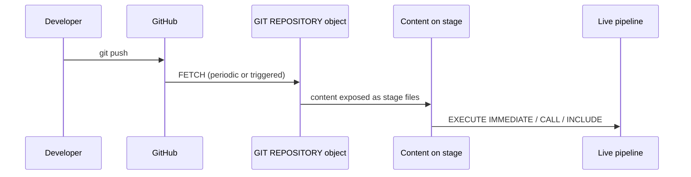

### Lab Exercise
```sql
-- Secret with PAT or SSH key
CREATE OR REPLACE SECRET SECRETS.GH_PAT
  TYPE = PASSWORD
  USERNAME = 'rmoses'
  PASSWORD = '<github-personal-access-token>';

-- API integration
CREATE OR REPLACE API INTEGRATION GH_API
  API_PROVIDER = GIT_HTTPS_API
  API_ALLOWED_PREFIXES = ('https://github.com/myorg')
  ALLOWED_AUTHENTICATION_SECRETS = (SECRETS.GH_PAT)
  ENABLED = TRUE;

-- Repository
CREATE OR REPLACE GIT REPOSITORY ML_REPO
  API_INTEGRATION = GH_API
  GIT_CREDENTIALS = SECRETS.GH_PAT
  ORIGIN = 'https://github.com/myorg/ml-pipelines.git';

-- Pull latest
ALTER GIT REPOSITORY ML_REPO FETCH;

-- Execute SQL from a specific branch
EXECUTE IMMEDIATE FROM @ML_REPO/branches/main/pipelines/create_feature_dts.sql;

-- Reference files from a specific tag (immutable release)
EXECUTE IMMEDIATE FROM @ML_REPO/tags/v1.5.2/pipelines/create_feature_dts.sql;
```

### Gotchas / Exam Traps
- `FETCH` is not automatic — schedule a Task or trigger from CI.
- Files can be parameterized with Jinja (`USING (var = value)` in EXECUTE IMMEDIATE).
- Private repos require correct secret type (PAT or SSH).

---

## Q3: Walk through a CI/CD pipeline using Snowflake CLI (`snow`) and GitHub Actions.

**Difficulty:** Intermediate
**Exam relevance:** CI/CD

### Answer
Typical pipeline:
1. **PR opened** → lint, run unit tests, dry-run SQL
2. **Merge to main** → CI pipeline runs:
   - `snow git fetch` to sync Snowflake with latest commit
   - Execute DDL scripts (feature DTs, services) via `snow sql`
   - Train model via `snow ml` or Python script (potentially on SPCS)
   - Register version with git_commit tag
   - Run offline eval tests
   - If pass → promote via tag update (triggers alias flip via SPROC)
3. **Scheduled jobs** → nightly retraining, monitoring

Secrets stored in GitHub repo secrets, injected to CI runner.

### First Principles
**Why CI/CD:** Reproducible, auditable deployments. "It worked on my laptop" is unacceptable for production ML.

**Why `snow` CLI:** Idempotent, scripted, aware of Snowflake-specific concepts (models, services, warehouses) in ways SQL alone isn't.

### Diagram
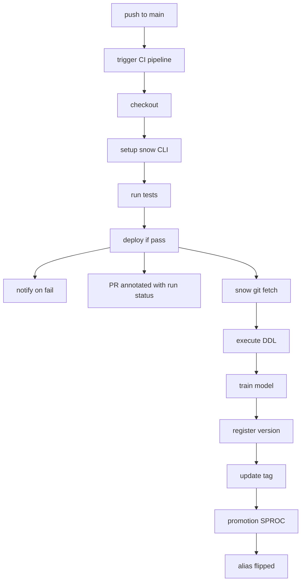

### Lab Exercise
```yaml
# .github/workflows/deploy-ml.yml
name: Deploy ML Pipeline
on:
  push:
    branches: [main]

jobs:
  deploy:
    runs-on: ubuntu-latest
    env:
      SNOWFLAKE_ACCOUNT: ${{ secrets.SF_ACCOUNT }}
      SNOWFLAKE_USER: ${{ secrets.SF_USER }}
      SNOWFLAKE_PRIVATE_KEY: ${{ secrets.SF_PRIVATE_KEY }}
    steps:
      - uses: actions/checkout@v4

      - name: Install snow CLI
        run: pip install snowflake-cli-labs snowflake-ml-python

      - name: Sync Git repo to Snowflake
        run: |
          snow sql -q "ALTER GIT REPOSITORY ML_REPO FETCH"

      - name: Deploy feature pipeline DDL
        run: snow sql -f pipelines/create_feature_dts.sql

      - name: Train model (uses Snowflake compute)
        run: python pipelines/train_and_register.py \
             --version "V_${{ github.sha }}" \
             --git-commit "${{ github.sha }}"

      - name: Offline evaluation gate
        run: python pipelines/offline_eval.py \
             --model CHURN --version "V_${{ github.sha }}" \
             --min-auc 0.85

      - name: Promote if gate passed
        run: snow sql -q "CALL ML_DB.REGISTRY.PROMOTE_IF_APPROVED('CHURN','V_${{ github.sha }}')"

      - name: Deploy / update SPCS service
        run: snow sql -f pipelines/update_service.sql
```

### Gotchas / Exam Traps
- Use key-pair auth, not password — CI runs are headless.
- Rotate Snowflake credentials via GitHub secrets regularly.
- Tag releases in Git to pin production versions.

---

## Q4: What's the role of Snowflake Tasks in automation (vs CI/CD)?

**Difficulty:** Intermediate
**Exam relevance:** Automation primitives

### Answer
Snowflake Tasks are in-platform schedulers:
- Run SQL / call procedures on cron-like intervals or in task graphs (DAGs)
- No external orchestrator required
- Integrate with warehouses, serverless Tasks, SPROCs

Compared to CI/CD:
- **CI/CD** — triggered by code changes (push/PR); builds, tests, deploys
- **Tasks** — triggered by schedule/data events; runs operations (retrain, score, monitor)

They complement: CI/CD deploys the Tasks; Tasks execute the day-to-day work.

### First Principles
**Why in-platform scheduler:** Avoid external cron infra. One place to see what runs when. One place for audit.

**Why Task DAGs:** Multi-step pipelines (ingest → feature → score → monitor) have ordering constraints. DAGs express those.

### Diagram
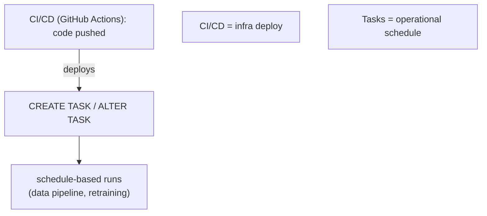

### Lab Exercise
```sql
-- Task graph: feature refresh -> scoring -> monitoring
CREATE OR REPLACE TASK ML.T_REFRESH_FEATURES
  WAREHOUSE = ML_WH SCHEDULE = '1 HOUR'
AS ALTER DYNAMIC TABLE FEATURES.CUSTOMER_30D REFRESH;

CREATE OR REPLACE TASK ML.T_SCORE
  WAREHOUSE = ML_WH AFTER ML.T_REFRESH_FEATURES
AS CALL ML.SP_SCORE_AND_LOG();

CREATE OR REPLACE TASK ML.T_MONITOR
  WAREHOUSE = MONITOR_WH AFTER ML.T_SCORE
AS CALL ML.SP_REFRESH_MONITORING();

-- Resume (root last)
ALTER TASK ML.T_MONITOR RESUME;
ALTER TASK ML.T_SCORE RESUME;
ALTER TASK ML.T_REFRESH_FEATURES RESUME;
```

### Gotchas / Exam Traps
- Tasks must be resumed in reverse DAG order (child first, root last).
- Serverless Tasks (no warehouse) exist for lightweight workloads.
- Task failures silent unless you add error handlers; use `TASK_HISTORY` + Alerts.

---

## Q5: How do you implement model approval workflows in Snowflake?

**Difficulty:** Advanced
**Exam relevance:** Governance workflow

### Answer
Pattern: approvals as tag changes, promotion gated by tag check.

Steps:
1. **Define approval tags** on models — `approval_status` with values `pending`, `approved`, `rejected`
2. **Approvers role** — only this role can modify the tag
3. **Promotion procedure** — checks the tag before setting PROD alias
4. **Audit** — `TAG_REFERENCES` and ACCOUNT_USAGE show who approved when

Alternative: object_privileges on MODIFY — but tag-based is more auditable.

### First Principles
**Why tag-based approval:** Tags are first-class governable objects; changes appear in `ACCOUNT_USAGE.OBJECT_PRIVILEGES` and tag reference views. Audit-friendly.

**Why gate in procedure:** Centralized check; no bypass path. CI can't skip approval.

### Diagram
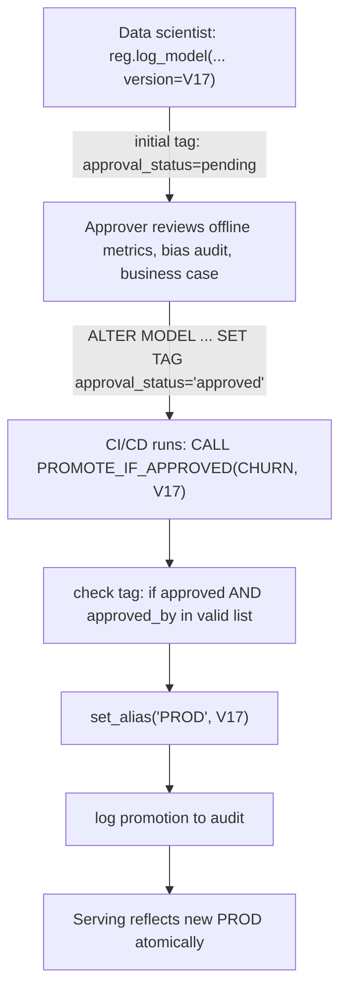

### Lab Exercise
```sql
-- Tags
CREATE TAG IF NOT EXISTS ML_DB.REGISTRY.APPROVAL_STATUS
  ALLOWED_VALUES ('pending','approved','rejected','revoked');
CREATE TAG IF NOT EXISTS ML_DB.REGISTRY.APPROVED_BY;

-- Grants: only RELEASE_MANAGER can set the approval tag
GRANT APPLY ON TAG ML_DB.REGISTRY.APPROVAL_STATUS TO ROLE RELEASE_MANAGER;

-- Promotion procedure gated on tag
CREATE OR REPLACE PROCEDURE ML_DB.REGISTRY.PROMOTE_IF_APPROVED(
  MODEL STRING, VERSION STRING
)
RETURNS STRING LANGUAGE PYTHON RUNTIME_VERSION = '3.10'
PACKAGES = ('snowflake-snowpark-python','snowflake-ml-python')
HANDLER = 'run' AS $$
def run(session, model, version):
    from snowflake.ml.registry import Registry
    tag = session.sql(f"""
      SELECT SYSTEM$GET_TAG('ML_DB.REGISTRY.APPROVAL_STATUS',
        'ML_DB.REGISTRY.{model}', 'MODEL') AS STATUS
    """).collect()[0]['STATUS']  # (actual API for versioned model may differ)

    if tag != 'approved':
        raise Exception(f"Model {model} V{version} not approved (status={tag})")

    reg = Registry(session, "ML_DB", "REGISTRY")
    reg.get_model(model).version(version).set_alias("PROD")
    return f"Promoted {model}:{version} to PROD"
$$;

-- Data scientist logs V17 (tagged pending by default via setup)
-- Approver:
-- ALTER MODEL ML_DB.REGISTRY.CHURN VERSION V17 SET TAG APPROVAL_STATUS = 'approved';
-- ALTER MODEL ML_DB.REGISTRY.CHURN VERSION V17 SET TAG APPROVED_BY = 'alice@org';

-- CI/CD:
CALL ML_DB.REGISTRY.PROMOTE_IF_APPROVED('CHURN','V17');
```

### Gotchas / Exam Traps
- Tag-based approval requires discipline — enforcing default `pending` on log_model needs a wrapper.
- Approval evidence (model card, metrics report) typically stored alongside — reference in a comment or linked object.
- Separate roles for log_model and promote are critical; same role shouldn't approve own work.

---

## Q6: Describe RBAC for Model Registry objects. Who can do what?

**Difficulty:** Advanced
**Exam relevance:** Model RBAC

### Answer
Grants:
- `USAGE ON DATABASE/SCHEMA` — see the Registry
- `USAGE ON MODEL <name>` — call UDF functions on the model (predict)
- `MODIFY ON MODEL <name>` — change aliases, tags, metrics; log new versions
- `USAGE ON WAREHOUSE / COMPUTE POOL` — needed for serving execution

Typical roles:
- `DATA_SCIENTIST` — USAGE on dev Registry; MODIFY on dev models
- `MLOPS_RELEASE` — MODIFY on stage/prod Registry (promotion)
- `ML_SERVICE` — USAGE on prod Registry (serving); cannot promote
- `AUDITOR` — SELECT on ACCOUNT_USAGE views

### First Principles
**Why MODIFY is separate from USAGE:** You can read predictions without being able to promote. Separation of duties.

**Why schema-level grants are coarse:** Convenient but overly permissive. For sensitive models, grant on individual models.

### Diagram

**Role-to-model access matrix:**

| Role | Dev | Stage | Prod |
|------|-----|-------|------|
| DATA_SCIENTIST | MODIFY (log, retrain) | USAGE | USAGE (read predictions) |
| MLOPS_RELEASE | USAGE | MODIFY (promote, alias) | MODIFY (promote, alias) |
| ML_SERVICE | - (no access) | - | USAGE only (serving) |
| AUDITOR | ACCOUNT_USAGE SELECT (read-only history across all envs) | - | - |

### Lab Exercise
```sql
-- Dev schema
GRANT USAGE ON DATABASE ML_DEV TO ROLE DATA_SCIENTIST;
GRANT USAGE ON SCHEMA ML_DEV.REGISTRY TO ROLE DATA_SCIENTIST;
GRANT CREATE MODEL ON SCHEMA ML_DEV.REGISTRY TO ROLE DATA_SCIENTIST;
GRANT USAGE ON ALL MODELS IN SCHEMA ML_DEV.REGISTRY TO ROLE DATA_SCIENTIST;
GRANT MODIFY ON ALL MODELS IN SCHEMA ML_DEV.REGISTRY TO ROLE DATA_SCIENTIST;

-- Prod: only USAGE for data scientists
GRANT USAGE ON SCHEMA ML_PROD.REGISTRY TO ROLE DATA_SCIENTIST;
GRANT USAGE ON ALL MODELS IN SCHEMA ML_PROD.REGISTRY TO ROLE DATA_SCIENTIST;
-- NO modify grant

-- Prod: MODIFY to release managers only
GRANT MODIFY ON ALL MODELS IN SCHEMA ML_PROD.REGISTRY TO ROLE MLOPS_RELEASE;

-- Serving role
GRANT USAGE ON SCHEMA ML_PROD.REGISTRY TO ROLE ML_SERVICE;
GRANT USAGE ON ALL MODELS IN SCHEMA ML_PROD.REGISTRY TO ROLE ML_SERVICE;
GRANT USAGE ON WAREHOUSE SERVING_WH TO ROLE ML_SERVICE;

-- Auditor
GRANT IMPORTED PRIVILEGES ON DATABASE SNOWFLAKE TO ROLE AUDITOR;
```

### Gotchas / Exam Traps
- Future grants (`GRANT ... ON FUTURE MODELS`) apply to objects created later.
- Row access + masking policies on backing tables still apply; model inherits visibility.
- Service roles should have minimal grants; least privilege.

---

## Q7: How do you track model lineage from source data to prediction?

**Difficulty:** Advanced
**Exam relevance:** Lineage

### Answer
Lineage sources:
- `ACCOUNT_USAGE.ACCESS_HISTORY` — which queries read/wrote which objects
- `ACCOUNT_USAGE.OBJECT_DEPENDENCIES` — static dependencies (views, DTs)
- Model Registry metadata — tags linking model to Dataset version, FV versions, Git commit
- `ACCOUNT_USAGE.MODELS` + `MODEL_VERSIONS` — model-level info
- Backing DT lineage via INFORMATION_SCHEMA

Combine for end-to-end: raw table → FV → Dataset → Model → predictions → consumer.

### First Principles
**Why lineage matters in regulated ML:** For GDPR/MRM compliance, you must document how a prediction was derived. Lineage is the evidence.

**Why platform-native lineage:** Manual lineage (Confluence, wikis) rots. ACCESS_HISTORY is accurate because it's generated by actual query execution.

### Diagram
```mermaid
flowchart TD
    R["RAW.EVENTS (written by Snowpipe, in ACCESS_HISTORY)"]
    R -->|read by (ACCESS_HISTORY)| F["FEATURES.CUSTOMER_30D (DT; depends on RAW.EVENTS)"]
    F -->|read by generate_dataset()| D["DATASET: CHURN_TRAIN:V2024_10_01 (immutable)"]
    D -->|consumed by log_model (tagged)| M["MODEL: CHURN V17<br/>tags: dataset=..., fv_versions=..., git_commit=..."]
    M -->|called by (ACCESS_HISTORY -> MODEL UDF)| L["PRED.CHURN_LOG"]
    L -->|read by consumers| DS["downstream"]
```

### Lab Exercise
```sql
-- Find full lineage of a prediction
WITH model_meta AS (
  SELECT NAME, VERSION_NAME, COMMENT, METRICS
  FROM ACCOUNT_USAGE.MODEL_VERSIONS
  WHERE DATABASE_NAME = 'ML_PROD' AND SCHEMA_NAME = 'REGISTRY'
    AND NAME = 'CHURN' AND VERSION_NAME = 'V17'
),
tags AS (
  SELECT TAG_NAME, TAG_VALUE
  FROM ACCOUNT_USAGE.TAG_REFERENCES
  WHERE OBJECT_NAME = 'CHURN' AND OBJECT_DOMAIN = 'MODEL'
),
upstream AS (
  SELECT DISTINCT OBJECTS_ACCESSED
  FROM ACCOUNT_USAGE.ACCESS_HISTORY
  WHERE QUERY_START_TIME >= DATEADD('day',-180,CURRENT_TIMESTAMP())
    AND ARRAY_CONTAINS('CHURN_TRAIN'::VARIANT, SPLIT(OBJECTS_MODIFIED::STRING, ','))
)
SELECT 'MODEL' AS LAYER, VERSION_NAME, COMMENT, METRICS FROM model_meta
UNION ALL
SELECT 'TAG', TAG_NAME, TAG_VALUE, '' FROM tags
UNION ALL
SELECT 'UPSTREAM', '', OBJECTS_ACCESSED::STRING, '' FROM upstream;
```

### Gotchas / Exam Traps
- `ACCESS_HISTORY` has 1-3h latency.
- External lineage (what external app does with results) requires app-side logs.
- Snowflake Horizon Catalog unifies lineage, discoverability, and governance — may be referenced on exam.

---

## Q8: How do you implement cost tracking / chargeback for ML workloads?

**Difficulty:** Advanced
**Exam relevance:** FinOps

### Answer
Approach:
1. **Tag every query** with `QUERY_TAG` indicating team/model/env (`ml-train-churn-dev`)
2. **Separate warehouses per workload** (training WH, inference WH, monitor WH)
3. **Compute pools scoped by team** (DS team pool vs serving pool)
4. **Attribute credits** via joins:
   - `QUERY_HISTORY` + `WAREHOUSE_METERING_HISTORY` → WH credits by tag
   - `COMPUTE_POOL_METERING_HISTORY` → SPCS credits per pool
   - `CORTEX_FUNCTIONS_USAGE_HISTORY` → LLM token credits
5. **Dashboard** by team/model/environment

### First Principles
**Why tag-based:** Snowflake credits aren't naturally attributed to "models" — they're per warehouse-second or per container-hour. Tags provide the semantic layer.

**Why multiple warehouses:** Easier billing attribution; also controls blast radius (bad query doesn't block all teams).

### Diagram
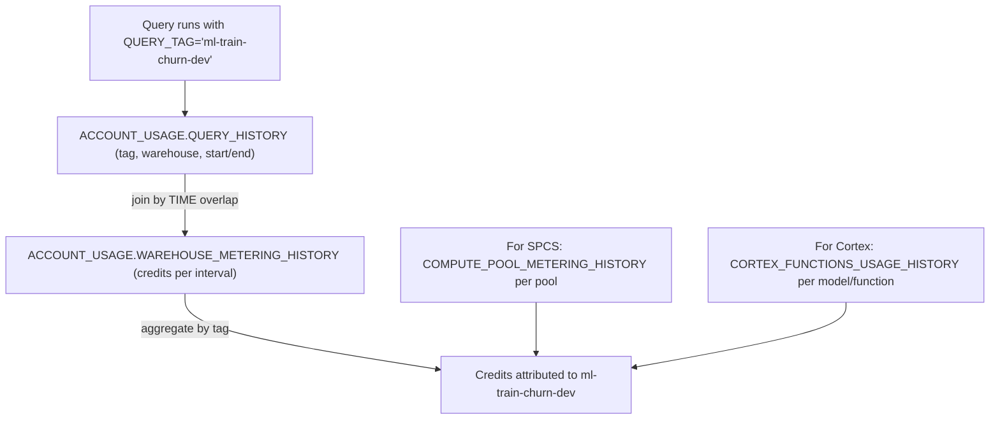

### Lab Exercise
```sql
-- Monthly cost by model workload
WITH q AS (
  SELECT
    DATE_TRUNC('month', START_TIME) AS MONTH,
    QUERY_TAG,
    WAREHOUSE_NAME,
    SUM(CREDITS_USED_CLOUD_SERVICES + CREDITS_USED_COMPUTE) AS CREDITS,
    COUNT(*) AS N_QUERIES
  FROM ACCOUNT_USAGE.QUERY_HISTORY
  WHERE QUERY_TAG LIKE 'ml-%'
    AND START_TIME >= DATEADD('month',-6,CURRENT_TIMESTAMP())
  GROUP BY MONTH, QUERY_TAG, WAREHOUSE_NAME
),
pool AS (
  SELECT
    DATE_TRUNC('month', START_TIME) AS MONTH,
    COMPUTE_POOL_NAME,
    SUM(CREDITS_USED) AS CREDITS
  FROM ACCOUNT_USAGE.COMPUTE_POOL_METERING_HISTORY
  WHERE START_TIME >= DATEADD('month',-6,CURRENT_TIMESTAMP())
  GROUP BY MONTH, COMPUTE_POOL_NAME
),
cortex AS (
  SELECT
    DATE_TRUNC('month', START_TIME) AS MONTH,
    MODEL_NAME,
    SUM(TOKENS) AS TOKENS,
    SUM(TOKEN_CREDITS) AS CREDITS
  FROM ACCOUNT_USAGE.CORTEX_FUNCTIONS_USAGE_HISTORY
  WHERE START_TIME >= DATEADD('month',-6,CURRENT_TIMESTAMP())
  GROUP BY MONTH, MODEL_NAME
)
SELECT 'WH' AS SRC, MONTH, QUERY_TAG AS ITEM, CREDITS FROM q
UNION ALL
SELECT 'POOL', MONTH, COMPUTE_POOL_NAME, CREDITS FROM pool
UNION ALL
SELECT 'CORTEX', MONTH, MODEL_NAME, CREDITS FROM cortex
ORDER BY MONTH DESC, SRC, CREDITS DESC;
```

### Gotchas / Exam Traps
- `ACCOUNT_USAGE` has latency; `INFORMATION_SCHEMA` for recent data if needed.
- Chargeback requires org buy-in — tag conventions must be enforced by every team.
- Storage costs are separate (table-level); include for complete picture.

---

## Q9: How do you manage secrets (API keys, credentials) for ML pipelines?

**Difficulty:** Intermediate
**Exam relevance:** Secrets management

### Answer
Snowflake has native Secret objects (`CREATE SECRET`):
- `TYPE = PASSWORD` — username+password
- `TYPE = OAUTH2` — OAuth2 flow credentials
- `TYPE = GENERIC_STRING` — any string
- `TYPE = SYMMETRIC_KEY` — key material

Secrets are referenced by procedures, UDFs, external access integrations, and services. Values are not visible via SHOW/DESCRIBE — only accessible to code with explicit grants.

### First Principles
**Why Snowflake-native secrets:** External secret managers (AWS Secrets Manager, Vault) introduce another system to secure and audit. Snowflake secrets live where the compute runs.

**Why types:** Different auth protocols need different structures. Typing enforces correct usage.

### Diagram
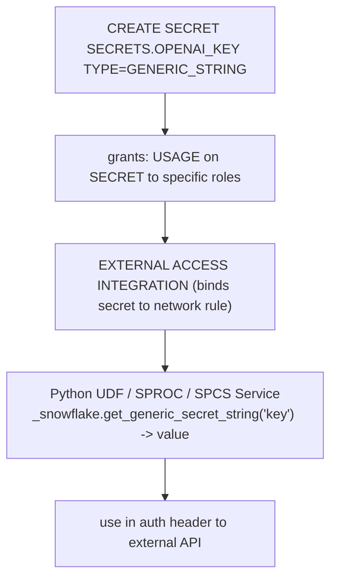

### Lab Exercise
```sql
CREATE SECRET SECRETS.HF_TOKEN
  TYPE = GENERIC_STRING
  SECRET_STRING = 'hf_<redacted>';

CREATE NETWORK RULE HF_RULE
  MODE = EGRESS TYPE = HOST_PORT
  VALUE_LIST = ('huggingface.co:443','*.hf.co:443');

CREATE EXTERNAL ACCESS INTEGRATION HF_EAI
  ALLOWED_NETWORK_RULES = (HF_RULE)
  ALLOWED_AUTHENTICATION_SECRETS = (SECRETS.HF_TOKEN)
  ENABLED = TRUE;

GRANT USAGE ON SECRET SECRETS.HF_TOKEN TO ROLE ML_PIPELINE;
GRANT USAGE ON INTEGRATION HF_EAI TO ROLE ML_PIPELINE;

-- Used in ML Jobs
```

```python
from snowflake.ml.jobs import remote

@remote(
    compute_pool="GPU_POOL",
    stage_name="JOB_STAGE",
    pip_requirements=["transformers==4.42","torch==2.3"],
    external_access_integrations=["HF_EAI"],
    secrets={"HF_TOKEN": "SECRETS.HF_TOKEN"}
)
def download_and_finetune():
    import os
    hf_token = os.environ["HF_TOKEN"]
    from transformers import AutoModel
    model = AutoModel.from_pretrained("meta-llama/Llama-3-8B", token=hf_token)
    # ... fine-tune ...
```

### Gotchas / Exam Traps
- Secrets can't be SELECTed — only accessible from code with grants.
- Rotate secrets regularly via ALTER SECRET.
- Access to secrets is audited in ACCESS_HISTORY.

---

## Q10: Design a dev → stage → prod promotion pipeline.

**Difficulty:** Advanced
**Exam relevance:** Multi-env

### Answer
Multi-environment pattern:
- **Three databases** (or three schemas): `ML_DEV`, `ML_STAGE`, `ML_PROD`
- Each has: `REGISTRY`, `FEATURES`, `PRED` schemas
- CI/CD promotes:
  - DEV: data scientists freely iterate
  - STAGE: PR merge triggers CI to clone/promote to stage; run integration tests
  - PROD: approval tag required; CI promotes with alias flip

Promotion mechanics:
- `CLONE SCHEMA` for fast metadata-only copy
- Or re-log model via Registry API in the target
- Config-driven: environment-specific warehouses, compute pools

### First Principles
**Why multi-env:** Blast radius. A bug in training shouldn't crash production serving. Separate environments isolate.

**Why database-level separation:** Snowflake's zero-copy clone works at schema/database granularity, so promoting a full environment is cheap.

### Diagram
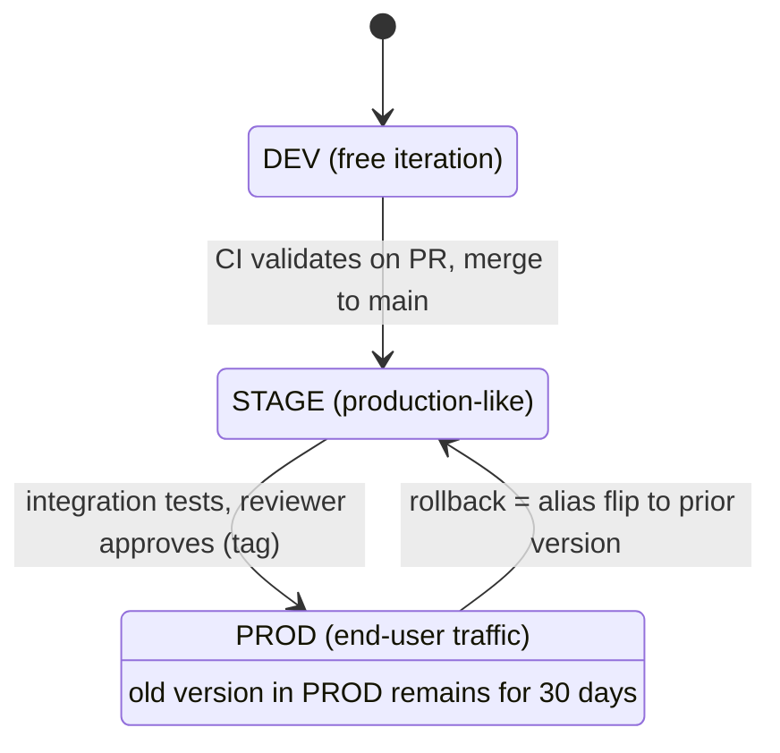

### Lab Exercise
```sql
-- Promote via metadata-only clone (fast)
CREATE OR REPLACE SCHEMA ML_STAGE.REGISTRY CLONE ML_DEV.REGISTRY;

-- Or move individual model version using Python
```

```python
# Re-log a dev model in prod registry (actual API varies)
import tempfile

dev_reg = Registry(session, "ML_DEV", "REGISTRY")
prod_reg = Registry(session, "ML_PROD", "REGISTRY")

mv = dev_reg.get_model("CHURN").version("V17")

# Download the model from dev
with tempfile.TemporaryDirectory() as tmpdir:
    mv.download("model.joblib", target_path=tmpdir)
    import joblib
    model = joblib.load(f"{tmpdir}/model.joblib")

    # Re-log to prod registry
    prod_mv = prod_reg.log_model(
        model, model_name="CHURN", version_name="V17",
        sample_input_data=sample,
        conda_dependencies=mv.show_dependencies().get("conda", []),
        metrics=mv.show_metrics()
    )
    # Copy tags
    for tag, value in mv.show_tags().items():
        prod_mv.set_tag(tag, value)
    prod_mv.set_tag("promoted_from", "ML_DEV")
    prod_mv.set_tag("promoted_at", "2024-10-30")
```

### Gotchas / Exam Traps
- Cloning schemas doesn't copy data from backing tables (model artifacts in internal stages ARE copied by schema CLONE).
- Keep warehouse / pool names environment-specific to avoid accidental cross-env usage.
- Prod should be read-only to data scientists.

---

## Q11: What is Snowflake Horizon Catalog's role in ML governance?

**Difficulty:** Advanced
**Exam relevance:** Governance platform

### Answer
Snowflake Horizon Catalog is Snowflake's unified data governance surface. For ML it provides:
- **Discovery** — search for feature views, models, datasets across the account
- **Access policies** — tags, row access, masking policies apply to ML objects
- **Lineage** — unified visualization of upstream/downstream dependencies
- **Monitoring** — observability of policy enforcement, anomalies
- **Classifications** — auto-tag PII in features

For MLE: ensure feature views, Dataset, model versions are classified with proper tags; grant Horizon-based policies rather than hand-rolling.

### First Principles
**Why unified governance:** ML pipelines touch many object types (tables, features, models, services). One consistent governance plane > fragmented per-object controls.

**Why classification auto-tagging:** Humans miss things; auto-classification (via Snowflake's data classification engine) catches PII that would otherwise leak.

### Diagram
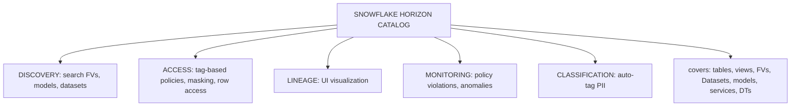

### Lab Exercise
```sql
-- Classify features
SELECT SYSTEM$CLASSIFY('FEATURES.CUSTOMER_30D',
                       {'auto_tag': true});

-- Apply tag-based masking policy
CREATE OR REPLACE MASKING POLICY MASK_PII AS (val STRING) RETURNS STRING ->
  CASE WHEN CURRENT_ROLE() IN ('ML_PIPELINE','AUDITOR') THEN val
       ELSE '***MASKED***' END;

CREATE TAG IF NOT EXISTS PII;
ALTER TAG PII SET MASKING POLICY MASK_PII;

-- Any column tagged PII gets masked automatically
ALTER TABLE FEATURES.CUSTOMER_30D MODIFY COLUMN EMAIL SET TAG PII = 'HIGH';
```

### Gotchas / Exam Traps
- Classifications are run on request (or scheduled) — not continuous.
- Policies apply system-wide; a model inherits the backing table's masking.
- Horizon's lineage UI is a visualization layer over ACCESS_HISTORY.

---

## Q12: How do you ensure fairness/bias audits in a governed ML pipeline?

**Difficulty:** Advanced
**Exam relevance:** Responsible ML

### Answer
Fairness checks as CI gates:
1. Compute per-group metrics (accuracy, FPR, FNR) by sensitive attribute (gender, age, region)
2. Check against disparity thresholds (e.g., FPR ratio across groups must be between 0.8 and 1.25)
3. Record audit results as tags/metrics on the model version
4. Block promotion if thresholds breached

Store sensitive attributes separately from model inputs to prevent accidental use as features; use only in post-hoc audits.

### First Principles
**Why automate fairness:** Manual audits are infrequent and inconsistent. CI-gated fairness is enforced on every promotion.

**Why keep sensitive attrs out of features:** Legal, ethical, and performance. Many jurisdictions prohibit certain inputs; models can "pick up" proxies anyway, but direct use is clearly prohibited.

### Diagram
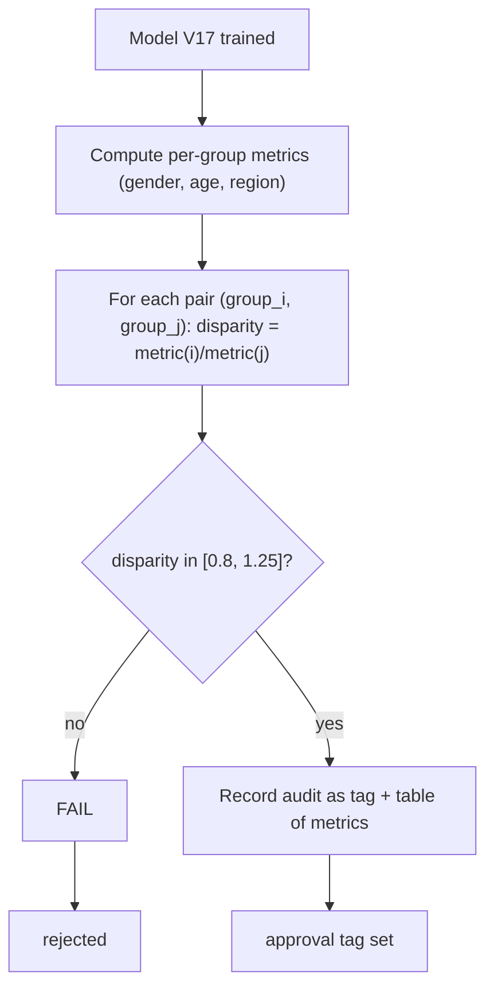

### Lab Exercise
```python
def audit_fairness(session, model_version, protected_cols, metric="accuracy"):
    results = session.sql(f"""
      SELECT
        FEATURES:{protected_cols[0]}::STRING AS GROUP,
        AVG(IFF(PRED = ACTUAL_LABEL, 1, 0)) AS ACC,
        COUNT(*) AS N
      FROM PRED.CHURN_LOG
      WHERE MODEL_VERSION = '{model_version.version_name}'
        AND ACTUAL_LABEL IS NOT NULL
      GROUP BY GROUP
    """).to_pandas()

    if len(results) < 2:
        return False, "Not enough groups"

    acc_max = results["ACC"].max()
    acc_min = results["ACC"].min()
    disparity = acc_min / acc_max

    passed = disparity >= 0.8
    model_version.set_metric(f"fairness_disparity_{protected_cols[0]}", disparity)
    model_version.set_tag("fairness_audit_passed_" + protected_cols[0],
                          str(passed).lower())
    return passed, results.to_dict()

# In CI:
passed, _ = audit_fairness(session, mv_new, protected_cols=["REGION"])
if not passed:
    raise Exception("Fairness audit failed; cannot promote")
```

### Gotchas / Exam Traps
- Must have ground truth to audit — only post-actuals audit possible.
- Define protected attributes with legal consultation; different jurisdictions differ.
- Fairness is multi-dimensional; combine with calibration-by-group.

---

## Q13: How do you handle PII in training and inference data?

**Difficulty:** Advanced
**Exam relevance:** Data privacy

### Answer
Approach:
1. **Classify at source** — tag columns as PII in table metadata
2. **Mask by default** — masking policies emit masked values for most roles
3. **Service accounts** — only specific roles (ML pipeline service account) can see unmasked
4. **Use masked derivatives for training** — hash sensitive attributes, or exclude entirely
5. **Audit access** — ACCESS_HISTORY shows who read PII

For LLM apps, mask or redact PII before sending to Cortex / external APIs.

### First Principles
**Why role-based masking:** Different consumers need different levels of access. Analysts see masked; ML pipeline sees unmasked (if permitted); auditors see unmasked.

**Why mask before LLM:** Sending PII to a third-party LLM may violate data residency / GDPR.

### Diagram
```mermaid
flowchart TD
    R["RAW.CUSTOMERS (EMAIL, SSN tagged PII)"]
    R -->|masking policy applied| MASK["data scientist sees ***@***, XXX-XX-XXXX<br/>ML pipeline role sees real values"]
    MASK -->|build features (exclude or hash)| F["FEATURES.CUSTOMER_30D (no raw PII, maybe HASH(EMAIL))"]
    F --> M["Model trains on non-PII derivatives"]
    M --> P["Inference consumes features; no PII in prediction log"]
```

### Lab Exercise
```sql
-- Classify
CREATE TAG IF NOT EXISTS PII_LEVEL
  ALLOWED_VALUES ('low','medium','high');

ALTER TABLE RAW.CUSTOMERS
  MODIFY COLUMN EMAIL SET TAG PII_LEVEL = 'high',
  MODIFY COLUMN SSN SET TAG PII_LEVEL = 'high',
  MODIFY COLUMN ADDRESS SET TAG PII_LEVEL = 'medium';

-- Masking policy by role
CREATE OR REPLACE MASKING POLICY MASK_HIGH_PII AS (val STRING) RETURNS STRING ->
  CASE WHEN CURRENT_ROLE() IN ('ML_PIPELINE_SVC','PRIVACY_ADMIN') THEN val
       ELSE SHA2(val, 256) END;    -- hash still allows deterministic join

-- Apply via tag
ALTER TAG PII_LEVEL SET MASKING POLICY MASK_HIGH_PII;

-- Feature engineering: use hash, not raw
CREATE OR REPLACE DYNAMIC TABLE FEATURES.CUSTOMER_30D
  TARGET_LAG = '15 minutes' WAREHOUSE = ML_WH AS
SELECT CUSTOMER_ID,
       SHA2(EMAIL, 256) AS EMAIL_HASH,   -- used for joining, not identifying
       AGE, INCOME, TENURE
FROM RAW.CUSTOMERS;
```

### Gotchas / Exam Traps
- Hashed values look like PII to the model but can't be reversed — safe for ML.
- Masking affects all queries, including UDF inputs — align training-time role with serving-time role.
- Compliance requirements (GDPR right-to-be-forgotten) require deletion propagation — plan at design time.

---

## Q14: What's the role of Alerts in automated governance (not just drift)?

**Difficulty:** Intermediate
**Exam relevance:** Governance automation

### Answer
Alerts can automate governance checks:
- **Unapproved model in prod** — alert if PROD alias points to a model without `approval_status='approved'`
- **Dependency version drift** — alert if a prod model has deprecated packages
- **Policy violations** — alert if a model with `pii_sensitive=true` is called by a role without proper grants (via QUERY_HISTORY join)
- **Stale models** — alert on models last retrained > N days ago
- **High-cost queries** — alert on queries exceeding credit thresholds

### First Principles
**Why alert on governance:** Audit after-the-fact is reactive. Alerts catch issues as they emerge.

**Why procedure-based actions:** Multi-step responses (notify + log + lock down role).

### Diagram
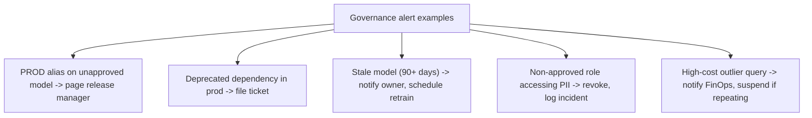

### Lab Exercise
```sql
-- Alert: PROD-aliased model not approved
CREATE OR REPLACE ALERT GOV.UNAPPROVED_PROD_MODEL
  WAREHOUSE = MONITOR_WH SCHEDULE = '1 HOUR'
  IF (EXISTS (
    WITH prod_versions AS (
      SELECT MODEL_NAME, VERSION_NAME
      FROM ACCOUNT_USAGE.MODEL_VERSIONS
      WHERE DATABASE_NAME = 'ML_PROD' AND SCHEMA_NAME = 'REGISTRY'
        AND ALIAS LIKE '%PROD%'
    ),
    tags AS (
      SELECT OBJECT_NAME AS MODEL_NAME, TAG_VALUE
      FROM ACCOUNT_USAGE.TAG_REFERENCES
      WHERE TAG_NAME = 'APPROVAL_STATUS'
        AND OBJECT_DOMAIN = 'MODEL'
    )
    SELECT 1 FROM prod_versions p LEFT JOIN tags t USING (MODEL_NAME)
    WHERE t.TAG_VALUE IS NULL OR t.TAG_VALUE <> 'approved'
  )) THEN CALL OBS.NOTIFY('CRITICAL','governance','approval',0,0,
                         'Unapproved model on PROD alias');
ALTER ALERT GOV.UNAPPROVED_PROD_MODEL RESUME;

-- Alert: stale model
CREATE OR REPLACE ALERT GOV.STALE_MODEL
  WAREHOUSE = MONITOR_WH SCHEDULE = '1 DAY'
  IF (EXISTS (
    SELECT 1 FROM ACCOUNT_USAGE.MODEL_VERSIONS
    WHERE DATABASE_NAME = 'ML_PROD'
      AND ALIAS LIKE '%PROD%'
      AND CREATED_ON < DATEADD('day',-90,CURRENT_TIMESTAMP())
  )) THEN CALL OBS.NOTIFY('WARN','governance','freshness',0,0,'Stale prod models');
ALTER ALERT GOV.STALE_MODEL RESUME;
```

### Gotchas / Exam Traps
- Alerts have cooldown — don't fire every hour for the same open issue.
- Tag-based alerts rely on tags being set — ensure the tag-set workflow is enforced.
- Dedup via a "last fired" table or a dedup window.

---

## Q15: Describe a model card / documentation workflow for registered models.

**Difficulty:** Advanced
**Exam relevance:** Documentation / responsible ML

### Answer
Model card = structured documentation per model version. Typical fields:
- Intended use / users
- Training data characteristics
- Performance metrics (per segment)
- Fairness audit results
- Known limitations
- Approvers / timeline
- Rollback procedure

Store as:
- `comment` on model version (short summary)
- JSON blob in a dedicated `MODEL_CARDS` table
- Markdown file in Git referenced by tag
- Streamlit app surfacing the card

### First Principles
**Why document:** Audit trails for regulated ML. Non-technical stakeholders need to understand what a model does/doesn't do.

**Why structured:** Searchable, comparable across models, enforceable fields.

### Diagram
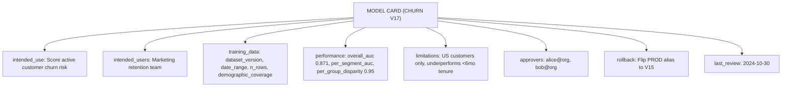

### Lab Exercise
```sql
CREATE TABLE IF NOT EXISTS ML_DB.REGISTRY.MODEL_CARDS (
  MODEL_NAME STRING,
  VERSION_NAME STRING,
  CARD VARIANT,
  CREATED_AT TIMESTAMP_LTZ DEFAULT CURRENT_TIMESTAMP(),
  PRIMARY KEY (MODEL_NAME, VERSION_NAME)
);
```

```python
import json

card = {
    "model_name": "CHURN",
    "version": "V17",
    "intended_use": "Score active customer churn risk",
    "training_data": {"dataset_version": "CHURN_TRAIN:V2024_10_01"},
    "performance": {"overall_auc": 0.871},
    "limitations": ["US customers only"],
    "approvers": ["alice@org"]
}

session.sql(f"""
  INSERT INTO ML_DB.REGISTRY.MODEL_CARDS
    (MODEL_NAME, VERSION_NAME, CARD)
  SELECT 'CHURN','V17', PARSE_JSON('{json.dumps(card).replace("'", "''")}')
""").collect()

# Set comment pointer
mv = reg.get_model("CHURN").version("V17")
mv.comment = "See ML_DB.REGISTRY.MODEL_CARDS for full card"
```

### Gotchas / Exam Traps
- Keep card up to date; link to Git commit of the card file.
- Streamlit app can render the card nicely for business users.
- Compliance tools (e.g., model risk management platforms) may import these cards.

---

## Q16: How do you handle secrets rotation in a running ML service?

**Difficulty:** Advanced
**Exam relevance:** Operations

### Answer
Pattern:
1. Create new secret value: `ALTER SECRET SECRETS.X SET SECRET_STRING = 'new-value'`
2. Service containers that use the secret via Snowflake API picks up the new value on next access (no restart needed for most patterns)
3. If service caches secret in-memory, trigger service restart (`ALTER SERVICE RESTART`) to force reload
4. Audit via ACCESS_HISTORY that services switched to new value

### First Principles
**Why rotate:** Credential compromise risk. Static credentials shouldn't live forever.

**Why Snowflake-managed:** Rotation via ALTER is one SQL statement; secret manager APIs are consistent.

### Diagram
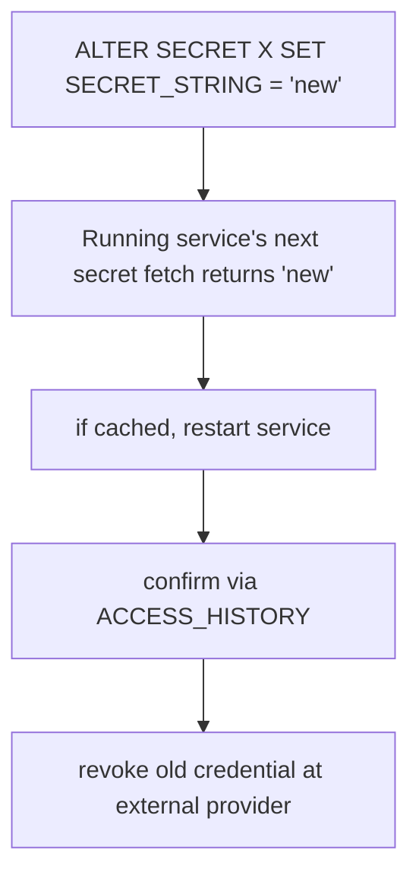

### Lab Exercise
```sql
-- Rotate secret
ALTER SECRET SECRETS.HF_TOKEN SET SECRET_STRING = 'hf_newly_rotated_value';

-- If service caches, restart
ALTER SERVICE ML_DB.REGISTRY.LLM_SVC RESTART;

-- Verify next fetch (via Event Table / service logs)
SELECT TIMESTAMP, RECORD:body::STRING
FROM ML_DB.OBS.ML_EVENTS
WHERE RESOURCE_ATTRIBUTES:"snow.service.name" = 'LLM_SVC'
  AND TIMESTAMP > CURRENT_TIMESTAMP() - INTERVAL '5 MINUTE';
```

### Gotchas / Exam Traps
- A service with stale cache plus rotated secret = failed external calls; always test post-rotation.
- Rotation window — have both old and new valid at the external provider during transition.
- Automate rotation via Tasks + external secret manager if required.

---

## Q17: Describe the full test strategy for an ML pipeline (unit, integration, data, model).

**Difficulty:** Advanced
**Exam relevance:** Testing

### Answer
Four test levels:
1. **Unit tests** — individual functions, UDFs, SPROCs tested with small inputs (pytest + Snowpark DF with fixtures)
2. **Integration tests** — multi-step pipeline tested in a dev schema with representative data
3. **Data tests** — schema, nulls, ranges verified on live data (dbt-style tests, or custom DT)
4. **Model tests** — performance thresholds, fairness, drift post-training; blocking gates in CI

### First Principles
**Why multi-level:** Unit tests catch logic bugs; integration catches wiring bugs; data tests catch upstream data bugs; model tests catch bad training outcomes.

**Why automate:** Humans skip tests under pressure. CI enforces them.

### Diagram

**Test levels:**

| Level | Scope | Mechanism |
|-------|-------|-----------|
| UNIT | Function logic, parsing | pytest + Snowpark fixtures |
| INTEGRATION | Full feature DT + train | dev schema w/ sampled data |
| DATA | Schema/null/range checks | DT monitors or expect-style |
| MODEL | Perf, fairness, drift | CI gates |

### Lab Exercise
```python
# pytest example for a feature engineering function
def test_customer_30d_agg(session):
    df = session.create_dataframe(
        [[1, 100.0, "2024-10-01"],
         [1, 200.0, "2024-10-15"],
         [2, 50.0,  "2024-10-10"]],
        schema=["CUSTOMER_ID","AMOUNT","EVENT_TS"]
    )
    out = compute_30d_spend(df).sort("CUSTOMER_ID").collect()
    assert out[0]["SPEND_30D"] == 300.0  # customer 1
    assert out[1]["SPEND_30D"] == 50.0   # customer 2

# Data test (as DT)
```

```sql
CREATE OR REPLACE DYNAMIC TABLE TESTS.DATA_HEALTH
  TARGET_LAG = '15 min' WAREHOUSE = TEST_WH AS
SELECT
  'customer_30d' AS TEST_NAME,
  COUNT(*) AS N_ROWS,
  SUM(IFF(SPEND_30D < 0, 1, 0)) AS NEGATIVE_SPEND_COUNT,
  SUM(IFF(AGE IS NULL, 1, 0)) AS NULL_AGE_COUNT,
  CASE WHEN SUM(IFF(SPEND_30D < 0, 1, 0)) > 0 OR SUM(IFF(AGE IS NULL, 1, 0)) > 10
       THEN 'FAIL' ELSE 'PASS' END AS STATUS
FROM FEATURES.CUSTOMER_30D;

-- Alert on FAIL
CREATE OR REPLACE ALERT TESTS.ALERT_DATA_HEALTH
  WAREHOUSE = TEST_WH SCHEDULE = '15 MIN'
  IF (EXISTS (SELECT 1 FROM TESTS.DATA_HEALTH WHERE STATUS = 'FAIL'))
  THEN CALL OBS.NOTIFY('WARN','data','test',0,0,'Data health failing');
ALTER ALERT TESTS.ALERT_DATA_HEALTH RESUME;
```

### Gotchas / Exam Traps
- Snowpark DataFrames are hard to mock — use dev schema with sampled data.
- Model tests often require actuals — run on holdout from training data.
- Fail fast; separate blocking (promotion) vs non-blocking (log only) tests.

---

## Q18: How do you handle rollback in a production ML deployment?

**Difficulty:** Intermediate
**Exam relevance:** Operations

### Answer
Rollback mechanics:
1. **Alias flip** — `set_alias('PROD', <previous_version>)` — atomic, instant
2. **SPCS service** — swap underlying image via `ALTER SERVICE` or restart
3. **Dynamic Table refresh** — triggers prediction recompute with new PROD alias
4. **Communication** — notify downstream consumers, update dashboards

Rollback plan should be defined before promotion. Keep the previous version aliased as `PREVIOUS_PROD` for instant revert.

### First Principles
**Why rehearse rollback:** The 2am emergency isn't the time to figure out procedure. Scripted + tested rollback = calm response.

**Why alias-based rollback:** Fastest + simplest. Avoid redeploys.

### Diagram
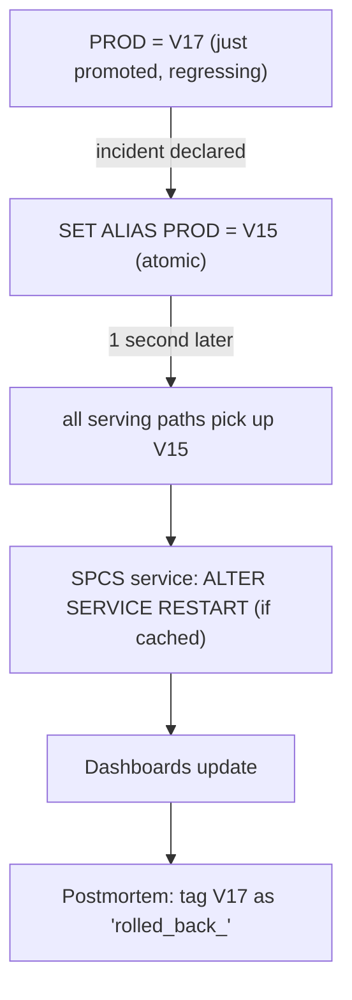

### Lab Exercise
```python
# Rollback procedure
reg = Registry(session, "ML_PROD", "REGISTRY")

# Immediate alias flip
current = reg.get_model("CHURN").version_by_alias("PROD")
previous = reg.get_model("CHURN").version_by_alias("PREVIOUS_PROD")

print(f"Rolling back from {current.version_name} to {previous.version_name}")

previous.set_alias("PROD")
current.set_alias("ROLLED_BACK_" + current.version_name)
current.set_tag("rollback_reason", "Severe calibration regression on segment X")
current.set_tag("rollback_at", "2024-10-30T22:15:00Z")

# Restart SPCS service to pick up new default
session.sql("ALTER SERVICE ML_PROD.REGISTRY.CHURN_RT RESTART").collect()
```

### Gotchas / Exam Traps
- Keep both old and new "warm" during risk window (e.g., 7 days post-promotion).
- Rollback plan should include notification steps (Slack, email, status page).
- Rolling back doesn't delete the problematic version — audit it later.

---

## Q19: What's the relationship between Snowflake Native Apps and MLOps?

**Difficulty:** Advanced
**Exam relevance:** Native Apps

### Answer
Snowflake Native Apps let you package an ML pipeline (schemas, models, SPROCs, services, Streamlit, Horizon metadata) as a listable, installable app distributable via the Snowflake Marketplace.

For MLOps:
- Package a trained model + its serving service + a Streamlit UI
- Distribute to customers as a Private Listing
- Consumers install into their account; app runs with its own compute, segregated from provider data

Useful for:
- ML providers monetizing models
- Internal distribution across business units with isolated data

### First Principles
**Why Native Apps:** Standard enterprise distribution needs installable, versioned, upgradeable artifacts. Native Apps are Snowflake's answer for ML+data+UI.

**Why not just share schemas:** Secure Data Sharing exposes data; Native Apps distribute code+data+logic as an atomic unit.

### Diagram
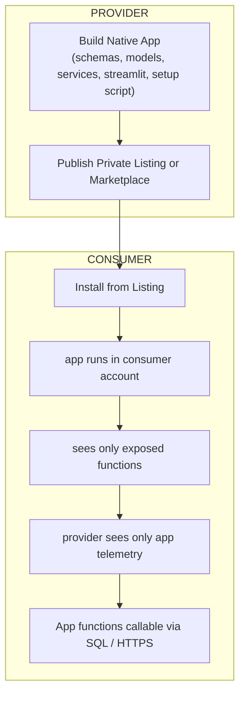

### Lab Exercise
```sql
-- Simplified setup script for a Native App
-- (full flow: snowflake.yml, manifest.yml, setup.sql, versions)

CREATE OR REPLACE APPLICATION PACKAGE MY_CHURN_APP_PKG;

CREATE OR REPLACE APPLICATION ROLE APP_PUBLIC;

-- In setup.sql of the app:
-- GRANT USAGE ON MODEL ... TO APPLICATION ROLE APP_PUBLIC;
-- CREATE OR ALTER VERSIONED SCHEMA core;
-- CREATE OR REPLACE PROCEDURE core.predict(...) ... ;

-- Publish listing
-- (via Snowsight UI or `snow app` CLI)
```

### Gotchas / Exam Traps
- App code is encrypted; consumers can't inspect proprietary models.
- Logging and telemetry via Event Tables are shared with provider for support.
- Upgrade cycles: provider pushes new app version; consumer accepts via UPGRADE.

---

## Q20: How do you implement an audit log for every model-related action?

**Difficulty:** Intermediate
**Exam relevance:** Compliance

### Answer
Composite audit log sources:
- `ACCOUNT_USAGE.ACCESS_HISTORY` — all reads/writes
- `ACCOUNT_USAGE.QUERY_HISTORY` — every query executed
- `ACCOUNT_USAGE.TAG_REFERENCES` — tag changes
- `ACCOUNT_USAGE.MODELS` + `MODEL_VERSIONS` — model events
- Custom audit table in schema for domain-specific events (promotions, rollbacks)

Combine into a daily audit DT; alert on anomalies.

### First Principles
**Why composite:** No single view covers everything. ACCESS_HISTORY misses tag changes; TAG_REFERENCES misses access patterns. Combined gives you full picture.

**Why custom audit:** Capture business-domain events (approval, rollback, retraining) that native views don't semantically understand.

### Diagram
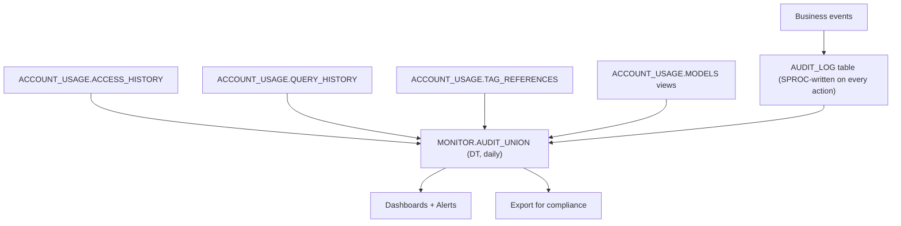

### Lab Exercise
```sql
CREATE TABLE AUDIT.ACTIONS (
  ACTION_ID STRING DEFAULT UUID_STRING(),
  ACTOR_ROLE STRING DEFAULT CURRENT_ROLE(),
  ACTOR_USER STRING DEFAULT CURRENT_USER(),
  ACTION_TYPE STRING,   -- 'LOG_MODEL','SET_ALIAS','ROLLBACK','APPROVE'
  OBJECT STRING,         -- model name + version
  DETAILS VARIANT,
  AT TIMESTAMP_LTZ DEFAULT CURRENT_TIMESTAMP()
);

-- Wrapper to log actions
CREATE OR REPLACE PROCEDURE AUDIT.LOG(ACTION_TYPE STRING, OBJECT STRING, DETAILS VARIANT)
RETURNS STRING LANGUAGE SQL AS
BEGIN
  INSERT INTO AUDIT.ACTIONS (ACTION_TYPE, OBJECT, DETAILS)
  VALUES (:ACTION_TYPE, :OBJECT, :DETAILS);
  RETURN 'logged';
END;

-- Composite audit DT
CREATE OR REPLACE DYNAMIC TABLE AUDIT.ALL_EVENTS_DAILY
  TARGET_LAG = '1 day' WAREHOUSE = AUDIT_WH AS
SELECT 'CUSTOM' AS SRC, AT AS TS, ACTOR_USER AS ACTOR,
       ACTION_TYPE AS ACTION, OBJECT, DETAILS::STRING AS DETAIL
FROM AUDIT.ACTIONS
WHERE AT >= DATEADD('day',-90,CURRENT_TIMESTAMP())
UNION ALL
SELECT 'QUERY_HISTORY', START_TIME, USER_NAME,
       'QUERY_RUN', QUERY_TAG, LEFT(QUERY_TEXT, 200)
FROM ACCOUNT_USAGE.QUERY_HISTORY
WHERE START_TIME >= DATEADD('day',-90,CURRENT_TIMESTAMP())
  AND QUERY_TAG LIKE 'ml-%';
```

### Gotchas / Exam Traps
- ACCOUNT_USAGE has latency (hours).
- Retain audit logs per compliance policy (often 7 years).
- Immutability: either enforce via row access policy preventing updates, or periodically export to immutable storage.

---

## Q21: How do you handle multi-cloud / multi-region ML deployments?

**Difficulty:** Advanced
**Exam relevance:** Advanced topology

### Answer
Options:
- **Snowflake replication** — replicate database (including Registry schema) across regions/clouds for failover
- **Multi-account strategy** — separate account per region with managed sync
- **Cross-region sharing** — share FS/models from a primary region to consumers (read-only)

For low-latency inference in a specific region, deploy SPCS Services in that region.

### First Principles
**Why multi-region:** Regulatory (data residency), latency (local inference), DR.

**Why not just global one region:** Latency crosses continents; residency laws prohibit cross-border data flow.

### Diagram
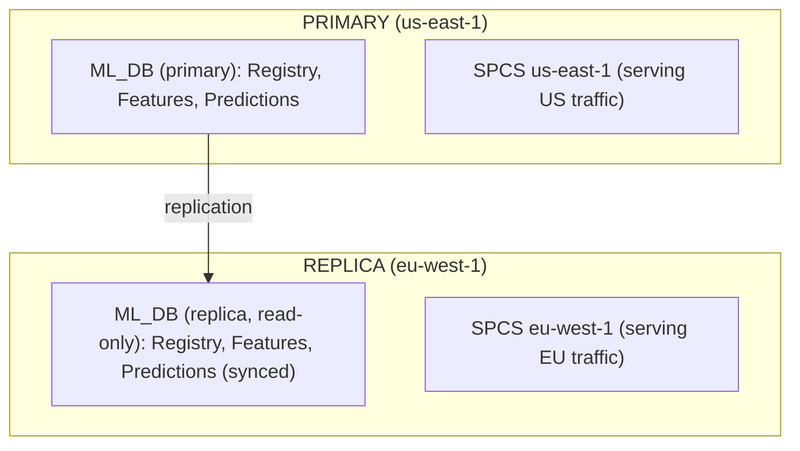

### Lab Exercise
```sql
-- Enable replication of ML_DB to EU region
ALTER DATABASE ML_DB ENABLE REPLICATION TO ACCOUNTS SELF_EU_ACCT;

-- In EU account
CREATE DATABASE ML_DB AS REPLICA OF US_ACCT.ML_DB;
ALTER DATABASE ML_DB REFRESH;

-- Setup auto-refresh (one-way)
```

### Gotchas / Exam Traps
- Replicated database is read-only on the replica — can serve, cannot register new versions.
- SPCS services aren't replicated; redeploy per region.
- Costs stack: storage per region, cross-region replication fees.

---

## Q22: How do you optimize cost for a seldom-used ML model?

**Difficulty:** Intermediate
**Exam relevance:** Cost optimization

### Answer
For a model called infrequently:
- **Use warehouse UDF, not SPCS** — avoid 24/7 container cost
- **Auto-suspend WH quickly** (60s)
- **Materialize predictions on-demand** rather than DT with continuous refresh
- **Suspend SPCS services** when known-idle
- **Share compute pool** across many light models
- **Scheduled batch** vs always-on if latency tolerates

### First Principles
**Why cost-sensitivity varies:** A model called 10x/day doesn't need the same infra as one called 10K/sec. Match infra to usage.

**Why suspension beats scale-down:** Suspended = $0; scaled-down = still some cost.

### Diagram

**Usage pattern vs cheapest architecture:**

| Usage pattern | Cheapest architecture |
|---------------|-----------------------|
| 10x / day | Warehouse UDF, auto-suspend 60s |
| 100x / day | Warehouse UDF, auto-suspend 300s |
| 1K / day | Scheduled batch DT |
| 10K+ / day, SLA tolerance 1s | Warm WH + materialized predictions |
| 10K+ / day, SLA <100ms | SPCS Service, min_instances=1 |
| 100K+ / day, GPU | SPCS GPU, min_instances=1 |

### Lab Exercise
```sql
-- Low-usage model: aggressive auto-suspend
ALTER WAREHOUSE INFERENCE_WH SET AUTO_SUSPEND = 60;

-- Pause SPCS service for off-hours
ALTER SERVICE ML_DB.REGISTRY.CHURN_RT SUSPEND;
-- Scheduled task to resume at business hours
CREATE TASK OPS.RESUME_SERVICE
  SCHEDULE = 'USING CRON 0 7 * * 1-5 America/Los_Angeles'
AS ALTER SERVICE ML_DB.REGISTRY.CHURN_RT RESUME;
ALTER TASK OPS.RESUME_SERVICE RESUME;
```

### Gotchas / Exam Traps
- Service suspend doesn't drop image; next resume is faster than fresh deploy.
- Match AUTO_SUSPEND to query cadence — too short = constant resume lag.
- Monitor cost; chase high-cost outliers via QUERY_TAG attribution.

---

## Q23: How do you ensure deterministic / reproducible training across time?

**Difficulty:** Advanced
**Exam relevance:** Reproducibility

### Answer
Steps:
1. **Fix all randomness** — `random_state` in model, seed in Python, seed in NumPy
2. **Freeze dataset** — Snowflake Dataset version
3. **Freeze dependencies** — exact pins in `conda_dependencies`
4. **Freeze code** — Git commit tag on model
5. **Document execution env** — compute (warehouse size, SPCS instance type)

Reconstruct: checkout commit, pin env, materialize dataset version, run train script → identical model.

### First Principles
**Why not just rely on PRNG seeds:** Many libraries have non-deterministic ops (parallel reductions, cuDNN kernels). Determinism requires ecosystem-wide discipline.

**Why document execution env:** Memory pressure, parallelism level can affect numerical results.

### Diagram
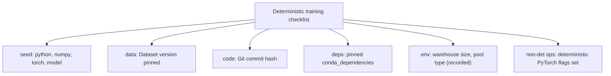

### Lab Exercise
```python
import os, random
import numpy as np
import torch

SEED = 42
os.environ["PYTHONHASHSEED"] = str(SEED)
random.seed(SEED)
np.random.seed(SEED)
torch.manual_seed(SEED)
torch.cuda.manual_seed_all(SEED)
torch.backends.cudnn.deterministic = True
torch.backends.cudnn.benchmark = False

# Snowpark ML models
from snowflake.ml.modeling.xgboost import XGBClassifier
model = XGBClassifier(..., random_state=SEED)
model.fit(df)

# Document on model
mv.set_tag("random_seed", str(SEED))
mv.set_tag("python_hash_seed", str(SEED))
```

### Gotchas / Exam Traps
- GPU operations may still be non-deterministic at bit level; aim for deterministic within tolerance.
- Snowflake warehouse parallelism can affect result ordering (not values) for tree-based models.
- Document "known tolerance" (e.g., AUC differences within 0.0001 acceptable).

---

## Q24: Describe a strategy for managing model deprecation in a regulated environment.

**Difficulty:** Advanced
**Exam relevance:** Lifecycle governance

### Answer
Deprecation ritual:
1. **Announce** via tag `deprecated=true`, `sunset_date=...`
2. **Notify consumers** via comm channel (email, Slack)
3. **Grace period** (e.g., 90 days) — model still callable
4. **Monitor** usage; if unexpected calls persist, extend or escalate
5. **Sunset** — tag `sunset=true`; disable serving (suspend service, revoke access)
6. **Archive** — keep model artifact + metadata for N years per regulation
7. **Audit** — record deprecation in audit log; link to replacement model

### First Principles
**Why ritual:** Regulated environments require documented lifecycles. Yanking a model without process is a compliance violation.

**Why archive before delete:** Audits can request historical predictions explained months/years later.

### Diagram
```mermaid
stateDiagram-v2
    [*] --> active
    active --> deprecated: notify consumers, offer replacement
    deprecated --> sunset: grace period ends; monitors usage
    sunset --> archived: access revoked, service suspended
    archived --> [*]
```

### Lab Exercise
```python
# Mark deprecated
mv = reg.get_model("CHURN").version("V5")
mv.set_tag("lifecycle", "deprecated")
mv.set_tag("deprecation_date", "2024-11-01")
mv.set_tag("sunset_date", "2025-02-01")
mv.set_tag("replacement_version", "V17")

session.sql("CALL AUDIT.LOG('DEPRECATE','CHURN:V5', OBJECT_CONSTRUCT('replacement','V17'))").collect()
```

```sql
-- Monitor usage during grace
SELECT USER_NAME, ROLE_NAME, COUNT(*) AS CALLS
FROM ACCOUNT_USAGE.QUERY_HISTORY
WHERE QUERY_TEXT ILIKE '%CHURN%VERSION%V5%'
  AND START_TIME >= DATEADD('day',-30,CURRENT_TIMESTAMP())
GROUP BY USER_NAME, ROLE_NAME;
```

### Gotchas / Exam Traps
- Alias cleanup — remove any aliases pointing to deprecated version.
- Grace period aligns with usage; 90 days is typical.
- Archival storage still costs — plan retention tiers.

---

## Q25: Capstone: Design an end-to-end MLOps pipeline for a regulated ML workload.

**Difficulty:** Advanced
**Exam relevance:** Capstone

### Answer
Complete architecture:

**Git repo** (source of truth)
- `features/` SQL for feature views
- `training/` Python scripts
- `services/` SPCS specs
- `streamlit/` UI
- `tests/` unit + data + model tests

**Snowflake objects**
- `ML_DEV`, `ML_STAGE`, `ML_PROD` databases, each with REGISTRY, FEATURES, PRED schemas
- Git repository registered; CI fetches on each push
- Compute pools per environment
- Warehouses per workload (training, inference, monitor, UI)

**CI/CD** (GitHub Actions)
- On PR: lint, unit tests, dry-run SQL on DEV
- On merge: full deploy to STAGE, run integration + model tests, promote to PROD if approved

**Governance**
- `APPROVAL_STATUS` tag required for PROD alias
- Separate roles: DATA_SCIENTIST, MLOPS_RELEASE, ML_SERVICE, AUDITOR
- PII masking policies on raw tables
- Audit log table + ACCOUNT_USAGE DTs

**Observability**
- Model Monitor per PROD version
- Custom DTs: PSI, pred health, fairness-by-group, cost-per-prediction
- Multi-signal alerts with notification integration

**Lifecycle**
- Retraining Task triggered by alert or schedule
- Shadow deploy → offline eval gate → tag-approved → promote via alias flip
- Deprecation ritual with 90-day grace

### First Principles
**Why integrate all pieces:** Each dimension (automation, governance, observability) alone is partial. Together they form a system where errors are caught, actions are audited, and promotions are safe.

### Diagram
```mermaid
flowchart TD
    GR["Git repo"] -->|push| GH["GitHub Actions"]
    GH -->|snow CLI| SF["Snowflake"]
    SF --> O1["Git repository (synced)"]
    SF --> O2["Feature DTs (per env)"]
    SF --> O3["Registry (per env, with approval tags)"]
    SF --> O4["SPCS services (per env, scaled per workload)"]
    SF --> O5["Streamlit UIs"]
    SF --> O6["Monitor DTs + alerts"]
    SF --> O7["Audit tables"]
    SF --> O8["ACCOUNT_USAGE for lineage"]
    SF --> L["loop: alert -> retrain -> eval -> approve -> promote -> monitor"]
```

### Lab Exercise
```yaml
# Full CI/CD skeleton
name: ML Pipeline
on:
  pull_request:
  push:
    branches: [main]

jobs:
  test:
    runs-on: ubuntu-latest
    steps:
      - uses: actions/checkout@v4
      - run: pytest tests/
      - run: snow sql --dry-run -f pipelines/*.sql

  deploy-stage:
    needs: test
    if: github.event_name == 'push'
    runs-on: ubuntu-latest
    env:
      SF_ENV: stage
    steps:
      - uses: actions/checkout@v4
      - run: pip install snowflake-cli-labs snowflake-ml-python
      - run: snow sql -q "ALTER GIT REPOSITORY ML_REPO FETCH"
      - run: snow sql -f pipelines/stage/*.sql
      - run: python pipelines/stage/train.py --git-sha $GITHUB_SHA
      - run: python pipelines/stage/eval_gate.py
      - run: python pipelines/stage/fairness_audit.py

  deploy-prod:
    needs: deploy-stage
    runs-on: ubuntu-latest
    environment: production      # GitHub approval gate
    env:
      SF_ENV: prod
    steps:
      - run: snow sql -q "CALL ML_PROD.REGISTRY.PROMOTE_IF_APPROVED('CHURN','V_$GITHUB_SHA')"
      - run: snow sql -f pipelines/prod/update_service.sql
      - run: snow sql -q "CALL AUDIT.LOG('PROMOTE','CHURN:V_$GITHUB_SHA', OBJECT_CONSTRUCT('actor','ci'))"
```

```sql
-- Example promotion procedure (prod)
CREATE OR REPLACE PROCEDURE ML_PROD.REGISTRY.PROMOTE_IF_APPROVED(
  MODEL STRING, VERSION STRING
)
RETURNS STRING LANGUAGE PYTHON RUNTIME_VERSION='3.10'
PACKAGES=('snowflake-snowpark-python','snowflake-ml-python') HANDLER='run' AS $$
def run(session, model, version):
    from snowflake.ml.registry import Registry
    tag = session.sql(f"""
      SELECT TAG_VALUE FROM SNOWFLAKE.ACCOUNT_USAGE.TAG_REFERENCES
      WHERE OBJECT_NAME='{model}' AND OBJECT_DATABASE='ML_PROD'
        AND TAG_NAME='APPROVAL_STATUS'
    """).collect()
    if not tag or tag[0]['TAG_VALUE'] != 'approved':
        raise Exception(f"Not approved")
    reg = Registry(session, "ML_PROD", "REGISTRY")
    reg.get_model(model).version(version).set_alias("PROD")
    session.sql(f"CALL AUDIT.LOG('PROMOTE','{model}:{version}', OBJECT_CONSTRUCT())").collect()
    return "promoted"
$$;
```

### Gotchas / Exam Traps
- Many moving parts → thorough test strategy is non-negotiable.
- Keep the system simple enough that one person can understand all of it.
- Review the pipeline quarterly; patterns evolve.

---

## Study Checklist

- [ ] Can design CI/CD for ML with GitHub Actions + snow CLI
- [ ] Can set up Snowflake Git integration end-to-end
- [ ] Can implement tag-based model approval workflow
- [ ] Can grant appropriate RBAC on models, services, pools
- [ ] Can query ACCOUNT_USAGE for lineage, cost, audit
- [ ] Can manage secrets via Snowflake Secret objects
- [ ] Can handle PII through masking policies and classification
- [ ] Can design dev/stage/prod multi-env promotion
- [ ] Can automate fairness audits in CI
- [ ] Can design model deprecation lifecycle
