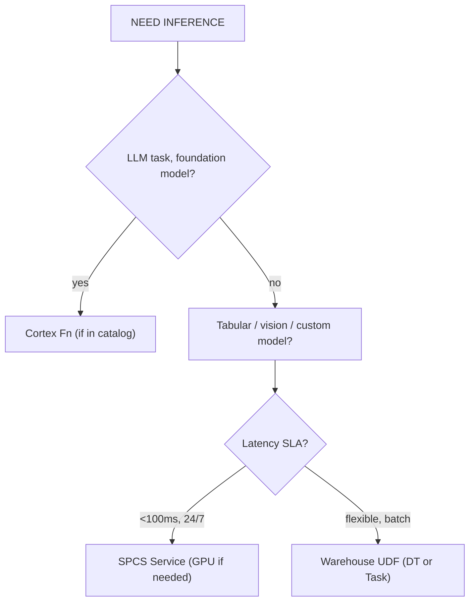
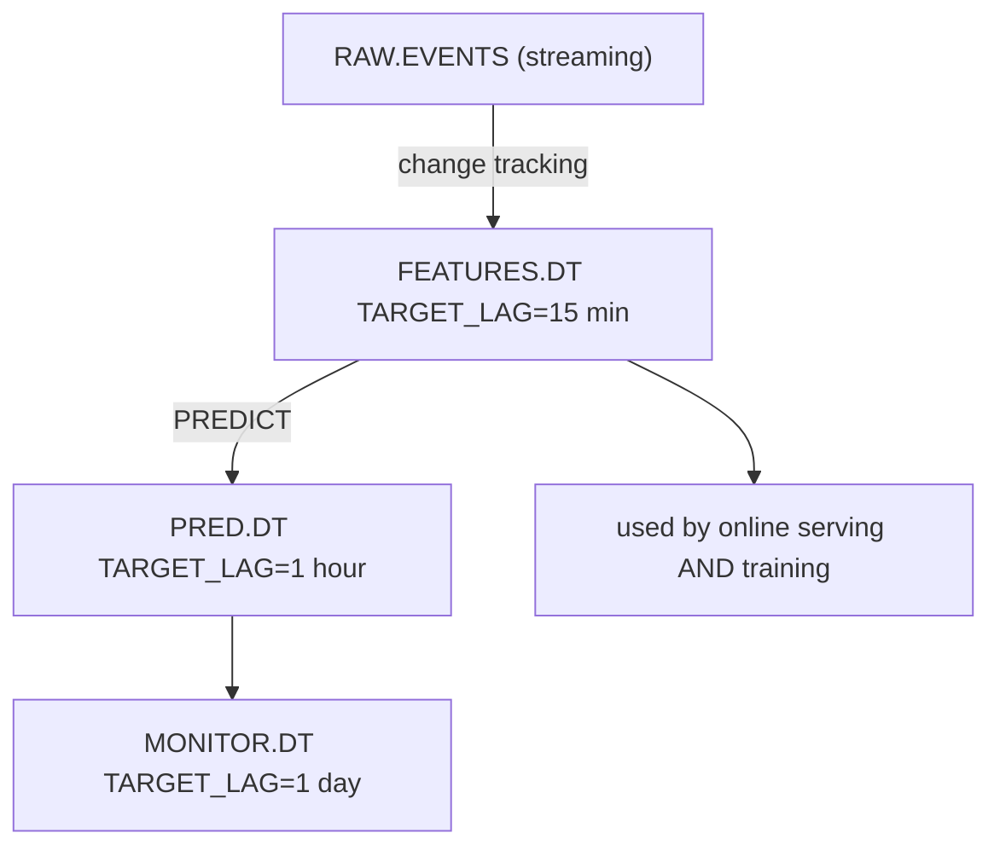

# MLE-C01 Cheatsheet

> **Purpose:** dense exam-day reference. One section per domain pillar. Skim the
> night before. Memorize the deployment matrix, PSI formula, Registry workflow, and
> `create_service()` kwargs.
>
> **Caveat:** Snowflake's APIs evolve. Pin `snowflake-ml-python >= 1.6` to match
> patterns shown here; some older patterns (e.g., `ModelDeployment`, `deploy()`) are
> superseded by `Registry.log_model()` + `mv.create_service()`.

---

## 1. Snowpark ML API Surface

### 1.1 Package Layout (import map)

```mermaid
flowchart TD
    ROOT["snowflake-ml-python (built on snowflake-snowpark-python)"]
    ROOT --> M["snowflake.ml.modeling"]
    ROOT --> FS["snowflake.ml.feature_store"]
    ROOT --> REG["snowflake.ml.registry"]
    ROOT --> DS["snowflake.ml.dataset"]
    ROOT --> JOB["snowflake.ml.jobs"]
    ROOT --> MOD["snowflake.ml.model"]
    ROOT --> MON["snowflake.ml.monitoring (via ModelVersion.create_monitor())"]
    M --> M1[".xgboost -> XGBClassifier, XGBRegressor"]
    M --> M2[".lightgbm -> LGBMClassifier, LGBMRegressor"]
    M --> M3[".linear_model -> LogisticRegression, LinearRegression, Ridge, Lasso"]
    M --> M4[".ensemble -> RandomForestClassifier, GradientBoostingClassifier"]
    M --> M5[".cluster -> KMeans, DBSCAN"]
    M --> M6[".decomposition -> PCA, TruncatedSVD"]
    M --> M7[".preprocessing -> StandardScaler, MinMaxScaler, OneHotEncoder, OrdinalEncoder, LabelEncoder, Normalizer, Binarizer, KBinsDiscretizer, PolynomialFeatures"]
    M --> M8[".impute -> SimpleImputer"]
    M --> M9[".pipeline -> Pipeline"]
    M --> M10[".compose -> ColumnTransformer"]
    M --> M11[".model_selection -> GridSearchCV, RandomizedSearchCV, train_test_split"]
    M --> M12[".metrics -> accuracy_score, roc_auc_score, f1_score, ..."]
    FS --> FS1["FeatureStore"]
    FS --> FS2["Entity"]
    FS --> FS3["FeatureView"]
    FS --> FS4["CreationMode (FAIL_IF_EXISTS, CREATE_IF_NOT_EXIST)"]
    REG --> REG1["Registry"]
    REG --> REG2["classes: Model, ModelVersion"]
    DS --> DS1["Dataset"]
    DS --> DS2["DatasetFactory"]
    JOB --> JOB1["@remote (decorator for SPCS job submission)"]
    MOD --> CM["custom_model"]
    CM --> CM1["CustomModel"]
    CM --> CM2["ModelContext"]
    CM --> CM3["@custom_model.inference_api"]
```



### 1.2 Common Class Signatures

```python
# Session
from snowflake.snowpark import Session
session = Session.builder.configs({...}).create()

# Estimator (sklearn-shaped)
from snowflake.ml.modeling.xgboost import XGBClassifier
m = XGBClassifier(
    input_cols=["AGE","INCOME"],
    label_cols=["CHURNED"],
    output_cols=["PRED"],
    n_estimators=500,
    max_depth=6,
    learning_rate=0.1,
)
m.fit(df_train)                    # trains on warehouse via SPROC
df_scored = m.predict(df_test)     # scored Snowpark DF
auc = m.score(df_test)             # if labels present

# Pipeline
from snowflake.ml.modeling.pipeline import Pipeline
from snowflake.ml.modeling.preprocessing import StandardScaler
pipe = Pipeline(steps=[
    ("scale", StandardScaler(input_cols=["AGE","INCOME"],
                             output_cols=["AGE_S","INCOME_S"])),
    ("clf",   XGBClassifier(input_cols=["AGE_S","INCOME_S"],
                            label_cols=["CHURNED"],
                            output_cols=["PRED"])),
])

# Grid search
from snowflake.ml.modeling.model_selection import GridSearchCV
gs = GridSearchCV(
    estimator=XGBClassifier(input_cols=[...], label_cols=["Y"]),
    param_grid={"n_estimators":[100,300], "max_depth":[4,8]},
    cv=3, scoring="roc_auc",
)
gs.fit(df)
best = gs.to_sklearn()             # extract best model

# Registry
from snowflake.ml.registry import Registry
reg = Registry(session, database_name="ML_DB", schema_name="REG")

# ML Jobs (SPCS)
from snowflake.ml.jobs import remote
@remote(compute_pool="GPU_NV_S_POOL",
        stage_name="JOB_STAGE",
        pip_requirements=["torch==2.3.0","transformers==4.42.0"])
def train(dataset_name: str, epochs: int) -> str:
    ...
job = train("DS1", epochs=3); job.wait(); result = job.result()
```

---

## 2. Feature Store DDL + PIT Join

### 2.1 Setup

```python
from snowflake.ml.feature_store import FeatureStore, Entity, FeatureView, CreationMode

fs = FeatureStore(
    session=session,
    database="ML_DB",
    name="FS",                       # schema name inside the DB
    default_warehouse="ML_WH",
    creation_mode=CreationMode.CREATE_IF_NOT_EXIST,
)

# Entity (join grammar)
customer = Entity(name="CUSTOMER", join_keys=["CUSTOMER_ID"], desc="End customer")
fs.register_entity(customer)

product = Entity(name="PRODUCT", join_keys=["PRODUCT_ID"])
fs.register_entity(product)
```

### 2.2 FeatureView (managed = refreshable)

```python
feat_df = session.table("CURATED.EVENTS").group_by("CUSTOMER_ID","EVENT_TS").agg(
    sum_("AMOUNT").alias("SPEND_30D"),
    count_distinct("SESSION_ID").alias("SESSIONS_30D"),
)

fv = FeatureView(
    name="CUSTOMER_30D",
    entities=[customer],
    feature_df=feat_df,
    timestamp_col="EVENT_TS",        # enables PIT join
    refresh_freq="1 hour",           # managed; backed by Dynamic Table w/ TARGET_LAG=1h
    desc="Trailing-30d customer spend aggregates",
).attach_feature_desc({
    "SPEND_30D":    "Sum of amounts last 30d",
    "SESSIONS_30D": "Distinct sessions last 30d",
})

fs.register_feature_view(fv, version="V1", block=True)
```

### 2.3 Dataset Generation (PIT join)

```python
spine = session.sql("""
    SELECT CUSTOMER_ID, EVENT_TS, CHURNED_30D
    FROM TRAIN.CHURN_LABELS
    WHERE EVENT_TS BETWEEN '2024-01-01' AND '2024-10-01'
""")

ds = fs.generate_dataset(
    name="CHURN_TRAIN_V1",
    spine_df=spine,
    features=[fv],                   # list of FeatureView objects
    spine_timestamp_col="EVENT_TS",  # drives PIT: features at EVENT_TS ≤ TS
    spine_label_cols=["CHURNED_30D"],
    exclude_columns=[],
    desc="Training set for churn V1",
)

# Consume as Snowpark DF or stream to Torch
train_df = ds.read.to_snowpark_dataframe()
torch_ds = ds.read.to_torch_datapipe(batch_size=1024, shuffle=True)
```

### 2.4 PIT Join Semantics

```
Naive JOIN           → may pick post-event feature value (LEAKAGE)
PIT  JOIN            → for each spine row at time T, picks latest feature row
                       whose timestamp ≤ T
                       (equivalent to SQL ASOF JOIN)

Snowflake implements PIT via ASOF JOIN under the hood:
    SELECT s.*, fv.*
    FROM spine s ASOF JOIN fv
      ON s.CUSTOMER_ID = fv.CUSTOMER_ID
      MATCH_CONDITION s.EVENT_TS >= fv.EVENT_TS
```

### 2.5 Online Serving

```python
# Single-key lookup for real-time inference
online = fs.retrieve_feature_values(
    spine_df=session.create_dataframe([[cid]], schema=["CUSTOMER_ID"]),
    features=[fv],
)
```

---

## 3. Model Registry Workflow

### 3.1 Full Lifecycle

```python
from snowflake.ml.registry import Registry
reg = Registry(session, database_name="ML_DB", schema_name="REG")

# ── Log a new version ──────────────────────────────────────────
mv = reg.log_model(
    model=pipe,                      # Snowpark ML pipeline, sklearn, torch,
                                     # xgboost, lightgbm, HF, MLflow, or CustomModel
    model_name="CHURN",
    version_name="V17",
    comment="Add session_count feature",
    sample_input_data=df_train.limit(10),
    conda_dependencies=["xgboost==1.7.5","scikit-learn==1.3.*"],
    pip_requirements=None,           # or ["package==x.y.z"] for non-Anaconda
    metrics={"roc_auc":0.87, "f1":0.74, "n_train":500_000},
    options={"embed_local_ml_library": True},
)

# ── Query the registry ─────────────────────────────────────────
reg.show_models()
m = reg.get_model("CHURN")
m.show_versions()
m.show_tags()

mv = m.version("V17")                # specific version
dv = m.default                       # DEFAULT alias

# ── Metrics / tags / comments ──────────────────────────────────
mv.set_metric("calibration_error", 0.03)
mv.comment = "Promoted after offline eval 2024-10-25"

# Object Tags (must be pre-created via CREATE TAG)
m.set_tag("ML_DB.GOV.OWNER", "churn-team")
m.set_tag("ML_DB.GOV.PII_LEVEL", "none")

# ── Aliases ────────────────────────────────────────────────────
mv.set_alias("PROD")                 # atomic flip
mv.set_alias("CHAMPION")

# Rollback
m.version("V16").set_alias("PROD")   # back to V16

# ── Invoke ─────────────────────────────────────────────────────
# Via Snowpark
pred_df = mv.run(df_scoring, function_name="predict")

# Via SQL
# SELECT ML_DB.REG.CHURN!PREDICT(OBJECT_CONSTRUCT('AGE', AGE, 'INCOME', INCOME))
#   FROM scoring_features;

# ── Delete ─────────────────────────────────────────────────────
m.delete_version("V3")               # version
reg.delete_model("CHURN")            # whole model
```

### 3.2 CustomModel for Custom Logic

```python
from snowflake.ml.model import custom_model
import pandas as pd

class RagChain(custom_model.CustomModel):
    def __init__(self, context):
        super().__init__(context)
        self.retriever = context.model_ref("RETRIEVER")
        self.generator = context.model_ref("GENERATOR")

    @custom_model.inference_api
    def predict(self, input_df: pd.DataFrame) -> pd.DataFrame:
        docs = self.retriever.run(input_df, function_name="retrieve")
        ctx  = docs.groupby("QUERY_ID")["CHUNK"].agg(" ".join).reset_index()
        prompts = input_df.merge(ctx, on="QUERY_ID")
        prompts["PROMPT"] = "Answer using: " + prompts["CHUNK"] + \
                            "\nQ: " + prompts["QUESTION"]
        out = self.generator.run(prompts[["PROMPT"]], function_name="complete")
        return out.rename(columns={"RESPONSE":"ANSWER"})

ctx = custom_model.ModelContext(
    models={"RETRIEVER": retriever_mv, "GENERATOR": generator_mv},
)
rag = RagChain(ctx)
reg.log_model(rag, model_name="RAG_V1", version_name="V1",
              sample_input_data=sample_df)
```

### 3.3 Version Immutability Rules

| Operation | Allowed? |
|---|---|
| Overwrite artifact of existing version | ❌ |
| Delete version | ✅ |
| Update metrics on existing version | ✅ (`set_metric`) |
| Update comment | ✅ |
| Add/remove tags | ✅ |
| Flip alias | ✅ (atomic) |
| Change signature | ❌ (log new version) |
| Change dependencies | ❌ (log new version) |

---

## 4. Deployment Matrix

| Path | Latency | Throughput | Cost model | GPU | Scale-to-zero | Best for |
|---|---|---|---|---|---|---|
| **Warehouse UDF** (auto on `log_model`) | sec cold → ms warm | Columnar scan, 100s MB/s | Per-query credits | ❌ | ✅ (suspend) | Batch scoring, Dynamic Table inference, ad-hoc SQL |
| **SPCS Model Service** (`create_service`) | 10-100ms warm | Replica-bound (hundreds QPS/replica) | Per-second compute pool credits | ✅ (`gpu_requests`) | Only to `min_instances=0` | Real-time, GPU, large models, custom libs |
| **ML Jobs** (`@remote`) | Job cold-start ~tens of sec | Batch per job | Pool credits for job duration | ✅ | Pool suspends | GPU training, distributed training, long-running jobs |
| **Cortex LLM Fns** (`SNOWFLAKE.CORTEX.*`) | sub-second | Shared infra | Per-token | ✅ (managed) | ✅ | Foundation-model tasks: COMPLETE, EMBED_TEXT_768, SUMMARIZE, TRANSLATE, SENTIMENT, EXTRACT_ANSWER |
| **External Function** | 10s-100s ms | Depends on target | Per-call + target cost | ✅ (target-side) | ✅ | Legacy external models, specialized endpoints |

### 4.1 Decision Flow



### 4.2 `create_service()` Reference

```python
mv.create_service(
    service_name="CHURN_RT",
    service_compute_pool="SERVING_POOL",         # REQUIRED
    image_repo="ML_DB.REG.IMG",                  # OCI image repo (reused per deps)
    ingress_enabled=True,                        # public HTTPS endpoint
    min_instances=2,                             # always-on warm
    max_instances=10,                            # autoscale cap
    cpu_requests="1",                            # per container
    memory_requests="4Gi",
    gpu_requests=None,                           # or "1" for 1 GPU/container
    max_batch_rows=256,                          # throughput tuning for GPU
    build_external_access_integrations=None,     # for build-time pip installs
    comment="Primary churn RT service",
)
# → Internal UDF: ML_DB.REG.CHURN_RT!PREDICT(...)
# → External HTTPS (if ingress): https://<account>.snowflakecomputing.app/CHURN_RT/predict
```

### 4.3 Dynamic Table for Batch Inference

```sql
CREATE OR REPLACE DYNAMIC TABLE ML_DB.PRED.CHURN_DT
  TARGET_LAG = '1 hour'
  WAREHOUSE  = ML_WH
AS
SELECT
  CUSTOMER_ID,
  ML_DB.REG.CHURN!PREDICT(
    OBJECT_CONSTRUCT(
      'SPEND_30D',    SPEND_30D,
      'SESSIONS_30D', SESSIONS_30D,
      'TENURE_MO',    TENURE_MO
    )
  ):PREDICTION::FLOAT AS CHURN_PROB,
  CURRENT_TIMESTAMP() AS SCORED_AT
FROM FEATURES.CUSTOMER_30D_SERVING;
```

**Rules:**
- `MODEL!PREDICT` is deterministic → DT-safe.
- External-access UDFs are NOT DT-safe.
- Stored procedures NOT allowed in DT SELECTs (UDFs only).
- Chain DTs with `TARGET_LAG = 'DOWNSTREAM'` on upstream.

### 4.4 Compute Pool DDL

```sql
CREATE COMPUTE POOL SERVING_POOL
  MIN_NODES = 2
  MAX_NODES = 10
  INSTANCE_FAMILY = CPU_X64_S          -- or GPU_NV_S / GPU_NV_M / GPU_NV_L
  AUTO_SUSPEND_SECS = 300              -- CRITICAL: avoid runaway cost
  AUTO_RESUME = TRUE
  COMMENT = 'Serving pool for CHURN';

CREATE IMAGE REPOSITORY ML_DB.REG.IMG;
```

---

## 5. Model Monitor Setup + Drift Formulas

### 5.1 Create a Monitor

```python
mv.create_monitor(
    monitor_name="CHURN_MONITOR",
    source_table="PRED.CHURN_PREDICTIONS",       # must contain features, pred, (actuals)
    prediction_col="CHURN_PROB",
    actual_col="CHURNED_ACTUAL",                 # optional; needed for performance metrics
    timestamp_col="SCORED_AT",
    refresh_frequency="1 day",
    aggregation_window="1 day",
    baseline="TRAIN.BASELINE_FEATURES",          # optional; defaults to training set
    warehouse="MONITOR_WH",
)

# Query the monitor
session.sql(f"""
  SELECT TIMESTAMP, METRIC_NAME, METRIC_VALUE
  FROM TABLE(SYSTEM$MODEL_MONITOR_METRICS('CHURN_MONITOR'))
  WHERE METRIC_NAME IN ('ROC_AUC','PSI_PRED_PROB','PSI_SPEND_30D')
  ORDER BY TIMESTAMP DESC
""").collect()
```

### 5.2 PSI — Population Stability Index

```
                 n_bins
      PSI  =      Σ      (p_cur,i − p_base,i) · ln( p_cur,i / p_base,i )
                 i=1
```

| PSI | Meaning |
|---|---|
| < 0.1 | No shift |
| 0.1-0.25 | Minor shift (monitor) |
| ≥ 0.25 | Major shift (investigate / retrain) |

Binning: 10 equal-frequency/width bins for numeric; one bin per category.

```sql
-- Hand-rolled PSI for a numeric feature
WITH b AS (
  SELECT WIDTH_BUCKET(VAL, 0, 10000, 10) AS BIN,
         COUNT(*)::FLOAT / SUM(COUNT(*)) OVER () AS P_BASE
  FROM BASELINE GROUP BY BIN
),
c AS (
  SELECT WIDTH_BUCKET(VAL, 0, 10000, 10) AS BIN,
         COUNT(*)::FLOAT / SUM(COUNT(*)) OVER () AS P_CUR
  FROM CURRENT GROUP BY BIN
)
SELECT SUM((P_CUR - P_BASE) * LN(NULLIF(P_CUR,0) / NULLIF(P_BASE,0))) AS PSI
FROM b FULL OUTER JOIN c USING (BIN);
```

### 5.3 KS Test — Kolmogorov-Smirnov

```
      KS = max | F_cur(x) − F_base(x) |
            x
   where F is the empirical CDF.
```

- Distribution-free, no binning required.
- Works for continuous numeric features.
- `KS > 0.1` with `p < 0.05` is a common drift threshold.

### 5.4 Chi-squared Test — Categorical

```
                   k
      χ²  =        Σ    (O_i − E_i)² / E_i
                  i=1
   where O_i = observed count, E_i = expected count in category i.
```

- Use when each cell expected count ≥ 5.
- Fisher's exact or Monte-Carlo variants if cells are sparse.
- Compare `χ²` to critical value at `df = k-1`.

### 5.5 Drift Taxonomy

| Term | Definition |
|---|---|
| **Data drift** | Input feature distribution P(X) changes |
| **Concept drift** | P(Y|X) changes — relationship shifts |
| **Prediction drift** | P(Ŷ) changes — may be either, surfaces first |
| **Label drift** | P(Y) changes — base-rate shift |

---

## 6. Dynamic Tables for Batch Inference Pattern



### 6.1 Three-Tier Pattern

```sql
-- Tier 1: Feature DT (feeds BOTH training and inference)
CREATE OR REPLACE DYNAMIC TABLE FEATURES.CUSTOMER_30D
  TARGET_LAG = '15 minutes'
  WAREHOUSE  = FEATURE_WH
AS SELECT ... FROM RAW.EVENTS ...;

-- Tier 2: Inference DT (invokes model UDF)
CREATE OR REPLACE DYNAMIC TABLE PRED.CHURN
  TARGET_LAG = '1 hour'
  WAREHOUSE  = INFERENCE_WH
AS
SELECT CUSTOMER_ID,
       ML_DB.REG.CHURN!PREDICT(OBJECT_CONSTRUCT(*)):PREDICTION::FLOAT AS P,
       CURRENT_TIMESTAMP() AS SCORED_AT
FROM FEATURES.CUSTOMER_30D;

-- Tier 3: Monitoring DT (feeds Model Monitor source table)
CREATE OR REPLACE DYNAMIC TABLE MONITOR.PRED_DAILY
  TARGET_LAG = '1 day'
  WAREHOUSE  = MONITOR_WH
AS
SELECT DATE_TRUNC('day', SCORED_AT) AS DAY,
       AVG(P) AS AVG_PROB, STDDEV(P) AS STD_PROB, COUNT(*) AS N
FROM PRED.CHURN GROUP BY 1;
```

### 6.2 `TARGET_LAG` Values

| Value | Meaning |
|---|---|
| `'<n> minutes'` / `'<n> hours'` | Max staleness bound; engine schedules refresh |
| `'DOWNSTREAM'` | Refresh only when downstream DT needs data |

---

## 7. Git Integration + `snow` CLI

### 7.1 Git Repository in Snowflake

```sql
-- 1) API integration (one-time, for the Git provider)
CREATE OR REPLACE API INTEGRATION GIT_API_INT
  API_PROVIDER      = GIT_HTTPS_API
  API_ALLOWED_PREFIXES = ('https://github.com/myorg/')
  ALLOWED_AUTHENTICATION_SECRETS = (ML_DB.SEC.GH_PAT)
  ENABLED           = TRUE;

-- 2) Secret with Personal Access Token
CREATE OR REPLACE SECRET ML_DB.SEC.GH_PAT
  TYPE     = PASSWORD
  USERNAME = 'myorg-bot'
  PASSWORD = '<pat>';

-- 3) Git repository
CREATE OR REPLACE GIT REPOSITORY ML_DB.CODE.ML_REPO
  API_INTEGRATION = GIT_API_INT
  GIT_CREDENTIALS = ML_DB.SEC.GH_PAT
  ORIGIN          = 'https://github.com/myorg/ml-repo.git';

-- 4) Sync
ALTER GIT REPOSITORY ML_DB.CODE.ML_REPO FETCH;

-- 5) Execute a script from a branch
EXECUTE IMMEDIATE FROM @ML_DB.CODE.ML_REPO/branches/main/pipelines/train.sql;
```

### 7.2 `snow` CLI Cheatsheet

```bash
# Config
snow connection add --connection-name mle --account <acct> --user <user> \
    --authenticator SNOWFLAKE_JWT --private-key-file ~/.ssh/snow_rsa
snow connection test

# SQL execution
snow sql -q "SHOW MODELS IN SCHEMA ML_DB.REG"
snow sql -f pipelines/create_feature_dts.sql
snow sql -q "ALTER GIT REPOSITORY ML_DB.CODE.ML_REPO FETCH"

# Streamlit app
snow streamlit deploy                # from a project dir with snowflake.yml
snow streamlit list

# Snowpark
snow snowpark build                  # package Python code
snow snowpark deploy                 # upload stage + register UDFs/SPROCs

# Container services
snow spcs service create --name CHURN_RT --compute-pool SERVING_POOL \
    --spec-path spec.yaml --min-instances 2 --max-instances 10
snow spcs service status --name CHURN_RT
snow spcs service suspend --name CHURN_RT

# Git integration
snow git setup <repo_name>           # scaffolds the API_INTEGRATION + secret
snow git fetch <repo_name>           # equivalent to ALTER ... FETCH

# ML (newer sub-commands)
snow ml model list
snow ml service list
```

### 7.3 CI/CD Skeleton (GitHub Actions)

```yaml
name: ML CI/CD
on:
  push:
    branches: [main]

jobs:
  deploy:
    runs-on: ubuntu-latest
    steps:
      - uses: actions/checkout@v4
      - uses: actions/setup-python@v5
        with: { python-version: '3.11' }
      - name: Install Snowflake CLI
        run: pip install snowflake-cli-labs snowflake-ml-python
      - name: Configure Snowflake connection
        env:
          SNOWFLAKE_ACCOUNT:  ${{ secrets.SNOWFLAKE_ACCOUNT }}
          SNOWFLAKE_USER:     ${{ secrets.SNOWFLAKE_USER }}
          SNOWFLAKE_PRIVATE_KEY: ${{ secrets.SNOWFLAKE_PK }}
        run: |
          snow connection add --connection-name ci \
            --account "$SNOWFLAKE_ACCOUNT" --user "$SNOWFLAKE_USER" \
            --authenticator SNOWFLAKE_JWT --private-key-raw "$SNOWFLAKE_PRIVATE_KEY"
      - name: Sync Git repo
        run: snow sql -q "ALTER GIT REPOSITORY ML_DB.CODE.ML_REPO FETCH" -c ci
      - name: Deploy DDL
        run: snow sql -f pipelines/create_feature_dts.sql -c ci
      - name: Train + register
        run: python pipelines/train_and_register.py \
             --version "V_${{ github.sha }}" --git-commit "${{ github.sha }}"
      - name: Offline evaluation gate
        run: python pipelines/offline_eval.py --version "V_${{ github.sha }}"
      - name: Promote
        run: snow sql -c ci \
             -q "CALL ML_DB.REG.PROMOTE_IF_APPROVED('CHURN','V_${{ github.sha }}')"
      - name: Update service
        run: snow sql -c ci -f pipelines/update_service.sql
```

---

## 8. ACCESS_HISTORY / QUERY_TAG for Lineage & Cost

### 8.1 Attribute Workloads via QUERY_TAG

```sql
-- Set once per session
ALTER SESSION SET QUERY_TAG = 'ml.churn.train.V17';

-- Or per statement
SELECT /*+ QUERY_TAG('ml.churn.inference.batch') */ ...;
```

Convention: `<domain>.<model>.<phase>.<version>` e.g. `ml.churn.inference.V17`.

### 8.2 Cost Chargeback

```sql
-- Warehouse credits by tag over last 7 days
SELECT
  qh.QUERY_TAG,
  SUM(wmh.CREDITS_USED) AS CREDITS,
  SUM(qh.TOTAL_ELAPSED_TIME)/1000/60 AS MINUTES,
  COUNT(*) AS QUERIES
FROM SNOWFLAKE.ACCOUNT_USAGE.QUERY_HISTORY qh
JOIN SNOWFLAKE.ACCOUNT_USAGE.WAREHOUSE_METERING_HISTORY wmh
  ON qh.WAREHOUSE_ID = wmh.WAREHOUSE_ID
 AND qh.START_TIME BETWEEN wmh.START_TIME AND wmh.END_TIME
WHERE qh.START_TIME >= DATEADD(day, -7, CURRENT_TIMESTAMP())
  AND qh.QUERY_TAG LIKE 'ml.%'
GROUP BY qh.QUERY_TAG
ORDER BY CREDITS DESC;

-- SPCS pool credits
SELECT NAME, SUM(CREDITS_USED) AS POOL_CREDITS
FROM SNOWFLAKE.ACCOUNT_USAGE.SNOWPARK_CONTAINER_SERVICES_HISTORY
WHERE START_TIME >= DATEADD(day,-7,CURRENT_TIMESTAMP())
GROUP BY NAME;
```

### 8.3 Lineage via ACCESS_HISTORY

```sql
-- What tables did a given training query read?
SELECT
  QUERY_ID,
  DIRECT_OBJECTS_ACCESSED,     -- array of tables/views directly in query
  BASE_OBJECTS_ACCESSED,       -- recursive: through views/DTs
  OBJECTS_MODIFIED
FROM SNOWFLAKE.ACCOUNT_USAGE.ACCESS_HISTORY
WHERE QUERY_ID = '<train-query-id>';

-- Reconstruct model → predictions → source lineage
--  (train SPROC query_tag → QUERY_HISTORY → ACCESS_HISTORY → BASE_OBJECTS)
```

### 8.4 Model Lineage Hygiene

```python
reg.log_model(
    ..., metrics={"roc_auc":0.87},
    comment="git_commit=abc123; dataset=CHURN_TRAIN_V1; trained_on_wh=ML_WH_L"
)
mv.set_tag("ML_DB.GOV.GIT_COMMIT", "abc123def456")
mv.set_tag("ML_DB.GOV.DATASET_VERSION", "CHURN_TRAIN_V1_2024_10_01")
mv.set_tag("ML_DB.GOV.APPROVED_BY", "jane.doe@co.com")
```

---

## 9. Common Gotchas

### 9.1 Schema Evolution in FeatureView

- **Adding a column**: register a **new version** (V2). Downstream consumers must
  update their reference. V1 continues to serve existing consumers.
- **Removing a column**: new version — never mutate V1.
- **Changing data type**: new version. Existing Datasets pinned to V1 remain valid.
- **Changing the backing SQL (business logic)**: new version. Rule of thumb: if a
  reasonable person would get different values, bump the version.
- **Changing refresh_freq**: not a semantic change — alter in place is tolerable.
- **FS catalog metadata (description, tags)**: in-place is fine.

### 9.2 Training-Serving Skew Sources

| Source | Mitigation |
|---|---|
| Different code paths (pandas vs SQL vs Java) | Register a Snowpark ML Pipeline — preprocessing baked in |
| Different data snapshots | Feature Store serves both pipelines from the same FV |
| Null / missing handling drift | `SimpleImputer` inside the Pipeline, not ad-hoc |
| Timezone / timestamp drift | Normalize to UTC in the FV SQL; never `CURRENT_TIMESTAMP()` at serve-only path |
| Feature leakage (future data in training) | PIT join via `generate_dataset(spine_timestamp_col=...)` |
| Different categorical vocabularies | `OneHotEncoder` fit at train, re-used at serve via Pipeline |
| Different library versions | Pin `conda_dependencies` + `pip_requirements` at `log_model` |

### 9.3 Delayed / Async Actuals

- Design the prediction log with a nullable `ACTUAL` column from day one.
- A separate pipeline (Task or DT) back-fills `ACTUAL` as labels mature.
- Model Monitor refreshes performance metrics on next scheduled run; design
  `refresh_frequency` ≥ typical label latency.
- When alerting, filter to rows with non-null actuals and matured timestamp:
  `WHERE SCORED_AT < DATEADD(day, -<label_latency_days>, CURRENT_TIMESTAMP())`.
- Beware of label leakage from early-matured sub-populations biasing the metric.

### 9.4 Deployment Gotchas

- Warehouse UDFs cannot host >~500MB artifacts reliably → SPCS for big models.
- SPCS compute pools **do not** auto-suspend by default. Set `AUTO_SUSPEND_SECS`.
- `MODEL!PREDICT` returns a VARIANT; cast as needed (`:PREDICTION::FLOAT`).
- External-access UDFs are NOT allowed in Dynamic Tables.
- Stored procedures cannot be referenced in a DT SELECT (UDFs only).
- `ingress_enabled=True` exposes HTTPS *outside* Snowflake — still subject to
  Network Policies and account-level allow-lists.
- Dropping a Registry schema drops the backing stage and all model artifacts in it.

### 9.5 Monitoring Gotchas

- Model Monitor is tied to a Registry **version**. For a new version, create a new
  monitor (or re-point) — don't assume continuity across versions.
- PSI with zero-count bins → `ln(0)` → add Laplace smoothing (`+ε`) or drop empty bins.
- KS on heavily discretized features (e.g., binned age) can produce misleadingly
  high D-statistics — use chi² instead.
- Chi² is unreliable with cells where expected count < 5.
- Baseline = training distribution; refresh the baseline only on retraining, not
  arbitrarily (that defeats the comparison).

### 9.6 Registry Gotchas

- `DEFAULT` alias auto-flips to the latest-logged version unless you set it explicitly.
- `PROD` is a **convention**, not a reserved alias — any team can override by
  flipping it. Guard via tag-based approval SPROC.
- `log_model(..., sample_input_data=...)` is **required** for non-Snowpark-ML
  models (sklearn, torch, HF, custom) to infer the signature.
- You cannot change a version's signature or dependencies after logging. Log a new
  version instead.
- Metrics are mutable (`set_metric`); artifacts, signatures, and deps are not.
- Tags must be pre-created via `CREATE TAG` and then granted; you cannot set
  arbitrary free-form tags on a version.

### 9.7 Governance Gotchas

- `MASKING POLICY` on an underlying column IS honored by FeatureView queries.
- `ROW ACCESS POLICY` propagates through DTs — predictions will be filtered to
  the caller's visible rows.
- Horizon Catalog classification tags surface to data scientists; configure them to
  flag PII before features are built.
- Secret rotation: `ALTER SECRET SET SECRET_STRING = ...` is live; the service
  re-reads on next call (no restart required if the service fetches per request).
- Audit via `ACCOUNT_USAGE.ACCESS_HISTORY` has a latency of ~45 minutes.

---

## 10. Last-Minute Memory Hooks

- **One-liner for every Registry log:** `reg.log_model(model, model_name, version_name, sample_input_data, conda_dependencies, metrics)`
- **One-liner for every service:** `mv.create_service(service_name, service_compute_pool, image_repo, ingress_enabled, min_instances, max_instances, gpu_requests)`
- **One-liner for every monitor:** `mv.create_monitor(monitor_name, source_table, prediction_col, actual_col, timestamp_col, refresh_frequency)`
- **PSI thresholds:** 0.1 / 0.25
- **PIT:** `generate_dataset(spine_df, spine_timestamp_col, features)`
- **Deployment picker:** latency SLA → path. Sub-100ms = SPCS. Batch = warehouse UDF. LLM foundation = Cortex. Fine-tuned LLM = SPCS GPU.
- **Alias flip = atomic promotion.** Version immutable.
- **DT UDF rule:** pure/deterministic UDFs only. No SPROCs, no external access.
- **Git integration:** `CREATE GIT REPOSITORY` + `ALTER ... FETCH`.
- **Cost chargeback:** `QUERY_TAG` + `WAREHOUSE_METERING_HISTORY`.
- **Lineage:** `ACCESS_HISTORY` + `OBJECTS_ACCESSED`.
- **Compute pool AUTO_SUSPEND_SECS** or you'll bleed money.

Good luck. You've got this.
