# Data Analytics Fundamentals — DAA-C01 Study Guide

## Exam Weight & Scope

Approximately 15-20% of DAA-C01. Covers the analyst's end-to-end workflow in Snowflake: framing an analytical question, locating and profiling datasets, assessing data quality, computing descriptive statistics, and documenting findings. Expect scenario questions where you must choose between EDA approaches, interpret `APPROX_*` functions, or pick the right profiling query. The exam leans heavily on *when to use* each tool, not just syntax.

## Core Concepts Map

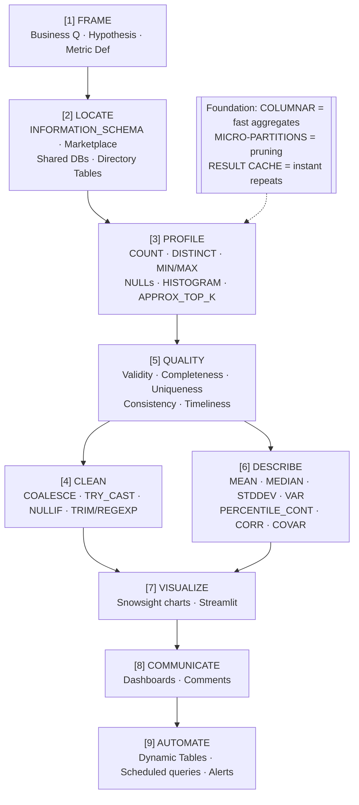

---

## Q1: What is the recommended first step when exploring an unfamiliar table in Snowflake, and which objects help you discover it?
**Difficulty:** Foundation
**Exam relevance:** Dataset discovery and profiling

### Answer

Start with metadata lookups via `INFORMATION_SCHEMA` or `SNOWFLAKE.ACCOUNT_USAGE`, then run a lightweight profile. The canonical sequence:

1. `SHOW TABLES LIKE '%customer%' IN SCHEMA ...;` — discover candidates.
2. `DESCRIBE TABLE SNOWFLAKE_SAMPLE_DATA.TPCH_SF1.CUSTOMER;` — see columns, types, nullability.
3. `SELECT * FROM TPCH_SF1.CUSTOMER LIMIT 10;` — sample rows (uses result cache cheaply).
4. `SELECT COUNT(*), COUNT(DISTINCT C_CUSTKEY) FROM TPCH_SF1.CUSTOMER;` — size and uniqueness.
5. `SELECT GET_DDL('TABLE', 'TPCH_SF1.CUSTOMER');` — see constraints, clustering keys.

### First Principles

Snowflake's columnar + micro-partition storage means a `COUNT(*)` or `SELECT TOP 10` is essentially free: metadata-only operations return in milliseconds without scanning data. This flips the traditional discipline from "sample first because scans are expensive" to "scan metadata freely." The analyst's time is more valuable than warehouse time for small profiling queries.

### Diagram

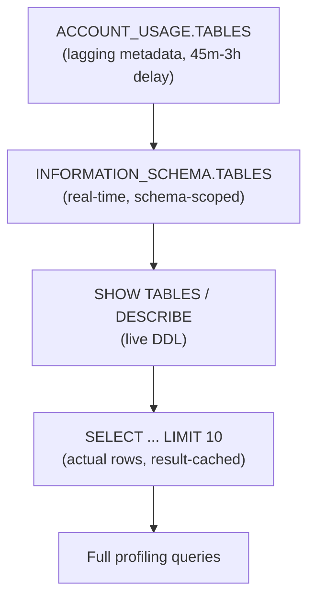

### Lab Exercise

```sql
-- Discover and profile a TPCH table end-to-end
USE DATABASE SNOWFLAKE_SAMPLE_DATA;
USE SCHEMA TPCH_SF1;

-- 1. Catalog scan
SELECT table_name, row_count, bytes
FROM INFORMATION_SCHEMA.TABLES
WHERE table_schema = 'TPCH_SF1'
ORDER BY bytes DESC;

-- 2. Column inventory
SELECT column_name, data_type, is_nullable
FROM INFORMATION_SCHEMA.COLUMNS
WHERE table_name = 'ORDERS';

-- 3. Lightweight profile
SELECT
    COUNT(*)                            AS row_count,
    COUNT(DISTINCT O_ORDERKEY)          AS unique_orders,
    COUNT(DISTINCT O_CUSTKEY)           AS unique_customers,
    MIN(O_ORDERDATE)                    AS earliest_order,
    MAX(O_ORDERDATE)                    AS latest_order,
    SUM(IFF(O_COMMENT IS NULL, 1, 0))   AS null_comments
FROM ORDERS;
```

### Gotchas / Exam Traps

- `ACCOUNT_USAGE` views lag by **up to 3 hours** — never use for real-time profiling. Use `INFORMATION_SCHEMA` for live stats.
- `INFORMATION_SCHEMA.TABLES.ROW_COUNT` is maintained metadata (accurate for permanent/transient but **not for views**).
- `SHOW` commands return results to the result cache but you must access via `RESULT_SCAN(LAST_QUERY_ID())` to query them.

---

## Q2: What is the difference between `COUNT(DISTINCT col)` and `APPROX_COUNT_DISTINCT(col)` and when should an analyst prefer the approximate version?
**Difficulty:** Intermediate
**Exam relevance:** Descriptive statistics, performance

### Answer

`COUNT(DISTINCT col)` is exact; it must track every distinct value, which requires memory proportional to cardinality and often triggers spill-to-disk on billion-row tables. `APPROX_COUNT_DISTINCT(col)` uses HyperLogLog, trading ~1.6% relative error for constant memory (~16 KB per group). Prefer approximate when:

- Cardinality is in the millions+ and exact precision isn't needed (dashboards, trend charts).
- You're grouping by many dimensions (each group gets its own HLL sketch).
- You need to merge counts across time windows (`HLL_COMBINE` is associative).

### First Principles

Counting distinct values exactly is fundamentally harder than counting rows: you must remember *everything you've seen*. HyperLogLog hashes each value into buckets and records the maximum number of leading zeros per bucket — statistical theory lets you estimate cardinality from those extremes without storing the values. This is why HLL memory is constant regardless of cardinality: 10 unique or 10 billion unique both fit in the same sketch.

### Diagram

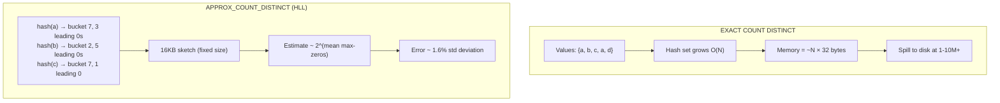

### Lab Exercise

```sql
-- Compare exact vs approximate on TPCH LINEITEM
SELECT
    COUNT(DISTINCT L_PARTKEY)         AS exact_parts,
    APPROX_COUNT_DISTINCT(L_PARTKEY)  AS approx_parts,
    COUNT(DISTINCT L_SUPPKEY)         AS exact_supps,
    APPROX_COUNT_DISTINCT(L_SUPPKEY)  AS approx_supps
FROM SNOWFLAKE_SAMPLE_DATA.TPCH_SF10.LINEITEM;

-- Mergeable sketches for incremental dashboards
SELECT
    DATE_TRUNC('MONTH', L_SHIPDATE) AS ship_month,
    HLL(L_PARTKEY)                  AS unique_parts_hll
FROM SNOWFLAKE_SAMPLE_DATA.TPCH_SF1.LINEITEM
GROUP BY 1;

-- Combine monthly HLLs into quarterly without re-scanning
SELECT
    DATE_TRUNC('QUARTER', ship_month)        AS ship_quarter,
    HLL_ESTIMATE(HLL_COMBINE(unique_parts_hll)) AS unique_parts_q
FROM (/* previous query */) GROUP BY 1;
```

### Gotchas / Exam Traps

- `APPROX_COUNT_DISTINCT(NULL)` returns 0 — NULLs are *not* counted (same as exact).
- The function name `HLL()` returns the *sketch* (binary), while `APPROX_COUNT_DISTINCT()` returns the *estimate* (integer). Confuse these on the exam and you lose points.
- Error is relative, not absolute: 1.6% of 1 billion = 16 million. For small cardinalities, use exact.

---

## Q3: Define data quality dimensions and show how to measure each in Snowflake SQL.
**Difficulty:** Intermediate
**Exam relevance:** Data quality assessment

### Answer

The six classical dimensions:

| Dimension | Question | SQL check |
|-----------|----------|-----------|
| **Completeness** | Are required fields populated? | `COUNT_IF(col IS NULL) / COUNT(*)` |
| **Uniqueness** | Are keys unique? | `COUNT(*) - COUNT(DISTINCT key)` |
| **Validity** | Do values match the domain/format? | `COUNT_IF(NOT REGEXP_LIKE(email,'^[^@]+@[^@]+$'))` |
| **Consistency** | Do related fields agree? | `COUNT_IF(start_date > end_date)` |
| **Accuracy** | Do values match reality? | compare to source-of-truth table |
| **Timeliness** | Is data fresh enough? | `MAX(load_ts) < DATEADD('hour',-6,CURRENT_TIMESTAMP)` |

### First Principles

Quality has no single number — it is multidimensional because *different* downstream uses demand *different* guarantees. A finance dashboard needs accuracy and timeliness; a marketing segmentation needs completeness. Snowflake makes quality checks cheap because columnar storage lets you scan a single column across billions of rows without touching others — enabling continuous monitoring via `DATA_METRIC_FUNCTION` (DMF) objects.

### Diagram

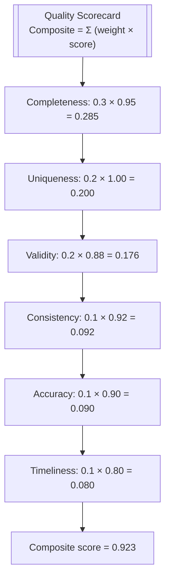

### Lab Exercise

```sql
-- Multi-dimension DQ profile on TPCH CUSTOMER
WITH stats AS (
  SELECT
    COUNT(*)                                                 AS total,
    COUNT_IF(C_NAME IS NULL OR TRIM(C_NAME)='')              AS null_name,
    COUNT(*) - COUNT(DISTINCT C_CUSTKEY)                     AS dup_keys,
    COUNT_IF(NOT REGEXP_LIKE(C_PHONE,'^[0-9-]+$'))           AS bad_phone,
    COUNT_IF(C_ACCTBAL < 0 AND C_MKTSEGMENT='BUILDING')      AS inconsistent
  FROM SNOWFLAKE_SAMPLE_DATA.TPCH_SF1.CUSTOMER
)
SELECT
  1 - null_name   / total::FLOAT  AS completeness_name,
  1 - dup_keys    / total::FLOAT  AS uniqueness_key,
  1 - bad_phone   / total::FLOAT  AS validity_phone,
  1 - inconsistent/ total::FLOAT  AS consistency_biz
FROM stats;

-- Snowflake-native DMF (released 2024)
CREATE DATA METRIC FUNCTION null_rate(T TABLE(col STRING))
  RETURNS NUMBER AS 'SELECT COUNT_IF(col IS NULL)/COUNT(*)::FLOAT FROM T';
```

### Gotchas / Exam Traps

- `COUNT_IF` is Snowflake-specific; standard SQL uses `COUNT(CASE WHEN ...)`.
- NULL `!=` empty string. Always check both: `col IS NULL OR TRIM(col) = ''`.
- DMFs run on a schedule attached to tables — they aren't just one-off queries; the exam may ask about `ASSOCIATE DATA METRIC FUNCTION`.

---

## Q4: What are percentile functions in Snowflake and how do `PERCENTILE_CONT` and `PERCENTILE_DISC` differ?
**Difficulty:** Intermediate
**Exam relevance:** Descriptive statistics

### Answer

- `PERCENTILE_CONT(p) WITHIN GROUP (ORDER BY col)` — **continuous** percentile; linearly interpolates between adjacent values. Returns a value that may not exist in the data.
- `PERCENTILE_DISC(p) WITHIN GROUP (ORDER BY col)` — **discrete** percentile; returns the first actual value whose cumulative distribution is ≥ p.
- `MEDIAN(col)` is shorthand for `PERCENTILE_CONT(0.5)`.
- `APPROX_PERCENTILE(col, p)` uses t-digest for large datasets.

### First Principles

Percentiles answer "what value separates the bottom p% from the top (1-p)%?" With 100 values and p=0.5, both methods agree. With 2 values {10, 20}, continuous returns 15 (midpoint); discrete returns 10 (first value with cumulative ≥ 0.5). The choice matters for small samples and categorical-numeric data (e.g., star ratings) where interpolation makes no business sense.

### Diagram

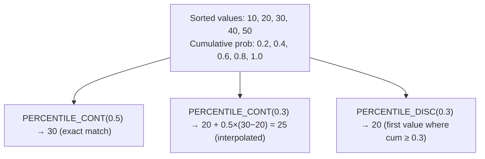

### Lab Exercise

```sql
-- Order value percentiles on TPCH
SELECT
    PERCENTILE_CONT(0.25) WITHIN GROUP (ORDER BY O_TOTALPRICE) AS p25,
    MEDIAN(O_TOTALPRICE)                                       AS p50,
    PERCENTILE_CONT(0.75) WITHIN GROUP (ORDER BY O_TOTALPRICE) AS p75,
    PERCENTILE_CONT(0.95) WITHIN GROUP (ORDER BY O_TOTALPRICE) AS p95,
    APPROX_PERCENTILE(O_TOTALPRICE, 0.99)                      AS p99_approx
FROM SNOWFLAKE_SAMPLE_DATA.TPCH_SF10.ORDERS;

-- Per-segment analysis
SELECT
    C.C_MKTSEGMENT,
    MEDIAN(O.O_TOTALPRICE)                                     AS median_order,
    PERCENTILE_CONT(0.9) WITHIN GROUP (ORDER BY O.O_TOTALPRICE) AS p90_order
FROM SNOWFLAKE_SAMPLE_DATA.TPCH_SF1.ORDERS O
JOIN SNOWFLAKE_SAMPLE_DATA.TPCH_SF1.CUSTOMER C USING (C_CUSTKEY → O_CUSTKEY)
  ON C.C_CUSTKEY = O.O_CUSTKEY
GROUP BY C.C_MKTSEGMENT;
```

### Gotchas / Exam Traps

- `PERCENTILE_CONT` cannot be used as a window function (unlike `ROW_NUMBER`); it is an *ordered-set aggregate*.
- `APPROX_PERCENTILE` is cheaper but non-deterministic across runs (error ~1%).
- NULLs are ignored in the input (not treated as 0).

---

## Q5: Explain correlation vs. covariance in Snowflake SQL and when to use each.
**Difficulty:** Intermediate
**Exam relevance:** Descriptive statistics

### Answer

- `COVAR_POP(x,y)` / `COVAR_SAMP(x,y)` — covariance; measures direction of joint variability but is scale-dependent. Hard to compare across variable pairs.
- `CORR(x,y)` — Pearson correlation; covariance normalized by both standard deviations. Scale-free, bounded [-1, 1].
- Use covariance when scale matters (e.g., portfolio variance math). Use correlation when comparing strength of linear relationships.

### First Principles

Covariance = E[(X - μx)(Y - μy)]. The magnitude depends on the units of X and Y. Correlation = Covariance / (σx * σy), which cancels units. This is why correlation can be compared across completely different variable pairs (price-vs-weight has the same scale as revenue-vs-count).

### Diagram

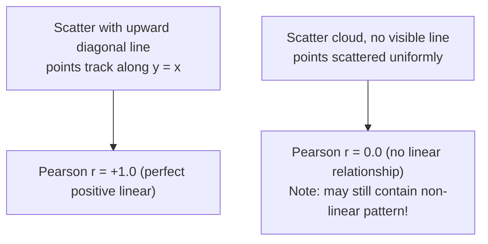

### Lab Exercise

```sql
-- Price-quantity correlation on LINEITEM
SELECT
    CORR(L_QUANTITY, L_EXTENDEDPRICE)       AS r_qty_price,
    COVAR_SAMP(L_QUANTITY, L_EXTENDEDPRICE) AS cov_qty_price,
    STDDEV_SAMP(L_QUANTITY)                 AS sd_qty,
    STDDEV_SAMP(L_EXTENDEDPRICE)            AS sd_price,
    REGR_SLOPE(L_EXTENDEDPRICE, L_QUANTITY) AS slope,
    REGR_INTERCEPT(L_EXTENDEDPRICE, L_QUANTITY) AS intercept,
    REGR_R2(L_EXTENDEDPRICE, L_QUANTITY)    AS r_squared
FROM SNOWFLAKE_SAMPLE_DATA.TPCH_SF1.LINEITEM;
```

### Gotchas / Exam Traps

- `CORR` returns NULL if either variable has zero variance (division by 0).
- Correlation measures **linear** association only — anscombe quartet reminder.
- `REGR_SLOPE(y, x)` has y first and x second — opposite of math convention. Easy to flip.

---

## Q6: What is exploratory data analysis (EDA) and what sequence of Snowflake queries forms a standard EDA pass?
**Difficulty:** Foundation
**Exam relevance:** Analytical workflows

### Answer

EDA is the iterative process of forming hypotheses, inspecting distributions, and spotting anomalies before formal modeling. A canonical EDA pass:

1. **Shape** — row/column counts, data types.
2. **Univariate distribution** — min/max/mean/median/stddev per numeric; top-K per categorical.
3. **Missingness** — NULL rates per column.
4. **Outliers** — values beyond p99 or ±3σ.
5. **Bivariate** — correlation matrix for numerics, cross-tab for categoricals.
6. **Time patterns** — if there's a date column, check daily/weekly cycles.
7. **Hypothesis generation** — note surprises.

### First Principles

EDA is defensive engineering: it uncovers assumption violations before they poison downstream analysis. In Snowflake, EDA is cheap because the warehouse scales elastically — a single analyst can profile TBs of data in seconds. The discipline is to *always* profile before modeling; "jump to the chart" skips the step that catches 80% of bugs.

### Diagram

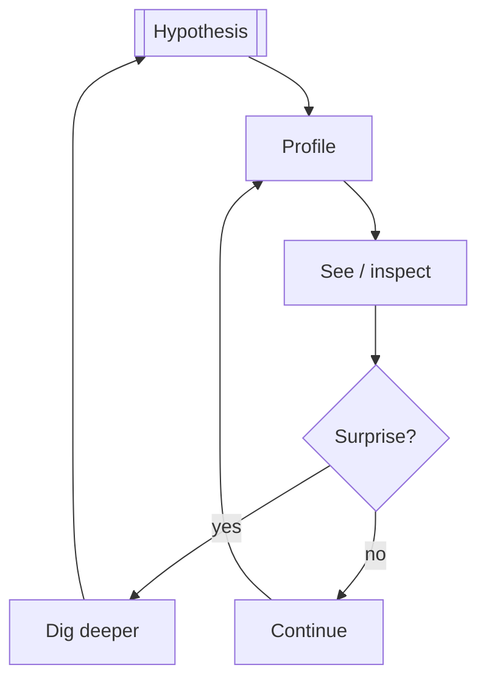

### Lab Exercise

```sql
-- Full EDA pass on TPCH ORDERS in one query via CTEs
WITH shape AS (
  SELECT COUNT(*) rows_, COUNT(DISTINCT O_ORDERKEY) uniq_keys
  FROM SNOWFLAKE_SAMPLE_DATA.TPCH_SF1.ORDERS),
dist AS (
  SELECT MIN(O_TOTALPRICE) mn, AVG(O_TOTALPRICE) mu,
         MEDIAN(O_TOTALPRICE) med, STDDEV(O_TOTALPRICE) sd,
         MAX(O_TOTALPRICE) mx
  FROM SNOWFLAKE_SAMPLE_DATA.TPCH_SF1.ORDERS),
missing AS (
  SELECT COUNT_IF(O_CLERK IS NULL)   / COUNT(*)::FLOAT null_clerk,
         COUNT_IF(O_COMMENT IS NULL) / COUNT(*)::FLOAT null_comment
  FROM SNOWFLAKE_SAMPLE_DATA.TPCH_SF1.ORDERS),
top_segments AS (
  SELECT O_ORDERSTATUS, COUNT(*) cnt
  FROM SNOWFLAKE_SAMPLE_DATA.TPCH_SF1.ORDERS
  GROUP BY 1 ORDER BY cnt DESC)
SELECT * FROM shape, dist, missing;
```

### Gotchas / Exam Traps

- EDA on sampled data (`SAMPLE(1)`) is faster but can hide rare but important categories.
- Always check mean *vs* median together — large divergence signals skew.
- `AVG` of boolean (0/1) gives you the base rate — useful trick for class-imbalance checks.

---

## Q7: What is the SAMPLE / TABLESAMPLE clause and when should an analyst use it?
**Difficulty:** Foundation
**Exam relevance:** EDA on large datasets

### Answer

`SAMPLE` returns a probabilistic subset of rows. Two methods:

- `SAMPLE BERNOULLI (p)` or `SAMPLE ROW (p)` — scans every row, keeps each with probability p. Slower, more precise.
- `SAMPLE SYSTEM (p)` or `SAMPLE BLOCK (p)` — samples at the micro-partition level. Faster, but can skip entire partitions.
- `SAMPLE (n ROWS)` — approximate row count.

Use for EDA on multi-TB tables, hypothesis checks, or iterating on query logic.

### First Principles

Micro-partitions are Snowflake's physical storage unit (~16MB compressed). `SAMPLE SYSTEM` picks whole partitions, so it benefits from pruning — if your table has 1000 partitions and you sample 10%, you read ~100 partitions worth of data at full partition speed. `SAMPLE BERNOULLI` must still *decompress and scan* every row even though it only keeps some.

### Diagram

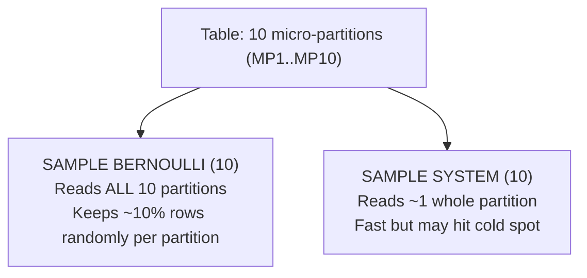

### Lab Exercise

```sql
-- Compare methods on LINEITEM (6M+ rows at SF1)
SELECT COUNT(*) FROM SNOWFLAKE_SAMPLE_DATA.TPCH_SF1.LINEITEM
  SAMPLE BERNOULLI (1);     -- Bernoulli: ~60k rows

SELECT COUNT(*) FROM SNOWFLAKE_SAMPLE_DATA.TPCH_SF1.LINEITEM
  SAMPLE SYSTEM (1);        -- System/block: ~60k rows but faster

SELECT COUNT(*) FROM SNOWFLAKE_SAMPLE_DATA.TPCH_SF1.LINEITEM
  SAMPLE (10000 ROWS);      -- fixed count

-- Reproducible sample for iterative work
SELECT * FROM SNOWFLAKE_SAMPLE_DATA.TPCH_SF1.ORDERS
  SAMPLE BERNOULLI (1) REPEATABLE (42);
```

### Gotchas / Exam Traps

- `SAMPLE SYSTEM` is biased when partitions are correlated with the column of interest — e.g., sampling by block on a table clustered by date will skip whole date ranges.
- Without `REPEATABLE (seed)`, re-running the query gives different rows.
- `SAMPLE` applies **after** the FROM, before WHERE — predicates still filter the sampled rows.

---

## Q8: How do you identify outliers in Snowflake and what are the common statistical methods?
**Difficulty:** Intermediate
**Exam relevance:** Data quality, descriptive statistics

### Answer

Three common methods:

1. **Z-score**: `(x - mean) / stddev`. Flag `|z| > 3`. Assumes normality.
2. **IQR**: Flag values outside `[Q1 - 1.5*IQR, Q3 + 1.5*IQR]`. Robust to skew.
3. **Modified z-score / MAD**: `0.6745 * (x - median) / MAD`. Most robust.

In SQL, use window functions or percentile aggregates.

### First Principles

Outliers can be errors (bad data), rare events (fraud), or valid extremes (whale customers). The method choice reflects the assumption about the distribution. Z-score assumes bell-shape; IQR makes no assumption about shape but assumes a well-defined middle; MAD is best when you suspect many outliers (which would inflate stddev and distort z-score).

### Diagram

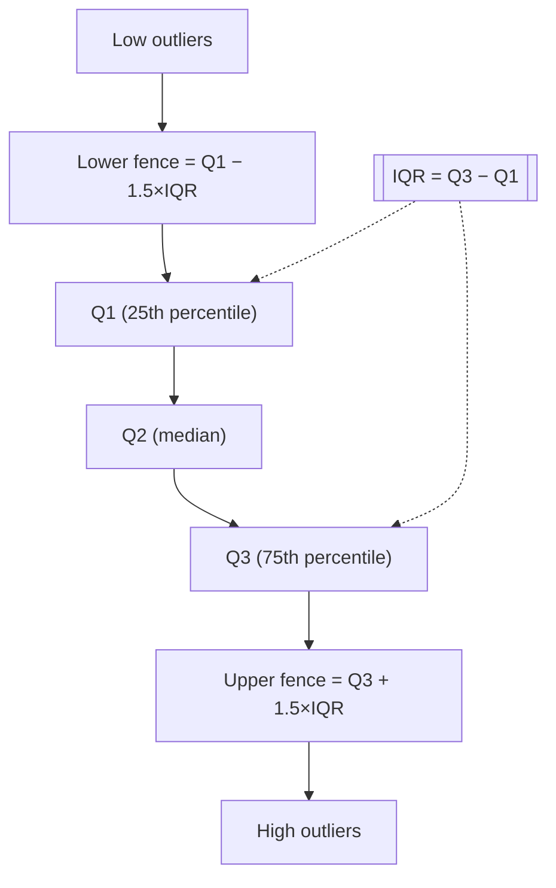

### Lab Exercise

```sql
-- IQR-based outlier flagging on order totals
WITH q AS (
  SELECT
    PERCENTILE_CONT(0.25) WITHIN GROUP (ORDER BY O_TOTALPRICE) AS q1,
    PERCENTILE_CONT(0.75) WITHIN GROUP (ORDER BY O_TOTALPRICE) AS q3
  FROM SNOWFLAKE_SAMPLE_DATA.TPCH_SF1.ORDERS
)
SELECT o.*,
    CASE
      WHEN O_TOTALPRICE < q.q1 - 1.5*(q.q3-q.q1) THEN 'low_outlier'
      WHEN O_TOTALPRICE > q.q3 + 1.5*(q.q3-q.q1) THEN 'high_outlier'
      ELSE 'normal'
    END AS outlier_flag
FROM SNOWFLAKE_SAMPLE_DATA.TPCH_SF1.ORDERS o
CROSS JOIN q
WHERE outlier_flag != 'normal';

-- Z-score with window function
SELECT
  O_ORDERKEY,
  O_TOTALPRICE,
  (O_TOTALPRICE - AVG(O_TOTALPRICE) OVER ())
    / NULLIF(STDDEV(O_TOTALPRICE) OVER (),0) AS zscore
FROM SNOWFLAKE_SAMPLE_DATA.TPCH_SF1.ORDERS
QUALIFY ABS(zscore) > 3;
```

### Gotchas / Exam Traps

- IQR constants (1.5 for mild, 3.0 for extreme) are conventions, not statistical laws.
- Z-score is sensitive to the outliers themselves — one huge outlier pulls both mean and stddev, hiding other outliers.
- Always inspect flagged rows before deleting — many "outliers" are the most interesting rows.

---

## Q9: What is `APPROX_TOP_K` and how does it beat `GROUP BY ... ORDER BY COUNT(*) DESC LIMIT k`?
**Difficulty:** Intermediate
**Exam relevance:** Dataset profiling, descriptive statistics

### Answer

`APPROX_TOP_K(col, k, counters)` returns the k most frequent values and their approximate counts using the SpaceSaving algorithm. Beats exact GROUP BY when:

- Cardinality is extreme (billions of distinct values).
- You only need the heavy hitters, not the full histogram.
- Memory is constrained (SpaceSaving uses O(counters) memory, independent of cardinality).

### First Principles

GROUP BY must build a hash table of *all* distinct values, then sort by count — O(N) memory. SpaceSaving maintains only `counters` buckets; when a new value arrives, it evicts the current min-count bucket, inheriting its count as a confidence bound. The theoretical guarantee: any value appearing more than `N/counters` times is guaranteed to be in the output.

### Diagram

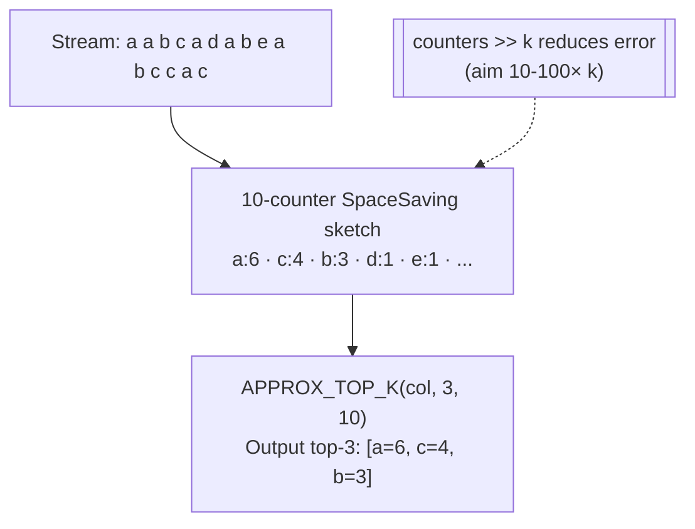

### Lab Exercise

```sql
-- Top 10 parts by order frequency on LINEITEM
SELECT APPROX_TOP_K(L_PARTKEY, 10, 1000) AS top_parts
FROM SNOWFLAKE_SAMPLE_DATA.TPCH_SF10.LINEITEM;

-- Compare with exact
SELECT L_PARTKEY, COUNT(*) cnt
FROM SNOWFLAKE_SAMPLE_DATA.TPCH_SF10.LINEITEM
GROUP BY L_PARTKEY
ORDER BY cnt DESC
LIMIT 10;

-- Per-segment top customers (approx)
SELECT C_MKTSEGMENT, APPROX_TOP_K(C_CUSTKEY, 5, 500) AS top5
FROM SNOWFLAKE_SAMPLE_DATA.TPCH_SF1.CUSTOMER
JOIN SNOWFLAKE_SAMPLE_DATA.TPCH_SF1.ORDERS USING (C_CUSTKEY)
GROUP BY C_MKTSEGMENT;
```

### Gotchas / Exam Traps

- The third argument `counters` must be ≥ `k`. Setting counters close to k gives poor accuracy; aim for 10-100× k.
- Return type is ARRAY of OBJECT `{value, estimate}`, not a tabular result. Use `FLATTEN` to tabularize.
- Non-deterministic — results can differ across runs on identical data.

---

## Q10: How do you compute a histogram in Snowflake?
**Difficulty:** Intermediate
**Exam relevance:** Dataset profiling

### Answer

Two main approaches:

1. **Equal-width bins** — `WIDTH_BUCKET(expr, min, max, num_buckets)` returns the bucket index 1..num_buckets.
2. **Equal-frequency bins (quantile)** — `NTILE(n) OVER (ORDER BY col)` splits rows into n equal-size groups.
3. **Approximate histogram** — `APPROX_PERCENTILE_ACCUMULATE` / `APPROX_PERCENTILE_ESTIMATE` for incremental maintenance.

### First Principles

Equal-width bins preserve the shape of the distribution (useful for visualizing skew). Equal-frequency bins give each bucket the same count (useful for discretizing a continuous feature for modeling). They tell different stories: a right-skewed distribution with equal-width looks like exponential decay; with equal-frequency, it looks uniform.

### Diagram

```mermaid
flowchart TD
    subgraph EW["EQUAL-WIDTH (width_bucket)"]
        EW1["1 [0-10] : ######## (8 rows)"]
        EW2["2 [10-20] : ##### (5 rows)"]
        EW3["3 [20-30] : ## (2 rows)"]
        EW4["4 [30-40] : # (1 row)"]
        EW5["5 [40-50] : (0 rows)"]
        EW1 --> EW2 --> EW3 --> EW4 --> EW5
    end
    subgraph EF["EQUAL-FREQUENCY (ntile)"]
        EF1["1 [p0-p25] : ### (equal count, width 10)"]
        EF2["2 [p25-p50] : ### (equal count, width 18)"]
        EF3["3 [p50-p75] : ### (equal count, width 28)"]
        EF4["4 [p75-p100] : ### (equal count, width 60)"]
        EF1 --> EF2 --> EF3 --> EF4
    end
```

### Lab Exercise

```sql
-- Equal-width histogram of order totals
SELECT
    WIDTH_BUCKET(O_TOTALPRICE, 0, 500000, 10) AS bucket,
    MIN(O_TOTALPRICE) AS bucket_lo,
    MAX(O_TOTALPRICE) AS bucket_hi,
    COUNT(*)          AS freq
FROM SNOWFLAKE_SAMPLE_DATA.TPCH_SF1.ORDERS
GROUP BY bucket ORDER BY bucket;

-- Equal-frequency decile analysis
SELECT
    NTILE(10) OVER (ORDER BY O_TOTALPRICE) AS decile,
    MIN(O_TOTALPRICE) AS lo,
    MAX(O_TOTALPRICE) AS hi,
    COUNT(*)          AS cnt
FROM SNOWFLAKE_SAMPLE_DATA.TPCH_SF1.ORDERS
GROUP BY decile ORDER BY decile;
```

### Gotchas / Exam Traps

- `WIDTH_BUCKET` returns 0 for values below `min` and `num_buckets+1` for values above `max` — never NULL. Handle these overflow buckets explicitly.
- `NTILE` is not deterministic for ties — rows with the same value may land in different buckets.
- Many analysts forget to coerce types; integer division truncates bucket widths.

---

## Q11: What are descriptive vs. inferential statistics and what Snowflake functions support each?
**Difficulty:** Foundation
**Exam relevance:** Analytical workflows

### Answer

- **Descriptive** = summarize what the data contains. `COUNT`, `AVG`, `STDDEV`, `MEDIAN`, `PERCENTILE_CONT`, `MIN`, `MAX`, `CORR`.
- **Inferential** = generalize from sample to population. Confidence intervals, hypothesis tests, forecasting. Snowflake supports via Cortex ML (`FORECAST`, `ANOMALY_DETECTION`) and user-defined logic (bootstrap sampling, z-tests via SQL).

### First Principles

Descriptive stats *describe* — they don't claim anything beyond the data at hand. Inferential stats *infer* — they bridge sample to population under assumptions (random sampling, independence, distribution). Confusing them is a classic analytical error: reporting that "average order value is $100" is descriptive; claiming "the population average is $100 ± $5" requires inference.

### Diagram

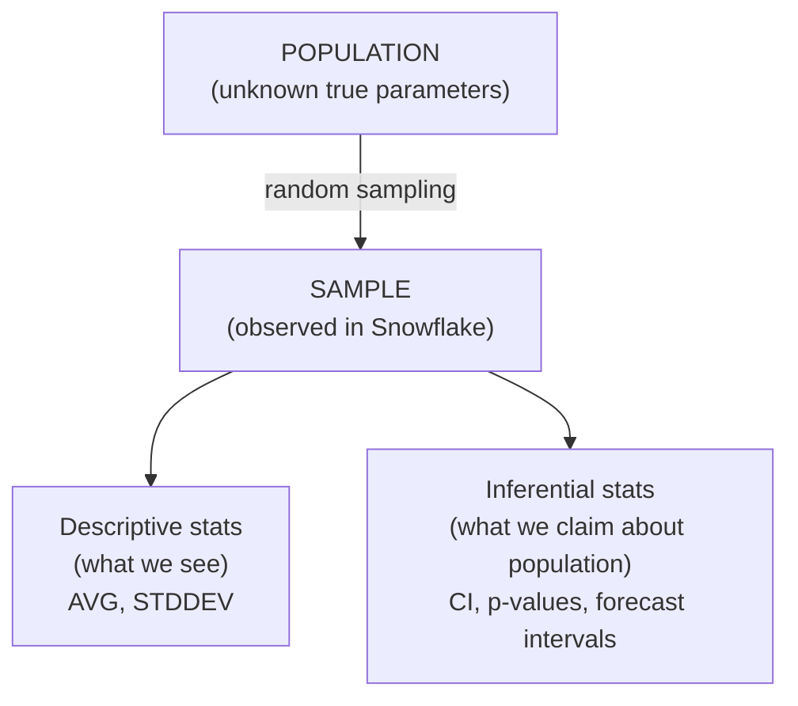

### Lab Exercise

```sql
-- Descriptive summary
SELECT
    COUNT(*) n,
    AVG(O_TOTALPRICE)        mean,
    STDDEV(O_TOTALPRICE)     sd,
    MEDIAN(O_TOTALPRICE)     med
FROM SNOWFLAKE_SAMPLE_DATA.TPCH_SF1.ORDERS;

-- Inferential: 95% confidence interval for mean
WITH s AS (
  SELECT COUNT(*) n, AVG(O_TOTALPRICE) mu, STDDEV(O_TOTALPRICE) sd
  FROM SNOWFLAKE_SAMPLE_DATA.TPCH_SF1.ORDERS
)
SELECT mu, mu - 1.96*sd/SQRT(n) lo, mu + 1.96*sd/SQRT(n) hi
FROM s;
```

### Gotchas / Exam Traps

- `STDDEV` in Snowflake defaults to **sample stddev** (`STDDEV_SAMP`), not population. For population, use `STDDEV_POP`.
- Confidence intervals require i.i.d. assumption — violated when rows are time-correlated.

---

## Q12: What is `MODE` in SQL and how do you compute it in Snowflake?
**Difficulty:** Foundation
**Exam relevance:** Descriptive statistics

### Answer

Snowflake has `MODE(col)` as an aggregate (added 2023) that returns the most frequent value. For ties, it returns one arbitrary mode. If you need all modes or counts, use a `GROUP BY` + `QUALIFY RANK() OVER` pattern.

### First Principles

Mode is the only measure of central tendency defined for categorical data (nominal variables). You cannot compute mean of "red / blue / green." Mode is also useful for highly skewed numeric data where mean/median mislead (e.g., viral content where mode = 0 shares, but mean = 50).

### Diagram

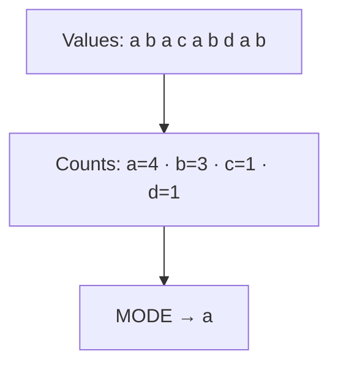

### Lab Exercise

```sql
-- Modal market segment per nation
SELECT N_NAME, MODE(C_MKTSEGMENT) AS modal_segment
FROM SNOWFLAKE_SAMPLE_DATA.TPCH_SF1.CUSTOMER
JOIN SNOWFLAKE_SAMPLE_DATA.TPCH_SF1.NATION ON C_NATIONKEY = N_NATIONKEY
GROUP BY N_NAME;

-- All ties with explicit counts
WITH counts AS (
  SELECT C_MKTSEGMENT, COUNT(*) cnt
  FROM SNOWFLAKE_SAMPLE_DATA.TPCH_SF1.CUSTOMER
  GROUP BY C_MKTSEGMENT)
SELECT * FROM counts
QUALIFY RANK() OVER (ORDER BY cnt DESC) = 1;
```

### Gotchas / Exam Traps

- `MODE` returns NULL if all input values are NULL (not if there's no clear mode).
- For bimodal distributions, `MODE` arbitrarily chooses — the result is not deterministic.

---

## Q13: Describe the difference between `SKEW` and `KURTOSIS` and when they matter.
**Difficulty:** Advanced
**Exam relevance:** Descriptive statistics

### Answer

- `SKEW(col)` — third standardized moment; measures asymmetry. Positive = right-tailed, negative = left-tailed.
- `KURTOSIS(col)` — fourth standardized moment (excess, so normal = 0). Positive = heavy tails, negative = light tails.

Together they diagnose how far a distribution deviates from normal — critical before applying Z-score outlier detection or any method assuming normality.

### First Principles

Mean and variance don't tell you distribution shape. A log-normal distribution can share mean/variance with a normal distribution yet have skew = 1.1 and kurtosis = 2.5 (heavier right tail). Running "mean ± 2σ captures 95%" fails if the distribution has kurtosis of 5.

### Diagram

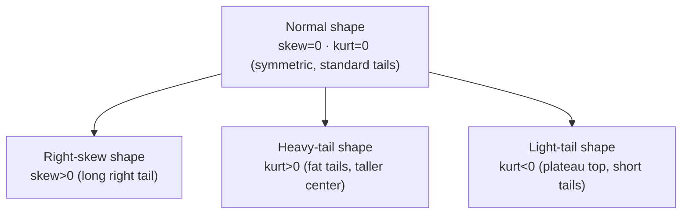

### Lab Exercise

```sql
-- Shape stats on LINEITEM extended price
SELECT
    AVG(L_EXTENDEDPRICE)      mu,
    STDDEV(L_EXTENDEDPRICE)   sd,
    SKEW(L_EXTENDEDPRICE)     skew_,
    KURTOSIS(L_EXTENDEDPRICE) kurt_
FROM SNOWFLAKE_SAMPLE_DATA.TPCH_SF1.LINEITEM;

-- Decision tree: if |skew| > 1 or kurt > 3, use robust methods
```

### Gotchas / Exam Traps

- Snowflake's `KURTOSIS` returns **excess** kurtosis (normal = 0, not 3). Some tools report raw kurtosis (normal = 3). Be careful comparing.
- Both are highly sensitive to outliers — remove or winsorize before measuring shape.

---

## Q14: How does an analyst use `GET_DDL`, `DESCRIBE`, and `SHOW` effectively during discovery?
**Difficulty:** Foundation
**Exam relevance:** Dataset discovery

### Answer

- `SHOW` — lists objects (tables, views, columns, grants) in a namespace. Returns a result set you can post-process via `RESULT_SCAN`.
- `DESCRIBE TABLE t` — shows column definitions, types, defaults.
- `GET_DDL('TABLE', 't')` — returns full CREATE statement, including clustering key, constraints, comments.

Use in sequence: `SHOW` to find, `DESCRIBE` for columns, `GET_DDL` for the full picture.

### First Principles

These three commands never touch data — they read the metadata layer (FoundationDB). They are near-instant and warehouse-independent (no credits consumed for the metadata ops themselves). This makes them the right first tool: never scan a table before understanding its shape.

### Lab Exercise

```sql
-- Chain SHOW with RESULT_SCAN for analytical workflow
SHOW TABLES IN SCHEMA SNOWFLAKE_SAMPLE_DATA.TPCH_SF1;
SELECT "name", "rows", "bytes"
FROM TABLE(RESULT_SCAN(LAST_QUERY_ID()))
WHERE "rows" > 1000000;

DESCRIBE TABLE SNOWFLAKE_SAMPLE_DATA.TPCH_SF1.LINEITEM;

SELECT GET_DDL('TABLE', 'SNOWFLAKE_SAMPLE_DATA.TPCH_SF1.LINEITEM');
```

### Gotchas / Exam Traps

- Column names from `SHOW` are **quoted strings** (lowercase) — e.g., `"rows"` not `ROWS`.
- `SHOW` default limit is 10,000 rows — use `LIMIT` explicitly for larger metadata scans.
- `GET_DDL` requires appropriate privileges (`USAGE` on database and schema).

---

## Q15: What are "data profiling" views in `SNOWFLAKE.ACCOUNT_USAGE` and when should an analyst query them?
**Difficulty:** Advanced
**Exam relevance:** Dataset profiling

### Answer

Key views:

- `ACCESS_HISTORY` — who queried which columns (great for finding popular data).
- `OBJECT_DEPENDENCIES` — table ↔ view ↔ UDF relationships.
- `QUERY_HISTORY` — see common query patterns on a table.
- `TAG_REFERENCES` — business classifications applied to columns.
- `TABLE_STORAGE_METRICS` — size over time.

Use for: finding which tables are actively used, identifying stale/unused tables, discovering column lineage.

### First Principles

Metadata about *usage* is itself data. By asking "which tables do my colleagues query most?" you accelerate discovery dramatically. This is especially powerful in large accounts where thousands of tables exist and names are not self-explanatory.

### Lab Exercise

```sql
-- Most-queried tables in last 30 days
SELECT
  OBJECTS_ACCESSED[0]:objectName::STRING AS object_name,
  COUNT(*) AS access_count
FROM SNOWFLAKE.ACCOUNT_USAGE.ACCESS_HISTORY
WHERE QUERY_START_TIME > DATEADD('day', -30, CURRENT_TIMESTAMP)
GROUP BY 1 ORDER BY access_count DESC LIMIT 20;

-- Who uses my analytics table?
SELECT DISTINCT USER_NAME
FROM SNOWFLAKE.ACCOUNT_USAGE.ACCESS_HISTORY,
     LATERAL FLATTEN(OBJECTS_ACCESSED)
WHERE VALUE:objectName::STRING = 'ANALYTICS.PROD.ORDERS_DAILY';
```

### Gotchas / Exam Traps

- `ACCOUNT_USAGE` latency: 45 minutes to 3 hours. Use `INFORMATION_SCHEMA` for real-time.
- `ACCESS_HISTORY` is Enterprise+ edition only.
- `OBJECTS_ACCESSED` is a VARIANT array — must FLATTEN to filter.

---

## Q16: What is `TRY_CAST` and how is it foundational for data quality workflows?
**Difficulty:** Foundation
**Exam relevance:** Data preparation, data quality

### Answer

`TRY_CAST(expr AS type)` attempts the cast and returns NULL on failure, unlike `CAST`/`::` which errors. Essential for ingesting messy data where some strings aren't valid dates/numbers.

### First Principles

In an analytical pipeline, one bad row shouldn't fail the entire query. `TRY_CAST` moves the error from "query dies" to "data is NULL," which can then be counted, logged, and investigated. It is the SQL equivalent of defensive programming.

### Lab Exercise

```sql
-- Robust ingestion of string dates
WITH raw AS (
  SELECT * FROM VALUES
    ('2024-01-15'),('2024/02/30'),('not a date'),('2024-03-15')
  AS t(d_str))
SELECT
  d_str,
  TRY_CAST(d_str AS DATE)      AS d_parsed,
  TRY_TO_DATE(d_str,'YYYY-MM-DD') AS d_strict
FROM raw;
```

### Gotchas / Exam Traps

- `TRY_CAST` returns NULL even for invalid-but-plausible inputs (e.g., Feb 30).
- Use `TRY_TO_DATE`, `TRY_TO_NUMBER`, `TRY_TO_TIMESTAMP` for format-aware parsing.

---

## Q17: How do analysts handle NULL semantics in aggregations and comparisons?
**Difficulty:** Foundation
**Exam relevance:** Data preparation

### Answer

- Aggregates (`SUM`, `AVG`, `COUNT(col)`) **skip NULLs** silently.
- `COUNT(*)` counts all rows including those with NULL columns.
- `NULL = NULL` is NULL (not TRUE). Use `IS NULL` / `IS NOT NULL` or `EQUAL_NULL(a, b)` for null-safe equality.
- NULL in a GROUP BY becomes its own group.
- `COALESCE`, `IFNULL`, `NVL` substitute NULLs.

### First Principles

NULL means "unknown," not "missing" or "zero." Treating it as zero in a `SUM` or as a value in equality tests silently produces wrong answers. Snowflake follows SQL standard three-valued logic (TRUE/FALSE/NULL), which is why `WHERE col = NULL` never matches.

### Lab Exercise

```sql
-- NULL safety
SELECT AVG(COALESCE(O_CLERK, 'UNKNOWN')) FROM ... ; -- wrong, averaging strings
-- Correct:
SELECT COUNT_IF(O_CLERK IS NULL)   nulls,
       COUNT_IF(O_CLERK IS NOT NULL) non_nulls
FROM SNOWFLAKE_SAMPLE_DATA.TPCH_SF1.ORDERS;

-- Null-safe join
SELECT a.*, b.*
FROM a FULL JOIN b ON EQUAL_NULL(a.id, b.id);
```

### Gotchas / Exam Traps

- `COUNT(DISTINCT col)` does **not** count NULL as a distinct value.
- `col NOT IN (subquery)` returns NULL (not false) if the subquery contains NULL — a common bug.

---

## Q18: What is a "fact" vs "dimension" and how does an analyst recognize each in a schema?
**Difficulty:** Foundation
**Exam relevance:** Analytical workflows, schema literacy

### Answer

- **Fact** — grain of measurement; rows represent events or transactions (ORDERS, LINEITEM, CLICKS). Columns include numeric measures (quantity, amount) and foreign keys to dimensions.
- **Dimension** — descriptive context (CUSTOMER, PRODUCT, DATE). Rows are entities, usually fewer and slower-changing.

Recognize by: fact tables are large, have surrogate/FK columns and numeric metrics; dimensions are smaller with descriptive attributes.

### First Principles

Star schemas are optimized for analytical queries: fact tables scan efficiently via columnar compression and are joined to small dimension tables that fit in cache. Knowing which is which tells you where to apply filters (dimension) vs. aggregations (fact).

### Diagram

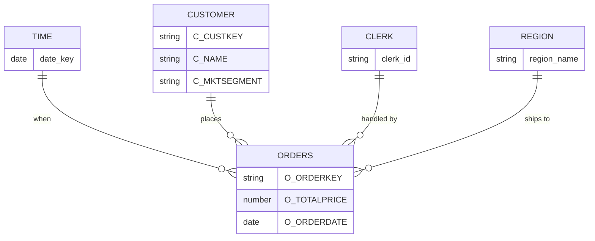

### Lab Exercise

```sql
-- Identify fact vs dimension by row count ratio
SELECT table_name, row_count
FROM SNOWFLAKE_SAMPLE_DATA.TPCH_SF1.INFORMATION_SCHEMA.TABLES
ORDER BY row_count DESC;
-- LINEITEM (~6M), ORDERS (~1.5M) are facts
-- NATION (25), REGION (5) are dimensions
```

### Gotchas / Exam Traps

- Not all schemas are strict star — some are snowflake (normalized dimensions). TPCH is a snowflake schema.
- A table can serve as fact in one analysis and dimension in another (e.g., ORDERS as fact for LINEITEM analysis).

---

## Q19: How do you compute percentile ranks and z-scores within groups?
**Difficulty:** Intermediate
**Exam relevance:** Descriptive statistics, advanced SQL preview

### Answer

Use window functions:

- `PERCENT_RANK() OVER (PARTITION BY grp ORDER BY col)` — returns rank in [0,1].
- `CUME_DIST() OVER (PARTITION BY grp ORDER BY col)` — cumulative distribution.
- `NTILE(n) OVER (PARTITION BY grp ORDER BY col)` — bucket index.
- For z-score: `(col - AVG(col) OVER (PARTITION BY grp)) / STDDEV(col) OVER (PARTITION BY grp)`.

### Lab Exercise

```sql
-- Per-segment customer z-score on account balance
SELECT
  C_CUSTKEY,
  C_MKTSEGMENT,
  C_ACCTBAL,
  (C_ACCTBAL - AVG(C_ACCTBAL) OVER (PARTITION BY C_MKTSEGMENT))
  / NULLIF(STDDEV(C_ACCTBAL) OVER (PARTITION BY C_MKTSEGMENT),0) AS zscore,
  PERCENT_RANK() OVER (PARTITION BY C_MKTSEGMENT ORDER BY C_ACCTBAL) AS pct_rank
FROM SNOWFLAKE_SAMPLE_DATA.TPCH_SF1.CUSTOMER;
```

### Gotchas / Exam Traps

- `PERCENT_RANK` returns 0 for the smallest value and 1 for the largest (not centered on 0.5).
- `CUME_DIST` is monotonic non-decreasing; use when you want "fraction of rows at or below."

---

## Q20: What is the role of `RESULT_SCAN` and the result cache in iterative EDA?
**Difficulty:** Intermediate
**Exam relevance:** EDA efficiency

### Answer

Snowflake caches query results for 24 hours (reset on each table modification). `RESULT_SCAN(query_id)` lets you query a prior result set as a table, enabling iterative pivoting without re-scanning the source.

### First Principles

EDA is iterative: you look at a result, ask a follow-up question. Re-running the base query wastes credits. `RESULT_SCAN` promotes the result to a queryable artifact for free, letting you filter, pivot, or aggregate the cached output.

### Lab Exercise

```sql
-- Base query: expensive aggregation
SELECT
    O_ORDERSTATUS, O_ORDERPRIORITY,
    COUNT(*) cnt, SUM(O_TOTALPRICE) total
FROM SNOWFLAKE_SAMPLE_DATA.TPCH_SF10.ORDERS
GROUP BY 1, 2;

-- Reuse via RESULT_SCAN
SELECT O_ORDERSTATUS, SUM(cnt) total_cnt
FROM TABLE(RESULT_SCAN(LAST_QUERY_ID()))
GROUP BY 1;
```

### Gotchas / Exam Traps

- Result cache invalidated by any DML on queried tables (not just the specific rows).
- Session-scoped `LAST_QUERY_ID()` returns NULL in a new session — use the actual UUID.
- 24-hour TTL extended to 31 days if the result is reused.

---
