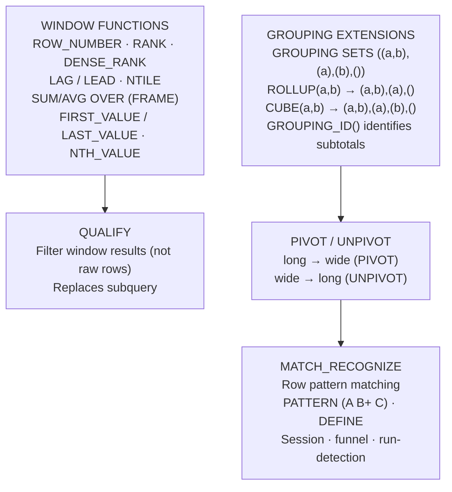
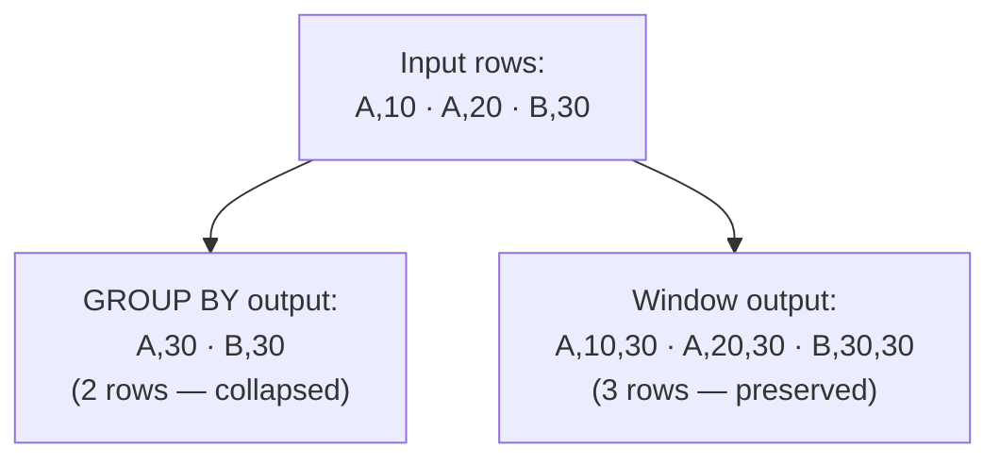
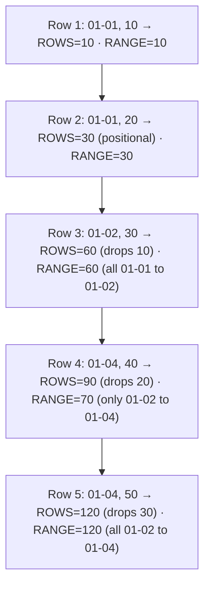
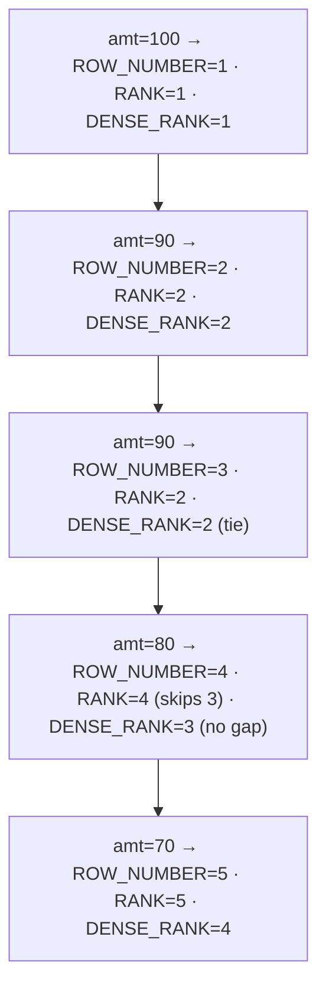
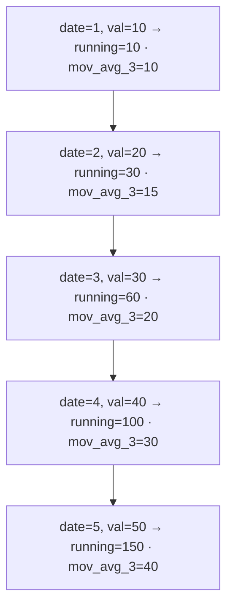
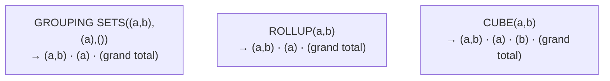
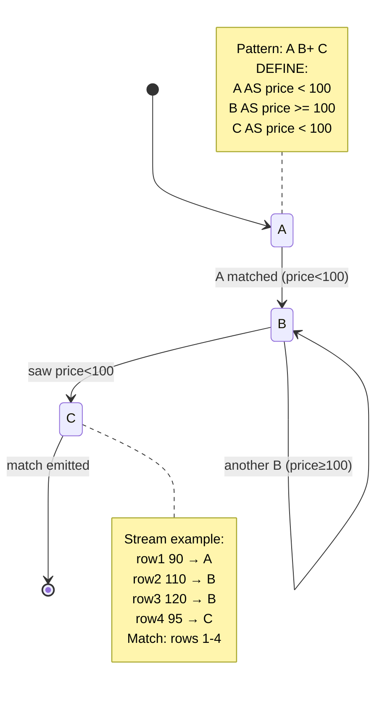

# Advanced SQL Analytics — DAA-C01 Study Guide

## Exam Weight & Scope

Approximately 25-30% of DAA-C01 — the largest domain. Covers window functions, grouping extensions (ROLLUP/CUBE/GROUPING SETS), PIVOT/UNPIVOT, QUALIFY, and MATCH_RECOGNIZE. Expect heavy syntax questions: given a problem, pick the right windowing frame, interpret `GROUPING_ID`, or write a `MATCH_RECOGNIZE` pattern for sessionization.

## Core Concepts Map



---

## Q1: What is a window function and how does it differ from a GROUP BY aggregate?
**Difficulty:** Foundation
**Exam relevance:** Window functions

### Answer

A window function computes an aggregate (or ranking/positional value) over a defined "window" of rows **without collapsing rows**. GROUP BY reduces N rows to G groups; window functions return N rows with G aggregated values attached.

Syntax: `function() OVER (PARTITION BY ... ORDER BY ... ROWS/RANGE BETWEEN ... AND ...)`.

### First Principles

The common analytical pattern "compare each row to its group's aggregate" (e.g., "customer order vs. their average") previously required a self-join: expensive, verbose, error-prone. Window functions compute the aggregate once per partition and broadcast to each row — a single pass through the data. The columnar engine makes this cheap because the aggregated column is scanned once.

### Diagram



### Lab Exercise

```sql
-- Each order's share of its customer's lifetime spend
SELECT
  O_CUSTKEY,
  O_ORDERKEY,
  O_TOTALPRICE,
  SUM(O_TOTALPRICE) OVER (PARTITION BY O_CUSTKEY) AS cust_lifetime,
  O_TOTALPRICE / NULLIF(SUM(O_TOTALPRICE)
                        OVER (PARTITION BY O_CUSTKEY),0) AS share
FROM SNOWFLAKE_SAMPLE_DATA.TPCH_SF1.ORDERS;
```

### Gotchas / Exam Traps

- Omit `ORDER BY` and the frame defaults to the **entire partition** — fine for SUM/AVG, broken for ranking.
- Window functions execute **after** WHERE but **before** QUALIFY and SELECT list evaluation — so you cannot reference a window alias in WHERE.
- `OVER ()` with no partition means the whole result set.

---

## Q2: Explain the window frame clause: ROWS BETWEEN vs. RANGE BETWEEN.
**Difficulty:** Intermediate
**Exam relevance:** Window frames

### Answer

- `ROWS BETWEEN` — frame is positional, counted in rows. `ROWS BETWEEN 2 PRECEDING AND CURRENT ROW` = 3-row window.
- `RANGE BETWEEN` — frame is value-based, defined by the ORDER BY expression. `RANGE BETWEEN INTERVAL '7 DAYS' PRECEDING AND CURRENT ROW` captures all rows in the previous week.

Default frame when ORDER BY present but no frame specified: `RANGE BETWEEN UNBOUNDED PRECEDING AND CURRENT ROW`.

### First Principles

ROWS handles ties by position (which is often arbitrary); RANGE handles ties by value (which respects the semantic ordering). For running totals, RANGE is more natural when ties exist — all rows with the same date get the same running total. For moving averages, ROWS is clearer — "last 7 observations" regardless of their values.

### Diagram



### Lab Exercise

```sql
-- 7-row rolling average vs 7-day rolling average
SELECT
  O_ORDERDATE,
  COUNT(*) daily_orders,
  AVG(COUNT(*)) OVER (
    ORDER BY O_ORDERDATE
    ROWS BETWEEN 6 PRECEDING AND CURRENT ROW
  ) AS rolling_7row,
  AVG(COUNT(*)) OVER (
    ORDER BY O_ORDERDATE
    RANGE BETWEEN INTERVAL '6 DAYS' PRECEDING AND CURRENT ROW
  ) AS rolling_7day
FROM SNOWFLAKE_SAMPLE_DATA.TPCH_SF1.ORDERS
GROUP BY O_ORDERDATE;
```

### Gotchas / Exam Traps

- `RANGE BETWEEN n PRECEDING AND CURRENT ROW` works only with a numeric or date ORDER BY column.
- Default frame is **RANGE** not ROWS — this causes subtle bugs when the ORDER BY has duplicates (all duplicates share the same aggregate).
- Named frame windows via `WINDOW w AS (...)` improves readability for repeated frames.

---

## Q3: Compare ROW_NUMBER, RANK, DENSE_RANK, and PERCENT_RANK.
**Difficulty:** Foundation
**Exam relevance:** Ranking functions

### Answer

| Function | Ties handling | Gap? |
|----------|---------------|------|
| `ROW_NUMBER()` | Arbitrary 1,2,3 regardless of ties | No gaps |
| `RANK()` | Same rank for ties, skip next | Gaps after ties |
| `DENSE_RANK()` | Same rank for ties, next = +1 | No gaps |
| `PERCENT_RANK()` | (RANK-1) / (total-1), range [0,1] | — |

### Diagram



### Lab Exercise

```sql
-- Top 3 customers per nation (handle ties properly)
SELECT *
FROM (
  SELECT
    N_NAME, C_NAME, C_ACCTBAL,
    RANK() OVER (PARTITION BY N_NAME ORDER BY C_ACCTBAL DESC) AS rnk
  FROM SNOWFLAKE_SAMPLE_DATA.TPCH_SF1.CUSTOMER
  JOIN SNOWFLAKE_SAMPLE_DATA.TPCH_SF1.NATION ON C_NATIONKEY = N_NATIONKEY)
WHERE rnk <= 3;
```

### Gotchas / Exam Traps

- Picking "top N per group" with `ROW_NUMBER() = 1` quietly drops ties; `RANK() = 1` keeps them.
- `ROW_NUMBER()` without ORDER BY is **not deterministic** — Snowflake assigns in indeterminate order.
- `QUALIFY` can filter on the window alias directly without a subquery.

---

## Q4: What is QUALIFY and why does it beat subqueries for filtering window results?
**Difficulty:** Intermediate
**Exam relevance:** QUALIFY clause

### Answer

`QUALIFY` filters rows based on window function results, analogous to how `HAVING` filters GROUP BY results. Snowflake-specific; replaces the common `SELECT ... FROM (SELECT ..., ROW_NUMBER()...) WHERE rn = 1` pattern.

Execution order: `FROM -> WHERE -> GROUP BY -> HAVING -> WINDOW -> QUALIFY -> SELECT -> ORDER BY -> LIMIT`.

### First Principles

Without QUALIFY, you must materialize the window result in a subquery before filtering, which forces a logical pass boundary. QUALIFY is syntactic sugar that keeps the pipeline flat, making SQL more readable and easier to maintain.

### Lab Exercise

```sql
-- Classic: last order per customer
SELECT *
FROM SNOWFLAKE_SAMPLE_DATA.TPCH_SF1.ORDERS
QUALIFY ROW_NUMBER() OVER (
  PARTITION BY O_CUSTKEY ORDER BY O_ORDERDATE DESC
) = 1;

-- Equivalent without QUALIFY (verbose)
SELECT * FROM (
  SELECT *, ROW_NUMBER() OVER (
    PARTITION BY O_CUSTKEY ORDER BY O_ORDERDATE DESC) rn
  FROM SNOWFLAKE_SAMPLE_DATA.TPCH_SF1.ORDERS)
WHERE rn = 1;

-- QUALIFY with aliased window
SELECT O_CUSTKEY, O_ORDERDATE,
  ROW_NUMBER() OVER (PARTITION BY O_CUSTKEY ORDER BY O_ORDERDATE DESC) rn
FROM SNOWFLAKE_SAMPLE_DATA.TPCH_SF1.ORDERS
QUALIFY rn = 1;
```

### Gotchas / Exam Traps

- QUALIFY requires at least one window function in the query (SELECT list or QUALIFY itself).
- QUALIFY runs **after** SELECT alias resolution but **before** ORDER BY/LIMIT.
- You cannot use QUALIFY with GROUP BY and no window — use HAVING for group filters.

---

## Q5: Explain LAG and LEAD — syntax, offset, default, and typical use cases.
**Difficulty:** Intermediate
**Exam relevance:** Window functions

### Answer

`LAG(expr, offset=1, default=NULL) OVER (PARTITION BY ... ORDER BY ...)` returns a prior row's value within the partition. `LEAD` is the mirror — looks forward.

Typical uses:

- Period-over-period changes (`current - LAG(current)`).
- Session detection (`LAG(timestamp)` to compute inter-arrival).
- Churn flags (`LEAD(active_flag)`).

### First Principles

LAG/LEAD let you align rows along the time dimension without a self-join, which would require matching every row to its predecessor via a correlated subquery. The engine does this via a single ordered pass, keeping constant memory per partition.

### Lab Exercise

```sql
-- Month-over-month revenue growth
WITH monthly AS (
  SELECT DATE_TRUNC('MONTH', O_ORDERDATE) m, SUM(O_TOTALPRICE) rev
  FROM SNOWFLAKE_SAMPLE_DATA.TPCH_SF1.ORDERS
  GROUP BY 1)
SELECT
  m, rev,
  LAG(rev) OVER (ORDER BY m) AS prev_rev,
  (rev - LAG(rev) OVER (ORDER BY m))
  / NULLIF(LAG(rev) OVER (ORDER BY m),0) * 100 AS pct_change
FROM monthly;

-- Inter-order gap per customer
SELECT
  O_CUSTKEY,
  O_ORDERDATE,
  DATEDIFF('day',
    LAG(O_ORDERDATE) OVER (PARTITION BY O_CUSTKEY ORDER BY O_ORDERDATE),
    O_ORDERDATE) AS days_since_prev
FROM SNOWFLAKE_SAMPLE_DATA.TPCH_SF1.ORDERS;
```

### Gotchas / Exam Traps

- The ORDER BY is **mandatory**; without it, LAG/LEAD is non-deterministic.
- First row's LAG is NULL unless a default is supplied: `LAG(col, 1, 0)`.
- `LAG(col, 2)` jumps 2 positions, not 1 — easy to confuse with `LAG(col) OVER (ROWS 2 PRECEDING)`.

---

## Q6: Define running total and moving average patterns with window functions.
**Difficulty:** Intermediate
**Exam relevance:** Window functions

### Answer

- **Running total**: `SUM(col) OVER (ORDER BY date ROWS UNBOUNDED PRECEDING)`.
- **Moving average**: `AVG(col) OVER (ORDER BY date ROWS BETWEEN n PRECEDING AND CURRENT ROW)`.
- **Centered moving avg**: `ROWS BETWEEN 3 PRECEDING AND 3 FOLLOWING`.

### Diagram



### Lab Exercise

```sql
WITH daily AS (
  SELECT O_ORDERDATE, SUM(O_TOTALPRICE) rev
  FROM SNOWFLAKE_SAMPLE_DATA.TPCH_SF1.ORDERS
  GROUP BY 1)
SELECT
  O_ORDERDATE, rev,
  SUM(rev) OVER (ORDER BY O_ORDERDATE
    ROWS UNBOUNDED PRECEDING)              AS running_total,
  AVG(rev) OVER (ORDER BY O_ORDERDATE
    ROWS BETWEEN 6 PRECEDING AND CURRENT ROW) AS ma_7,
  AVG(rev) OVER (ORDER BY O_ORDERDATE
    ROWS BETWEEN 29 PRECEDING AND CURRENT ROW) AS ma_30
FROM daily;
```

### Gotchas / Exam Traps

- Early rows in a moving average use incomplete windows — the first row's `ma_7` averages only 1 value. Use `WHERE ROW_NUMBER() >= n` or warm-up handling.
- `UNBOUNDED PRECEDING` with no `ORDER BY` returns NULL.
- Running totals on `TIMESTAMP` with ties: use `RANGE` for consistency across ties.

---

## Q7: What is GROUPING SETS and how does it differ from ROLLUP and CUBE?
**Difficulty:** Intermediate
**Exam relevance:** Grouping extensions

### Answer

- `GROUPING SETS ((a,b), (a), ())` — explicit list of grouping combinations.
- `ROLLUP(a,b,c)` — hierarchical: `(a,b,c), (a,b), (a), ()`. Produces subtotals and grand total.
- `CUBE(a,b)` — all combinations: `(a,b), (a), (b), ()`. 2^n groups.

Produces a single result set combining multiple aggregation levels — a single scan vs. UNION ALL of multiple queries.

### First Principles

GROUPING SETS is the general form; ROLLUP and CUBE are shortcuts. ROLLUP suits natural hierarchies (year/quarter/month) where you want subtotals at each level. CUBE suits dashboards that need every possible pivot. Using these over UNION ALL saves N-1 passes through the data — the engine scans once and produces all groupings.

### Diagram



### Lab Exercise

```sql
-- Multi-level revenue summary in one scan
SELECT
  C_MKTSEGMENT,
  N_NAME,
  SUM(O_TOTALPRICE) rev,
  GROUPING_ID(C_MKTSEGMENT, N_NAME) AS g_id
FROM SNOWFLAKE_SAMPLE_DATA.TPCH_SF1.ORDERS O
JOIN SNOWFLAKE_SAMPLE_DATA.TPCH_SF1.CUSTOMER C ON O.O_CUSTKEY=C.C_CUSTKEY
JOIN SNOWFLAKE_SAMPLE_DATA.TPCH_SF1.NATION   N ON C.C_NATIONKEY=N.N_NATIONKEY
GROUP BY GROUPING SETS ((C_MKTSEGMENT, N_NAME), (C_MKTSEGMENT), ());
```

### Gotchas / Exam Traps

- `GROUPING_ID()` returns a bitmask indicating which columns are aggregated to `ALL`.
- NULLs in grouping columns are indistinguishable from "rollup NULL" without `GROUPING_ID`.
- `ROLLUP(a,b,c)` is not the same as `ROLLUP(c,b,a)` — order matters.

---

## Q8: How does `GROUPING_ID` work and why is it essential with ROLLUP/CUBE?
**Difficulty:** Advanced
**Exam relevance:** Grouping extensions

### Answer

`GROUPING_ID(col1, col2, ...)` returns a bit-encoded integer where each bit indicates whether that column is "aggregated to all" (bit=1) in the current grouping. Essential for distinguishing a true NULL in the data from a NULL inserted by rollup.

| GROUPING_ID(a,b) | Means |
|------------------|-------|
| 0 | grouped by (a,b) |
| 1 | grouped by (a), b is subtotal |
| 2 | grouped by (b), a is subtotal |
| 3 | grand total |

### Lab Exercise

```sql
SELECT
  COALESCE(C_MKTSEGMENT, 'ALL') segment,
  COALESCE(N_NAME,       'ALL') nation,
  SUM(O_TOTALPRICE) rev,
  GROUPING_ID(C_MKTSEGMENT, N_NAME) grp_id,
  CASE GROUPING_ID(C_MKTSEGMENT, N_NAME)
    WHEN 0 THEN 'segment+nation'
    WHEN 1 THEN 'segment only'
    WHEN 2 THEN 'nation only'
    WHEN 3 THEN 'grand total'
  END AS level
FROM SNOWFLAKE_SAMPLE_DATA.TPCH_SF1.ORDERS O
JOIN SNOWFLAKE_SAMPLE_DATA.TPCH_SF1.CUSTOMER C ON O.O_CUSTKEY=C.C_CUSTKEY
JOIN SNOWFLAKE_SAMPLE_DATA.TPCH_SF1.NATION   N ON C.C_NATIONKEY=N.N_NATIONKEY
GROUP BY CUBE(C_MKTSEGMENT, N_NAME);
```

### Gotchas / Exam Traps

- Bit order: leftmost column in `GROUPING_ID(a,b)` is the **high-order** bit.
- `GROUPING(col)` (singular) returns 0 or 1 for a single column — different from `GROUPING_ID`.

---

## Q9: What does PIVOT do, and what are its syntactic requirements?
**Difficulty:** Intermediate
**Exam relevance:** PIVOT / UNPIVOT

### Answer

PIVOT rotates rows into columns — "long to wide." Requires three things:

1. An aggregate function (`SUM`, `COUNT`, `AVG`, etc.).
2. A pivot column (categorical values become column names).
3. A list of values to pivot (or `ANY ORDER BY` / `ANY` for dynamic since 2024).

Syntax: `SELECT * FROM src PIVOT (SUM(amount) FOR category IN ('A','B','C'))`.

### First Principles

Analytical workflows frequently need to compare categories side-by-side ("revenue by segment, columns = segment"). SQL by default returns long format; PIVOT handles the row-to-column transformation declaratively instead of forcing manual `SUM(CASE WHEN segment='A' THEN amt END)` for each category.

### Diagram

```mermaid
flowchart TD
    LONG["LONG format<br/>segment=BUILDING, rev=100<br/>segment=MACHINERY, rev=200<br/>segment=FURNITURE, rev=300<br/>(3 rows, 2 columns)"]
    WIDE["WIDE format (after PIVOT)<br/>'BUILDING'=100 · 'MACHINERY'=200 · 'FURNITURE'=300<br/>(1 row, 3 pivoted columns)"]
    LONG -->|PIVOT (SUM(rev) FOR segment IN (...))| WIDE
```

### Lab Exercise

```sql
-- Revenue by segment, per nation (wide format)
SELECT *
FROM (
  SELECT N_NAME, C_MKTSEGMENT, O_TOTALPRICE
  FROM SNOWFLAKE_SAMPLE_DATA.TPCH_SF1.ORDERS
  JOIN SNOWFLAKE_SAMPLE_DATA.TPCH_SF1.CUSTOMER USING (C_CUSTKEY → O_CUSTKEY)
    ON O_CUSTKEY = C_CUSTKEY
  JOIN SNOWFLAKE_SAMPLE_DATA.TPCH_SF1.NATION
    ON C_NATIONKEY = N_NATIONKEY)
PIVOT (SUM(O_TOTALPRICE) FOR C_MKTSEGMENT IN
       ('AUTOMOBILE','BUILDING','FURNITURE','HOUSEHOLD','MACHINERY'))
AS p (nation, auto_rev, bldg_rev, furn_rev, hh_rev, mach_rev);

-- Dynamic PIVOT (Snowflake-only, 2024+)
SELECT * FROM src_table
PIVOT (SUM(amount) FOR category IN (ANY ORDER BY category));
```

### Gotchas / Exam Traps

- Non-pivot, non-aggregate columns in the inner SELECT become **implicit grouping keys** — a frequent source of bugs. Project only columns you need.
- Column names from PIVOT are quoted strings — reference as `"BUILDING"` not `BUILDING`.
- Dynamic PIVOT requires full column resolution; downstream views break if new pivot values appear.

---

## Q10: What is UNPIVOT and when do you need it?
**Difficulty:** Intermediate
**Exam relevance:** PIVOT / UNPIVOT

### Answer

UNPIVOT rotates columns into rows — "wide to long." Needed when source data arrives in wide format (e.g., spreadsheet-style with `jan_sales, feb_sales, ...`) but analytical queries want tidy long format.

Syntax: `src UNPIVOT (metric_val FOR metric_name IN (col1, col2, col3))`.

### Lab Exercise

```sql
-- Convert wide monthly data to long format
WITH wide AS (SELECT * FROM VALUES
  ('North', 100, 200, 300),
  ('South', 150, 250, 350) t(region, jan, feb, mar))
SELECT * FROM wide
UNPIVOT (sales FOR month IN (jan, feb, mar));

-- Result:
-- region  month  sales
-- North   JAN    100
-- North   FEB    200
-- North   MAR    300
-- South   JAN    150
-- ...
```

### Gotchas / Exam Traps

- UNPIVOT drops rows where **all** unpivoted columns are NULL by default. Use `INCLUDE NULLS` to keep them.
- All columns in the IN list must share a compatible data type.
- Column names become uppercased string literals in the output.

---

## Q11: What is MATCH_RECOGNIZE and what analytical problems does it solve?
**Difficulty:** Advanced
**Exam relevance:** Pattern detection

### Answer

`MATCH_RECOGNIZE` is a row-pattern matching clause (SQL:2016) that finds sequences of rows matching a regex-like pattern. Solves:

- **Sessionization** — group clicks separated by < 30 min idle time.
- **Funnels** — detect page1 -> page2 -> conversion sequences.
- **Run detection** — N consecutive price increases.
- **Fraud sequences** — login -> rapid transfers -> logout.

Core components: `PARTITION BY`, `ORDER BY`, `MEASURES`, `PATTERN`, `DEFINE`, `ONE ROW PER MATCH` / `ALL ROWS PER MATCH`.

### First Principles

Pattern detection via self-joins is O(N²) and nearly impossible for variable-length patterns. MATCH_RECOGNIZE uses NFA (nondeterministic finite automaton) to process the sorted stream in one pass. Snowflake's columnar engine makes the ORDER BY cheap, and the pattern evaluates in a single sequential scan.

### Diagram



### Lab Exercise

```sql
-- Detect 3+ day consecutive stock price increases
WITH prices AS (SELECT * FROM VALUES
  ('AAPL','2024-01-01', 100),
  ('AAPL','2024-01-02', 102),
  ('AAPL','2024-01-03', 105),
  ('AAPL','2024-01-04', 108),
  ('AAPL','2024-01-05', 107),
  ('AAPL','2024-01-06', 110),
  ('AAPL','2024-01-07', 115)
  AS t(sym, dt, price))
SELECT * FROM prices
MATCH_RECOGNIZE (
  PARTITION BY sym
  ORDER BY dt
  MEASURES
    MATCH_NUMBER()        AS mn,
    FIRST(dt)             AS run_start,
    LAST(dt)              AS run_end,
    COUNT(*)              AS run_length
  ONE ROW PER MATCH
  PATTERN (UP{3,})
  DEFINE
    UP AS price > PREV(price)
);
```

### Gotchas / Exam Traps

- `PATTERN` supports regex quantifiers: `*`, `+`, `?`, `{n}`, `{n,m}`, `|`.
- `ONE ROW PER MATCH` returns summary; `ALL ROWS PER MATCH` returns every matched row with `CLASSIFIER()`.
- `AFTER MATCH SKIP` controls where to resume: `PAST LAST ROW`, `TO NEXT ROW`, `TO LAST var`.
- `PREV()` and `NEXT()` are evaluated within the pattern context — not window functions.

---

## Q12: Demonstrate sessionization with MATCH_RECOGNIZE.
**Difficulty:** Advanced
**Exam relevance:** Pattern detection, time-series analytics

### Answer

Sessionization groups events into sessions when gaps exceed a threshold. The pattern: `S+` where `S` is "within gap tolerance of previous event."

### Lab Exercise

```sql
WITH clicks AS (SELECT * FROM VALUES
  (1, '2024-01-01 09:00:00'::TIMESTAMP),
  (1, '2024-01-01 09:05:00'),
  (1, '2024-01-01 09:10:00'),  -- same session
  (1, '2024-01-01 11:00:00'),  -- new session (gap > 30 min)
  (1, '2024-01-01 11:02:00'),
  (2, '2024-01-01 10:00:00')
  AS t(user_id, ts))
SELECT * FROM clicks
MATCH_RECOGNIZE (
  PARTITION BY user_id
  ORDER BY ts
  MEASURES
    MATCH_NUMBER()  AS session_id,
    FIRST(ts)       AS session_start,
    LAST(ts)        AS session_end,
    COUNT(*)        AS clicks_in_session,
    DATEDIFF('s', FIRST(ts), LAST(ts)) AS duration_s
  ONE ROW PER MATCH
  PATTERN (S+)
  DEFINE S AS DATEDIFF('minute', PREV(ts), ts) <= 30
             OR PREV(ts) IS NULL
);
```

### Gotchas / Exam Traps

- First row has no PREV — handle with `OR PREV(ts) IS NULL`.
- `+` means one or more; `*` means zero or more — a `*` pattern can match empty sequences unexpectedly.

---

## Q13: What is the difference between `ONE ROW PER MATCH` and `ALL ROWS PER MATCH`?
**Difficulty:** Advanced
**Exam relevance:** Pattern detection

### Answer

- `ONE ROW PER MATCH` (default) — one summary row per matched sequence. Use for aggregates (session counts, run lengths).
- `ALL ROWS PER MATCH` — every row in each match, annotated with `CLASSIFIER()` (which pattern variable matched) and `MATCH_NUMBER()`.

### Lab Exercise

```sql
-- ALL ROWS: see which pattern variable each row matched
SELECT * FROM prices_table
MATCH_RECOGNIZE (
  ORDER BY dt
  MEASURES
    MATCH_NUMBER()   AS mn,
    CLASSIFIER()     AS cl
  ALL ROWS PER MATCH
  PATTERN (DOWN+ UP+)
  DEFINE
    DOWN AS price < PREV(price),
    UP   AS price > PREV(price)
);
```

### Gotchas / Exam Traps

- `ALL ROWS PER MATCH SHOW EMPTY MATCHES` includes unmatched rows (useful for debugging).
- Row expansion can balloon output — be careful on large datasets.

---

## Q14: How do you compute year-over-year change using LAG and date arithmetic?
**Difficulty:** Intermediate
**Exam relevance:** Window functions, time-series analytics

### Answer

Two patterns:

1. `LAG(amount, 12) OVER (ORDER BY month)` — assumes dense monthly data.
2. Self-join on `DATEADD('year',-1,current_month)` — robust to gaps.

### Lab Exercise

```sql
-- YoY revenue growth (dense data assumption)
WITH monthly AS (
  SELECT DATE_TRUNC('MONTH', O_ORDERDATE) m, SUM(O_TOTALPRICE) rev
  FROM SNOWFLAKE_SAMPLE_DATA.TPCH_SF1.ORDERS
  GROUP BY 1)
SELECT
  m, rev,
  LAG(rev, 12) OVER (ORDER BY m)                 AS rev_prior_yr,
  rev - LAG(rev, 12) OVER (ORDER BY m)           AS yoy_delta,
  (rev / NULLIF(LAG(rev, 12) OVER (ORDER BY m),0) - 1) * 100 AS yoy_pct
FROM monthly ORDER BY m;
```

### Gotchas / Exam Traps

- LAG(12) silently returns NULL for the first 12 rows — expected but easy to misread as "no YoY data."
- Missing months break the LAG assumption — fill with a calendar join first.

---

## Q15: What is a "gaps and islands" problem and how do you solve it in Snowflake?
**Difficulty:** Advanced
**Exam relevance:** Advanced SQL patterns

### Answer

Gaps-and-islands: find contiguous runs ("islands") in a sequence with gaps. Classic trick: compute `ROW_NUMBER() OVER (ORDER BY val) - val` or similar — the difference is constant for rows in the same island.

### Lab Exercise

```sql
-- Find runs of consecutive active days per user
WITH activity AS (SELECT * FROM VALUES
  (1, DATE'2024-01-01'), (1, DATE'2024-01-02'),
  (1, DATE'2024-01-03'), (1, DATE'2024-01-05'),
  (1, DATE'2024-01-06')
  AS t(user_id, dt))
SELECT
  user_id,
  MIN(dt) run_start,
  MAX(dt) run_end,
  COUNT(*) run_length
FROM (
  SELECT user_id, dt,
    DATEADD('day',
      -ROW_NUMBER() OVER (PARTITION BY user_id ORDER BY dt),
      dt) AS grp
  FROM activity)
GROUP BY user_id, grp;
```

### First Principles

If days are consecutive, each day is `row_number` days apart from a fixed origin — subtracting the row number from the date gives a constant per island. This classic trick avoids expensive recursive CTEs.

### Gotchas / Exam Traps

- Breaks if there are duplicate dates — `DENSE_RANK` or deduplication needed first.
- MATCH_RECOGNIZE is a cleaner alternative for complex patterns.

---

## Q16: Explain FIRST_VALUE, LAST_VALUE, and NTH_VALUE within a window.
**Difficulty:** Intermediate
**Exam relevance:** Window functions

### Answer

- `FIRST_VALUE(col) OVER (window)` — the first value in the window frame.
- `LAST_VALUE(col) OVER (window)` — the last.
- `NTH_VALUE(col, n) OVER (window)` — the nth row's value.

Critical: default frame is `RANGE UNBOUNDED PRECEDING TO CURRENT ROW` — so `LAST_VALUE` returns the **current row**, not the last of the partition. Fix: specify `ROWS BETWEEN UNBOUNDED PRECEDING AND UNBOUNDED FOLLOWING`.

### Lab Exercise

```sql
-- First and last order per customer
SELECT DISTINCT
  O_CUSTKEY,
  FIRST_VALUE(O_ORDERDATE) OVER (
    PARTITION BY O_CUSTKEY ORDER BY O_ORDERDATE
    ROWS BETWEEN UNBOUNDED PRECEDING AND UNBOUNDED FOLLOWING) AS first_order,
  LAST_VALUE(O_ORDERDATE) OVER (
    PARTITION BY O_CUSTKEY ORDER BY O_ORDERDATE
    ROWS BETWEEN UNBOUNDED PRECEDING AND UNBOUNDED FOLLOWING) AS last_order
FROM SNOWFLAKE_SAMPLE_DATA.TPCH_SF1.ORDERS;
```

### Gotchas / Exam Traps

- Without the explicit frame, `LAST_VALUE = CURRENT_VALUE` — the #1 exam trap in this area.
- `NTH_VALUE(col, n)` returns NULL if the frame has fewer than n rows.
- `FROM FIRST` / `FROM LAST` modifier controls direction of nth counting.

---

## Q17: What is `RATIO_TO_REPORT` and how does it relate to `/SUM(...)OVER()`?
**Difficulty:** Intermediate
**Exam relevance:** Window functions

### Answer

`RATIO_TO_REPORT(col) OVER (PARTITION BY ...)` returns `col / SUM(col) OVER (PARTITION BY ...)` — each row's share of its partition total. Pure syntactic sugar.

### Lab Exercise

```sql
-- Each order's % of its customer's total
SELECT
  O_CUSTKEY,
  O_ORDERKEY,
  O_TOTALPRICE,
  RATIO_TO_REPORT(O_TOTALPRICE)
    OVER (PARTITION BY O_CUSTKEY) * 100 AS pct_of_customer
FROM SNOWFLAKE_SAMPLE_DATA.TPCH_SF1.ORDERS;
```

### Gotchas / Exam Traps

- Returns NULL if the partition sum is 0.
- Equivalent to manual division but sometimes clearer in intent.

---

## Q18: Explain the execution order of SQL clauses and where window functions and QUALIFY fit.
**Difficulty:** Intermediate
**Exam relevance:** SQL semantics

### Answer

Logical order of evaluation:

```
1. FROM / JOIN         <- resolve tables
2. WHERE               <- filter raw rows
3. GROUP BY            <- group rows
4. HAVING              <- filter groups
5. WINDOW functions    <- compute over partitions
6. QUALIFY             <- filter on window results
7. SELECT (project)    <- compute output columns
8. DISTINCT
9. ORDER BY
10. LIMIT / OFFSET
```

### First Principles

Window functions see rows **after** WHERE filtering but **before** SELECT projection. QUALIFY sits between window and projection. This means: you can't reference SELECT aliases in WHERE/GROUP BY/WINDOW/QUALIFY except in Snowflake which permits lateral aliasing to a limited extent.

### Gotchas / Exam Traps

- `WHERE rank_col = 1` fails because WHERE runs before window — use QUALIFY.
- `ORDER BY` in SELECT list is cosmetic ordering; `ORDER BY` inside `OVER()` controls the window.

---

## Q19: What are `CUMULATIVE_DIST` and `NTILE`, and when to use each?
**Difficulty:** Intermediate
**Exam relevance:** Window functions

### Answer

- `CUME_DIST() OVER (ORDER BY col)` — fraction of rows with value ≤ current (0 < val ≤ 1).
- `NTILE(n) OVER (ORDER BY col)` — divides rows into n buckets of approximately equal size.

Use CUME_DIST for cumulative distribution plots or percentile ranks; use NTILE for decile analysis or quintile segmentation.

### Lab Exercise

```sql
-- Customer deciles by lifetime value
SELECT
  C_CUSTKEY,
  SUM(O_TOTALPRICE) AS ltv,
  NTILE(10) OVER (ORDER BY SUM(O_TOTALPRICE)) AS ltv_decile,
  CUME_DIST() OVER (ORDER BY SUM(O_TOTALPRICE)) AS cum_dist
FROM SNOWFLAKE_SAMPLE_DATA.TPCH_SF1.ORDERS
GROUP BY C_CUSTKEY;
```

### Gotchas / Exam Traps

- `NTILE` not deterministic for ties — rows with equal values can land in different buckets.
- `CUME_DIST` includes ties — all tied rows share the maximum cum_dist of the group.

---

## Q20: How do you use `BOOLOR_AGG`, `BOOLAND_AGG`, `BOOLXOR_AGG` for analytical boolean rollups?
**Difficulty:** Intermediate
**Exam relevance:** Aggregation functions

### Answer

- `BOOLOR_AGG(expr)` — TRUE if any value is TRUE.
- `BOOLAND_AGG(expr)` — TRUE only if all values are TRUE.
- `BOOLXOR_AGG(expr)` — TRUE if exactly one value is TRUE.

Useful for "did this customer ever buy X?" rollups.

### Lab Exercise

```sql
-- Flag customers who ever placed a MACHINERY order
SELECT
  C_CUSTKEY,
  BOOLOR_AGG(C_MKTSEGMENT = 'MACHINERY') AS ever_machinery,
  BOOLAND_AGG(O_ORDERSTATUS = 'F')       AS all_fulfilled
FROM SNOWFLAKE_SAMPLE_DATA.TPCH_SF1.ORDERS
JOIN SNOWFLAKE_SAMPLE_DATA.TPCH_SF1.CUSTOMER USING (C_CUSTKEY → O_CUSTKEY)
  ON O_CUSTKEY = C_CUSTKEY
GROUP BY C_CUSTKEY;
```

### Gotchas / Exam Traps

- `MAX(CASE WHEN ... THEN 1 ELSE 0 END) = 1` is the pre-boolean equivalent — still works but less readable.
- NULLs in boolean aggs follow three-valued logic: `BOOLAND_AGG` returns NULL if any input is NULL (unless another is FALSE).

---

## Q21: What is `LISTAGG` and how do you use `WITHIN GROUP` with it?
**Difficulty:** Intermediate
**Exam relevance:** Aggregation functions

### Answer

`LISTAGG(col, delimiter) WITHIN GROUP (ORDER BY ...)` concatenates column values across group rows into a delimited string, optionally ordered.

### Lab Exercise

```sql
-- All order dates per customer, chronological
SELECT
  C_CUSTKEY,
  LISTAGG(O_ORDERDATE, ', ')
    WITHIN GROUP (ORDER BY O_ORDERDATE)
    AS order_dates
FROM SNOWFLAKE_SAMPLE_DATA.TPCH_SF1.ORDERS
GROUP BY C_CUSTKEY;

-- As a window function
SELECT C_CUSTKEY,
  LISTAGG(O_ORDERDATE, ', ')
    WITHIN GROUP (ORDER BY O_ORDERDATE)
    OVER (PARTITION BY C_CUSTKEY) AS cust_orders
FROM SNOWFLAKE_SAMPLE_DATA.TPCH_SF1.ORDERS;
```

### Gotchas / Exam Traps

- Maximum output length is 16 MB for VARCHAR. Beyond that, you get an error — use `ARRAY_AGG` + `TO_JSON` instead.
- `DISTINCT` inside LISTAGG dedupes before concatenation.
- `WITHIN GROUP (ORDER BY ...)` is required for deterministic output ordering.

---

## Q22: Compare `ARRAY_AGG` and `OBJECT_AGG` for analytical use.
**Difficulty:** Intermediate
**Exam relevance:** Aggregation functions

### Answer

- `ARRAY_AGG(col) WITHIN GROUP (ORDER BY ...)` — collects values into a VARIANT array.
- `OBJECT_AGG(key_col, value_col)` — builds a JSON object with key-value pairs.

Both scale to much larger outputs than LISTAGG and preserve type information.

### Lab Exercise

```sql
-- Collect all order IDs per customer as an array
SELECT
  C_CUSTKEY,
  ARRAY_AGG(O_ORDERKEY) WITHIN GROUP (ORDER BY O_ORDERDATE) AS order_ids,
  ARRAY_SIZE(ARRAY_AGG(O_ORDERKEY)) AS n_orders
FROM SNOWFLAKE_SAMPLE_DATA.TPCH_SF1.ORDERS
GROUP BY C_CUSTKEY;

-- Pivot via OBJECT_AGG
SELECT
  C_MKTSEGMENT,
  OBJECT_AGG(N_NAME, revenue) AS by_nation
FROM (
  SELECT C_MKTSEGMENT, N_NAME, SUM(O_TOTALPRICE) revenue
  FROM SNOWFLAKE_SAMPLE_DATA.TPCH_SF1.ORDERS
  JOIN SNOWFLAKE_SAMPLE_DATA.TPCH_SF1.CUSTOMER ON O_CUSTKEY=C_CUSTKEY
  JOIN SNOWFLAKE_SAMPLE_DATA.TPCH_SF1.NATION   ON C_NATIONKEY=N_NATIONKEY
  GROUP BY 1, 2)
GROUP BY C_MKTSEGMENT;
```

### Gotchas / Exam Traps

- `ARRAY_AGG` without `WITHIN GROUP (ORDER BY ...)` has arbitrary order.
- `OBJECT_AGG` with duplicate keys silently keeps one — results depend on scan order.
- Max VARIANT size is 16 MB.

---
