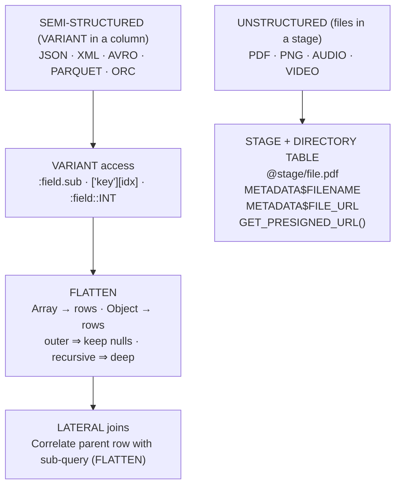
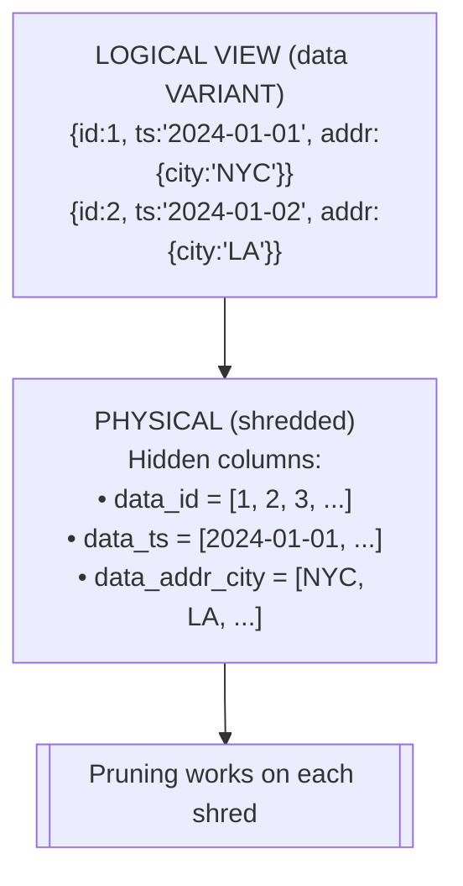
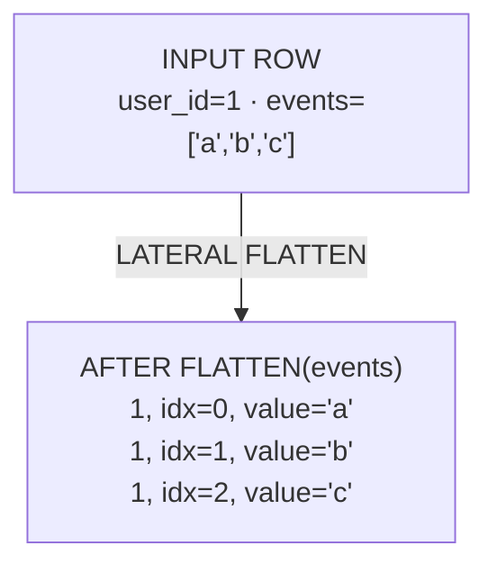
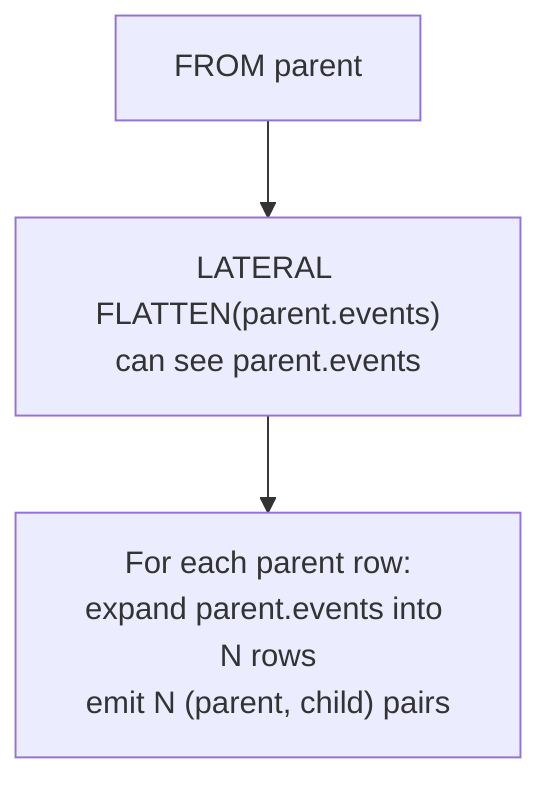

# Semi-Structured and Unstructured Data Analytics — DAA-C01 Study Guide

## Exam Weight & Scope

Approximately 15-20% of DAA-C01. Covers Snowflake's native handling of JSON, XML, Parquet, Avro, ORC via VARIANT/OBJECT/ARRAY, the FLATTEN table function, LATERAL joins, and the directory table + stage pattern for unstructured files. Expect scenario questions on dot/bracket navigation, choosing between FLATTEN and ARRAY functions, and querying file metadata.

## Core Concepts Map



---

## Q1: What is the VARIANT data type and how does Snowflake store it internally?
**Difficulty:** Foundation
**Exam relevance:** Semi-structured basics

### Answer

VARIANT is a semi-structured type holding any JSON-compatible value: object, array, string, number, boolean, null. Stored internally in a columnar, type-tagged, compressed binary format. Snowflake automatically detects repeating sub-fields and shreds them into separate columnar slices for pruning and projection pushdown.

### First Principles

Traditional databases store JSON as text — every scan parses the entire string. Snowflake's shredded storage recognizes that JSON documents in a column usually share structure. Each distinct path (e.g., `address.city`) becomes a hidden "virtual column" with its own min/max metadata. Querying `data:address.city` triggers partition pruning as if it were a top-level column, delivering columnar-level performance on semi-structured data.

### Diagram



### Lab Exercise

```sql
-- Create VARIANT, parse JSON, inspect inferred types
CREATE OR REPLACE TABLE events(data VARIANT);
INSERT INTO events SELECT PARSE_JSON('{
  "user_id": 42,
  "event": "click",
  "ts": "2024-01-15T10:00:00Z",
  "props": {"page":"home","elements":["btn","img"]}
}');

SELECT
  data:user_id::INT       AS uid,
  data:event::STRING      AS event_type,
  data:ts::TIMESTAMP_NTZ  AS event_time,
  data:props.page::STRING AS page,
  data:props.elements[0]  AS first_elem,
  TYPEOF(data:user_id)    AS inferred_type
FROM events;
```

### Gotchas / Exam Traps

- VARIANT max size is 16 MB per value.
- Always cast with `::type` for predicates — otherwise comparisons return VARIANT booleans and may not prune.
- `TYPEOF(v)` returns the inferred type (`'INTEGER'`, `'VARCHAR'`, etc.) — useful for type-dirty data.

---

## Q2: Explain the difference between OBJECT, ARRAY, and VARIANT.
**Difficulty:** Foundation
**Exam relevance:** Semi-structured basics

### Answer

- `OBJECT` — JSON object (key-value pairs). `{"a":1,"b":2}`.
- `ARRAY` — JSON array (ordered values). `[1,2,3]`.
- `VARIANT` — superset that holds OBJECT, ARRAY, or any scalar.

OBJECT and ARRAY are stricter variants of VARIANT, chosen when you want type guarantees in function signatures.

### Lab Exercise

```sql
SELECT
  OBJECT_CONSTRUCT('name','Alice','age',30)      AS obj,
  ARRAY_CONSTRUCT(1,2,3)                          AS arr,
  TO_VARIANT('any value')                         AS var;

-- Build nested
SELECT OBJECT_CONSTRUCT(
  'user', OBJECT_CONSTRUCT('id',1,'name','Alice'),
  'tags', ARRAY_CONSTRUCT('a','b','c')
) AS doc;
```

### Gotchas / Exam Traps

- `ARRAY_CONSTRUCT(NULL)` creates a 1-element array containing NULL — not an empty array. Use `ARRAY_CONSTRUCT()` (no args) for empty.
- `OBJECT_CONSTRUCT_KEEP_NULL` is needed to retain NULL-valued keys; the default drops them.

---

## Q3: How do you navigate VARIANT fields — dot, bracket, colon notation?
**Difficulty:** Foundation
**Exam relevance:** VARIANT access patterns

### Answer

| Syntax | Use |
|--------|-----|
| `col:field` | top-level field (equivalent to `col['field']`) |
| `col:field.sub` | nested object navigation |
| `col:arr[0]` | array element |
| `col:field::INT` | cast after navigation |
| `col['key with space']` | bracket for special characters |

Dot notation after the colon drills into nested objects; brackets access arrays or special-key fields.

### Lab Exercise

```sql
WITH d AS (SELECT PARSE_JSON('{
  "user":{"id":1,"name":"Alice"},
  "events":[{"type":"click"},{"type":"view"}],
  "x-forwarded-for":"1.2.3.4"
}') v)
SELECT
  v:user.id::INT                 AS uid,
  v:user:name::STRING            AS uname,       -- colon works too
  v:events[0].type::STRING       AS first_evt,
  v:["x-forwarded-for"]::STRING  AS fwd_ip,
  ARRAY_SIZE(v:events)           AS evt_count
FROM d;
```

### Gotchas / Exam Traps

- `v:field` and `v['field']` are equivalent for simple paths.
- Mixing with/without colon after the first field is permitted (`v:a.b.c` or `v:a:b:c` both work).
- Access of a missing path returns NULL silently — no error.

---

## Q4: What does FLATTEN do and why is it critical for array/object analytics?
**Difficulty:** Intermediate
**Exam relevance:** FLATTEN

### Answer

`FLATTEN(input, [path, outer, recursive, mode])` is a table function that converts an ARRAY or OBJECT into a set of rows. Each element becomes a row with columns: `SEQ`, `KEY`, `PATH`, `INDEX`, `VALUE`, `THIS`.

Essential for turning nested arrays (events, line items) into tabular form for aggregation and joining.

### First Principles

Semi-structured data stored as arrays is efficient but opaque to GROUP BY. FLATTEN unwraps arrays row-wise, letting the analyst apply standard SQL to each element. The engine still benefits from columnar access to the parent VARIANT.

### Diagram



### Lab Exercise

```sql
-- Explode an array of events per user
WITH t AS (SELECT * FROM VALUES
  (1, PARSE_JSON('[{"type":"click","ts":"10:00"},{"type":"view","ts":"10:05"}]')),
  (2, PARSE_JSON('[{"type":"click","ts":"11:00"}]'))
  AS v(uid, events))
SELECT
  t.uid,
  f.index                      AS event_idx,
  f.value:type::STRING         AS event_type,
  f.value:ts::STRING           AS event_ts
FROM t, LATERAL FLATTEN(input => events) f;
```

### Gotchas / Exam Traps

- Without `LATERAL`, FLATTEN cannot reference the outer row's columns.
- NULL input to FLATTEN silently returns zero rows (dropping that parent row). Use `outer => TRUE` to keep.
- `recursive => TRUE` walks all levels; use with care on deeply nested data.

---

## Q5: Explain `outer`, `recursive`, and `mode` FLATTEN parameters.
**Difficulty:** Intermediate
**Exam relevance:** FLATTEN

### Answer

- `outer => TRUE` — keep parent row even when the array is empty/NULL (like LEFT JOIN).
- `recursive => TRUE` — descend into nested objects/arrays recursively.
- `mode => 'ARRAY' | 'OBJECT' | 'BOTH'` — restrict which structural types to flatten.
- `path => 'field.sub'` — start flattening at a nested path.

### Lab Exercise

```sql
-- Keep users with zero events
SELECT t.uid, f.value
FROM t, LATERAL FLATTEN(input => events, outer => TRUE) f;

-- Recursive flatten of a deeply nested structure
SELECT path, value
FROM TABLE(FLATTEN(
  input => PARSE_JSON('{"a":{"b":{"c":1,"d":[2,3]}}}'),
  recursive => TRUE
));
-- Returns rows for each nested path: a, a.b, a.b.c, a.b.d, a.b.d[0], a.b.d[1]
```

### Gotchas / Exam Traps

- `outer => TRUE` + no array still emits one row with NULL value — not zero rows.
- `recursive => TRUE` on OBJECT emits a row for every leaf *and* every intermediate node.

---

## Q6: What is a LATERAL join and why does it pair with FLATTEN?
**Difficulty:** Intermediate
**Exam relevance:** LATERAL joins

### Answer

LATERAL lets a subquery on the right side of a join reference columns from the left — essentially a correlated subquery that returns rows. FLATTEN requires LATERAL to see the parent row's VARIANT column.

Syntax: `FROM parent, LATERAL FLATTEN(input => parent.array_col) f`.

### First Principles

Standard join subqueries evaluate once (not per outer row). LATERAL marks the subquery as per-row evaluation, enabling parameterized expansion. Without it, FLATTEN would have no way to see the parent's VARIANT column.

### Diagram



### Lab Exercise

```sql
-- LATERAL subquery (not FLATTEN) also works
SELECT c.*, o.*
FROM customers c,
LATERAL (
  SELECT * FROM orders
  WHERE orders.cust_id = c.id
  ORDER BY ts DESC LIMIT 1
) o;
```

### Gotchas / Exam Traps

- In Snowflake, FLATTEN implicitly supports lateral semantics even when written as `TABLE(FLATTEN(...))` — the `LATERAL` keyword is optional for FLATTEN but required for correlated subqueries.
- A LATERAL subquery returning zero rows drops the parent (inner join semantics). Use `LEFT JOIN LATERAL` to retain.

---

## Q7: How do you query a JSON Parquet file directly from a stage using analytical SQL?
**Difficulty:** Intermediate
**Exam relevance:** External data analytics

### Answer

For a stage containing JSON or Parquet files, query directly with `SELECT $1 FROM @stage` and inspect `METADATA$` columns.

### Lab Exercise

```sql
-- Create a stage pointing to data files
CREATE OR REPLACE STAGE my_json_stage
  FILE_FORMAT = (TYPE = JSON);

-- Query JSON directly
SELECT
  METADATA$FILENAME         AS source_file,
  METADATA$FILE_ROW_NUMBER  AS row_num,
  $1:user_id::INT           AS user_id,
  $1:event::STRING          AS event_type
FROM @my_json_stage
WHERE $1:event = 'purchase';

-- Parquet example (strongly typed by schema)
CREATE OR REPLACE STAGE pq_stage FILE_FORMAT = (TYPE = PARQUET);
SELECT $1:user_id, $1:amount FROM @pq_stage;
-- OR with schema inference:
SELECT * FROM @pq_stage (FILE_FORMAT => 'pq_stage/parquet_format');
```

### Gotchas / Exam Traps

- JSON file format must be defined (either on the stage or in the query via `FILE_FORMAT =>`).
- `$1` is the first (and only) VARIANT column for JSON; for Parquet, `$1:field` navigates.
- `METADATA$` columns are only available when querying from a stage, not from a table.

---

## Q8: What are directory tables and how do analysts use them for unstructured data?
**Difficulty:** Intermediate
**Exam relevance:** Unstructured data analytics

### Answer

A directory table is auto-maintained metadata for files in a stage. It stores file name, size, modification time, URL, MD5. Enables SQL queries over unstructured content catalogs (images, PDFs, audio).

Enable with `CREATE STAGE ... DIRECTORY = (ENABLE = TRUE)` or `ALTER STAGE ... SET DIRECTORY = (ENABLE = TRUE)`.

### First Principles

Unstructured data cannot be queried for content, but its *metadata* (and derived features via Cortex AI) can be. Directory tables make a stage behave like a catalog, letting analysts filter, join, and aggregate over file properties. Combined with `GET_PRESIGNED_URL` and Cortex AI functions (AI_CLASSIFY, OCR, SUMMARIZE), unstructured files become queryable.

### Lab Exercise

```sql
-- Enable directory, refresh, query
CREATE OR REPLACE STAGE unstruct_docs
  DIRECTORY = (ENABLE = TRUE, AUTO_REFRESH = TRUE);

ALTER STAGE unstruct_docs REFRESH;

SELECT
  RELATIVE_PATH,
  SIZE,
  LAST_MODIFIED,
  FILE_URL,
  BUILD_SCOPED_FILE_URL(@unstruct_docs, RELATIVE_PATH) AS scoped_url,
  GET_PRESIGNED_URL(@unstruct_docs, RELATIVE_PATH, 3600) AS presigned
FROM DIRECTORY(@unstruct_docs)
WHERE SIZE > 1000000;
```

### Gotchas / Exam Traps

- Directory table is not auto-updated unless `AUTO_REFRESH = TRUE` (requires cloud event notifications).
- Manual refresh via `ALTER STAGE ... REFRESH` is required otherwise.
- `GET_PRESIGNED_URL` requires `USAGE` on the stage; the URL is time-bounded.

---

## Q9: How do you parse XML in Snowflake and extract fields analytically?
**Difficulty:** Intermediate
**Exam relevance:** XML analytics

### Answer

- Load with `FILE_FORMAT = (TYPE = XML)` or `PARSE_XML('<xml>...</xml>')`.
- Navigate via `XMLGET(xml, 'tagname', instance_index)` or dot-style on the resulting VARIANT.
- Extract text with `GET(XMLGET(xml,'tag'), '$')`.

### Lab Exercise

```sql
WITH x AS (SELECT PARSE_XML('
<order>
  <id>42</id>
  <items>
    <item sku="A1"><qty>2</qty></item>
    <item sku="B2"><qty>5</qty></item>
  </items>
</order>') xml)
SELECT
  GET(XMLGET(xml, 'id'), '$')::INT AS order_id,
  f.value:"@sku"::STRING           AS sku,
  GET(XMLGET(f.value, 'qty'), '$')::INT AS qty
FROM x, LATERAL FLATTEN(input => XMLGET(xml, 'items'):"$") f
WHERE f.value:"@" = 'item';
```

### Gotchas / Exam Traps

- XML attributes are stored under `@` key; text content under `$`.
- `XMLGET` returns a VARIANT, not a scalar — chain with `GET(..., '$')` or `::STRING`.
- Namespaces require explicit namespace-prefixed tag names.

---

## Q10: What is the difference between `OBJECT_INSERT`, `OBJECT_DELETE`, and `OBJECT_PICK`?
**Difficulty:** Intermediate
**Exam relevance:** VARIANT manipulation

### Answer

- `OBJECT_INSERT(obj, key, value, [update_flag])` — adds/updates a key.
- `OBJECT_DELETE(obj, key1[, key2...])` — removes keys.
- `OBJECT_PICK(obj, key1[, key2...])` — keeps only specified keys.
- `OBJECT_KEYS(obj)` — array of keys.

### Lab Exercise

```sql
WITH t AS (SELECT PARSE_JSON('{"a":1,"b":2,"c":3,"d":4}') o)
SELECT
  OBJECT_INSERT(o,'e',5,TRUE)       AS added,
  OBJECT_DELETE(o,'a','b')          AS removed,
  OBJECT_PICK(o,'a','c')            AS picked,
  OBJECT_KEYS(o)                    AS keys_arr
FROM t;
```

### Gotchas / Exam Traps

- `OBJECT_INSERT` with `update_flag = FALSE` and existing key raises an error.
- `OBJECT_PICK` with a missing key is silent, not an error.

---

## Q11: Describe `ARRAY_AGG`, `ARRAY_CAT`, `ARRAY_SLICE`, `ARRAY_CONTAINS`.
**Difficulty:** Intermediate
**Exam relevance:** ARRAY operations

### Answer

| Function | Purpose |
|----------|---------|
| `ARRAY_AGG(col) WITHIN GROUP (ORDER BY ...)` | aggregate to array |
| `ARRAY_CAT(a, b)` | concatenate two arrays |
| `ARRAY_SLICE(a, from, to)` | subarray [from, to) |
| `ARRAY_CONTAINS(v::variant, arr)` | boolean membership |
| `ARRAY_SIZE(a)` | length |
| `ARRAY_POSITION(v, arr)` | index of first match |
| `ARRAY_DISTINCT(a)` | dedupe |
| `ARRAY_SORT(a)` | ascending sort |

### Lab Exercise

```sql
WITH t AS (SELECT ARRAY_CONSTRUCT(1,2,3,2,1) a)
SELECT
  ARRAY_SIZE(a)              AS n,
  ARRAY_DISTINCT(a)          AS unique_vals,
  ARRAY_SORT(a)              AS sorted,
  ARRAY_CONTAINS(2::VARIANT, a) AS has_2,
  ARRAY_SLICE(a,1,4)         AS middle
FROM t;
```

### Gotchas / Exam Traps

- `ARRAY_CONTAINS` requires the search value cast to VARIANT.
- `ARRAY_SLICE` is zero-indexed and uses `[from, to)` semantics.

---

## Q12: How do you compute statistics on nested JSON data (e.g., average quantity per line item)?
**Difficulty:** Intermediate
**Exam relevance:** Nested analytics

### Answer

Flatten the nested array, then aggregate normally.

### Lab Exercise

```sql
WITH orders AS (SELECT * FROM VALUES
  (1, PARSE_JSON('[{"sku":"A","qty":2},{"sku":"B","qty":5}]')),
  (2, PARSE_JSON('[{"sku":"A","qty":3},{"sku":"C","qty":1}]'))
  AS t(oid, items))
SELECT
  f.value:sku::STRING    AS sku,
  AVG(f.value:qty::NUMBER) AS avg_qty,
  SUM(f.value:qty::NUMBER) AS total_qty,
  COUNT(DISTINCT oid)      AS orders_with_sku
FROM orders, LATERAL FLATTEN(input => items) f
GROUP BY sku;
```

### Gotchas / Exam Traps

- Casting inside aggregates is required (`::NUMBER`), otherwise `AVG(VARIANT)` fails.
- Missing nested keys return NULL, not 0 — can skew averages if not handled.

---

## Q13: What is `IS_ARRAY`, `IS_OBJECT`, `IS_NULL_VALUE`, and `TYPEOF`?
**Difficulty:** Intermediate
**Exam relevance:** VARIANT type checking

### Answer

- `IS_ARRAY(v)` — TRUE if VARIANT is an array.
- `IS_OBJECT(v)` — TRUE if VARIANT is an object.
- `IS_NULL_VALUE(v)` — TRUE if VARIANT is JSON null (not SQL NULL).
- `TYPEOF(v)` — returns string: `'ARRAY'`, `'OBJECT'`, `'INTEGER'`, `'VARCHAR'`, `'BOOLEAN'`, `'NULL_VALUE'`, etc.

Critical for parsing heterogeneous JSON where a field might be either a scalar or an array.

### Lab Exercise

```sql
WITH t AS (SELECT PARSE_JSON('{"tags":["a","b"]}') v1,
                  PARSE_JSON('{"tags":"single"}') v2,
                  PARSE_JSON('{"tags":null}')     v3)
SELECT
  IS_ARRAY(v1:tags)      AS v1_is_arr,  -- TRUE
  IS_ARRAY(v2:tags)      AS v2_is_arr,  -- FALSE
  IS_NULL_VALUE(v3:tags) AS v3_is_jnull, -- TRUE
  TYPEOF(v1:tags)        AS v1_type,
  TYPEOF(v2:tags)        AS v2_type
FROM t;
```

### Gotchas / Exam Traps

- JSON `null` != SQL `NULL`. `IS NULL` returns FALSE for `IS_NULL_VALUE`-TRUE VARIANTs.
- Use `IFF(IS_ARRAY(v:tags), v:tags, ARRAY_CONSTRUCT(v:tags))` to normalize scalar-or-array fields.

---

## Q14: How do you ingest Parquet files from a stage with schema inference?
**Difficulty:** Intermediate
**Exam relevance:** Parquet analytics

### Answer

```sql
CREATE FILE FORMAT pq TYPE = PARQUET;
CREATE STAGE pq_stage URL = 's3://bucket/path' FILE_FORMAT = pq;

-- Infer schema
SELECT * FROM TABLE(INFER_SCHEMA(
  LOCATION => '@pq_stage',
  FILE_FORMAT => 'pq'
));

-- Create table using schema template
CREATE TABLE events_pq
  USING TEMPLATE (
    SELECT ARRAY_AGG(OBJECT_CONSTRUCT(*))
    FROM TABLE(INFER_SCHEMA(LOCATION=>'@pq_stage',FILE_FORMAT=>'pq'))
  );

COPY INTO events_pq
FROM @pq_stage
MATCH_BY_COLUMN_NAME = CASE_INSENSITIVE;
```

### First Principles

Parquet is strongly typed and columnar — Snowflake can map it directly to typed columns during COPY. For VARIANT ingestion, use `FILE_FORMAT = (TYPE = PARQUET)` and `SELECT $1 FROM @stage` to get a single VARIANT column.

### Gotchas / Exam Traps

- `MATCH_BY_COLUMN_NAME = CASE_INSENSITIVE` ignores column case; `CASE_SENSITIVE` is strict.
- `INFER_SCHEMA` reads a sample of files; declared schemas may not reflect all files.

---

## Q15: What are `GET_PATH`, `PATH`, and `OBJECT_KEYS` in the context of exploring unknown JSON?
**Difficulty:** Intermediate
**Exam relevance:** Semi-structured discovery

### Answer

- `GET_PATH(v, 'a.b.c')` — equivalent to `v:a.b.c` but as a function (useful for dynamic paths).
- `PATH` column from `FLATTEN(recursive=>TRUE)` — gives the string path to each leaf.
- `OBJECT_KEYS(v)` — returns array of top-level keys.

Together: discover the schema of unknown JSON.

### Lab Exercise

```sql
-- Discover all unique paths in a VARIANT column
WITH events AS (
  SELECT PARSE_JSON('{"a":{"b":1,"c":[1,2]},"d":"x"}') v)
SELECT DISTINCT f.path
FROM events, LATERAL FLATTEN(input => v, recursive => TRUE) f
ORDER BY f.path;

-- Count values per top-level key across many rows
SELECT key, COUNT(*)
FROM my_events, LATERAL FLATTEN(input => OBJECT_KEYS(payload)) f(key)
GROUP BY key ORDER BY 2 DESC;
```

### Gotchas / Exam Traps

- `GET_PATH` returns VARIANT; cast with `::type`.
- `OBJECT_KEYS` returns VARIANT ARRAY — FLATTEN again to tabularize.

---

## Q16: How do you join a VARIANT array to a dimension table?
**Difficulty:** Intermediate
**Exam relevance:** Nested joins

### Answer

FLATTEN the array to rows, then standard join.

### Lab Exercise

```sql
CREATE OR REPLACE TABLE products(sku STRING, name STRING, price NUMBER);
INSERT INTO products VALUES ('A','Widget',10),('B','Gadget',20);

CREATE OR REPLACE TABLE orders_json(order_id INT, items VARIANT);
INSERT INTO orders_json
SELECT 1, PARSE_JSON('[{"sku":"A","qty":2},{"sku":"B","qty":1}]');

SELECT
  o.order_id,
  f.value:sku::STRING AS sku,
  p.name,
  f.value:qty::NUMBER AS qty,
  p.price * f.value:qty::NUMBER AS line_total
FROM orders_json o, LATERAL FLATTEN(input => items) f
JOIN products p ON p.sku = f.value:sku::STRING;
```

### Gotchas / Exam Traps

- Comparison type mismatch: `f.value:sku` is VARIANT; `p.sku` is STRING. Cast with `::STRING` for join to work efficiently and prune.

---

## Q17: What is `OBJECT_AGG` and how does it build JSON output from tabular data?
**Difficulty:** Intermediate
**Exam relevance:** JSON construction

### Answer

`OBJECT_AGG(key_col, value_col)` groups rows into a single JSON object. Useful for building wide API payloads from narrow analytical tables.

### Lab Exercise

```sql
-- Build nation lookup object: { nation_key -> name }
SELECT OBJECT_AGG(N_NATIONKEY::STRING, N_NAME::VARIANT) AS nation_map
FROM SNOWFLAKE_SAMPLE_DATA.TPCH_SF1.NATION;

-- Nested: per region, map of nations
SELECT
  R_NAME,
  OBJECT_AGG(N_NAME, N_COMMENT::VARIANT) AS nations
FROM SNOWFLAKE_SAMPLE_DATA.TPCH_SF1.NATION
JOIN SNOWFLAKE_SAMPLE_DATA.TPCH_SF1.REGION ON N_REGIONKEY=R_REGIONKEY
GROUP BY R_NAME;
```

### Gotchas / Exam Traps

- Duplicate keys cause one to win silently — results non-deterministic.
- Values must be VARIANT (or implicitly castable); `OBJECT_AGG(name, int_col)` works but `OBJECT_AGG(name, raw_blob)` may not.

---

## Q18: How do you query file metadata and use Cortex AI functions on unstructured content?
**Difficulty:** Advanced
**Exam relevance:** Unstructured data analytics

### Answer

Combine directory tables with Cortex AI SQL functions for content-level analytics.

### Lab Exercise

```sql
-- Classify documents using Cortex
SELECT
  RELATIVE_PATH,
  AI_CLASSIFY(
    TO_FILE('@docs_stage', RELATIVE_PATH),
    ['invoice', 'contract', 'resume']
  ) AS doc_type
FROM DIRECTORY(@docs_stage);

-- Summarize text extracted from PDF
SELECT
  RELATIVE_PATH,
  SNOWFLAKE.CORTEX.PARSE_DOCUMENT(
    TO_FILE('@docs_stage', RELATIVE_PATH),
    {'mode':'LAYOUT'}
  ) AS parsed,
  SNOWFLAKE.CORTEX.SUMMARIZE(parsed:content::STRING) AS summary
FROM DIRECTORY(@docs_stage)
WHERE RELATIVE_PATH ILIKE '%.pdf';
```

### Gotchas / Exam Traps

- `TO_FILE` is required to pass a file reference to AI functions; a raw URL won't do.
- Cortex AI calls consume credits per request; batch and cache aggressively.
- `PARSE_DOCUMENT` modes: `'OCR'` (fast, text only), `'LAYOUT'` (slower, preserves structure).

---

## Q19: What is `FLATTEN` with `path` parameter and how does it select a nested array?
**Difficulty:** Intermediate
**Exam relevance:** FLATTEN

### Answer

`path => 'a.b.c'` starts the FLATTEN at that nested location rather than the root.

### Lab Exercise

```sql
WITH t AS (SELECT PARSE_JSON('{
  "order":{"id":1,"items":[{"sku":"A"},{"sku":"B"}]}
}') v)
SELECT f.value:sku::STRING AS sku
FROM t, LATERAL FLATTEN(input => v, path => 'order.items') f;
```

### Gotchas / Exam Traps

- `path` works only when the input is OBJECT at the root.
- Equivalent to `FLATTEN(input => v:order.items)` — the `path` syntax is older.

---

## Q20: Compare `PARSE_JSON`, `TRY_PARSE_JSON`, and `CHECK_JSON`.
**Difficulty:** Intermediate
**Exam relevance:** JSON parsing

### Answer

- `PARSE_JSON('...')` — strict parse, errors on invalid JSON.
- `TRY_PARSE_JSON('...')` — returns NULL on error.
- `CHECK_JSON('...')` — returns NULL if valid, error message if invalid (used for validation).

Use TRY_* in ingestion pipelines; CHECK_JSON for quality monitoring.

### Lab Exercise

```sql
WITH data AS (SELECT * FROM VALUES
  ('{"ok":1}'), ('{"bad":}'), (NULL)
  AS t(json_str))
SELECT
  json_str,
  TRY_PARSE_JSON(json_str) AS parsed,
  CHECK_JSON(json_str)     AS validation_msg
FROM data;
```

### Gotchas / Exam Traps

- `PARSE_JSON(NULL)` returns NULL (not error); `PARSE_JSON('null')` returns VARIANT JSON null.
- Prefer `TRY_PARSE_JSON` for user-sourced data.

---

## Q21: How do you efficiently filter on a VARIANT field at scale?
**Difficulty:** Advanced
**Exam relevance:** VARIANT performance

### Answer

Three strategies, in order of preference:

1. **Rely on shredded columns** — predicates like `v:user_id::INT = 42` can prune micro-partitions if that path exists in metadata.
2. **Explicit cast in WHERE** — ensures the engine knows the type for comparison.
3. **Materialize to typed columns** via a Dynamic Table or a view with explicit casts.

For heavy repeated access to one path, materialize.

### First Principles

VARIANT shredding stores per-path min/max in micro-partition metadata only when the engine has observed enough rows at that path. New fields may not have shred stats initially — resulting in full scans. Materializing to a typed column guarantees pruning.

### Lab Exercise

```sql
-- Not pruned reliably
SELECT * FROM events
WHERE data:region = 'US';          -- comparing VARIANT to STRING

-- Better: explicit cast
SELECT * FROM events
WHERE data:region::STRING = 'US';  -- shred-aware predicate

-- Best: materialize hot path
CREATE OR REPLACE DYNAMIC TABLE events_mat
  TARGET_LAG = '5 min' WAREHOUSE = wh AS
SELECT
  data:user_id::INT    AS user_id,
  data:region::STRING  AS region,
  data:ts::TIMESTAMP   AS ts,
  data                 AS raw
FROM events;
```

### Gotchas / Exam Traps

- `data:region = 'US'` (no cast) returns a VARIANT boolean — technically works but doesn't guarantee pruning.
- `WHERE IS_ARRAY(data:tags)` cannot prune — always full scan.

---

## Q22: What are directory tables' limits and when should you use external tables instead?
**Difficulty:** Advanced
**Exam relevance:** Unstructured data analytics

### Answer

| Feature | Directory table | External table |
|---------|-----------------|----------------|
| Content | file metadata only | parsed data in files |
| Refresh | event-driven or manual | automatic on access |
| Query cost | metadata only | scans file content |
| Best use | catalog of unstructured files | analytical access to structured files without ingestion |

Use directory tables for binary content (PDFs, images). Use external tables for columnar data (Parquet) you want to query without copying.

### Lab Exercise

```sql
-- External table over Parquet (no ingest)
CREATE EXTERNAL TABLE ext_events (
  user_id INT AS ($1:user_id::INT),
  ts TIMESTAMP AS ($1:ts::TIMESTAMP),
  region STRING AS ($1:region::STRING)
)
WITH LOCATION = @my_pq_stage
FILE_FORMAT = (TYPE = PARQUET)
AUTO_REFRESH = TRUE;

SELECT region, COUNT(*) FROM ext_events GROUP BY region;
```

### Gotchas / Exam Traps

- External tables are read-only.
- Partition pruning on external tables requires explicit `PARTITION BY` definition and partition-aware WHERE clauses.

---
