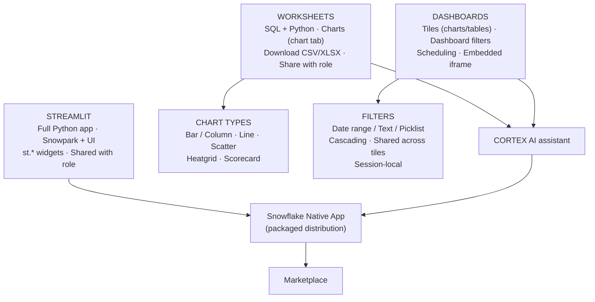
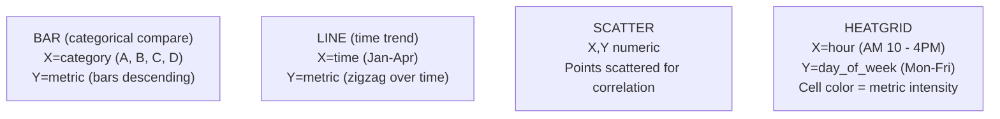
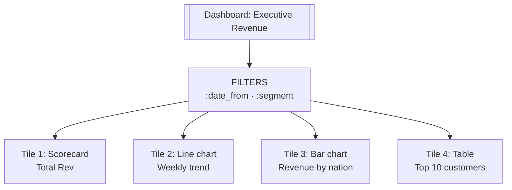

# Data Visualization and Apps — DAA-C01 Study Guide

## Exam Weight & Scope

Approximately 15-20% of DAA-C01. Covers Snowsight dashboards, chart types, dashboard filters, scheduled dashboards, Streamlit in Snowflake (SiS), and embedded analytics patterns. Expect UI-centric questions: which chart for which data, how filters propagate, when to use a Streamlit app vs. a dashboard, scheduling and sharing options.

## Core Concepts Map



---

## Q1: What are the chart types available in Snowsight worksheets and when to use each?
**Difficulty:** Foundation
**Exam relevance:** Visualization basics

### Answer

Snowsight native chart types:

| Chart | Best for | Config |
|-------|----------|--------|
| **Bar / Column** | compare categories | X=category, Y=metric |
| **Line** | time trends | X=time, Y=metric, Series=category |
| **Scatter** | correlation / bivariate | X,Y numeric |
| **Scorecard** | single KPI headline | one metric |
| **Heatgrid** | 2D density / correlation matrix | X,Y categorical, color=metric |

### First Principles

Chart choice matches data shape: continuous X -> line; categorical X -> bar; two continuous -> scatter; one value -> scorecard. Mismatched charts (e.g., pie for time series) confuse the audience and misrepresent the data.

### Diagram



### Lab Exercise

```sql
-- Query optimized for a line chart (dense time series)
SELECT
  DATE_TRUNC('WEEK', O_ORDERDATE) AS week,
  C_MKTSEGMENT                     AS segment,
  SUM(O_TOTALPRICE)                AS revenue
FROM SNOWFLAKE_SAMPLE_DATA.TPCH_SF1.ORDERS
JOIN SNOWFLAKE_SAMPLE_DATA.TPCH_SF1.CUSTOMER USING(C_CUSTKEY → O_CUSTKEY)
  ON C_CUSTKEY = O_CUSTKEY
GROUP BY 1, 2
ORDER BY 1;
-- In Snowsight: Chart -> Line, X=week, Y=revenue, series=segment
```

### Gotchas / Exam Traps

- Snowsight charts are **worksheet-local** until added to a dashboard.
- Line charts require **monotonic X** — otherwise lines zigzag confusingly.
- Scorecard tiles need an aggregate query returning exactly one row.

---

## Q2: What is a Snowsight dashboard and how is it composed?
**Difficulty:** Foundation
**Exam relevance:** Dashboard architecture

### Answer

A dashboard is a collection of tiles, each tile backed by a SQL (or Python) query that renders either a chart or a table. Dashboards support:

- **Filters** — reusable parameters bound to tile queries.
- **Scheduled refresh** — rerun all tiles on a cadence.
- **Sharing** — grant to roles or make public (via secure embed).
- **Linking** — tiles can link to other dashboards for drill-down.

### Diagram



### Lab Exercise

```sql
-- A tile's underlying query, using dashboard filter :segment and :from
SELECT
  DATE_TRUNC('WEEK', O_ORDERDATE) wk,
  SUM(O_TOTALPRICE) rev
FROM SNOWFLAKE_SAMPLE_DATA.TPCH_SF1.ORDERS
JOIN SNOWFLAKE_SAMPLE_DATA.TPCH_SF1.CUSTOMER ON C_CUSTKEY=O_CUSTKEY
WHERE C_MKTSEGMENT = :segment
  AND O_ORDERDATE >= :from
GROUP BY 1 ORDER BY 1;
```

### Gotchas / Exam Traps

- Tiles do not auto-refresh on view; they use cached results unless the dashboard is explicitly refreshed.
- Each tile runs its own query — queries don't share a cursor or implicit filter.
- Dashboard ownership is bound to the owning role; executors need `USAGE` on that role or dashboard sharing permissions.

---

## Q3: What are Snowsight dashboard filters and how do they bind to tile queries?
**Difficulty:** Intermediate
**Exam relevance:** Dashboard filters

### Answer

Dashboard filters are named parameters (`:name`) injected into tile queries. Types:

- **Date range** — produces `:from` and `:to`.
- **Picklist** — bound to a static list or an SQL-generated list.
- **Text** — free-form input.

Filters can be shared across all tiles or scoped to one tile. SQL-defined picklists let analysts build cascading filters (e.g., segment -> customer).

### First Principles

Filters decouple the data query from the UI selection. The tile SQL references `:param`, Snowsight substitutes the current filter value, and the query re-runs. This is cleaner than embedding fixed values and lets users explore slices without editing SQL.

### Lab Exercise

```sql
-- Picklist filter query (produces the dropdown options)
SELECT DISTINCT C_MKTSEGMENT
FROM SNOWFLAKE_SAMPLE_DATA.TPCH_SF1.CUSTOMER
ORDER BY 1;

-- Tile using the filter
SELECT COUNT(*) FROM SNOWFLAKE_SAMPLE_DATA.TPCH_SF1.CUSTOMER
WHERE C_MKTSEGMENT = :segment;

-- Multi-select filter: use IN
SELECT * FROM my_table WHERE col IN (:multi_select);
```

### Gotchas / Exam Traps

- Picklist query must return exactly one column.
- Single-select filters produce scalars; multi-select produces an array — syntax differs.
- Filter names are case-sensitive; `:Segment` != `:segment`.
- You cannot inject filter values into DDL — only DML/SELECT.

---

## Q4: Compare dashboard scheduling vs. ad-hoc refresh in Snowsight.
**Difficulty:** Intermediate
**Exam relevance:** Scheduling

### Answer

- **Ad-hoc refresh** — user clicks "Refresh"; executes all tile queries now.
- **Scheduled refresh** — background execution on a cron-like schedule. Dashboards can be scheduled to deliver via email or to a Slack channel (via integrations).

Scheduled refresh uses the dashboard owner's role and warehouse.

### First Principles

Dashboards without scheduling show cached results — fine for exploratory analysts, bad for executives who need "the number as of 8 AM." Scheduling detaches viewing from refreshing: queries run on cadence, viewers see pre-computed results.

### Lab Exercise

```
-- UI steps:
-- 1. Open dashboard
-- 2. Click schedule icon
-- 3. Set cadence: daily @ 7 AM
-- 4. Choose warehouse
-- 5. Add email recipients (optional)
```

### Gotchas / Exam Traps

- Scheduled dashboards consume warehouse credits even when nobody views the result.
- Minimum schedule interval varies; sub-minute is not supported.
- Scheduled refresh runs with the **owner's** privileges, not the viewer's — row access policies apply based on owner.

---

## Q5: What is Streamlit in Snowflake (SiS) and how does it differ from a dashboard?
**Difficulty:** Intermediate
**Exam relevance:** Streamlit integration

### Answer

Streamlit in Snowflake is a hosted Python framework for building interactive data apps. Code runs on Snowpark Python server-side; UI renders in the browser.

Dashboard vs. Streamlit:

| | Dashboard | Streamlit |
|-|-----------|-----------|
| Language | SQL (+ Python) | Python |
| UI widgets | fixed set (filters, chart configs) | arbitrary (`st.*`) |
| Logic | query-time only | full Python flow |
| State | per-session filters | `st.session_state` |
| Complexity | low | medium-high |

Choose Streamlit when you need custom logic, multi-step workflows, or non-tabular UI.

### First Principles

Dashboards are declarative views of SQL results. Streamlit is a programmatic app — you can call Snowpark DataFrame APIs, invoke Cortex ML functions, chain user inputs through conditional logic. Streamlit replaces the custom web app you might have hosted outside Snowflake, keeping compute and data colocated.

### Lab Exercise

```python
# streamlit_app.py - deployed via Snowsight -> Streamlit
import streamlit as st
from snowflake.snowpark.context import get_active_session

session = get_active_session()
st.title("Order Explorer")

segment = st.selectbox("Segment",
    ["BUILDING","MACHINERY","FURNITURE","HOUSEHOLD","AUTOMOBILE"])

df = session.sql(f"""
  SELECT DATE_TRUNC('MONTH', O_ORDERDATE) m, SUM(O_TOTALPRICE) rev
  FROM SNOWFLAKE_SAMPLE_DATA.TPCH_SF1.ORDERS
  JOIN SNOWFLAKE_SAMPLE_DATA.TPCH_SF1.CUSTOMER ON O_CUSTKEY=C_CUSTKEY
  WHERE C_MKTSEGMENT = '{segment}'
  GROUP BY 1 ORDER BY 1
""").to_pandas()

st.line_chart(df, x="M", y="REV")

if st.button("Forecast next 90 days"):
    # Call Cortex ML.FORECAST and render
    ...
```

### Gotchas / Exam Traps

- Streamlit apps are governed by database/schema roles — sharing requires granting USAGE on the APP object.
- `get_active_session()` returns the session of the viewing user — their role controls data access.
- Streamlit apps cannot run arbitrary system calls; package allowlist is maintained by Anaconda.
- UDFs/UDTFs can be defined inside the app for reuse.

---

## Q6: How does a Streamlit app connect to Snowflake data?
**Difficulty:** Intermediate
**Exam relevance:** Streamlit integration

### Answer

In SiS, use `get_active_session()` from `snowflake.snowpark.context` — no credentials needed; the session is the running user's. For local development or external hosting, use `Session.builder.configs(...).create()` with credentials from a config file or secret.

### Lab Exercise

```python
# SiS (in-Snowflake)
from snowflake.snowpark.context import get_active_session
session = get_active_session()
df = session.table("SALES.ORDERS").filter("STATUS='SHIPPED'")

# External (local)
from snowflake.snowpark import Session
conn_params = {
  "account":"xyz-abc",
  "user":"analyst",
  "password":"...",
  "role":"ANALYST",
  "warehouse":"ANALYTICS_WH",
  "database":"PROD","schema":"PUBLIC"}
session = Session.builder.configs(conn_params).create()
```

### Gotchas / Exam Traps

- `get_active_session()` fails outside SiS — guard with try/except for dual-mode apps.
- Sharing a SiS app does **not** share the data it queries; viewers also need table-level grants.

---

## Q7: What is a Snowflake Native Application and how does it relate to Streamlit?
**Difficulty:** Advanced
**Exam relevance:** Embedded analytics

### Answer

A Snowflake Native App is a packaged, distributable unit containing SQL objects, Streamlit UI, and setup scripts. Can be published to the Marketplace or shared privately. Native Apps run in the consumer's account, with access controlled by application roles.

Streamlit is often the UI tier of a Native App.

### Lab Exercise

```sql
-- Native App manifest.yml snippet
manifest_version: 1
version:
  name: v1
  label: "Order Analytics App"
artifacts:
  setup_script: setup.sql
  readme: README.md
  default_streamlit: ui.streamlit_app
```

### Gotchas / Exam Traps

- Native Apps enforce the Snowflake App Framework's security model — the app runs with an application role, not the consumer's user role.
- Updates propagate via `ALTER APPLICATION ... UPGRADE`.

---

## Q8: What is a "scorecard" tile and when is it appropriate?
**Difficulty:** Foundation
**Exam relevance:** Chart types

### Answer

A scorecard tile displays one metric prominently — total revenue, user count, DAU. Query must return a single row with one aggregated value (or value + delta columns for trend indicators).

### Lab Exercise

```sql
-- Current month revenue with YoY comparison
SELECT
  SUM(IFF(O_ORDERDATE >= DATE_TRUNC('MONTH', CURRENT_DATE),
           O_TOTALPRICE, 0)) AS current_month,
  SUM(IFF(O_ORDERDATE >= DATE_TRUNC('MONTH', DATEADD('year',-1,CURRENT_DATE))
          AND O_ORDERDATE < DATEADD('year',-1,DATE_TRUNC('MONTH',CURRENT_DATE))
                         + INTERVAL '1 month',
           O_TOTALPRICE, 0)) AS prior_year
FROM SNOWFLAKE_SAMPLE_DATA.TPCH_SF1.ORDERS;
```

### Gotchas / Exam Traps

- Scorecards don't support axes or series — just the number and optional trend arrow.
- Multiple columns in result = Snowsight picks the first numeric by default.

---

## Q9: How do you handle multi-row results in a line chart with multiple series?
**Difficulty:** Intermediate
**Exam relevance:** Chart configuration

### Answer

Long format (one row per (time, series) point) with a Series column binding is the correct pattern. Avoid pivoting in SQL — Snowsight handles series natively.

### Lab Exercise

```sql
-- Correct: long format
SELECT
  DATE_TRUNC('MONTH', O_ORDERDATE) m,
  C_MKTSEGMENT segment,
  SUM(O_TOTALPRICE) rev
FROM ... GROUP BY 1, 2;
-- Chart: X=m, Y=rev, series=segment  -> multi-line chart

-- Avoid: wide format (one column per segment)
-- PIVOT output is harder to re-shape into a chart
```

### Gotchas / Exam Traps

- Pivoted (wide) data forces manual column mapping — breaks when new series appear.
- Series column should be LOW-cardinality (< 20) for legibility.

---

## Q10: What is a "cascading filter" and how do you implement it?
**Difficulty:** Advanced
**Exam relevance:** Dashboard filters

### Answer

Cascading filter = child filter's options depend on parent's selection. Implement by making the child filter's picklist query reference the parent's parameter.

### Lab Exercise

```sql
-- Parent filter (region):
SELECT DISTINCT R_NAME FROM SNOWFLAKE_SAMPLE_DATA.TPCH_SF1.REGION ORDER BY 1;

-- Child filter (nation), dependent on :region:
SELECT DISTINCT N_NAME
FROM SNOWFLAKE_SAMPLE_DATA.TPCH_SF1.NATION
JOIN SNOWFLAKE_SAMPLE_DATA.TPCH_SF1.REGION USING (R_REGIONKEY → N_REGIONKEY)
  ON R_REGIONKEY = N_REGIONKEY
WHERE R_NAME = :region
ORDER BY 1;

-- Tile uses both:
SELECT COUNT(*) FROM SNOWFLAKE_SAMPLE_DATA.TPCH_SF1.CUSTOMER
JOIN SNOWFLAKE_SAMPLE_DATA.TPCH_SF1.NATION USING(N_NATIONKEY)
WHERE N_NAME = :nation;
```

### Gotchas / Exam Traps

- If `:region` is NULL (unset), the child filter returns 0 rows — add `OR :region IS NULL` to handle.
- Snowsight re-executes the child filter query on parent change — expensive queries lag the UI.

---

## Q11: What are the sharing options for a Snowsight dashboard?
**Difficulty:** Intermediate
**Exam relevance:** Dashboard sharing

### Answer

Options:

1. **Role-based sharing** — grant other roles access via the share menu.
2. **Private URL** — anyone with the URL *and* appropriate role can view.
3. **Scheduled email delivery** — PDF/CSV sent on cadence to specified addresses.
4. **Embed via public link** — requires account-level embedded analytics feature.

Private links do not bypass RBAC — the viewer still needs the right role.

### Gotchas / Exam Traps

- URL-based sharing does **not** grant permissions — it only exposes the dashboard; viewers must have the owning role or shared role.
- Deleted dashboards cannot be recovered — no time travel for Snowsight UI objects.

---

## Q12: How do you add row-level and column-level security to a dashboard?
**Difficulty:** Advanced
**Exam relevance:** Dashboard security

### Answer

Security isn't configured at the dashboard — it is enforced at the data layer:

- **Row Access Policies** on tables filter rows by role / user context.
- **Masking Policies** on columns redact sensitive values.
- **Secure Views** combine logic + security.

Dashboards automatically honor these when running under the viewer's role.

### Lab Exercise

```sql
CREATE ROW ACCESS POLICY region_rap AS (region STRING)
  RETURNS BOOLEAN ->
    CURRENT_ROLE() IN ('GLOBAL_ANALYST')
    OR region = INVOKER_SHARE_CONTEXT('user_region');

ALTER TABLE orders ADD ROW ACCESS POLICY region_rap ON (region);

-- Dashboard tile returns different rows for different viewers.
```

### Gotchas / Exam Traps

- Scheduled dashboards run as the owner — row policies apply to owner's context, not viewer's. Design accordingly.
- Masking policies cannot be bypassed via `SHOW GRANTS` — only policy owners can edit.

---

## Q13: What is an "embedded dashboard" and how is it enabled?
**Difficulty:** Advanced
**Exam relevance:** Embedded analytics

### Answer

Embedded dashboards expose a dashboard via a signed URL embeddable in an iframe outside Snowsight. Enabled via Snowsight settings; requires JWT-based authentication for the embedding application.

### Gotchas / Exam Traps

- Embedded dashboards require a feature preview or specific edition.
- The embedding host must sign requests with a private key paired to a Snowflake user.

---

## Q14: Explain `st.cache_data` and `st.cache_resource` in a Streamlit app on Snowflake.
**Difficulty:** Advanced
**Exam relevance:** Streamlit optimization

### Answer

- `@st.cache_data` — caches function output (DataFrames, dicts). TTL and max-entries configurable.
- `@st.cache_resource` — caches singletons (connections, models). Not serialized; stays in memory.

Use `cache_data` for the result of expensive SQL queries; use `cache_resource` for shared Snowpark session or Cortex model handles.

### Lab Exercise

```python
import streamlit as st

@st.cache_data(ttl=300)
def load_orders(segment):
    return session.sql(f"""
      SELECT * FROM orders WHERE segment='{segment}'
    """).to_pandas()

@st.cache_resource
def get_session():
    return get_active_session()
```

### Gotchas / Exam Traps

- `cache_data` hashes arguments to detect reuse — don't pass unhashable types.
- Cache is per-session unless configured otherwise.

---

## Q15: What is `st.session_state` and how does it enable multi-step workflows?
**Difficulty:** Intermediate
**Exam relevance:** Streamlit state

### Answer

`st.session_state` is a dict-like store surviving across widget re-runs within a single user session. Essential for wizard flows, undo/redo, and inter-widget communication.

### Lab Exercise

```python
if 'step' not in st.session_state:
    st.session_state.step = 1

if st.session_state.step == 1:
    segment = st.selectbox("Segment", ["A","B","C"])
    if st.button("Next"):
        st.session_state.segment = segment
        st.session_state.step = 2
        st.rerun()
elif st.session_state.step == 2:
    st.write(f"Chosen: {st.session_state.segment}")
```

### Gotchas / Exam Traps

- Streamlit re-runs the whole script on every widget change — state is how you avoid losing context.
- `st.rerun()` triggers an immediate re-execution.

---

## Q16: How do you render Snowpark DataFrames efficiently in Streamlit?
**Difficulty:** Intermediate
**Exam relevance:** Streamlit performance

### Answer

- Use `df.limit(N).to_pandas()` to materialize only what you render.
- `st.dataframe(df)` can take a Pandas DF.
- For large tables, paginate or lazy-load.

### Lab Exercise

```python
snow_df = session.table("ORDERS").filter("STATUS='F'")
st.dataframe(snow_df.limit(1000).to_pandas())

# Full-table download without materialization
if st.button("Export CSV"):
    import io
    buf = io.StringIO()
    snow_df.to_pandas().to_csv(buf, index=False)
    st.download_button("Download", buf.getvalue(), "orders.csv")
```

### Gotchas / Exam Traps

- `to_pandas()` without limit on huge tables ships gigabytes to the Streamlit server — slow and expensive.
- `st.dataframe` renders max ~50k rows well; beyond, use pagination.

---

## Q17: Compare Snowsight charts to Streamlit's chart libraries.
**Difficulty:** Intermediate
**Exam relevance:** Visualization choice

### Answer

- Snowsight charts: fixed types, simple config, deeply integrated with worksheets/dashboards.
- Streamlit: `st.line_chart`, `st.bar_chart`, plus any Plotly/Altair/Matplotlib via `st.plotly_chart(fig)`.

Streamlit wins on flexibility (annotations, dual axes, custom color scales). Snowsight wins on simplicity and shareability.

### Lab Exercise

```python
import plotly.express as px
df = session.table("ORDERS_WEEKLY").to_pandas()
fig = px.line(df, x="WK", y="REV", color="SEGMENT",
              title="Weekly revenue by segment")
fig.update_layout(hovermode="x unified")
st.plotly_chart(fig, use_container_width=True)
```

### Gotchas / Exam Traps

- Plotly in SiS requires Plotly to be in the Anaconda-approved package list — it is, but verify.
- Rendering 100k+ points in Plotly is slow; downsample for interactivity.

---

## Q18: What is a "secondary role" in Snowflake and how can a dashboard use it?
**Difficulty:** Advanced
**Exam relevance:** Dashboard security

### Answer

A user can activate multiple roles simultaneously (`USE SECONDARY ROLES ALL`). Snowsight dashboards leverage all active roles for query execution, giving broad data access to users with cross-functional needs without constant role switching.

### Lab Exercise

```sql
USE SECONDARY ROLES ALL;
-- Now the user can access tables granted to ANY of their roles.

-- To limit:
USE SECONDARY ROLES ('MARKETING','FINANCE');
```

### Gotchas / Exam Traps

- Not all customers enable secondary roles — admin-controlled.
- Audit queries show the primary role; secondary access is implicit.

---

## Q19: What is the correct way to parameterize a date filter across tiles?
**Difficulty:** Intermediate
**Exam relevance:** Dashboard filters

### Answer

Define a single date-range dashboard filter yielding `:date_from` and `:date_to`. Reference in each tile's WHERE clause.

### Lab Exercise

```sql
-- Tile 1
SELECT COUNT(*) FROM orders
WHERE order_date BETWEEN :date_from AND :date_to;

-- Tile 2
SELECT segment, SUM(amount) FROM orders
WHERE order_date BETWEEN :date_from AND :date_to
GROUP BY segment;
```

### Gotchas / Exam Traps

- Date filter values are strings in Snowsight — Snowflake auto-casts to DATE in a BETWEEN but explicit cast is safer: `:date_from::DATE`.
- Half-open intervals (`>= from AND < to`) are more precise than BETWEEN at the boundary.

---

## Q20: What is a dashboard "tile link" and how does it enable drill-down?
**Difficulty:** Intermediate
**Exam relevance:** Dashboard navigation

### Answer

A tile can link to another dashboard or worksheet, optionally passing clicked-row context as filter values. This creates drill-down paths: click a region in a chart, open a dashboard filtered to that region.

### Gotchas / Exam Traps

- Linking passes URL parameters; the receiving dashboard must declare matching filter names.
- Not all chart types support row-click events.

---

## Q21: How do you measure dashboard performance and tune queries?
**Difficulty:** Advanced
**Exam relevance:** Query optimization

### Answer

Use `SNOWFLAKE.ACCOUNT_USAGE.QUERY_HISTORY` filtered by `QUERY_TAG = '<dashboard_name>'` or by the dashboard owner's role. Look at:

- `EXECUTION_TIME`
- `BYTES_SCANNED` vs `PARTITIONS_SCANNED` (pruning efficiency)
- `COMPILATION_TIME`
- Spill to local / remote storage

Tune by: adding clustering keys, materializing via Dynamic Tables, reducing scan via better filters.

### Lab Exercise

```sql
-- Set a dashboard query tag so queries can be filtered
ALTER SESSION SET QUERY_TAG='dash_executive_revenue';

-- Inspect
SELECT query_text, execution_time, bytes_scanned, partitions_scanned,
       partitions_total
FROM SNOWFLAKE.ACCOUNT_USAGE.QUERY_HISTORY
WHERE query_tag = 'dash_executive_revenue'
  AND start_time > DATEADD('day',-7,CURRENT_TIMESTAMP)
ORDER BY execution_time DESC;
```

### Gotchas / Exam Traps

- `QUERY_TAG` must be set before the dashboard runs — scheduled dashboards can set it via session preamble.
- Dashboard caching (result cache) hides slow queries until data changes — don't tune a cached run.

---

## Q22: What are the limits of Streamlit in Snowflake (SiS)?
**Difficulty:** Advanced
**Exam relevance:** Streamlit production

### Answer

Current (2024-2026) limits:

- Package availability: Anaconda channel allowlist.
- No arbitrary system access (no subprocess, no outbound network except via External Access Integrations).
- 1 session per user per app (long-running state).
- UI runs server-side — latency on every widget interaction.

### Gotchas / Exam Traps

- Outbound HTTP calls require External Access Integration + Secret objects; cannot use plain `requests` without setup.
- File uploads via `st.file_uploader` are limited by Snowsight's upload limit (~200 MB per file).

---
