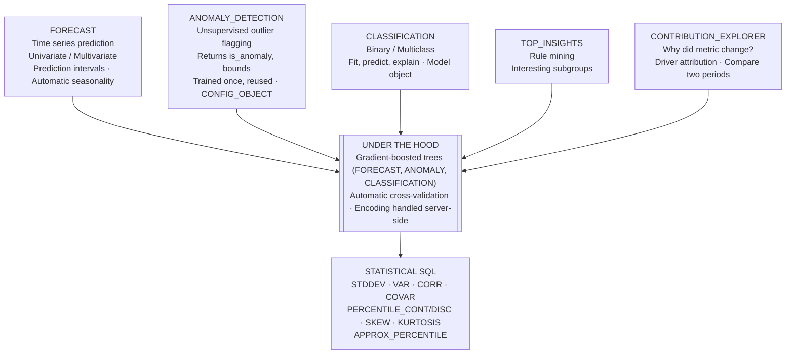
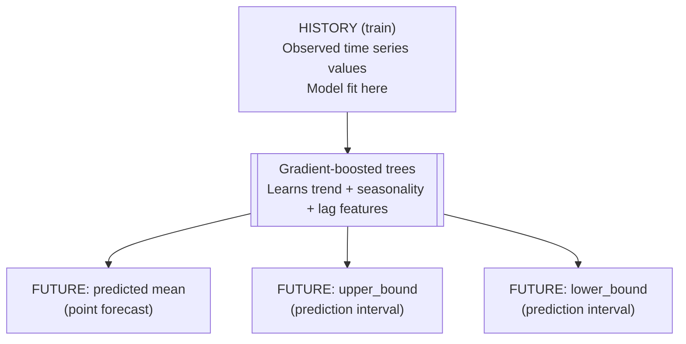
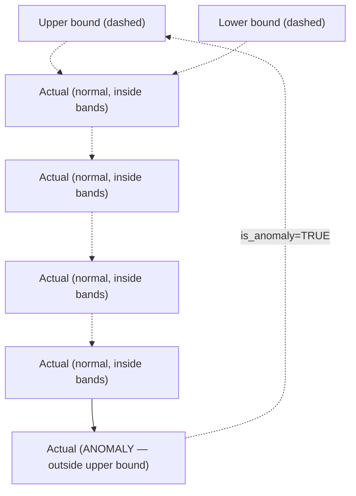
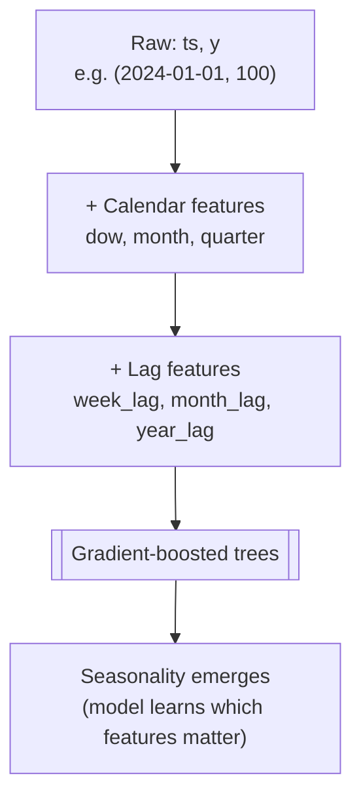

# Statistical and ML Analytics — DAA-C01 Study Guide

## Exam Weight & Scope

Approximately 20-25% of DAA-C01. Covers Cortex ML Functions (`FORECAST`, `ANOMALY_DETECTION`, `CLASSIFICATION`, `TOP_INSIGHTS`, `CONTRIBUTION_EXPLORER`), statistical SQL functions, and time-series analysis. The exam emphasizes function signatures, when to use each ML function, parameter tuning (prediction interval, lag, exogenous variables), and interpreting results.

## Core Concepts Map



---

## Q1: What are Cortex ML Functions and how do they differ from Cortex LLM Functions?
**Difficulty:** Foundation
**Exam relevance:** Cortex overview

### Answer

- **Cortex ML Functions** — classical ML tasks via SQL: `FORECAST`, `ANOMALY_DETECTION`, `CLASSIFICATION`, `TOP_INSIGHTS`, `CONTRIBUTION_EXPLORER`. Powered by gradient-boosted trees. Deterministic, inspectable.
- **Cortex LLM Functions** — generative/semantic tasks: `COMPLETE`, `SUMMARIZE`, `TRANSLATE`, `EXTRACT_ANSWER`, `AI_CLASSIFY`. Powered by large language models.

Analysts primarily use ML functions for structured data; LLM functions for unstructured text/image analytics.

### First Principles

ML functions deliver statistical predictions over structured data without exporting to a Python ML stack. The model is trained and persisted as a Snowflake object (schema-scoped), callable like a UDF. This closes the "last mile" between warehouse data and ML output.

### Lab Exercise

```sql
-- ML function signature preview
CALL SNOWFLAKE.ML.FORECAST!FORECAST(FORECASTING_PERIODS => 30);
CALL SNOWFLAKE.ML.ANOMALY_DETECTION!DETECT_ANOMALIES(INPUT_DATA => ...);

-- LLM function
SELECT SNOWFLAKE.CORTEX.SUMMARIZE('long text...');
```

### Gotchas / Exam Traps

- Cortex ML Functions require sufficient data volume (hundreds+ rows typically).
- Cortex functions are schema-scoped objects — `CREATE SNOWFLAKE.ML.FORECAST ...` creates a persistent model.
- Credit consumption model: ML functions bill by rows processed; LLM by tokens.

---

## Q2: What is the SNOWFLAKE.ML.FORECAST function and its signature?
**Difficulty:** Intermediate
**Exam relevance:** FORECAST function

### Answer

`FORECAST` is a trainable model object for univariate or multivariate time-series forecasting. Steps:

1. Create the model using training data.
2. Call `!FORECAST` method to generate predictions.

```sql
CREATE SNOWFLAKE.ML.FORECAST my_forecast(
  INPUT_DATA         => SYSTEM$REFERENCE('TABLE','training_data'),
  TIMESTAMP_COLNAME  => 'ts',
  TARGET_COLNAME     => 'y'
);

CALL my_forecast!FORECAST(
  FORECASTING_PERIODS => 30,
  CONFIG_OBJECT       => {'prediction_interval': 0.95}
);
```

### First Principles

Under the hood, FORECAST uses gradient-boosted trees over engineered time features (lag, calendar features, trend). This avoids the ARIMA assumption of stationarity and handles non-linear patterns automatically. Seasonality is detected via lag-feature importance ranking.

### Diagram



### Lab Exercise

```sql
-- Train on monthly order totals
CREATE OR REPLACE VIEW monthly_orders AS
  SELECT DATE_TRUNC('MONTH', O_ORDERDATE) ts, SUM(O_TOTALPRICE) y
  FROM SNOWFLAKE_SAMPLE_DATA.TPCH_SF1.ORDERS
  GROUP BY 1;

CREATE OR REPLACE SNOWFLAKE.ML.FORECAST order_forecast(
  INPUT_DATA        => SYSTEM$REFERENCE('VIEW','monthly_orders'),
  TIMESTAMP_COLNAME => 'ts',
  TARGET_COLNAME    => 'y'
);

CALL order_forecast!FORECAST(FORECASTING_PERIODS => 6);
```

### Gotchas / Exam Traps

- `TIMESTAMP_COLNAME` requires a DATE/TIMESTAMP column.
- `FORECASTING_PERIODS` is in the natural granularity of the data (if monthly, 6 = 6 months).
- Model objects must be unique per schema and are tied to the training data via SYSTEM$REFERENCE.

---

## Q3: How do you add exogenous (external) variables to a FORECAST model?
**Difficulty:** Advanced
**Exam relevance:** FORECAST advanced

### Answer

Pass additional feature columns in the training data; FORECAST uses them during prediction if you provide future values of these features.

### Lab Exercise

```sql
-- Training: ts, y, holiday_flag, promo_spend
CREATE OR REPLACE SNOWFLAKE.ML.FORECAST sales_forecast(
  INPUT_DATA        => SYSTEM$REFERENCE('VIEW','sales_with_exog'),
  TIMESTAMP_COLNAME => 'ts',
  TARGET_COLNAME    => 'y'
);

-- Forecast with known future exogenous values
CALL sales_forecast!FORECAST(
  INPUT_DATA => SYSTEM$REFERENCE('VIEW','future_exog_values'),
  FORECASTING_PERIODS => 30
);
```

### Gotchas / Exam Traps

- Future values of exogenous features must be provided — forecaster cannot invent them.
- Too many exogenous features relative to training rows causes overfitting; feature importance in output helps prune.

---

## Q4: How do you perform multi-series forecasting (per-group) in Cortex FORECAST?
**Difficulty:** Advanced
**Exam relevance:** FORECAST multi-series

### Answer

Specify `SERIES_COLNAME` — FORECAST trains one model per series internally and returns predictions for each.

### Lab Exercise

```sql
-- Forecast per product
CREATE OR REPLACE SNOWFLAKE.ML.FORECAST product_forecast(
  INPUT_DATA        => SYSTEM$REFERENCE('TABLE','sales_by_product_day'),
  SERIES_COLNAME    => 'product_id',
  TIMESTAMP_COLNAME => 'ts',
  TARGET_COLNAME    => 'units_sold'
);

CALL product_forecast!FORECAST(FORECASTING_PERIODS => 7);
```

### Gotchas / Exam Traps

- Series with too few observations are skipped (warning in logs).
- All series must share the same timestamp granularity.

---

## Q5: What is the `prediction_interval` parameter and how do you interpret the output?
**Difficulty:** Intermediate
**Exam relevance:** FORECAST interpretation

### Answer

`prediction_interval` sets the confidence level for the lower_bound/upper_bound columns in the output. Default 0.95 (95%).

The output rows contain:

| Column | Meaning |
|--------|---------|
| `TS` | future timestamp |
| `FORECAST` | point prediction (mean) |
| `LOWER_BOUND` | p (lower) of the predicted distribution |
| `UPPER_BOUND` | p (upper) of the predicted distribution |

### First Principles

A 95% prediction interval means: assuming the model is correctly specified, 95 out of 100 future actual values should fall within [lower, upper]. Narrow intervals suggest confidence; wide intervals signal uncertainty — often due to high noise or non-stationary trends.

### Lab Exercise

```sql
-- 80% prediction interval for tighter bounds
CALL order_forecast!FORECAST(
  FORECASTING_PERIODS => 12,
  CONFIG_OBJECT       => {'prediction_interval': 0.80}
);
```

### Gotchas / Exam Traps

- Prediction interval is NOT a confidence interval for the mean — it bounds individual future observations, which is wider.
- Values are not probabilities; they are quantiles of the predicted distribution.

---

## Q6: How does Cortex `ANOMALY_DETECTION` work and what does it return?
**Difficulty:** Intermediate
**Exam relevance:** ANOMALY_DETECTION function

### Answer

Trains an unsupervised model that flags observations as anomalous based on learned prediction bounds. Returns, per input row:

- `IS_ANOMALY` — boolean.
- `FORECAST` — expected value.
- `LOWER_BOUND` / `UPPER_BOUND` — expected normal range.
- `DISTANCE` — magnitude of deviation.

### First Principles

Anomaly detection on time series is essentially: "predict what the value should be, flag large residuals." Cortex uses the same gradient-boosted forecaster but applies it as a one-step-ahead prediction; actuals outside the predicted band are anomalies.

### Diagram



### Lab Exercise

```sql
CREATE OR REPLACE SNOWFLAKE.ML.ANOMALY_DETECTION traffic_ad(
  INPUT_DATA        => SYSTEM$REFERENCE('VIEW','daily_traffic'),
  TIMESTAMP_COLNAME => 'ts',
  TARGET_COLNAME    => 'visits'
);

CALL traffic_ad!DETECT_ANOMALIES(
  INPUT_DATA => SYSTEM$REFERENCE('VIEW','new_days'),
  TIMESTAMP_COLNAME => 'ts',
  TARGET_COLNAME    => 'visits',
  CONFIG_OBJECT     => {'prediction_interval': 0.99}
);
```

### Gotchas / Exam Traps

- Higher `prediction_interval` = fewer anomalies flagged (wider "normal" band).
- Anomaly detection is per-timestamp; batch comparisons require aggregating multiple detections.
- Model requires at least ~2-3 full seasonal cycles in training data for reliable detection.

---

## Q7: How do you tune anomaly detection sensitivity?
**Difficulty:** Advanced
**Exam relevance:** ANOMALY_DETECTION tuning

### Answer

Primary knob: `prediction_interval` in CONFIG_OBJECT.

- Lower (e.g., 0.80) — more sensitive, more false positives.
- Higher (e.g., 0.99) — less sensitive, misses mild anomalies.

Secondary: provide more training data to tighten the model's expected range.

### Lab Exercise

```sql
-- Tight bands = sensitive
CALL ad_model!DETECT_ANOMALIES(
  INPUT_DATA => ..., CONFIG_OBJECT => {'prediction_interval': 0.90});

-- Loose bands = conservative
CALL ad_model!DETECT_ANOMALIES(
  INPUT_DATA => ..., CONFIG_OBJECT => {'prediction_interval': 0.995});
```

### Gotchas / Exam Traps

- No separate "contamination" parameter in Cortex (unlike scikit-learn Isolation Forest).
- For multi-series data, pass `SERIES_COLNAME` for separate thresholds per series.

---

## Q8: What is Cortex `CLASSIFICATION` and when do analysts use it?
**Difficulty:** Intermediate
**Exam relevance:** CLASSIFICATION function

### Answer

A supervised classifier (binary or multiclass) using gradient-boosted trees. Analysts use it for:

- Churn prediction.
- Fraud flagging.
- Lead scoring.
- Product categorization.

Signature mirrors FORECAST: create model, call `!PREDICT`.

### Lab Exercise

```sql
-- Create model
CREATE OR REPLACE SNOWFLAKE.ML.CLASSIFICATION churn_model(
  INPUT_DATA  => SYSTEM$REFERENCE('VIEW','churn_train_data'),
  TARGET_COLNAME => 'churned'  -- boolean/int
);

-- Predict
SELECT
  customer_id,
  churn_model!PREDICT(INPUT_DATA => OBJECT_CONSTRUCT(*))
    AS prediction
FROM customer_features;
-- prediction is an OBJECT with class, probability, and feature contributions
```

### First Principles

Gradient-boosted trees handle mixed types, missing values, and non-linear interactions out of the box — ideal for business analytics features that mix categorical and numeric columns. Cortex handles encoding, splitting, and hyperparameter tuning server-side.

### Gotchas / Exam Traps

- Target must be a bounded value set — not an arbitrary string.
- Class imbalance is detected and reported but not auto-balanced; sample weighting is manual.

---

## Q9: How do you interpret the output of `!PREDICT` from a classification model?
**Difficulty:** Advanced
**Exam relevance:** CLASSIFICATION output

### Answer

Returns a VARIANT object:

```json
{
  "class": "churned",
  "probability": {"churned": 0.72, "retained": 0.28},
  "feature_importance": {"tenure_months": 0.35, "monthly_spend": 0.22, ...}
}
```

Use `prediction:class`, `prediction:probability.churned::NUMBER`, `prediction:feature_importance` for row-level explanations.

### Lab Exercise

```sql
WITH preds AS (
  SELECT
    customer_id,
    churn_model!PREDICT(INPUT_DATA => OBJECT_CONSTRUCT(*)) p
  FROM customer_features)
SELECT
  customer_id,
  p:class::STRING                           AS predicted_class,
  p:probability.churned::NUMBER             AS churn_prob,
  p:feature_importance                      AS why
FROM preds
WHERE churn_prob > 0.7
ORDER BY churn_prob DESC;
```

### Gotchas / Exam Traps

- Feature importance in prediction output is per-row (local), different from global model importance.
- Probability sum across classes = 1.0.

---

## Q10: What is `TOP_INSIGHTS` and what pattern does it find?
**Difficulty:** Intermediate
**Exam relevance:** TOP_INSIGHTS function

### Answer

`TOP_INSIGHTS` finds "interesting subgroups" where a metric differs meaningfully from the overall population. Useful for drill-down analytics: "which combinations of dimensions explain the overall average?"

### Lab Exercise

```sql
CALL SNOWFLAKE.ML.TOP_INSIGHTS!GET_DRIVERS(
  INPUT_DATA      => SYSTEM$REFERENCE('VIEW','sales_data'),
  LABEL_COLNAME   => 'is_high_value',
  METRIC_COLNAME  => 'revenue'
);
-- Returns rules like "segment=BUILDING AND region=EUROPE -> rev 3x avg"
```

### First Principles

TOP_INSIGHTS is essentially a decision-tree + rule-mining approach: enumerate candidate subgroups, score by metric deviation and support, return top-k. Great for exploratory analysis when you have many dimensions and need to know which combinations matter.

### Gotchas / Exam Traps

- Not deterministic across versions.
- High-cardinality dimensions can be excluded automatically; low support rules are filtered.

---

## Q11: What is `CONTRIBUTION_EXPLORER` and how does it attribute metric changes?
**Difficulty:** Advanced
**Exam relevance:** CONTRIBUTION_EXPLORER function

### Answer

Decomposes the difference in a metric between two time periods (or two groups) into contributions by dimensions. Answers "why did revenue drop 10% from Q1 to Q2?"

### Lab Exercise

```sql
CALL SNOWFLAKE.ML.CONTRIBUTION_EXPLORER!EXPLAIN_CHANGE(
  INPUT_DATA          => SYSTEM$REFERENCE('VIEW','sales_by_dim'),
  METRIC_COLNAME      => 'revenue',
  CATEGORICAL_DIMENSIONS => ['product','region','channel'],
  BASELINE_FILTER     => 'period = ''2024-Q1''',
  COMPARISON_FILTER   => 'period = ''2024-Q2'''
);
-- Returns: product X in region Y contributed -$500k to the drop
```

### Gotchas / Exam Traps

- Baseline/comparison filters are passed as SQL predicate strings.
- High-cardinality dimensions slow computation; filter to top-N before invoking.

---

## Q12: How do time-series statistical functions complement Cortex FORECAST?
**Difficulty:** Intermediate
**Exam relevance:** Time-series analytics

### Answer

Native SQL statistical/time-series functions:

- `LAG`, `LEAD` — explicit lag feature engineering.
- `AVG(...) OVER (ROWS BETWEEN n PRECEDING ...)` — moving averages.
- `STDDEV(...) OVER (...)` — rolling volatility.
- `REGR_SLOPE(y, x) OVER (...)` — rolling linear regression.
- `CORR(x, y) OVER (...)` — rolling correlation.

Use these for simple trend/seasonality analysis and feature engineering before invoking Cortex functions.

### Lab Exercise

```sql
-- Rolling 30-day stats on daily revenue
WITH daily AS (
  SELECT O_ORDERDATE d, SUM(O_TOTALPRICE) rev
  FROM SNOWFLAKE_SAMPLE_DATA.TPCH_SF1.ORDERS GROUP BY 1)
SELECT
  d, rev,
  AVG(rev)    OVER (ORDER BY d ROWS BETWEEN 29 PRECEDING AND CURRENT ROW) ma30,
  STDDEV(rev) OVER (ORDER BY d ROWS BETWEEN 29 PRECEDING AND CURRENT ROW) sd30,
  (rev - AVG(rev) OVER (ORDER BY d ROWS BETWEEN 29 PRECEDING AND CURRENT ROW))
  / NULLIF(STDDEV(rev) OVER (ORDER BY d ROWS BETWEEN 29 PRECEDING AND CURRENT ROW),0)
    AS z_vs_30d
FROM daily;
```

### Gotchas / Exam Traps

- Rolling window stats on sparse data produce misleading results — fill with calendar join first.

---

## Q13: What statistical SQL functions should an analyst know for hypothesis testing?
**Difficulty:** Advanced
**Exam relevance:** Statistical SQL

### Answer

Snowflake has primitive statistics but no built-in hypothesis test (t-test, chi-square). Build via SQL:

- `AVG`, `STDDEV`, `COUNT` -> compute t-statistic.
- `COVAR_POP`, `COVAR_SAMP` -> covariance.
- `REGR_*` family -> linear regression (slope, intercept, R2).

For richer tests, use Snowpark Python with SciPy.

### Lab Exercise

```sql
-- Two-sample t-test (Welch's)
WITH g AS (
  SELECT group_col, AVG(val) mu, STDDEV(val) sd, COUNT(*) n
  FROM my_table GROUP BY group_col)
SELECT
  (SELECT mu FROM g WHERE group_col='A')
  - (SELECT mu FROM g WHERE group_col='B') AS mean_diff,
  (SELECT mu FROM g WHERE group_col='A') - (SELECT mu FROM g WHERE group_col='B'))
  / SQRT(
    POWER((SELECT sd FROM g WHERE group_col='A'),2) / (SELECT n FROM g WHERE group_col='A')
    + POWER((SELECT sd FROM g WHERE group_col='B'),2) / (SELECT n FROM g WHERE group_col='B')
  ) AS t_stat;

-- Linear regression
SELECT
  REGR_SLOPE(y, x)     slope,
  REGR_INTERCEPT(y, x) intercept,
  REGR_R2(y, x)        r_squared,
  REGR_COUNT(y, x)     n
FROM data;
```

### Gotchas / Exam Traps

- `REGR_SLOPE(y, x)` — y first, x second (opposite of math convention `y = mx + b`).
- No built-in `pnorm` / `pt` — compute p-values via Snowpark or external.

---

## Q14: How does Cortex FORECAST handle seasonality automatically?
**Difficulty:** Advanced
**Exam relevance:** FORECAST internals

### Answer

FORECAST derives calendar features (day-of-week, month, quarter, holiday proximity) and lag features (prior week, prior month). Gradient-boosted trees learn which patterns matter — a weekly cycle becomes a strong `day_of_week` signal; yearly cycles emerge from `month` and 12-month lag.

### First Principles

Classical approaches like ARIMA decompose data into trend + seasonal + residual components, requiring the analyst to specify seasonal period. Tree-based models with lag features let the data decide which cycles matter — a form of implicit decomposition. This is why FORECAST handles multi-seasonality (daily + weekly + yearly) without configuration.

### Diagram



### Gotchas / Exam Traps

- Needs at least ~2 complete cycles of each pattern to detect — a 6-month series can't detect yearly seasonality.
- Irregular events (holidays, promotions) should be provided as exogenous features.

---

## Q15: How do you evaluate FORECAST accuracy?
**Difficulty:** Advanced
**Exam relevance:** Model evaluation

### Answer

Hold out the tail of the training data, train on the rest, forecast forward, and compare to the holdout. Compute MAE, MAPE, RMSE.

### Lab Exercise

```sql
-- Create holdout training view (exclude last 90 days)
CREATE OR REPLACE VIEW train_data AS
  SELECT * FROM full_series
  WHERE ts < DATEADD('day', -90, (SELECT MAX(ts) FROM full_series));

-- Train
CREATE OR REPLACE SNOWFLAKE.ML.FORECAST holdout_fcst(
  INPUT_DATA => SYSTEM$REFERENCE('VIEW','train_data'),
  TIMESTAMP_COLNAME => 'ts', TARGET_COLNAME => 'y');

-- Forecast and compare
WITH preds AS (
  SELECT * FROM TABLE(holdout_fcst!FORECAST(FORECASTING_PERIODS => 90))),
actuals AS (
  SELECT * FROM full_series
  WHERE ts >= DATEADD('day', -90, (SELECT MAX(ts) FROM full_series)))
SELECT
  AVG(ABS(p.forecast - a.y))                        AS mae,
  AVG(ABS(p.forecast - a.y) / NULLIF(a.y,0)) * 100  AS mape,
  SQRT(AVG(POWER(p.forecast - a.y, 2)))             AS rmse
FROM preds p JOIN actuals a USING (ts);
```

### Gotchas / Exam Traps

- Walk-forward validation (expanding window) is more rigorous than a single holdout.
- MAPE is undefined when actuals contain zero; filter or use symmetric MAPE.

---

## Q16: What is `APPROX_PERCENTILE_ACCUMULATE` / `APPROX_PERCENTILE_ESTIMATE` and when to use them?
**Difficulty:** Advanced
**Exam relevance:** Approximate statistics

### Answer

These compose for incremental percentile tracking:

- `APPROX_PERCENTILE_ACCUMULATE(col)` — builds a t-digest sketch per group.
- `APPROX_PERCENTILE_ESTIMATE(sketch, p)` — extracts a percentile from a sketch.
- `APPROX_PERCENTILE_COMBINE(sketches)` — merges sketches without re-scanning data.

Enables roll-up aggregations across time or dimensions without materializing full distributions.

### Lab Exercise

```sql
-- Daily sketches
CREATE OR REPLACE TABLE daily_sketches AS
SELECT
  DATE_TRUNC('day', ts) d,
  APPROX_PERCENTILE_ACCUMULATE(response_time_ms) sk
FROM request_logs GROUP BY 1;

-- Monthly P95 from daily sketches (no re-scan)
SELECT
  DATE_TRUNC('MONTH', d) m,
  APPROX_PERCENTILE_ESTIMATE(APPROX_PERCENTILE_COMBINE(sk), 0.95) p95
FROM daily_sketches GROUP BY 1;
```

### Gotchas / Exam Traps

- Sketches are binary blobs; store in dedicated columns.
- Combining non-compatible sketches (different column) is undefined.

---

## Q17: How do you detect trend changes in a time series?
**Difficulty:** Advanced
**Exam relevance:** Time-series analytics

### Answer

Approaches:

1. **Rolling slope**: `REGR_SLOPE(y, time_idx) OVER (ROWS BETWEEN n PRECEDING AND CURRENT ROW)`.
2. **CUSUM** — cumulative sum of residuals from a target.
3. **MATCH_RECOGNIZE** patterns for monotonic runs.
4. **Cortex FORECAST** residuals — compare actuals to prior predictions; large residuals signal regime change.

### Lab Exercise

```sql
-- Rolling 30-day slope reveals trend reversals
WITH idx AS (
  SELECT d, rev, ROW_NUMBER() OVER (ORDER BY d) ri FROM daily_rev)
SELECT
  d, rev,
  REGR_SLOPE(rev, ri) OVER (ORDER BY d ROWS BETWEEN 29 PRECEDING AND CURRENT ROW)
    AS slope_30d
FROM idx;
```

### Gotchas / Exam Traps

- Rolling slopes are smoothed; sudden shifts can be masked by the window length.

---

## Q18: What is Snowpark ML and how does it extend Cortex ML Functions?
**Difficulty:** Advanced
**Exam relevance:** ML analytics

### Answer

Snowpark ML (`snowflake.ml.modeling`) is a Python library implementing scikit-learn-style APIs on top of Snowpark. Lets analysts train arbitrary models (linear regression, random forest, XGBoost) with distributed execution.

Choose Cortex ML Functions when SQL-only workflow is sufficient; Snowpark ML when you need custom models.

### Lab Exercise

```python
from snowflake.ml.modeling.ensemble import RandomForestClassifier
from snowflake.snowpark.context import get_active_session

session = get_active_session()
df = session.table("CHURN_TRAIN")

model = RandomForestClassifier(
    input_cols=["TENURE","MONTHLY_SPEND","PLAN_TYPE"],
    label_cols=["CHURNED"],
    output_cols=["PREDICTION"])
model.fit(df)
preds = model.predict(session.table("CHURN_TEST"))
```

### Gotchas / Exam Traps

- Models trained with Snowpark ML can be registered in Model Registry for versioning.
- Not all scikit-learn hyperparameters are supported; check the Snowpark ML docs.

---

## Q19: How do you compute a confusion matrix in SQL after classification?
**Difficulty:** Intermediate
**Exam relevance:** Model evaluation

### Answer

```sql
WITH preds AS (
  SELECT actual, predicted FROM predictions)
SELECT
  COUNT_IF(actual=1 AND predicted=1) tp,
  COUNT_IF(actual=0 AND predicted=1) fp,
  COUNT_IF(actual=1 AND predicted=0) fn,
  COUNT_IF(actual=0 AND predicted=0) tn,
  tp*1.0 / NULLIF(tp+fp,0) precision,
  tp*1.0 / NULLIF(tp+fn,0) recall,
  2 * tp*1.0 / NULLIF(2*tp+fp+fn,0) f1
FROM preds;
```

### Gotchas / Exam Traps

- Imbalanced classes make raw accuracy misleading — use precision/recall/F1.
- For multiclass, build per-class rows and average macro or micro.

---

## Q20: What is `SNOWFLAKE.CORTEX.AI_CLASSIFY` and how does it compare to CLASSIFICATION?
**Difficulty:** Advanced
**Exam relevance:** AI vs ML functions

### Answer

- `CORTEX.AI_CLASSIFY(text, labels)` — zero-shot classification via LLM. No training required.
- `SNOWFLAKE.ML.CLASSIFICATION` — supervised model from labeled training data.

Use AI_CLASSIFY when you have labels but no training data (or text-only input); use CLASSIFICATION when you have structured features and sufficient history.

### Lab Exercise

```sql
-- Zero-shot
SELECT review_text,
       SNOWFLAKE.CORTEX.AI_CLASSIFY(
         review_text,
         ['positive','neutral','negative']
       ) AS sentiment
FROM reviews;
```

### Gotchas / Exam Traps

- AI_CLASSIFY cost scales with text length (tokens).
- CLASSIFICATION beats AI_CLASSIFY in accuracy when you have labeled historical data.

---

## Q21: How do you productionize a Cortex ML model for an analytical pipeline?
**Difficulty:** Advanced
**Exam relevance:** ML operations

### Answer

Pattern:

1. Create training view that refreshes on schedule (Dynamic Table).
2. CREATE OR REPLACE the model on a schedule (Task).
3. Serve predictions in another view or Dynamic Table that calls `!FORECAST` or `!PREDICT`.
4. Monitor accuracy via a validation task.

### Lab Exercise

```sql
-- Dynamic Table: training data
CREATE OR REPLACE DYNAMIC TABLE train_data_dt
  TARGET_LAG='1 hour' WAREHOUSE=analytics_wh AS
SELECT ts, y FROM live_source WHERE ts > CURRENT_DATE - 365;

-- Task: refresh model nightly
CREATE OR REPLACE TASK refresh_model
  SCHEDULE='USING CRON 0 3 * * * UTC'
  WAREHOUSE=analytics_wh AS
CREATE OR REPLACE SNOWFLAKE.ML.FORECAST live_forecast(
  INPUT_DATA => SYSTEM$REFERENCE('DYNAMIC TABLE','train_data_dt'),
  TIMESTAMP_COLNAME => 'ts', TARGET_COLNAME => 'y');

-- Serving view
CREATE OR REPLACE VIEW forecasts_v AS
  SELECT * FROM TABLE(live_forecast!FORECAST(FORECASTING_PERIODS=>30));
```

### Gotchas / Exam Traps

- Models are not versioned by default — overwrite loses history. Use Model Registry (Snowpark ML) for formal versioning.
- `SYSTEM$REFERENCE` to a Dynamic Table resolves at model creation; later refreshes of the DT auto-apply to future training runs.

---

## Q22: What are the pricing considerations for Cortex ML functions?
**Difficulty:** Intermediate
**Exam relevance:** Cost management

### Answer

Cortex ML functions bill based on:

- **Training cost** — proportional to rows and features.
- **Inference cost** — proportional to rows predicted.
- **Warehouse credits** — the invoking warehouse covers compute.

Billed as "Snowflake Credits" in the usage views; detailed in `METERING_HISTORY` and `CORTEX_FUNCTIONS_USAGE_HISTORY`.

### Lab Exercise

```sql
SELECT function_name, SUM(credits_used) credits, SUM(tokens) tokens
FROM SNOWFLAKE.ACCOUNT_USAGE.CORTEX_FUNCTIONS_USAGE_HISTORY
WHERE start_time > DATEADD('day',-30,CURRENT_TIMESTAMP)
GROUP BY 1;
```

### Gotchas / Exam Traps

- Training is a one-time cost; inference is per-call — frequent forecasts cost more than periodic batches.
- Suspended warehouses cannot run Cortex functions — ensure the invoking warehouse is active.

---
