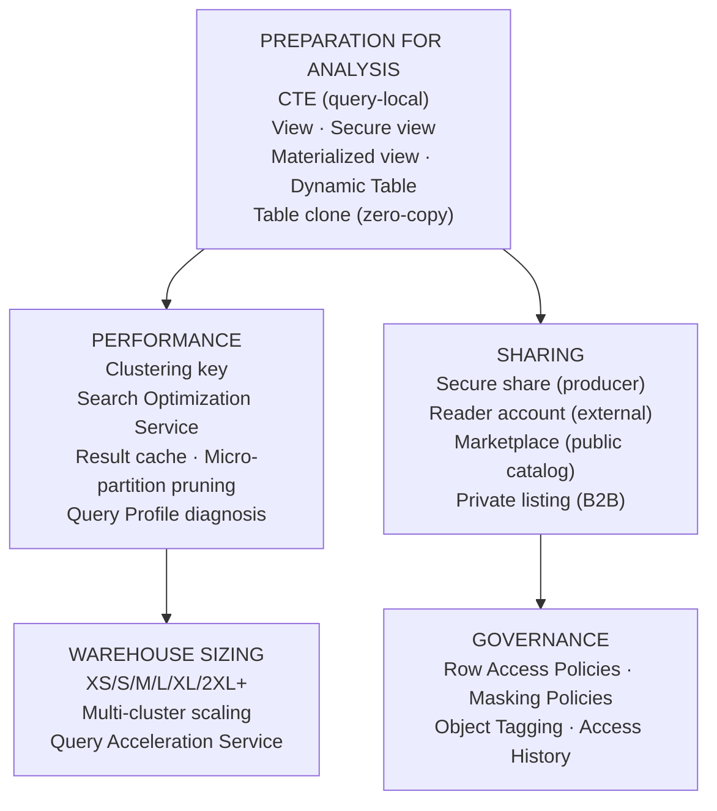
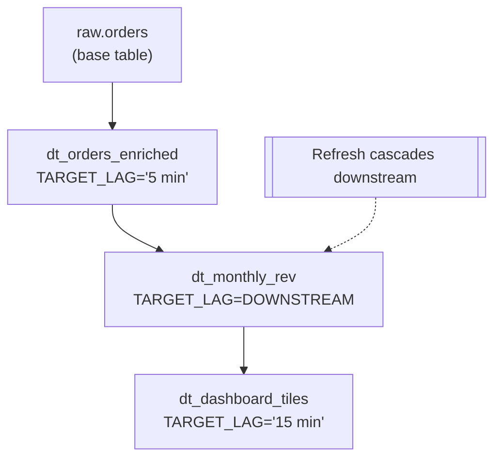
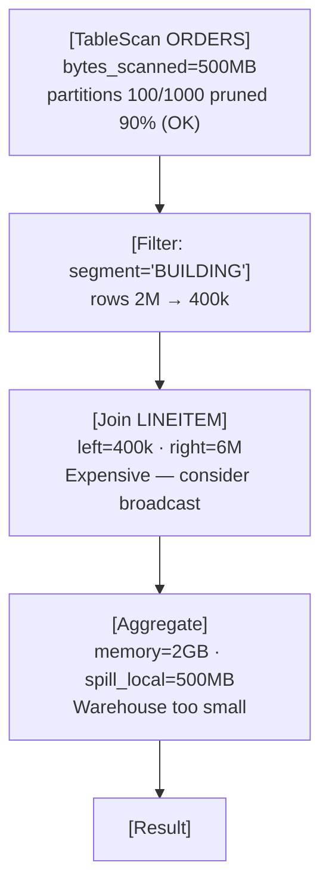
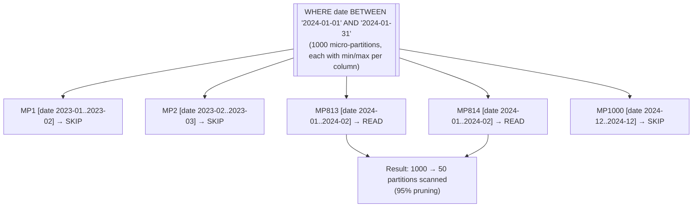

# Data Preparation and Sharing — DAA-C01 Study Guide

## Exam Weight & Scope

Approximately 15-20% of DAA-C01. Covers views, CTEs, Dynamic Tables (analyst-facing), Data Marketplace consumption, secure data sharing from the analyst's perspective, and performance tuning of analytical queries. Expect scenarios: pick view vs. materialized view vs. Dynamic Table; interpret query profile; use shared data from Marketplace.

## Core Concepts Map



---

## Q1: Compare CTE, view, materialized view, and Dynamic Table from the analyst's perspective.
**Difficulty:** Foundation
**Exam relevance:** Data preparation choices

### Answer

**CTE**
- Persistence: query-local
- Refresh: n/a
- Cost: compute at query
- Use: one-off
- Modifies target: no

**View**
- Persistence: definition only
- Refresh: on query
- Cost: compute at query
- Use: reusable SQL
- Modifies target: no

**Materialized View**
- Persistence: pre-computed
- Refresh: automatic
- Cost: background maintenance
- Use: hot aggregations
- Modifies target: yes (hidden)

**Dynamic Table**
- Persistence: pre-computed
- Refresh: declarative lag
- Cost: background pipeline
- Use: multi-step ELT
- Modifies target: yes (visible table)

### First Principles

A CTE is scaffolding for one query. A view is a saved SELECT with no stored data. A materialized view caches the result and auto-maintains on base-table changes (narrow use cases, strict query shape rules). Dynamic Tables are the modern general-purpose answer: declarative lag-driven refresh, SQL-only, support arbitrary query shapes.

### Lab Exercise

```sql
-- CTE: in-query only
WITH monthly AS (
  SELECT DATE_TRUNC('MONTH',O_ORDERDATE) m, SUM(O_TOTALPRICE) rev
  FROM SNOWFLAKE_SAMPLE_DATA.TPCH_SF1.ORDERS GROUP BY 1)
SELECT * FROM monthly ORDER BY m DESC LIMIT 12;

-- View: reusable
CREATE OR REPLACE VIEW monthly_rev AS
SELECT DATE_TRUNC('MONTH',O_ORDERDATE) m, SUM(O_TOTALPRICE) rev
FROM SNOWFLAKE_SAMPLE_DATA.TPCH_SF1.ORDERS GROUP BY 1;

-- Materialized view (narrow shape; no joins beyond single table)
CREATE OR REPLACE MATERIALIZED VIEW mv_orders_by_date AS
SELECT O_ORDERDATE, COUNT(*) cnt
FROM SNOWFLAKE_SAMPLE_DATA.TPCH_SF1.ORDERS GROUP BY 1;

-- Dynamic Table: full SQL power, automatic refresh
CREATE OR REPLACE DYNAMIC TABLE dt_monthly_rev
  TARGET_LAG='15 minutes' WAREHOUSE=analytics_wh AS
SELECT DATE_TRUNC('MONTH',O_ORDERDATE) m, SUM(O_TOTALPRICE) rev
FROM SNOWFLAKE_SAMPLE_DATA.TPCH_SF1.ORDERS GROUP BY 1;
```

### Gotchas / Exam Traps

- Materialized views have strict restrictions: no joins (except with dimension-like), no window functions, no non-deterministic functions.
- Dynamic Tables cannot query other databases without permissions; cross-DB joins work but require USAGE.
- Views don't store data; snapshotting a view requires `CREATE TABLE AS SELECT * FROM view`.

---

## Q2: What is a Dynamic Table and what is TARGET_LAG?
**Difficulty:** Intermediate
**Exam relevance:** Dynamic Tables

### Answer

A Dynamic Table is a declarative transformation: you write a SELECT, Snowflake maintains the output and refreshes it to stay within `TARGET_LAG` of the latest base-table change. Supports arbitrary SQL (joins, windows, CTEs).

- `TARGET_LAG = '5 minutes'` — refresh freshness target.
- `TARGET_LAG = DOWNSTREAM` — refresh only when a downstream DT needs it.
- `WAREHOUSE` — compute used for refreshes.

### First Principles

Dynamic Tables unify "scheduled view" and "incremental ETL" into one abstraction. The engine figures out which rows changed and recomputes only the affected portion of the output (incremental when possible, full refresh otherwise). Analysts describe *what* data should look like; Snowflake handles *how* to maintain it.

### Diagram



### Lab Exercise

```sql
CREATE OR REPLACE DYNAMIC TABLE dt_orders_enriched
  TARGET_LAG='5 minutes'
  WAREHOUSE=analytics_wh AS
SELECT
  o.O_ORDERKEY, o.O_ORDERDATE, o.O_TOTALPRICE,
  c.C_MKTSEGMENT,
  n.N_NAME nation,
  r.R_NAME region
FROM SNOWFLAKE_SAMPLE_DATA.TPCH_SF1.ORDERS o
JOIN SNOWFLAKE_SAMPLE_DATA.TPCH_SF1.CUSTOMER c ON o.O_CUSTKEY=c.C_CUSTKEY
JOIN SNOWFLAKE_SAMPLE_DATA.TPCH_SF1.NATION n ON c.C_NATIONKEY=n.N_NATIONKEY
JOIN SNOWFLAKE_SAMPLE_DATA.TPCH_SF1.REGION r ON n.N_REGIONKEY=r.R_REGIONKEY;

-- Monitor
SELECT * FROM TABLE(INFORMATION_SCHEMA.DYNAMIC_TABLE_REFRESH_HISTORY(
  NAME => 'DT_ORDERS_ENRICHED'));
```

### Gotchas / Exam Traps

- Minimum TARGET_LAG is 1 minute.
- Not all queries can refresh incrementally — unsupported constructs cause full refresh.
- Suspended warehouses prevent refresh; use dedicated DT warehouses.

---

## Q3: What is a secure view and when should an analyst create one?
**Difficulty:** Intermediate
**Exam relevance:** Secure views

### Answer

`CREATE SECURE VIEW` hides the view's definition from consumers (unlike regular views where SHOW/DDL exposes SQL). Required when:

- Sharing a view externally via Secure Data Sharing.
- Masking sensitive logic (business rules, PII filtering).

Secure views also disable some optimizations (no predicate pushdown into the view body) — slight performance cost in exchange for information hiding.

### Lab Exercise

```sql
CREATE OR REPLACE SECURE VIEW customer_segments_v AS
SELECT C_CUSTKEY, C_NAME, C_MKTSEGMENT, C_NATIONKEY
FROM SNOWFLAKE_SAMPLE_DATA.TPCH_SF1.CUSTOMER
WHERE C_MKTSEGMENT IN ('BUILDING','MACHINERY');  -- business logic

-- Consumer can SELECT but cannot see the WHERE clause via SHOW
```

### Gotchas / Exam Traps

- Secure views require SELECT privilege on *underlying* tables for the view owner, not just the consumer.
- Without SECURE, `SELECT GET_DDL('VIEW','...')` returns full SQL to anyone with USAGE.

---

## Q4: What is zero-copy cloning and how do analysts use it for safe exploration?
**Difficulty:** Intermediate
**Exam relevance:** Table cloning

### Answer

`CREATE TABLE t2 CLONE t1` creates a new table that initially shares storage with t1. No data copied until writes diverge. Enables:

- Isolated analytical sandboxes.
- "What-if" scenarios without touching production.
- Point-in-time analysis via `CLONE ... AT (TIMESTAMP => ...)`.

### First Principles

Clones leverage Snowflake's immutable micro-partitions: pointers are copied, not data. Writes to either clone or source trigger copy-on-write at the partition level. Analytical sandboxes become essentially free until modifications happen.

### Lab Exercise

```sql
-- Instant sandbox
CREATE TABLE orders_sandbox CLONE SNOWFLAKE_SAMPLE_DATA.TPCH_SF1.ORDERS;

-- Point-in-time clone
CREATE TABLE orders_as_of CLONE orders_sandbox
  AT (TIMESTAMP => DATEADD('hour',-24,CURRENT_TIMESTAMP));

-- Full schema clone
CREATE SCHEMA analytics_scratch CLONE prod.analytics;
```

### Gotchas / Exam Traps

- Clones inherit grants from parent as of the clone time; subsequent grants on the parent don't propagate.
- Clones count against storage once writes diverge (and after time travel retention).

---

## Q5: What is Snowflake Marketplace and how does an analyst consume data from it?
**Difficulty:** Foundation
**Exam relevance:** Marketplace consumption

### Answer

Marketplace is Snowflake's public catalog of shared data products. Analysts browse, request access, and — once approved — query the shared database directly like a local database.

Flow:

1. Browse Marketplace in Snowsight.
2. Request / accept the listing.
3. The listing appears as a *shared database* in your account.
4. Query with `SELECT * FROM shared_db.schema.table`.

No ETL, no credits for the data; you pay the warehouse credits to query.

### First Principles

Secure Data Sharing exposes the provider's data to the consumer by reference, without copying. The consumer's queries run on their own warehouse against the provider's storage. Marketplace is the discovery layer on top.

### Lab Exercise

```sql
-- After accepting a Marketplace listing (e.g., Snowflake Sample Data)
SELECT * FROM SNOWFLAKE_SAMPLE_DATA.TPCH_SF1.LINEITEM LIMIT 10;

-- Check which inbound shares exist
SHOW SHARES;

-- Check consumer-side cost of querying shared data
SELECT * FROM SNOWFLAKE.ACCOUNT_USAGE.QUERY_HISTORY
WHERE query_text ILIKE '%SNOWFLAKE_SAMPLE_DATA%'
  AND start_time > DATEADD('day',-7,CURRENT_TIMESTAMP);
```

### Gotchas / Exam Traps

- Consumer cannot CREATE objects in shared databases; read-only.
- Row Access Policies and Masking on provider side remain in effect for consumer.
- Marketplace listings differ: free, paid (per-GB or flat), personalized.

---

## Q6: What is a "data clean room" in Snowflake and what analytical use cases does it support?
**Difficulty:** Advanced
**Exam relevance:** Secure sharing

### Answer

A clean room allows multiple parties to run joint analytical queries over shared data without exposing raw records. Use cases:

- Audience overlap analysis (how many customers do we share?).
- Cross-partner attribution.
- Confidential benchmarks.

Implemented via Secure UDFs, Row Access Policies, and controlled share constructs.

### Gotchas / Exam Traps

- Snowflake Data Clean Rooms are a packaged offering (Native App) — not just secure sharing.
- Joint queries only expose aggregates above a minimum threshold (differential privacy pattern).

---

## Q7: Explain the Query Profile and what analysts should look for.
**Difficulty:** Intermediate
**Exam relevance:** Query tuning

### Answer

Query Profile (Snowsight History > click query) shows the physical execution plan:

- **Nodes** — operators (TableScan, Join, Filter, Aggregate).
- **Statistics** — rows produced, bytes scanned, pruning info, time %.
- **Spill** — when operators spill to local/remote storage (bad).
- **Bytes exchange** — cross-stage data movement.

Analysts should look for: high scan with low partition pruning, remote-disk spill, exploding joins, and queue time.

### First Principles

Query Profile tells you *why* a query is slow at the engine level. Columnar scans with poor pruning (few partitions skipped) indicate missing clustering or a predicate that doesn't align with physical layout. Spill indicates insufficient warehouse memory. Reading the profile is the fastest path from "slow query" to "specific fix."

### Diagram



### Lab Exercise

```sql
-- Set a tag then inspect profile
ALTER SESSION SET QUERY_TAG='profile_test';

SELECT c.C_MKTSEGMENT, SUM(l.L_EXTENDEDPRICE)
FROM SNOWFLAKE_SAMPLE_DATA.TPCH_SF1.CUSTOMER c
JOIN SNOWFLAKE_SAMPLE_DATA.TPCH_SF1.ORDERS   o ON c.C_CUSTKEY=o.O_CUSTKEY
JOIN SNOWFLAKE_SAMPLE_DATA.TPCH_SF1.LINEITEM l ON o.O_ORDERKEY=l.L_ORDERKEY
GROUP BY 1;

-- Inspect:
SELECT * FROM SNOWFLAKE.ACCOUNT_USAGE.QUERY_HISTORY
WHERE query_tag='profile_test' ORDER BY start_time DESC LIMIT 1;
```

### Gotchas / Exam Traps

- "Pruning" ratio ignored: partitions scanned / total — aim for < 10% on filtered queries.
- Spill to **remote disk** is 100× worse than local disk.

---

## Q8: What is micro-partition pruning and how do analysts help enable it?
**Difficulty:** Intermediate
**Exam relevance:** Query performance

### Answer

Snowflake stores data in ~16 MB immutable units called micro-partitions. Each partition tracks min/max per column. A query's WHERE clause compared to these metadata values eliminates partitions without reading them.

Analysts help by:

- Filtering on columns that have natural ordering (date, timestamp).
- Avoiding function-wrapped predicates (`WHERE DATE_TRUNC('day', ts) = '2024-01-01'` prevents direct pruning on `ts`).
- Casting correctly on VARIANT paths for shred-level pruning.

### First Principles

Pruning turns a full table scan into a targeted scan. The win scales with table size — on a 1 TB table with 1 million partitions, pruning 99% saves 990 GB of I/O. This is why columnar + micro-partition is the heart of Snowflake performance.

### Diagram



### Lab Exercise

```sql
-- Pruning works
EXPLAIN SELECT COUNT(*) FROM orders
WHERE order_date = '2024-01-15';

-- Pruning blocked by function wrap
EXPLAIN SELECT COUNT(*) FROM orders
WHERE DATE_TRUNC('day', order_date) = '2024-01-15';

-- Pruning blocked by implicit cast
EXPLAIN SELECT COUNT(*) FROM orders
WHERE order_date = '2024-01-15'::VARCHAR;  -- compared as string
```

### Gotchas / Exam Traps

- `LIKE '2024-01-%'` on a date column stored as VARCHAR prunes; on DATE column it doesn't (functional predicate).
- Clustering key auto-maintains partition order; without it, inserts land roughly in insert order.

---

## Q9: What is clustering and when should an analyst recommend it?
**Difficulty:** Advanced
**Exam relevance:** Table design

### Answer

Clustering key defines preferred physical ordering of micro-partitions. Snowflake maintains it via background re-clustering (automatic clustering). Recommend when:

- Table is multi-TB and query filters commonly scan a small range.
- `SYSTEM$CLUSTERING_INFORMATION('t')` shows depth > 10 (poor clustering).
- `BYTES_SCANNED / PARTITIONS_TOTAL` ratios indicate low pruning.

### Lab Exercise

```sql
-- Measure clustering
SELECT SYSTEM$CLUSTERING_INFORMATION('ORDERS', '(O_ORDERDATE)');

-- Add key
ALTER TABLE orders CLUSTER BY (O_ORDERDATE);

-- Monitor
SELECT * FROM SNOWFLAKE.ACCOUNT_USAGE.AUTOMATIC_CLUSTERING_HISTORY
WHERE table_name='ORDERS'
ORDER BY start_time DESC;
```

### Gotchas / Exam Traps

- Automatic clustering consumes credits — cost may exceed query savings on small tables.
- Clustering key cannot include VARIANT without an explicit cast expression.
- Only one clustering key per table (can be multi-column).

---

## Q10: What is the Search Optimization Service and how is it different from clustering?
**Difficulty:** Advanced
**Exam relevance:** Query performance

### Answer

Search Optimization Service (SOS) builds search access paths (think inverted indexes) on specified columns. Optimized for **point lookups** and selective predicates like equality and IN. Clustering optimizes **range scans**.

Trade-off: SOS costs more storage and credits for maintenance; use for highly selective predicates on large tables.

### Lab Exercise

```sql
ALTER TABLE events ADD SEARCH OPTIMIZATION ON EQUALITY(user_id, event_id);
-- Query: SELECT * FROM events WHERE user_id = 42  -> uses SOS
```

### Gotchas / Exam Traps

- SOS doesn't help range queries — use clustering for date ranges.
- Minimum table size for SOS to be effective: ~2 TB range.

---

## Q11: What are "warehouse sizes" and when to scale up vs. out?
**Difficulty:** Intermediate
**Exam relevance:** Warehouse management

### Answer

- Sizes: XS, S, M, L, XL, 2XL, 3XL, 4XL, 5XL, 6XL. Each doubles compute and credit rate.
- **Scale up** (larger size) — single query too slow; more memory, more cores for one query.
- **Scale out** (multi-cluster) — many concurrent queries queue; add parallel clusters.

### First Principles

A query runs on one cluster of the warehouse. Larger size = more servers per cluster = more parallel execution for a single query (joins, aggregates). Multi-cluster adds *additional* clusters that each run their own set of queries — no benefit to a single query's speed.

### Lab Exercise

```sql
-- Scale up for one big query
ALTER WAREHOUSE analytics_wh SET WAREHOUSE_SIZE='XLARGE';

-- Scale out for many users
ALTER WAREHOUSE analytics_wh SET
  WAREHOUSE_SIZE='LARGE'
  MIN_CLUSTER_COUNT=1
  MAX_CLUSTER_COUNT=4
  SCALING_POLICY='STANDARD';
```

### Gotchas / Exam Traps

- 2x size for 2x speed only if the query is "scale-up friendly" — hash joins and large aggregations yes, small point lookups no.
- Multi-cluster is for concurrency, not single-query speed.

---

## Q12: What is Query Acceleration Service (QAS)?
**Difficulty:** Advanced
**Exam relevance:** Query performance

### Answer

QAS temporarily augments a warehouse with additional serverless compute for queries that need extra parallelism (large scans). You enable it per warehouse with a `SCALING_FACTOR`.

Useful for occasional big ad-hoc queries without permanently resizing the warehouse.

### Lab Exercise

```sql
ALTER WAREHOUSE analytics_wh SET
  ENABLE_QUERY_ACCELERATION = TRUE
  QUERY_ACCELERATION_MAX_SCALE_FACTOR = 8;
```

### Gotchas / Exam Traps

- QAS costs serverless credits in addition to warehouse credits for the accelerated portion.
- Not all queries are eligible — Snowflake decides; check `QUERY_ACCELERATION_HISTORY`.

---

## Q13: How do analysts use result cache effectively?
**Difficulty:** Foundation
**Exam relevance:** Query performance

### Answer

Snowflake caches query results for 24 hours (31 days with reuse). Identical queries by the same user with unchanged underlying data return instantly. Enable in your workflow by:

- Writing deterministic queries (avoid `CURRENT_TIMESTAMP` where you can).
- Not altering tables between runs if you're iterating.
- Using `RESULT_SCAN` to filter/pivot cached results without re-running.

### Gotchas / Exam Traps

- Result cache invalidated by **any** DML on the underlying table, even one that doesn't affect your query's rows.
- `CURRENT_TIMESTAMP()` makes every query unique; use `DATE_TRUNC('day', CURRENT_TIMESTAMP)` for day-cached queries.

---

## Q14: What is `USING TEMPLATE` for CREATE TABLE and how does it help analyst-driven ingestion?
**Difficulty:** Intermediate
**Exam relevance:** Data loading

### Answer

Infers a schema from staged files (Parquet, CSV with headers, JSON) and creates a typed table.

### Lab Exercise

```sql
CREATE OR REPLACE TABLE sales
  USING TEMPLATE (
    SELECT ARRAY_AGG(OBJECT_CONSTRUCT(*))
    FROM TABLE(INFER_SCHEMA(
      LOCATION => '@my_pq_stage',
      FILE_FORMAT => 'parquet_ff'
    ))
  );

COPY INTO sales FROM @my_pq_stage
  MATCH_BY_COLUMN_NAME = CASE_INSENSITIVE
  FILE_FORMAT = (FORMAT_NAME = 'parquet_ff');
```

### Gotchas / Exam Traps

- Schema inference reads a sample; wide schema variations may not be captured.
- `MATCH_BY_COLUMN_NAME` is required for name-based loading; otherwise positional.

---

## Q15: Explain `COPY INTO` vs. `INSERT INTO ... SELECT` for analyst ad-hoc loads.
**Difficulty:** Intermediate
**Exam relevance:** Data loading

### Answer

- `COPY INTO table FROM @stage` — bulk load from files; optimized for high throughput; skips Snowflake query compilation overhead.
- `INSERT INTO ... SELECT FROM @stage` — standard DML; slower for large volumes but allows transformation in the SELECT.

For analyst scratchpads, both work; for production loads, use COPY.

### Gotchas / Exam Traps

- COPY can use `TRANSFORM` clause for projection: `COPY INTO t FROM (SELECT $1:field FROM @stage)`.
- INSERT ... SELECT runs through the query engine — reduces load throughput vs. parallel COPY.

---

## Q16: How does Time Travel help analysts recover from accidental changes?
**Difficulty:** Foundation
**Exam relevance:** Data recovery

### Answer

Every table has a retention period (default 1 day, up to 90 for Enterprise+). Query past states:

- `SELECT * FROM t AT (TIMESTAMP => '2024-01-15 10:00')`.
- `SELECT * FROM t AT (OFFSET => -3600)` — 1 hour ago.
- `SELECT * FROM t BEFORE (STATEMENT => 'query_id')`.

Combine with `CREATE TABLE t_restored CLONE t AT (...)` to recover.

### Lab Exercise

```sql
-- Before an "oops" moment
SELECT COUNT(*) FROM my_table;

-- After accidental DELETE
SELECT COUNT(*) FROM my_table AT (OFFSET => -300);  -- 5 min ago

-- Recover
CREATE OR REPLACE TABLE my_table CLONE my_table
  AT (OFFSET => -300);
```

### Gotchas / Exam Traps

- Standard edition is limited to 1 day retention; Enterprise+ supports up to 90.
- Fail-safe (7 days post-retention) is Snowflake-admin-only recovery.

---

## Q17: What is `QUERY_HISTORY` and `ACCESS_HISTORY` from the analyst's perspective?
**Difficulty:** Intermediate
**Exam relevance:** Query management

### Answer

- `INFORMATION_SCHEMA.QUERY_HISTORY` — your session/account queries, real-time, 7-day retention.
- `SNOWFLAKE.ACCOUNT_USAGE.QUERY_HISTORY` — 365-day retention, 45m-3h lag.
- `ACCESS_HISTORY` — which objects/columns were touched by each query.

Analysts use these to find expensive queries, identify stale assets, build dashboard performance metrics.

### Lab Exercise

```sql
-- My top 10 slowest queries today
SELECT query_text, execution_time, warehouse_name
FROM TABLE(INFORMATION_SCHEMA.QUERY_HISTORY_BY_SESSION())
ORDER BY execution_time DESC LIMIT 10;

-- Account-wide expensive queries (lagged)
SELECT user_name, warehouse_name, execution_time, bytes_scanned
FROM SNOWFLAKE.ACCOUNT_USAGE.QUERY_HISTORY
WHERE start_time > DATEADD('day',-1,CURRENT_TIMESTAMP)
ORDER BY execution_time DESC LIMIT 50;
```

### Gotchas / Exam Traps

- `QUERY_HISTORY_BY_SESSION()` is a table function; use `INFORMATION_SCHEMA.QUERY_HISTORY_BY_WAREHOUSE()`, etc., for other scopes.

---

## Q18: What are tags and object comments and how do analysts leverage them?
**Difficulty:** Intermediate
**Exam relevance:** Metadata management

### Answer

- `COMMENT` — human-readable description attached to tables, columns, views.
- `TAG` — key-value classification (PII_level=high, data_owner=marketing).

Analysts leverage for:

- Finding tables by business meaning (`WHERE tag_value = 'customer_pii'`).
- Documenting datasets within Snowsight (shows in object inspector).
- Governance workflows (masking by tag).

### Lab Exercise

```sql
ALTER TABLE customers SET COMMENT = 'Customer master, updated nightly from CRM';
ALTER TABLE customers MODIFY COLUMN email COMMENT 'PII; hashed on export';

CREATE TAG pii_level ALLOWED_VALUES ('low','medium','high');
ALTER TABLE customers MODIFY COLUMN email SET TAG pii_level='high';

-- Discover tagged columns
SELECT * FROM SNOWFLAKE.ACCOUNT_USAGE.TAG_REFERENCES
WHERE tag_name = 'PII_LEVEL' AND tag_value = 'high';
```

### Gotchas / Exam Traps

- Tags require tag objects created with `CREATE TAG`; ad-hoc strings aren't permitted.
- Tag changes propagate to policy evaluations.

---

## Q19: What is a "private listing" and how does it differ from Marketplace?
**Difficulty:** Advanced
**Exam relevance:** Secure sharing

### Answer

A private listing is a Marketplace-style package shared only with specific consumer accounts (not public). Analyst-facing use:

- Internal data product distribution between business units.
- B2B data sharing with partners under contract.

Supports terms acceptance, usage reporting, and billing integration like public listings but with controlled visibility.

### Gotchas / Exam Traps

- Private listings still use Secure Data Sharing underneath — read-only consumer access.
- Reader accounts (older model) are being superseded by listings for most use cases.

---

## Q20: How do you tune a query that joins a large fact to a large fact?
**Difficulty:** Advanced
**Exam relevance:** Query tuning

### Answer

Techniques:

1. **Filter early** — push WHERE into subqueries before the join.
2. **Pre-aggregate** — reduce fact size before joining.
3. **Partition alignment** — cluster both facts on the join key.
4. **Scale up warehouse** — more memory for hash join.
5. **Materialize** intermediate result as a Dynamic Table.

### Lab Exercise

```sql
-- Bad: full fact-fact join
SELECT ... FROM orders o JOIN lineitem l ON o.O_ORDERKEY=l.L_ORDERKEY
WHERE o.O_ORDERDATE >= '2024-01-01';

-- Better: filter orders first
WITH recent_orders AS (
  SELECT O_ORDERKEY, O_TOTALPRICE FROM orders
  WHERE O_ORDERDATE >= '2024-01-01')
SELECT ro.*, SUM(l.L_EXTENDEDPRICE)
FROM recent_orders ro
JOIN lineitem l ON ro.O_ORDERKEY = l.L_ORDERKEY
GROUP BY 1, 2;
```

### Gotchas / Exam Traps

- The optimizer sometimes misses predicate pushdown through views; CTEs can be hints.
- CROSS JOIN of two large tables is almost always a bug — check join conditions.

---

## Q21: What is the difference between "producer" and "consumer" in Secure Data Sharing?
**Difficulty:** Foundation
**Exam relevance:** Secure sharing

### Answer

- **Producer** — account owning the data, creates a SHARE with granted objects.
- **Consumer** — account receiving access; mounts the share as a shared database.

Producer pays storage; consumer pays compute to query.

### Lab Exercise

```sql
-- Producer side
CREATE SHARE my_share;
GRANT USAGE ON DATABASE analytics TO SHARE my_share;
GRANT USAGE ON SCHEMA analytics.public TO SHARE my_share;
GRANT SELECT ON ALL TABLES IN SCHEMA analytics.public TO SHARE my_share;
ALTER SHARE my_share ADD ACCOUNTS = ('consumer_acct_id');

-- Consumer side
CREATE DATABASE shared_analytics FROM SHARE producer_acct.my_share;
SELECT * FROM shared_analytics.public.orders;
```

### Gotchas / Exam Traps

- Shares are account-to-account within the same cloud region (cross-region uses replication).
- You cannot share non-table objects without specific grants (views require underlying grants or secure view).

---

## Q22: How do you share derived analytical data back to consumers without exposing raw data?
**Difficulty:** Advanced
**Exam relevance:** Secure sharing

### Answer

Pattern: create a **secure view** aggregating raw data to the share-safe level; grant SELECT on the view (not the base tables) to the share.

### Lab Exercise

```sql
CREATE SECURE VIEW shared_summary AS
SELECT
  DATE_TRUNC('MONTH', O_ORDERDATE) m,
  C_MKTSEGMENT segment,
  SUM(O_TOTALPRICE) revenue,
  COUNT(DISTINCT C_CUSTKEY) uniq_customers
FROM orders JOIN customers ON O_CUSTKEY=C_CUSTKEY
GROUP BY 1, 2;

GRANT SELECT ON VIEW shared_summary TO SHARE partner_share;
```

### Gotchas / Exam Traps

- Secure view required (non-secure exposes definition).
- Underlying tables must be in the same database as the view; shares can't cross DBs transitively.
- Row-level thresholds (e.g., "suppress groups < 10 customers") must be enforced in the view SQL.

---
