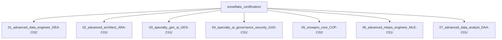

# Recommended Snowflake Certification Sequence

Offcicial site:
https://learn.snowflake.com/en/certifications/

Personalized study sequence — tackle the Advanced/Specialty tracks first (given existing foundation familiarity), then loop back for Core and the remaining tracks.

| Priority | Certification                           | Exam Code  | Career Relevance         |
|----------|-----------------------------------------|------------|--------------------------|
| 1        | Advanced Data Engineer                  | DEA-C02    | Data Engineering         |
| 2        | Advanced Architect                      | ARA-C01    | Enterprise Architecture  |
| 3        | Specialty Gen AI                        | GES-C01    | AI Application Developer |
| 4        | Specialty AI Governance & Security      | GAS-C01    | AI Architect             |
| 5        | SnowPro Core                            | COF-C02    | Essential foundation     |
| 6        | Advanced MLOps Engineer                 | MLE-C01    | AI/ML Engineering        |
| 7        | Advanced Data Analyst                   | DAA-C01    | Analytics Engineering    |

## Study Style
- **Question-first learning**: materials are organized as exhaustive Q&A so you can "double-click" from a question into deep concept, lab, and first-principles explanation.
- Each module folder contains Q&A sets aligned to the exam blueprint + concept depth.
- Every answer includes: **concept**, **first-principles reasoning**, **lab exercise**, and **ASCII sketch/diagram** where relevant.

## Folder Map

